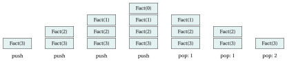
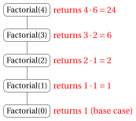
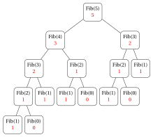
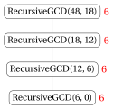
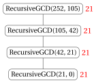
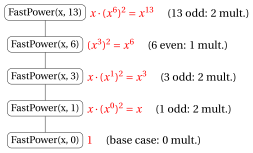
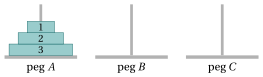
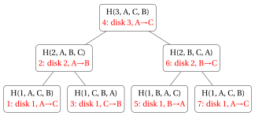

# Recursion

<div class="info-capitolo" markdown>

**Part 2 · Analysis and recursion · Chapter 10** · [:material-file-pdf-box: Lecture notes, volume 2 (PDF)](../pdf/lecture-notes-2-analysis-recursion.pdf) · [:material-pencil: Exercises](../exercises/ex-10-recursion.md)

</div>

In the previous chapters every algorithm was <strong>iterative</strong>: a sequence of instructions and loops, whose number of steps we counted line by line (chapter «Running time») and whose correctness we proved with loop invariants (chapter «Correctness»). In this chapter we study a different way of designing algorithms: an algorithm may <strong>call itself</strong> on smaller instances of the same problem.

The plan of the chapter is the following.

- In Section [10.1](#sez-sec-rec-def) we define recursive algorithms, base cases and recursive steps, and we see why a recursive algorithm terminates.

- In Section [10.2](#sez-sec-rec-tree) we describe how a recursive algorithm is executed: the <strong>tree of recursive calls</strong> (which determines the number of steps) and the <strong>call stack</strong> (which determines the memory).

- In Section [10.3](#sez-sec-rec-correct) we show that the correctness of a recursive algorithm is proved by <strong>strong induction</strong>.

- In Sections [10.4](#sez-sec-factorial)–[10.8](#sez-sec-hanoi) we apply these tools to five classical recursive algorithms: the factorial, the Fibonacci numbers, the greatest common divisor, fast exponentiation and the Towers of Hanoi. For each of them we prove the correctness, we count the number of steps by unrolling a recurrence, and we give a <code>C++</code> implementation executed step by step.

## 10.1 Recursive algorithms { #sez-sec-rec-def }

- Many problems have a natural <strong>self-similar</strong> structure: the solution of an instance can be easily obtained from the solution of one or more <strong>smaller instances of the same problem</strong>.

- For example, for every natural number $n \ge 1$,

    $$
    n! = n \cdot (n-1)!
    $$

    that is, the factorial of $n$ is obtained from the factorial of the smaller number $n-1$.

- Algorithms that exploit this structure are called recursive algorithms.

<a id="box-1-defRecursiveAlgorithm"></a>

!!! definizione "Definition 10.1: recursive algorithm"

    A <strong>recursive algorithm</strong> is an algorithm that solves an instance of a problem by <strong>calling itself</strong> on one or more <strong>smaller instances</strong> of the same problem, and then combining the results of these calls.

- Every recursive algorithm is made of two parts:

    1. <strong>Base case(s)</strong>: one or more instances that are small enough to be solved directly, without any recursive call (for example, $0! = 1$).

    2. <strong>Recursive step</strong>: on every other instance, the algorithm calls itself on smaller instances and combines the returned results (for example, $n! = n \cdot (n-1)!$).

- Each execution of the algorithm on a given input is called a <strong>call</strong> (or invocation). A call that is made from inside another call is a <strong>recursive call</strong>.

- To measure how “small” an instance is, we associate to each input a <strong>size</strong>, which is a natural number (for example the value $n$ of the input number, or the number $n$ of entries of an array $a[1..n]$).

### 10.1.1 Termination

- A recursive algorithm terminates only if the chain of recursive calls eventually reaches a base case.

- If the size of the instance strictly decreases at each recursive call, we obtain a strictly decreasing sequence of natural numbers

    $$
    n_0 > n_1 > n_2 > \cdots
    $$

- There is no infinite strictly decreasing sequence of natural numbers (by the well-ordering property of $\N$): after at most $n_0$ calls the size cannot decrease anymore. Therefore, if every instance which is not a base case is reduced to strictly smaller instances, a base case is necessarily reached after finitely many calls.

!!! chiave ""

    <strong>Key idea of recursion.</strong>

    - Solve the <strong>base cases</strong> directly.

    - Reduce every other instance to one or more <strong>strictly smaller</strong> instances of the same problem, solve them by recursive calls, and combine their results.

    - Since the size is a natural number that <strong>strictly decreases</strong> at every recursive call, a base case is always reached and the algorithm <strong>terminates</strong>.

<a id="box-2-exRecursionWrong"></a>

!!! esempio "Example 10.1: What can go wrong"

    - <strong>Missing base case.</strong> Consider the function <code>WrongFactorial</code>$(n)$ that returns $n \cdot \texttt{WrongFactorial}(n-1)$, without any base case. The call <code>WrongFactorial</code>$(2)$ calls <code>WrongFactorial</code>$(1)$, which calls <code>WrongFactorial</code>$(0)$, which calls <code>WrongFactorial</code>$(-1)$, and so on forever: the recursion never stops.

    - <strong>Size not decreasing.</strong> A function that, on input $n$, calls itself on input $n$ (or $n+1$) never reaches a base case $n=0$ when $n \ge 1$.

    - In practice, an infinite recursion is stopped by the computer when the memory reserved to the calls is exhausted (a <strong>stack overflow</strong> error).

- To count the number of steps of a recursive algorithm we use the same conventions as in the chapter «Running time»: each execution of a line of pseudo-code is <strong>one step</strong>. A line that contains a recursive call counts as one step <strong>plus</strong> all the steps executed by that recursive call.

- As a consequence, the number of steps $S(n)$ of a recursive algorithm is naturally expressed in terms of the number of steps on smaller instances, i.e., by a <strong>recurrence</strong>, such as

    $$
    S(n) = S(n-1) + 2.
    $$

!!! chiave ""

    In this chapter we solve the recurrences of the step counts by <strong>simple unrolling</strong> (also called <strong>expansion</strong>): we replace repeatedly $S(\cdot)$ by its definition until we reach a base case.

## 10.2 Tree of recursive calls and call stack { #sez-sec-rec-tree }

### 10.2.1 Tree of recursive calls

<a id="box-3-defCallTree"></a>

!!! definizione "Definition 10.2: tree of recursive calls"

    The <strong>tree of recursive calls</strong> of a recursive algorithm on a given input is the rooted tree in which:

    - every node is a call of the algorithm;

    - the root is the initial call;

    - the children of a node are the recursive calls made directly by that call, from left to right in the order in which they are executed.

    The leaves of the tree are the calls that do not make recursive calls (typically the base cases).

- The total number of calls executed by the algorithm is the <strong>number of nodes</strong> of the tree.

- If every call executes a constant number of steps (excluding the steps of its recursive calls), then the number of steps of the algorithm is proportional to the number of nodes of the tree.

- The calls are executed following a <strong>depth-first</strong> visit of the tree: a call starts, executes its first recursive call (and the whole subtree below it) completely, then its second recursive call, and so on; it returns its result only when all its recursive calls have returned.

<a id="box-4-exCallTreeShapes"></a>

!!! esempio "Example 10.2: Two shapes of trees of recursive calls"

    - If each call makes <strong>one</strong> recursive call (as for $n! = n\cdot(n-1)!$), the tree is a <strong>path</strong> (left).

    - If each call makes <strong>two</strong> recursive calls (as for the Fibonacci numbers, defined by $F(n) = F(n-1)+F(n-2)$ with $F(0)=0$ and $F(1)=1$), the tree <strong>branches</strong> and the number of nodes can grow very quickly (right).

    <div class="minipage" style="width:30%" markdown>

    { .fig loading=lazy  }

    </div>

    <div class="minipage" style="width:65%" markdown>

    { .fig loading=lazy  }

    </div>

### 10.2.2 Call stack

- When a call starts, the computer reserves a piece of memory, called a <strong>stack frame</strong> (or activation record), that contains the parameters of the call, its local variables, and the point of the program where the execution must continue when the call returns.

- The frames are stored in a memory area organised as a <strong>stack</strong> (the <strong>call stack</strong>):

    - when a call starts, its frame is <strong>pushed</strong> on top of the stack;

    - when a call returns, its frame is <strong>popped</strong> from the top of the stack, and the execution continues in the call whose frame is now on top.

- At any moment, the frames in the stack are exactly the calls on the path from the root of the tree of recursive calls to the call currently executed.

<a id="box-5-defRecursionDepth"></a>

!!! definizione "Definition 10.3: depth of the recursion"

    The <strong>depth of the recursion</strong> of a recursive algorithm on a given input is the maximum number of calls that are simultaneously active, i.e., the maximum number of nodes on a path from the root to a leaf of the tree of recursive calls.

!!! chiave ""

    The maximum number of stack frames simultaneously in memory is equal to the <strong>depth of the recursion</strong>. If every frame uses a constant amount of memory, the memory used by the call stack is

    $$
    \Theta(\text{depth of the recursion}).
    $$

- Note the difference: the <strong>number of steps</strong> depends on the <strong>number of nodes</strong> of the tree, while the <strong>memory</strong> used by the call stack depends only on its <strong>depth</strong>.

- For the tree of <code>Fib(4)</code> above, there are $9$ calls, but at most $4$ of them are simultaneously in the stack (for example <code>Fib(4)</code>, <code>Fib(3)</code>, <code>Fib(2)</code>, <code>Fib(1)</code>).

<a id="box-6-exCallStackFact"></a>

!!! esempio "Example 10.3: Evolution of the call stack for Fact(3)"

    The figure shows the call stack (top of the stack is up) after each push and after each pop, during the computation of $3!$ with the recursion $n! = n \cdot (n-1)!$, $0!=1$.

    { .fig loading=lazy  }

    - Four frames are pushed: <code>Fact(3)</code>, <code>Fact(2)</code>, <code>Fact(1)</code>, <code>Fact(0)</code>.

    - <code>Fact(0)</code> is a base case: it returns $1$ and its frame is popped. Then <code>Fact(1)</code> returns $1\cdot 1 = 1$, <code>Fact(2)</code> returns $2 \cdot 1 = 2$ and, finally, <code>Fact(3)</code> returns $3 \cdot 2 = 6$ and the stack becomes empty.

    - The depth of the recursion is $4$.

- The size of the call stack is limited (typically a few megabytes). A very deep recursion (for example, millions of nested calls) causes a <strong>stack overflow</strong>, even if the algorithm is correct and terminates.

## 10.3 Correctness of recursive algorithms { #sez-sec-rec-correct }

- The natural tool to prove the correctness of a recursive algorithm is <strong>mathematical induction</strong> on the size of the input.

- Since a recursive call can be made on any smaller instance (not only on the instance of size $n-1$), we use <strong>strong induction</strong>.

!!! chiave ""

    <strong>Strong induction.</strong> Let $P(n)$ be a statement depending on $n \in \N$, and let $n_0 \in \N$. If

    1. <strong>base case</strong>: $P(n_0)$ is true, and

    2. <strong>inductive step</strong>: for every $n > n_0$, if $P(k)$ is true for every $k$ with $n_0 \le k < n$ (<strong>inductive hypothesis</strong>), then $P(n)$ is true,

    then $P(n)$ is true for every natural number $n \ge n_0$.

- It is sometimes convenient to prove more than one base case (for example $n=0$ and $n=1$), and then the inductive step only for $n$ larger than all of them.

- The structure of a recursive algorithm mirrors the structure of an induction proof:

    - the <strong>base cases</strong> of the algorithm correspond to the <strong>base cases</strong> of the induction;

    - in the <strong>recursive step</strong>, we may assume (inductive hypothesis) that the recursive calls, which are made on smaller inputs, return correct results, and we only need to show that the results are <strong>combined</strong> correctly.

<a id="box-7-obsRecursiveCorrectness"></a>

!!! teorema "Observation 10.4: correctness of recursive algorithms"

    Consider a recursive algorithm in which every input has a size in $\N$. Assume that:

    1. on every input which is a base case, the algorithm returns the correct output;

    2. on every other input of size $n$, the algorithm makes a finite number of recursive calls, all on inputs of size strictly smaller than $n$, and returns the correct output whenever all these recursive calls return the correct output.

    Then the algorithm terminates and returns the correct output on every input.

??? dimostrazione "Proof"

    Let $P(n)$ be the statement: “on every input of size $n$ the algorithm terminates and returns the correct output”. We prove $P(n)$ for every $n \in \N$ by strong induction.

    Let $n \in \N$ and assume that $P(k)$ is true for every $k < n$ (for $n=0$ this assumption is empty). Consider an input of size $n$.

    - If the input is a base case, then the algorithm terminates and returns the correct output by hypothesis 1.

    - Otherwise, by hypothesis 2, the algorithm makes a finite number of recursive calls on inputs of size $k < n$. By the inductive hypothesis, each of these calls terminates and returns the correct output. Hence the algorithm terminates and, by hypothesis 2, it returns the correct output.

    Therefore $P(n)$ is true, and by strong induction $P(n)$ is true for every $n \in \N$. <span class="qed">□</span>

### 10.3.1 Link with loop invariants

- In the chapter «Correctness» we proved the correctness of iterative algorithms by means of <strong>loop invariants</strong>, which also have the structure of an induction proof.

- The three properties of a loop invariant correspond to the parts of the proof by induction of a recursive algorithm:

<div class="tabella" markdown="0"><table>
<tr>
<th><strong>Loop invariant</strong> (iterative algorithm)</th>
<th><strong>Induction</strong> (recursive algorithm)</th>
</tr>
<tr>
<td>Initialization: true before the first iteration</td>
<td>Base case(s) of the recursion</td>
</tr>
<tr>
<td>Maintenance: preserved by each iteration</td>
<td>Inductive step: correct combination of the results</td>
</tr>
<tr>
<td>Termination: the loop stops</td>
<td>The size strictly decreases towards a base case</td>
</tr>
</table></div>

- The main difference is the direction: an iterative algorithm builds the solution “from the bottom” (from the initialization towards the final iteration), while a recursive algorithm starts “from the top” (the original instance) and reduces it to smaller instances until a base case is reached.

## 10.4 Factorial { #sez-sec-factorial }

!!! chiave ""

    Given a natural number $n$, we consider the problem of computing the <strong>factorial</strong> of $n$:

    $$
    n! = 1 \cdot 2 \cdot \ldots \cdot n \qquad \text{with } 0! = 1.
    $$

- Since $n! = n \cdot (n-1)!$ for every $n \ge 1$, the factorial has the following recursive definition:

    $$
    n! =
    \begin{cases}
    1 & \text{if } n = 0 \\
    n \cdot (n-1)! & \text{if } n \ge 1
    \end{cases}
    $$

- This is the pseudo-code of the recursive algorithm <code>Factorial</code>:

!!! algoritmo "Algorithm: Factorial"

    <div class="pseudocodice" markdown="0">
    <div class="pc-io"><span class="pc-kw">Input:</span> <span>A natural number <span class="arithmatex">&#92;(n&#92;)</span></span></div>
    <div class="pc-io"><span class="pc-kw">Output:</span> <span>The factorial <span class="arithmatex">&#92;(n!&#92;)</span></span></div>
    <div class="pc-sep"></div>
    <div class="pc-riga pc-vuota"><span class="pc-n"></span><span class="pc-corpo"></span></div>
    <div class="pc-riga"><span class="pc-n">1</span><span class="pc-corpo"><span class="pc-t"><strong>function</strong> Factorial(n)</span></span></div>
    <div class="pc-riga" id="riga-10-recursion-line-fact-a"><span class="pc-n">2</span><span class="pc-corpo"><span class="pc-l"></span><span class="pc-t"><strong>if</strong> <span class="arithmatex">&#92;(n = 0&#92;)</span> <strong>then</strong></span></span></div>
    <div class="pc-riga" id="riga-10-recursion-line-fact-b"><span class="pc-n">3</span><span class="pc-corpo"><span class="pc-l"></span><span class="pc-l"></span><span class="pc-t"><strong>return</strong> <span class="arithmatex">&#92;(1&#92;)</span></span><span class="pc-c">// base case</span></span></div>
    <div class="pc-riga"><span class="pc-n">4</span><span class="pc-corpo"><span class="pc-l"></span><span class="pc-t"><strong>end</strong></span></span></div>
    <div class="pc-riga" id="riga-10-recursion-line-fact-c"><span class="pc-n">5</span><span class="pc-corpo"><span class="pc-l"></span><span class="pc-t"><strong>return</strong> <span class="arithmatex">&#92;(n &#92;cdot&#92;)</span> Factorial<span class="arithmatex">&#92;((n-1)&#92;)</span></span><span class="pc-c">// recursive step</span></span></div>
    <div class="pc-riga"><span class="pc-n">6</span><span class="pc-corpo"><span class="pc-t"><strong>end</strong></span></span></div>
    </div>

- Explanation of the algorithm:

    - The base case is $n=0$, for which the algorithm returns $0! = 1$.

    - For $n \ge 1$, the algorithm calls itself on the smaller input $n-1$ and multiplies the result by $n$.

    - The size of the input is the value $n$, which decreases by one at each recursive call. Hence the base case is reached after $n$ recursive calls.

<a id="box-8-exFactorialTree"></a>

!!! esempio "Example 10.4: Tree of recursive calls of Factorial(4)"

    The tree is a path with $5$ nodes. The value returned by each call is written in red next to the call.

    { .fig loading=lazy  }

    The calls are made from the top to the bottom; the results are returned from the bottom to the top. The depth of the recursion is $5$.

### 10.4.1 Correctness

<a id="box-9-obsFactorialCorrect"></a>

!!! teorema "Observation 10.5: correctness of Factorial"

    For every natural number $n$, the call <code>Factorial</code>$(n)$ terminates and returns $n!$.

??? dimostrazione "Proof"

    We proceed by induction on $n$.

    - <strong>Base case</strong> ($n=0$): the condition of line [2](#riga-10-recursion-line-fact-a) is true and the algorithm returns $1 = 0!$ at line [3](#riga-10-recursion-line-fact-b).

    - <strong>Inductive step</strong> ($n \ge 1$): assume that <code>Factorial</code>$(n-1)$ terminates and returns $(n-1)!$ (inductive hypothesis). Since $n \ne 0$, the algorithm executes line [5](#riga-10-recursion-line-fact-c) and returns

        $$
        n \cdot \texttt{Factorial}(n-1) = n \cdot (n-1)! = n!.
        $$

    Therefore <code>Factorial</code>$(n)$ returns $n!$ for every $n \in \N$. <span class="qed">□</span>

### 10.4.2 Number of steps

- Let $S(n)$ denote the number of steps executed by <code>Factorial</code> on the input $n$ (there is only one input for each value of $n$, so this is also the worst case).

- If $n = 0$, lines [2](#riga-10-recursion-line-fact-a) and [3](#riga-10-recursion-line-fact-b) are executed once each:

    $$
    S(0) = 2.
    $$

- If $n \ge 1$, lines [2](#riga-10-recursion-line-fact-a) and [5](#riga-10-recursion-line-fact-c) are executed once each, and line [5](#riga-10-recursion-line-fact-c) also executes all the steps of the call <code>Factorial</code>$(n-1)$:

    $$
    S(n) = S(n-1) + 2.
    $$

- We solve the recurrence by unrolling it:

    \begin{align*}
    S(n) &= S(n-1) + 2 \\
    &= \big(S(n-2) + 2\big) + 2 = S(n-2) + 2\cdot 2 \\
    &= \big(S(n-3) + 2\big) + 2 \cdot 2 = S(n-3) + 3 \cdot 2 \\
    &\;\;\vdots \\
    &= S(n-k) + k \cdot 2 \qquad \forall k \in \{1, 2, \dots, n\}.
    \end{align*}

    Choosing $k = n$ (base case), we obtain

    $$
    S(n) = S(0) + 2n = 2n + 2.
    $$

- Therefore,

    $$
    S(n) = 2n + 2 = \Theta(n),
    $$

    since

    $$
    \lim_{n \to \infty} \frac{2n+2}{n} = \lim_{n \to \infty} \left(2 + \frac{2}{n}\right) = 2 \in \R_{>0}.
    $$

- The depth of the recursion is $n+1$ (the calls with inputs $n, n-1, \dots, 0$ are all simultaneously in the stack), so the call stack uses $\Theta(n)$ memory. The iterative algorithm that computes $n!$ with a <code>while</code> loop uses only a constant amount of memory.

- We now express the number of steps as a function of the input size $|I|$. As in the chapter «Running time», we count each multiplication as one step. The input is the natural number $n$, which requires $\lfloor \log_2 n\rfloor + 1$ bits (for $n \ge 1$), hence

    $$
    |I| = \Theta(\log_2 n).
    $$

    This means that there exist constants $c_1, c_2 > 0$ such that, for all sufficiently large $n$,

    $$
    c_1 \log_2 n \le |I| \le c_2 \log_2 n \qquad \Longleftrightarrow \qquad 2^{\frac{1}{c_2}|I|} \le n \le 2^{\frac{1}{c_1}|I|}.
    $$

    Since $S(n) = \Theta(n)$, there exist constants $a_1, a_2 > 0$ such that $a_1 n \le S(n) \le a_2 n$ for all sufficiently large $n$, and therefore

    $$
    a_1 2^{\frac{1}{c_2}|I|} \le S(n) \le a_2 2^{\frac{1}{c_1}|I|},
    $$

    that is, $T(|I|) = 2^{\Theta(|I|)}$.

!!! chiave ""

    The number of steps of the <code>Factorial</code> algorithm is $S(n) = 2n+2 = \Theta(n)$, and its depth of recursion is $n+1$. As a function of the input size $|I| = \Theta(\log_2 n)$, the worst-case running time is

    $$
    T(|I|) = 2^{\Theta(|I|)},
    $$

    i.e., it is linear in the numerical value $n$, but exponential in the input size $|I|$.

### 10.4.3 <code>C++</code> implementation

- This is a <code>C++</code> implementation of the <code>Factorial</code> algorithm. We use the type <code>unsigned long long</code> (64 bits): the result is correct only for $n \le 20$, since $21! > 2^{64}-1$.

```cpp
// Returns n! for n >= 0 (correct for 0 <= n <= 20 with 64-bit integers)
unsigned long long Factorial(int n)
{
    if (n == 0)
    {
        return 1;                     // base case
    }
    return n * Factorial(n - 1);      // recursive step
}
```

<a id="box-10-exFactCpp"></a>

!!! esempio "Example 10.5: execution of the <code>C++</code> implementation of Factorial for $n=4$"

    <strong>Calls</strong> (the stack grows)

    1. <code>Factorial(4)</code>: $4 \ne 0$ $\Rightarrow$ it must compute $4 \cdot$ <code>Factorial(3)</code> and waits.  stack: [4]

    2. <code>Factorial(3)</code>: $3 \ne 0$ $\Rightarrow$ it must compute $3 \cdot$ <code>Factorial(2)</code> and waits.  stack: [4, 3]

    3. <code>Factorial(2)</code>: $2 \ne 0$ $\Rightarrow$ it must compute $2 \cdot$ <code>Factorial(1)</code> and waits.  stack: [4, 3, 2]

    4. <code>Factorial(1)</code>: $1 \ne 0$ $\Rightarrow$ it must compute $1 \cdot$ <code>Factorial(0)</code> and waits.  stack: [4, 3, 2, 1]

    5. <code>Factorial(0)</code>: $n = 0$ $\Rightarrow$ base case.  stack: [4, 3, 2, 1, 0]

    <strong>Returns</strong> (the stack shrinks)

    1. <code>Factorial(0)</code> returns $1$.  stack: [4, 3, 2, 1]

    2. <code>Factorial(1)</code> returns $1 \cdot 1 = 1$.  stack: [4, 3, 2]

    3. <code>Factorial(2)</code> returns $2 \cdot 1 = 2$.  stack: [4, 3]

    4. <code>Factorial(3)</code> returns $3 \cdot 2 = 6$.  stack: [4]

    5. <code>Factorial(4)</code> returns $4 \cdot 6 = 24$.  stack: [ ]

    The algorithm terminates with result $24 = 4!$, after $5$ calls.

## 10.5 Fibonacci numbers { #sez-sec-fibonacci }

!!! chiave ""

    Given a natural number $n$, we consider the problem of computing the $n$-th <strong>Fibonacci number</strong> $F(n)$, defined as

    $$
    F(n) =
    \begin{cases}
    n & \text{if } n \in \{0, 1\} \\
    F(n-1) + F(n-2) & \text{if } n \ge 2
    \end{cases}
    $$

- The first Fibonacci numbers are:

    <div class="tabella" markdown="0"><table>
    <tr>
    <th><span class="arithmatex">&#92;(n&#92;)</span></th>
    <th>0</th>
    <th>1</th>
    <th>2</th>
    <th>3</th>
    <th>4</th>
    <th>5</th>
    <th>6</th>
    <th>7</th>
    <th>8</th>
    <th>9</th>
    <th>10</th>
    </tr>
    <tr>
    <td><span class="arithmatex">&#92;(F(n)&#92;)</span></td>
    <td>0</td>
    <td>1</td>
    <td>1</td>
    <td>2</td>
    <td>3</td>
    <td>5</td>
    <td>8</td>
    <td>13</td>
    <td>21</td>
    <td>34</td>
    <td>55</td>
    </tr>
    </table></div>

- The definition is itself recursive, and it directly gives the following (naive) recursive algorithm <code>Fib</code>, with <strong>two</strong> base cases and <strong>two</strong> recursive calls:

!!! algoritmo "Algorithm: Fib"

    <div class="pseudocodice" markdown="0">
    <div class="pc-io"><span class="pc-kw">Input:</span> <span>A natural number <span class="arithmatex">&#92;(n&#92;)</span></span></div>
    <div class="pc-io"><span class="pc-kw">Output:</span> <span>The Fibonacci number <span class="arithmatex">&#92;(F(n)&#92;)</span></span></div>
    <div class="pc-sep"></div>
    <div class="pc-riga pc-vuota"><span class="pc-n"></span><span class="pc-corpo"></span></div>
    <div class="pc-riga"><span class="pc-n">1</span><span class="pc-corpo"><span class="pc-t"><strong>function</strong> Fib(n)</span></span></div>
    <div class="pc-riga" id="riga-10-recursion-line-fib-a"><span class="pc-n">2</span><span class="pc-corpo"><span class="pc-l"></span><span class="pc-t"><strong>if</strong> <span class="arithmatex">&#92;(n &#92;le 1&#92;)</span> <strong>then</strong></span></span></div>
    <div class="pc-riga" id="riga-10-recursion-line-fib-b"><span class="pc-n">3</span><span class="pc-corpo"><span class="pc-l"></span><span class="pc-l"></span><span class="pc-t"><strong>return</strong> <span class="arithmatex">&#92;(n&#92;)</span></span><span class="pc-c">// base cases</span></span></div>
    <div class="pc-riga"><span class="pc-n">4</span><span class="pc-corpo"><span class="pc-l"></span><span class="pc-t"><strong>end</strong></span></span></div>
    <div class="pc-riga" id="riga-10-recursion-line-fib-c"><span class="pc-n">5</span><span class="pc-corpo"><span class="pc-l"></span><span class="pc-t"><strong>return</strong> Fib<span class="arithmatex">&#92;((n-1)&#92;)</span> <span class="arithmatex">&#92;(+&#92;)</span> Fib<span class="arithmatex">&#92;((n-2)&#92;)</span></span><span class="pc-c">// recursive step</span></span></div>
    <div class="pc-riga"><span class="pc-n">6</span><span class="pc-corpo"><span class="pc-t"><strong>end</strong></span></span></div>
    </div>

<a id="box-11-obsFibCorrect"></a>

!!! teorema "Observation 10.6: correctness of Fib"

    For every natural number $n$, the call <code>Fib</code>$(n)$ terminates and returns $F(n)$.

??? dimostrazione "Proof"

    We proceed by strong induction on $n$.

    - <strong>Base cases</strong> ($n \in \{0,1\}$): the algorithm returns $n = F(n)$ at line [3](#riga-10-recursion-line-fib-b).

    - <strong>Inductive step</strong> ($n \ge 2$): by the inductive hypothesis the two calls on the smaller inputs $n-1$ and $n-2$ return $F(n-1)$ and $F(n-2)$, and line [5](#riga-10-recursion-line-fib-c) returns their sum $F(n)$.

    Here two base cases are needed, because the inductive step for $n$ uses both $n-1$ and $n-2$. <span class="qed">□</span>

<a id="box-12-exFibTree"></a>

!!! esempio "Example 10.6: Tree of recursive calls of Fib(5)"

    Each node is a call; the value returned by the call is written in red below it.

    { .fig loading=lazy  }

    - The tree has $15$ nodes: the algorithm makes $15$ calls to compute $F(5) = 5$.

    - The same subproblems are solved many times: <code>Fib(3)</code> is computed $2$ times, <code>Fib(2)</code> $3$ times, <code>Fib(1)</code> $5$ times and <code>Fib(0)</code> $3$ times.

    - The depth of the recursion is $5$ (for example, the path <code>Fib(5)</code>, <code>Fib(4)</code>, <code>Fib(3)</code>, <code>Fib(2)</code>, <code>Fib(1)</code>).

### 10.5.1 Number of calls and number of steps

- Let $C(n)$ denote the number of calls (nodes of the tree) executed by <code>Fib</code>$(n)$. Each call with $n \ge 2$ generates one call on $n-1$ and one call on $n-2$, hence

    $$
    C(n) =
    \begin{cases}
    1 & \text{if } n \in \{0, 1\} \\
    C(n-1) + C(n-2) + 1 & \text{if } n \ge 2
    \end{cases}
    $$

- The first values are $C(0)=1$, $C(1)=1$, $C(2)=3$, $C(3)=5$, $C(4)=9$, $C(5)=15$, $C(6)=25$. They are related to the Fibonacci numbers themselves:

<a id="box-13-obsFibCalls"></a>

!!! teorema "Observation 10.7: number of calls of Fib"

    For every natural number $n$,

    $$
    C(n) = 2F(n+1) - 1.
    $$

??? dimostrazione "Proof"

    We proceed by strong induction on $n$.

    - <strong>Base cases</strong>: $C(0) = 1 = 2 \cdot 1 - 1 = 2F(1) - 1$ and $C(1) = 1 = 2 \cdot 1 - 1 = 2F(2) - 1$.

    - <strong>Inductive step</strong> ($n \ge 2$): assume $C(k) = 2F(k+1)-1$ for every $k < n$. Then

        \begin{align*}
        C(n) &= C(n-1) + C(n-2) + 1 \\
        &= \big(2F(n) - 1\big) + \big(2F(n-1) - 1\big) + 1 \\
        &= 2\big(F(n) + F(n-1)\big) - 1 = 2F(n+1) - 1.
        \end{align*}

    <p class="qed-riga"><span class="qed">□</span></p>

- For example, $C(5) = 2F(6) - 1 = 2 \cdot 8 - 1 = 15$, as in [Example 10.6](#box-12-exFibTree).

- Each call executes exactly $2$ lines (lines [2](#riga-10-recursion-line-fib-a)–[3](#riga-10-recursion-line-fib-b) for a base case, lines [2](#riga-10-recursion-line-fib-a) and [5](#riga-10-recursion-line-fib-c) otherwise), hence the number of steps $S(n)$ satisfies

    $$
    S(n) = S(n-1) + S(n-2) + 2 \quad (n \ge 2), \qquad S(0) = S(1) = 2,
    $$

    and therefore $S(n) = 2C(n) = 4F(n+1) - 2$.

- The number of calls grows <strong>exponentially</strong> in $n$:

<a id="box-14-obsFibLowerBound"></a>

!!! teorema "Observation 10.8: exponential number of calls of Fib"

    For every natural number $n \ge 2$,

    $$
    2^{n/2} \le C(n) \le 2^n.
    $$

??? dimostrazione "Proof"

    <strong>Lower bound.</strong> We proceed by strong induction on $n \ge 2$.

    - <strong>Base cases</strong>: $C(2) = 3 \ge 2 = 2^{2/2}$ and $C(3) = 5 \ge 2\sqrt{2} = 2^{3/2}$.

    - <strong>Inductive step</strong> ($n \ge 4$): assume the claim for every $k$ with $2 \le k < n$; in particular for $k = n-2 \ge 2$. Since $C(n-1) \ge C(n-2)$ (the sequence $C$ is non-decreasing),

        $$
        C(n) = C(n-1) + C(n-2) + 1 > 2\,C(n-2) \ge 2 \cdot 2^{(n-2)/2} = 2^{n/2}.
        $$

    <strong>Upper bound.</strong> Also by strong induction: $C(2) = 3 \le 4$, $C(3) = 5 \le 8$ and, for $n \ge 4$,

    $$
    C(n) = C(n-1) + C(n-2) + 1 \le 2^{n-1} + 2^{n-2} + 2^{n-2} = 2^n,
    $$

    where we used $1 \le 2^{n-2}$. <span class="qed">□</span>

- Note that $C(1) = 1 < 2^{1/2}$: this is why the lower bound is stated for $n \ge 2$.

- Therefore $S(n) = 2C(n) = 2^{\Theta(n)}$: the naive recursive algorithm is <strong>exponential</strong> in $n$. For example, the computation of $F(30) = 832040$ requires $C(30) = 2F(31) - 1 = 2 \cdot 1346269 - 1 = 2692537$ calls.

- (It can be shown that $F(n)$ grows as $\varphi^n/\sqrt{5}$, where $\varphi = \frac{1+\sqrt{5}}{2} \approx 1.618$ is the golden ratio; hence $C(n) = \Theta(\varphi^n)$.)

### 10.5.2 An iterative algorithm

- The reason of the exponential number of calls is that the naive algorithm <strong>solves the same subproblems again and again</strong> (see [Example 10.6](#box-12-exFibTree)). An iterative algorithm computes each Fibonacci number only once, from $F(0)$ and $F(1)$ upwards, keeping only the last two values:

!!! algoritmo "Algorithm: IterativeFib"

    <div class="pseudocodice" markdown="0">
    <div class="pc-io"><span class="pc-kw">Input:</span> <span>A natural number <span class="arithmatex">&#92;(n&#92;)</span></span></div>
    <div class="pc-io"><span class="pc-kw">Output:</span> <span>The Fibonacci number <span class="arithmatex">&#92;(F(n)&#92;)</span></span></div>
    <div class="pc-sep"></div>
    <div class="pc-riga pc-vuota"><span class="pc-n"></span><span class="pc-corpo"></span></div>
    <div class="pc-riga"><span class="pc-n">1</span><span class="pc-corpo"><span class="pc-t"><strong>function</strong> IterativeFib(n)</span></span></div>
    <div class="pc-riga" id="riga-10-recursion-line-itfib-a"><span class="pc-n">2</span><span class="pc-corpo"><span class="pc-l"></span><span class="pc-t"><strong>if</strong> <span class="arithmatex">&#92;(n &#92;le 1&#92;)</span> <strong>then</strong></span></span></div>
    <div class="pc-riga" id="riga-10-recursion-line-itfib-b"><span class="pc-n">3</span><span class="pc-corpo"><span class="pc-l"></span><span class="pc-l"></span><span class="pc-t"><strong>return</strong> <span class="arithmatex">&#92;(n&#92;)</span></span></span></div>
    <div class="pc-riga"><span class="pc-n">4</span><span class="pc-corpo"><span class="pc-l"></span><span class="pc-t"><strong>end</strong></span></span></div>
    <div class="pc-riga" id="riga-10-recursion-line-itfib-c"><span class="pc-n">5</span><span class="pc-corpo"><span class="pc-l"></span><span class="pc-t"><span class="arithmatex">&#92;(prev := 0&#92;)</span></span></span></div>
    <div class="pc-riga" id="riga-10-recursion-line-itfib-d"><span class="pc-n">6</span><span class="pc-corpo"><span class="pc-l"></span><span class="pc-t"><span class="arithmatex">&#92;(curr := 1&#92;)</span></span></span></div>
    <div class="pc-riga" id="riga-10-recursion-line-itfib-e"><span class="pc-n">7</span><span class="pc-corpo"><span class="pc-l"></span><span class="pc-t"><span class="arithmatex">&#92;(i := 2&#92;)</span></span></span></div>
    <div class="pc-riga" id="riga-10-recursion-line-itfib-f"><span class="pc-n">8</span><span class="pc-corpo"><span class="pc-l"></span><span class="pc-t"><strong>while</strong> <span class="arithmatex">&#92;(i &#92;le n&#92;)</span> <strong>do</strong></span></span></div>
    <div class="pc-riga" id="riga-10-recursion-line-itfib-g"><span class="pc-n">9</span><span class="pc-corpo"><span class="pc-l"></span><span class="pc-l"></span><span class="pc-t"><span class="arithmatex">&#92;(next := prev + curr&#92;)</span></span></span></div>
    <div class="pc-riga" id="riga-10-recursion-line-itfib-h"><span class="pc-n">10</span><span class="pc-corpo"><span class="pc-l"></span><span class="pc-l"></span><span class="pc-t"><span class="arithmatex">&#92;(prev &#92;leftarrow curr&#92;)</span></span></span></div>
    <div class="pc-riga" id="riga-10-recursion-line-itfib-i"><span class="pc-n">11</span><span class="pc-corpo"><span class="pc-l"></span><span class="pc-l"></span><span class="pc-t"><span class="arithmatex">&#92;(curr &#92;leftarrow next&#92;)</span></span></span></div>
    <div class="pc-riga" id="riga-10-recursion-line-itfib-j"><span class="pc-n">12</span><span class="pc-corpo"><span class="pc-l"></span><span class="pc-l"></span><span class="pc-t"><span class="arithmatex">&#92;(i &#92;leftarrow i + 1&#92;)</span></span></span></div>
    <div class="pc-riga"><span class="pc-n">13</span><span class="pc-corpo"><span class="pc-l"></span><span class="pc-t"><strong>end</strong></span></span></div>
    <div class="pc-riga" id="riga-10-recursion-line-itfib-k"><span class="pc-n">14</span><span class="pc-corpo"><span class="pc-l"></span><span class="pc-t"><strong>return</strong> <span class="arithmatex">&#92;(curr&#92;)</span></span></span></div>
    <div class="pc-riga"><span class="pc-n">15</span><span class="pc-corpo"><span class="pc-t"><strong>end</strong></span></span></div>
    </div>

- For $n \ge 2$: lines [2](#riga-10-recursion-line-itfib-a), [5](#riga-10-recursion-line-itfib-c), [6](#riga-10-recursion-line-itfib-d), [7](#riga-10-recursion-line-itfib-e), [14](#riga-10-recursion-line-itfib-k) are executed once, line [8](#riga-10-recursion-line-itfib-f) is executed $n$ times and lines [9](#riga-10-recursion-line-itfib-g)–[12](#riga-10-recursion-line-itfib-j) are executed $n-1$ times. Hence

    $$
    S(n) = 5 + n + 4(n-1) = 5n + 1 = \Theta(n).
    $$

- (Loop invariant: before each test of line [8](#riga-10-recursion-line-itfib-f), $prev = F(i-2)$ and $curr = F(i-1)$; at the end $i = n+1$ and $curr = F(n)$.)

<div class="tabella" markdown="0"><table>
<tr>
<th><span class="arithmatex">&#92;(n&#92;)</span></th>
<th><span class="arithmatex">&#92;(F(n)&#92;)</span></th>
<th>steps of <code>Fib</code>: <span class="arithmatex">&#92;(4F(n+1)-2&#92;)</span></th>
<th>steps of <code>IterativeFib</code>: <span class="arithmatex">&#92;(5n+1&#92;)</span></th>
</tr>
<tr>
<td><span class="arithmatex">&#92;(5&#92;)</span></td>
<td><span class="arithmatex">&#92;(5&#92;)</span></td>
<td><span class="arithmatex">&#92;(30&#92;)</span></td>
<td><span class="arithmatex">&#92;(26&#92;)</span></td>
</tr>
<tr>
<td><span class="arithmatex">&#92;(10&#92;)</span></td>
<td><span class="arithmatex">&#92;(55&#92;)</span></td>
<td><span class="arithmatex">&#92;(354&#92;)</span></td>
<td><span class="arithmatex">&#92;(51&#92;)</span></td>
</tr>
<tr>
<td><span class="arithmatex">&#92;(20&#92;)</span></td>
<td><span class="arithmatex">&#92;(6765&#92;)</span></td>
<td><span class="arithmatex">&#92;(43782&#92;)</span></td>
<td><span class="arithmatex">&#92;(101&#92;)</span></td>
</tr>
<tr>
<td><span class="arithmatex">&#92;(30&#92;)</span></td>
<td><span class="arithmatex">&#92;(832040&#92;)</span></td>
<td><span class="arithmatex">&#92;(5385074&#92;)</span></td>
<td><span class="arithmatex">&#92;(151&#92;)</span></td>
</tr>
</table></div>

!!! chiave ""

    The naive recursive algorithm <code>Fib</code> executes $S(n) = 4F(n+1) - 2 = 2^{\Theta(n)}$ steps (exponential in $n$), while <code>IterativeFib</code> executes $S(n) = 5n+1 = \Theta(n)$ steps (linear in $n$). Since $|I| = \Theta(\log_2 n)$, as functions of the input size the naive algorithm is even doubly exponential, while the iterative one is exponential (as <code>Factorial</code>).

- The recursion itself is not the problem: the problem is the <strong>repetition of identical subproblems</strong>. Storing the solution of each subproblem the first time it is solved, and reusing it afterwards, is the key idea of the technique called <strong>Dynamic Programming</strong>.

### 10.5.3 <code>C++</code> implementation

- This is a <code>C++</code> implementation of the naive recursive algorithm and of the iterative algorithm:

```cpp
// Naive recursive algorithm: exponential number of calls
long long Fib(int n)
{
    if (n <= 1)
    {
        return n;                     // base cases F(0)=0, F(1)=1
    }
    return Fib(n - 1) + Fib(n - 2);   // two recursive calls
}

// Iterative algorithm: n-1 iterations
long long IterativeFib(int n)
{
    if (n <= 1)
    {
        return n;
    }
    long long prev = 0;   // F(i-2)
    long long curr = 1;   // F(i-1)
    for (int i = 2; i <= n; i++)
    {
        long long next = prev + curr;
        prev = curr;
        curr = next;
    }
    return curr;
}
```

<a id="box-15-exFibCpp"></a>

!!! esempio "Example 10.7: execution of the <code>C++</code> implementations for $n=4$"

    This is the step-by-step execution of <code>Fib(4)</code>. The calls are executed in the depth-first order of the tree of [Example 10.2](#box-4-exCallTreeShapes) (indentation = depth in the stack).

    <div class="tabella" markdown="0"><table>
    <tr>
    <th>call</th>
    <th>action</th>
    </tr>
    <tr>
    <td><code>Fib(4)</code></td>
    <td>calls <code>Fib(3)</code></td>
    </tr>
    <tr>
    <td><code>Fib(3)</code></td>
    <td>calls <code>Fib(2)</code></td>
    </tr>
    <tr>
    <td><code>Fib(2)</code></td>
    <td>calls <code>Fib(1)</code></td>
    </tr>
    <tr>
    <td><code>Fib(1)</code></td>
    <td>base case, returns <span class="arithmatex">&#92;(1&#92;)</span></td>
    </tr>
    <tr>
    <td><code>Fib(2)</code></td>
    <td>calls <code>Fib(0)</code></td>
    </tr>
    <tr>
    <td><code>Fib(0)</code></td>
    <td>base case, returns <span class="arithmatex">&#92;(0&#92;)</span></td>
    </tr>
    <tr>
    <td><code>Fib(2)</code></td>
    <td>returns <span class="arithmatex">&#92;(1 + 0 = 1&#92;)</span></td>
    </tr>
    <tr>
    <td><code>Fib(3)</code></td>
    <td>calls <code>Fib(1)</code></td>
    </tr>
    <tr>
    <td><code>Fib(1)</code></td>
    <td>base case, returns <span class="arithmatex">&#92;(1&#92;)</span></td>
    </tr>
    <tr>
    <td><code>Fib(3)</code></td>
    <td>returns <span class="arithmatex">&#92;(1 + 1 = 2&#92;)</span></td>
    </tr>
    <tr>
    <td><code>Fib(4)</code></td>
    <td>calls <code>Fib(2)</code></td>
    </tr>
    <tr>
    <td><code>Fib(2)</code></td>
    <td>calls <code>Fib(1)</code></td>
    </tr>
    <tr>
    <td><code>Fib(1)</code></td>
    <td>base case, returns <span class="arithmatex">&#92;(1&#92;)</span></td>
    </tr>
    <tr>
    <td><code>Fib(2)</code></td>
    <td>calls <code>Fib(0)</code></td>
    </tr>
    <tr>
    <td><code>Fib(0)</code></td>
    <td>base case, returns <span class="arithmatex">&#92;(0&#92;)</span></td>
    </tr>
    <tr>
    <td><code>Fib(2)</code></td>
    <td>returns <span class="arithmatex">&#92;(1 + 0 = 1&#92;)</span></td>
    </tr>
    <tr>
    <td><code>Fib(4)</code></td>
    <td>returns <span class="arithmatex">&#92;(2 + 1 = 3&#92;)</span></td>
    </tr>
    </table></div>

    The result is $F(4) = 3$, after $C(4) = 2F(5)-1 = 9$ calls. Instead, <code>IterativeFib(4)</code> executes $3$ iterations:

    <div class="tabella" markdown="0"><table>
    <tr>
    <th>iteration</th>
    <th><span class="arithmatex">&#92;(i&#92;)</span></th>
    <th><span class="arithmatex">&#92;(next = prev + curr&#92;)</span></th>
    <th><span class="arithmatex">&#92;(prev&#92;)</span></th>
    <th><span class="arithmatex">&#92;(curr&#92;)</span></th>
    </tr>
    <tr>
    <td>initialization</td>
    <td><span class="arithmatex">&#92;(2&#92;)</span></td>
    <td>–</td>
    <td><span class="arithmatex">&#92;(0&#92;)</span></td>
    <td><span class="arithmatex">&#92;(1&#92;)</span></td>
    </tr>
    <tr>
    <td><span class="arithmatex">&#92;(1&#92;)</span></td>
    <td><span class="arithmatex">&#92;(2 &#92;to 3&#92;)</span></td>
    <td><span class="arithmatex">&#92;(0 + 1 = 1&#92;)</span></td>
    <td><span class="arithmatex">&#92;(1&#92;)</span></td>
    <td><span class="arithmatex">&#92;(1&#92;)</span></td>
    </tr>
    <tr>
    <td><span class="arithmatex">&#92;(2&#92;)</span></td>
    <td><span class="arithmatex">&#92;(3 &#92;to 4&#92;)</span></td>
    <td><span class="arithmatex">&#92;(1 + 1 = 2&#92;)</span></td>
    <td><span class="arithmatex">&#92;(1&#92;)</span></td>
    <td><span class="arithmatex">&#92;(2&#92;)</span></td>
    </tr>
    <tr>
    <td><span class="arithmatex">&#92;(3&#92;)</span></td>
    <td><span class="arithmatex">&#92;(4 &#92;to 5&#92;)</span></td>
    <td><span class="arithmatex">&#92;(1 + 2 = 3&#92;)</span></td>
    <td><span class="arithmatex">&#92;(2&#92;)</span></td>
    <td><span class="arithmatex">&#92;(3&#92;)</span></td>
    </tr>
    </table></div>

    The loop ends with $i = 5 > 4$ and the function returns $curr = 3$.

## 10.6 Greatest common divisor { #sez-sec-gcd }

!!! chiave ""

    Given two natural numbers $n, m$ with $n \ge 1$ and $m \ge 0$, we consider the problem of computing their greatest common divisor $\gcd(n,m)$ (with $\gcd(n,0) = n$).

- In the chapter «Numerical algorithms» we proved that, for all natural numbers $n \ge 1$ and $m \ge 1$,

    $$
    \gcd(n,m) = \gcd(m,\ n \bmod m),
    $$

    and we obtained the iterative algorithm <code>EuclideanAlgorithm</code>: it replaces the pair $(n,m)$ by the pair $(m,\ n \bmod m)$ again and again, until $m = 0$.

- The same property, together with $\gcd(n,0) = n$, is a recursive definition:

    $$
    \gcd(n,m) =
    \begin{cases}
    n & \text{if } m = 0 \\
    \gcd(m,\ n \bmod m) & \text{if } m \ge 1
    \end{cases}
    $$

- This gives the recursive version of the Euclidean algorithm:

!!! algoritmo "Algorithm: RecursiveGCD"

    <div class="pseudocodice" markdown="0">
    <div class="pc-io"><span class="pc-kw">Input:</span> <span>Two natural numbers <span class="arithmatex">&#92;(n &#92;ge 1&#92;)</span> and <span class="arithmatex">&#92;(m &#92;ge 0&#92;)</span></span></div>
    <div class="pc-io"><span class="pc-kw">Output:</span> <span><span class="arithmatex">&#92;(&#92;gcd(n,m)&#92;)</span></span></div>
    <div class="pc-sep"></div>
    <div class="pc-riga pc-vuota"><span class="pc-n"></span><span class="pc-corpo"></span></div>
    <div class="pc-riga"><span class="pc-n">1</span><span class="pc-corpo"><span class="pc-t"><strong>function</strong> RecursiveGCD(n, m)</span></span></div>
    <div class="pc-riga" id="riga-10-recursion-line-gcd-a"><span class="pc-n">2</span><span class="pc-corpo"><span class="pc-l"></span><span class="pc-t"><strong>if</strong> <span class="arithmatex">&#92;(m = 0&#92;)</span> <strong>then</strong></span></span></div>
    <div class="pc-riga" id="riga-10-recursion-line-gcd-b"><span class="pc-n">3</span><span class="pc-corpo"><span class="pc-l"></span><span class="pc-l"></span><span class="pc-t"><strong>return</strong> <span class="arithmatex">&#92;(n&#92;)</span></span><span class="pc-c">// base case</span></span></div>
    <div class="pc-riga"><span class="pc-n">4</span><span class="pc-corpo"><span class="pc-l"></span><span class="pc-t"><strong>end</strong></span></span></div>
    <div class="pc-riga" id="riga-10-recursion-line-gcd-c"><span class="pc-n">5</span><span class="pc-corpo"><span class="pc-l"></span><span class="pc-t"><strong>return</strong> RecursiveGCD<span class="arithmatex">&#92;((m,&#92; n &#92;bmod m)&#92;)</span></span><span class="pc-c">// recursive step</span></span></div>
    <div class="pc-riga"><span class="pc-n">6</span><span class="pc-corpo"><span class="pc-t"><strong>end</strong></span></span></div>
    </div>

- The size of the input is the second argument $m$. Since $0 \le n \bmod m < m$, the second argument strictly decreases at each recursive call, hence the base case $m = 0$ is always reached.

<a id="box-16-exGCDTree"></a>

!!! esempio "Example 10.8: Trees of recursive calls of RecursiveGCD"

    Each call makes at most one recursive call, so the trees are paths.

    <div class="minipage" style="width:45%" markdown>

    { .fig loading=lazy  }

    </div>

    <div class="minipage" style="width:45%" markdown>

    { .fig loading=lazy  }

    </div>

    - $48 \bmod 18 = 12$, $18 \bmod 12 = 6$, $12 \bmod 6 = 0$: hence $\gcd(48,18) = 6$.

    - $252 \bmod 105 = 42$, $105 \bmod 42 = 21$, $42 \bmod 21 = 0$: hence $\gcd(252,105) = 21$.

    - The value found by the base case is returned unchanged by all the calls.

### 10.6.1 Correctness

<a id="box-17-obsRecGCDCorrect"></a>

!!! teorema "Observation 10.9: correctness of RecursiveGCD"

    For every pair of natural numbers $n \ge 1$ and $m \ge 0$, the call <code>RecursiveGCD</code>$(n,m)$ terminates and returns $\gcd(n,m)$.

??? dimostrazione "Proof"

    We proceed by strong induction on $m$.

    - <strong>Base case</strong> ($m = 0$): the algorithm returns $n = \gcd(n, 0)$ at line [3](#riga-10-recursion-line-gcd-b).

    - <strong>Inductive step</strong> ($m \ge 1$): assume the claim for every second argument $k < m$ and every first argument $\ge 1$. The algorithm calls <code>RecursiveGCD</code>$(m,\ n \bmod m)$, where $m \ge 1$ and $n \bmod m < m$. By the inductive hypothesis, this call returns $\gcd(m,\ n \bmod m)$, which is equal to $\gcd(n,m)$ by the property $\gcd(n,m) = \gcd(m,\ n \bmod m)$ recalled at the beginning of this section.

    <p class="qed-riga"><span class="qed">□</span></p>

### 10.6.2 Tail recursion

<a id="box-18-defTailRecursion"></a>

!!! definizione "Definition 10.10: tail recursion"

    A recursive call is a <strong>tail call</strong> if it is the last operation executed by the calling function, and its result is returned unchanged. A recursive algorithm whose recursive calls are all tail calls is <strong>tail recursive</strong>.

- <code>RecursiveGCD</code> is tail recursive: line [5](#riga-10-recursion-line-gcd-c) returns directly the result of the recursive call, without any further operation.

- <code>Factorial</code> is <strong>not</strong> tail recursive: after the recursive call <code>Factorial</code>$(n-1)$ returns, the result must still be multiplied by $n$, so the frame of the caller must be kept in the stack.

!!! chiave ""

    A tail-recursive algorithm can always be transformed into a <code>while</code> loop: the tail call is replaced by the update of the parameters, and the loop continues until the base case is reached. Applying this transformation to <code>RecursiveGCD</code>, with the update $(n,m) \leftarrow (m,\ n \bmod m)$, we obtain exactly the iterative <code>EuclideanAlgorithm</code>, which uses a constant amount of memory. Many compilers apply this transformation automatically (<strong>tail-call optimization</strong>).

### 10.6.3 Number of steps

- Each call executes exactly $2$ lines (lines [2](#riga-10-recursion-line-gcd-a)–[3](#riga-10-recursion-line-gcd-b), or lines [2](#riga-10-recursion-line-gcd-a) and [5](#riga-10-recursion-line-gcd-c)), so the number of steps is twice the number of calls. We bound the number of calls.

- Let $m_0 = m$ and let $m_0, m_1, m_2, \dots, m_K = 0$ be the second arguments of the successive calls. The call $k \ge 1$ is <code>RecursiveGCD</code>$(m_{k-1}, m_k)$ and therefore

    $$
    m_{k+1} = m_{k-1} \bmod m_k, \qquad m_{k+1} < m_k.
    $$

<a id="box-19-obsGCDHalving"></a>

!!! teorema "Observation 10.11: the second argument halves every two calls"

    For every $k$ such that $m_{k+2}$ is defined,

    $$
    m_{k+2} < \frac{m_k}{2}.
    $$

??? dimostrazione "Proof"

    We have $m_{k+2} = m_k \bmod m_{k+1}$ with $m_{k+1} < m_k$. We distinguish two cases.

    - If $m_{k+1} \le m_k/2$, then $m_{k+2} < m_{k+1} \le m_k / 2$.

    - If $m_{k+1} > m_k/2$, then $m_k < 2m_{k+1}$, so the quotient of $m_k$ divided by $m_{k+1}$ is $1$ and $m_{k+2} = m_k - m_{k+1} < m_k - m_k/2 = m_k/2$.

    <p class="qed-riga"><span class="qed">□</span></p>

- Let $m \ge 1$ and $j = \lfloor \log_2 m \rfloor + 1$, so that $2^j > m$. Applying the Observation $j$ times, if $m_{2j}$ is defined then

    $$
    m_{2j} < \frac{m}{2^j} < 1 \quad \Longrightarrow \quad m_{2j} = 0.
    $$

    Hence $K \le 2j$ and the number of calls ($K+1$) is at most $2\lfloor \log_2 m \rfloor + 3$. Therefore

    $$
    S(n,m) \le 2\big(2\lfloor \log_2 m \rfloor + 3\big) = O(\log_2 m).
    $$

- The input consists of the two numbers $n$ and $m$, so $|I| = \Omega(\log_2 m)$ (for $m \ge 2$) and, as for <code>ChangeToBase2</code> in the chapter «Running time», $S(n,m) = O(|I|)$.

!!! chiave ""

    The <code>RecursiveGCD</code> algorithm makes at most $2\lfloor \log_2 m \rfloor + 3$ calls, and its worst-case running time is

    $$
    T(|I|) = O(|I|),
    $$

    i.e., it is at most linear in the input size. (It can be shown that the worst case occurs for two consecutive Fibonacci numbers: for example $\gcd(89, 55)$ requires $10$ calls, against the bound $2\lfloor \log_2 55 \rfloor + 3 = 13$.)

### 10.6.4 <code>C++</code> implementation

```cpp
// Returns gcd(n, m), with n >= 1 and m >= 0
int RecursiveGCD(int n, int m)
{
    if (m == 0)
    {
        return n;                        // base case: gcd(n,0) = n
    }
    return RecursiveGCD(m, n % m);       // tail call
}
```

<a id="box-20-exGCDCpp"></a>

!!! esempio "Example 10.9: execution of the <code>C++</code> implementation of RecursiveGCD"

    This is the step-by-step execution of the <code>C++</code> implementation for $n = 18$ and $m = 48$ (note that $n < m$: the first call simply swaps the two numbers, since $18 \bmod 48 = 18$).

    1. <code>RecursiveGCD(18, 48)</code>: $m \ne 0$, $18 \% 48 = 18$ $\Rightarrow$ calls <code>RecursiveGCD(48, 18)</code>

    2. <code>RecursiveGCD(48, 18)</code>: $m \ne 0$, $48 \% 18 = 12$ $\Rightarrow$ calls <code>RecursiveGCD(18, 12)</code>

    3. <code>RecursiveGCD(18, 12)</code>: $m \ne 0$, $18 \% 12 = 6$ $\Rightarrow$ calls <code>RecursiveGCD(12, 6)</code>

    4. <code>RecursiveGCD(12, 6)</code>: $m \ne 0$, $12 \% 6 = 0$ $\Rightarrow$ calls <code>RecursiveGCD(6, 0)</code>

    5. <code>RecursiveGCD(6, 0)</code>: $m = 0$ $\Rightarrow$ base case, returns $6$

    The value $6$ is returned unchanged by all the calls: $\gcd(18, 48) = 6$, after $5$ calls.

## 10.7 Fast exponentiation { #sez-sec-fastpower }

!!! chiave ""

    Given a number $x$ and a natural number $n$, we consider the problem of computing the power $x^n$ (with $x^0 = 1$).

- The naive algorithm multiplies $n$ times by $x$:

    $$
    p := 1, \qquad p \leftarrow p \cdot x \quad (n \text{ times}),
    $$

    which requires $n$ multiplications and $\Theta(n)$ steps.

- A much faster algorithm is obtained by <strong>squaring</strong>. Since $n = 2\lfloor n/2 \rfloor$ if $n$ is even, and $n = 2\lfloor n/2 \rfloor + 1$ if $n$ is odd,

    $$
    x^n =
    \begin{cases}
    1 & \text{if } n = 0 \\
    \left(x^{\lfloor n/2 \rfloor}\right)^2 & \text{if } n \ge 1 \text{ is even} \\
    x \cdot \left(x^{\lfloor n/2 \rfloor}\right)^2 & \text{if } n \text{ is odd}
    \end{cases}
    $$

    (for $n$ odd, $\lfloor n/2 \rfloor = (n-1)/2$). The size of the exponent is halved at each recursive call.

!!! algoritmo "Algorithm: FastPower"

    <div class="pseudocodice" markdown="0">
    <div class="pc-io"><span class="pc-kw">Input:</span> <span>A number <span class="arithmatex">&#92;(x&#92;)</span> and a natural number <span class="arithmatex">&#92;(n&#92;)</span></span></div>
    <div class="pc-io"><span class="pc-kw">Output:</span> <span>The power <span class="arithmatex">&#92;(x^n&#92;)</span></span></div>
    <div class="pc-sep"></div>
    <div class="pc-riga pc-vuota"><span class="pc-n"></span><span class="pc-corpo"></span></div>
    <div class="pc-riga"><span class="pc-n">1</span><span class="pc-corpo"><span class="pc-t"><strong>function</strong> FastPower(x, n)</span></span></div>
    <div class="pc-riga" id="riga-10-recursion-line-pow-a"><span class="pc-n">2</span><span class="pc-corpo"><span class="pc-l"></span><span class="pc-t"><strong>if</strong> <span class="arithmatex">&#92;(n = 0&#92;)</span> <strong>then</strong></span></span></div>
    <div class="pc-riga" id="riga-10-recursion-line-pow-b"><span class="pc-n">3</span><span class="pc-corpo"><span class="pc-l"></span><span class="pc-l"></span><span class="pc-t"><strong>return</strong> <span class="arithmatex">&#92;(1&#92;)</span></span><span class="pc-c">// base case</span></span></div>
    <div class="pc-riga"><span class="pc-n">4</span><span class="pc-corpo"><span class="pc-l"></span><span class="pc-t"><strong>end</strong></span></span></div>
    <div class="pc-riga" id="riga-10-recursion-line-pow-c"><span class="pc-n">5</span><span class="pc-corpo"><span class="pc-l"></span><span class="pc-t"><span class="arithmatex">&#92;(y :=&#92;)</span> FastPower<span class="arithmatex">&#92;((x, &#92;lfloor n/2 &#92;rfloor)&#92;)</span></span><span class="pc-c">// one recursive call</span></span></div>
    <div class="pc-riga" id="riga-10-recursion-line-pow-d"><span class="pc-n">6</span><span class="pc-corpo"><span class="pc-l"></span><span class="pc-t"><strong>if</strong> <span class="arithmatex">&#92;(n &#92;bmod 2 = 0&#92;)</span> <strong>then</strong></span></span></div>
    <div class="pc-riga" id="riga-10-recursion-line-pow-e"><span class="pc-n">7</span><span class="pc-corpo"><span class="pc-l"></span><span class="pc-l"></span><span class="pc-t"><strong>return</strong> <span class="arithmatex">&#92;(y &#92;cdot y&#92;)</span></span><span class="pc-c">// <span class="arithmatex">&#92;(n&#92;)</span> even</span></span></div>
    <div class="pc-riga"><span class="pc-n">8</span><span class="pc-corpo"><span class="pc-l"></span><span class="pc-t"><strong>else</strong></span></span></div>
    <div class="pc-riga" id="riga-10-recursion-line-pow-f"><span class="pc-n">9</span><span class="pc-corpo"><span class="pc-l"></span><span class="pc-l"></span><span class="pc-t"><strong>return</strong> <span class="arithmatex">&#92;(x &#92;cdot y &#92;cdot y&#92;)</span></span><span class="pc-c">// <span class="arithmatex">&#92;(n&#92;)</span> odd</span></span></div>
    <div class="pc-riga"><span class="pc-n">10</span><span class="pc-corpo"><span class="pc-l"></span><span class="pc-t"><strong>end</strong></span></span></div>
    <div class="pc-riga"><span class="pc-n">11</span><span class="pc-corpo"><span class="pc-t"><strong>end</strong></span></span></div>
    </div>

- Note that the result of the recursive call is stored in the variable $y$ and used twice: writing <code>FastPower</code>$(x, \lfloor n/2 \rfloor) \cdot$ <code>FastPower</code>$(x, \lfloor n/2 \rfloor)$ would make <strong>two</strong> identical recursive calls and would destroy the efficiency of the algorithm (this variant is analysed in the exercises of the chapter).

<a id="box-21-exFastPowerTree"></a>

!!! esempio "Example 10.10: Tree of recursive calls of FastPower(x, 13)"

    The exponents of the calls are $13, 6, 3, 1, 0$ ($\lfloor 13/2 \rfloor = 6$, $\lfloor 6/2 \rfloor = 3$, $\lfloor 3/2 \rfloor = 1$, $\lfloor 1/2 \rfloor = 0$). On the right of each call: the value returned and the number of multiplications executed by that call.

    { .fig loading=lazy  }

    - Total number of multiplications: $2 + 1 + 2 + 2 + 0 = 7$, against the $13$ multiplications of the naive algorithm.

    - Note that $13 = (1101)_2$: the odd/even exponents met going up from <code>FastPower</code>$(x,1)$ to <code>FastPower</code>$(x,13)$ (odd, odd, even, odd) are exactly the binary digits $1,1,0,1$ of $13$ read from the most significant one. In general, the number of multiplications is the number of binary digits of $n$ plus the number of digits equal to $1$: here $4 + 3 = 7$.

### 10.7.1 Correctness

<a id="box-22-obsFastPowerCorrect"></a>

!!! teorema "Observation 10.12: correctness of FastPower"

    For every number $x$ and every natural number $n$, the call <code>FastPower</code>$(x,n)$ terminates and returns $x^n$.

??? dimostrazione "Proof"

    We proceed by strong induction on $n$.

    - <strong>Base case</strong> ($n=0$): the algorithm returns $1 = x^0$ at line [3](#riga-10-recursion-line-pow-b).

    - <strong>Inductive step</strong> ($n \ge 1$): assume that <code>FastPower</code>$(x,k)$ returns $x^k$ for every $k < n$. Since $n \ge 1$, we have $\lfloor n/2 \rfloor < n$, so by the inductive hypothesis line [5](#riga-10-recursion-line-pow-c) assigns $y = x^{\lfloor n/2 \rfloor}$.

        - If $n$ is even, then $n = 2\lfloor n/2 \rfloor$ and line [7](#riga-10-recursion-line-pow-e) returns $y \cdot y = x^{2\lfloor n/2 \rfloor} = x^n$.

        - If $n$ is odd, then $n = 2\lfloor n/2 \rfloor + 1$ and line [9](#riga-10-recursion-line-pow-f) returns $x \cdot y \cdot y = x^{2\lfloor n/2 \rfloor + 1} = x^n$.

    Note that strong induction is needed: the inductive hypothesis is used for $k = \lfloor n/2 \rfloor$, not for $k = n-1$. <span class="qed">□</span>

### 10.7.2 Number of steps

- Let $S(n)$ denote the number of steps of <code>FastPower</code> on the exponent $n$. If $n = 0$, lines [2](#riga-10-recursion-line-pow-a)–[3](#riga-10-recursion-line-pow-b) are executed: $S(0) = 2$. If $n \ge 1$, lines [2](#riga-10-recursion-line-pow-a), [5](#riga-10-recursion-line-pow-c), [6](#riga-10-recursion-line-pow-d) and one of the lines [7](#riga-10-recursion-line-pow-e), [9](#riga-10-recursion-line-pow-f) are executed once each, plus the steps of the call on $\lfloor n/2 \rfloor$:

    $$
    S(n) = S(\lfloor n/2 \rfloor) + 4 \qquad (n \ge 1).
    $$

- We solve the recurrence by unrolling it. Since $\big\lfloor \lfloor n/2^{k} \rfloor / 2 \big\rfloor = \lfloor n/2^{k+1} \rfloor$,

    \begin{align*}
    S(n) &= S(\lfloor n/2 \rfloor) + 4 \\
    &= S(\lfloor n/4 \rfloor) + 2 \cdot 4 \\
    &\;\;\vdots \\
    &= S(\lfloor n/2^k \rfloor) + k \cdot 4,
    \end{align*}

    as long as $\lfloor n/2^{k-1} \rfloor \ge 1$. Now $\lfloor n/2^k \rfloor \ge 1$ if and only if $2^k \le n$, i.e., $k \le \lfloor \log_2 n \rfloor$. Hence, for $n \ge 1$, the exponents $n, \lfloor n/2 \rfloor, \dots, \lfloor n/2^{\lfloor \log_2 n \rfloor}\rfloor = 1$ are all $\ge 1$, and the next one is $0$. Choosing $k = \lfloor \log_2 n \rfloor + 1$:

    $$
    S(n) = S(0) + 4\big(\lfloor \log_2 n \rfloor + 1\big) = 4\lfloor \log_2 n \rfloor + 6.
    $$

- For example, $S(13) = 4 \cdot 3 + 6 = 18$. As shown for <code>ChangeToBase2</code> in the chapter «Running time»,

    $$
    \lim_{n \to \infty} \frac{4\lfloor \log_2 n \rfloor + 6}{\log_2 n} = 4 \in \R_{>0}, \qquad \text{hence} \qquad S(n) = \Theta(\log_2 n).
    $$

- For $n \ge 1$, the number of calls, and therefore the depth of the recursion, is $\lfloor \log_2 n \rfloor + 2$ (the number of binary digits of $n$, plus the call with exponent $0$).

- The number of multiplications is at most $2(\lfloor \log_2 n \rfloor + 1)$, against $n$ for the naive algorithm. For example, for $n = 1000 = (1111101000)_2$: $10 + 6 = 16$ multiplications instead of $1000$.

- Assume that $x$ and all the intermediate results use a constant number of bits (so each multiplication is one step). The input size is $|I| = \Theta(\log_2 n)$, hence, as for <code>ChangeToBase2</code> in the chapter «Running time», $S(n) = \Theta(\log_2 n)$ gives $T(|I|) = \Theta(|I|)$.

!!! chiave ""

    The number of steps of the <code>FastPower</code> algorithm is $S(n) = 4\lfloor \log_2 n \rfloor + 6 = \Theta(\log_2 n)$, and its worst-case running time is

    $$
    T(|I|) = \Theta(|I|),
    $$

    i.e., it is linear in the input size. The naive algorithm executes $\Theta(n)$ steps, i.e., it is exponential in the input size.

### 10.7.3 <code>C++</code> implementation

```cpp
// Returns x^n (n >= 0), by repeated squaring
long long FastPower(long long x, int n)
{
    if (n == 0)
    {
        return 1;                       // base case: x^0 = 1
    }
    long long y = FastPower(x, n / 2);  // integer division = floor(n/2)
    if (n % 2 == 0)
    {
        return y * y;                   // n even
    }
    else
    {
        return x * y * y;               // n odd
    }
}
```

<a id="box-23-exPowCpp"></a>

!!! esempio "Example 10.11: execution of the <code>C++</code> implementation of FastPower"

    This is the step-by-step execution of the <code>C++</code> implementation for $x = 3$ and $n = 13$.

    <strong>Calls</strong>

    1. <code>FastPower(3, 13)</code>: $13 \ne 0$ $\Rightarrow$ calls <code>FastPower(3, 6)</code>  ($13/2 = 6$)

    2. <code>FastPower(3, 6)</code>: $6 \ne 0$ $\Rightarrow$ calls <code>FastPower(3, 3)</code>  ($6/2 = 3$)

    3. <code>FastPower(3, 3)</code>: $3 \ne 0$ $\Rightarrow$ calls <code>FastPower(3, 1)</code>  ($3/2 = 1$)

    4. <code>FastPower(3, 1)</code>: $1 \ne 0$ $\Rightarrow$ calls <code>FastPower(3, 0)</code>  ($1/2 = 0$)

    5. <code>FastPower(3, 0)</code>: base case, returns $1$

    <strong>Returns</strong>

    1. <code>FastPower(3, 1)</code>: $y = 1$, $1$ is odd $\Rightarrow$ returns $3 \cdot 1 \cdot 1 = 3$

    2. <code>FastPower(3, 3)</code>: $y = 3$, $3$ is odd $\Rightarrow$ returns $3 \cdot 3 \cdot 3 = 27$

    3. <code>FastPower(3, 6)</code>: $y = 27$, $6$ is even $\Rightarrow$ returns $27 \cdot 27 = 729$

    4. <code>FastPower(3, 13)</code>: $y = 729$, $13$ is odd $\Rightarrow$ returns $3 \cdot 729 \cdot 729 = 1594323$

    The algorithm terminates with result $1594323 = 3^{13}$, after $5$ calls and $7$ multiplications.

## 10.8 Towers of Hanoi { #sez-sec-hanoi }

!!! chiave ""

    There are three pegs $A$, $B$, $C$ and $n \ge 1$ disks of different sizes, numbered $1, 2, \dots, n$ from the smallest to the largest. Initially all the disks are stacked on peg $A$, in decreasing order of size from the bottom to the top. We consider the problem of moving all the disks to peg $C$, with the following rules:

    - only one disk is moved at a time, taking the top disk of a peg and putting it on top of another peg;

    - a disk can never be placed on top of a smaller disk.

{ .fig loading=lazy  }

- <strong>Recursive idea.</strong> To move $n$ disks from peg $A$ to peg $C$ using peg $B$ as auxiliary peg:

    1. move the $n-1$ smallest disks from $A$ to $B$ (using $C$ as auxiliary peg), recursively;

    2. move the largest disk $n$ from $A$ to $C$;

    3. move the $n-1$ smallest disks from $B$ to $C$ (using $A$ as auxiliary peg), recursively.

- During steps 1 and 3, disk $n$ is at the bottom of a peg and it is larger than all the moved disks, so it never violates the rules: the $n-1$ disks can be moved as if disk $n$ were not there.

!!! algoritmo "Algorithm: Hanoi"

    <div class="pseudocodice" markdown="0">
    <div class="pc-io"><span class="pc-kw">Input:</span> <span>The number of disks <span class="arithmatex">&#92;(n &#92;ge 1&#92;)</span>, the source peg <span class="arithmatex">&#92;(from&#92;)</span>, the destination peg <span class="arithmatex">&#92;(to&#92;)</span>, the auxiliary peg <span class="arithmatex">&#92;(aux&#92;)</span></span></div>
    <div class="pc-io"><span class="pc-kw">Output:</span> <span>The sequence of moves that transfers disks <span class="arithmatex">&#92;(1,2,&#92;dots,n&#92;)</span> from <span class="arithmatex">&#92;(from&#92;)</span> to <span class="arithmatex">&#92;(to&#92;)</span></span></div>
    <div class="pc-sep"></div>
    <div class="pc-riga pc-vuota"><span class="pc-n"></span><span class="pc-corpo"></span></div>
    <div class="pc-riga"><span class="pc-n">1</span><span class="pc-corpo"><span class="pc-t"><strong>function</strong> Hanoi(n, from, to, aux)</span></span></div>
    <div class="pc-riga" id="riga-10-recursion-line-hanoi-a"><span class="pc-n">2</span><span class="pc-corpo"><span class="pc-l"></span><span class="pc-t"><strong>if</strong> <span class="arithmatex">&#92;(n = 1&#92;)</span> <strong>then</strong></span></span></div>
    <div class="pc-riga" id="riga-10-recursion-line-hanoi-b"><span class="pc-n">3</span><span class="pc-corpo"><span class="pc-l"></span><span class="pc-l"></span><span class="pc-t">move disk <span class="arithmatex">&#92;(1&#92;)</span> from <span class="arithmatex">&#92;(from&#92;)</span> to <span class="arithmatex">&#92;(to&#92;)</span></span><span class="pc-c">// base case</span></span></div>
    <div class="pc-riga"><span class="pc-n">4</span><span class="pc-corpo"><span class="pc-l"></span><span class="pc-t"><strong>else</strong></span></span></div>
    <div class="pc-riga" id="riga-10-recursion-line-hanoi-c"><span class="pc-n">5</span><span class="pc-corpo"><span class="pc-l"></span><span class="pc-l"></span><span class="pc-t">Hanoi<span class="arithmatex">&#92;((n-1, from, aux, to)&#92;)</span></span></span></div>
    <div class="pc-riga" id="riga-10-recursion-line-hanoi-d"><span class="pc-n">6</span><span class="pc-corpo"><span class="pc-l"></span><span class="pc-l"></span><span class="pc-t">move disk <span class="arithmatex">&#92;(n&#92;)</span> from <span class="arithmatex">&#92;(from&#92;)</span> to <span class="arithmatex">&#92;(to&#92;)</span></span></span></div>
    <div class="pc-riga" id="riga-10-recursion-line-hanoi-e"><span class="pc-n">7</span><span class="pc-corpo"><span class="pc-l"></span><span class="pc-l"></span><span class="pc-t">Hanoi<span class="arithmatex">&#92;((n-1, aux, to, from)&#92;)</span></span></span></div>
    <div class="pc-riga"><span class="pc-n">8</span><span class="pc-corpo"><span class="pc-l"></span><span class="pc-t"><strong>end</strong></span></span></div>
    <div class="pc-riga"><span class="pc-n">9</span><span class="pc-corpo"><span class="pc-t"><strong>end</strong></span></span></div>
    </div>

- The initial call is <code>Hanoi</code>$(n, A, C, B)$.

<a id="box-24-obsHanoiCorrect"></a>

!!! teorema "Observation 10.13: correctness of Hanoi"

    For every natural number $n \ge 1$, if disks $1, 2, \dots, n$ are the top $n$ disks of peg $from$ and all the disks on pegs $to$ and $aux$ are larger than $n$, then <code>Hanoi</code>$(n, from, to, aux)$ moves disks $1, 2, \dots, n$ on top of peg $to$, respecting the rules.

??? dimostrazione "Proof"

    We proceed by induction on $n$.

    - <strong>Base case</strong> ($n = 1$): the single move of disk $1$ is valid, since disk $1$ is the smallest disk.

    - <strong>Inductive step</strong> ($n \ge 2$): by the inductive hypothesis, the call of line [5](#riga-10-recursion-line-hanoi-c) correctly moves the tower of the $n-1$ smallest disks from $from$ to $aux$ (disk $n$ and the disks below it are larger, so they do not interfere). Then disk $n$ is on top of peg $from$, and every disk on peg $to$ is larger than $n$: line [6](#riga-10-recursion-line-hanoi-d) moves disk $n$ correctly. Finally, by the inductive hypothesis, the call of line [7](#riga-10-recursion-line-hanoi-e) moves the $n-1$ smallest disks from $aux$ on top of disk $n$.

    <p class="qed-riga"><span class="qed">□</span></p>

<a id="box-25-exHanoiTree"></a>

!!! esempio "Example 10.12: Tree of recursive calls of Hanoi(3, A, C, B)"

    Each node shows the call (with arguments $n$, $from$, $to$, $aux$) and, in red, the move executed by the call itself (line [3](#riga-10-recursion-line-hanoi-b) or line [6](#riga-10-recursion-line-hanoi-d)), numbered in the order of execution.

    { .fig loading=lazy  }

    The moves are executed in the order of an <strong>in-order</strong> visit of the tree (left subtree, node, right subtree):

    <div class="tabella" markdown="0"><table>
    <tr>
    <th>move</th>
    <th>disk</th>
    <th>from</th>
    <th>to</th>
    </tr>
    <tr>
    <td>1</td>
    <td>1</td>
    <td>A</td>
    <td>C</td>
    </tr>
    <tr>
    <td>2</td>
    <td>2</td>
    <td>A</td>
    <td>B</td>
    </tr>
    <tr>
    <td>3</td>
    <td>1</td>
    <td>C</td>
    <td>B</td>
    </tr>
    <tr>
    <td>4</td>
    <td>3</td>
    <td>A</td>
    <td>C</td>
    </tr>
    <tr>
    <td>5</td>
    <td>1</td>
    <td>B</td>
    <td>A</td>
    </tr>
    <tr>
    <td>6</td>
    <td>2</td>
    <td>B</td>
    <td>C</td>
    </tr>
    <tr>
    <td>7</td>
    <td>1</td>
    <td>A</td>
    <td>C</td>
    </tr>
    </table></div>

    The tree has $7$ nodes and every node executes exactly one move: $7$ moves in total.

### 10.8.1 Number of moves

- Let $M(n)$ be the number of moves executed by <code>Hanoi</code> with $n$ disks. From the pseudo-code,

    $$
    M(n) =
    \begin{cases}
    1 & \text{if } n = 1 \\
    2M(n-1) + 1 & \text{if } n \ge 2
    \end{cases}
    $$

- Unrolling: $M(n) = 2M(n-1) + 1 = 4M(n-2) + 2 + 1 = 8M(n-3) + 4 + 2 + 1 = \dots = 2^{n-1}M(1) + 2^{n-2} + \dots + 2 + 1 = 2^n - 1.$ We prove it formally:

<a id="box-26-obsHanoiMoves"></a>

!!! teorema "Observation 10.14: number of moves of Hanoi"

    For every natural number $n \ge 1$,

    $$
    M(n) = 2^n - 1.
    $$

??? dimostrazione "Proof"

    We proceed by induction on $n$.

    - <strong>Base case</strong> ($n = 1$): $M(1) = 1 = 2^1 - 1$.

    - <strong>Inductive step</strong> ($n \ge 2$): assume $M(n-1) = 2^{n-1} - 1$. Then

        $$
        M(n) = 2M(n-1) + 1 = 2\big(2^{n-1} - 1\big) + 1 = 2^n - 2 + 1 = 2^n - 1.
        $$

    <p class="qed-riga"><span class="qed">□</span></p>

- The number of steps satisfies $S(1) = 2$ (lines [2](#riga-10-recursion-line-hanoi-a)–[3](#riga-10-recursion-line-hanoi-b)) and $S(n) = 2S(n-1) + 4$ for $n \ge 2$ (lines [2](#riga-10-recursion-line-hanoi-a), [5](#riga-10-recursion-line-hanoi-c), [6](#riga-10-recursion-line-hanoi-d), [7](#riga-10-recursion-line-hanoi-e), plus the two recursive calls). Unrolling as above,

    $$
    S(n) = 2^{n-1}S(1) + 4\big(2^{n-2} + \dots + 2 + 1\big) = 2^n + 4\big(2^{n-1} - 1\big) = 3 \cdot 2^n - 4 = \Theta(2^n),
    $$

    since $\lim_{n\to\infty} (3\cdot 2^n - 4)/2^n = 3 \in \R_{>0}$.

- The depth of the recursion is only $n$: the memory used by the call stack is $\Theta(n)$.

### 10.8.2 Optimality

- The exponential number of moves is not a weakness of the algorithm: <strong>no</strong> algorithm can solve the problem with fewer moves.

<a id="box-27-obsHanoiOptimal"></a>

!!! teorema "Observation 10.15: optimality of Hanoi"

    Let $M^*(n)$ be the minimum number of moves needed to transfer a tower of $n \ge 1$ disks from one peg to another one. Then

    $$
    M^*(n) = 2^n - 1.
    $$

??? dimostrazione "Proof (Sketch of proof)"

    Since the algorithm <code>Hanoi</code> uses $2^n - 1$ moves, $M^*(n) \le 2^n - 1$. We show $M^*(n) \ge 2^n - 1$ by induction on $n$. For $n=1$, at least one move is needed.

    Let $n \ge 2$. The largest disk $n$ must be moved <strong>at least once</strong>. Consider its first move, from the source peg to some other peg $P$: at that moment disk $n$ is the only disk on the source peg and peg $P$ is empty, so the $n-1$ smaller disks are all stacked on the third peg. Moving them there from the source peg required at least $M^*(n-1)$ moves.

    Consider now the last move of disk $n$, onto the destination peg. After this move, the $n-1$ smaller disks are all stacked on a peg different from the destination, and they must still be transferred on top of disk $n$: this requires at least $M^*(n-1)$ further moves.

    These two groups of moves are distinct (one happens before the first move of disk $n$, the other after its last move), hence

    $$
    M^*(n) \ge M^*(n-1) + 1 + M^*(n-1) = 2M^*(n-1) + 1 \ge 2\big(2^{n-1}-1\big) + 1 = 2^n - 1.
    $$

    <p class="qed-riga"><span class="qed">□</span></p>

!!! chiave ""

    The <code>Hanoi</code> algorithm executes $M(n) = 2^n - 1$ moves and $S(n) = 3 \cdot 2^n - 4 = \Theta(2^n)$ steps, with depth of recursion $n$. The number of moves is <strong>optimal</strong>: every algorithm must output $2^n - 1$ moves, so the running time of any algorithm for this problem is exponential in $n$ (and therefore doubly exponential in the input size $|I| = \Theta(\log_2 n)$).

- With $n = 64$ disks (the original legend) and one move per second, $2^{64} - 1$ seconds are more than $5.8 \cdot 10^{11}$ years.

### 10.8.3 <code>C++</code> implementation

```cpp
#include <iostream>
using namespace std;

// Prints the moves that transfer disks 1..n from peg "from" to peg "to"
void Hanoi(int n, char from, char to, char aux)
{
    if (n == 1)
    {
        cout << "move disk 1 from " << from << " to " << to << endl;
        return;
    }
    Hanoi(n - 1, from, aux, to);
    cout << "move disk " << n << " from " << from << " to " << to << endl;
    Hanoi(n - 1, aux, to, from);
}

int main()
{
    Hanoi(3, 'A', 'C', 'B');
    return 0;
}
```

<a id="box-28-exHanoiCpp"></a>

!!! esempio "Example 10.13: execution of the <code>C++</code> implementation of Hanoi for $n=3$"

    This is the step-by-step execution for $n = 3$ (indentation = depth in the stack; the printed lines are the moves of [Example 10.12](#box-25-exHanoiTree)).

    <div class="tabella" markdown="0"><table>
    <tr>
    <th>call</th>
    <th>action</th>
    </tr>
    <tr>
    <td><code>Hanoi(3,A,C,B)</code></td>
    <td>calls <code>Hanoi(2,A,B,C)</code></td>
    </tr>
    <tr>
    <td><code>Hanoi(2,A,B,C)</code></td>
    <td>calls <code>Hanoi(1,A,C,B)</code></td>
    </tr>
    <tr>
    <td><code>Hanoi(1,A,C,B)</code></td>
    <td>prints <strong>move disk 1 from A to C</strong>, returns</td>
    </tr>
    <tr>
    <td><code>Hanoi(2,A,B,C)</code></td>
    <td>prints <strong>move disk 2 from A to B</strong>, calls <code>Hanoi(1,C,B,A)</code></td>
    </tr>
    <tr>
    <td><code>Hanoi(1,C,B,A)</code></td>
    <td>prints <strong>move disk 1 from C to B</strong>, returns</td>
    </tr>
    <tr>
    <td><code>Hanoi(2,A,B,C)</code></td>
    <td>returns</td>
    </tr>
    <tr>
    <td><code>Hanoi(3,A,C,B)</code></td>
    <td>prints <strong>move disk 3 from A to C</strong>, calls <code>Hanoi(2,B,C,A)</code></td>
    </tr>
    <tr>
    <td><code>Hanoi(2,B,C,A)</code></td>
    <td>calls <code>Hanoi(1,B,A,C)</code></td>
    </tr>
    <tr>
    <td><code>Hanoi(1,B,A,C)</code></td>
    <td>prints <strong>move disk 1 from B to A</strong>, returns</td>
    </tr>
    <tr>
    <td><code>Hanoi(2,B,C,A)</code></td>
    <td>prints <strong>move disk 2 from B to C</strong>, calls <code>Hanoi(1,A,C,B)</code></td>
    </tr>
    <tr>
    <td><code>Hanoi(1,A,C,B)</code></td>
    <td>prints <strong>move disk 1 from A to C</strong>, returns</td>
    </tr>
    <tr>
    <td><code>Hanoi(2,B,C,A)</code></td>
    <td>returns</td>
    </tr>
    <tr>
    <td><code>Hanoi(3,A,C,B)</code></td>
    <td>returns</td>
    </tr>
    </table></div>

    All the $7$ moves are printed and all the disks are on peg $C$.

## 10.9 Summary

<div class="tabella" markdown="0"><table>
<tr>
<th>algorithm</th>
<th>recurrence for <span class="arithmatex">&#92;(S(n)&#92;)</span></th>
<th><span class="arithmatex">&#92;(S(n)&#92;)</span></th>
<th>calls</th>
<th>depth</th>
</tr>
<tr>
<td><code>Factorial</code></td>
<td><span class="arithmatex">&#92;(S(n) = S(n-1) + 2&#92;)</span></td>
<td><span class="arithmatex">&#92;(2n+2 = &#92;Theta(n)&#92;)</span></td>
<td><span class="arithmatex">&#92;(n+1&#92;)</span></td>
<td><span class="arithmatex">&#92;(n+1&#92;)</span></td>
</tr>
<tr>
<td><code>Fib</code> (naive)</td>
<td><span class="arithmatex">&#92;(S(n) = S(n-1) + S(n-2) + 2&#92;)</span></td>
<td><span class="arithmatex">&#92;(4F(n+1)-2 = 2^{&#92;Theta(n)}&#92;)</span></td>
<td><span class="arithmatex">&#92;(2F(n+1)-1&#92;)</span></td>
<td><span class="arithmatex">&#92;(&#92;max(n,1)&#92;)</span></td>
</tr>
<tr>
<td><code>RecursiveGCD</code></td>
<td><span class="arithmatex">&#92;(m&#95;{k+2} &lt; m&#95;k/2&#92;)</span> (Obs. [Observation 10.11](#box-19-obsGCDHalving))</td>
<td><span class="arithmatex">&#92;(O(&#92;log&#95;2 m)&#92;)</span></td>
<td><span class="arithmatex">&#92;(&#92;le 2&#92;lfloor &#92;log&#95;2 m&#92;rfloor + 3&#92;)</span></td>
<td>= calls</td>
</tr>
<tr>
<td><code>FastPower</code></td>
<td><span class="arithmatex">&#92;(S(n) = S(&#92;lfloor n/2 &#92;rfloor) + 4&#92;)</span></td>
<td><span class="arithmatex">&#92;(4&#92;lfloor &#92;log&#95;2 n&#92;rfloor + 6 = &#92;Theta(&#92;log&#95;2 n)&#92;)</span></td>
<td><span class="arithmatex">&#92;(&#92;lfloor &#92;log&#95;2 n&#92;rfloor + 2&#92;)</span></td>
<td>= calls</td>
</tr>
<tr>
<td><code>Hanoi</code></td>
<td><span class="arithmatex">&#92;(S(n) = 2S(n-1) + 4&#92;)</span></td>
<td><span class="arithmatex">&#92;(3&#92;cdot 2^n - 4 = &#92;Theta(2^n)&#92;)</span></td>
<td><span class="arithmatex">&#92;(2^n - 1&#92;)</span></td>
<td><span class="arithmatex">&#92;(n&#92;)</span></td>
</tr>
</table></div>

!!! chiave ""

    - A <strong>recursive algorithm</strong> solves the <strong>base cases</strong> directly and reduces every other instance to <strong>strictly smaller</strong> instances of the same problem; this guarantees termination.

    - The execution is described by the <strong>tree of recursive calls</strong>: the number of steps depends on the <strong>number of nodes</strong>, the memory used by the <strong>call stack</strong> on the <strong>depth</strong> of the tree.

    - Correctness is proved by <strong>(strong) induction</strong> on the size of the input: base cases $\leftrightarrow$ base of the induction, recursive step $\leftrightarrow$ inductive step (as initialization and maintenance for loop invariants).

    - The number of steps is described by a <strong>recurrence</strong> for $S(n)$: decreasing by one with constant work gives $\Theta(n)$ (<code>Factorial</code>); halving with constant work gives $\Theta(\log_2 n)$ (<code>FastPower</code>); two calls on $n-1$ give $\Theta(2^n)$ (<code>Hanoi</code>).

    - Recursion can be very inefficient when the <strong>same subproblems</strong> are solved many times (naive <code>Fib</code>): this motivates <strong>Dynamic Programming</strong>.

    - A <strong>tail-recursive</strong> algorithm (<code>RecursiveGCD</code>) can be directly rewritten as a loop.

<!-- laboratorio-interattivo: sezione generata da interattivi.py -->

## Interactive lab { #interactive-lab }

The algorithm of the chapter, one step at a time: move the sliders and press ▶.
All the graphs of the course are in the [interactive lab](../lab/index.md#cap-10).

<div class="gi" data-grafico="albero-ricorsione"></div>
