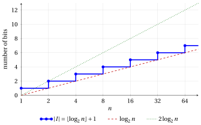

# Input size

**Part 4 · Analysis and recursion · Chapter 11** · [:material-file-pdf-box: Lecture notes, volume 4 (PDF)](../pdf/lecture-notes-4-analysis-recursion.pdf) · [:material-pencil: Exercises](../exercises/ex-11-input-size.md)

## Introduction

To compare two algorithms that solve the same problem we count how many operations they execute. This number grows with the input: sorting an array of one million entries takes longer than sorting an array of ten entries, and testing whether a number with twenty digits is prime takes longer than testing a number with two digits. To make this statement precise we need a measure of how <em>large</em> an input is.

In this chapter we fix this measure: the <strong>input size</strong> is the number of bits needed to write the input in binary, as in the chapter «Representation of numbers». We proceed as follows:

- we define the input size and we recall the asymptotic notation used to describe its order of growth (chapter 10 «Asymptotic notation»);

- we compute the input size, and its order of growth, when the input is one natural number, two natural numbers, or an array of natural numbers;

- we show why the distinction matters: the same number of steps can be small or huge with respect to the input size, depending on whether the parameter $n$ is the <em>value</em> of a number or the <em>number of entries</em> of an array.

## 11.1 Input size

!!! definizione "Definition 11.1: input size"

    The <strong>input size</strong> $|I|$ of an algorithm is the <strong>total number of bits needed to represent a given input instance $I$ in binary</strong>.

- The input size is a function that maps each input instance to a natural number corresponding to the total number of bits needed to represent the input instance in binary.

- We consider algorithms whose input instances consist of one or more natural numbers, or arrays of natural numbers.

- In the chapter «Representation of numbers» we have seen that the minimum number of digits needed to write a natural number $n \ge 1$ in base $2$ is $\lfloor \log_2 n \rfloor + 1$. Equivalently, a natural number $n$ is written with exactly $k$ bits if and only if

    $$
    2^{k-1} \le n \le 2^{k}-1.
    $$

!!! esempio "Example 11.1: the number of bits of some input instances"

    - One natural number, $n = 37$. Since $2^5 = 32 \le 37 < 64 = 2^6$, we have $\lfloor \log_2 37 \rfloor = 5$, and

        $$
        37 = (100101)_2, \qquad |I| = \lfloor \log_2 37 \rfloor + 1 = 6.
        $$

    - Two natural numbers, $n = 37$ and $m = 200$. Since $2^7 = 128 \le 200 < 256 = 2^8$, the number $200 = (11001000)_2$ needs $8$ bits, and

        $$
        |I| = 6 + 8 = 14.
        $$

    - The array $a = [6, 1, 3, 8]$. Its entries are $6 = (110)_2$, $1 = (1)_2$, $3 = (11)_2$ and $8 = (1000)_2$, and

        $$
        |I| = 3 + 1 + 2 + 4 = 10.
        $$

The exact input size depends on the specific values of the instance. In the analysis of algorithms we are interested in how it <em>grows</em>, and for this we use the asymptotic notation.

## 11.2 Asymptotic notation: a recall

The asymptotic notation is defined and studied in chapter 10 «Asymptotic notation». Here we only recall the definitions and the two facts that are used in this chapter. As there, $f$ and $g$ are functions defined on the natural numbers $n \ge 1$ and with non-negative real values, and the notation compares their orders of growth for all sufficiently large $n$.

!!! chiave ""

    - $f(n) = O\big(g(n)\big)$ (<strong>upper bound</strong>) if there exist $c \in \R_{>0}$ and $n_1 \in \N$ such that

        $$
        0 \le f(n) \le c\, g(n), \qquad \forall n \ge n_1;
        $$

    - $f(n) = \Omega\big(g(n)\big)$ (<strong>lower bound</strong>) if there exist $c \in \R_{>0}$ and $n_1 \in \N$ such that

        $$
        0 \le c\, g(n) \le f(n), \qquad \forall n \ge n_1;
        $$

    - $f(n) = \Theta\big(g(n)\big)$ (<strong>both</strong>) if there exist $c_1, c_2 \in \R_{>0}$ and $n_1 \in \N$ such that

        $$
        0 \le c_1\, g(n) \le f(n) \le c_2\, g(n), \qquad \forall n \ge n_1.
        $$

- To prove one of these statements we <strong>determine</strong> the constants ($c$, or $c_1$ and $c_2$) and the threshold $n_1$.

- For functions of two parameters, such as $f(n,m)$, the definitions are the same, with the inequalities required for every $n \ge n_1$ and every $m \ge m_1$.

- The following two facts are proved in chapter 10 «Asymptotic notation».

!!! teorema "Observation 11.2: $\Theta$ is the same as $O$ and $\Omega$"

    We have $f(n) = \Theta\big(g(n)\big)$ if and only if $f(n) = O\big(g(n)\big)$ and $f(n) = \Omega\big(g(n)\big)$.

!!! teorema "Proposition 11.3: limit criterion"

    Let $g(n) > 0$ for every $n \ge 1$. If

    $$
    \lim_{n \to \infty} \frac{f(n)}{g(n)} = L \in \R_{>0},
    $$

    then $f(n) = \Theta\big(g(n)\big)$.

## 11.3 Input instance consisting of one natural number

We start from the simplest input: a single natural number.

- If the input consists of a single natural number $n \ge 1$, then the input size is

    $$
    |I|=\lfloor \log_2 n \rfloor +1,
    $$

    which is the minimum number of bits needed to represent $n$ in binary.

!!! teorema "Observation 11.4: input size of one natural number"

    We have

    \begin{equation*}
    \label{is:eqone}
    \lfloor \log_2 n \rfloor +1=\Theta(\log_2 n). \tag{11.1}
    \end{equation*}

??? dimostrazione "Proof"

    To prove the result, we determine $c_1,c_2 \in \R_{>0}$ and $n_1 \in \N$ such that

    $$
    0 \le c_1 \log_2 n \le \lfloor \log_2 n \rfloor +1 \le c_2 \log_2 n,
    \qquad \forall n \ge n_1.
    $$

    Since $x < \lfloor x \rfloor + 1$ for every real number $x$, we have

    $$
    \log_2 n \le \lfloor \log_2 n \rfloor +1, \qquad \forall n \ge 1.
    $$

    Moreover, since $\lfloor x \rfloor \le x$ for every real number $x$, and $\log_2 n \ge 1$ for every $n \ge 2$, we have

    $$
    \lfloor \log_2 n \rfloor +1 \le \log_2 n +1 \le 2\log_2 n,
    \qquad \forall n \ge 2.
    $$

    Thus, by choosing $c_1=1$, $c_2=2$, and $n_1=2$, we obtain

    $$
    0 \le \log_2 n \le \lfloor \log_2 n \rfloor +1 \le 2\log_2 n,
    \qquad \forall n \ge 2.
    $$

    
□

!!! chiave ""

    If the input of an algorithm consists of a single natural number $n \ge 1$, then the input size satisfies:

    $$
    |I|=\Theta(\log_2 n).
    $$

{ .fig loading=lazy  }

<strong>Figure 11.1:</strong> The input size &#92;(|I| = &#92;lfloor &#92;log&#95;2 n &#92;rfloor + 1&#92;) of one natural number &#92;(n&#92;) (horizontal axis in logarithmic scale): it increases by one bit at every power of &#92;(2&#92;), and for &#92;(n &#92;ge 2&#92;) it lies between &#92;(&#92;log&#95;2 n&#92;) and &#92;(2&#92;log&#95;2 n&#92;), as stated by [Observation 11.4](#box-5-obsOneNumber).

!!! esempio "Example 11.2: the bounds for one natural number"

    For $n = 37$ we have $|I| = 6$ ([Example 11.1](#box-2-is-exbits)) and $\log_2 37 \approx 5.21$. The inequalities of the proof of [Observation 11.4](#box-5-obsOneNumber) become

    $$
    \log_2 37 \approx 5.21 \;\le\; |I| = 6 \;\le\; 2\log_2 37 \approx 10.42 .
    $$

    For $n = 1$ we have $|I| = 1$ but $\log_2 1 = 0$: this is why the threshold of the proof is $n_1 = 2$.

## 11.4 Input instance consisting of two natural numbers

When the input consists of two numbers, the bits of both have to be written.

- If the input consists of two natural numbers $n,m \ge 1$, then the input size is

    $$
    |I|=\big(\lfloor \log_2 n \rfloor +1\big)+\big(\lfloor \log_2 m \rfloor +1\big),
    $$

    which is the minimum number of bits needed to represent both $n$ and $m$ in binary.

!!! teorema "Observation 11.5: input size of two natural numbers"

    We have

    \begin{equation*}
    \label{is:eqtwosum}
    \big(\lfloor \log_2 n \rfloor +1\big)+\big(\lfloor \log_2 m \rfloor +1\big)
    =\Theta(\log_2 n+\log_2 m). \tag{11.2}
    \end{equation*}

??? dimostrazione "Proof"

    To prove the result, we determine $c_1,c_2 \in \R_{>0}$ and $n_1,m_1 \in \N$ such that

    $$
    0 \le c_1(\log_2 n+\log_2 m)
    \le
    \big(\lfloor \log_2 n \rfloor +1\big)+\big(\lfloor \log_2 m \rfloor +1\big)
    \le
    c_2(\log_2 n+\log_2 m)
    $$

    for every $n \ge n_1$ and $m \ge m_1$.

    We have

    $$
    \log_2 n \le \lfloor \log_2 n \rfloor +1,
    \qquad
    \log_2 m \le \lfloor \log_2 m \rfloor +1,
    \qquad \forall n,m \ge 1.
    $$

    Therefore,

    $$
    \log_2 n+\log_2 m
    \le
    \big(\lfloor \log_2 n \rfloor +1\big)+\big(\lfloor \log_2 m \rfloor +1\big),
    \qquad \forall n,m \ge 1.
    $$

    Moreover,

    $$
    \lfloor \log_2 n \rfloor +1 \le \log_2 n+1,
    \qquad
    \lfloor \log_2 m \rfloor +1 \le \log_2 m+1.
    $$

    Hence

    $$
    \big(\lfloor \log_2 n \rfloor +1\big)+\big(\lfloor \log_2 m \rfloor +1\big)
    \le
    (\log_2 n+1)+(\log_2 m+1).
    $$

    If $n,m \ge 2$, then $\log_2 n \ge 1$ and $\log_2 m \ge 1$, so

    $$
    \log_2 n+1 \le 2\log_2 n,
    \qquad
    \log_2 m+1 \le 2\log_2 m.
    $$

    Thus,

    $$
    \big(\lfloor \log_2 n \rfloor +1\big)+\big(\lfloor \log_2 m \rfloor +1\big)
    \le
    2(\log_2 n+\log_2 m),
    \qquad \forall n,m \ge 2.
    $$

    Therefore, by choosing $c_1=1$, $c_2=2$, $n_1=2$, and $m_1=2$, we obtain

    $$
    0 \le \log_2 n+\log_2 m
    \le
    \big(\lfloor \log_2 n \rfloor +1\big)+\big(\lfloor \log_2 m \rfloor +1\big)
    \le
    2(\log_2 n+\log_2 m),
    \qquad \forall n,m \ge 2.
    $$

    
□

!!! chiave ""

    If the input of an algorithm consists of two natural numbers $n,m \ge 1$, then the input size satisfies:

    $$
    |I|=\Theta(\underbrace{\log_2 n+\log_2 m}_{\log_2 (nm)}).
    $$

The sum of the two logarithms can be replaced by the logarithm of the larger of the two numbers: the larger number needs at least half of the bits of the instance.

!!! teorema "Observation 11.6: input size of two natural numbers and their maximum"

    We have

    \begin{equation*}
    \label{is:eqtwomax}
    \big(\lfloor \log_2 n \rfloor +1\big)+\big(\lfloor \log_2 m \rfloor +1\big)
    =\Theta(\log_2 M), \tag{11.3}
    \end{equation*}

    where

    $$
    M=\max\{n,m\}.
    $$

??? dimostrazione "Proof"

    To prove the result, we determine $c_1,c_2 \in \R_{>0}$ and $n_1,m_1 \in \N$ such that

    $$
    0 \le c_1\log_2 M
    \le
    \big(\lfloor \log_2 n \rfloor +1\big)+\big(\lfloor \log_2 m \rfloor +1\big)
    \le
    c_2\log_2 M, \qquad \forall n \ge n_1, ~ m \ge m_1.
    $$

    Since one of the two numbers is equal to $M$, we have

    $$
    \lfloor \log_2 M \rfloor +1
    \le
    \big(\lfloor \log_2 n \rfloor +1\big)+\big(\lfloor \log_2 m \rfloor +1\big).
    $$

    Moreover,

    $$
    \log_2 M \le \lfloor \log_2 M \rfloor +1,
    \qquad \forall M \ge 1.
    $$

    Therefore,

    $$
    \log_2 M
    \le
    \big(\lfloor \log_2 n \rfloor +1\big)+\big(\lfloor \log_2 m \rfloor +1\big),
    \qquad \forall n,m \ge 1.
    $$

    On the other hand, since $n \le M$ and $m \le M$, we have

    $$
    \lfloor \log_2 n \rfloor +1 \le \lfloor \log_2 M \rfloor +1,
    \qquad
    \lfloor \log_2 m \rfloor +1 \le \lfloor \log_2 M \rfloor +1.
    $$

    Hence

    $$
    \big(\lfloor \log_2 n \rfloor +1\big)+\big(\lfloor \log_2 m \rfloor +1\big)
    \le
    2\big(\lfloor \log_2 M \rfloor +1\big).
    $$

    If $M \ge 2$, then $\log_2 M \ge 1$, so

    $$
    \lfloor \log_2 M \rfloor +1 \le \log_2 M +1 \le 2\log_2 M.
    $$

    Thus,

    $$
    \big(\lfloor \log_2 n \rfloor +1\big)+\big(\lfloor \log_2 m \rfloor +1\big)
    \le
    4\log_2 M,
    \qquad \forall M \ge 2.
    $$

    Therefore, by choosing $c_1=1$, $c_2=4$, $n_1=2$, and $m_1=2$ (which give $M \ge 2$), we obtain

    $$
    0 \le \log_2 M
    \le
    \big(\lfloor \log_2 n \rfloor +1\big)+\big(\lfloor \log_2 m \rfloor +1\big)
    \le
    4\log_2 M,
    \qquad \forall n,m \ge 2.
    $$

    
□

!!! chiave ""

    If the input of an algorithm consists of two natural numbers $n,m \ge 1$, then the input size satisfies:

    $$
    |I|=\Theta\big(\log_2 M\big),
    $$

    where

    $$
    M=\max\{n,m\}.
    $$

!!! esempio "Example 11.3: the bounds for two natural numbers"

    For $n = 37$ and $m = 200$ we have $|I| = 14$ ([Example 11.1](#box-2-is-exbits)), $M = 200$, and

    $$
    \log_2 37 + \log_2 200 \approx 12.85, \qquad \log_2 200 \approx 7.64 .
    $$

    The inequalities of the proofs of Observations [11.5](#box-8-obsTwoSum) and [Observation 11.6](#box-9-obsTwoMax) become

    $$
    12.85 \le 14 \le 2 \cdot 12.85 = 25.71
    \qquad \text{and} \qquad
    7.64 \le 14 \le 4 \cdot 7.64 = 30.58 ,
    $$

    where all the values are rounded to two decimals.

## 11.5 Input instance consisting of an array of natural numbers

Most of the algorithms of the course receive an array. Its input size depends both on the number $n$ of entries and on their values.

- If the input instance consists of an array $a[1..n]$ of $n$ natural numbers, with $a[i]\ge 1$ for every $i \in \{1,2,\dots,n\}$, then the input size is

    $$
    |I|=\sum_{i=1}^{n}\big(\lfloor \log_2 a[i] \rfloor +1\big),
    $$

    which is the minimum number of bits needed to represent all the entries of the array in binary.

### 11.5.1 An upper bound

!!! teorema "Observation 11.7: upper bound on the input size of an array"

    Given an array $a[1..n]$ of $n$ natural numbers, with $a[i]\ge 1$ for every $i \in \{1,2,\dots,n\}$, we have

    \begin{equation*}
    \label{is:eqarrayupper}
    \sum_{i=1}^{n}\big(\lfloor \log_2 a[i] \rfloor +1\big)
    =
    O\big(n(1+\log_2 M)\big), \tag{11.4}
    \end{equation*}

    where

    $$
    M=\max\big\{a[1],a[2],\dots,a[n]\big\}.
    $$

??? dimostrazione "Proof"

    To prove the result, we determine $c \in \R_{>0}$ and $n_1 \in \N$ such that

    $$
    0 \le \sum_{i=1}^{n}\big(\lfloor \log_2 a[i] \rfloor +1\big)
    \le
    c\,n\bigl(1+\log_2 M\bigr),
    \qquad \forall n \ge n_1.
    $$

    Since $a[i] \le M$ for every $i \in \{1,2,\dots,n\}$, we have

    $$
    \lfloor \log_2 a[i] \rfloor +1 \le \lfloor \log_2 M \rfloor +1,
    \qquad \forall i \in \{1,2,\dots,n\}.
    $$

    Therefore,

    $$
    \sum_{i=1}^{n}\big(\lfloor \log_2 a[i] \rfloor +1\big)
    \le
    \sum_{i=1}^{n}\big(\lfloor \log_2 M \rfloor +1\big)
    =
    n\big(\lfloor \log_2 M \rfloor +1\big).
    $$

    Moreover, we have

    $$
    \lfloor \log_2 M \rfloor +1 \le \log_2 M +1.
    $$

    Hence,

    $$
    \sum_{i=1}^{n}\big(\lfloor \log_2 a[i] \rfloor +1\big)
    \le
    n\bigl(1+\log_2 M\bigr),
    \qquad \forall n \ge 1.
    $$

    Therefore, by choosing $c=1$ and $n_1=1$, we obtain

    $$
    0 \le \sum_{i=1}^{n}\big(\lfloor \log_2 a[i] \rfloor +1\big)
    \le
    n\bigl(1+\log_2 M\bigr),
    \qquad \forall n \ge 1.
    $$

    
□

!!! chiave ""

    If the input of an algorithm consists of an array $a[1..n]$ of $n$ natural numbers, with $a[i]\ge 1$ for every $i \in \{1,2,\dots,n\}$, then the input size satisfies

    $$
    |I|=O\big(n(1+\log_2 M)\big),
    $$

    where

    $$
    M=\max\big\{a[1],a[2],\dots,a[n]\big\}.
    $$

The upper bound $n(1+\log_2 M)$ counts every entry as if it were as large as the maximum. When only a few entries are large, this is a strong overestimate, and the bound cannot be replaced by $\Theta$.

!!! esempio "Example 11.4: the upper bound is not tight"

    Given an array $a[1..n]$ of $n$ natural numbers, with $a[i]\ge 1$ for every $i \in \{1,2,\dots,n\}$, to prove that, in general,

    $$
    \sum_{i=1}^{n}\big(\lfloor \log_2 a[i] \rfloor +1\big)
    \neq
    \Theta\big(n(1+\log_2 M)\big),
    \qquad
    M=\max\{a[1],a[2],\dots,a[n]\},
    $$

    it is enough to provide a counterexample.

    - Consider the family of arrays defined by

        $$
        a[1]=M,
        \qquad
        a[2]=a[3]=\cdots=a[n]=1,
        $$

        with $M\ge 2$.

    - For these arrays, the input size is

        $$
        |I|
        =
        \sum_{i=1}^{n}\big(\lfloor \log_2 a[i] \rfloor +1\big)
        =
        (\lfloor \log_2 M \rfloor +1)+(n-1)(\lfloor \log_2 1 \rfloor +1).
        $$

        Since $\lfloor \log_2 1 \rfloor +1 = 1$, we obtain

        $$
        |I|
        =
        (\lfloor \log_2 M \rfloor +1)+(n-1)
        =
        n+\lfloor \log_2 M \rfloor.
        $$

    - Now choose $M=2^n$, so that $\log_2 M=n$. Then

        $$
        |I| = n + n = 2n,
        \qquad \text{whereas} \qquad
        n(1+\log_2 M)=n(1+n)=n^2+n.
        $$

    - If we had $2n = \Theta(n^2+n)$, there would exist $c_1 \in \R_{>0}$ and $n_1 \in \N$ such that $c_1(n^2+n) \le 2n$ for every $n \ge n_1$, that is, $c_1(n+1) \le 2$ for every $n \ge n_1$, which is false for $n$ large enough.

    Thus, for this family of arrays, $|I|\neq \Theta\big(n(1+\log_2 M)\big)$.

- If $M\ge 2$, then $\log_2 M \ge 1$, and therefore $1+\log_2 M \le 2\log_2 M$. Hence

    $$
    n(1+\log_2 M)\le 2n\log_2 M,
    $$

    and the input size satisfies

    $$
    |I|=O\big(n\log_2 M\big).
    $$

- If $M=1$, then all the entries of the array are equal to $1$, and therefore

    $$
    |I|=\sum_{i=1}^{n}(\lfloor \log_2 1 \rfloor +1)=n.
    $$

### 11.5.2 A lower bound

Every entry of the array needs at least one bit. This simple remark gives a lower bound that holds for every array.

!!! teorema "Observation 11.8: lower bound on the input size of an array"

    Given an array $a[1..n]$ of $n$ natural numbers, with $a[i]\ge 1$ for every $i \in \{1,2,\dots,n\}$, we have

    \begin{equation*}
    \label{is:eqarraylower}
    \sum_{i=1}^{n}\big(\lfloor \log_2 a[i] \rfloor +1\big)
    =
    \Omega\big(n\big). \tag{11.5}
    \end{equation*}

??? dimostrazione "Proof"

    To prove the result, we determine $c \in \R_{>0}$ and $n_1 \in \N$ such that

    $$
    0 \le c\,n \le \sum_{i=1}^{n}\big(\lfloor \log_2 a[i] \rfloor +1\big),
    \qquad \forall n \ge n_1.
    $$

    Since $a[i]\ge 1$ for every $i \in \{1,2,\dots,n\}$, we have

    $$
    \lfloor \log_2 a[i] \rfloor +1 \ge \lfloor \log_2 1 \rfloor +1 = 1,
    \qquad \forall i \in \{1,2,\dots,n\}.
    $$

    Therefore,

    $$
    \sum_{i=1}^{n}\big(\lfloor \log_2 a[i] \rfloor +1\big)
    \ge
    \sum_{i=1}^{n}1
    =
    n.
    $$

    Thus, by choosing $c=1$ and $n_1=1$, we obtain

    $$
    0 \le n \le \sum_{i=1}^{n}\big(\lfloor \log_2 a[i] \rfloor +1\big),
    \qquad \forall n \ge 1.
    $$

    
□

!!! chiave ""

    If the input of an algorithm consists of an array $a[1..n]$ of $n$ natural numbers, with $a[i]\ge 1$ for every $i \in \{1,2,\dots,n\}$, then the input size satisfies

    $$
    |I|=\Omega\big(n\big).
    $$

!!! esempio "Example 11.5: the bounds for an array"

    For the array $a = [6, 1, 3, 8]$ of [Example 11.1](#box-2-is-exbits) we have $n = 4$, $|I| = 10$ and $M = 8$. The lower bound of [Observation 11.8](#box-13-obsArrayLower) and the upper bound of [Observation 11.7](#box-11-obsArrayUpper) give

    $$
    n = 4 \;\le\; |I| = 10 \;\le\; n(1 + \log_2 M) = 4\,(1 + 3) = 16 .
    $$

### 11.5.3 Entries of constant size

In many applications the entries of the array are stored with a fixed number of bits, independent of $n$. In this case the two bounds meet.

!!! teorema "Corollary 11.9: entries of constant size"

    Given an array $a[1..n]$ of $n$ natural numbers, with $a[i]\ge 1$ for every $i \in \{1,2,\dots,n\}$, if all the entries of the array can be represented using at most a fixed constant number of bits, then

    $$
    |I|=\Theta(n).
    $$

??? dimostrazione "Proof"

    By hypothesis there exists a constant $c \in \N$ such that

    $$
    \lfloor \log_2 a[i] \rfloor +1 \le c,
    \qquad \forall i \in \{1,2,\dots,n\}.
    $$

    Therefore,

    $$
    |I|
    =
    \sum_{i=1}^{n}\big(\lfloor \log_2 a[i] \rfloor +1\big)
    \le
    \sum_{i=1}^{n} c
    =
    cn,
    \qquad \forall n \ge 1,
    $$

    and hence $|I|=O(n)$. By [Observation 11.8](#box-13-obsArrayLower) we also have $|I|=\Omega(n)$, and therefore, by [Observation 11.2](#box-3-obsThetaOOmega),

    $$
    |I|=\Theta(n).
    $$

    
□

### 11.5.4 Two variants of the array input

- If the input consists of a natural number $n \ge 1$ and an array $a[1..n]$ of $n$ natural numbers, with $a[i]\ge 1$ for every $i \in \{1,2,\dots,n\}$, then the input size is

    $$
    |I|=\big(\lfloor \log_2 n \rfloor +1\big)+\sum_{i=1}^{n}\big(\lfloor \log_2 a[i] \rfloor +1\big).
    $$

    Let

    $$
    M=\max\{n,a[1],a[2],\dots,a[n]\}.
    $$

    Then we have

    $$
    \lfloor \log_2 n \rfloor +1 \le 1+\log_2 M,
    $$

    and, for every $i \in \{1,2,\dots,n\}$,

    $$
    \lfloor \log_2 a[i] \rfloor +1 \le 1+\log_2 M.
    $$

    Therefore,

    $$
    |I|
    \le
    (1+\log_2 M)+n(1+\log_2 M)
    =
    (n+1)(1+\log_2 M).
    $$

    Hence

    $$
    |I|=O\big((n+1)(1+\log_2 M)\big).
    $$

    Since $n+1\le 2n$ for every $n\ge 1$, we also obtain

    $$
    |I|=O\big(n(1+\log_2 M)\big).
    $$

    Moreover, if $M\ge 2$, then

    $$
    1+\log_2 M \le 2\log_2 M,
    $$

    and therefore

    $$
    |I|=O\big(n\log_2 M\big).
    $$

    The lower bound $|I| = \Omega(n)$ still holds, since the bits of the array alone are at least $n$.

- If the entries of the array are allowed to be $0$, then the input size is

    $$
    |I|=\sum_{i=1}^{n}\big(\lfloor \log_2(\max\{1,a[i]\}) \rfloor +1\big),
    $$

    so that each entry equal to $0$ contributes exactly $1$ bit. In this case, if we let

    $$
    M=\max\{1,a[1],a[2],\dots,a[n]\},
    $$

    then the previous formulas become

    $$
    |I|=O\big(n(1+\log_2 M)\big),
    $$

    and, if $M\ge 2$,

    $$
    |I|=O(n\log_2 M).
    $$

    Moreover, we still have

    $$
    |I|=\Omega(n),
    $$

    since every entry contributes at least $1$ bit.

    In particular, if all the entries of the array can be represented using at most a fixed constant number of bits, then

    $$
    |I|=\Theta(n).
    $$

## 11.6 Input size and number of steps

We can now explain why the input size is measured in bits. The time needed by an algorithm is estimated by counting its <strong>steps</strong>: in pseudo-code, a step is the execution of one line, and the condition of a <strong>while</strong> loop counts as one step each time it is evaluated. The number of steps is first computed as a function $S(n)$ of a natural parameter $n$ of the input, and then expressed as a function of the input size $|I|$.

!!! definizione "Definition 11.10: worst-case running time"

    The <strong>worst-case running time</strong> $T(|I|)$ of an algorithm is the maximum number of steps executed by the algorithm on any input $I$ of a given input size $|I|$.

!!! definizione "Definition 11.11: polynomial and exponential algorithms"

    An algorithm is <strong>polynomial</strong> if its worst-case running time satisfies $T(|I|)=O(|I|^k)$ for some constant $k \in \N$.

    An algorithm is <strong>exponential</strong> if its worst-case running time satisfies $T(|I|)=2^{\Theta(|I|)}$, that is, if there exist $c_1, c_2 \in \R_{>0}$ and $k_1 \in \N$ such that

    $$
    2^{c_1 |I|} \le T(|I|) \le 2^{c_2 |I|}, \qquad \forall |I| \ge k_1.
    $$

The parameter $n$ can play two very different roles. It can be the <strong>value</strong> of a number given as input, or the <strong>number of entries</strong> of an array given as input. The next observation shows how $n$ is related to $|I|$ in the two cases.

!!! teorema "Observation 11.12: value of a number and number of entries of an array"

    1. If the input consists of a single natural number $n \ge 1$, then

        $$
        2^{|I|-1} \le n \le 2^{|I|} - 1:
        $$

        the value $n$ is exponential in the input size.

    2. If the input consists of an array $a[1..n]$ of $n$ natural numbers (and possibly of the number $n$), then

        $$
        n \le |I|:
        $$

        the number of entries $n$ is at most linear in the input size.

??? dimostrazione "Proof"

    1. Since $|I| = \lfloor \log_2 n \rfloor + 1$, we have $\lfloor \log_2 n \rfloor = |I| - 1$, that is,

        $$
        |I| - 1 \le \log_2 n < |I|.
        $$

        The function $x \mapsto 2^x$ is strictly increasing, so $2^{|I|-1} \le n < 2^{|I|}$. Since $n$ is an integer, $n \le 2^{|I|}-1$.

    2. Every entry of the array contributes at least one bit to the input size ([Observation 11.8](#box-13-obsArrayLower), and the same holds for entries equal to $0$), so $|I| \ge n$. □

When a number of steps is bounded by exponentials with constant factors, the constant factors can be absorbed in the exponent.

!!! teorema "Observation 11.13: constant factors in the exponent"

    Let $a_1, a_2, b_1, b_2 \in \R_{>0}$. If a function $T$ satisfies

    $$
    a_1\, 2^{b_1 x} \le T(x) \le a_2\, 2^{b_2 x}
    $$

    for every sufficiently large natural number $x$, then $T(x) = 2^{\Theta(x)}$.

??? dimostrazione "Proof"

    We write the constant factors as powers of $2$: $a_1 = 2^{\log_2 a_1}$ and $a_2 = 2^{\log_2 a_2}$. Then

    $$
    a_2\, 2^{b_2 x} = 2^{b_2 x + \log_2 a_2} \le 2^{2 b_2 x}
    \qquad \text{whenever} \qquad b_2 x \ge \log_2 a_2,
    $$

    and

    $$
    a_1\, 2^{b_1 x} = 2^{b_1 x + \log_2 a_1} \ge 2^{\frac{b_1}{2} x}
    \qquad \text{whenever} \qquad \frac{b_1}{2}\, x \ge -\log_2 a_1 .
    $$

    Both conditions hold for every sufficiently large $x$. Therefore, with $c_1 = \frac{b_1}{2}$ and $c_2 = 2b_2$, we obtain $2^{c_1 x} \le T(x) \le 2^{c_2 x}$ for every sufficiently large $x$, that is, $T(x) = 2^{\Theta(x)}$. □

!!! esempio "Example 11.6: the sum of the entries of an array"

    Consider the following algorithm, which computes the sum of the entries of an array.

    !!! algoritmo "Algorithm: SumArray"

        

        
Input: An array &#92;(a&#91;1..n&#93;&#92;) of &#92;(n &#92;ge 1&#92;) natural numbers

        
Output: &#92;(a&#91;1&#93;+a&#91;2&#93;+&#92;cdots+a&#91;n&#93;&#92;)

        

        

        
1<strong>function</strong> SumArray(a, n)

        
2&#92;(s := 0&#92;)

        
3&#92;(i := 1&#92;)

        
4<strong>while</strong> &#92;(i &#92;leq n&#92;) <strong>do</strong>

        
5&#92;(s &#92;leftarrow s + a&#91;i&#93;&#92;)

        
6&#92;(i &#92;leftarrow i + 1&#92;)

        
7<strong>end</strong>

        
8<strong>return</strong> &#92;(s&#92;)

        
9<strong>end</strong>

        

    - <strong>Step 1: number of steps.</strong> Lines [2](#riga-11-input-size-is-sa1), [3](#riga-11-input-size-is-sa2) and [8](#riga-11-input-size-is-sa6) are executed $1$ time each; the condition at line [4](#riga-11-input-size-is-sa3) is evaluated $n+1$ times (it is false the last time); lines [5](#riga-11-input-size-is-sa4) and [6](#riga-11-input-size-is-sa5) are executed $n$ times each. Therefore

        $$
        S(n) = 3 + (n+1) + 2n = 3n + 4,
        $$

        for every array of $n$ entries, whatever its values.

    - <strong>Step 2: from $n$ to $|I|$.</strong> By [Observation 11.12](#box-18-obsValueEntries), every input of size $|I|$ has $n \le |I|$ entries, so it requires at most $3|I| + 4$ steps. The array of $|I|$ entries all equal to $1$ has input size $|I|$ and requires exactly $3|I| + 4$ steps. Hence

        $$
        T(|I|) = 3|I| + 4 = O(|I|).
        $$

    - <strong>Step 3: conclusion.</strong> <code>SumArray</code> is polynomial (linear) in the input size.

    If instead the same loop ran from $1$ to the <em>value</em> of a number $n$ given as input, the $\Theta(n)$ steps would be exponential in the input size, because $n$ can be as large as $2^{|I|}-1$ ([Observation 11.12](#box-18-obsValueEntries)).

!!! chiave ""

    <strong>Key points of the chapter</strong>

    - The input size $|I|$ is the number of bits needed to write the input instance in binary.

    - One natural number $n$: $|I| = \lfloor \log_2 n \rfloor + 1 = \Theta(\log_2 n)$. Two natural numbers $n, m$: $|I| = \Theta(\log_2 n + \log_2 m) = \Theta(\log_2 \max\{n,m\})$.

    - An array of $n$ natural numbers: $|I| = \Omega(n)$ and $|I| = O\big(n(1+\log_2 M)\big)$, with $M$ the maximum entry; the upper bound is not tight in general. If the entries have a constant number of bits, $|I| = \Theta(n)$.

    - The same number of steps $S(n)$ can be polynomial or exponential in $|I|$: the value of a number is exponential in its input size, while the number of entries of an array is at most its input size.
