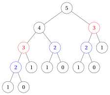
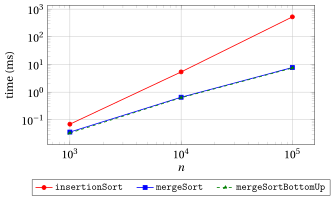
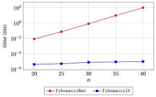

# Recursive versus iterative algorithms

<div class="info-capitolo" markdown>

**Part 2 · Analysis and recursion · Chapter 14** · [:material-file-pdf-box: Lecture notes, volume 2 (PDF)](../pdf/lecture-notes-2-analysis-recursion.pdf) · [:material-pencil: Exercises](../exercises/ex-14-recursive-vs-iterative.md)

</div>

## Introduction

In the previous chapters we have studied several recursive algorithms (chapter «Recursion»: factorial, Fibonacci numbers, recursive GCD, fast power, Tower of Hanoi; chapter «Recursive algorithms»: sum of an array, Merge Sort, Recursive Binary Search, maximum subarray) and we have analysed them by means of recurrences and of the Master Theorem. In this chapter we answer a very practical question:

<strong>when is it convenient to design a recursive algorithm, and when is it not?</strong>

We will see that the answer does not depend on recursion itself, but on <strong>how</strong> the problem is decomposed into subproblems:

- if the problem is split into a few <strong>independent</strong> subproblems of size $n/b$ (divide and conquer), recursion may give a large asymptotic gain;

- if the problem is only reduced from size $n$ to size $n-1$, recursion gives no gain in time and it costs memory;

- if the subproblems <strong>overlap</strong>, a naive recursive algorithm may be exponentially slower than an iterative one.

The chapter first explains the costs that every recursive call carries, then compares recursive and iterative algorithms for the problems of the course, studies the three situations above one by one, and closes with measured running times of the <code>C++</code> implementations and with some guidelines.

## 14.1 Recursion and iteration

!!! chiave ""

    Every recursive algorithm can be transformed into an iterative one (that uses an <strong>explicit stack</strong> to store the pending calls), and every iterative algorithm can be written recursively (every loop can be replaced by a function that calls itself).

    Recursion and iteration have the <strong>same expressive power</strong>: what changes from one to the other is the <strong>number of steps</strong> and the <strong>amount of memory</strong> needed to solve the problem.

### 14.1.1 The hidden costs of recursion

- Each time a function is called, the computer creates a <strong>stack frame</strong> (or <em>activation record</em>) on the <strong>call stack</strong>, a memory area reserved to the program. The stack frame contains:

    - the parameters of the call;

    - the local variables of the call;

    - the return address, i.e., the point of the calling function from which the execution resumes when the call terminates.

- The frame is removed from the stack only when the call terminates. Accordingly, during the execution of a recursive algorithm, all the calls that have started and not yet terminated keep their frame on the stack.

- This produces three hidden costs, which do not appear in a loop:

    1. <strong>Call overhead</strong>: creating and removing a frame, copying the parameters and jumping to the function and back require a constant number of extra steps for each call. This does not change the order of growth of the running time, but it makes a recursive algorithm slower than an equivalent loop by a constant factor.

    2. <strong>Memory</strong>: the memory used by the call stack is proportional to the maximum number of calls that are <em>simultaneously</em> active, i.e., to the <strong>depth</strong> of the recursion (the height of the recursion tree plus one, studied in detail later in this chapter).

    3. <strong>Stack overflow</strong>: the call stack has a fixed and rather small size. On Linux the default size is typically $8$ MB (command <code>ulimit -s</code> $\Rightarrow$ $8192$ KB), on Windows it is typically $1$ MB. If the depth of the recursion is too large, the stack is exhausted and the program <strong>crashes</strong> (in <code>C++</code> with a <em>segmentation fault</em>). In Python the default limit is only $1000$ nested calls.

<a id="box-1-exRviStackOverflow"></a>

!!! esempio "Example 14.1: a recursive linear sum that crashes"

    - Consider the decrease-by-one recursive algorithm that computes the sum of an array $a[1..n]$ as $\texttt{SumDecrease}(a,n)=\texttt{SumDecrease}(a,n-1)+a[n]$, with base case $\texttt{SumDecrease}(a,0)=0$ (the decrease-by-one sum of the chapter «Recursive algorithms», with base case $n=0$ instead of $n=1$).

    - The calls $\texttt{SumDecrease}(a,n), \texttt{SumDecrease}(a,n-1), \dots, \texttt{SumDecrease}(a,0)$ are all active at the same time: the depth of the recursion is $n+1$.

    - With $n=10^7$ and a stack frame of about $32$ bytes, the stack should contain about

        $$
        10^7\cdot 32 = 3.2\cdot 10^8 \text{ bytes} \approx 320 \text{ MB},
        $$

        i.e., $40$ times the default $8$ MB.

    - The program crashes, although the array itself ($4\cdot 10^7$ bytes $=40$ MB) fits easily in memory and the iterative sum computes the result in about $3$ milliseconds. In the experiment at the end of the chapter we measure that, with a stack of $8$ MB, the crash occurs already for $n\approx 7\cdot 10^5$.

### 14.1.2 From recursion to iteration with an explicit stack

- A recursive algorithm can always be transformed into an iterative one by managing <strong>explicitly</strong> a stack that contains the parameters of the calls still to be executed.

- As an example, this is an iterative version of the halving recursive sum <code>RecursiveSum</code> of the chapter «Recursive algorithms», which computes the sum of $a[l..r]$ as the sum of $a[l..mid]$ plus the sum of $a[mid+1..r]$:

!!! algoritmo "Algorithm: SumExplicitStack"

    <div class="pseudocodice" markdown="0">
    <div class="pc-io"><span class="pc-kw">Input:</span> <span>An array <span class="arithmatex">&#92;(a&#91;1..n&#93;&#92;)</span> of <span class="arithmatex">&#92;(n &#92;ge 1&#92;)</span> integer numbers</span></div>
    <div class="pc-io"><span class="pc-kw">Output:</span> <span>The sum <span class="arithmatex">&#92;(a&#91;1&#93;+a&#91;2&#93;+&#92;cdots+a&#91;n&#93;&#92;)</span></span></div>
    <div class="pc-sep"></div>
    <div class="pc-riga pc-vuota"><span class="pc-n"></span><span class="pc-corpo"></span></div>
    <div class="pc-riga"><span class="pc-n">1</span><span class="pc-corpo"><span class="pc-t"><strong>function</strong> SumExplicitStack(a, n)</span></span></div>
    <div class="pc-riga"><span class="pc-n">2</span><span class="pc-corpo"><span class="pc-l"></span><span class="pc-t"><span class="arithmatex">&#92;(s := 0&#92;)</span></span></span></div>
    <div class="pc-riga"><span class="pc-n">3</span><span class="pc-corpo"><span class="pc-l"></span><span class="pc-t"><span class="arithmatex">&#92;(P :=&#92;)</span> empty stack</span><span class="pc-c">// pending sub-arrays</span></span></div>
    <div class="pc-riga"><span class="pc-n">4</span><span class="pc-corpo"><span class="pc-l"></span><span class="pc-t">push <span class="arithmatex">&#92;((1,n)&#92;)</span> on <span class="arithmatex">&#92;(P&#92;)</span></span></span></div>
    <div class="pc-riga"><span class="pc-n">5</span><span class="pc-corpo"><span class="pc-l"></span><span class="pc-t"><strong>while</strong> <span class="arithmatex">&#92;(P&#92;)</span> is not empty <strong>do</strong></span></span></div>
    <div class="pc-riga"><span class="pc-n">6</span><span class="pc-corpo"><span class="pc-l"></span><span class="pc-l"></span><span class="pc-t"><span class="arithmatex">&#92;((l,r) :=&#92;)</span> pop from <span class="arithmatex">&#92;(P&#92;)</span></span></span></div>
    <div class="pc-riga"><span class="pc-n">7</span><span class="pc-corpo"><span class="pc-l"></span><span class="pc-l"></span><span class="pc-t"><strong>if</strong> <span class="arithmatex">&#92;(l = r&#92;)</span> <strong>then</strong></span></span></div>
    <div class="pc-riga"><span class="pc-n">8</span><span class="pc-corpo"><span class="pc-l"></span><span class="pc-l"></span><span class="pc-l"></span><span class="pc-t"><span class="arithmatex">&#92;(s &#92;leftarrow s + a&#91;l&#93;&#92;)</span></span><span class="pc-c">// base case</span></span></div>
    <div class="pc-riga"><span class="pc-n">9</span><span class="pc-corpo"><span class="pc-l"></span><span class="pc-l"></span><span class="pc-t"><strong>else</strong></span></span></div>
    <div class="pc-riga"><span class="pc-n">10</span><span class="pc-corpo"><span class="pc-l"></span><span class="pc-l"></span><span class="pc-l"></span><span class="pc-t"><span class="arithmatex">&#92;(mid := &#92;lfloor (l+r)/2 &#92;rfloor&#92;)</span></span></span></div>
    <div class="pc-riga"><span class="pc-n">11</span><span class="pc-corpo"><span class="pc-l"></span><span class="pc-l"></span><span class="pc-l"></span><span class="pc-t">push <span class="arithmatex">&#92;((mid+1,r)&#92;)</span> on <span class="arithmatex">&#92;(P&#92;)</span></span></span></div>
    <div class="pc-riga"><span class="pc-n">12</span><span class="pc-corpo"><span class="pc-l"></span><span class="pc-l"></span><span class="pc-l"></span><span class="pc-t">push <span class="arithmatex">&#92;((l,mid)&#92;)</span> on <span class="arithmatex">&#92;(P&#92;)</span></span></span></div>
    <div class="pc-riga"><span class="pc-n">13</span><span class="pc-corpo"><span class="pc-l"></span><span class="pc-l"></span><span class="pc-t"><strong>end</strong></span></span></div>
    <div class="pc-riga"><span class="pc-n">14</span><span class="pc-corpo"><span class="pc-l"></span><span class="pc-t"><strong>end</strong></span></span></div>
    <div class="pc-riga"><span class="pc-n">15</span><span class="pc-corpo"><span class="pc-l"></span><span class="pc-t"><strong>return</strong> <span class="arithmatex">&#92;(s&#92;)</span></span></span></div>
    <div class="pc-riga"><span class="pc-n">16</span><span class="pc-corpo"><span class="pc-t"><strong>end</strong></span></span></div>
    </div>

- The stack $P$ plays exactly the role of the call stack: it contains the sub-arrays still to be summed. Its maximum size is of the same order as the depth of the recursion, i.e., $\Theta(\log_2 n)$.

<a id="box-2-exRviExplicitStack"></a>

!!! esempio "Example 14.2: SumExplicitStack on four elements"

    We execute <code>SumExplicitStack</code>$(a,4)$ with $a=[4,7,1,9]$. Each item reports the pair popped from $P$, what is done, and the content of $P$ afterwards (the top of the stack is on the right):

    - pop $(1,4)$: $mid=2$, push $(3,4)$ and $(1,2)$ $\Rightarrow$ $P=[(3,4),(1,2)]$, $s=0$;

    - pop $(1,2)$: $mid=1$, push $(2,2)$ and $(1,1)$ $\Rightarrow$ $P=[(3,4),(2,2),(1,1)]$, $s=0$;

    - pop $(1,1)$: base case, $s=4$ $\Rightarrow$ $P=[(3,4),(2,2)]$;

    - pop $(2,2)$: base case, $s=11$ $\Rightarrow$ $P=[(3,4)]$;

    - pop $(3,4)$: $mid=3$, push $(4,4)$ and $(3,3)$ $\Rightarrow$ $P=[(4,4),(3,3)]$, $s=11$;

    - pop $(3,3)$: base case, $s=12$ $\Rightarrow$ $P=[(4,4)]$;

    - pop $(4,4)$: base case, $s=21$ $\Rightarrow$ $P$ is empty.

    The algorithm returns $21=4+7+1+9$. The sub-arrays are processed in the same order as the calls of <code>RecursiveSum</code>$(a,1,4)$, and $P$ never contains more than $3$ pairs.

!!! chiave ""

    Simulating the recursion with an explicit stack does <strong>not</strong> change the order of growth of the number of steps and of the memory: it only removes the call overhead and moves the stack from the (small) call stack to the (large) main memory.

    A real gain in time or in memory can only come from a <strong>different algorithm</strong>, not from the mechanical replacement of recursion by iteration (or vice versa).

## 14.2 Comparison at a glance

- The following table compares, for the problems studied in the course, the best iterative algorithm of the course with the recursive one.

- <strong>Time</strong> is the worst-case number of steps $S(n)$ (arithmetic operations on numbers are counted as one step, as in the chapter «Running time»); <strong>space</strong> is the memory used <strong>in addition to the input</strong>, including the call stack.

- The verdict refers to the recursive algorithm: <span style="color:#2f9e44"><strong>GAIN</strong></span> if it is asymptotically faster, <span style="color:#1971c2"><strong>SAME</strong></span> if it has the same running time, <span style="color:#e03131"><strong>LOSS</strong></span> if it is worse in time or in space.

<div class="tabella" markdown="0"><table>
<tr>
<th><strong>Problem</strong></th>
<th><strong>Iterative</strong></th>
<th><strong>time</strong></th>
<th><strong>space</strong></th>
<th><strong>Recursive</strong></th>
<th><strong>time</strong></th>
<th><strong>space</strong></th>
<th><strong>Verdict</strong></th>
</tr>
<tr>
<td>Sorting</td>
<td>Insertion, Selection, Exchange Sort</td>
<td><span class="arithmatex">&#92;(&#92;Theta(n^2)&#92;)</span></td>
<td><span class="arithmatex">&#92;(&#92;Theta(1)&#92;)</span></td>
<td>Merge Sort</td>
<td><span class="arithmatex">&#92;(&#92;Theta(n&#92;log&#95;2 n)&#92;)</span></td>
<td><span class="arithmatex">&#92;(&#92;Theta(n)&#92;)</span></td>
<td><span style="color:#2f9e44"><strong>GAIN</strong></span> in time (divide and conquer), paid with <span class="arithmatex">&#92;(&#92;Theta(n)&#92;)</span> memory</td>
</tr>
<tr>
<td>Power <span class="arithmatex">&#92;(x^n&#92;)</span></td>
<td><span class="arithmatex">&#92;(n&#92;)</span> multiplications</td>
<td><span class="arithmatex">&#92;(&#92;Theta(n)&#92;)</span></td>
<td><span class="arithmatex">&#92;(&#92;Theta(1)&#92;)</span></td>
<td>Fast power</td>
<td><span class="arithmatex">&#92;(&#92;Theta(&#92;log&#95;2 n)&#92;)</span></td>
<td><span class="arithmatex">&#92;(&#92;Theta(&#92;log&#95;2 n)&#92;)</span></td>
<td><span style="color:#2f9e44"><strong>GAIN</strong></span>, which comes from halving <span class="arithmatex">&#92;(n&#92;)</span>: the iterative square-and-multiply is also <span class="arithmatex">&#92;(&#92;Theta(&#92;log&#95;2 n)&#92;)</span>, with <span class="arithmatex">&#92;(&#92;Theta(1)&#92;)</span> space</td>
</tr>
<tr>
<td>Maximum subarray</td>
<td>Brute force</td>
<td><span class="arithmatex">&#92;(&#92;Theta(n^2)&#92;)</span></td>
<td><span class="arithmatex">&#92;(&#92;Theta(1)&#92;)</span></td>
<td>Divide and conquer</td>
<td><span class="arithmatex">&#92;(&#92;Theta(n&#92;log&#95;2 n)&#92;)</span></td>
<td><span class="arithmatex">&#92;(&#92;Theta(&#92;log&#95;2 n)&#92;)</span></td>
<td><span style="color:#2f9e44"><strong>GAIN</strong></span> over brute force, but the iterative Kadane algorithm, <span class="arithmatex">&#92;(&#92;Theta(n)&#92;)</span> time and <span class="arithmatex">&#92;(&#92;Theta(1)&#92;)</span> space, beats both</td>
</tr>
<tr>
<td>Product of <span class="arithmatex">&#92;(n&#92;)</span>-digit integers</td>
<td>Schoolbook</td>
<td><span class="arithmatex">&#92;(&#92;Theta(n^2)&#92;)</span></td>
<td><span class="arithmatex">&#92;(&#92;Theta(n)&#92;)</span></td>
<td>Karatsuba</td>
<td><span class="arithmatex">&#92;(&#92;Theta(n^{&#92;log&#95;2 3})&#92;)</span></td>
<td><span class="arithmatex">&#92;(&#92;Theta(n)&#92;)</span></td>
<td><span style="color:#2f9e44"><strong>GAIN</strong></span>: <span class="arithmatex">&#92;(S(n)=3S(n/2)+&#92;Theta(n)&#92;)</span>, <span class="arithmatex">&#92;(n^{&#92;log&#95;2 3}&#92;approx n^{1.585}&#92;)</span></td>
</tr>
<tr>
<td>Array sum</td>
<td>Loop</td>
<td><span class="arithmatex">&#92;(&#92;Theta(n)&#92;)</span></td>
<td><span class="arithmatex">&#92;(&#92;Theta(1)&#92;)</span></td>
<td>Halving <br> Decr. by one</td>
<td><span class="arithmatex">&#92;(&#92;Theta(n)&#92;)</span> <br> <span class="arithmatex">&#92;(&#92;Theta(n)&#92;)</span></td>
<td><span class="arithmatex">&#92;(&#92;Theta(&#92;log&#95;2 n)&#92;)</span> <br> <span class="arithmatex">&#92;(&#92;Theta(n)&#92;)</span></td>
<td><span style="color:#1971c2"><strong>SAME</strong></span> time, <span style="color:#e03131"><strong>LOSS</strong></span> in space</td>
</tr>
<tr>
<td>Binary search</td>
<td>Loop</td>
<td><span class="arithmatex">&#92;(&#92;Theta(&#92;log&#95;2 n)&#92;)</span></td>
<td><span class="arithmatex">&#92;(&#92;Theta(1)&#92;)</span></td>
<td>Recursive Binary Search</td>
<td><span class="arithmatex">&#92;(&#92;Theta(&#92;log&#95;2 n)&#92;)</span></td>
<td><span class="arithmatex">&#92;(&#92;Theta(&#92;log&#95;2 n)&#92;)</span></td>
<td><span style="color:#1971c2"><strong>SAME</strong></span> time, <span style="color:#e03131"><strong>LOSS</strong></span> in space; tail recursion, it can be removed</td>
</tr>
<tr>
<td>Factorial, linear search</td>
<td>Loop</td>
<td><span class="arithmatex">&#92;(&#92;Theta(n)&#92;)</span></td>
<td><span class="arithmatex">&#92;(&#92;Theta(1)&#92;)</span></td>
<td>Decrease by one</td>
<td><span class="arithmatex">&#92;(&#92;Theta(n)&#92;)</span></td>
<td><span class="arithmatex">&#92;(&#92;Theta(n)&#92;)</span></td>
<td><span style="color:#1971c2"><strong>SAME</strong></span> time, <span style="color:#e03131"><strong>LOSS</strong></span> in space, risk of stack overflow</td>
</tr>
<tr>
<td>GCD (Euclid)</td>
<td>Loop</td>
<td><span class="arithmatex">&#92;(&#92;Theta(&#92;log m)&#92;)</span></td>
<td><span class="arithmatex">&#92;(&#92;Theta(1)&#92;)</span></td>
<td>Recursive GCD</td>
<td><span class="arithmatex">&#92;(&#92;Theta(&#92;log m)&#92;)</span></td>
<td><span class="arithmatex">&#92;(&#92;Theta(&#92;log m)&#92;)</span></td>
<td><span style="color:#1971c2"><strong>SAME</strong></span>: tail recursion, the depth is only logarithmic</td>
</tr>
<tr>
<td>Fibonacci numbers</td>
<td>Loop with two variables</td>
<td><span class="arithmatex">&#92;(&#92;Theta(n)&#92;)</span></td>
<td><span class="arithmatex">&#92;(&#92;Theta(1)&#92;)</span></td>
<td>Naive recursion</td>
<td><span class="arithmatex">&#92;(&#92;Theta(&#92;varphi^n)&#92;)</span></td>
<td><span class="arithmatex">&#92;(&#92;Theta(n)&#92;)</span></td>
<td>huge <span style="color:#e03131"><strong>LOSS</strong></span>: overlapping subproblems; memoization brings it back to <span class="arithmatex">&#92;(&#92;Theta(n)&#92;)</span></td>
</tr>
<tr>
<td>Tower of Hanoi</td>
<td>Iterative versions exist</td>
<td><span class="arithmatex">&#92;(&#92;Theta(2^n)&#92;)</span></td>
<td><span class="arithmatex">&#92;(&#92;Theta(n)&#92;)</span></td>
<td>Recursive Hanoi</td>
<td><span class="arithmatex">&#92;(&#92;Theta(2^n)&#92;)</span></td>
<td><span class="arithmatex">&#92;(&#92;Theta(n)&#92;)</span></td>
<td><span style="color:#1971c2"><strong>SAME</strong></span>: <span class="arithmatex">&#92;(2^n-1&#92;)</span> moves are needed anyway; recursion is the natural description</td>
</tr>
</table></div>

- In the table, $\varphi=\frac{1+\sqrt5}{2}\approx 1.618$ is the golden ratio and $m=\min(a,b)$ for the GCD of $a$ and $b$.

- The four rows of the first block are the cases where recursion <strong>pays off</strong>: in all of them the problem is split into subproblems of size $n/2$ (next section).

- The rows of the second block are the cases where recursion only <strong>replaces a loop</strong>: no gain in time, a loss in memory (section «Space»).

- The Fibonacci row is the case where naive recursion is a <strong>disaster</strong>, because the same subproblems are solved over and over again (section «When subproblems overlap»).

## 14.3 Divide and conquer is what gives the gain, not recursion itself { #sez-sec-dc }

- The number of steps of a recursive algorithm is described by a recurrence. Two families of recurrences appear in the course:

    - <strong>decrease by one</strong>: the problem of size $n$ is reduced to <strong>one</strong> problem of size $n-1$,

        $$
        S(n)=S(n-1)+f(n);
        $$

    - <strong>divide and conquer</strong>: the problem of size $n$ is split into $a$ problems of size $n/b$,

        $$
        S(n)=a\,S(n/b)+f(n), \qquad a\ge 1,~b>1.
        $$

### 14.3.1 Decrease by one: recursion is a loop in disguise

<a id="box-3-obsRviDecreaseByOne"></a>

!!! teorema "Observation 14.1: decrease-by-one recurrences"

    Let $S(n)=S(n-1)+f(n)$ for $n\ge 1$, with $S(0)=d$. Then

    $$
    S(n)=d+\sum_{i=1}^{n}f(i).
    $$

    In particular, if $f(n)=c$ for a constant $c>0$, then $S(n)=c\,n+d=\Theta(n)$.

??? dimostrazione "Proof"

    By induction on $n$. For $n=0$ the sum is empty and $S(0)=d$. If the formula holds for $n-1$, then

    $$
    S(n)=S(n-1)+f(n)=d+\sum_{i=1}^{n-1}f(i)+f(n)=d+\sum_{i=1}^{n}f(i).
    $$

    If $f(i)=c$ for every $i$, then $\sum_{i=1}^{n}c=c\,n$ and $S(n)=c\,n+d$. Since $\lim_{n\to\infty}\frac{c\,n+d}{n}=c\in\R_{>0}$, we have $S(n)=\Theta(n)$. <span class="qed">□</span>

- The formula $S(n)=d+\sum_{i=1}^{n}f(i)$ is <strong>exactly</strong> the number of steps of a loop that executes, for $i=1,2,\dots,n$, a body of cost $f(i)$. The decrease-by-one recursion does the same work as a loop:

    - factorial, linear search and the decrease-by-one array sum: $S(n)=S(n-1)+\Theta(1)=\Theta(n)$, like the corresponding loop;

    - a recursive insertion sort (sort $a[1..n-1]$ recursively, then insert $a[n]$): $S(n)=S(n-1)+\Theta(n)=\Theta(n^2)$, like the iterative <code>InsertionSort</code>.

- In all these cases the recursive algorithm has the same order of growth of the running time as the iterative one, plus the call overhead and a depth of recursion $\Theta(n)$.

### 14.3.2 Divide and conquer: where the gain comes from

- Merge Sort splits the array into two halves, sorts them recursively and merges them in $\Theta(n)$ steps:

    $$
    S(n)=2S(n/2)+\Theta(n)=\Theta(n\log_2 n)
    $$

    by case 2 of the Master Theorem. The gain with respect to $\Theta(n^2)$ comes from the fact that the two halves are <strong>balanced</strong> and <strong>independent</strong>: the recursion tree has only $\Theta(\log_2 n)$ levels, and each level costs $\Theta(n)$.

- The same splitting can be organised <strong>without recursion</strong>: we first merge pairs of sub-arrays of length $1$, then pairs of sub-arrays of length $2$, then of length $4$, and so on. This is the <strong>bottom-up</strong> Merge Sort. It uses the procedure <code>Merge</code>$(a,l,m,r)$ of the chapter «Recursive algorithms», which merges the sorted sub-arrays $a[l..m]$ and $a[m+1..r]$ in $\Theta(r-l+1)$ steps.

!!! algoritmo "Algorithm: MergeSortBottomUp"

    <div class="pseudocodice" markdown="0">
    <div class="pc-io"><span class="pc-kw">Input:</span> <span>An array <span class="arithmatex">&#92;(a&#91;1..n&#93;&#92;)</span> of <span class="arithmatex">&#92;(n&#92;)</span> natural numbers</span></div>
    <div class="pc-io"><span class="pc-kw">Output:</span> <span>The array <span class="arithmatex">&#92;(a&#92;)</span> sorted in non-decreasing order</span></div>
    <div class="pc-sep"></div>
    <div class="pc-riga pc-vuota"><span class="pc-n"></span><span class="pc-corpo"></span></div>
    <div class="pc-riga"><span class="pc-n">1</span><span class="pc-corpo"><span class="pc-t"><strong>function</strong> MergeSortBottomUp(a, n)</span></span></div>
    <div class="pc-riga"><span class="pc-n">2</span><span class="pc-corpo"><span class="pc-l"></span><span class="pc-t"><span class="arithmatex">&#92;(width := 1&#92;)</span></span></span></div>
    <div class="pc-riga" id="riga-14-recursive-vs-iterative-line-rvi-bu-a"><span class="pc-n">3</span><span class="pc-corpo"><span class="pc-l"></span><span class="pc-t"><strong>while</strong> <span class="arithmatex">&#92;(width &lt; n&#92;)</span> <strong>do</strong></span></span></div>
    <div class="pc-riga"><span class="pc-n">4</span><span class="pc-corpo"><span class="pc-l"></span><span class="pc-l"></span><span class="pc-t"><span class="arithmatex">&#92;(l := 1&#92;)</span></span></span></div>
    <div class="pc-riga" id="riga-14-recursive-vs-iterative-line-rvi-bu-b"><span class="pc-n">5</span><span class="pc-corpo"><span class="pc-l"></span><span class="pc-l"></span><span class="pc-t"><strong>while</strong> <span class="arithmatex">&#92;(l + width &#92;le n&#92;)</span> <strong>do</strong></span></span></div>
    <div class="pc-riga"><span class="pc-n">6</span><span class="pc-corpo"><span class="pc-l"></span><span class="pc-l"></span><span class="pc-l"></span><span class="pc-t"><span class="arithmatex">&#92;(m := l + width - 1&#92;)</span></span></span></div>
    <div class="pc-riga"><span class="pc-n">7</span><span class="pc-corpo"><span class="pc-l"></span><span class="pc-l"></span><span class="pc-l"></span><span class="pc-t"><span class="arithmatex">&#92;(r := &#92;min(l + 2&#92;cdot width - 1,~ n)&#92;)</span></span></span></div>
    <div class="pc-riga" id="riga-14-recursive-vs-iterative-line-rvi-bu-c"><span class="pc-n">8</span><span class="pc-corpo"><span class="pc-l"></span><span class="pc-l"></span><span class="pc-l"></span><span class="pc-t"><code>Merge</code><span class="arithmatex">&#92;((a, l, m, r)&#92;)</span></span></span></div>
    <div class="pc-riga"><span class="pc-n">9</span><span class="pc-corpo"><span class="pc-l"></span><span class="pc-l"></span><span class="pc-l"></span><span class="pc-t"><span class="arithmatex">&#92;(l &#92;leftarrow l + 2&#92;cdot width&#92;)</span></span></span></div>
    <div class="pc-riga"><span class="pc-n">10</span><span class="pc-corpo"><span class="pc-l"></span><span class="pc-l"></span><span class="pc-t"><strong>end</strong></span></span></div>
    <div class="pc-riga"><span class="pc-n">11</span><span class="pc-corpo"><span class="pc-l"></span><span class="pc-l"></span><span class="pc-t"><span class="arithmatex">&#92;(width &#92;leftarrow 2&#92;cdot width&#92;)</span></span></span></div>
    <div class="pc-riga"><span class="pc-n">12</span><span class="pc-corpo"><span class="pc-l"></span><span class="pc-t"><strong>end</strong></span></span></div>
    <div class="pc-riga"><span class="pc-n">13</span><span class="pc-corpo"><span class="pc-t"><strong>end</strong></span></span></div>
    </div>

<a id="box-4-exRviBottomUp"></a>

!!! esempio "Example 14.3: bottom-up Merge Sort"

    Consider $a=[5,2,4,6,1,3]$ ($n=6$).

    - $width=1$: merge $a[1..1]$ with $a[2..2]$, $a[3..3]$ with $a[4..4]$, $a[5..5]$ with $a[6..6]$ $\Rightarrow$ $a=[2,5,4,6,1,3]$.

    - $width=2$: merge $a[1..2]$ with $a[3..4]$; for $l=5$ we have $l+width=7>6$, so $a[5..6]$ is left as it is $\Rightarrow$ $a=[2,4,5,6,1,3]$.

    - $width=4$: merge $a[1..4]$ with $a[5..6]$ $\Rightarrow$ $a=[1,2,3,4,5,6]$.

    - $width=8\ge 6$: stop.

    The algorithm executes $3=\lceil \log_2 6\rceil$ passes.

<a id="box-5-obsRviBottomUpMergeSort"></a>

!!! teorema "Observation 14.2: bottom-up Merge Sort"

    For $n\ge 2$, <code>MergeSortBottomUp</code> executes $\lceil \log_2 n\rceil$ passes of the outer loop and its number of steps in the worst case is

    $$
    S(n)=\Theta(n\log_2 n),
    $$

    the same as the recursive Merge Sort. Moreover, it does not use the call stack.

??? dimostrazione "Proof"

    Let $n\ge 2$. In the outer loop $width$ takes the values $1,2,4,\dots,2^{p-1}$, where $p$ is the smallest integer with $2^{p}\ge n$, i.e., $p=\lceil\log_2 n\rceil$.

    <em>Upper bound</em>. In a pass, the calls to <code>Merge</code> (line [8](#riga-14-recursive-vs-iterative-line-rvi-bu-c)) work on disjoint sub-arrays, so their total length is at most $n$ and their total cost is $O(n)$. The inner loop is executed at most $\frac{n}{2\cdot width}+1\le n$ times, each time with a constant number of other steps. Hence every pass costs $O(n)$ and $S(n)=O(n\lceil\log_2 n\rceil)=O(n\log_2 n)$.

    <em>Lower bound</em>. The inner loop stops when $l+width>n$, so the elements that are not merged in a pass are at most $width$. In the passes with $width\le n/2$, at least $n-width\ge n/2$ elements are merged, with $\Omega(n)$ steps. These passes are those with $width=2^t$, $t=0,1,\dots,\lfloor\log_2 n\rfloor-1$, i.e., $\lfloor\log_2 n\rfloor$ passes. Hence $S(n)=\Omega(n\lfloor\log_2 n\rfloor)=\Omega(n\log_2 n)$.

    Therefore $S(n)=\Theta(n\log_2 n)$. The algorithm contains no recursive call, so the only extra memory is the one used by <code>Merge</code>, i.e., $\Theta(n)$. <span class="qed">□</span>

!!! chiave ""

    The gain of Merge Sort over the $\Theta(n^2)$ sorting algorithms is a consequence of the <strong>divide and conquer</strong> strategy (balanced halves, merged in linear time), not of recursion: the iterative bottom-up version has the same running time $\Theta(n\log_2 n)$.

### 14.3.3 Fast power: the gain comes from halving

- The recursive fast power of the chapter «Recursion» computes $x^n=\left(x^{\lfloor n/2\rfloor}\right)^2$ if $n$ is even, and $x^n=\left(x^{\lfloor n/2\rfloor}\right)^2\cdot x$ if $n$ is odd, with $S(n)=S(\lfloor n/2\rfloor)+\Theta(1)=\Theta(\log_2 n)$.

- Halving the exponent can also be done with a loop, by reading the bits of $n$ from the least significant one (<strong>square-and-multiply</strong>):

!!! algoritmo "Algorithm: PowerIt"

    <div class="pseudocodice" markdown="0">
    <div class="pc-io"><span class="pc-kw">Input:</span> <span>A number <span class="arithmatex">&#92;(x&#92;)</span> and a natural number <span class="arithmatex">&#92;(n&#92;)</span></span></div>
    <div class="pc-io"><span class="pc-kw">Output:</span> <span>The power <span class="arithmatex">&#92;(x^n&#92;)</span></span></div>
    <div class="pc-sep"></div>
    <div class="pc-riga pc-vuota"><span class="pc-n"></span><span class="pc-corpo"></span></div>
    <div class="pc-riga"><span class="pc-n">1</span><span class="pc-corpo"><span class="pc-t"><strong>function</strong> PowerIt(x, n)</span></span></div>
    <div class="pc-riga"><span class="pc-n">2</span><span class="pc-corpo"><span class="pc-l"></span><span class="pc-t"><span class="arithmatex">&#92;(p := 1&#92;)</span></span></span></div>
    <div class="pc-riga"><span class="pc-n">3</span><span class="pc-corpo"><span class="pc-l"></span><span class="pc-t"><span class="arithmatex">&#92;(y := x&#92;)</span></span></span></div>
    <div class="pc-riga"><span class="pc-n">4</span><span class="pc-corpo"><span class="pc-l"></span><span class="pc-t"><span class="arithmatex">&#92;(k := n&#92;)</span></span></span></div>
    <div class="pc-riga" id="riga-14-recursive-vs-iterative-line-rvi-pow-a"><span class="pc-n">5</span><span class="pc-corpo"><span class="pc-l"></span><span class="pc-t"><strong>while</strong> <span class="arithmatex">&#92;(k &gt; 0&#92;)</span> <strong>do</strong></span></span></div>
    <div class="pc-riga"><span class="pc-n">6</span><span class="pc-corpo"><span class="pc-l"></span><span class="pc-l"></span><span class="pc-t"><strong>if</strong> <span class="arithmatex">&#92;(k&#92;)</span> is odd <strong>then</strong></span></span></div>
    <div class="pc-riga"><span class="pc-n">7</span><span class="pc-corpo"><span class="pc-l"></span><span class="pc-l"></span><span class="pc-l"></span><span class="pc-t"><span class="arithmatex">&#92;(p &#92;leftarrow p&#92;cdot y&#92;)</span></span></span></div>
    <div class="pc-riga"><span class="pc-n">8</span><span class="pc-corpo"><span class="pc-l"></span><span class="pc-l"></span><span class="pc-t"><strong>end</strong></span></span></div>
    <div class="pc-riga"><span class="pc-n">9</span><span class="pc-corpo"><span class="pc-l"></span><span class="pc-l"></span><span class="pc-t"><span class="arithmatex">&#92;(y &#92;leftarrow y&#92;cdot y&#92;)</span></span></span></div>
    <div class="pc-riga"><span class="pc-n">10</span><span class="pc-corpo"><span class="pc-l"></span><span class="pc-l"></span><span class="pc-t"><span class="arithmatex">&#92;(k &#92;leftarrow &#92;lfloor k/2&#92;rfloor&#92;)</span></span></span></div>
    <div class="pc-riga"><span class="pc-n">11</span><span class="pc-corpo"><span class="pc-l"></span><span class="pc-t"><strong>end</strong></span></span></div>
    <div class="pc-riga"><span class="pc-n">12</span><span class="pc-corpo"><span class="pc-l"></span><span class="pc-t"><strong>return</strong> <span class="arithmatex">&#92;(p&#92;)</span></span></span></div>
    <div class="pc-riga"><span class="pc-n">13</span><span class="pc-corpo"><span class="pc-t"><strong>end</strong></span></span></div>
    </div>

- At the beginning of each iteration we have $p\cdot y^{k}=x^n$ (it holds at the start with $p=1$, $y=x$, $k=n$, and it is preserved by every iteration); when $k=0$ we get $p=x^n$.

<a id="box-6-exRviPowerIt"></a>

!!! esempio "Example 14.4: square-and-multiply with $n=13$"

    We execute <code>PowerIt</code>$(x,13)$, where $13=(1101)_2$. Each item reports the values at the end of an iteration:

    - $k=13$ is odd: $p=x$, $y=x^2$, $k=6$;

    - $k=6$ is even: $p=x$, $y=x^4$, $k=3$;

    - $k=3$ is odd: $p=x\cdot x^4=x^5$, $y=x^8$, $k=1$;

    - $k=1$ is odd: $p=x^5\cdot x^8=x^{13}$, $y=x^{16}$, $k=0$.

    The iterations multiply $p$ by $x$, $x^4$ and $x^8$ (the bits of $13$ equal to $1$), and $p=x^{1+4+8}=x^{13}$ after $4=\lfloor\log_2 13\rfloor+1$ iterations.

<a id="box-7-obsRviPowerIt"></a>

!!! teorema "Observation 14.3: iterations of PowerIt"

    For $n\ge 1$, <code>PowerIt</code> executes exactly $\lfloor \log_2 n\rfloor+1$ iterations, hence $S(n)=\Theta(\log_2 n)$, and it uses $\Theta(1)$ extra memory.

??? dimostrazione "Proof"

    Every iteration replaces $k$ by $\lfloor k/2\rfloor$, i.e., it removes the least significant bit of the binary representation of $k$. Hence the number of iterations is the number of binary digits of $n$, which is $\lfloor\log_2 n\rfloor+1$ (chapter «Representation of numbers»). Each iteration executes a constant number of steps, so $S(n)=\Theta(\log_2 n)$. Only the three variables $p$, $y$, $k$ are used. <span class="qed">□</span>

### 14.3.4 Maximum subarray: a better iterative algorithm

- For the maximum subarray problem (chapter «Recursive algorithms») the divide and conquer algorithm, with $S(n)=2S(n/2)+\Theta(n)=\Theta(n\log_2 n)$, improves on the $\Theta(n^2)$ brute force algorithm.

- However, a smarter <strong>iterative</strong> algorithm, due to Kadane, solves the problem in $\Theta(n)$ steps. For each position $i$ it maintains the maximum sum $cur$ of a sub-array <strong>ending</strong> at position $i$: such a sub-array either is $a[i]$ alone, or extends the best sub-array ending at $i-1$. This is a compact version of the algorithm <code>Kadane</code> of the chapter «Recursive algorithms», which returns only the maximum sum:

!!! algoritmo "Algorithm: Kadane"

    <div class="pseudocodice" markdown="0">
    <div class="pc-io"><span class="pc-kw">Input:</span> <span>An array <span class="arithmatex">&#92;(a&#91;1..n&#93;&#92;)</span> of <span class="arithmatex">&#92;(n&#92;ge 1&#92;)</span> integer numbers</span></div>
    <div class="pc-io"><span class="pc-kw">Output:</span> <span>The maximum sum of a non-empty sub-array <span class="arithmatex">&#92;(a&#91;l..r&#93;&#92;)</span></span></div>
    <div class="pc-sep"></div>
    <div class="pc-riga pc-vuota"><span class="pc-n"></span><span class="pc-corpo"></span></div>
    <div class="pc-riga"><span class="pc-n">1</span><span class="pc-corpo"><span class="pc-t"><strong>function</strong> Kadane(a, n)</span></span></div>
    <div class="pc-riga"><span class="pc-n">2</span><span class="pc-corpo"><span class="pc-l"></span><span class="pc-t"><span class="arithmatex">&#92;(best := a&#91;1&#93;&#92;)</span></span></span></div>
    <div class="pc-riga"><span class="pc-n">3</span><span class="pc-corpo"><span class="pc-l"></span><span class="pc-t"><span class="arithmatex">&#92;(cur := a&#91;1&#93;&#92;)</span></span><span class="pc-c">// best sum of a sub-array ending at <span class="arithmatex">&#92;(i&#92;)</span></span></span></div>
    <div class="pc-riga"><span class="pc-n">4</span><span class="pc-corpo"><span class="pc-l"></span><span class="pc-t"><span class="arithmatex">&#92;(i := 2&#92;)</span></span></span></div>
    <div class="pc-riga"><span class="pc-n">5</span><span class="pc-corpo"><span class="pc-l"></span><span class="pc-t"><strong>while</strong> <span class="arithmatex">&#92;(i &#92;le n&#92;)</span> <strong>do</strong></span></span></div>
    <div class="pc-riga"><span class="pc-n">6</span><span class="pc-corpo"><span class="pc-l"></span><span class="pc-l"></span><span class="pc-t"><span class="arithmatex">&#92;(cur &#92;leftarrow &#92;max(a&#91;i&#93;,~ cur + a&#91;i&#93;)&#92;)</span></span></span></div>
    <div class="pc-riga"><span class="pc-n">7</span><span class="pc-corpo"><span class="pc-l"></span><span class="pc-l"></span><span class="pc-t"><span class="arithmatex">&#92;(best &#92;leftarrow &#92;max(best,~ cur)&#92;)</span></span></span></div>
    <div class="pc-riga"><span class="pc-n">8</span><span class="pc-corpo"><span class="pc-l"></span><span class="pc-l"></span><span class="pc-t"><span class="arithmatex">&#92;(i &#92;leftarrow i+1&#92;)</span></span></span></div>
    <div class="pc-riga"><span class="pc-n">9</span><span class="pc-corpo"><span class="pc-l"></span><span class="pc-t"><strong>end</strong></span></span></div>
    <div class="pc-riga"><span class="pc-n">10</span><span class="pc-corpo"><span class="pc-l"></span><span class="pc-t"><strong>return</strong> <span class="arithmatex">&#92;(best&#92;)</span></span></span></div>
    <div class="pc-riga"><span class="pc-n">11</span><span class="pc-corpo"><span class="pc-t"><strong>end</strong></span></span></div>
    </div>

- The loop is executed $n-1$ times with a constant number of steps: $S(n)=\Theta(n)$, with $\Theta(1)$ extra memory.

- Divide and conquer is a powerful <strong>design technique</strong>, but it is not always the best one: a gain with respect to brute force does not mean that the recursive algorithm is optimal.

### 14.3.5 Integer multiplication: Karatsuba

- Two $n$-digit integers are multiplied with the schoolbook method in $\Theta(n^2)$ steps on the digits.

- Splitting each number into two halves of $n/2$ digits, the product requires four products of $n/2$-digit numbers. Karatsuba observed that <strong>three</strong> products are enough (plus additions and shifts, costing $\Theta(n)$):

    $$
    S(n)=3S(n/2)+\Theta(n).
    $$

- Here $a=3$, $b=2$, $f(n)=\Theta(n)$ and $n^{\log_2 3}\approx n^{1.585}$; since $f(n)=O(n^{\log_2 3-\varepsilon})$ for $\varepsilon=0.5$, case 1 of the Master Theorem gives $S(n)=\Theta(n^{\log_2 3})$, asymptotically better than $\Theta(n^2)$.

!!! chiave ""

    <strong>Key points.</strong> A decrease-by-one recursion does the same work as a loop. A divide and conquer recursion can be asymptotically faster than the simple iterative algorithms (Merge Sort, fast power, Karatsuba), but the gain comes from the decomposition into balanced independent subproblems, and the same decomposition can often be organised with a loop (bottom-up Merge Sort, square-and-multiply). The best algorithm for a problem may even be iterative (Kadane).

## 14.4 When subproblems overlap { #sez-sec-overlap }

- In divide and conquer the subproblems are <strong>disjoint</strong>: the two halves of Merge Sort have no element in common. When the subproblems <strong>overlap</strong>, a naive recursive algorithm solves the same subproblem many times.

- The Fibonacci numbers are defined by $F(0)=0$, $F(1)=1$ and $F(n)=F(n-1)+F(n-2)$ for $n\ge 2$. The direct translation of the definition is:

!!! algoritmo "Algorithm: FibRec"

    <div class="pseudocodice" markdown="0">
    <div class="pc-io"><span class="pc-kw">Input:</span> <span>A natural number <span class="arithmatex">&#92;(n&#92;)</span></span></div>
    <div class="pc-io"><span class="pc-kw">Output:</span> <span>The Fibonacci number <span class="arithmatex">&#92;(F(n)&#92;)</span></span></div>
    <div class="pc-sep"></div>
    <div class="pc-riga pc-vuota"><span class="pc-n"></span><span class="pc-corpo"></span></div>
    <div class="pc-riga"><span class="pc-n">1</span><span class="pc-corpo"><span class="pc-t"><strong>function</strong> FibRec(n)</span></span></div>
    <div class="pc-riga"><span class="pc-n">2</span><span class="pc-corpo"><span class="pc-l"></span><span class="pc-t"><strong>if</strong> <span class="arithmatex">&#92;(n &#92;le 1&#92;)</span> <strong>then</strong></span></span></div>
    <div class="pc-riga"><span class="pc-n">3</span><span class="pc-corpo"><span class="pc-l"></span><span class="pc-l"></span><span class="pc-t"><strong>return</strong> <span class="arithmatex">&#92;(n&#92;)</span></span></span></div>
    <div class="pc-riga"><span class="pc-n">4</span><span class="pc-corpo"><span class="pc-l"></span><span class="pc-t"><strong>end</strong></span></span></div>
    <div class="pc-riga"><span class="pc-n">5</span><span class="pc-corpo"><span class="pc-l"></span><span class="pc-t"><strong>return</strong> <span class="arithmatex">&#92;(&#92;texttt{FibRec}(n-1) + &#92;texttt{FibRec}(n-2)&#92;)</span></span></span></div>
    <div class="pc-riga"><span class="pc-n">6</span><span class="pc-corpo"><span class="pc-t"><strong>end</strong></span></span></div>
    </div>

<a id="box-8-exRviFibTree"></a>

!!! esempio "Example 14.5: the recursion tree of FibRec$(5)$"

    This is the recursion tree of $\texttt{FibRec}(5)$ (each node is a call, labelled with its parameter). The sub-tree of $\texttt{FibRec}(3)$ is computed <span style="color:#e03131">twice</span>, the call $\texttt{FibRec}(2)$ <span style="color:#1971c2">three times</span>:

    { .fig loading=lazy  }

    The tree has $15$ nodes, while only $6$ different values $F(0),F(1),\dots,F(5)$ are needed.

<a id="box-9-obsRviFibCalls"></a>

!!! teorema "Observation 14.4: number of calls of FibRec"

    For every $n\ge 0$, the number of calls executed by $\texttt{FibRec}(n)$ is

    $$
    C(n)=2F(n+1)-1.
    $$

??? dimostrazione "Proof"

    The calls satisfy $C(0)=C(1)=1$ and $C(n)=1+C(n-1)+C(n-2)$ for $n\ge 2$. We prove the formula by strong induction. Base cases: $C(0)=1=2F(1)-1$ and $C(1)=1=2F(2)-1$. If the formula holds for $n-1$ and $n-2$, then

    $$
    C(n)=1+\big(2F(n)-1\big)+\big(2F(n-1)-1\big)=2\big(F(n)+F(n-1)\big)-1=2F(n+1)-1. \qedhere
    $$

    <p class="qed-riga"><span class="qed">□</span></p>

<a id="box-10-obsRviFibGrowth"></a>

!!! teorema "Observation 14.5: growth of the Fibonacci numbers"

    Let $\varphi=\frac{1+\sqrt5}{2}$. For every $n\ge 1$,

    $$
    \varphi^{n-2}\le F(n)\le \varphi^{n-1}.
    $$

    Hence $F(n)=\Theta(\varphi^n)$ and the number of steps of <code>FibRec</code> is $S(n)=\Theta(C(n))=\Theta(\varphi^n)$.

??? dimostrazione "Proof"

    The number $\varphi$ satisfies $\varphi^2=\varphi+1$. Base cases: $\varphi^{-1}\approx 0.618\le F(1)=1\le\varphi^0=1$ and $\varphi^{0}=1\le F(2)=1\le\varphi\approx 1.618$. For $n\ge 3$, by strong induction,

    $$
    F(n)=F(n-1)+F(n-2)\ge \varphi^{n-3}+\varphi^{n-4}=\varphi^{n-4}(\varphi+1)=\varphi^{n-4}\varphi^2=\varphi^{n-2},
    $$

    and in the same way $F(n)\le\varphi^{n-2}+\varphi^{n-3}=\varphi^{n-3}(\varphi+1)=\varphi^{n-1}$. Accordingly, $\varphi^{-2}\varphi^n\le F(n)\le\varphi^{-1}\varphi^n$, i.e., $F(n)=\Theta(\varphi^n)$. Each call executes a constant number of steps (besides its sub-calls), so $S(n)=\Theta(C(n))=\Theta(2F(n+1)-1)=\Theta(\varphi^{n})$. <span class="qed">□</span>

- For example, $\texttt{FibRec}(40)$ executes $2F(41)-1=331\,160\,281$ calls to compute $F(40)=102\,334\,155$, and $\texttt{FibRec}(50)$ executes $2F(51)-1=40\,730\,022\,147$ calls.

### 14.4.1 Memoization

- The waste of <code>FibRec</code> is eliminated by storing in a table $memo[0..n]$ the values already computed (<strong>memoization</strong>): before computing $F(k)$ we check whether it is already in the table.

!!! algoritmo "Algorithm: FibMemo"

    <div class="pseudocodice" markdown="0">
    <div class="pc-io"><span class="pc-kw">Input:</span> <span>A natural number <span class="arithmatex">&#92;(n&#92;)</span> and a table <span class="arithmatex">&#92;(memo&#91;0..n&#93;&#92;)</span> whose entries are all <em>undefined</em></span></div>
    <div class="pc-io"><span class="pc-kw">Output:</span> <span>The Fibonacci number <span class="arithmatex">&#92;(F(n)&#92;)</span></span></div>
    <div class="pc-sep"></div>
    <div class="pc-riga pc-vuota"><span class="pc-n"></span><span class="pc-corpo"></span></div>
    <div class="pc-riga"><span class="pc-n">1</span><span class="pc-corpo"><span class="pc-t"><strong>function</strong> FibMemo(n, memo)</span></span></div>
    <div class="pc-riga"><span class="pc-n">2</span><span class="pc-corpo"><span class="pc-l"></span><span class="pc-t"><strong>if</strong> <span class="arithmatex">&#92;(n &#92;le 1&#92;)</span> <strong>then</strong></span></span></div>
    <div class="pc-riga"><span class="pc-n">3</span><span class="pc-corpo"><span class="pc-l"></span><span class="pc-l"></span><span class="pc-t"><strong>return</strong> <span class="arithmatex">&#92;(n&#92;)</span></span></span></div>
    <div class="pc-riga"><span class="pc-n">4</span><span class="pc-corpo"><span class="pc-l"></span><span class="pc-t"><strong>end</strong></span></span></div>
    <div class="pc-riga"><span class="pc-n">5</span><span class="pc-corpo"><span class="pc-l"></span><span class="pc-t"><strong>if</strong> <span class="arithmatex">&#92;(memo&#91;n&#93;&#92;)</span> is <em>undefined</em> <strong>then</strong></span></span></div>
    <div class="pc-riga"><span class="pc-n">6</span><span class="pc-corpo"><span class="pc-l"></span><span class="pc-l"></span><span class="pc-t"><span class="arithmatex">&#92;(memo&#91;n&#93; &#92;leftarrow &#92;texttt{FibMemo}(n-1, memo) + &#92;texttt{FibMemo}(n-2, memo)&#92;)</span></span></span></div>
    <div class="pc-riga"><span class="pc-n">7</span><span class="pc-corpo"><span class="pc-l"></span><span class="pc-t"><strong>end</strong></span></span></div>
    <div class="pc-riga"><span class="pc-n">8</span><span class="pc-corpo"><span class="pc-l"></span><span class="pc-t"><strong>return</strong> <span class="arithmatex">&#92;(memo&#91;n&#93;&#92;)</span></span></span></div>
    <div class="pc-riga"><span class="pc-n">9</span><span class="pc-corpo"><span class="pc-t"><strong>end</strong></span></span></div>
    </div>

<a id="box-11-obsRviFibMemo"></a>

!!! teorema "Observation 14.6: number of calls of FibMemo"

    For every $n\ge 2$, $\texttt{FibMemo}(n,memo)$ (with all entries of $memo$ undefined) executes exactly $2n-1$ calls. Hence $S(n)=\Theta(n)$; the memory used is $\Theta(n)$ (the table and the call stack).

??? dimostrazione "Proof"

    Let $M(k)$ be the number of calls executed by $\texttt{FibMemo}(k,memo)$ when the entries $memo[0..k]$ are undefined. For $k=2$ the call makes two calls, both base cases: $M(2)=3$. For $k\ge 3$ the call makes the call $\texttt{FibMemo}(k-1,memo)$, which executes $M(k-1)$ calls and fills $memo[2..k-1]$; then it makes the call $\texttt{FibMemo}(k-2,memo)$, which finds $memo[k-2]$ already defined (or is a base case if $k-2\le 1$) and returns immediately. Hence $M(k)=1+M(k-1)+1=M(k-1)+2$, and by [Observation 14.1](#box-3-obsRviDecreaseByOne) $M(n)=M(2)+2(n-2)=2n-1$. Each call executes a constant number of steps, so $S(n)=\Theta(n)$. The table has $n+1$ entries and the depth of the recursion is $n$. <span class="qed">□</span>

### 14.4.2 The iterative algorithm

- Computing the values $F(2),F(3),\dots,F(n)$ in increasing order, each value only needs the two previous ones. We do not even need the table: two variables are enough.

!!! algoritmo "Algorithm: FibIt"

    <div class="pseudocodice" markdown="0">
    <div class="pc-io"><span class="pc-kw">Input:</span> <span>A natural number <span class="arithmatex">&#92;(n&#92;)</span></span></div>
    <div class="pc-io"><span class="pc-kw">Output:</span> <span>The Fibonacci number <span class="arithmatex">&#92;(F(n)&#92;)</span></span></div>
    <div class="pc-sep"></div>
    <div class="pc-riga pc-vuota"><span class="pc-n"></span><span class="pc-corpo"></span></div>
    <div class="pc-riga"><span class="pc-n">1</span><span class="pc-corpo"><span class="pc-t"><strong>function</strong> FibIt(n)</span></span></div>
    <div class="pc-riga"><span class="pc-n">2</span><span class="pc-corpo"><span class="pc-l"></span><span class="pc-t"><strong>if</strong> <span class="arithmatex">&#92;(n &#92;le 1&#92;)</span> <strong>then</strong></span></span></div>
    <div class="pc-riga"><span class="pc-n">3</span><span class="pc-corpo"><span class="pc-l"></span><span class="pc-l"></span><span class="pc-t"><strong>return</strong> <span class="arithmatex">&#92;(n&#92;)</span></span></span></div>
    <div class="pc-riga"><span class="pc-n">4</span><span class="pc-corpo"><span class="pc-l"></span><span class="pc-t"><strong>end</strong></span></span></div>
    <div class="pc-riga"><span class="pc-n">5</span><span class="pc-corpo"><span class="pc-l"></span><span class="pc-t"><span class="arithmatex">&#92;(prev := 0&#92;)</span></span><span class="pc-c">// <span class="arithmatex">&#92;(F(i-2)&#92;)</span></span></span></div>
    <div class="pc-riga"><span class="pc-n">6</span><span class="pc-corpo"><span class="pc-l"></span><span class="pc-t"><span class="arithmatex">&#92;(curr := 1&#92;)</span></span><span class="pc-c">// <span class="arithmatex">&#92;(F(i-1)&#92;)</span></span></span></div>
    <div class="pc-riga"><span class="pc-n">7</span><span class="pc-corpo"><span class="pc-l"></span><span class="pc-t"><span class="arithmatex">&#92;(i := 2&#92;)</span></span></span></div>
    <div class="pc-riga"><span class="pc-n">8</span><span class="pc-corpo"><span class="pc-l"></span><span class="pc-t"><strong>while</strong> <span class="arithmatex">&#92;(i &#92;le n&#92;)</span> <strong>do</strong></span></span></div>
    <div class="pc-riga"><span class="pc-n">9</span><span class="pc-corpo"><span class="pc-l"></span><span class="pc-l"></span><span class="pc-t"><span class="arithmatex">&#92;(next := prev + curr&#92;)</span></span></span></div>
    <div class="pc-riga"><span class="pc-n">10</span><span class="pc-corpo"><span class="pc-l"></span><span class="pc-l"></span><span class="pc-t"><span class="arithmatex">&#92;(prev &#92;leftarrow curr&#92;)</span></span></span></div>
    <div class="pc-riga"><span class="pc-n">11</span><span class="pc-corpo"><span class="pc-l"></span><span class="pc-l"></span><span class="pc-t"><span class="arithmatex">&#92;(curr &#92;leftarrow next&#92;)</span></span></span></div>
    <div class="pc-riga"><span class="pc-n">12</span><span class="pc-corpo"><span class="pc-l"></span><span class="pc-l"></span><span class="pc-t"><span class="arithmatex">&#92;(i &#92;leftarrow i+1&#92;)</span></span></span></div>
    <div class="pc-riga"><span class="pc-n">13</span><span class="pc-corpo"><span class="pc-l"></span><span class="pc-t"><strong>end</strong></span></span></div>
    <div class="pc-riga"><span class="pc-n">14</span><span class="pc-corpo"><span class="pc-l"></span><span class="pc-t"><strong>return</strong> <span class="arithmatex">&#92;(curr&#92;)</span></span></span></div>
    <div class="pc-riga"><span class="pc-n">15</span><span class="pc-corpo"><span class="pc-t"><strong>end</strong></span></span></div>
    </div>

- The loop is executed $n-1$ times: $S(n)=\Theta(n)$, with $\Theta(1)$ extra memory.

!!! chiave ""

    <div class="tabella" markdown="0"><table>
    <tr>
    <th>Algorithm</th>
    <th>time</th>
    <th>space</th>
    </tr>
    <tr>
    <td><code>FibRec</code> (naive recursion)</td>
    <td><span class="arithmatex">&#92;(&#92;Theta(&#92;varphi^n)&#92;)</span></td>
    <td><span class="arithmatex">&#92;(&#92;Theta(n)&#92;)</span></td>
    </tr>
    <tr>
    <td><code>FibMemo</code> (recursion + memoization)</td>
    <td><span class="arithmatex">&#92;(&#92;Theta(n)&#92;)</span></td>
    <td><span class="arithmatex">&#92;(&#92;Theta(n)&#92;)</span></td>
    </tr>
    <tr>
    <td><code>FibIt</code> (iteration, bottom-up)</td>
    <td><span class="arithmatex">&#92;(&#92;Theta(n)&#92;)</span></td>
    <td><span class="arithmatex">&#92;(&#92;Theta(1)&#92;)</span></td>
    </tr>
    </table></div>

    When the subproblems overlap, the right technique is to solve each subproblem <strong>once</strong> and store its value: top-down with memoization, or bottom-up with a loop. This is the idea of <strong>Dynamic Programming</strong>, which will be studied later in the course.

## 14.5 Space { #sez-sec-space }

The previous sections compared numbers of steps. We now turn to the second resource, the memory, which for a recursive algorithm is governed by the depth of the recursion.

### 14.5.1 Depth of the recursion

<a id="box-12-defRviRecursionDepth"></a>

!!! definizione "Definition 14.7: depth of the recursion"

    The <strong>depth of the recursion</strong> $D(n)$ of a recursive algorithm on an input of size parameter $n$ is the maximum number of calls that are active at the same time during the execution. It is the number of nodes of the longest path from the root to a leaf of the recursion tree, i.e., the height of the tree plus one.

- When the calls are executed one after the other, only the calls on the path from the root to the current call are active. Hence, if every frame has constant size, the memory used by the call stack is $\Theta(D(n))$.

- The depth is <strong>not</strong> the number of calls: <code>FibRec</code>$(n)$ executes $\Theta(\varphi^n)$ calls, but at most $n$ of them are active at the same time.

<div class="tabella" markdown="0"><table>
<tr>
<th>Algorithm</th>
<th>base case</th>
<th>depth <span class="arithmatex">&#92;(D(n)&#92;)</span></th>
<th><span class="arithmatex">&#92;(D(10^6)&#92;)</span></th>
</tr>
<tr>
<td>Factorial, linear sum (decrease by one)</td>
<td><span class="arithmatex">&#92;(n=0&#92;)</span></td>
<td><span class="arithmatex">&#92;(n+1&#92;)</span></td>
<td><span class="arithmatex">&#92;(1&#92;,000&#92;,001&#92;)</span></td>
</tr>
<tr>
<td>Tower of Hanoi with <span class="arithmatex">&#92;(n&#92;)</span> disks</td>
<td><span class="arithmatex">&#92;(n=0&#92;)</span></td>
<td><span class="arithmatex">&#92;(n+1&#92;)</span></td>
<td><span class="arithmatex">&#92;(1&#92;,000&#92;,001&#92;)</span></td>
</tr>
<tr>
<td><code>FibRec</code><span class="arithmatex">&#92;((n)&#92;)</span>, <span class="arithmatex">&#92;(n&#92;ge 1&#92;)</span></td>
<td><span class="arithmatex">&#92;(n&#92;le 1&#92;)</span></td>
<td><span class="arithmatex">&#92;(n&#92;)</span></td>
<td><span class="arithmatex">&#92;(1&#92;,000&#92;,000&#92;)</span></td>
</tr>
<tr>
<td>Sum by halving, Merge Sort, Maximum Subarray</td>
<td><span class="arithmatex">&#92;(l=r&#92;)</span></td>
<td><span class="arithmatex">&#92;(&#92;lceil&#92;log&#95;2 n&#92;rceil+1&#92;)</span></td>
<td><span class="arithmatex">&#92;(21&#92;)</span></td>
</tr>
<tr>
<td>Recursive Binary Search (worst case)</td>
<td><span class="arithmatex">&#92;(l&gt;r&#92;)</span></td>
<td><span class="arithmatex">&#92;(&#92;lfloor&#92;log&#95;2 n&#92;rfloor+2&#92;)</span></td>
<td><span class="arithmatex">&#92;(21&#92;)</span></td>
</tr>
<tr>
<td>Fast power <span class="arithmatex">&#92;(x^n&#92;)</span>, <span class="arithmatex">&#92;(n&#92;ge 1&#92;)</span></td>
<td><span class="arithmatex">&#92;(n=0&#92;)</span></td>
<td><span class="arithmatex">&#92;(&#92;lfloor&#92;log&#95;2 n&#92;rfloor+2&#92;)</span></td>
<td><span class="arithmatex">&#92;(21&#92;)</span></td>
</tr>
<tr>
<td>Recursive GCD<span class="arithmatex">&#92;((a,b)&#92;)</span></td>
<td><span class="arithmatex">&#92;(b=0&#92;)</span></td>
<td><span class="arithmatex">&#92;(&#92;Theta(&#92;log&#92;min(a,b))&#92;)</span></td>
<td>–</td>
</tr>
</table></div>

- For the halving algorithms, the largest sub-array at level $t$ of the recursion tree has $\lceil n/2^t\rceil$ elements, and it reaches size $1$ for $t=\lceil\log_2 n\rceil$; for the fast power, the exponent goes through the values $n,\lfloor n/2\rfloor,\dots,1,0$, which are $\lfloor\log_2 n\rfloor+2$.

- A depth $\Theta(\log_2 n)$ is never a problem in practice ($21$ frames for $n=10^6$, $31$ for $n=10^9$). A depth $\Theta(n)$ is a real risk of stack overflow for large $n$.

### 14.5.2 Tail recursion and its elimination

<a id="box-13-defRviTailRecursion"></a>

!!! definizione "Definition 14.8: tail recursion"

    A recursive call is a <strong>tail call</strong> if it is the last operation executed by the function, and its result is returned as it is, without further computation. A recursive algorithm is <strong>tail recursive</strong> if all its recursive calls are tail calls.

- The recursive GCD (return $\texttt{GCD}(b, a \bmod b)$) and the Recursive Binary Search (return the result of the search in one half) are tail recursive.

- The factorial ($n\cdot\texttt{Fact}(n-1)$), the decrease-by-one sum ($\texttt{SumDecrease}(a,n-1)+a[n]$) and <code>FibRec</code> are <strong>not</strong> tail recursive: after the recursive call returns there is still a multiplication or an addition to do, so the frame must be kept.

- In a tail call, the frame of the calling function is no longer needed: nothing remains to be done after the call. Therefore the call can be replaced by an <strong>update of the parameters</strong> followed by a jump to the beginning of the function, i.e., by a loop.

!!! chiave ""

    <strong>Mechanical elimination of tail recursion</strong>

    1. Enclose the body of the function in a <strong>while</strong> loop whose condition is the negation of the base-case condition.

    2. Replace every tail call $f(e_1,\dots,e_k)$ by the <strong>simultaneous</strong> assignment of the new values $e_1,\dots,e_k$ to the parameters (use temporary variables when a new value depends on a parameter that is modified).

    3. Move the return of the base case after the loop.

<a id="box-14-exRviGcdTail"></a>

!!! esempio "Example 14.6: Recursive GCD $\Rightarrow$ iterative GCD"

    <div class="minipage" style="width:47%" markdown>

    <div class="pseudocodice" markdown="0"><div class="pc-titolo"><strong>Algorithm:</strong> GCDRec</div>
    <div class="pc-riga"><span class="pc-n">1</span><span class="pc-corpo"><span class="pc-t"><strong>function</strong> GCDRec(a, b)</span></span></div>
    <div class="pc-riga"><span class="pc-n">2</span><span class="pc-corpo"><span class="pc-l"></span><span class="pc-t"><strong>if</strong> <span class="arithmatex">&#92;(b = 0&#92;)</span> <strong>then</strong></span></span></div>
    <div class="pc-riga"><span class="pc-n">3</span><span class="pc-corpo"><span class="pc-l"></span><span class="pc-l"></span><span class="pc-t"><strong>return</strong> <span class="arithmatex">&#92;(a&#92;)</span></span></span></div>
    <div class="pc-riga"><span class="pc-n">4</span><span class="pc-corpo"><span class="pc-l"></span><span class="pc-t"><strong>end</strong></span></span></div>
    <div class="pc-riga"><span class="pc-n">5</span><span class="pc-corpo"><span class="pc-l"></span><span class="pc-t"><strong>return</strong> <span class="arithmatex">&#92;(&#92;texttt{GCDRec}(b,~ a &#92;bmod b)&#92;)</span></span></span></div>
    <div class="pc-riga"><span class="pc-n">6</span><span class="pc-corpo"><span class="pc-t"><strong>end</strong></span></span></div>
    </div>

    </div>

    <div class="minipage" style="width:47%" markdown>

    <div class="pseudocodice" markdown="0"><div class="pc-titolo"><strong>Algorithm:</strong> GCDIt</div>
    <div class="pc-riga"><span class="pc-n">1</span><span class="pc-corpo"><span class="pc-t"><strong>function</strong> GCDIt(a, b)</span></span></div>
    <div class="pc-riga"><span class="pc-n">2</span><span class="pc-corpo"><span class="pc-l"></span><span class="pc-t"><strong>while</strong> <span class="arithmatex">&#92;(b &#92;neq 0&#92;)</span> <strong>do</strong></span></span></div>
    <div class="pc-riga"><span class="pc-n">3</span><span class="pc-corpo"><span class="pc-l"></span><span class="pc-l"></span><span class="pc-t"><span class="arithmatex">&#92;(r := a &#92;bmod b&#92;)</span></span></span></div>
    <div class="pc-riga"><span class="pc-n">4</span><span class="pc-corpo"><span class="pc-l"></span><span class="pc-l"></span><span class="pc-t"><span class="arithmatex">&#92;(a &#92;leftarrow b&#92;)</span></span></span></div>
    <div class="pc-riga"><span class="pc-n">5</span><span class="pc-corpo"><span class="pc-l"></span><span class="pc-l"></span><span class="pc-t"><span class="arithmatex">&#92;(b &#92;leftarrow r&#92;)</span></span></span></div>
    <div class="pc-riga"><span class="pc-n">6</span><span class="pc-corpo"><span class="pc-l"></span><span class="pc-t"><strong>end</strong></span></span></div>
    <div class="pc-riga"><span class="pc-n">7</span><span class="pc-corpo"><span class="pc-l"></span><span class="pc-t"><strong>return</strong> <span class="arithmatex">&#92;(a&#92;)</span></span></span></div>
    <div class="pc-riga"><span class="pc-n">8</span><span class="pc-corpo"><span class="pc-t"><strong>end</strong></span></span></div>
    </div>

    </div>

    - Base condition $b=0$ $\Rightarrow$ loop condition $b\neq 0$.

    - Tail call $\texttt{GCDRec}(b, a\bmod b)$ $\Rightarrow$ $(a,b)\leftarrow(b, a\bmod b)$; the temporary variable $r$ is needed because $a\bmod b$ must be computed with the <em>old</em> value of $a$.

    - With $(a,b)=(252,105)$ both algorithms go through the pairs $(252,105)$, $(105,42)$, $(42,21)$, $(21,0)$ and return $21$: four calls versus three iterations.

<a id="box-15-exRviBsTail"></a>

!!! esempio "Example 14.7: Recursive Binary Search $\Rightarrow$ iterative Binary Search"

    <div class="minipage" style="width:49%" markdown>

    <div class="pseudocodice" markdown="0"><div class="pc-titolo"><strong>Algorithm:</strong> RecBinarySearch</div>
    <div class="pc-riga"><span class="pc-n">1</span><span class="pc-corpo"><span class="pc-t"><strong>function</strong> RecBS(a, l, r, m)</span></span></div>
    <div class="pc-riga"><span class="pc-n">2</span><span class="pc-corpo"><span class="pc-l"></span><span class="pc-t"><strong>if</strong> <span class="arithmatex">&#92;(l &gt; r&#92;)</span> <strong>then</strong></span></span></div>
    <div class="pc-riga"><span class="pc-n">3</span><span class="pc-corpo"><span class="pc-l"></span><span class="pc-l"></span><span class="pc-t"><strong>return</strong> <span class="arithmatex">&#92;(-1&#92;)</span></span></span></div>
    <div class="pc-riga"><span class="pc-n">4</span><span class="pc-corpo"><span class="pc-l"></span><span class="pc-t"><strong>end</strong></span></span></div>
    <div class="pc-riga"><span class="pc-n">5</span><span class="pc-corpo"><span class="pc-l"></span><span class="pc-t"><span class="arithmatex">&#92;(mid := l + &#92;lfloor (r-l)/2 &#92;rfloor&#92;)</span></span></span></div>
    <div class="pc-riga"><span class="pc-n">6</span><span class="pc-corpo"><span class="pc-l"></span><span class="pc-t"><strong>if</strong> <span class="arithmatex">&#92;(a&#91;mid&#93; = m&#92;)</span> <strong>then</strong></span></span></div>
    <div class="pc-riga"><span class="pc-n">7</span><span class="pc-corpo"><span class="pc-l"></span><span class="pc-l"></span><span class="pc-t"><strong>return</strong> <span class="arithmatex">&#92;(mid&#92;)</span></span></span></div>
    <div class="pc-riga"><span class="pc-n">8</span><span class="pc-corpo"><span class="pc-l"></span><span class="pc-t"><strong>end</strong></span></span></div>
    <div class="pc-riga"><span class="pc-n">9</span><span class="pc-corpo"><span class="pc-l"></span><span class="pc-t"><strong>if</strong> <span class="arithmatex">&#92;(a&#91;mid&#93; &lt; m&#92;)</span> <strong>then</strong></span></span></div>
    <div class="pc-riga"><span class="pc-n">10</span><span class="pc-corpo"><span class="pc-l"></span><span class="pc-l"></span><span class="pc-t"><strong>return</strong> <span class="arithmatex">&#92;(&#92;texttt{RecBS}(a, mid+1, r, m)&#92;)</span></span></span></div>
    <div class="pc-riga"><span class="pc-n">11</span><span class="pc-corpo"><span class="pc-l"></span><span class="pc-t"><strong>else</strong></span></span></div>
    <div class="pc-riga"><span class="pc-n">12</span><span class="pc-corpo"><span class="pc-l"></span><span class="pc-l"></span><span class="pc-t"><strong>return</strong> <span class="arithmatex">&#92;(&#92;texttt{RecBS}(a, l, mid-1, m)&#92;)</span></span></span></div>
    <div class="pc-riga"><span class="pc-n">13</span><span class="pc-corpo"><span class="pc-l"></span><span class="pc-t"><strong>end</strong></span></span></div>
    <div class="pc-riga"><span class="pc-n">14</span><span class="pc-corpo"><span class="pc-t"><strong>end</strong></span></span></div>
    </div>

    </div>

    <div class="minipage" style="width:47%" markdown>

    <div class="pseudocodice" markdown="0"><div class="pc-titolo"><strong>Algorithm:</strong> ItBinarySearch</div>
    <div class="pc-riga"><span class="pc-n">1</span><span class="pc-corpo"><span class="pc-t"><strong>function</strong> ItBS(a, l, r, m)</span></span></div>
    <div class="pc-riga"><span class="pc-n">2</span><span class="pc-corpo"><span class="pc-l"></span><span class="pc-t"><strong>while</strong> <span class="arithmatex">&#92;(l &#92;le r&#92;)</span> <strong>do</strong></span></span></div>
    <div class="pc-riga"><span class="pc-n">3</span><span class="pc-corpo"><span class="pc-l"></span><span class="pc-l"></span><span class="pc-t"><span class="arithmatex">&#92;(mid := l + &#92;lfloor (r-l)/2 &#92;rfloor&#92;)</span></span></span></div>
    <div class="pc-riga"><span class="pc-n">4</span><span class="pc-corpo"><span class="pc-l"></span><span class="pc-l"></span><span class="pc-t"><strong>if</strong> <span class="arithmatex">&#92;(a&#91;mid&#93; = m&#92;)</span> <strong>then</strong></span></span></div>
    <div class="pc-riga"><span class="pc-n">5</span><span class="pc-corpo"><span class="pc-l"></span><span class="pc-l"></span><span class="pc-l"></span><span class="pc-t"><strong>return</strong> <span class="arithmatex">&#92;(mid&#92;)</span></span></span></div>
    <div class="pc-riga"><span class="pc-n">6</span><span class="pc-corpo"><span class="pc-l"></span><span class="pc-l"></span><span class="pc-t"><strong>end</strong></span></span></div>
    <div class="pc-riga"><span class="pc-n">7</span><span class="pc-corpo"><span class="pc-l"></span><span class="pc-l"></span><span class="pc-t"><strong>if</strong> <span class="arithmatex">&#92;(a&#91;mid&#93; &lt; m&#92;)</span> <strong>then</strong></span></span></div>
    <div class="pc-riga"><span class="pc-n">8</span><span class="pc-corpo"><span class="pc-l"></span><span class="pc-l"></span><span class="pc-l"></span><span class="pc-t"><span class="arithmatex">&#92;(l &#92;leftarrow mid+1&#92;)</span></span></span></div>
    <div class="pc-riga"><span class="pc-n">9</span><span class="pc-corpo"><span class="pc-l"></span><span class="pc-l"></span><span class="pc-t"><strong>else</strong></span></span></div>
    <div class="pc-riga"><span class="pc-n">10</span><span class="pc-corpo"><span class="pc-l"></span><span class="pc-l"></span><span class="pc-l"></span><span class="pc-t"><span class="arithmatex">&#92;(r &#92;leftarrow mid-1&#92;)</span></span></span></div>
    <div class="pc-riga"><span class="pc-n">11</span><span class="pc-corpo"><span class="pc-l"></span><span class="pc-l"></span><span class="pc-t"><strong>end</strong></span></span></div>
    <div class="pc-riga"><span class="pc-n">12</span><span class="pc-corpo"><span class="pc-l"></span><span class="pc-t"><strong>end</strong></span></span></div>
    <div class="pc-riga"><span class="pc-n">13</span><span class="pc-corpo"><span class="pc-l"></span><span class="pc-t"><strong>return</strong> <span class="arithmatex">&#92;(-1&#92;)</span></span></span></div>
    <div class="pc-riga"><span class="pc-n">14</span><span class="pc-corpo"><span class="pc-t"><strong>end</strong></span></span></div>
    </div>

    </div>

    - Base condition $l>r$ $\Rightarrow$ loop condition $l\le r$.

    - The second base case ($a[mid]=m$) stays inside the loop as a <strong>return</strong>.

    - Tail call $\texttt{RecBS}(a,mid+1,r,m)$ $\Rightarrow$ $l\leftarrow mid+1$; tail call $\texttt{RecBS}(a,l,mid-1,m)$ $\Rightarrow$ $r\leftarrow mid-1$ (the parameters that do not change are not assigned).

    - Calling $\texttt{ItBS}(a,1,n,m)$ we obtain exactly the iterative <code>BinarySearch</code> of the chapter «Linear and binary search».

<a id="box-16-obsRviTailElimination"></a>

!!! teorema "Observation 14.9: elimination of tail recursion"

    Let $f$ be a tail recursive algorithm whose calls execute a constant number of steps (besides the recursive call) and use frames of constant size, and let $g$ be the iterative algorithm obtained by the mechanical elimination of the tail recursion. Then $g$ returns the same result as $f$, its number of steps is of the same order as that of $f$, and it uses $\Theta(1)$ extra memory instead of $\Theta(D(n))$.

??? dimostrazione "Proof"

    Let $p_1,p_2,\dots,p_k$ be the values of the parameters in the successive calls of $f$, where $p_k$ satisfies a base condition. The $j$-th iteration of the loop of $g$ starts with the parameters equal to $p_j$ and executes the same operations as the call of $f$ with parameters $p_j$, except that the tail call is replaced by the assignment of $p_{j+1}$. Hence $g$ goes through the same values $p_1,\dots,p_k$ and returns, in the end, what the call with parameters $p_k$ returns; since every call of $f$ returns as it is the value of the following one, this is also the result of $f$. The $k$ calls of $f$ and the $k-1$ iterations of $g$ (plus the final test and return) execute the same steps up to a constant per call, so the two numbers of steps are of the same order. Finally, $g$ only uses the parameters and a constant number of temporary variables. <span class="qed">□</span>

- A function that is not tail recursive can sometimes be made tail recursive with an extra parameter (an <strong>accumulator</strong>) that carries the partial result: for example $\texttt{FactAcc}(n,acc)$ returns $acc$ if $n=0$ and $\texttt{FactAcc}(n-1, n\cdot acc)$ otherwise, and $n!=\texttt{FactAcc}(n,1)$. Its elimination gives the usual loop $acc\leftarrow acc\cdot n$, $n\leftarrow n-1$.

- Optimizing compilers often eliminate tail calls automatically: for instance, <code>g++</code> 15.2 with the option <code>-O2</code> removes the recursive calls of the <code>C++</code> functions <code>gcdRec</code> and <code>binarySearchRec</code> of the course code, while with <code>-O0</code> it keeps them. However, the <code>C++</code> standard does not guarantee it, and Python and Java never do it. To be sure that the memory is $\Theta(1)$, write the loop.

!!! chiave ""

    <strong>Key points on space.</strong> The call stack uses memory proportional to the depth of the recursion, not to the number of calls. A logarithmic depth is harmless; a linear depth (decrease by one) risks a stack overflow. Tail recursion can be removed mechanically, obtaining a loop with $\Theta(1)$ extra memory.

## 14.6 <code>C++</code> implementation { #sez-sec-cpp }

- All the algorithms of this chapter are implemented in the course code, in the file <code>Recursion.cpp</code> (with <code>Recursion.h</code>); the experiments of the next section are in the file <code>Experiments.cpp</code>, and the sorting algorithms <code>insertionSort</code> and <code>mergeSort</code> are in the file <code>Sortings.cpp</code>. Arrays are indexed from $0$.

- These are the three implementations of the array sum:

```cpp
long long sumIt(int *a, int n)
{
    long long s = 0;
    for (int i = 0; i < n; i++)
    {
        s = s + a[i];
    }
    return s;
}

// sum of a[l..r] by halving: depth Theta(log n)
long long sumRecHalving(int *a, int l, int r)
{
    if (l == r)
    {
        return a[l];
    }
    int mid = l + (r - l) / 2;
    return sumRecHalving(a, l, mid) + sumRecHalving(a, mid + 1, r);
}

// sum of a[0..n-1] by decrease by one: depth Theta(n)
long long sumRecDecrease(int *a, int n)
{
    if (n == 0)
    {
        return 0;
    }
    return sumRecDecrease(a, n - 1) + a[n - 1];
}
```

<a id="box-17-exRviCallStack"></a>

!!! esempio "Example 14.8: the call stack of sumRecDecrease"

    This is the step-by-step execution of <code>sumRecDecrease(a, 3)</code> on the array $a=[4,7,1]$, showing the content of the call stack (the top of the stack is on the right; <code>s</code> stands for <code>sumRecDecrease</code> with the array <code>a</code> omitted).

    $$
    \begin{array}{c|c|c|c|}
    {a[j]} & {j=0} & {j=1} & {j=2} \\
    & 4 & 7 & 1
    \end{array}
    $$

    <div class="tabella" markdown="0"><table>
    <tr>
    <th>step</th>
    <th>call stack (active calls)</th>
    <th>action</th>
    </tr>
    <tr>
    <td>1</td>
    <td><code>s(3)</code></td>
    <td><span class="arithmatex">&#92;(n=3&#92;neq 0&#92;)</span>: call <code>s(2)</code>, then add <span class="arithmatex">&#92;(a&#91;2&#93;&#92;)</span></td>
    </tr>
    <tr>
    <td>2</td>
    <td><code>s(3)</code> <code>s(2)</code></td>
    <td><span class="arithmatex">&#92;(n=2&#92;neq 0&#92;)</span>: call <code>s(1)</code>, then add <span class="arithmatex">&#92;(a&#91;1&#93;&#92;)</span></td>
    </tr>
    <tr>
    <td>3</td>
    <td><code>s(3)</code> <code>s(2)</code> <code>s(1)</code></td>
    <td><span class="arithmatex">&#92;(n=1&#92;neq 0&#92;)</span>: call <code>s(0)</code>, then add <span class="arithmatex">&#92;(a&#91;0&#93;&#92;)</span></td>
    </tr>
    <tr>
    <td>4</td>
    <td><code>s(3)</code> <code>s(2)</code> <code>s(1)</code> <code>s(0)</code></td>
    <td><span class="arithmatex">&#92;(n=0&#92;)</span>: return <span class="arithmatex">&#92;(0&#92;)</span></td>
    </tr>
    <tr>
    <td>5</td>
    <td><code>s(3)</code> <code>s(2)</code> <code>s(1)</code></td>
    <td>return <span class="arithmatex">&#92;(0+a&#91;0&#93;=4&#92;)</span></td>
    </tr>
    <tr>
    <td>6</td>
    <td><code>s(3)</code> <code>s(2)</code></td>
    <td>return <span class="arithmatex">&#92;(4+a&#91;1&#93;=11&#92;)</span></td>
    </tr>
    <tr>
    <td>7</td>
    <td><code>s(3)</code></td>
    <td>return <span class="arithmatex">&#92;(11+a&#91;2&#93;=12&#92;)</span></td>
    </tr>
    </table></div>

    At step 4 there are $4=n+1$ active calls: the depth of the recursion is $n+1$. The additions are executed only <strong>after</strong> the base case is reached, while the stack is emptied. For comparison, <code>sumIt(a, 3)</code> uses the two variables <code>s</code> and <code>i</code> only: $s=0\to 4\to 11\to 12$.

- These are the three implementations of the Fibonacci numbers:

```cpp
long long fibonacciRec(int n)
{
    if (n <= 1)
    {
        return n;
    }
    return fibonacciRec(n - 1) + fibonacciRec(n - 2);
}

// memo must have n+1 entries, all initialised to -1
long long fibonacciMemo(int n, long long *memo)
{
    if (n <= 1)
    {
        return n;
    }
    if (memo[n] == -1)
    {
        memo[n] = fibonacciMemo(n - 1, memo) + fibonacciMemo(n - 2, memo);
    }
    return memo[n];
}

long long fibonacciIt(int n)
{
    if (n <= 1)
    {
        return n;
    }
    long long prev = 0;  // F(i-2)
    long long curr = 1;  // F(i-1)
    for (int i = 2; i <= n; i++)
    {
        long long next = prev + curr;
        prev = curr;
        curr = next;
    }
    return curr;
}
```

## 14.7 Experiment { #sez-sec-experiment }

The asymptotic analysis predicts how the number of steps grows with $n$. We now check these predictions on a real computer.

### 14.7.1 Experimental setting

- The running times were measured on 11 October 2026 on a computer with an Intel Core i5-14500T processor (20 logical CPUs, maximum frequency $4.8$ GHz), with the operating system Ubuntu 26.04 LTS (Linux kernel 7.0), using the <code>C++</code> code of the course compiled with <code>g++</code> 15.2.0 and the option <code>-O2</code>. The default stack size is $8$ MB (<code>ulimit -s</code> $\Rightarrow$ $8192$ KB).

- The function <code>runRecursionExperiments</code> of the file <code>Experiments.cpp</code> measures the wall-clock time of each computation and repeats it until at least $0.2$ seconds (and at least $3$ repetitions) have elapsed; each time in the tables is the average over the repetitions.

    - <strong>Sorting</strong>: arrays of $n=10^3$, $10^4$ and $10^5$ random integers between $1$ and $10^6$ (seed $12345$), sorted by <code>insertionSort</code>, by the recursive <code>mergeSort</code> and by <code>mergeSortBottomUp</code>.

    - <strong>Fibonacci</strong>: <code>fibonacciRec</code>$(n)$ and <code>fibonacciIt</code>$(n)$ for $n=20,25,30,35,40$; the calls of <code>fibonacciRec</code> are counted by a counter in the code; <code>fibonacciIt</code> is repeated in blocks of $10^5$ calls.

    - <strong>Array sum</strong>: <code>sumIt</code>, <code>sumRecHalving</code> and <code>sumRecDecrease</code> on arrays of $n=10^5$, $10^6$ and $10^7$ random integers between $1$ and $100$, with the stack limit removed (<code>ulimit -s unlimited</code>); a separate run checks whether <code>sumRecDecrease</code> terminates with the default stack of $8$ MB.

!!! chiave ""

    Measured times depend on the machine, on the compiler and on its options, on the other programs running, and on the cache memory. They must not be compared in absolute terms: what matters is <strong>how they grow</strong> with $n$, which is predicted by the asymptotic analysis and is the same on every machine.

### 14.7.2 Sorting: Insertion Sort versus Merge Sort

<div class="tabella" markdown="0"><table>
<tr>
<th><span class="arithmatex">&#92;(n&#92;)</span></th>
<th><code>insertionSort</code></th>
<th><code>mergeSort</code> (recursive)</th>
<th><code>mergeSortBottomUp</code></th>
</tr>
<tr>
<td><span class="arithmatex">&#92;(10^3&#92;)</span></td>
<td><span class="arithmatex">&#92;(0.0695&#92;)</span> ms</td>
<td><span class="arithmatex">&#92;(0.0361&#92;)</span> ms</td>
<td><span class="arithmatex">&#92;(0.0332&#92;)</span> ms</td>
</tr>
<tr>
<td><span class="arithmatex">&#92;(10^4&#92;)</span></td>
<td><span class="arithmatex">&#92;(5.38&#92;)</span> ms</td>
<td><span class="arithmatex">&#92;(0.654&#92;)</span> ms</td>
<td><span class="arithmatex">&#92;(0.629&#92;)</span> ms</td>
</tr>
<tr>
<td><span class="arithmatex">&#92;(10^5&#92;)</span></td>
<td><span class="arithmatex">&#92;(525&#92;)</span> ms</td>
<td><span class="arithmatex">&#92;(7.76&#92;)</span> ms</td>
<td><span class="arithmatex">&#92;(7.43&#92;)</span> ms</td>
</tr>
</table></div>

- From $n=10^4$ to $n=10^5$ the time of Insertion Sort is multiplied by about $98$, close to the factor $100$ predicted by $\Theta(n^2)$, while the time of Merge Sort is multiplied by about $12$, close to the factor predicted by $\Theta(n\log_2 n)$:

    $$
    10\cdot\frac{\log_2 10^5}{\log_2 10^4}=12.5 .
    $$

    (From $n=10^3$ to $n=10^4$ the factors are smaller, about $77$ and $18$: for small arrays the constant costs and the cache memory still weigh on the measure.)

- For $n=10^5$ Merge Sort is about $70$ times faster. The recursive and the bottom-up versions have practically the same time: the gain is due to divide and conquer, not to recursion.

{ .fig loading=lazy  }

<p class="didascalia"><strong>Figure 14.1:</strong> Measured running times of the three sorting algorithms (logarithmic scales on both axes).</p>

- In a plot with logarithmic scales on both axes a power $n^k$ is a straight line with slope $k$: the line of Insertion Sort has slope close to $2$, the lines of Merge Sort slope slightly larger than $1$.

### 14.7.3 Fibonacci: naive recursion versus iteration

<div class="tabella" markdown="0"><table>
<tr>
<th><span class="arithmatex">&#92;(n&#92;)</span></th>
<th><span class="arithmatex">&#92;(F(n)&#92;)</span></th>
<th>calls of <code>fibonacciRec</code></th>
<th><code>fibonacciRec</code></th>
<th><code>fibonacciIt</code></th>
</tr>
<tr>
<td><span class="arithmatex">&#92;(20&#92;)</span></td>
<td><span class="arithmatex">&#92;(6&#92;,765&#92;)</span></td>
<td><span class="arithmatex">&#92;(21&#92;,891&#92;)</span></td>
<td><span class="arithmatex">&#92;(0.00808&#92;)</span> ms</td>
<td><span class="arithmatex">&#92;(4.0&#92;)</span> ns</td>
</tr>
<tr>
<td><span class="arithmatex">&#92;(25&#92;)</span></td>
<td><span class="arithmatex">&#92;(75&#92;,025&#92;)</span></td>
<td><span class="arithmatex">&#92;(242&#92;,785&#92;)</span></td>
<td><span class="arithmatex">&#92;(0.0699&#92;)</span> ms</td>
<td><span class="arithmatex">&#92;(4.8&#92;)</span> ns</td>
</tr>
<tr>
<td><span class="arithmatex">&#92;(30&#92;)</span></td>
<td><span class="arithmatex">&#92;(832&#92;,040&#92;)</span></td>
<td><span class="arithmatex">&#92;(2&#92;,692&#92;,537&#92;)</span></td>
<td><span class="arithmatex">&#92;(0.764&#92;)</span> ms</td>
<td><span class="arithmatex">&#92;(7.4&#92;)</span> ns</td>
</tr>
<tr>
<td><span class="arithmatex">&#92;(35&#92;)</span></td>
<td><span class="arithmatex">&#92;(9&#92;,227&#92;,465&#92;)</span></td>
<td><span class="arithmatex">&#92;(29&#92;,860&#92;,703&#92;)</span></td>
<td><span class="arithmatex">&#92;(9.15&#92;)</span> ms</td>
<td><span class="arithmatex">&#92;(8.4&#92;)</span> ns</td>
</tr>
<tr>
<td><span class="arithmatex">&#92;(40&#92;)</span></td>
<td><span class="arithmatex">&#92;(102&#92;,334&#92;,155&#92;)</span></td>
<td><span class="arithmatex">&#92;(331&#92;,160&#92;,281&#92;)</span></td>
<td><span class="arithmatex">&#92;(93.8&#92;)</span> ms</td>
<td><span class="arithmatex">&#92;(9.5&#92;)</span> ns</td>
</tr>
</table></div>

- The numbers of calls were counted with a counter in the code and coincide with $2F(n+1)-1$ ([Observation 14.4](#box-9-obsRviFibCalls)).

- When $n$ increases by $5$, the time of <code>fibonacciRec</code> is multiplied by a factor between about $9$ and $12$, in agreement with $\varphi^5\approx 11.09$. The time of <code>fibonacciIt</code> remains of a few nanoseconds.

- Extrapolating with the factor $\varphi$ per unit of $n$ from the measured time for $n=40$:

    - <code>fibonacciRec</code>$(50)$ needs about $93.8\cdot\varphi^{10}\approx 11\,500$ ms, i.e., about $12$ seconds;

    - <code>fibonacciRec</code>$(60)$ needs about $93.8\cdot\varphi^{20}$ ms, i.e., about $24$ minutes;

    - <code>fibonacciRec</code>$(100)$ needs about $93.8\cdot\varphi^{60}$ ms, i.e., about $10\,000$ years.

- The compiler optimizes the code (with <code>-O2</code> it merges several levels of the recursion into a single function call), so the time per call, about $93.8$ ms$/331\,160\,281\approx 0.28$ ns, is smaller than one would expect: this changes the constant, not the exponential growth.

{ .fig loading=lazy  }

<p class="didascalia"><strong>Figure 14.2:</strong> Measured running times of the recursive and of the iterative Fibonacci algorithms (logarithmic scale on the vertical axis).</p>

- In a semi-logarithmic plot an exponential function is a straight line: the slope of the red line is about $\log_{10}\varphi\approx 0.21$ per unit of $n$.

### 14.7.4 Array sum: time and stack

<div class="tabella" markdown="0"><table>
<tr>
<th><span class="arithmatex">&#92;(n&#92;)</span></th>
<th><code>sumIt</code></th>
<th><code>sumRecHalving</code></th>
<th><code>sumRecDecrease</code></th>
<th><code>sumRecDecrease</code>, stack <span class="arithmatex">&#92;(8&#92;)</span> MB</th>
</tr>
<tr>
<td><span class="arithmatex">&#92;(10^5&#92;)</span></td>
<td><span class="arithmatex">&#92;(0.0215&#92;)</span> ms</td>
<td><span class="arithmatex">&#92;(0.0960&#92;)</span> ms</td>
<td><span class="arithmatex">&#92;(0.207&#92;)</span> ms</td>
<td>OK</td>
</tr>
<tr>
<td><span class="arithmatex">&#92;(10^6&#92;)</span></td>
<td><span class="arithmatex">&#92;(0.210&#92;)</span> ms</td>
<td><span class="arithmatex">&#92;(0.910&#92;)</span> ms</td>
<td><span class="arithmatex">&#92;(2.24&#92;)</span> ms</td>
<td><span style="color:#e03131">crash</span></td>
</tr>
<tr>
<td><span class="arithmatex">&#92;(10^7&#92;)</span></td>
<td><span class="arithmatex">&#92;(2.69&#92;)</span> ms</td>
<td><span class="arithmatex">&#92;(9.01&#92;)</span> ms</td>
<td><span class="arithmatex">&#92;(34.9&#92;)</span> ms</td>
<td><span style="color:#e03131">crash</span></td>
</tr>
</table></div>

- The three algorithms have the same order of growth $\Theta(n)$: when $n$ is multiplied by $10$, all the times are multiplied by about $10$ (between $9.5$ and $16$; from $n=10^6$ to $n=10^7$ the array no longer fits in the cache memory and the factors increase).

- The recursive versions are slower by a constant factor (about $3$–$4.5$ for the halving version, about $10$–$13$ for the decrease-by-one version): this is the call overhead.

- With the default stack of $8$ MB, <code>sumRecDecrease</code> crashes (segmentation fault) for $n=10^6$ and $n=10^7$; the times of the table were measured by removing the limit with the command <code>ulimit -s unlimited</code>.

- By bisection on $n$ (with a precision of $10^3$) we found that, with $8$ MB, the largest $n$ that does not crash is about $6.97\cdot 10^5$ with <code>-O2</code>, and about $2.62\cdot 10^5$ without optimization (<code>-O0</code>). Without optimization every call uses a frame of $32$ bytes:

    $$
    \frac{8\cdot 2^{20}}{32}=262\,144 .
    $$

    With <code>-O2</code> the compiler merges four levels of the recursion into a single call with a frame of $48$ bytes, so that

    $$
    \frac{8\cdot 2^{20}}{48}\cdot 4\approx 6.99\cdot 10^5 :
    $$

    optimization changes the constant, not the $\Theta(n)$ depth.

- <code>sumRecHalving</code> uses only $\lceil\log_2 n\rceil+1\le 25$ frames for $n\le 10^7$ and never crashes; <code>sumIt</code> uses no frame at all.

## 14.8 Guidelines

!!! chiave ""

    <strong>Use recursion</strong> when:

    - the problem splits into a few <strong>independent</strong> subproblems of size $n/b$ (divide and conquer), so that the Master Theorem gives a better running time than the iterative algorithms (Merge Sort, fast power, Karatsuba);

    - the recursive description is the natural one and no asymptotic gain is possible anyway (Tower of Hanoi, and later visits of trees and graphs);

    - the depth of the recursion is small, typically $\Theta(\log_2 n)$.

    <strong>Avoid recursion</strong> when:

    - the problem only decreases from $n$ to $n-1$ with constant extra work: the recursion is a loop in disguise, with the same running time, a call overhead, $\Theta(n)$ stack memory and a risk of stack overflow (factorial, linear sum, linear search);

    - the subproblems <strong>overlap</strong>: the naive recursion repeats the same computations and can be exponential (Fibonacci); use memoization or, better, a bottom-up loop (Dynamic Programming).

    <strong>Always consider the space</strong>: the call stack uses memory proportional to the depth of the recursion. Tail recursion can be eliminated mechanically, obtaining a loop with $\Theta(1)$ extra memory.

    <strong>Always compare with the best iterative algorithm</strong>: a recursive algorithm can improve on brute force and still be beaten by a smarter loop (Kadane's algorithm for the maximum subarray).
