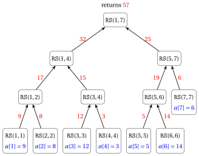
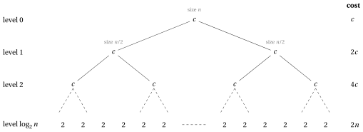
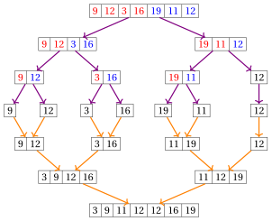
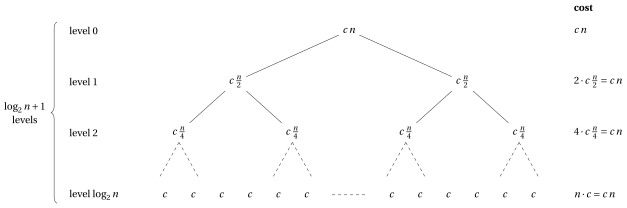
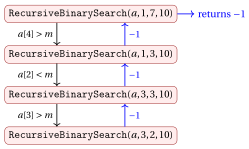
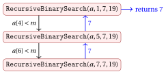
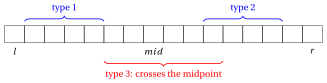
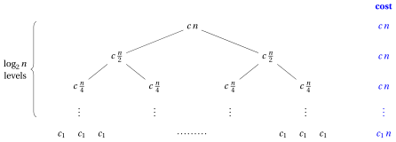

# Recursive algorithms

<div class="info-capitolo" markdown>

**Part 4 · Analysis and recursion · Chapter 17** · [:material-file-pdf-box: Lecture notes, volume 4 (PDF)](../pdf/lecture-notes-4-analysis-recursion.pdf) · [:material-pencil: Exercises](../exercises/ex-17-recursive-algorithms.md)

</div>

## Introduction

In the chapters «Recursion», «Recurrences» and «The Master Theorem» we have learnt how a recursive algorithm is executed, how its number of steps is described by a recurrence, and how such a recurrence is solved. In this chapter we put these tools to work on four classical problems on arrays:

- the <strong>sum</strong> of the elements of an array, the simplest possible problem, on which we compare an iterative and two recursive algorithms;

- <strong>sorting</strong>, with <strong>Merge Sort</strong>, the first algorithm of the course that beats the $\Theta(n^2)$ sorting algorithms;

- <strong>searching</strong> in a sorted array, with the <strong>Recursive Binary Search</strong>;

- the <strong>maximum subarray</strong> problem, where a divide and conquer algorithm improves on brute force, and a clever iterative algorithm improves on both.

All the algorithms are studied with the same scheme, which is the scheme of the analysis of every recursive algorithm.

!!! chiave ""

    For each recursive algorithm we:

    1. write the pseudo-code and run it on a small example, drawing the <strong>call tree</strong>;

    2. prove that it is <strong>correct</strong>, by (strong) induction on the size of the sub-problem;

    3. describe its number of steps by a <strong>recurrence</strong> and solve it, with the recursion tree and with the Master Theorem;

    4. express the worst-case <strong>running time</strong> as a function of the input size $|I|$;

    5. measure the <strong>extra memory</strong>, which for a recursive algorithm includes the call stack;

    6. give a <code>C++</code> implementation (arrays indexed from $0$, while in the pseudo-code they are indexed from $1$).

Three of the four algorithms follow the <strong>divide and conquer</strong> paradigm: the problem on a sub-array $a[l..r]$ is split into sub-problems on the two halves $a[l..m]$ and $a[m+1..r]$ (<em>divide</em>), the sub-problems are solved recursively (<em>conquer</em>), and their solutions are put together (<em>combine</em>). The Recursive Binary Search, instead, makes a single recursive call on one half.

## 17.1 The sum of the elements of an array

### 17.1.1 The problem

!!! chiave ""

    Given an array $a[1..n]$ of $n \ge 1$ integer numbers, we consider the problem of computing the sum of its elements:

    $$
    \sum_{i=1}^{n} a[i] = a[1]+a[2]+\cdots+a[n].
    $$

- This is one of the simplest problems on arrays, and it is the ideal problem to compare an <strong>iterative</strong> algorithm and a <strong>recursive</strong> algorithm that solve the same problem.

- We write the recursive algorithm, we prove that it is correct, we describe its number of steps by a recurrence and we solve the recurrence, using the tools of the chapters «Recursion», «Recurrences» and «The Master Theorem».

<a id="box-1-exSumInstance"></a>

!!! esempio "Example 17.1: sum of an array"

    We consider the following array of $n=7$ integer numbers:

    $$
    \begin{array}{c|c|c|c|c|c|c|c|}
    {a[i]} & {i=1} & {i=2} & {i=3} & {i=4} & {i=5} & {i=6} & {i=7} \\
    & 9 & 8 & 12 & 3 & 5 & 14 & 6
    \end{array}
    $$

    The sum of its elements is

    $$
    9+8+12+3+5+14+6 = 57.
    $$

### 17.1.2 Iterative algorithm

- We start from the obvious iterative algorithm <code>SumIterative</code>, which scans the array from left to right and accumulates the partial sums in the variable $s$:

!!! algoritmo "Algorithm: SumIterative"

    <div class="pseudocodice" markdown="0">
    <div class="pc-io"><span class="pc-kw">Input:</span> <span>An array <span class="arithmatex">&#92;(a&#91;1..n&#93;&#92;)</span> of <span class="arithmatex">&#92;(n&#92;)</span> integer numbers</span></div>
    <div class="pc-io"><span class="pc-kw">Output:</span> <span>The sum <span class="arithmatex">&#92;(a&#91;1&#93;+a&#91;2&#93;+&#92;cdots+a&#91;n&#93;&#92;)</span></span></div>
    <div class="pc-sep"></div>
    <div class="pc-riga pc-vuota"><span class="pc-n"></span><span class="pc-corpo"></span></div>
    <div class="pc-riga"><span class="pc-n">1</span><span class="pc-corpo"><span class="pc-t"><strong>function</strong> SumIterative(a, n)</span></span></div>
    <div class="pc-riga" id="riga-17-recursive-algorithms-line-sumit-a"><span class="pc-n">2</span><span class="pc-corpo"><span class="pc-l"></span><span class="pc-t"><span class="arithmatex">&#92;(s := 0&#92;)</span></span></span></div>
    <div class="pc-riga" id="riga-17-recursive-algorithms-line-sumit-b"><span class="pc-n">3</span><span class="pc-corpo"><span class="pc-l"></span><span class="pc-t"><span class="arithmatex">&#92;(i := 1&#92;)</span></span></span></div>
    <div class="pc-riga pc-vuota"><span class="pc-n"></span><span class="pc-corpo"><span class="pc-l"></span></span></div>
    <div class="pc-riga" id="riga-17-recursive-algorithms-line-sumit-c"><span class="pc-n">4</span><span class="pc-corpo"><span class="pc-l"></span><span class="pc-t"><strong>while</strong> <span class="arithmatex">&#92;(i &#92;le n&#92;)</span> <strong>do</strong></span></span></div>
    <div class="pc-riga" id="riga-17-recursive-algorithms-line-sumit-d"><span class="pc-n">5</span><span class="pc-corpo"><span class="pc-l"></span><span class="pc-l"></span><span class="pc-t"><span class="arithmatex">&#92;(s &#92;leftarrow s + a&#91;i&#93;&#92;)</span></span></span></div>
    <div class="pc-riga" id="riga-17-recursive-algorithms-line-sumit-e"><span class="pc-n">6</span><span class="pc-corpo"><span class="pc-l"></span><span class="pc-l"></span><span class="pc-t"><span class="arithmatex">&#92;(i &#92;leftarrow i + 1&#92;)</span></span></span></div>
    <div class="pc-riga"><span class="pc-n">7</span><span class="pc-corpo"><span class="pc-l"></span><span class="pc-t"><strong>end</strong></span></span></div>
    <div class="pc-riga pc-vuota"><span class="pc-n"></span><span class="pc-corpo"><span class="pc-l"></span></span></div>
    <div class="pc-riga" id="riga-17-recursive-algorithms-line-sumit-f"><span class="pc-n">8</span><span class="pc-corpo"><span class="pc-l"></span><span class="pc-t"><strong>return</strong> <span class="arithmatex">&#92;(s&#92;)</span></span></span></div>
    <div class="pc-riga"><span class="pc-n">9</span><span class="pc-corpo"><span class="pc-t"><strong>end</strong></span></span></div>
    </div>

- Let $S(n)$ denote the number of steps executed by <code>SumIterative</code> on an array of $n$ elements (there is no difference between best and worst case: the algorithm always performs the same operations). The number of times each line of code is executed is:

    - <span style="color:#e03131">Line</span> [2](#riga-17-recursive-algorithms-line-sumit-a) is executed $1$ time

    - <span style="color:#e03131">Line</span> [3](#riga-17-recursive-algorithms-line-sumit-b) is executed $1$ time

    - <span style="color:#e03131">Line</span> [4](#riga-17-recursive-algorithms-line-sumit-c) is executed $n+1$ times

    - <span style="color:#e03131">Line</span> [5](#riga-17-recursive-algorithms-line-sumit-d) is executed $n$ times

    - <span style="color:#e03131">Line</span> [6](#riga-17-recursive-algorithms-line-sumit-e) is executed $n$ times

    - <span style="color:#e03131">Line</span> [8](#riga-17-recursive-algorithms-line-sumit-f) is executed $1$ time

    Therefore,

    $$
    S(n) = 1+1+(n+1)+n+n+1 = 3n+4 = \Theta(n),
    \qquad\text{since}\qquad
    \lim_{n\to\infty}\frac{3n+4}{n}=\lim_{n\to\infty}\left(3+\frac{4}{n}\right)=3\in\R_{>0}.
    $$

- Besides the input array, the algorithm uses only the two variables $s$ and $i$: the <strong>extra memory</strong> is $\Theta(1)$.

### 17.1.3 Recursive algorithm (divide and conquer)

- The same sum can be computed recursively. The sum of the elements of a sub-array $a[l..r]$ is obtained by <strong>divide and conquer</strong>:

    1. <strong>Divide</strong>: split $a[l..r]$ in two halves $a[l..m]$ and $a[m+1..r]$, where $m=\lfloor (l+r)/2\rfloor$;

    2. <strong>Conquer</strong>: compute recursively the sum $s_1$ of $a[l..m]$ and the sum $s_2$ of $a[m+1..r]$;

    3. <strong>Combine</strong>: return $s_1+s_2$.

- The <strong>base case</strong> is a sub-array with a single element ($l=r$): its sum is the element $a[l]$ itself.

- This is the pseudo-code of the recursive algorithm <code>RecursiveSum</code>. To sum the whole array we call <code>RecursiveSum</code>$(a,1,n)$.

!!! algoritmo "Algorithm: RecursiveSum"

    <div class="pseudocodice" markdown="0">
    <div class="pc-io"><span class="pc-kw">Input:</span> <span>An array <span class="arithmatex">&#92;(a&#92;)</span> and two indices <span class="arithmatex">&#92;(l &#92;le r&#92;)</span></span></div>
    <div class="pc-io"><span class="pc-kw">Output:</span> <span>The sum <span class="arithmatex">&#92;(a&#91;l&#93;+a&#91;l+1&#93;+&#92;cdots+a&#91;r&#93;&#92;)</span></span></div>
    <div class="pc-sep"></div>
    <div class="pc-riga pc-vuota"><span class="pc-n"></span><span class="pc-corpo"></span></div>
    <div class="pc-riga"><span class="pc-n">1</span><span class="pc-corpo"><span class="pc-t"><strong>function</strong> RecursiveSum(a, l, r)</span></span></div>
    <div class="pc-riga" id="riga-17-recursive-algorithms-line-rsum-a"><span class="pc-n">2</span><span class="pc-corpo"><span class="pc-l"></span><span class="pc-t"><strong>if</strong> <span class="arithmatex">&#92;(l = r&#92;)</span> <strong>then</strong></span></span></div>
    <div class="pc-riga" id="riga-17-recursive-algorithms-line-rsum-b"><span class="pc-n">3</span><span class="pc-corpo"><span class="pc-l"></span><span class="pc-l"></span><span class="pc-t"><strong>return</strong> <span class="arithmatex">&#92;(a&#91;l&#93;&#92;)</span></span><span class="pc-c">// Base case</span></span></div>
    <div class="pc-riga"><span class="pc-n">4</span><span class="pc-corpo"><span class="pc-l"></span><span class="pc-t"><strong>end</strong></span></span></div>
    <div class="pc-riga" id="riga-17-recursive-algorithms-line-rsum-c"><span class="pc-n">5</span><span class="pc-corpo"><span class="pc-l"></span><span class="pc-t"><span class="arithmatex">&#92;(m := &#92;lfloor (l+r)/2 &#92;rfloor&#92;)</span></span><span class="pc-c">// Divide</span></span></div>
    <div class="pc-riga" id="riga-17-recursive-algorithms-line-rsum-d"><span class="pc-n">6</span><span class="pc-corpo"><span class="pc-l"></span><span class="pc-t"><span class="arithmatex">&#92;(s&#95;1 :=&#92;)</span> RecursiveSum<span class="arithmatex">&#92;((a, l, m)&#92;)</span></span><span class="pc-c">// Conquer (left half)</span></span></div>
    <div class="pc-riga" id="riga-17-recursive-algorithms-line-rsum-e"><span class="pc-n">7</span><span class="pc-corpo"><span class="pc-l"></span><span class="pc-t"><span class="arithmatex">&#92;(s&#95;2 :=&#92;)</span> RecursiveSum<span class="arithmatex">&#92;((a, m+1, r)&#92;)</span></span><span class="pc-c">// Conquer (right half)</span></span></div>
    <div class="pc-riga" id="riga-17-recursive-algorithms-line-rsum-f"><span class="pc-n">8</span><span class="pc-corpo"><span class="pc-l"></span><span class="pc-t"><strong>return</strong> <span class="arithmatex">&#92;(s&#95;1 + s&#95;2&#92;)</span></span><span class="pc-c">// Combine</span></span></div>
    <div class="pc-riga"><span class="pc-n">9</span><span class="pc-corpo"><span class="pc-t"><strong>end</strong></span></span></div>
    </div>

- Let $k = r-l+1$ be the number of elements of $a[l..r]$. If $k\ge 2$, the two halves have

    $$
    m-l+1 = \left\lceil \frac{k}{2}\right\rceil
    \qquad\text{and}\qquad
    r-m = \left\lfloor \frac{k}{2}\right\rfloor
    $$

    elements, respectively. Both numbers are at least $1$ and strictly smaller than $k$: every recursive call works on a smaller sub-array, and the recursion always reaches the base case.

### 17.1.4 Call tree

- The execution of a recursive algorithm is represented by its <strong>call tree</strong>: every node is a call, and the children of a node are the calls it makes. The value returned by a call is sent back to its parent.

<a id="box-2-exSumCallTree"></a>

!!! esempio "Example 17.2: call tree of RecursiveSum"

    We consider the array of [Example 17.1](#box-1-exSumInstance), i.e., $a=[9,8,12,3,5,14,6]$ and $n=7$. This is the call tree of <code>RecursiveSum</code>$(a,1,7)$, where each node <code>RS</code>$(l,r)$ is a call on the sub-array $a[l..r]$. In <span style="color:#1971c2">blue</span> the elements of the array returned by the base cases, in <span style="color:#e03131">red</span> the values returned by the calls to their parents (along the arrows):

    { .fig loading=lazy  }

    - The root <code>RS</code>$(1,7)$ computes $m=\lfloor 8/2\rfloor = 4$ and calls <code>RS</code>$(1,4)$ and <code>RS</code>$(5,7)$.

    - <code>RS</code>$(1,4)$ computes $m=2$ and returns $17+15=32$; <code>RS</code>$(5,7)$ computes $m=6$ and returns $19+6=25$.

    - The root returns $32+25=57$, which is the sum of the elements of the array.

    - There are $13 = 2\cdot 7-1$ calls: $7$ leaves (base cases, one for each element) and $6$ internal nodes, each of which performs one addition, so there are $6=n-1$ additions in total.

- The calls are executed in <strong>depth-first</strong> order: a call is completed only after both its children are completed. In the example the calls terminate in the order

    $$
    (1,1),\ (2,2),\ (1,2),\ (3,3),\ (4,4),\ (3,4),\ (1,4),\ (5,5),\ (6,6),\ (5,6),\ (7,7),\ (5,7),\ (1,7).
    $$

### 17.1.5 Correctness

- The correctness of a recursive algorithm is proved by <strong>strong induction</strong> on the size of the sub-problem: we assume that the recursive calls, which work on smaller sub-arrays, are correct, and we show that the call combines their results correctly.

<a id="box-3-obsRecSumCorrect"></a>

!!! teorema "Observation 17.1: correctness of RecursiveSum"

    For every pair of indices $l \le r$, the call <code>RecursiveSum</code>$(a,l,r)$ terminates and returns

    $$
    \sum_{i=l}^{r} a[i].
    $$

??? dimostrazione "Proof"

    We use strong induction on the number $k=r-l+1 \ge 1$ of elements of the sub-array.

    <strong>Base case</strong> ($k=1$). Then $l=r$, the condition of line [2](#riga-17-recursive-algorithms-line-rsum-a) is true and the algorithm returns $a[l] = \sum_{i=l}^{l} a[i]$.

    <strong>Inductive step</strong> ($k \ge 2$). Assume that the statement holds for all sub-arrays with fewer than $k$ elements (<em>inductive hypothesis</em>). Since $l<r$, the algorithm computes $m=\lfloor (l+r)/2\rfloor$, with $l \le m < r$. The sub-arrays $a[l..m]$ and $a[m+1..r]$ have $\lceil k/2\rceil$ and $\lfloor k/2\rfloor$ elements, both between $1$ and $k-1$. By the inductive hypothesis, the two recursive calls terminate and

    $$
    s_1 = \sum_{i=l}^{m} a[i], \qquad s_2 = \sum_{i=m+1}^{r} a[i].
    $$

    Therefore, the algorithm returns

    $$
    s_1+s_2 = \sum_{i=l}^{m} a[i] + \sum_{i=m+1}^{r} a[i] = \sum_{i=l}^{r} a[i].
    $$

    <p class="qed-riga"><span class="qed">□</span></p>

- With $l=1$ and $r=n$, the call <code>RecursiveSum</code>$(a,1,n)$ returns the sum of all the elements of the array.

### 17.1.6 Number of steps of <code>RecursiveSum</code>

#### The recurrence

- Let $S(n)$ denote the number of steps executed by <code>RecursiveSum</code> on a sub-array of $n=r-l+1$ elements. As for the iterative algorithm, the number of steps depends only on $n$ (and not on the values of the elements).

- We count the lines of code executed <strong>by a single call</strong>. A line containing a recursive call counts as $1$ step (the call itself) <strong>plus</strong> all the steps executed by the called function, which we express again using $S$.

- If $n=1$, <span style="color:#e03131">lines</span> [2](#riga-17-recursive-algorithms-line-rsum-a) and [3](#riga-17-recursive-algorithms-line-rsum-b) are executed $1$ time each, and therefore $S(1)=2$.

- If $n\ge 2$:

    - <span style="color:#e03131">Line</span> [2](#riga-17-recursive-algorithms-line-rsum-a) is executed $1$ time

    - <span style="color:#e03131">Line</span> [3](#riga-17-recursive-algorithms-line-rsum-b) is not executed

    - <span style="color:#e03131">Line</span> [5](#riga-17-recursive-algorithms-line-rsum-c) is executed $1$ time

    - <span style="color:#e03131">Line</span> [6](#riga-17-recursive-algorithms-line-rsum-d) is executed $1$ time, plus the $S(\lceil n/2\rceil)$ steps of the call on $a[l..m]$

    - <span style="color:#e03131">Line</span> [7](#riga-17-recursive-algorithms-line-rsum-e) is executed $1$ time, plus the $S(\lfloor n/2\rfloor)$ steps of the call on $a[m+1..r]$

    - <span style="color:#e03131">Line</span> [8](#riga-17-recursive-algorithms-line-rsum-f) is executed $1$ time

    and therefore $S(n) = S(\lceil n/2\rceil)+S(\lfloor n/2\rfloor)+5$.

!!! chiave ""

    The number of steps of <code>RecursiveSum</code> is described by the recurrence

    $$
    S(n)=
    \begin{cases}
    2 & \text{if } n=1,\\[1mm]
    S\big(\lceil n/2\rceil\big)+S\big(\lfloor n/2\rfloor\big)+c & \text{if } n\ge 2,
    \end{cases}
    $$

    with $c=5$. As usual, in the asymptotic analysis we write it simply as

    $$
    S(n) = 2\,S(n/2) + c .
    $$

#### Solution with the recursion tree

- In the <strong>recursion tree</strong> every node represents a call and contains the number of steps executed by that call <em>excluding</em> the steps of its recursive calls: $c$ for an internal node, $2$ for a leaf. $S(n)$ is the sum of the values of all the nodes.

- For simplicity, assume first that $n=2^h$ is an exact power of $2$. Then every sub-array is split into two halves of equal size, and the tree is:

{ .fig loading=lazy style="width:95%" }

- Level $i$ contains $2^i$ calls on sub-arrays of $n/2^i$ elements. The leaves are at level $\log_2 n$, where the sub-arrays have $n/2^{\log_2 n}=1$ element: there are $2^{\log_2 n}=n$ leaves.

- The internal levels $0,1,\dots,\log_2 n-1$ contain

    $$
    \sum_{i=0}^{\log_2 n-1} 2^i = 2^{\log_2 n}-1 = n-1
    $$

    nodes (sum of a geometric series). Therefore the total number of steps is

    $$
    S(n) = c\,(n-1) + 2n = 5(n-1)+2n = 7n-5.
    $$

- The cost of the levels <strong>doubles</strong> from one level to the next one: the total is dominated by the leaves, which are $n$. This is exactly the situation of case 1 of the Master Theorem.

- The same counting holds for <strong>every</strong> $n$, not only for powers of $2$: the key fact is that the tree has exactly $n$ leaves and $n-1$ internal nodes, as the next observation shows.

<a id="box-4-obsRecSumCalls"></a>

!!! teorema "Observation 17.2: calls and steps of RecursiveSum"

    For every $n\ge 1$, the call <code>RecursiveSum</code>$(a,l,r)$ on a sub-array of $n=r-l+1$ elements generates exactly

    $$
    2n-1
    $$

    calls (including the first one): $n$ of them are base cases and $n-1$ of them perform one addition. Moreover, $S(n)=7n-5$.

??? dimostrazione "Proof"

    Let $C(n)$ be the number of calls. We have $C(1)=1$ and, for $n\ge 2$,

    $$
    C(n) = 1 + C(\lceil n/2\rceil) + C(\lfloor n/2\rfloor).
    $$

    We prove $C(n)=2n-1$ by strong induction on $n$. For $n=1$: $C(1)=1=2\cdot 1-1$. For $n \ge 2$, by the inductive hypothesis applied to $\lceil n/2\rceil<n$ and $\lfloor n/2\rfloor<n$,

    $$
    C(n) = 1 + \big(2\lceil n/2\rceil-1\big) + \big(2\lfloor n/2\rfloor-1\big)
    = 2\big(\lceil n/2\rceil+\lfloor n/2\rfloor\big) - 1 = 2n-1,
    $$

    because $\lceil n/2\rceil+\lfloor n/2\rfloor=n$ for every natural number $n$.

    Each base case corresponds to exactly one element of the sub-array (the sub-arrays of the leaves are disjoint and cover $a[l..r]$), so there are $n$ base cases and $2n-1-n=n-1$ calls that execute line [8](#riga-17-recursive-algorithms-line-rsum-f).

    In the same way, $S(1)=2=7\cdot 1-5$ and, for $n\ge 2$,

    $$
    S(n) = \big(7\lceil n/2\rceil-5\big) + \big(7\lfloor n/2\rfloor-5\big) + 5 = 7n-5.
    $$

    <p class="qed-riga"><span class="qed">□</span></p>

- Accordingly,

    $$
    S(n)=7n-5=\Theta(n),
    \qquad\text{since}\qquad
    \lim_{n\to\infty}\frac{7n-5}{n}=7\in\R_{>0}.
    $$

    For the array of [Example 17.2](#box-2-exSumCallTree), $S(7)=44$: $7$ leaves with $2$ steps each and $6$ internal nodes with $5$ steps each.

#### Solution with the Master Theorem

- We can obtain the order of growth of $S(n)$ directly from the Master Theorem, without computing $S(n)$ exactly. We recall case 1 of the Master Theorem:

!!! chiave ""

    Let $S(n)=a\,S(n/b)+f(n)$, with $a\ge 1$ and $b>1$ constants and $f(n)$ asymptotically positive. If $f(n)=O\big(n^{\log_b a-\varepsilon}\big)$ for some constant $\varepsilon>0$, then

    $$
    S(n)=\Theta\big(n^{\log_b a}\big).
    $$

- $S(n)=2\,S(n/2)+c$ $\quad\rightarrow\quad$ $a=2$, $b=2$, $f(n)=c$.

- $n^{\log_b a}=n^{\log_2 2}=n^1=n$.

- Comparison: $f(n)=c$ grows polynomially slower than $n$ $\quad\rightarrow\quad$ case 1.

- Hypothesis: $f(n)=c=O\big(n^{1-\varepsilon}\big)$ with $\varepsilon=1$, since $c = c\cdot n^{0}$.

- Conclusion: $S(n)=\Theta\big(n^{\log_2 2}\big)=\Theta(n)$.

As expected, the result agrees with the exact solution $S(n)=7n-5$.

#### Worst-case running time

- As in the chapter «Running time», we make the hypothesis that every entry of the array is stored using a fixed constant number of bits. Then $|I|=\Theta(n)$, i.e., there exist constants $c_1,c_2>0$ such that $c_1 n\le |I| \le c_2 n$ for all sufficiently large $n$, and

    $$
    \frac{1}{c_2}|I| \le n \le \frac{1}{c_1}|I|.
    $$

    Since $S(n)=7n-5=\Theta(n)$, there exist constants $a_1,a_2>0$ such that $a_1 n\le S(n) \le a_2 n$ for all sufficiently large $n$, and hence

    $$
    \frac{a_1}{c_2}|I| \le S(n) \le \frac{a_2}{c_1}|I|.
    $$

!!! chiave ""

    If all input values use a fixed constant number of bits, then the worst-case running time of the <code>RecursiveSum</code> algorithm (and also of the <code>SumIterative</code> algorithm) is

    $$
    T(|I|)=\Theta(|I|).
    $$

    Thus, both algorithms are linear in the input size.

- Recursion does not make the algorithm faster: both algorithms read every element once and perform $n-1$ (recursive) or $n$ (iterative) additions. The recursive version even executes more steps ($7n-5$ against $3n+4$), because of the overhead of the calls.

### 17.1.7 Extra memory: the call stack

- Time is not the only resource. Each active call of a recursive function needs its own <strong>activation record</strong> on the <strong>call stack</strong>, containing its parameters, its local variables and the return address. In <code>RecursiveSum</code> the parameters and local variables are $l$, $r$, $m$, $s_1$, $s_2$: every activation record has constant size.

- A call is active from the moment it starts until it returns. Since the calls are executed depth-first, the active calls at any moment form a path from the root of the call tree to the current node. Therefore:

!!! chiave ""

    The maximum number of simultaneously active calls (the <strong>recursion depth</strong>) equals the height of the call tree plus one. The extra memory used by a recursive algorithm is (at least) proportional to the recursion depth.

<a id="box-5-obsRecSumDepth"></a>

!!! teorema "Observation 17.3: recursion depth of RecursiveSum"

    For every $n\ge 1$, the call tree of <code>RecursiveSum</code> on a sub-array of $n$ elements has height $\lceil \log_2 n\rceil$. Hence the recursion depth is $\lceil \log_2 n\rceil+1$ and the extra memory used by <code>RecursiveSum</code> is $\Theta(\log_2 n)$.

??? dimostrazione "Proof"

    Let $h(n)$ be the height of the call tree. Then $h(1)=0$ and, for $n\ge 2$,

    $$
    h(n)=1+\max\big\{h(\lceil n/2\rceil),\,h(\lfloor n/2\rfloor)\big\}.
    $$

    We prove $h(n)=\lceil \log_2 n\rceil$ by strong induction. For $n=1$, $\lceil \log_2 1\rceil = 0$. Let $n\ge 2$. Since $\lceil \log_2 x\rceil$ is non-decreasing in $x$, by the inductive hypothesis the maximum is attained by the larger half, and $h(n)=1+\lceil \log_2 \lceil n/2\rceil\rceil$.

    Let $k=\lceil \log_2 n\rceil\ge 1$, i.e., $2^{k-1}<n\le 2^k$. Dividing by $2$, we obtain $2^{k-2}<n/2\le 2^{k-1}$; since $2^{k-1}$ is an integer, also $2^{k-2}<\lceil n/2\rceil\le 2^{k-1}$, that is $\lceil \log_2\lceil n/2\rceil\rceil=k-1$. Therefore $h(n)=1+(k-1)=k=\lceil \log_2 n\rceil$.

    Each activation record has constant size, so the extra memory is $\Theta(\lceil \log_2 n\rceil+1)=\Theta(\log_2 n)$. <span class="qed">□</span>

- In [Example 17.2](#box-2-exSumCallTree), $n=7$ and the recursion depth is $\lceil \log_2 7\rceil+1=3+1=4$: for instance, when <code>RS</code>$(1,1)$ is executed, the active calls are <code>RS</code>$(1,7)$, <code>RS</code>$(1,4)$, <code>RS</code>$(1,2)$ and <code>RS</code>$(1,1)$.

!!! chiave ""

    <div class="tabella" markdown="0"><table>
    <tr>
    <th>algorithm</th>
    <th>number of steps</th>
    <th>extra memory</th>
    </tr>
    <tr>
    <td><code>SumIterative</code></td>
    <td><span class="arithmatex">&#92;(3n+4=&#92;Theta(n)&#92;)</span></td>
    <td><span class="arithmatex">&#92;(&#92;Theta(1)&#92;)</span></td>
    </tr>
    <tr>
    <td><code>RecursiveSum</code></td>
    <td><span class="arithmatex">&#92;(7n-5=&#92;Theta(n)&#92;)</span></td>
    <td><span class="arithmatex">&#92;(&#92;Theta(&#92;log&#95;2 n)&#92;)</span></td>
    </tr>
    </table></div>

### 17.1.8 A different recursion: decrease by one

- The halving is not the only way to sum an array recursively. The array can also be split in an <strong>unbalanced</strong> way: the sum of $a[1..n]$ is the sum of $a[1..n-1]$ plus $a[n]$. This is a <em>decrease by one</em> recursion:

!!! algoritmo "Algorithm: RecursiveSumLinear"

    <div class="pseudocodice" markdown="0">
    <div class="pc-io"><span class="pc-kw">Input:</span> <span>An array <span class="arithmatex">&#92;(a&#91;1..n&#93;&#92;)</span> of <span class="arithmatex">&#92;(n &#92;ge 1&#92;)</span> integer numbers</span></div>
    <div class="pc-io"><span class="pc-kw">Output:</span> <span>The sum <span class="arithmatex">&#92;(a&#91;1&#93;+a&#91;2&#93;+&#92;cdots+a&#91;n&#93;&#92;)</span></span></div>
    <div class="pc-sep"></div>
    <div class="pc-riga pc-vuota"><span class="pc-n"></span><span class="pc-corpo"></span></div>
    <div class="pc-riga"><span class="pc-n">1</span><span class="pc-corpo"><span class="pc-t"><strong>function</strong> RecursiveSumLinear(a, n)</span></span></div>
    <div class="pc-riga" id="riga-17-recursive-algorithms-line-rsuml-a"><span class="pc-n">2</span><span class="pc-corpo"><span class="pc-l"></span><span class="pc-t"><strong>if</strong> <span class="arithmatex">&#92;(n = 1&#92;)</span> <strong>then</strong></span></span></div>
    <div class="pc-riga" id="riga-17-recursive-algorithms-line-rsuml-b"><span class="pc-n">3</span><span class="pc-corpo"><span class="pc-l"></span><span class="pc-l"></span><span class="pc-t"><strong>return</strong> <span class="arithmatex">&#92;(a&#91;1&#93;&#92;)</span></span><span class="pc-c">// Base case</span></span></div>
    <div class="pc-riga"><span class="pc-n">4</span><span class="pc-corpo"><span class="pc-l"></span><span class="pc-t"><strong>end</strong></span></span></div>
    <div class="pc-riga" id="riga-17-recursive-algorithms-line-rsuml-c"><span class="pc-n">5</span><span class="pc-corpo"><span class="pc-l"></span><span class="pc-t"><span class="arithmatex">&#92;(s :=&#92;)</span> RecursiveSumLinear<span class="arithmatex">&#92;((a, n-1)&#92;)</span></span></span></div>
    <div class="pc-riga" id="riga-17-recursive-algorithms-line-rsuml-d"><span class="pc-n">6</span><span class="pc-corpo"><span class="pc-l"></span><span class="pc-t"><strong>return</strong> <span class="arithmatex">&#92;(s + a&#91;n&#93;&#92;)</span></span></span></div>
    <div class="pc-riga"><span class="pc-n">7</span><span class="pc-corpo"><span class="pc-t"><strong>end</strong></span></span></div>
    </div>

- Correctness follows by (simple) induction on $n$: for $n=1$ the algorithm returns $a[1]$; for $n\ge 2$, by the inductive hypothesis $s=a[1]+\cdots+a[n-1]$, and the algorithm returns $s+a[n]=a[1]+\cdots+a[n]$.

- If $n=1$, lines [2](#riga-17-recursive-algorithms-line-rsuml-a) and [3](#riga-17-recursive-algorithms-line-rsuml-b) are executed once: $S(1)=2$. If $n\ge 2$, lines [2](#riga-17-recursive-algorithms-line-rsuml-a), [5](#riga-17-recursive-algorithms-line-rsuml-c) and [6](#riga-17-recursive-algorithms-line-rsuml-d) are executed once, plus the $S(n-1)$ steps of the recursive call:

    $$
    S(n)=
    \begin{cases}
    2 & \text{if } n=1,\\
    S(n-1)+3 & \text{if } n\ge 2.
    \end{cases}
    $$

- The Master Theorem <strong>cannot</strong> be applied, because the size of the sub-problem is $n-1$ and not $n/b$ for a constant $b>1$. We solve the recurrence by iteration (unrolling):

    $$
    S(n) = S(n-1)+3 = S(n-2)+2\cdot 3 = \cdots = S(1)+(n-1)\cdot 3 = 3n-1 = \Theta(n).
    $$

- The call tree is a <strong>path</strong> of $n$ nodes: <code>RecursiveSumLinear</code>$(a,n)$ calls <code>RecursiveSumLinear</code>$(a,n-1)$, which calls <code>RecursiveSumLinear</code>$(a,n-2)$, and so on, until $n=1$. When the base case is reached, all the $n$ calls are active.

!!! chiave ""

    <code>RecursiveSumLinear</code> executes $S(n)=3n-1=\Theta(n)$ steps, but its recursion depth is $n$: it needs $\Theta(n)$ extra memory for the call stack (against $\Theta(\log_2 n)$ of <code>RecursiveSum</code> and $\Theta(1)$ of <code>SumIterative</code>). In practice, for large $n$ (e.g. $n=10^7$) the decrease-by-one version may exhaust the call stack (<em>stack overflow</em>), while <code>RecursiveSum</code> needs only $\lceil\log_2 10^7\rceil+1=25$ active calls.

### 17.1.9 <code>C++</code> implementation

- This is a <code>C++</code> implementation of the iterative and of the recursive algorithms. In <code>C++</code> arrays are indexed from $0$: the sum of the whole array is computed by the call <code>RecursiveSum(a, 0, n-1)</code>.

```cpp
// Iterative sum of a[0..n-1]
int SumIterative(int n, int *a)
{
    int s = 0;
    for (int i = 0; i < n; i++)
    {
        s = s + a[i];
    }
    return s;
}

// Recursive sum of a[l..r] (0-indexed, l <= r)
int RecursiveSum(int *a, int l, int r)
{
    if (l == r)
    {
        return a[l];  // Base case: one element
    }

    int m = l + (r - l) / 2;  // Equivalent to (l + r) / 2

    int s1 = RecursiveSum(a, l, m);      // Sum of the left half
    int s2 = RecursiveSum(a, m + 1, r);  // Sum of the right half

    return s1 + s2;
}
```

- The expression <code>l + (r - l) / 2</code> computes $\lfloor (l+r)/2 \rfloor$ (for $l,r\ge 0$) without the risk of overflow of the sum <code>l + r</code>, as in the Binary Search algorithm.

<a id="box-6-exSumCpp"></a>

!!! esempio "Example 17.3: execution of the C++ implementation of RecursiveSum"

    We execute the call <code>RecursiveSum(a, 0, 4)</code> on the array $a = [9, 8, 12, 3, 5]$ ($n=5$):

    $$
    \begin{array}{c|c|c|c|c|c|}
    {a[j]} & {j=0} & {j=1} & {j=2} & {j=3} & {j=4} \\
    & 9 & 8 & 12 & 3 & 5
    \end{array}
    $$

    $l=0 \qquad r=4$

    The column <em>stack</em> reports the active calls, from the first one to the current one (we write $(l,r)$ for <code>RecursiveSum(a, l, r)</code>).

    <div class="tabella" markdown="0"><table>
    <tr>
    <th>\#</th>
    <th>stack</th>
    <th>action</th>
    </tr>
    <tr>
    <td>1</td>
    <td><span class="arithmatex">&#92;((0,4)&#92;)</span></td>
    <td><span class="arithmatex">&#92;(l&#92;ne r&#92;)</span>, <span class="arithmatex">&#92;(m=0+(4-0)/2=2&#92;)</span>; call <span class="arithmatex">&#92;((0,2)&#92;)</span></td>
    </tr>
    <tr>
    <td>2</td>
    <td><span class="arithmatex">&#92;((0,4),(0,2)&#92;)</span></td>
    <td><span class="arithmatex">&#92;(l&#92;ne r&#92;)</span>, <span class="arithmatex">&#92;(m=0+(2-0)/2=1&#92;)</span>; call <span class="arithmatex">&#92;((0,1)&#92;)</span></td>
    </tr>
    <tr>
    <td>3</td>
    <td><span class="arithmatex">&#92;((0,4),(0,2),(0,1)&#92;)</span></td>
    <td><span class="arithmatex">&#92;(l&#92;ne r&#92;)</span>, <span class="arithmatex">&#92;(m=0+(1-0)/2=0&#92;)</span>; call <span class="arithmatex">&#92;((0,0)&#92;)</span></td>
    </tr>
    <tr>
    <td>4</td>
    <td><span class="arithmatex">&#92;((0,4),(0,2),(0,1),(0,0)&#92;)</span></td>
    <td><span class="arithmatex">&#92;(l=r&#92;)</span> <span class="arithmatex">&#92;(&#92;Rightarrow&#92;)</span> return <span class="arithmatex">&#92;(a&#91;0&#93;=9&#92;)</span></td>
    </tr>
    <tr>
    <td>5</td>
    <td><span class="arithmatex">&#92;((0,4),(0,2),(0,1)&#92;)</span></td>
    <td><span class="arithmatex">&#92;(s1=9&#92;)</span>; call <span class="arithmatex">&#92;((1,1)&#92;)</span></td>
    </tr>
    <tr>
    <td>6</td>
    <td><span class="arithmatex">&#92;((0,4),(0,2),(0,1),(1,1)&#92;)</span></td>
    <td><span class="arithmatex">&#92;(l=r&#92;)</span> <span class="arithmatex">&#92;(&#92;Rightarrow&#92;)</span> return <span class="arithmatex">&#92;(a&#91;1&#93;=8&#92;)</span></td>
    </tr>
    <tr>
    <td>7</td>
    <td><span class="arithmatex">&#92;((0,4),(0,2),(0,1)&#92;)</span></td>
    <td><span class="arithmatex">&#92;(s2=8&#92;)</span>; return <span class="arithmatex">&#92;(9+8=17&#92;)</span></td>
    </tr>
    <tr>
    <td>8</td>
    <td><span class="arithmatex">&#92;((0,4),(0,2)&#92;)</span></td>
    <td><span class="arithmatex">&#92;(s1=17&#92;)</span>; call <span class="arithmatex">&#92;((2,2)&#92;)</span></td>
    </tr>
    <tr>
    <td>9</td>
    <td><span class="arithmatex">&#92;((0,4),(0,2),(2,2)&#92;)</span></td>
    <td><span class="arithmatex">&#92;(l=r&#92;)</span> <span class="arithmatex">&#92;(&#92;Rightarrow&#92;)</span> return <span class="arithmatex">&#92;(a&#91;2&#93;=12&#92;)</span></td>
    </tr>
    <tr>
    <td>10</td>
    <td><span class="arithmatex">&#92;((0,4),(0,2)&#92;)</span></td>
    <td><span class="arithmatex">&#92;(s2=12&#92;)</span>; return <span class="arithmatex">&#92;(17+12=29&#92;)</span></td>
    </tr>
    <tr>
    <td>11</td>
    <td><span class="arithmatex">&#92;((0,4)&#92;)</span></td>
    <td><span class="arithmatex">&#92;(s1=29&#92;)</span>; call <span class="arithmatex">&#92;((3,4)&#92;)</span></td>
    </tr>
    <tr>
    <td>12</td>
    <td><span class="arithmatex">&#92;((0,4),(3,4)&#92;)</span></td>
    <td><span class="arithmatex">&#92;(l&#92;ne r&#92;)</span>, <span class="arithmatex">&#92;(m=3+(4-3)/2=3&#92;)</span>; call <span class="arithmatex">&#92;((3,3)&#92;)</span></td>
    </tr>
    <tr>
    <td>13</td>
    <td><span class="arithmatex">&#92;((0,4),(3,4),(3,3)&#92;)</span></td>
    <td><span class="arithmatex">&#92;(l=r&#92;)</span> <span class="arithmatex">&#92;(&#92;Rightarrow&#92;)</span> return <span class="arithmatex">&#92;(a&#91;3&#93;=3&#92;)</span></td>
    </tr>
    <tr>
    <td>14</td>
    <td><span class="arithmatex">&#92;((0,4),(3,4)&#92;)</span></td>
    <td><span class="arithmatex">&#92;(s1=3&#92;)</span>; call <span class="arithmatex">&#92;((4,4)&#92;)</span></td>
    </tr>
    <tr>
    <td>15</td>
    <td><span class="arithmatex">&#92;((0,4),(3,4),(4,4)&#92;)</span></td>
    <td><span class="arithmatex">&#92;(l=r&#92;)</span> <span class="arithmatex">&#92;(&#92;Rightarrow&#92;)</span> return <span class="arithmatex">&#92;(a&#91;4&#93;=5&#92;)</span></td>
    </tr>
    <tr>
    <td>16</td>
    <td><span class="arithmatex">&#92;((0,4),(3,4)&#92;)</span></td>
    <td><span class="arithmatex">&#92;(s2=5&#92;)</span>; return <span class="arithmatex">&#92;(3+5=8&#92;)</span></td>
    </tr>
    <tr>
    <td>17</td>
    <td><span class="arithmatex">&#92;((0,4)&#92;)</span></td>
    <td><span class="arithmatex">&#92;(s2=8&#92;)</span>; return <span class="arithmatex">&#92;(29+8=37&#92;)</span></td>
    </tr>
    </table></div>

    The algorithm terminates with result $37 = 9+8+12+3+5$. There are $9=2\cdot 5-1$ calls, and the maximum number of active calls is $4=\lceil \log_2 5\rceil+1$ (rows 4 and 6).

!!! chiave ""

    <strong>Key points on the sum of an array.</strong>

    - <code>RecursiveSum</code> is correct (strong induction), makes $2n-1$ calls and executes $7n-5=\Theta(n)$ steps: recursion does not reduce the work, which is linear because every element must be read.

    - The recurrence $S(n)=2S(n/2)+c$ falls in case 1 of the Master Theorem: the cost is dominated by the $n$ leaves.

    - The call stack costs memory: $\Theta(\log_2 n)$ for the halving recursion, $\Theta(n)$ for the decrease-by-one recursion, $\Theta(1)$ for the loop.

## 17.2 Merge Sort

For the sum of an array, divide and conquer gave no gain in time. We now meet a problem where it does make a difference: sorting.

### 17.2.1 The sorting problem

!!! chiave ""

    Given an array $a[1..n]$ of $n$ natural numbers, we consider the problem of rearranging the elements of the array in non-decreasing order such that:

    $$
    a[1] \le a[2] \le \cdots \le a[n].
    $$

- The problem has been introduced in the chapter «Sorting algorithms», where we studied Insertion Sort, Exchange Sort and Selection Sort. In the chapter «Running time» we proved that the worst-case number of steps of <code>InsertionSort</code> is $S(n)=\frac{3n^2+9n-8}{2}=\Theta(n^2)$.

- In this section we study <strong>Merge Sort</strong>, a recursive comparison-based sorting algorithm based on the <strong>divide and conquer</strong> paradigm, whose number of steps is $\Theta(n\log_2 n)$ in the worst case.

<a id="box-7-exMsortInstance"></a>

!!! esempio "Example 17.4: a sorting instance"

    We consider the following array of $n=7$ natural numbers:

    $$
    \begin{array}{c|c|c|c|c|c|c|c|}
    {a[i]} & {i=1} & {i=2} & {i=3} & {i=4} & {i=5} & {i=6} & {i=7} \\
    & 9 & 12 & 3 & 16 & 19 & 11 & 12
    \end{array}
    $$

    The sorted array is:

    $$
    \begin{array}{c|c|c|c|c|c|c|c|}
    {a[i]} & {i=1} & {i=2} & {i=3} & {i=4} & {i=5} & {i=6} & {i=7} \\
    & 3 & 9 & 11 & 12 & 12 & 16 & 19
    \end{array}
    $$

### 17.2.2 The Merge Sort algorithm

#### Divide and conquer

- Merge Sort sorts a sub-array $a[l..r]$ as follows:

    1. <strong>Divide</strong>: split $a[l..r]$ in two halves $a[l..m]$ and $a[m+1..r]$, where $m=\lfloor (l+r)/2\rfloor$;

    2. <strong>Conquer</strong>: sort recursively the two halves;

    3. <strong>Combine</strong>: <strong>merge</strong> the two sorted halves into a single sorted sub-array $a[l..r]$.

- The <strong>base case</strong> is a sub-array with a single element ($l=r$), which is already sorted: nothing has to be done.

- The whole work is done in the <strong>combine</strong> step, by the procedure <code>Merge</code>. The key observation is that two <em>sorted</em> sequences can be merged very efficiently: the smallest element of the result is the smaller of the two first elements, and so on.

#### Pseudo-code

- This is the pseudo-code of the <code>MergeSort</code> algorithm. To sort the whole array $a[1..n]$, we call <code>MergeSort</code>$(a,1,n)$.

!!! algoritmo "Algorithm: MergeSort"

    <div class="pseudocodice" markdown="0">
    <div class="pc-io"><span class="pc-kw">Input:</span> <span>An array <span class="arithmatex">&#92;(a&#92;)</span> and two indices <span class="arithmatex">&#92;(l &#92;le r&#92;)</span></span></div>
    <div class="pc-io"><span class="pc-kw">Output:</span> <span>The sub-array <span class="arithmatex">&#92;(a&#91;l..r&#93;&#92;)</span> sorted in non-decreasing order</span></div>
    <div class="pc-sep"></div>
    <div class="pc-riga pc-vuota"><span class="pc-n"></span><span class="pc-corpo"></span></div>
    <div class="pc-riga"><span class="pc-n">1</span><span class="pc-corpo"><span class="pc-t"><strong>function</strong> MergeSort(a, l, r)</span></span></div>
    <div class="pc-riga" id="riga-17-recursive-algorithms-line-msort-a"><span class="pc-n">2</span><span class="pc-corpo"><span class="pc-l"></span><span class="pc-t"><strong>if</strong> <span class="arithmatex">&#92;(l &lt; r&#92;)</span> <strong>then</strong></span></span></div>
    <div class="pc-riga" id="riga-17-recursive-algorithms-line-msort-b"><span class="pc-n">3</span><span class="pc-corpo"><span class="pc-l"></span><span class="pc-l"></span><span class="pc-t"><span class="arithmatex">&#92;(m := &#92;lfloor (l+r)/2 &#92;rfloor&#92;)</span></span><span class="pc-c">// Divide</span></span></div>
    <div class="pc-riga" id="riga-17-recursive-algorithms-line-msort-c"><span class="pc-n">4</span><span class="pc-corpo"><span class="pc-l"></span><span class="pc-l"></span><span class="pc-t">MergeSort<span class="arithmatex">&#92;((a, l, m)&#92;)</span></span><span class="pc-c">// Conquer (left half)</span></span></div>
    <div class="pc-riga" id="riga-17-recursive-algorithms-line-msort-d"><span class="pc-n">5</span><span class="pc-corpo"><span class="pc-l"></span><span class="pc-l"></span><span class="pc-t">MergeSort<span class="arithmatex">&#92;((a, m+1, r)&#92;)</span></span><span class="pc-c">// Conquer (right half)</span></span></div>
    <div class="pc-riga" id="riga-17-recursive-algorithms-line-msort-e"><span class="pc-n">6</span><span class="pc-corpo"><span class="pc-l"></span><span class="pc-l"></span><span class="pc-t">Merge<span class="arithmatex">&#92;((a, l, m, r)&#92;)</span></span><span class="pc-c">// Combine</span></span></div>
    <div class="pc-riga"><span class="pc-n">7</span><span class="pc-corpo"><span class="pc-l"></span><span class="pc-t"><strong>end</strong></span></span></div>
    <div class="pc-riga"><span class="pc-n">8</span><span class="pc-corpo"><span class="pc-t"><strong>end</strong></span></span></div>
    </div>

- If $k=r-l+1\ge 2$, the two halves $a[l..m]$ and $a[m+1..r]$ have $\lceil k/2\rceil$ and $\lfloor k/2\rfloor$ elements, both between $1$ and $k-1$: the recursion always reaches the base case.

- The procedure <code>Merge</code>$(a,l,m,r)$ assumes that $a[l..m]$ and $a[m+1..r]$ are sorted. It copies them into two auxiliary arrays $L$ and $R$, and then it repeatedly moves the smaller of the first two elements not yet copied back into $a$:

!!! algoritmo "Algorithm: Merge"

    <div class="pseudocodice" markdown="0">
    <div class="pc-io"><span class="pc-kw">Input:</span> <span>An array <span class="arithmatex">&#92;(a&#92;)</span> and indices <span class="arithmatex">&#92;(l&#92;le m&lt;r&#92;)</span> such that <span class="arithmatex">&#92;(a&#91;l..m&#93;&#92;)</span> and <span class="arithmatex">&#92;(a&#91;m+1..r&#93;&#92;)</span> are sorted</span></div>
    <div class="pc-io"><span class="pc-kw">Output:</span> <span>The sub-array <span class="arithmatex">&#92;(a&#91;l..r&#93;&#92;)</span> sorted in non-decreasing order</span></div>
    <div class="pc-sep"></div>
    <div class="pc-riga pc-vuota"><span class="pc-n"></span><span class="pc-corpo"></span></div>
    <div class="pc-riga"><span class="pc-n">1</span><span class="pc-corpo"><span class="pc-t"><strong>function</strong> Merge(a, l, m, r)</span></span></div>
    <div class="pc-riga" id="riga-17-recursive-algorithms-line-merge-a"><span class="pc-n">2</span><span class="pc-corpo"><span class="pc-l"></span><span class="pc-t"><span class="arithmatex">&#92;(n&#95;1 := m-l+1&#92;)</span></span></span></div>
    <div class="pc-riga" id="riga-17-recursive-algorithms-line-merge-b"><span class="pc-n">3</span><span class="pc-corpo"><span class="pc-l"></span><span class="pc-t"><span class="arithmatex">&#92;(n&#95;2 := r-m&#92;)</span></span></span></div>
    <div class="pc-riga" id="riga-17-recursive-algorithms-line-merge-c"><span class="pc-n">4</span><span class="pc-corpo"><span class="pc-l"></span><span class="pc-t"><span class="arithmatex">&#92;(L :=&#92;)</span> new array<span class="arithmatex">&#92;(&#91;1..n&#95;1&#93;&#92;)</span>, <span class="arithmatex">&#92;(R :=&#92;)</span> new array<span class="arithmatex">&#92;(&#91;1..n&#95;2&#93;&#92;)</span></span></span></div>
    <div class="pc-riga" id="riga-17-recursive-algorithms-line-merge-d"><span class="pc-n">5</span><span class="pc-corpo"><span class="pc-l"></span><span class="pc-t"><strong>for</strong> <span class="arithmatex">&#92;(i := 1&#92;)</span> <strong>to</strong>  <span class="arithmatex">&#92;(n&#95;1&#92;)</span> <strong>do</strong></span></span></div>
    <div class="pc-riga" id="riga-17-recursive-algorithms-line-merge-e"><span class="pc-n">6</span><span class="pc-corpo"><span class="pc-l"></span><span class="pc-l"></span><span class="pc-t"><span class="arithmatex">&#92;(L&#91;i&#93; := a&#91;l+i-1&#93;&#92;)</span></span></span></div>
    <div class="pc-riga"><span class="pc-n">7</span><span class="pc-corpo"><span class="pc-l"></span><span class="pc-t"><strong>end</strong></span></span></div>
    <div class="pc-riga" id="riga-17-recursive-algorithms-line-merge-f"><span class="pc-n">8</span><span class="pc-corpo"><span class="pc-l"></span><span class="pc-t"><strong>for</strong> <span class="arithmatex">&#92;(j := 1&#92;)</span> <strong>to</strong>  <span class="arithmatex">&#92;(n&#95;2&#92;)</span> <strong>do</strong></span></span></div>
    <div class="pc-riga" id="riga-17-recursive-algorithms-line-merge-g"><span class="pc-n">9</span><span class="pc-corpo"><span class="pc-l"></span><span class="pc-l"></span><span class="pc-t"><span class="arithmatex">&#92;(R&#91;j&#93; := a&#91;m+j&#93;&#92;)</span></span></span></div>
    <div class="pc-riga"><span class="pc-n">10</span><span class="pc-corpo"><span class="pc-l"></span><span class="pc-t"><strong>end</strong></span></span></div>
    <div class="pc-riga" id="riga-17-recursive-algorithms-line-merge-h"><span class="pc-n">11</span><span class="pc-corpo"><span class="pc-l"></span><span class="pc-t"><span class="arithmatex">&#92;(i := 1&#92;)</span></span></span></div>
    <div class="pc-riga" id="riga-17-recursive-algorithms-line-merge-i"><span class="pc-n">12</span><span class="pc-corpo"><span class="pc-l"></span><span class="pc-t"><span class="arithmatex">&#92;(j := 1&#92;)</span></span></span></div>
    <div class="pc-riga" id="riga-17-recursive-algorithms-line-merge-j"><span class="pc-n">13</span><span class="pc-corpo"><span class="pc-l"></span><span class="pc-t"><span class="arithmatex">&#92;(k := l&#92;)</span></span></span></div>
    <div class="pc-riga" id="riga-17-recursive-algorithms-line-merge-k"><span class="pc-n">14</span><span class="pc-corpo"><span class="pc-l"></span><span class="pc-t"><strong>while</strong> <span class="arithmatex">&#92;(i &#92;le n&#95;1&#92;)</span> <strong>and</strong> <span class="arithmatex">&#92;(j &#92;le n&#95;2&#92;)</span> <strong>do</strong></span></span></div>
    <div class="pc-riga" id="riga-17-recursive-algorithms-line-merge-l"><span class="pc-n">15</span><span class="pc-corpo"><span class="pc-l"></span><span class="pc-l"></span><span class="pc-t"><strong>if</strong> <span class="arithmatex">&#92;(L&#91;i&#93; &#92;le R&#91;j&#93;&#92;)</span> <strong>then</strong></span></span></div>
    <div class="pc-riga" id="riga-17-recursive-algorithms-line-merge-m"><span class="pc-n">16</span><span class="pc-corpo"><span class="pc-l"></span><span class="pc-l"></span><span class="pc-l"></span><span class="pc-t"><span class="arithmatex">&#92;(a&#91;k&#93; &#92;leftarrow L&#91;i&#93;&#92;)</span></span></span></div>
    <div class="pc-riga" id="riga-17-recursive-algorithms-line-merge-n"><span class="pc-n">17</span><span class="pc-corpo"><span class="pc-l"></span><span class="pc-l"></span><span class="pc-l"></span><span class="pc-t"><span class="arithmatex">&#92;(i &#92;leftarrow i+1&#92;)</span></span></span></div>
    <div class="pc-riga"><span class="pc-n">18</span><span class="pc-corpo"><span class="pc-l"></span><span class="pc-l"></span><span class="pc-t"><strong>else</strong></span></span></div>
    <div class="pc-riga" id="riga-17-recursive-algorithms-line-merge-o"><span class="pc-n">19</span><span class="pc-corpo"><span class="pc-l"></span><span class="pc-l"></span><span class="pc-l"></span><span class="pc-t"><span class="arithmatex">&#92;(a&#91;k&#93; &#92;leftarrow R&#91;j&#93;&#92;)</span></span></span></div>
    <div class="pc-riga" id="riga-17-recursive-algorithms-line-merge-p"><span class="pc-n">20</span><span class="pc-corpo"><span class="pc-l"></span><span class="pc-l"></span><span class="pc-l"></span><span class="pc-t"><span class="arithmatex">&#92;(j &#92;leftarrow j+1&#92;)</span></span></span></div>
    <div class="pc-riga"><span class="pc-n">21</span><span class="pc-corpo"><span class="pc-l"></span><span class="pc-l"></span><span class="pc-t"><strong>end</strong></span></span></div>
    <div class="pc-riga" id="riga-17-recursive-algorithms-line-merge-q"><span class="pc-n">22</span><span class="pc-corpo"><span class="pc-l"></span><span class="pc-l"></span><span class="pc-t"><span class="arithmatex">&#92;(k &#92;leftarrow k+1&#92;)</span></span></span></div>
    <div class="pc-riga"><span class="pc-n">23</span><span class="pc-corpo"><span class="pc-l"></span><span class="pc-t"><strong>end</strong></span></span></div>
    <div class="pc-riga"><span class="pc-n">24</span><span class="pc-corpo"><span class="pc-l"></span><span class="pc-t"><strong>while</strong> ( <strong>do</strong></span></span></div>
    <div class="pc-riga pc-solo-commento"><span class="pc-n"></span><span class="pc-corpo"><span class="pc-l"></span><span class="pc-l"></span><span class="pc-t"></span></span></div>
    <div class="pc-riga"><span class="pc-n">25</span><span class="pc-corpo"><span class="pc-l"></span><span class="pc-t"><strong>end</strong></span></span></div>
    <div class="pc-riga" id="riga-17-recursive-algorithms-line-merge-r"><span class="pc-n">26</span><span class="pc-corpo"><span class="pc-l"></span><span class="pc-t">*[f]Copy the rest of <span class="arithmatex">&#92;(L&#92;)</span>)<span class="arithmatex">&#92;(i &#92;le n&#95;1&#92;)</span>
            <span class="arithmatex">&#92;(a&#91;k&#93; &#92;leftarrow L&#91;i&#93;&#92;)</span> 
            <span class="arithmatex">&#92;(i &#92;leftarrow i+1&#92;)</span> 
            <span class="arithmatex">&#92;(k &#92;leftarrow k+1&#92;)</span></span></span></div>
    <div class="pc-riga"><span class="pc-n">27</span><span class="pc-corpo"><span class="pc-l"></span><span class="pc-t"><strong>while</strong> ( <strong>do</strong></span></span></div>
    <div class="pc-riga pc-solo-commento"><span class="pc-n"></span><span class="pc-corpo"><span class="pc-l"></span><span class="pc-l"></span><span class="pc-t"></span></span></div>
    <div class="pc-riga"><span class="pc-n">28</span><span class="pc-corpo"><span class="pc-l"></span><span class="pc-t"><strong>end</strong></span></span></div>
    <div class="pc-riga" id="riga-17-recursive-algorithms-line-merge-v"><span class="pc-n">29</span><span class="pc-corpo"><span class="pc-l"></span><span class="pc-t">*[f]Copy the rest of <span class="arithmatex">&#92;(R&#92;)</span>)<span class="arithmatex">&#92;(j &#92;le n&#95;2&#92;)</span>
            <span class="arithmatex">&#92;(a&#91;k&#93; &#92;leftarrow R&#91;j&#93;&#92;)</span> 
            <span class="arithmatex">&#92;(j &#92;leftarrow j+1&#92;)</span> 
            <span class="arithmatex">&#92;(k &#92;leftarrow k+1&#92;)</span></span></span></div>
    <div class="pc-riga"><span class="pc-n">30</span><span class="pc-corpo"><span class="pc-t"><strong>end</strong></span></span></div>
    </div>

- Explanation of <code>Merge</code>:

    - Lines [2](#riga-17-recursive-algorithms-line-merge-a)–[9](#riga-17-recursive-algorithms-line-merge-g) copy $a[l..m]$ into $L[1..n_1]$ and $a[m+1..r]$ into $R[1..n_2]$. The copies are necessary, because the positions $a[l..r]$ are overwritten during the merge.

    - The indices $i$ and $j$ point to the first elements of $L$ and $R$ not yet copied back, and $k$ points to the next position of $a$ to be filled.

    - The first while loop (line [14](#riga-17-recursive-algorithms-line-merge-k)) compares $L[i]$ and $R[j]$ and copies the smaller one into $a[k]$ (in case of a tie, the element of $L$ is copied first: this makes Merge Sort <strong>stable</strong>).

    - As soon as one of the two arrays is exhausted, the remaining elements of the other one (which are already sorted, and not smaller than the ones already copied) are copied into $a$ by the while loop of line [26](#riga-17-recursive-algorithms-line-merge-r) or by the one of line [29](#riga-17-recursive-algorithms-line-merge-v). Only one of these two loops executes at least one iteration.

#### Examples

We now run Merge Sort on the array of [Example 17.4](#box-7-exMsortInstance): first we look at the whole call tree, then at the two phases of the algorithm, and finally at a single call of <code>Merge</code>.

<a id="box-8-exMsortCallTree"></a>

!!! esempio "Example 17.5: call tree of MergeSort"

    We consider the array of [Example 17.4](#box-7-exMsortInstance), i.e., $a=[9,12,3,16,19,11,12]$. This is the call tree of <code>MergeSort</code>$(a,1,7)$, where each node <code>MS</code>$(l,r)$ is a call on the sub-array $a[l..r]$. In each node, in <span style="color:#1971c2">blue</span> the sub-array received by the call and in <span style="color:#e03131">red</span> the sorted sub-array produced by the call (after its <code>Merge</code>):

    { .fig loading=lazy  }

    The calls of <code>Merge</code> are executed in the following order (depth-first), and this is the content of the array after each of them (the sub-array modified by each call is in <span style="color:#e03131">red</span>):

    <div class="tabella" markdown="0"><table>
    <tr>
    <th>call</th>
    <th>merged sub-arrays</th>
    <th>array <span class="arithmatex">&#92;(a&#92;)</span> after the call</th>
    </tr>
    <tr>
    <td><code>Merge</code><span class="arithmatex">&#92;((a,1,1,2)&#92;)</span></td>
    <td><span class="arithmatex">&#92;(&#91;9&#93;&#92;)</span> and <span class="arithmatex">&#92;(&#91;12&#93;&#92;)</span></td>
    <td><span class="arithmatex">&#92;(&#91;&#92;red{9,12},3,16,19,11,12&#93;&#92;)</span></td>
    </tr>
    <tr>
    <td><code>Merge</code><span class="arithmatex">&#92;((a,3,3,4)&#92;)</span></td>
    <td><span class="arithmatex">&#92;(&#91;3&#93;&#92;)</span> and <span class="arithmatex">&#92;(&#91;16&#93;&#92;)</span></td>
    <td><span class="arithmatex">&#92;(&#91;9,12,&#92;red{3,16},19,11,12&#93;&#92;)</span></td>
    </tr>
    <tr>
    <td><code>Merge</code><span class="arithmatex">&#92;((a,1,2,4)&#92;)</span></td>
    <td><span class="arithmatex">&#92;(&#91;9,12&#93;&#92;)</span> and <span class="arithmatex">&#92;(&#91;3,16&#93;&#92;)</span></td>
    <td><span class="arithmatex">&#92;(&#91;&#92;red{3,9,12,16},19,11,12&#93;&#92;)</span></td>
    </tr>
    <tr>
    <td><code>Merge</code><span class="arithmatex">&#92;((a,5,5,6)&#92;)</span></td>
    <td><span class="arithmatex">&#92;(&#91;19&#93;&#92;)</span> and <span class="arithmatex">&#92;(&#91;11&#93;&#92;)</span></td>
    <td><span class="arithmatex">&#92;(&#91;3,9,12,16,&#92;red{11,19},12&#93;&#92;)</span></td>
    </tr>
    <tr>
    <td><code>Merge</code><span class="arithmatex">&#92;((a,5,6,7)&#92;)</span></td>
    <td><span class="arithmatex">&#92;(&#91;11,19&#93;&#92;)</span> and <span class="arithmatex">&#92;(&#91;12&#93;&#92;)</span></td>
    <td><span class="arithmatex">&#92;(&#91;3,9,12,16,&#92;red{11,12,19}&#93;&#92;)</span></td>
    </tr>
    <tr>
    <td><code>Merge</code><span class="arithmatex">&#92;((a,1,4,7)&#92;)</span></td>
    <td><span class="arithmatex">&#92;(&#91;3,9,12,16&#93;&#92;)</span> and <span class="arithmatex">&#92;(&#91;11,12,19&#93;&#92;)</span></td>
    <td><span class="arithmatex">&#92;(&#91;&#92;red{3,9,11,12,12,16,19}&#93;&#92;)</span></td>
    </tr>
    </table></div>

<a id="box-9-exMsortPhases"></a>

!!! esempio "Example 17.6: divide and combine phases of MergeSort"

    We consider again the array of [Example 17.4](#box-7-exMsortInstance). The upper part of the figure shows the <strong>divide</strong> phase (<span style="color:#9c36b5">violet</span> arrows): each sub-array is split into its left half (in <span style="color:#e03131">red</span>) and its right half (in <span style="color:#1971c2">blue</span>), until sub-arrays of one element are obtained. The lower part shows the <strong>combine</strong> phase (<span style="color:#e8590c">orange</span> arrows): pairs of sorted sub-arrays are merged into a sorted sub-array.

    { .fig loading=lazy style="width:85%" }

<a id="box-10-exMergeTrace"></a>

!!! esempio "Example 17.7: trace of Merge"

    We consider the last call <code>Merge</code>$(a,1,4,7)$ of [Example 17.5](#box-8-exMsortCallTree). Before the call $a=[3,9,12,16,11,12,19]$, with $a[1..4]$ and $a[5..7]$ sorted. Then $n_1=4$, $n_2=3$ and

    $$
    L=[3,9,12,16], \qquad R=[11,12,19].
    $$

    This is the execution of the while loops (one row per element copied into $a$):

    <div class="tabella" markdown="0"><table>
    <tr>
    <th><span class="arithmatex">&#92;(k&#92;)</span></th>
    <th><span class="arithmatex">&#92;(i&#92;)</span></th>
    <th><span class="arithmatex">&#92;(j&#92;)</span></th>
    <th><span class="arithmatex">&#92;(L&#91;i&#93;&#92;)</span></th>
    <th><span class="arithmatex">&#92;(R&#91;j&#93;&#92;)</span></th>
    <th>comparison</th>
    <th>action</th>
    </tr>
    <tr>
    <td>1</td>
    <td>1</td>
    <td>1</td>
    <td>3</td>
    <td>11</td>
    <td><span class="arithmatex">&#92;(3 &#92;le 11&#92;)</span></td>
    <td><span class="arithmatex">&#92;(a&#91;1&#93;&#92;leftarrow 3&#92;)</span>, <span class="arithmatex">&#92;(i=2&#92;)</span></td>
    </tr>
    <tr>
    <td>2</td>
    <td>2</td>
    <td>1</td>
    <td>9</td>
    <td>11</td>
    <td><span class="arithmatex">&#92;(9 &#92;le 11&#92;)</span></td>
    <td><span class="arithmatex">&#92;(a&#91;2&#93;&#92;leftarrow 9&#92;)</span>, <span class="arithmatex">&#92;(i=3&#92;)</span></td>
    </tr>
    <tr>
    <td>3</td>
    <td>3</td>
    <td>1</td>
    <td>12</td>
    <td>11</td>
    <td><span class="arithmatex">&#92;(12 &gt; 11&#92;)</span></td>
    <td><span class="arithmatex">&#92;(a&#91;3&#93;&#92;leftarrow 11&#92;)</span>, <span class="arithmatex">&#92;(j=2&#92;)</span></td>
    </tr>
    <tr>
    <td>4</td>
    <td>3</td>
    <td>2</td>
    <td>12</td>
    <td>12</td>
    <td><span class="arithmatex">&#92;(12 &#92;le 12&#92;)</span></td>
    <td><span class="arithmatex">&#92;(a&#91;4&#93;&#92;leftarrow 12&#92;)</span> (from <span class="arithmatex">&#92;(L&#92;)</span>), <span class="arithmatex">&#92;(i=4&#92;)</span></td>
    </tr>
    <tr>
    <td>5</td>
    <td>4</td>
    <td>2</td>
    <td>16</td>
    <td>12</td>
    <td><span class="arithmatex">&#92;(16 &gt; 12&#92;)</span></td>
    <td><span class="arithmatex">&#92;(a&#91;5&#93;&#92;leftarrow 12&#92;)</span> (from <span class="arithmatex">&#92;(R&#92;)</span>), <span class="arithmatex">&#92;(j=3&#92;)</span></td>
    </tr>
    <tr>
    <td>6</td>
    <td>4</td>
    <td>3</td>
    <td>16</td>
    <td>19</td>
    <td><span class="arithmatex">&#92;(16 &#92;le 19&#92;)</span></td>
    <td><span class="arithmatex">&#92;(a&#91;6&#93;&#92;leftarrow 16&#92;)</span>, <span class="arithmatex">&#92;(i=5&#92;)</span></td>
    </tr>
    <tr>
    <td>7</td>
    <td>5</td>
    <td>3</td>
    <td>–</td>
    <td>19</td>
    <td><span class="arithmatex">&#92;(L&#92;)</span> exhausted</td>
    <td><span class="arithmatex">&#92;(a&#91;7&#93;&#92;leftarrow 19&#92;)</span>, <span class="arithmatex">&#92;(j=4&#92;)</span></td>
    </tr>
    </table></div>

    After $6$ iterations of the first while loop (and $6$ comparisons), $i=5>n_1$: the array $L$ is exhausted, and the last element of $R$ is copied by the while loop of line [29](#riga-17-recursive-algorithms-line-merge-v). The result is $a=[3,9,11,12,12,16,19]$.

### 17.2.3 Correctness

The correctness of Merge Sort rests on two facts: <code>Merge</code> correctly merges two sorted sub-arrays (a property of a loop, proved with a loop invariant), and the recursion is correct (proved by strong induction, as for <code>RecursiveSum</code>).

#### Correctness of <code>Merge</code>

- We prove the correctness of <code>Merge</code> by a <strong>loop invariant</strong>, i.e., a property that holds at the beginning of every iteration of a loop. As in the chapter «Correctness», we show that the invariant holds before the first iteration (<em>initialization</em>), that if it holds before an iteration it also holds before the next one (<em>maintenance</em>), and what it gives us when the loop ends (<em>termination</em>).

<a id="box-11-obsMergeInvariant"></a>

!!! teorema "Observation 17.4: loop invariant of Merge"

    Let $a[l..m]$ and $a[m+1..r]$ be sorted. At the beginning of every iteration of the while loop of line [14](#riga-17-recursive-algorithms-line-merge-k) of <code>Merge</code>:

    - **(I1)** the sub-array $a[l..k-1]$ contains the $k-l$ elements of $L[1..i-1]$ and $R[1..j-1]$, in non-decreasing order;

    - **(I2)** every element of $a[l..k-1]$ is smaller than or equal to every element of $L[i..n_1]$ and of $R[j..n_2]$.

    At the end, <code>Merge</code> terminates and $a[l..r]$ contains the elements originally in $a[l..r]$, sorted in non-decreasing order.

??? dimostrazione "Proof"

    After lines [2](#riga-17-recursive-algorithms-line-merge-a)–[9](#riga-17-recursive-algorithms-line-merge-g), $L[1..n_1]$ and $R[1..n_2]$ are copies of the sorted sub-arrays $a[l..m]$ and $a[m+1..r]$, hence they are sorted.

    <strong>Initialization.</strong> Before the first iteration $k=l$, $i=1$, $j=1$: the sub-array $a[l..k-1]$ is empty, and (I1) and (I2) hold trivially.

    <strong>Maintenance.</strong> Assume (I1) and (I2) at the beginning of an iteration, and suppose $L[i]\le R[j]$ (the other case is symmetric). Since $L$ and $R$ are sorted, $L[i]\le L[i+1..n_1]$ and $L[i]\le R[j]\le R[j+1..n_2]$: $L[i]$ is the smallest element not yet copied. By (I2), $L[i]$ is greater than or equal to all the elements of $a[l..k-1]$, so after $a[k]\leftarrow L[i]$ the sub-array $a[l..k]$ is sorted and contains $L[1..i]$ and $R[1..j-1]$. After $i\leftarrow i+1$ and $k\leftarrow k+1$, (I1) holds again. (I2) holds as well, because the elements not yet copied are a subset of the previous ones, and the new element $a[k-1]=L[i-1]$ is smaller than or equal to all of them.

    <strong>Termination.</strong> Every iteration increases $i+j$ by one, so the loop ends after at most $n_1+n_2$ iterations, with $i=n_1+1$ or $j=n_2+1$. Suppose $i=n_1+1$ (the other case is symmetric). The loop of line [26](#riga-17-recursive-algorithms-line-merge-r) is skipped, and the loop of line [29](#riga-17-recursive-algorithms-line-merge-v) copies $R[j..n_2]$, in this order, into $a[k..r]$. Since $R[j..n_2]$ is sorted and, by (I2), its elements are not smaller than those of $a[l..k-1]$, the whole sub-array $a[l..r]$ is sorted. By (I1), it contains exactly the elements of $L$ and $R$, i.e., the elements originally in $a[l..r]$. <span class="qed">□</span>

#### Correctness of <code>MergeSort</code>

<a id="box-12-obsMergeSortCorrect"></a>

!!! teorema "Observation 17.5: correctness of MergeSort"

    For every pair of indices $l\le r$, the call <code>MergeSort</code>$(a,l,r)$ terminates and rearranges the elements of $a[l..r]$ in non-decreasing order (without modifying the rest of the array).

??? dimostrazione "Proof"

    We use strong induction on the number $k=r-l+1\ge 1$ of elements of the sub-array.

    <strong>Base case</strong> ($k=1$). Then $l=r$, the condition of line [2](#riga-17-recursive-algorithms-line-msort-a) is false and nothing is done: a sub-array of one element is sorted.

    <strong>Inductive step</strong> ($k\ge 2$). Assume that the statement holds for all sub-arrays with fewer than $k$ elements. Since $l<r$, the algorithm computes $m=\lfloor (l+r)/2\rfloor$, with $l\le m<r$. The sub-arrays $a[l..m]$ and $a[m+1..r]$ have $\lceil k/2\rceil$ and $\lfloor k/2\rfloor$ elements, both between $1$ and $k-1$. By the inductive hypothesis, after lines [4](#riga-17-recursive-algorithms-line-msort-c) and [5](#riga-17-recursive-algorithms-line-msort-d) both $a[l..m]$ and $a[m+1..r]$ are sorted (and contain the same elements as before). Therefore the hypothesis of <code>Merge</code> is satisfied, and by [Observation 17.4](#box-11-obsMergeInvariant), after line [6](#riga-17-recursive-algorithms-line-msort-e) the sub-array $a[l..r]$ is sorted. <span class="qed">□</span>

### 17.2.4 Number of steps

#### Number of steps of <code>Merge</code>

- Let $n=r-l+1=n_1+n_2$ be the number of elements to be merged, and let $t$ be the number of iterations of the while loop of line [14](#riga-17-recursive-algorithms-line-merge-k). Among them, $t_L$ copy an element of $L$ and $t_R$ copy an element of $R$, with $t_L+t_R=t$. The header of a for loop from $1$ to $n_1$ is executed $n_1+1$ times (the last test fails). The line <code>else</code> is part of the <code>if</code> of line [15](#riga-17-recursive-algorithms-line-merge-l) and is not counted separately.

    The number of times each line of code is executed is:

    - <span style="color:#e03131">Lines</span> [2](#riga-17-recursive-algorithms-line-merge-a), [3](#riga-17-recursive-algorithms-line-merge-b), [4](#riga-17-recursive-algorithms-line-merge-c) are executed $1$ time each

    - <span style="color:#e03131">Line</span> [5](#riga-17-recursive-algorithms-line-merge-d) is executed $n_1+1$ times and <span style="color:#e03131">line</span> [6](#riga-17-recursive-algorithms-line-merge-e) $n_1$ times

    - <span style="color:#e03131">Line</span> [8](#riga-17-recursive-algorithms-line-merge-f) is executed $n_2+1$ times and <span style="color:#e03131">line</span> [9](#riga-17-recursive-algorithms-line-merge-g) $n_2$ times

    - <span style="color:#e03131">Lines</span> [11](#riga-17-recursive-algorithms-line-merge-h), [12](#riga-17-recursive-algorithms-line-merge-i), [13](#riga-17-recursive-algorithms-line-merge-j) are executed $1$ time each

    - <span style="color:#e03131">Line</span> [14](#riga-17-recursive-algorithms-line-merge-k) is executed $t+1$ times

    - <span style="color:#e03131">Line</span> [15](#riga-17-recursive-algorithms-line-merge-l) is executed $t$ times

    - <span style="color:#e03131">Lines</span> [16](#riga-17-recursive-algorithms-line-merge-m), [17](#riga-17-recursive-algorithms-line-merge-n) are executed $t_L$ times each

    - <span style="color:#e03131">Lines</span> [19](#riga-17-recursive-algorithms-line-merge-o), [20](#riga-17-recursive-algorithms-line-merge-p) are executed $t_R$ times each

    - <span style="color:#e03131">Line</span> [22](#riga-17-recursive-algorithms-line-merge-q) is executed $t$ times

    - <span style="color:#e03131">Line</span> [26](#riga-17-recursive-algorithms-line-merge-r) is executed $(n_1-t_L)+1$ times and <span style="color:#e03131">lines</span> [26](#riga-17-recursive-algorithms-line-merge-r), [26](#riga-17-recursive-algorithms-line-merge-r), [26](#riga-17-recursive-algorithms-line-merge-r) $n_1-t_L$ times each

    - <span style="color:#e03131">Line</span> [29](#riga-17-recursive-algorithms-line-merge-v) is executed $(n_2-t_R)+1$ times and <span style="color:#e03131">lines</span> [29](#riga-17-recursive-algorithms-line-merge-v), [29](#riga-17-recursive-algorithms-line-merge-v), [29](#riga-17-recursive-algorithms-line-merge-v) $n_2-t_R$ times each

    Therefore, the total number of steps of <code>Merge</code> is

    \begin{align*}
    & 3 + (2n_1+1) + (2n_2+1) + 3 + (t+1) + t + 2t_L + 2t_R + t + 4(n_1-t_L)+1 + 4(n_2-t_R)+1 \\[1ex]
    &= 11 + 2n + 5t + 4(n-t) = 6n + t + 11.
    \end{align*}

- Every iteration of the first while loop copies one element into $a$, so $t\le n$. More precisely:

    - the loop stops as soon as one of the two arrays is exhausted, so $t\ge \min\{n_1,n_2\}$;

    - when the loop stops, the other array still contains at least one element, so $t\le n-1$.

    Hence the number of steps of <code>Merge</code> on $n$ elements is between $6n+11+\min\{n_1,n_2\}$ and $7n+10$; in particular, it is between $6n+11$ and $7n+10$. The worst case $t=n-1$ happens, for instance, in [Example 17.7](#box-10-exMergeTrace) ($n=7$, $t=6$, $6\cdot 7+6+11=59$ steps).

!!! chiave ""

    The number of steps of <code>Merge</code> on $n=r-l+1$ elements is $6n+t+11$ and satisfies

    $$
    6n+11 \;\le\; S_{\texttt{Merge}}(n) \;\le\; 7n+10,
    \qquad\text{hence}\qquad
    S_{\texttt{Merge}}(n)=\Theta(n).
    $$

    The number of comparisons between elements (line [15](#riga-17-recursive-algorithms-line-merge-l)) is $t$, with $\min\{n_1,n_2\}\le t\le n-1$.

#### The recurrence of <code>MergeSort</code>

- Let $S(n)$ denote the number of steps executed by <code>MergeSort</code> in the worst case on a sub-array of $n=r-l+1$ elements. As for the sum of an array, a line containing a call counts $1$ step plus the steps of the called function.

- If $n=1$, only <span style="color:#e03131">line</span> [2](#riga-17-recursive-algorithms-line-msort-a) is executed: $S(1)=1$.

- If $n\ge 2$:

    - <span style="color:#e03131">Line</span> [2](#riga-17-recursive-algorithms-line-msort-a) is executed $1$ time

    - <span style="color:#e03131">Line</span> [3](#riga-17-recursive-algorithms-line-msort-b) is executed $1$ time

    - <span style="color:#e03131">Line</span> [4](#riga-17-recursive-algorithms-line-msort-c) is executed $1$ time, plus the $S(\lceil n/2\rceil)$ steps of the call

    - <span style="color:#e03131">Line</span> [5](#riga-17-recursive-algorithms-line-msort-d) is executed $1$ time, plus the $S(\lfloor n/2\rfloor)$ steps of the call

    - <span style="color:#e03131">Line</span> [6](#riga-17-recursive-algorithms-line-msort-e) is executed $1$ time, plus the $S_{\texttt{Merge}}(n)$ steps of <code>Merge</code>

    and therefore

    $$
    S(n)=S(\lceil n/2\rceil)+S(\lfloor n/2\rfloor)+f(n),
    \qquad f(n)=5+S_{\texttt{Merge}}(n).
    $$

- From the analysis of <code>Merge</code>, $6n+16\le f(n)\le 7n+15$. Since $7n+15\le 15n$ for $n\ge 2$, we have

    $$
    6n \le f(n) \le 15\,n \qquad \text{for every } n\ge 2,
    \qquad\text{i.e.,}\qquad f(n)=\Theta(n).
    $$

!!! chiave ""

    The number of steps of <code>MergeSort</code> is described by the recurrence

    $$
    S(n)=
    \begin{cases}
    1 & \text{if } n=1,\\[1mm]
    S\big(\lceil n/2\rceil\big)+S\big(\lfloor n/2\rfloor\big)+\Theta(n) & \text{if } n\ge 2,
    \end{cases}
    $$

    which, ignoring floors and ceilings, we write as

    $$
    S(n)=2\,S(n/2)+\Theta(n).
    $$

#### Solution with the recursion tree

- Assume that $n=2^h$ is an exact power of $2$, and let $c=15$ be the constant such that $f(n)\le c\,n$ (with $S(1)=1\le c$). We first bound $S(n)$ from above by the recursion tree of

    $$
    S(n)\le 2\,S(n/2)+c\,n,
    $$

    where each node contains the cost of a call, excluding the cost of its recursive calls:

{ .fig loading=lazy style="width:100%" }

- The top level has cost $c\,n$; the next level has cost $c\frac{n}{2}+c\frac{n}{2}=c\,n$; the level after has cost $4\cdot c\frac{n}{4}=c\,n$, and so on. In general, level $i$ has $2^i$ nodes, each corresponding to a sub-array of $n/2^i$ elements and contributing a cost of at most $c\,n/2^i$, so each level costs at most

    $$
    2^i\cdot c\,\frac{n}{2^i} = c\,n.
    $$

- The bottom level $\log_2 n$ has $n$ leaves (sub-arrays of one element), each with cost $S(1)=1\le c$: its cost is at most $c\,n$.

- The levels are $0,1,\dots,\log_2 n$, i.e., $\log_2 n+1$. Summing the costs of all the levels:

    $$
    S(n)\le c\,n\,(\log_2 n+1) = c\,n\log_2 n + c\,n .
    $$

- In the same way, using $f(n)\ge 6n$, each internal level costs at least $6n$, and there are $\log_2 n$ internal levels: $S(n)\ge 6\,n\log_2 n$.

- Therefore, for $n$ a power of $2$,

    $$
    6\,n\log_2 n \;\le\; S(n) \;\le\; 15\,n\log_2 n+15\,n,
    \qquad\text{i.e.,}\qquad S(n)=\Theta(n\log_2 n),
    $$

    since

    $$
    \lim_{n\to\infty}\frac{15\,n\log_2 n+15\,n}{n\log_2 n}=\lim_{n\to\infty}\left(15+\frac{15}{\log_2 n}\right)=15\in\R_{>0}.
    $$

- Contrary to the recursion tree of the sum of an array, where the cost of the levels doubles at each level, here <strong>all the levels have the same cost</strong> $c\,n$: the total is the cost of one level times the number of levels. This is exactly the situation of case 2 of the Master Theorem.

#### Solution with the Master Theorem

- We recall case 2 of the Master Theorem:

!!! chiave ""

    Let $S(n)=a\,S(n/b)+f(n)$, with $a\ge 1$ and $b>1$ constants and $f(n)$ asymptotically positive. If $f(n)=\Theta\big(n^{\log_b a}\log^k n\big)$ for some constant $k\ge 0$, then

    $$
    S(n)=\Theta\big(n^{\log_b a}\log^{k+1} n\big).
    $$

- $S(n)=2\,S(n/2)+\Theta(n)$ $\quad\rightarrow\quad$ $a=2$, $b=2$, $f(n)=\Theta(n)$.

- $n^{\log_b a}=n^{\log_2 2}=n$.

- Comparison: $f(n)$ and $n^{\log_b a}$ grow in the same way $\quad\rightarrow\quad$ case 2.

- Hypothesis: $f(n)=\Theta(n)=\Theta\big(n^{\log_2 2}\log^0 n\big)$ with $k=0$.

- Conclusion: $S(n)=\Theta\big(n^{\log_2 2}\log^{1} n\big)=\Theta(n\log n)$.

The base of the logarithm is irrelevant inside $\Theta$, because $\log_b n=\frac{\log_2 n}{\log_2 b}$ differs from $\log_2 n$ by a constant factor. Hence $S(n)=\Theta(n\log_2 n)$, in agreement with the recursion tree.

#### Worst-case running time

- We make the hypothesis that every entry of the array is stored using a fixed constant number of bits. Then $|I|=\Theta(n)$: there exist constants $c_1,c_2>0$ such that, for all sufficiently large $n$,

    $$
    \frac{1}{c_2}|I| \le n \le \frac{1}{c_1}|I|.
    $$

    Taking logarithms, $\log_2|I|-\log_2 c_2\le \log_2 n\le \log_2|I|-\log_2 c_1$, hence, for sufficiently large $|I|$,

    $$
    \frac{1}{2}\log_2|I| \le \log_2 n \le 2\log_2|I|.
    $$

    Multiplying the two chains of inequalities (all terms are positive),

    $$
    \frac{1}{2c_2}\,|I|\log_2|I| \;\le\; n\log_2 n \;\le\; \frac{2}{c_1}\,|I|\log_2|I|,
    $$

    that is, $n\log_2 n=\Theta(|I|\log_2|I|)$. Since $S(n)=\Theta(n\log_2 n)$, we obtain $S(n)=\Theta(|I|\log_2|I|)$.

!!! chiave ""

    If all input values use a fixed constant number of bits, then the worst-case running time of the <code>MergeSort</code> algorithm is

    $$
    T(|I|)=\Theta(|I|\log |I|).
    $$

### 17.2.5 Extra memory

- <code>Merge</code>$(a,l,m,r)$ allocates the auxiliary arrays $L$ and $R$, with $n_1+n_2=r-l+1$ elements in total, which are released when <code>Merge</code> returns.

- <code>Merge</code> is called only after both recursive calls have returned, so at any moment at most one <code>Merge</code> is active, and the largest auxiliary arrays are the ones of the first call <code>MergeSort</code>$(a,1,n)$, with $n$ elements in total.

- In addition, the call stack contains at most $\lceil\log_2 n\rceil+1$ activation records of constant size (the call tree has the same shape as the one of <code>RecursiveSum</code>, [Observation 17.3](#box-5-obsRecSumDepth)): $\Theta(\log_2 n)$ memory.

!!! chiave ""

    <code>MergeSort</code> uses $\Theta(n)+\Theta(\log_2 n)=\Theta(n)$ extra memory: it is <strong>not</strong> an in-place sorting algorithm. On the contrary, <code>InsertionSort</code> sorts in place, with $\Theta(1)$ extra memory.

### 17.2.6 Comparison with Insertion Sort

- In the worst case, <code>InsertionSort</code> executes $\Theta(n^2)$ steps, while <code>MergeSort</code> executes $\Theta(n\log_2 n)$ steps. Since

    $$
    \lim_{n\to\infty}\frac{n\log_2 n}{n^2}=\lim_{n\to\infty}\frac{\log_2 n}{n}=0,
    $$

    Merge Sort is asymptotically much faster.

- To get a feeling of the difference, we ignore the multiplicative constants and assume that a computer executes $10^9$ steps per second:

<div class="tabella" markdown="0"><table>
<tr>
<th><span class="arithmatex">&#92;(n&#92;)</span></th>
<th><span class="arithmatex">&#92;(n^2&#92;)</span></th>
<th><span class="arithmatex">&#92;(n&#92;log&#95;2 n&#92;)</span></th>
<th>time for <span class="arithmatex">&#92;(n^2&#92;)</span> steps</th>
<th>time for <span class="arithmatex">&#92;(n&#92;log&#95;2 n&#92;)</span> steps</th>
</tr>
<tr>
<td><span class="arithmatex">&#92;(10&#92;)</span></td>
<td><span class="arithmatex">&#92;(100&#92;)</span></td>
<td><span class="arithmatex">&#92;(&#92;approx 33&#92;)</span></td>
<td><span class="arithmatex">&#92;(10^{-7}&#92;)</span> s</td>
<td><span class="arithmatex">&#92;(&#92;approx 3.3&#92;cdot 10^{-8}&#92;)</span> s</td>
</tr>
<tr>
<td><span class="arithmatex">&#92;(10^3&#92;)</span></td>
<td><span class="arithmatex">&#92;(10^6&#92;)</span></td>
<td><span class="arithmatex">&#92;(&#92;approx 9&#92;,966&#92;)</span></td>
<td><span class="arithmatex">&#92;(10^{-3}&#92;)</span> s</td>
<td><span class="arithmatex">&#92;(&#92;approx 10^{-5}&#92;)</span> s</td>
</tr>
<tr>
<td><span class="arithmatex">&#92;(10^6&#92;)</span></td>
<td><span class="arithmatex">&#92;(10^{12}&#92;)</span></td>
<td><span class="arithmatex">&#92;(&#92;approx 1.99&#92;cdot 10^{7}&#92;)</span></td>
<td><span class="arithmatex">&#92;(10^{3}&#92;)</span> s <span class="arithmatex">&#92;(&#92;approx 16.7&#92;)</span> min</td>
<td><span class="arithmatex">&#92;(&#92;approx 0.02&#92;)</span> s</td>
</tr>
</table></div>

- For small arrays the difference is negligible (and, because of the constants and of the cost of the recursive calls, <code>InsertionSort</code> can even be faster). For large arrays, Merge Sort is dramatically faster: with $n=10^6$ elements it is about $50\,000$ times faster.

### 17.2.7 <code>C++</code> implementation

- This is a <code>C++</code> implementation of the Merge Sort algorithm. Arrays are indexed from $0$: the whole array is sorted by the call <code>MergeSort(a, 0, n-1)</code>. The auxiliary arrays are <code>std::vector</code>s, which are automatically released at the end of <code>Merge</code>.

```cpp
#include <vector>

// Merges the sorted sub-arrays a[l..m] and a[m+1..r] (0-indexed)
void Merge(int *a, int l, int m, int r)
{
    int n1 = m - l + 1;  // Size of the left part
    int n2 = r - m;      // Size of the right part

    std::vector<int> L(n1), R(n2);  // Auxiliary arrays

    for (int i = 0; i < n1; i++)
    {
        L[i] = a[l + i];
    }
    for (int j = 0; j < n2; j++)
    {
        R[j] = a[m + 1 + j];
    }

    int i = 0, j = 0, k = l;

    while (i < n1 && j < n2)  // Merge L and R back into a[l..r]
    {
        if (L[i] <= R[j])
        {
            a[k] = L[i];
            i++;
        }
        else
        {
            a[k] = R[j];
            j++;
        }
        k++;
    }

    while (i < n1)  // Copy the remaining elements of L
    {
        a[k] = L[i];
        i++;
        k++;
    }

    while (j < n2)  // Copy the remaining elements of R
    {
        a[k] = R[j];
        j++;
        k++;
    }
}

// Sorts a[l..r] in non-decreasing order (0-indexed)
void MergeSort(int *a, int l, int r)
{
    if (l < r)
    {
        int m = l + (r - l) / 2;  // Equivalent to (l + r) / 2

        MergeSort(a, l, m);
        MergeSort(a, m + 1, r);
        Merge(a, l, m, r);
    }
}
```

<a id="box-13-exMergeCpp"></a>

!!! esempio "Example 17.8: execution of the C++ implementation of Merge"

    We execute the call <code>Merge(a, 0, 1, 3)</code> on the array $a = [5, 8, 2, 7]$: the sub-arrays $a[0..1]=[5,8]$ and $a[2..3]=[2,7]$ are sorted.

    $$
    \begin{array}{c|c|c|c|c|}
    {a[j]} & {j=0} & {j=1} & {j=2} & {j=3} \\
    & 5 & 8 & 2 & 7
    \end{array}
    $$

    $l=0 \qquad m=1 \qquad r=3$

    After the copies,

    $$
    n1 = 1-0+1 = 2, \quad n2 = 3-1 = 2, \quad L=[5,8], \quad R=[2,7], \quad i=0, \quad j=0, \quad k=0.
    $$

    - <strong>Iteration 1</strong> (first while loop). $L[0]=5 \le R[0]=2$? No $\Rightarrow$ $a[0] = R[0] = 2$, $j=1$, $k=1$; now $a=[2,8,2,7]$.

    - <strong>Iteration 2</strong> (first while loop). $L[0]=5 \le R[1]=7$? Yes $\Rightarrow$ $a[1] = L[0] = 5$, $i=1$, $k=2$; now $a=[2,5,2,7]$.

    - <strong>Iteration 3</strong> (first while loop). $L[1]=8 \le R[1]=7$? No $\Rightarrow$ $a[2] = R[1] = 7$, $j=2$, $k=3$; now $a=[2,5,7,7]$.

    - The condition $j < n2$ is false ($j=2$): $R$ is exhausted and the first while loop ends.

    - <strong>Iteration 1</strong> (copy the rest of $L$). $a[3] = L[1] = 8$, $i=2$, $k=4$; now $a=[2,5,7,8]$.

    - The conditions $i<n1$ and $j<n2$ are both false: <code>Merge</code> terminates.

    The algorithm terminates with $a=[2,5,7,8]$, after $3=n-1$ comparisons. Note that the original values $a[0]=5$ and $a[1]=8$ are overwritten during the execution: this is why the copies $L$ and $R$ are necessary.

!!! chiave ""

    <strong>Key points on Merge Sort.</strong>

    - All the work is done by <code>Merge</code>, which merges two sorted sub-arrays of total size $n$ in $6n+t+11=\Theta(n)$ steps.

    - The recurrence $S(n)=2S(n/2)+\Theta(n)$ falls in case 2 of the Master Theorem: $\log_2 n+1$ levels of cost $\Theta(n)$ each, $S(n)=\Theta(n\log_2 n)$.

    - The price is memory: $\Theta(n)$ for the auxiliary arrays.

    <div class="tabella" markdown="0"><table>
    <tr>
    <th>algorithm</th>
    <th>worst-case number of steps</th>
    <th>extra memory</th>
    </tr>
    <tr>
    <td><code>InsertionSort</code></td>
    <td><span class="arithmatex">&#92;(&#92;Theta(n^2)&#92;)</span></td>
    <td><span class="arithmatex">&#92;(&#92;Theta(1)&#92;)</span></td>
    </tr>
    <tr>
    <td><code>MergeSort</code></td>
    <td><span class="arithmatex">&#92;(&#92;Theta(n&#92;log&#95;2 n)&#92;)</span></td>
    <td><span class="arithmatex">&#92;(&#92;Theta(n)&#92;)</span></td>
    </tr>
    </table></div>

## 17.3 Recursive Binary Search

Merge Sort makes two recursive calls on the two halves. The next algorithm makes only <strong>one</strong>: after a single comparison, one of the two halves can be discarded.

### 17.3.1 The algorithm

!!! chiave ""

    Given an array $a[1..n]$ of $n$ natural numbers sorted in non-decreasing order and a target natural number $m$, we consider the problem of determining if $m$ is one of the elements of the array.

- In the chapter «Linear and binary search» we solved this problem with the <strong>iterative</strong> algorithm <code>BinarySearch</code>: the algorithm maintains a search interval $a[left..right]$, initially $a[1..n]$, and at each iteration it compares the target $m$ with the middle element

    $$
    a[mid], \qquad mid = left + \left\lfloor \frac{right-left}{2} \right\rfloor .
    $$

    If $a[mid]=m$ the element is found; otherwise, since the array is sorted, half of the interval can be discarded.

- The key observation is that, after the comparison with $a[mid]$, the problem that remains to be solved is <strong>the same problem</strong> (search $m$ in a sorted array) on a <strong>smaller</strong> sub-array:

    - if $a[mid] < m$, then $m$ can only be in $a[mid+1..right]$;

    - if $a[mid] > m$, then $m$ can only be in $a[left..mid-1]$.

- This is exactly the structure required by a recursive algorithm: we solve the problem on $a[left..right]$ by solving the same problem on a sub-array of (about) half the size. The <strong>base cases</strong> are the empty interval ($left > right$), in which $m$ is certainly not present, and the case $a[mid]=m$, in which $m$ is found.

- Differently from the iterative version, the boundaries $left$ and $right$ are now <strong>parameters</strong> of the function. To search $m$ in the whole array, we call

    $$
    \texttt{RecursiveBinarySearch}(a,1,n,m).
    $$

- This is the pseudo-code of the Recursive Binary Search algorithm:

!!! algoritmo "Algorithm: RecursiveBinarySearch"

    <div class="pseudocodice" markdown="0">
    <div class="pc-io"><span class="pc-kw">Input:</span> <span>An array <span class="arithmatex">&#92;(a&#91;1..n&#93;&#92;)</span> of <span class="arithmatex">&#92;(n&#92;)</span> natural numbers sorted in non-decreasing order, two indices <span class="arithmatex">&#92;(left&#92;)</span> and <span class="arithmatex">&#92;(right&#92;)</span>, and a target value <span class="arithmatex">&#92;(m&#92;)</span></span></div>
    <div class="pc-io"><span class="pc-kw">Output:</span> <span>An index <span class="arithmatex">&#92;(i &#92;in &#92;{left,&#92;dots,right&#92;}&#92;)</span> such that <span class="arithmatex">&#92;(a&#91;i&#93;=m&#92;)</span>, or <span class="arithmatex">&#92;(-1&#92;)</span> if <span class="arithmatex">&#92;(m&#92;)</span> is not in <span class="arithmatex">&#92;(a&#91;left..right&#93;&#92;)</span></span></div>
    <div class="pc-sep"></div>
    <div class="pc-riga pc-vuota"><span class="pc-n"></span><span class="pc-corpo"></span></div>
    <div class="pc-riga"><span class="pc-n">1</span><span class="pc-corpo"><span class="pc-t"><strong>function</strong> RecursiveBinarySearch(a, left, right, m)</span></span></div>
    <div class="pc-riga" id="riga-17-recursive-algorithms-line-rbs-a"><span class="pc-n">2</span><span class="pc-corpo"><span class="pc-l"></span><span class="pc-t"><strong>if</strong> <span class="arithmatex">&#92;(left &gt; right&#92;)</span> <strong>then</strong></span></span></div>
    <div class="pc-riga" id="riga-17-recursive-algorithms-line-rbs-b"><span class="pc-n">3</span><span class="pc-corpo"><span class="pc-l"></span><span class="pc-l"></span><span class="pc-t"><strong>return</strong> <span class="arithmatex">&#92;(-1&#92;)</span></span><span class="pc-c">// Empty interval: not found</span></span></div>
    <div class="pc-riga"><span class="pc-n">4</span><span class="pc-corpo"><span class="pc-l"></span><span class="pc-t"><strong>end</strong></span></span></div>
    <div class="pc-riga pc-vuota"><span class="pc-n"></span><span class="pc-corpo"><span class="pc-l"></span></span></div>
    <div class="pc-riga" id="riga-17-recursive-algorithms-line-rbs-c"><span class="pc-n">5</span><span class="pc-corpo"><span class="pc-l"></span><span class="pc-t"><span class="arithmatex">&#92;(mid := left + &#92;lfloor (right - left) / 2 &#92;rfloor&#92;)</span></span><span class="pc-c">// Middle index</span></span></div>
    <div class="pc-riga pc-vuota"><span class="pc-n"></span><span class="pc-corpo"><span class="pc-l"></span></span></div>
    <div class="pc-riga" id="riga-17-recursive-algorithms-line-rbs-d"><span class="pc-n">6</span><span class="pc-corpo"><span class="pc-l"></span><span class="pc-t"><strong>if</strong> <span class="arithmatex">&#92;(a&#91;mid&#93; = m&#92;)</span> <strong>then</strong></span></span></div>
    <div class="pc-riga" id="riga-17-recursive-algorithms-line-rbs-e"><span class="pc-n">7</span><span class="pc-corpo"><span class="pc-l"></span><span class="pc-l"></span><span class="pc-t"><strong>return</strong> <span class="arithmatex">&#92;(mid&#92;)</span></span><span class="pc-c">// Element found</span></span></div>
    <div class="pc-riga"><span class="pc-n">8</span><span class="pc-corpo"><span class="pc-l"></span><span class="pc-t"><strong>end</strong></span></span></div>
    <div class="pc-riga pc-vuota"><span class="pc-n"></span><span class="pc-corpo"><span class="pc-l"></span></span></div>
    <div class="pc-riga" id="riga-17-recursive-algorithms-line-rbs-f"><span class="pc-n">9</span><span class="pc-corpo"><span class="pc-l"></span><span class="pc-t"><strong>if</strong> <span class="arithmatex">&#92;(a&#91;mid&#93; &lt; m&#92;)</span> <strong>then</strong></span></span></div>
    <div class="pc-riga" id="riga-17-recursive-algorithms-line-rbs-g"><span class="pc-n">10</span><span class="pc-corpo"><span class="pc-l"></span><span class="pc-l"></span><span class="pc-t"><strong>return</strong> RecursiveBinarySearch(<span class="arithmatex">&#92;(a&#92;)</span>, <span class="arithmatex">&#92;(mid+1&#92;)</span>, <span class="arithmatex">&#92;(right&#92;)</span>, <span class="arithmatex">&#92;(m&#92;)</span>)</span></span></div>
    <div class="pc-riga"><span class="pc-n">11</span><span class="pc-corpo"><span class="pc-l"></span><span class="pc-t"><strong>end</strong></span></span></div>
    <div class="pc-riga pc-vuota"><span class="pc-n"></span><span class="pc-corpo"><span class="pc-l"></span></span></div>
    <div class="pc-riga" id="riga-17-recursive-algorithms-line-rbs-h"><span class="pc-n">12</span><span class="pc-corpo"><span class="pc-l"></span><span class="pc-t"><strong>return</strong> RecursiveBinarySearch(<span class="arithmatex">&#92;(a&#92;)</span>, <span class="arithmatex">&#92;(left&#92;)</span>, <span class="arithmatex">&#92;(mid-1&#92;)</span>, <span class="arithmatex">&#92;(m&#92;)</span>)</span></span></div>
    <div class="pc-riga"><span class="pc-n">13</span><span class="pc-corpo"><span class="pc-t"><strong>end</strong></span></span></div>
    </div>

- Explanation of the algorithm:

    - <span style="color:#e03131">Lines</span> [2](#riga-17-recursive-algorithms-line-rbs-a)–[3](#riga-17-recursive-algorithms-line-rbs-b): if the interval is empty ($left > right$), the element is not present and $-1$ is returned (<strong>base case</strong>).

    - <span style="color:#e03131">Line</span> [5](#riga-17-recursive-algorithms-line-rbs-c): the middle index $mid$ is computed with the same formula as in the iterative algorithm.

    - <span style="color:#e03131">Lines</span> [6](#riga-17-recursive-algorithms-line-rbs-d)–[7](#riga-17-recursive-algorithms-line-rbs-e): if $a[mid] = m$, the element is found and its index is returned (<strong>base case</strong>).

    - <span style="color:#e03131">Lines</span> [9](#riga-17-recursive-algorithms-line-rbs-f)–[10](#riga-17-recursive-algorithms-line-rbs-g): if $a[mid] < m$, the search continues <strong>recursively</strong> in the right half $a[mid+1..right]$.

    - <span style="color:#e03131">Line</span> [12](#riga-17-recursive-algorithms-line-rbs-h): otherwise $a[mid] > m$, and the search continues <strong>recursively</strong> in the left half $a[left..mid-1]$.

    - The value returned by the recursive call is returned unchanged to the caller.

- Each call of <code>RecursiveBinarySearch</code> performs <strong>at most one</strong> recursive call. Therefore, the <strong>call tree</strong> is a <strong>path</strong>: it has no branching. This is very different from Merge Sort, where every call on an array with at least two elements generates two recursive calls.

### 17.3.2 Examples

- We consider the same searches performed in the chapter «Linear and binary search» with the iterative algorithm. For each search we report one row for each call: the values of $left$, $right$, $mid$, $a[mid]$ and the action executed. Then, we draw the call tree: a black arrow is a recursive call, a blue arrow is the value returned to the caller.

<a id="box-14-exRbsExamples"></a>

!!! esempio "Example 17.9: Recursive Binary Search on a sorted array"

    We search four values in the sorted array $a = [3, 9, 11, 12, 12, 16, 19]$ ($n=7$).

    - <strong>Search for $m = 12$</strong>. First call <code>RecursiveBinarySearch</code>$(a,1,7,12)$:

        <div class="tabella" markdown="0"><table>
        <tr>
        <th>call</th>
        <th><span class="arithmatex">&#92;(left&#92;)</span></th>
        <th><span class="arithmatex">&#92;(right&#92;)</span></th>
        <th><span class="arithmatex">&#92;(mid&#92;)</span></th>
        <th><span class="arithmatex">&#92;(a&#91;mid&#93;&#92;)</span></th>
        <th>action</th>
        </tr>
        <tr>
        <td><span class="arithmatex">&#92;(1&#92;)</span></td>
        <td>1</td>
        <td>7</td>
        <td>4</td>
        <td>12</td>
        <td><span class="arithmatex">&#92;(a&#91;mid&#93; = m&#92;)</span> <span class="arithmatex">&#92;(&#92;Rightarrow&#92;)</span> Found! Return <span class="arithmatex">&#92;(4&#92;)</span></td>
        </tr>
        </table></div>

        { .fig loading=lazy  }

        Element 12 is found at index 4 with a single call (no recursion).

    - <strong>Search for $m = 10$</strong>. First call <code>RecursiveBinarySearch</code>$(a,1,7,10)$:

        <div class="tabella" markdown="0"><table>
        <tr>
        <th>call</th>
        <th><span class="arithmatex">&#92;(left&#92;)</span></th>
        <th><span class="arithmatex">&#92;(right&#92;)</span></th>
        <th><span class="arithmatex">&#92;(mid&#92;)</span></th>
        <th><span class="arithmatex">&#92;(a&#91;mid&#93;&#92;)</span></th>
        <th>action</th>
        </tr>
        <tr>
        <td><span class="arithmatex">&#92;(1&#92;)</span></td>
        <td>1</td>
        <td>7</td>
        <td>4</td>
        <td>12</td>
        <td><span class="arithmatex">&#92;(a&#91;mid&#93; &gt; m&#92;)</span> <span class="arithmatex">&#92;(&#92;Rightarrow&#92;)</span> call on <span class="arithmatex">&#92;(left=1&#92;)</span>, <span class="arithmatex">&#92;(right = 3&#92;)</span></td>
        </tr>
        <tr>
        <td><span class="arithmatex">&#92;(2&#92;)</span></td>
        <td>1</td>
        <td>3</td>
        <td>2</td>
        <td>9</td>
        <td><span class="arithmatex">&#92;(a&#91;mid&#93; &lt; m&#92;)</span> <span class="arithmatex">&#92;(&#92;Rightarrow&#92;)</span> call on <span class="arithmatex">&#92;(left=3&#92;)</span>, <span class="arithmatex">&#92;(right = 3&#92;)</span></td>
        </tr>
        <tr>
        <td><span class="arithmatex">&#92;(3&#92;)</span></td>
        <td>3</td>
        <td>3</td>
        <td>3</td>
        <td>11</td>
        <td><span class="arithmatex">&#92;(a&#91;mid&#93; &gt; m&#92;)</span> <span class="arithmatex">&#92;(&#92;Rightarrow&#92;)</span> call on <span class="arithmatex">&#92;(left=3&#92;)</span>, <span class="arithmatex">&#92;(right = 2&#92;)</span></td>
        </tr>
        <tr>
        <td><span class="arithmatex">&#92;(4&#92;)</span></td>
        <td>3</td>
        <td>2</td>
        <td>–</td>
        <td>–</td>
        <td><span class="arithmatex">&#92;(left &gt; right&#92;)</span> <span class="arithmatex">&#92;(&#92;Rightarrow&#92;)</span> Not found! Return <span class="arithmatex">&#92;(-1&#92;)</span></td>
        </tr>
        </table></div>

        { .fig loading=lazy  }

        Element 10 is not in the array: the last call is on an empty interval and returns $-1$, and this value is propagated back to the first call.

    - <strong>Search for $m = 3$</strong>. First call <code>RecursiveBinarySearch</code>$(a,1,7,3)$:

        <div class="tabella" markdown="0"><table>
        <tr>
        <th>call</th>
        <th><span class="arithmatex">&#92;(left&#92;)</span></th>
        <th><span class="arithmatex">&#92;(right&#92;)</span></th>
        <th><span class="arithmatex">&#92;(mid&#92;)</span></th>
        <th><span class="arithmatex">&#92;(a&#91;mid&#93;&#92;)</span></th>
        <th>action</th>
        </tr>
        <tr>
        <td><span class="arithmatex">&#92;(1&#92;)</span></td>
        <td>1</td>
        <td>7</td>
        <td>4</td>
        <td>12</td>
        <td><span class="arithmatex">&#92;(a&#91;mid&#93; &gt; m&#92;)</span> <span class="arithmatex">&#92;(&#92;Rightarrow&#92;)</span> call on <span class="arithmatex">&#92;(left=1&#92;)</span>, <span class="arithmatex">&#92;(right = 3&#92;)</span></td>
        </tr>
        <tr>
        <td><span class="arithmatex">&#92;(2&#92;)</span></td>
        <td>1</td>
        <td>3</td>
        <td>2</td>
        <td>9</td>
        <td><span class="arithmatex">&#92;(a&#91;mid&#93; &gt; m&#92;)</span> <span class="arithmatex">&#92;(&#92;Rightarrow&#92;)</span> call on <span class="arithmatex">&#92;(left=1&#92;)</span>, <span class="arithmatex">&#92;(right = 1&#92;)</span></td>
        </tr>
        <tr>
        <td><span class="arithmatex">&#92;(3&#92;)</span></td>
        <td>1</td>
        <td>1</td>
        <td>1</td>
        <td>3</td>
        <td><span class="arithmatex">&#92;(a&#91;mid&#93; = m&#92;)</span> <span class="arithmatex">&#92;(&#92;Rightarrow&#92;)</span> Found! Return <span class="arithmatex">&#92;(1&#92;)</span></td>
        </tr>
        </table></div>

        { .fig loading=lazy  }

        Element 3 is found at index 1.

    - <strong>Search for $m = 19$</strong>. First call <code>RecursiveBinarySearch</code>$(a,1,7,19)$:

        <div class="tabella" markdown="0"><table>
        <tr>
        <th>call</th>
        <th><span class="arithmatex">&#92;(left&#92;)</span></th>
        <th><span class="arithmatex">&#92;(right&#92;)</span></th>
        <th><span class="arithmatex">&#92;(mid&#92;)</span></th>
        <th><span class="arithmatex">&#92;(a&#91;mid&#93;&#92;)</span></th>
        <th>action</th>
        </tr>
        <tr>
        <td><span class="arithmatex">&#92;(1&#92;)</span></td>
        <td>1</td>
        <td>7</td>
        <td>4</td>
        <td>12</td>
        <td><span class="arithmatex">&#92;(a&#91;mid&#93; &lt; m&#92;)</span> <span class="arithmatex">&#92;(&#92;Rightarrow&#92;)</span> call on <span class="arithmatex">&#92;(left=5&#92;)</span>, <span class="arithmatex">&#92;(right = 7&#92;)</span></td>
        </tr>
        <tr>
        <td><span class="arithmatex">&#92;(2&#92;)</span></td>
        <td>5</td>
        <td>7</td>
        <td>6</td>
        <td>16</td>
        <td><span class="arithmatex">&#92;(a&#91;mid&#93; &lt; m&#92;)</span> <span class="arithmatex">&#92;(&#92;Rightarrow&#92;)</span> call on <span class="arithmatex">&#92;(left=7&#92;)</span>, <span class="arithmatex">&#92;(right = 7&#92;)</span></td>
        </tr>
        <tr>
        <td><span class="arithmatex">&#92;(3&#92;)</span></td>
        <td>7</td>
        <td>7</td>
        <td>7</td>
        <td>19</td>
        <td><span class="arithmatex">&#92;(a&#91;mid&#93; = m&#92;)</span> <span class="arithmatex">&#92;(&#92;Rightarrow&#92;)</span> Found! Return <span class="arithmatex">&#92;(7&#92;)</span></td>
        </tr>
        </table></div>

        { .fig loading=lazy  }

        Element 19 is found at index 7.

- The sequence of values $(left, right, mid)$ is <strong>exactly the same</strong> as the sequence produced by the iterative algorithm: each call of the recursive algorithm corresponds to one iteration of the <code>while</code> loop of the iterative algorithm.

- Note that the second occurrence of $12$ (index 5) is never found when searching $m=12$: as in the iterative version, the algorithm returns <strong>one</strong> index $i$ with $a[i]=m$, not necessarily the first one.

### 17.3.3 Correctness

- As for the previous algorithms, the correctness is proved by <strong>strong induction</strong> on the size of the input of the call. The size of the call <code>RecursiveBinarySearch</code>$(a,left,right,m)$ is the number of elements of the interval:

    $$
    k = right - left + 1 .
    $$

    For an empty interval ($left = right+1$) we have $k=0$.

<a id="box-15-theoRbsCorrectness"></a>

!!! teorema "Theorem 17.6: correctness of Recursive Binary Search"

    Let $a[1..n]$ be sorted in non-decreasing order and let $1 \le left \le right+1 \le n+1$. Then <code>RecursiveBinarySearch</code>$(a,left,right,m)$ terminates and returns:

    - an index $i \in \{left,\dots,right\}$ such that $a[i]=m$, if $m$ is one of the elements of $a[left..right]$;

    - $-1$, otherwise.

??? dimostrazione "Proof"

    We proceed by strong induction on $k = right-left+1 \ge 0$.

    <strong>Base case</strong> $k=0$. Then $left > right$, the interval is empty and $m$ is not one of its elements. The algorithm executes <span style="color:#e03131">lines</span> [2](#riga-17-recursive-algorithms-line-rbs-a)–[3](#riga-17-recursive-algorithms-line-rbs-b) and returns $-1$, which is correct.

    <strong>Inductive step.</strong> Let $k \ge 1$ and assume (inductive hypothesis) that the statement holds for every call whose interval has size $k' < k$. Since $left \le right$, the algorithm computes

    $$
    mid = left + \left\lfloor \frac{right-left}{2} \right\rfloor, \qquad left \le mid \le right .
    $$

    - If $a[mid]=m$, the algorithm returns $mid \in \{left,\dots,right\}$, which is correct.

    - If $a[mid] < m$, then, since the array is sorted, $a[i] \le a[mid] < m$ for every $i \in \{left,\dots,mid\}$. Hence $m$ is in $a[left..right]$ if and only if it is in $a[mid+1..right]$. This interval has size $right-mid < k$ (because $mid \ge left$), so by the inductive hypothesis the call <code>RecursiveBinarySearch</code>$(a,mid+1,right,m)$ terminates and returns a correct answer, which is returned unchanged.

    - If $a[mid] > m$, then $a[i] \ge a[mid] > m$ for every $i \in \{mid,\dots,right\}$. Hence $m$ is in $a[left..right]$ if and only if it is in $a[left..mid-1]$, an interval of size $mid-left < k$ (because $mid \le right$). By the inductive hypothesis, the recursive call returns a correct answer.

    In all cases the call terminates and returns a correct answer. <span class="qed">□</span>

- Applying [Theorem 17.6](#box-15-theoRbsCorrectness) with $left=1$ and $right=n$, we obtain that <code>RecursiveBinarySearch</code>$(a,1,n,m)$ solves the problem.

### 17.3.4 Worst-case running time

#### The recurrence

- Let $S(n)$ denote the number of steps executed by <code>RecursiveBinarySearch</code> in the worst case on an interval of $n = right-left+1$ elements (including the steps executed by all the recursive calls).

- The number of steps executed by a single call, <strong>without</strong> counting the steps of the recursive call, is:

    - empty interval: <span style="color:#e03131">lines</span> [2](#riga-17-recursive-algorithms-line-rbs-a) and [3](#riga-17-recursive-algorithms-line-rbs-b) $\Rightarrow$ $2$ steps;

    - element found: <span style="color:#e03131">lines</span> [2](#riga-17-recursive-algorithms-line-rbs-a), [5](#riga-17-recursive-algorithms-line-rbs-c), [6](#riga-17-recursive-algorithms-line-rbs-d), [7](#riga-17-recursive-algorithms-line-rbs-e) $\Rightarrow$ $4$ steps;

    - recursive call: <span style="color:#e03131">lines</span> [2](#riga-17-recursive-algorithms-line-rbs-a), [5](#riga-17-recursive-algorithms-line-rbs-c), [6](#riga-17-recursive-algorithms-line-rbs-d), [9](#riga-17-recursive-algorithms-line-rbs-f) and <span style="color:#e03131">line</span> [10](#riga-17-recursive-algorithms-line-rbs-g) (or [12](#riga-17-recursive-algorithms-line-rbs-h)) $\Rightarrow$ $5$ steps.

- <strong>Size of the sub-problems.</strong> Let $n = right-left+1 \ge 1$. Since $mid - left = \lfloor (n-1)/2 \rfloor$:

    - the left interval $a[left..mid-1]$ has $mid-left = \left\lfloor \frac{n-1}{2}\right\rfloor$ elements;

    - the right interval $a[mid+1..right]$ has $right-mid = (n-1) - \left\lfloor \frac{n-1}{2}\right\rfloor = \left\lceil \frac{n-1}{2}\right\rceil = \left\lfloor \frac{n}{2}\right\rfloor$ elements.

    For example, for $n=7$ both halves have $3$ elements; for $n=8$ the left half has $3$ elements and the right half has $4$.

- In the worst case the element is not found before the interval becomes empty, and the recursion continues on the larger half, which has $\lfloor n/2 \rfloor$ elements (one can easily check by induction that $S$ is non-decreasing). Therefore, $S(n)$ satisfies the recurrence

    $$
    S(n) =
    \begin{cases}
    2 & \text{if } n = 0,\\[2mm]
    S\big(\lfloor n/2 \rfloor\big) + 5 & \text{if } n \ge 1.
    \end{cases}
    $$

    This worst case happens, for example, when $m > a[n]$: the algorithm always continues in the right half, until the interval becomes empty.

- In general, we write

    $$
    S(n) = S\big(\lfloor n/2 \rfloor\big) + c ,
    $$

    where $c$ is a constant (here $c=5$): a recursive algorithm that reduces the problem to <strong>one</strong> sub-problem of <strong>half</strong> the size, doing a <strong>constant</strong> amount of extra work.

#### Solution by expansion

- We expand the recurrence, using the property $\big\lfloor \lfloor n/2^i \rfloor / 2 \big\rfloor = \lfloor n/2^{i+1} \rfloor$:

    $$
    \begin{aligned}
    S(n) &= S\big(\lfloor n/2 \rfloor\big) + 5 \\
    &= S\big(\lfloor n/4 \rfloor\big) + 5 + 5 \\
    &= S\big(\lfloor n/8 \rfloor\big) + 5\cdot 3 \\
    &\;\;\vdots \\
    &= S\big(\lfloor n/2^j \rfloor\big) + 5\, j .
    \end{aligned}
    $$

- The expansion stops at the first $j$ such that $\lfloor n/2^j \rfloor = 0$, that is $2^j > n$. For $n\ge 1$, this is

    $$
    j = \lfloor \log_2 n \rfloor + 1 ,
    $$

    because $2^{\lfloor \log_2 n\rfloor} \le n < 2^{\lfloor \log_2 n \rfloor +1}$. Hence, for every $n \ge 1$,

    $$
    S(n) = 5\big(\lfloor \log_2 n \rfloor + 1\big) + 2 .
    $$

- For example, $S(7) = 5\cdot(2+1)+2 = 17$: in the search for $m=10$ in [Example 17.9](#box-14-exRbsExamples), the three calls on non-empty intervals execute $5$ steps each and the last call (empty interval) executes $2$ steps.

- Since $\log_2 n - 1 < \lfloor \log_2 n \rfloor \le \log_2 n$, we have

    $$
    \lim_{n\to\infty}\frac{S(n)}{\log_2 n} = \lim_{n\to\infty}\frac{5\lfloor \log_2 n \rfloor + 7}{\log_2 n} = 5 \in \R_{>0},
    \qquad\text{therefore}\qquad
    S(n) = \Theta(\log_2 n).
    $$

#### Solution by the Master Theorem

- The same result is obtained immediately with the Master Theorem, applied to

    $$
    S(n) = S(n/2) + c
    $$

    (as usual, floors do not change the asymptotic solution).

    - <strong>Identify</strong> $a$, $b$, $f(n)$: $a = 1$, $b = 2$, $f(n) = c$.

    - <strong>Compute</strong> $n^{\log_b a} = n^{\log_2 1} = n^0 = 1$.

    - <strong>Compare</strong>: $f(n) = c = \Theta(1) = \Theta\big(n^{\log_2 1}\log^0 n\big)$.

    - <strong>Verify the hypothesis</strong>: we are in case 2 of the Master Theorem with $k = 0$.

    - <strong>Conclude</strong>:

        $$
        S(n) = \Theta\big(n^{\log_2 1}\log^{0+1} n\big) = \Theta(\log n) = \Theta(\log_2 n).
        $$

#### Number of recursive calls

- Each call on a non-empty interval compares $m$ with exactly one element $a[mid]$. Therefore, the number of calls on a non-empty interval is the number of elements of the array examined by the algorithm (exactly as the number of iterations of the <code>while</code> loop of the iterative algorithm).

<a id="box-16-obsRbsNumberOfCalls"></a>

!!! teorema "Observation 17.7: number of calls of Recursive Binary Search"

    For $n \ge 1$, the call <code>RecursiveBinarySearch</code>$(a,1,n,m)$ executes at most

    $$
    \lfloor \log_2 n \rfloor + 1
    $$

    calls on a non-empty interval, and this bound is attained (for example when $m > a[n]$). Counting also the final call on an empty interval, the total number of calls is at most $\lfloor \log_2 n \rfloor + 2$.

??? dimostrazione "Proof"

    Let $n_i$ be the size of the interval of the $i$-th call ($i=1$ is the first call, so $n_1 = n$). By the analysis of the sub-problems, $n_{i+1} \le \lfloor n_i/2 \rfloor$. By induction on $i$,

    $$
    n_i \le \left\lfloor \frac{n}{2^{i-1}} \right\rfloor :
    $$

    it holds for $i=1$, and if it holds for $i$ then $n_{i+1} \le \lfloor n_i/2\rfloor \le \big\lfloor \lfloor n/2^{i-1}\rfloor/2\big\rfloor = \lfloor n/2^{i}\rfloor$.

    If the $i$-th call is on a non-empty interval, then $n_i \ge 1$, hence $n/2^{i-1} \ge 1$, i.e., $2^{i-1} \le n$ and $i-1 \le \log_2 n$. Since $i-1$ is an integer, $i-1 \le \lfloor \log_2 n \rfloor$, i.e.,

    $$
    i \le \lfloor \log_2 n \rfloor + 1 .
    $$

    Thus, at most $\lfloor \log_2 n \rfloor + 1$ calls are on a non-empty interval, and at most one further call (on an empty interval, which makes no recursive call) can follow.

    If $m > a[n]$, the algorithm always continues in the right half, whose size is exactly $\lfloor n_i/2 \rfloor$. Hence $n_i = \lfloor n/2^{i-1} \rfloor$, which is $\ge 1$ for $i = \lfloor \log_2 n\rfloor + 1$: the bound is attained, and it is followed by one call on an empty interval. <span class="qed">□</span>

- For example, for $n = 7$ we have $\lfloor \log_2 7 \rfloor + 1 = 3$: in the search of $m = 10$ there are $3$ calls on non-empty intervals, plus the final call on the empty interval $left=3$, $right=2$.

- The same reasoning shows that also the iterative algorithm executes at most $\lfloor \log_2 n \rfloor + 1$ iterations of the <code>while</code> loop.

#### Worst-case running time as a function of the input size

- The input of the algorithm consists of the array $a[1..n]$ and of the target $m$. Under the hypothesis that every value uses a constant number of bits, the input size satisfies

    $$
    |I| = \Theta(n),
    $$

    that is, there exist constants $c_1,c_2>0$ such that $c_1 n \le |I| \le c_2 n$ for all sufficiently large $n$. Taking logarithms,

    $$
    \log_2 |I| - \log_2 c_2 \le \log_2 n \le \log_2 |I| - \log_2 c_1 ,
    $$

    hence $\log_2 n = \Theta(\log_2 |I|)$ (the additive constants are negligible with respect to $\log_2 |I|$).

- Since $S(n) = \Theta(\log_2 n)$, we obtain $S(n) = \Theta(\log_2 |I|)$.

!!! chiave ""

    If all input values use a fixed constant number of bits, then the worst-case running time of the <code>RecursiveBinarySearch</code> algorithm is

    $$
    T(|I|) = \Theta(\log |I|).
    $$

    Thus, as the iterative version, the algorithm is logarithmic in the input size: it is <strong>not</strong> necessary to read the whole input to solve the problem, because the array is sorted.

### 17.3.5 Space: recursive versus iterative Binary Search

- The recursive and the iterative algorithms execute the same comparisons and have the same worst-case running time. They differ in the <strong>memory</strong> used.

- Every call that has not yet terminated keeps in memory its own copy of the parameters and local variables ($left$, $right$, $m$, $mid$, a reference to the array, and the return address). This information is stored in the <strong>call stack</strong>, and it occupies a constant amount of memory per call.

- In <code>RecursiveBinarySearch</code> no call terminates before its recursive call has terminated. Therefore, when the last call is executing, <strong>all</strong> the calls of the path are in the call stack. By [Observation 17.7](#box-16-obsRbsNumberOfCalls), in the worst case there are $\lfloor \log_2 n \rfloor + 2$ of them, and the extra memory used is

    $$
    \Theta(\log n).
    $$

- The iterative algorithm uses only the variables $left$, $right$ and $mid$: its extra memory is

    $$
    \Theta(1).
    $$

<a id="box-17-defTailRecursion"></a>

!!! definizione "Definition 17.8: tail recursion"

    A recursive call is a <strong>tail call</strong> if it is the last operation executed by the calling function, i.e., the value it returns is directly returned by the caller without any further computation. A function whose recursive calls are all tail calls is called <strong>tail recursive</strong>.

- <code>RecursiveBinarySearch</code> is tail recursive: in <span style="color:#e03131">lines</span> [10](#riga-17-recursive-algorithms-line-rbs-g) and [12](#riga-17-recursive-algorithms-line-rbs-h) the value of the recursive call is returned as it is.

- A tail call can be replaced by updating the parameters and jumping back to the beginning of the function:

    - <span style="color:#e03131">line</span> [10](#riga-17-recursive-algorithms-line-rbs-g) becomes $left \leftarrow mid+1$;

    - <span style="color:#e03131">line</span> [12](#riga-17-recursive-algorithms-line-rbs-h) becomes $right \leftarrow mid-1$;

    - the test of <span style="color:#e03131">line</span> [2](#riga-17-recursive-algorithms-line-rbs-a) becomes the condition of a <code>while</code> loop “<strong>while</strong> $left \le right$”.

    The result of this transformation is <strong>exactly</strong> the iterative <code>BinarySearch</code> algorithm. This is why the two algorithms produce the same sequence of values of $left$, $right$ and $mid$.

- Many compilers perform this transformation automatically (<strong>tail-call elimination</strong>), so that the recursive version uses only $\Theta(1)$ extra memory. For instance, the compiler <code>g++</code> 15.2 removes the recursive calls of the <code>C++</code> implementation below with the option <code>-O2</code>, but not with <code>-O0</code>. However, this is not guaranteed by the <code>C++</code> standard.

!!! chiave ""

    Recursive and iterative Binary Search have the same worst-case running time $\Theta(\log n)$, but the recursive version uses $\Theta(\log n)$ extra memory for the call stack, while the iterative version uses $\Theta(1)$ extra memory. Every tail-recursive algorithm can be transformed into an iterative one.

### 17.3.6 <code>C++</code> implementation

- This is a <code>C++</code> implementation of the Recursive Binary Search algorithm. As usual in <code>C++</code>, the array is indexed from $0$: to search $m$ in the whole array of $n$ elements we call <code>RecursiveBinarySearch(a, 0, n-1, m)</code>.

```cpp
// Returns an index of m in a[left..right], or -1 if not found
// The array a must be sorted in non-decreasing order

int RecursiveBinarySearch(int *a, int left, int right, int m)
{
    if (left > right)
    {
        return -1;  // Empty interval: element not found
    }

    int mid = left + (right - left) / 2;

    if (a[mid] == m)
    {
        return mid;  // Element found at index mid
    }

    if (a[mid] < m)
    {
        return RecursiveBinarySearch(a, mid + 1, right, m);  // Right half
    }

    return RecursiveBinarySearch(a, left, mid - 1, m);  // Left half
}

int main()
{
    int a[] = {3, 9, 11, 12, 12, 16, 19};
    int n = 7;
    int result = RecursiveBinarySearch(a, 0, n - 1, 10);  // result = -1
    return 0;
}
```

<a id="box-18-exRbsCpp"></a>

!!! esempio "Example 17.10: execution of the C++ implementation of RecursiveBinarySearch"

    We search $m = 10$ and $m=19$ in the sorted array $a = [3, 9, 11, 12, 12, 16, 19]$:

    $$
    \begin{array}{c|c|c|c|c|c|c|c|}
    {a[j]} & {j=0} & {j=1} & {j=2} & {j=3} & {j=4} & {j=5} & {j=6} \\
    & 3 & 9 & 11 & 12 & 12 & 16 & 19
    \end{array}
    $$

    <strong>Search for $m=10$.</strong>

    - <strong>Call 1</strong>, <code>RecursiveBinarySearch(a, 0, 6, 10)</code>: $left = 0 \le right = 6$; $mid = 0 + (6 - 0) / 2 = 3$; $a[3] = 12 > 10$ $\Rightarrow$ call <code>RecursiveBinarySearch(a, 0, 2, 10)</code>.

    - <strong>Call 2</strong>, <code>RecursiveBinarySearch(a, 0, 2, 10)</code>: $left = 0 \le right = 2$; $mid = 0 + (2 - 0) / 2 = 1$; $a[1] = 9 < 10$ $\Rightarrow$ call <code>RecursiveBinarySearch(a, 2, 2, 10)</code>.

    - <strong>Call 3</strong>, <code>RecursiveBinarySearch(a, 2, 2, 10)</code>: $left = 2 \le right = 2$; $mid = 2 + (2 - 2) / 2 = 2$; $a[2] = 11 > 10$ $\Rightarrow$ call <code>RecursiveBinarySearch(a, 2, 1, 10)</code>.

    - <strong>Call 4</strong>, <code>RecursiveBinarySearch(a, 2, 1, 10)</code>: $left = 2 > right = 1$: the interval is empty $\Rightarrow$ return $-1$.

    The value $-1$ is returned to call 3, which returns it to call 2, which returns it to call 1, which returns it to <code>main</code>. At the moment of the deepest call, $4$ calls are simultaneously in the call stack.

    <strong>Search for $m=19$.</strong>

    - <strong>Call 1</strong>, <code>RecursiveBinarySearch(a, 0, 6, 19)</code>: $mid = 3$; $a[3] = 12 < 19$ $\Rightarrow$ call <code>RecursiveBinarySearch(a, 4, 6, 19)</code>.

    - <strong>Call 2</strong>, <code>RecursiveBinarySearch(a, 4, 6, 19)</code>: $mid = 4 + (6 - 4) / 2 = 5$; $a[5] = 16 < 19$ $\Rightarrow$ call <code>RecursiveBinarySearch(a, 6, 6, 19)</code>.

    - <strong>Call 3</strong>, <code>RecursiveBinarySearch(a, 6, 6, 19)</code>: $mid = 6$; $a[6] = 19 = m$ $\Rightarrow$ return $6$.

    The value $6$ is returned to call 2, which returns it to call 1, which returns it to <code>main</code>. The element is found at index $6$ (position $7$ in the pseudo-code, where the array is indexed from $1$).

!!! chiave ""

    <strong>Key points on the Recursive Binary Search.</strong>

    - One recursive call on (at most) half of the interval: the call tree is a path, with at most $\lfloor\log_2 n\rfloor+2$ calls.

    - $S(n)=S(\lfloor n/2\rfloor)+5$, i.e., $S(n)=5(\lfloor\log_2 n\rfloor+1)+2=\Theta(\log n)$ (case 2 of the Master Theorem with $a=1$).

    - The algorithm is tail recursive: removing the recursion gives the iterative <code>BinarySearch</code>, with $\Theta(1)$ extra memory instead of $\Theta(\log n)$.

## 17.4 The maximum subarray problem

The last problem of the chapter shows divide and conquer at work on a less obvious problem, where the <em>combine</em> step is the interesting part. It also shows that a recursive algorithm that improves on brute force is not necessarily the best possible one.

### 17.4.1 Motivation: buying and selling a stock

- Suppose we know in advance the price of a stock for the next days. We may buy one unit of stock <strong>once</strong> and sell it <strong>once</strong>, at a later day. We want to maximise the profit (sell price minus buy price).

- This is an example[^1]: $p[d]$ is the price at day $d$, and $a[d] = p[d]-p[d-1]$ is the <strong>daily change</strong> of the price.

<div class="tabella" markdown="0"><table>
<tr>
<th>day <span class="arithmatex">&#92;(d&#92;)</span></th>
<th>0</th>
<th>1</th>
<th>2</th>
<th>3</th>
<th>4</th>
<th>5</th>
<th>6</th>
<th>7</th>
<th>8</th>
<th>9</th>
<th>10</th>
<th>11</th>
<th>12</th>
<th>13</th>
<th>14</th>
<th>15</th>
<th>16</th>
</tr>
<tr>
<td>price <span class="arithmatex">&#92;(p&#91;d&#93;&#92;)</span></td>
<td>100</td>
<td>113</td>
<td>110</td>
<td>85</td>
<td>105</td>
<td>102</td>
<td>86</td>
<td>63</td>
<td>81</td>
<td>101</td>
<td>94</td>
<td>106</td>
<td>101</td>
<td>79</td>
<td>94</td>
<td>90</td>
<td>97</td>
</tr>
<tr>
<td>change <span class="arithmatex">&#92;(a&#91;d&#93;&#92;)</span></td>
<td></td>
<td>13</td>
<td><span class="arithmatex">&#92;(-3&#92;)</span></td>
<td><span class="arithmatex">&#92;(-25&#92;)</span></td>
<td>20</td>
<td><span class="arithmatex">&#92;(-3&#92;)</span></td>
<td><span class="arithmatex">&#92;(-16&#92;)</span></td>
<td><span class="arithmatex">&#92;(-23&#92;)</span></td>
<td>18</td>
<td>20</td>
<td><span class="arithmatex">&#92;(-7&#92;)</span></td>
<td>12</td>
<td><span class="arithmatex">&#92;(-5&#92;)</span></td>
<td><span class="arithmatex">&#92;(-22&#92;)</span></td>
<td>15</td>
<td><span class="arithmatex">&#92;(-4&#92;)</span></td>
<td>7</td>
</tr>
</table></div>

- If we buy at day $l-1$ and sell at day $r \ge l$, the profit is

    $$
    p[r]-p[l-1] = \big(p[l]-p[l-1]\big) + \big(p[l+1]-p[l]\big) + \cdots + \big(p[r]-p[r-1]\big) = a[l]+a[l+1]+\cdots+a[r],
    $$

    i.e., the sum of the consecutive daily changes $a[l..r]$. Hence, maximising the profit is equivalent to finding the consecutive portion of the array $a[1..16]$ with the largest sum.

- Note that it is <strong>not</strong> enough to buy at the lowest price or to sell at the highest price: the lowest price ($63$, day $7$) comes after the highest price ($113$, day $1$). In this example the best choice is to buy at day $7$ (price $63$) and sell at day $11$ (price $106$), with profit

    $$
    106 - 63 = 43 = a[8]+a[9]+a[10]+a[11] = 18+20-7+12 .
    $$

### 17.4.2 The problem

!!! chiave ""

    Given an array $a[1..n]$ of $n$ integer numbers, consider the problem of finding two indices $l \le r$ such that the sum

    $$
    a[l] + a[l+1] + \cdots + a[r] = \sum_{k=l}^{r} a[k]
    $$

    is maximum. The sub-array $a[l..r]$ is called a <strong>maximum subarray</strong> of $a$.

- A subarray is always <strong>non-empty</strong> ($l \le r$) and made of <strong>consecutive</strong> elements.

- The problem is interesting only if the array contains negative numbers: if all the entries are non-negative, the whole array $a[1..n]$ is a maximum subarray. If all the entries are negative, a maximum subarray is made of a single element, the largest one.

- A maximum subarray is not necessarily unique: we look for <strong>one</strong> of them.

- The number of subarrays of $a[1..n]$ is the number of pairs $(l,r)$ with $1 \le l \le r \le n$:

    $$
    \sum_{l=1}^{n} (n-l+1) = n + (n-1) + \cdots + 1 = \frac{n(n+1)}{2}.
    $$

### 17.4.3 A brute force algorithm

- The simplest algorithm considers all the $n(n+1)/2$ subarrays $a[l..r]$ and keeps the best one. For a fixed $l$, the sums of $a[l..r]$ for $r = l, l+1, \dots, n$ are computed incrementally: the sum of $a[l..r]$ is the sum of $a[l..r-1]$ plus $a[r]$.

- This is the pseudo-code of the <code>BruteForceMaximumSubarray</code> algorithm:

!!! algoritmo "Algorithm: BruteForceMaximumSubarray"

    <div class="pseudocodice" markdown="0">
    <div class="pc-io"><span class="pc-kw">Input:</span> <span>An array <span class="arithmatex">&#92;(a&#91;1..n&#93;&#92;)</span> of <span class="arithmatex">&#92;(n&#92;)</span> integer numbers</span></div>
    <div class="pc-io"><span class="pc-kw">Output:</span> <span>Indices <span class="arithmatex">&#92;(bl &#92;le br&#92;)</span> of a maximum subarray and its sum <span class="arithmatex">&#92;(best&#92;)</span></span></div>
    <div class="pc-sep"></div>
    <div class="pc-riga pc-vuota"><span class="pc-n"></span><span class="pc-corpo"></span></div>
    <div class="pc-riga"><span class="pc-n">1</span><span class="pc-corpo"><span class="pc-t"><strong>function</strong> BruteForceMaximumSubarray(a, n)</span></span></div>
    <div class="pc-riga" id="riga-17-recursive-algorithms-line-bf-a"><span class="pc-n">2</span><span class="pc-corpo"><span class="pc-l"></span><span class="pc-t"><span class="arithmatex">&#92;(best := a&#91;1&#93;&#92;)</span></span></span></div>
    <div class="pc-riga" id="riga-17-recursive-algorithms-line-bf-b"><span class="pc-n">3</span><span class="pc-corpo"><span class="pc-l"></span><span class="pc-t"><span class="arithmatex">&#92;(bl := 1&#92;)</span></span></span></div>
    <div class="pc-riga" id="riga-17-recursive-algorithms-line-bf-c"><span class="pc-n">4</span><span class="pc-corpo"><span class="pc-l"></span><span class="pc-t"><span class="arithmatex">&#92;(br := 1&#92;)</span></span></span></div>
    <div class="pc-riga" id="riga-17-recursive-algorithms-line-bf-d"><span class="pc-n">5</span><span class="pc-corpo"><span class="pc-l"></span><span class="pc-t"><span class="arithmatex">&#92;(l := 1&#92;)</span></span></span></div>
    <div class="pc-riga" id="riga-17-recursive-algorithms-line-bf-e"><span class="pc-n">6</span><span class="pc-corpo"><span class="pc-l"></span><span class="pc-t"><strong>while</strong> <span class="arithmatex">&#92;(l &#92;le n&#92;)</span> <strong>do</strong></span></span></div>
    <div class="pc-riga" id="riga-17-recursive-algorithms-line-bf-f"><span class="pc-n">7</span><span class="pc-corpo"><span class="pc-l"></span><span class="pc-l"></span><span class="pc-t"><span class="arithmatex">&#92;(sum := 0&#92;)</span></span></span></div>
    <div class="pc-riga" id="riga-17-recursive-algorithms-line-bf-g"><span class="pc-n">8</span><span class="pc-corpo"><span class="pc-l"></span><span class="pc-l"></span><span class="pc-t"><span class="arithmatex">&#92;(r := l&#92;)</span></span></span></div>
    <div class="pc-riga" id="riga-17-recursive-algorithms-line-bf-h"><span class="pc-n">9</span><span class="pc-corpo"><span class="pc-l"></span><span class="pc-l"></span><span class="pc-t"><strong>while</strong> <span class="arithmatex">&#92;(r &#92;le n&#92;)</span> <strong>do</strong></span></span></div>
    <div class="pc-riga" id="riga-17-recursive-algorithms-line-bf-i"><span class="pc-n">10</span><span class="pc-corpo"><span class="pc-l"></span><span class="pc-l"></span><span class="pc-l"></span><span class="pc-t"><span class="arithmatex">&#92;(sum &#92;leftarrow sum + a&#91;r&#93;&#92;)</span></span><span class="pc-c">// sum of <span class="arithmatex">&#92;(a&#91;l..r&#93;&#92;)</span></span></span></div>
    <div class="pc-riga" id="riga-17-recursive-algorithms-line-bf-j"><span class="pc-n">11</span><span class="pc-corpo"><span class="pc-l"></span><span class="pc-l"></span><span class="pc-l"></span><span class="pc-t"><strong>if</strong> <span class="arithmatex">&#92;(sum &gt; best&#92;)</span> <strong>then</strong></span></span></div>
    <div class="pc-riga" id="riga-17-recursive-algorithms-line-bf-k"><span class="pc-n">12</span><span class="pc-corpo"><span class="pc-l"></span><span class="pc-l"></span><span class="pc-l"></span><span class="pc-l"></span><span class="pc-t"><span class="arithmatex">&#92;(best &#92;leftarrow sum&#92;)</span></span></span></div>
    <div class="pc-riga" id="riga-17-recursive-algorithms-line-bf-l"><span class="pc-n">13</span><span class="pc-corpo"><span class="pc-l"></span><span class="pc-l"></span><span class="pc-l"></span><span class="pc-l"></span><span class="pc-t"><span class="arithmatex">&#92;(bl &#92;leftarrow l&#92;)</span></span></span></div>
    <div class="pc-riga" id="riga-17-recursive-algorithms-line-bf-m"><span class="pc-n">14</span><span class="pc-corpo"><span class="pc-l"></span><span class="pc-l"></span><span class="pc-l"></span><span class="pc-l"></span><span class="pc-t"><span class="arithmatex">&#92;(br &#92;leftarrow r&#92;)</span></span></span></div>
    <div class="pc-riga"><span class="pc-n">15</span><span class="pc-corpo"><span class="pc-l"></span><span class="pc-l"></span><span class="pc-l"></span><span class="pc-t"><strong>end</strong></span></span></div>
    <div class="pc-riga" id="riga-17-recursive-algorithms-line-bf-n"><span class="pc-n">16</span><span class="pc-corpo"><span class="pc-l"></span><span class="pc-l"></span><span class="pc-l"></span><span class="pc-t"><span class="arithmatex">&#92;(r &#92;leftarrow r + 1&#92;)</span></span></span></div>
    <div class="pc-riga"><span class="pc-n">17</span><span class="pc-corpo"><span class="pc-l"></span><span class="pc-l"></span><span class="pc-t"><strong>end</strong></span></span></div>
    <div class="pc-riga" id="riga-17-recursive-algorithms-line-bf-o"><span class="pc-n">18</span><span class="pc-corpo"><span class="pc-l"></span><span class="pc-l"></span><span class="pc-t"><span class="arithmatex">&#92;(l &#92;leftarrow l + 1&#92;)</span></span></span></div>
    <div class="pc-riga"><span class="pc-n">19</span><span class="pc-corpo"><span class="pc-l"></span><span class="pc-t"><strong>end</strong></span></span></div>
    <div class="pc-riga" id="riga-17-recursive-algorithms-line-bf-p"><span class="pc-n">20</span><span class="pc-corpo"><span class="pc-l"></span><span class="pc-t"><strong>return</strong> <span class="arithmatex">&#92;((bl, br, best)&#92;)</span></span></span></div>
    <div class="pc-riga"><span class="pc-n">21</span><span class="pc-corpo"><span class="pc-t"><strong>end</strong></span></span></div>
    </div>

<a id="box-19-exMaxSubBruteForce"></a>

!!! esempio "Example 17.11: brute force algorithm"

    Consider $a = [-2, 5, -1, 3]$. The algorithm starts with $best = a[1] = -2$ and examines the $4\cdot 5/2 = 10$ subarrays in this order:

    <div class="tabella" markdown="0"><table>
    <tr>
    <th><span class="arithmatex">&#92;(l&#92;)</span></th>
    <th><span class="arithmatex">&#92;(r&#92;)</span></th>
    <th><span class="arithmatex">&#92;(sum&#92;)</span></th>
    <th>action</th>
    </tr>
    <tr>
    <td>1</td>
    <td>1</td>
    <td><span class="arithmatex">&#92;(-2&#92;)</span></td>
    <td><span class="arithmatex">&#92;(sum &#92;le best = -2&#92;)</span></td>
    </tr>
    <tr>
    <td>1</td>
    <td>2</td>
    <td><span class="arithmatex">&#92;(3&#92;)</span></td>
    <td><span class="arithmatex">&#92;(sum &gt; best&#92;)</span> <span class="arithmatex">&#92;(&#92;Rightarrow&#92;)</span> <span class="arithmatex">&#92;(best = 3&#92;)</span>, <span class="arithmatex">&#92;(bl=1&#92;)</span>, <span class="arithmatex">&#92;(br=2&#92;)</span></td>
    </tr>
    <tr>
    <td>1</td>
    <td>3</td>
    <td><span class="arithmatex">&#92;(2&#92;)</span></td>
    <td></td>
    </tr>
    <tr>
    <td>1</td>
    <td>4</td>
    <td><span class="arithmatex">&#92;(5&#92;)</span></td>
    <td><span class="arithmatex">&#92;(sum &gt; best&#92;)</span> <span class="arithmatex">&#92;(&#92;Rightarrow&#92;)</span> <span class="arithmatex">&#92;(best = 5&#92;)</span>, <span class="arithmatex">&#92;(bl=1&#92;)</span>, <span class="arithmatex">&#92;(br=4&#92;)</span></td>
    </tr>
    <tr>
    <td>2</td>
    <td>2</td>
    <td><span class="arithmatex">&#92;(5&#92;)</span></td>
    <td><span class="arithmatex">&#92;(sum &#92;le best = 5&#92;)</span></td>
    </tr>
    <tr>
    <td>2</td>
    <td>3</td>
    <td><span class="arithmatex">&#92;(4&#92;)</span></td>
    <td></td>
    </tr>
    <tr>
    <td>2</td>
    <td>4</td>
    <td><span class="arithmatex">&#92;(7&#92;)</span></td>
    <td><span class="arithmatex">&#92;(sum &gt; best&#92;)</span> <span class="arithmatex">&#92;(&#92;Rightarrow&#92;)</span> <span class="arithmatex">&#92;(best = 7&#92;)</span>, <span class="arithmatex">&#92;(bl=2&#92;)</span>, <span class="arithmatex">&#92;(br=4&#92;)</span></td>
    </tr>
    <tr>
    <td>3</td>
    <td>3</td>
    <td><span class="arithmatex">&#92;(-1&#92;)</span></td>
    <td></td>
    </tr>
    <tr>
    <td>3</td>
    <td>4</td>
    <td><span class="arithmatex">&#92;(2&#92;)</span></td>
    <td></td>
    </tr>
    <tr>
    <td>4</td>
    <td>4</td>
    <td><span class="arithmatex">&#92;(3&#92;)</span></td>
    <td></td>
    </tr>
    </table></div>

    The algorithm returns $(2,4,7)$: the maximum subarray is $a[2..4] = [5,-1,3]$ with sum $7$.

#### Worst-case running time

- Let $S(n)$ denote the number of steps executed by <code>BruteForceMaximumSubarray</code> in the worst case, where $n$ is the size of the array.

- The execution of <span style="color:#e03131">lines</span> [12](#riga-17-recursive-algorithms-line-bf-k)–[14](#riga-17-recursive-algorithms-line-bf-m) depends on the input. We define a function $t(l,r) \in \{0,1\}$, for $1 \le l \le r \le n$, where $t(l,r)=1$ if <span style="color:#e03131">lines</span> [12](#riga-17-recursive-algorithms-line-bf-k)–[14](#riga-17-recursive-algorithms-line-bf-m) are executed when the inner loop examines the pair $(l,r)$, and $t(l,r)=0$ otherwise.

- For a fixed $l$, the inner loop executes $n-l+1$ iterations, and its condition is tested $n-l+2$ times. Hence

    $$
    \sum_{l=1}^{n}(n-l+1) = \frac{n(n+1)}{2},
    \qquad
    \sum_{l=1}^{n}(n-l+2) = \frac{n(n+1)}{2} + n .
    $$

- The number of times each line of code is executed is:

    - <span style="color:#e03131">Lines</span> [2](#riga-17-recursive-algorithms-line-bf-a), [3](#riga-17-recursive-algorithms-line-bf-b), [4](#riga-17-recursive-algorithms-line-bf-c), [5](#riga-17-recursive-algorithms-line-bf-d) are executed $1$ time each

    - <span style="color:#e03131">Line</span> [6](#riga-17-recursive-algorithms-line-bf-e) is executed $n+1$ times

    - <span style="color:#e03131">Lines</span> [7](#riga-17-recursive-algorithms-line-bf-f) and [8](#riga-17-recursive-algorithms-line-bf-g) are executed $n$ times each

    - <span style="color:#e03131">Line</span> [9](#riga-17-recursive-algorithms-line-bf-h) is executed $\frac{n(n+1)}{2} + n$ times

    - <span style="color:#e03131">Lines</span> [10](#riga-17-recursive-algorithms-line-bf-i), [11](#riga-17-recursive-algorithms-line-bf-j) and [16](#riga-17-recursive-algorithms-line-bf-n) are executed $\frac{n(n+1)}{2}$ times each

    - <span style="color:#e03131">Lines</span> [12](#riga-17-recursive-algorithms-line-bf-k), [13](#riga-17-recursive-algorithms-line-bf-l), [14](#riga-17-recursive-algorithms-line-bf-m) are executed $\sum_{l=1}^{n}\sum_{r=l}^{n} t(l,r)$ times each

    - <span style="color:#e03131">Line</span> [18](#riga-17-recursive-algorithms-line-bf-o) is executed $n$ times

    - <span style="color:#e03131">Line</span> [20](#riga-17-recursive-algorithms-line-bf-p) is executed $1$ time

- Therefore, the total number of steps is

    $$
    \begin{aligned}
    &4 + (n+1) + 2n + \frac{n(n+1)}{2} + n + 3\,\frac{n(n+1)}{2} + n + 1 + 3\sum_{l=1}^{n}\sum_{r=l}^{n} t(l,r)\\[1ex]
    &= 2n^2 + 7n + 6 + 3\sum_{l=1}^{n}\sum_{r=l}^{n} t(l,r).
    \end{aligned}
    $$

    In [Example 17.11](#box-19-exMaxSubBruteForce) there are $3$ updates and the algorithm executes $2\cdot 16+7\cdot 4+6+3\cdot 3=75$ steps.

- Since $0 \le t(l,r) \le 1$, the double sum is between $0$ and $n(n+1)/2$. Hence, for every input of size $n$, the number of steps is between

    $$
    2n^2+7n+6 \qquad\text{and}\qquad 2n^2+7n+6+\frac{3n(n+1)}{2} = \frac{7}{2}n^2 + \frac{17}{2}n + 6 ,
    $$

    and so is the worst-case number of steps $S(n)$. Both bounds are $\Theta(n^2)$; for example,

    $$
    \lim_{n\to\infty}\frac{2n^2+7n+6}{n^2} = 2 \in \R_{>0},
    \qquad
    \lim_{n\to\infty}\frac{\frac{7}{2}n^2+\frac{17}{2}n+6}{n^2} = \frac{7}{2} \in \R_{>0}.
    $$

    Therefore,

    $$
    S(n) = \Theta(n^2).
    $$

    Note that, for <strong>every</strong> input (not only in the worst case), the algorithm executes $\Theta(n^2)$ steps, since it always examines all the $n(n+1)/2$ subarrays.

- Under the hypothesis that every entry uses a constant number of bits, $|I| = \Theta(n)$, and therefore $S(n) = \Theta(|I|^2)$.

!!! chiave ""

    If all input values use a fixed constant number of bits, then the worst-case running time of the <code>BruteForceMaximumSubarray</code> algorithm is

    $$
    T(|I|) = \Theta(|I|^2).
    $$

    Thus, the brute force algorithm is quadratic in the input size.

### 17.4.4 A divide and conquer algorithm

- We now design a recursive algorithm based on the <strong>divide and conquer</strong> approach, as for Merge Sort. We solve the problem on a sub-array $a[l..r]$, and we initially call it with $l=1$ and $r=n$.

- <strong>Divide</strong>: split $a[l..r]$ into two halves $a[l..mid]$ and $a[mid+1..r]$, where

    $$
    mid = \left\lfloor \frac{l+r}{2} \right\rfloor \quad \Big(= l + \left\lfloor \frac{r-l}{2} \right\rfloor\Big).
    $$

- Every subarray $a[i..j]$ of $a[l..r]$ (with $l \le i \le j \le r$) is in exactly one of these three situations:

    1. it lies entirely in the left half: $l \le i \le j \le mid$;

    2. it lies entirely in the right half: $mid+1 \le i \le j \le r$;

    3. it <strong>crosses the midpoint</strong>: $l \le i \le mid < j \le r$.

- <strong>Conquer</strong>: a maximum subarray of type 1 and of type 2 are found <strong>recursively</strong>, since they are maximum subarrays of $a[l..mid]$ and $a[mid+1..r]$, respectively.

- <strong>Combine</strong>: a maximum subarray of type 3 is found by a non-recursive procedure, <code>FindMaxCrossingSubarray</code>, described below. The answer is the best of the three subarrays.

{ .fig loading=lazy  }

#### Maximum subarray crossing the midpoint

- A subarray crossing the midpoint is made of two parts: $a[i..mid]$, which <strong>ends</strong> at $mid$, and $a[mid+1..j]$, which <strong>starts</strong> at $mid+1$:

    $$
    \sum_{k=i}^{j} a[k] = \sum_{k=i}^{mid} a[k] + \sum_{k=mid+1}^{j} a[k] .
    $$

    The first term depends only on $i$, the second only on $j$: the two parts can be chosen <strong>independently</strong>. Therefore, it is enough to find the best $i$ (scanning the left half from $mid$ down to $l$) and the best $j$ (scanning the right half from $mid+1$ up to $r$).

- This is the pseudo-code of the <code>FindMaxCrossingSubarray</code> algorithm (from the same textbook as the stock example):

!!! algoritmo "Algorithm: FindMaxCrossingSubarray"

    <div class="pseudocodice" markdown="0">
    <div class="pc-io"><span class="pc-kw">Input:</span> <span>An array <span class="arithmatex">&#92;(a&#92;)</span> and three indices <span class="arithmatex">&#92;(l &#92;le mid &lt; r&#92;)</span></span></div>
    <div class="pc-io"><span class="pc-kw">Output:</span> <span>Indices <span class="arithmatex">&#92;(maxleft &#92;le mid &lt; maxright&#92;)</span> of a maximum subarray crossing the midpoint, and its sum</span></div>
    <div class="pc-sep"></div>
    <div class="pc-riga pc-vuota"><span class="pc-n"></span><span class="pc-corpo"></span></div>
    <div class="pc-riga"><span class="pc-n">1</span><span class="pc-corpo"><span class="pc-t"><strong>function</strong> FindMaxCrossingSubarray(a, l, mid, r)</span></span></div>
    <div class="pc-riga" id="riga-17-recursive-algorithms-line-cross-a"><span class="pc-n">2</span><span class="pc-corpo"><span class="pc-l"></span><span class="pc-t"><span class="arithmatex">&#92;(leftsum := -&#92;infty&#92;)</span></span></span></div>
    <div class="pc-riga" id="riga-17-recursive-algorithms-line-cross-b"><span class="pc-n">3</span><span class="pc-corpo"><span class="pc-l"></span><span class="pc-t"><span class="arithmatex">&#92;(sum := 0&#92;)</span></span></span></div>
    <div class="pc-riga" id="riga-17-recursive-algorithms-line-cross-c"><span class="pc-n">4</span><span class="pc-corpo"><span class="pc-l"></span><span class="pc-t"><strong>for</strong> <span class="arithmatex">&#92;(i := mid&#92;)</span> <strong>downto</strong>  <span class="arithmatex">&#92;(l&#92;)</span> <strong>do</strong></span></span></div>
    <div class="pc-riga" id="riga-17-recursive-algorithms-line-cross-d"><span class="pc-n">5</span><span class="pc-corpo"><span class="pc-l"></span><span class="pc-l"></span><span class="pc-t"><span class="arithmatex">&#92;(sum &#92;leftarrow sum + a&#91;i&#93;&#92;)</span></span><span class="pc-c">// sum of <span class="arithmatex">&#92;(a&#91;i..mid&#93;&#92;)</span></span></span></div>
    <div class="pc-riga" id="riga-17-recursive-algorithms-line-cross-e"><span class="pc-n">6</span><span class="pc-corpo"><span class="pc-l"></span><span class="pc-l"></span><span class="pc-t"><strong>if</strong> <span class="arithmatex">&#92;(sum &gt; leftsum&#92;)</span> <strong>then</strong></span></span></div>
    <div class="pc-riga" id="riga-17-recursive-algorithms-line-cross-f"><span class="pc-n">7</span><span class="pc-corpo"><span class="pc-l"></span><span class="pc-l"></span><span class="pc-l"></span><span class="pc-t"><span class="arithmatex">&#92;(leftsum &#92;leftarrow sum&#92;)</span></span></span></div>
    <div class="pc-riga" id="riga-17-recursive-algorithms-line-cross-g"><span class="pc-n">8</span><span class="pc-corpo"><span class="pc-l"></span><span class="pc-l"></span><span class="pc-l"></span><span class="pc-t"><span class="arithmatex">&#92;(maxleft &#92;leftarrow i&#92;)</span></span></span></div>
    <div class="pc-riga"><span class="pc-n">9</span><span class="pc-corpo"><span class="pc-l"></span><span class="pc-l"></span><span class="pc-t"><strong>end</strong></span></span></div>
    <div class="pc-riga"><span class="pc-n">10</span><span class="pc-corpo"><span class="pc-l"></span><span class="pc-t"><strong>end</strong></span></span></div>
    <div class="pc-riga pc-vuota"><span class="pc-n"></span><span class="pc-corpo"><span class="pc-l"></span></span></div>
    <div class="pc-riga" id="riga-17-recursive-algorithms-line-cross-h"><span class="pc-n">11</span><span class="pc-corpo"><span class="pc-l"></span><span class="pc-t"><span class="arithmatex">&#92;(rightsum := -&#92;infty&#92;)</span></span></span></div>
    <div class="pc-riga" id="riga-17-recursive-algorithms-line-cross-i"><span class="pc-n">12</span><span class="pc-corpo"><span class="pc-l"></span><span class="pc-t"><span class="arithmatex">&#92;(sum &#92;leftarrow 0&#92;)</span></span></span></div>
    <div class="pc-riga" id="riga-17-recursive-algorithms-line-cross-j"><span class="pc-n">13</span><span class="pc-corpo"><span class="pc-l"></span><span class="pc-t"><strong>for</strong> <span class="arithmatex">&#92;(j := mid+1&#92;)</span> <strong>to</strong>  <span class="arithmatex">&#92;(r&#92;)</span> <strong>do</strong></span></span></div>
    <div class="pc-riga" id="riga-17-recursive-algorithms-line-cross-k"><span class="pc-n">14</span><span class="pc-corpo"><span class="pc-l"></span><span class="pc-l"></span><span class="pc-t"><span class="arithmatex">&#92;(sum &#92;leftarrow sum + a&#91;j&#93;&#92;)</span></span><span class="pc-c">// sum of <span class="arithmatex">&#92;(a&#91;mid+1..j&#93;&#92;)</span></span></span></div>
    <div class="pc-riga" id="riga-17-recursive-algorithms-line-cross-l"><span class="pc-n">15</span><span class="pc-corpo"><span class="pc-l"></span><span class="pc-l"></span><span class="pc-t"><strong>if</strong> <span class="arithmatex">&#92;(sum &gt; rightsum&#92;)</span> <strong>then</strong></span></span></div>
    <div class="pc-riga" id="riga-17-recursive-algorithms-line-cross-m"><span class="pc-n">16</span><span class="pc-corpo"><span class="pc-l"></span><span class="pc-l"></span><span class="pc-l"></span><span class="pc-t"><span class="arithmatex">&#92;(rightsum &#92;leftarrow sum&#92;)</span></span></span></div>
    <div class="pc-riga" id="riga-17-recursive-algorithms-line-cross-n"><span class="pc-n">17</span><span class="pc-corpo"><span class="pc-l"></span><span class="pc-l"></span><span class="pc-l"></span><span class="pc-t"><span class="arithmatex">&#92;(maxright &#92;leftarrow j&#92;)</span></span></span></div>
    <div class="pc-riga"><span class="pc-n">18</span><span class="pc-corpo"><span class="pc-l"></span><span class="pc-l"></span><span class="pc-t"><strong>end</strong></span></span></div>
    <div class="pc-riga"><span class="pc-n">19</span><span class="pc-corpo"><span class="pc-l"></span><span class="pc-t"><strong>end</strong></span></span></div>
    <div class="pc-riga pc-vuota"><span class="pc-n"></span><span class="pc-corpo"><span class="pc-l"></span></span></div>
    <div class="pc-riga" id="riga-17-recursive-algorithms-line-cross-o"><span class="pc-n">20</span><span class="pc-corpo"><span class="pc-l"></span><span class="pc-t"><strong>return</strong> <span class="arithmatex">&#92;((maxleft, maxright, leftsum + rightsum)&#92;)</span></span></span></div>
    <div class="pc-riga"><span class="pc-n">21</span><span class="pc-corpo"><span class="pc-t"><strong>end</strong></span></span></div>
    </div>

<a id="box-20-lemMaxCrossingSubarray"></a>

!!! teorema "Lemma 17.9: crossing subarray"

    Let $l \le mid < r$. <code>FindMaxCrossingSubarray</code>$(a,l,mid,r)$ returns $(maxleft, maxright, s)$ with $l \le maxleft \le mid < maxright \le r$ and

    $$
    s = \sum_{k=maxleft}^{maxright} a[k] = \max\left\{ \sum_{k=i}^{j} a[k] \;:\; l \le i \le mid < j \le r \right\}.
    $$

    Moreover, it executes $\Theta(n)$ steps, where $n = r-l+1$.

??? dimostrazione "Proof"

    <strong>Left loop.</strong> At the end of the iteration with index $i$, the variable $sum$ is equal to $L(i) = \sum_{k=i}^{mid} a[k]$, and $leftsum$ is the maximum of $L(mid), L(mid-1), \dots, L(i)$, attained at $maxleft$ (by induction on the iterations: at each iteration $sum$ is compared with the best value found so far, which is initially $-\infty$, so the first comparison always succeeds). At the end of the loop,

    $$
    leftsum = \max_{l \le i \le mid} L(i) = L(maxleft).
    $$

    <strong>Right loop.</strong> In the same way, with $R(j) = \sum_{k=mid+1}^{j} a[k]$,

    $$
    rightsum = \max_{mid+1 \le j \le r} R(j) = R(maxright).
    $$

    <strong>Combination.</strong> For every crossing subarray, $\sum_{k=i}^{j} a[k] = L(i) + R(j)$. Since $i$ and $j$ can be chosen independently,

    $$
    \max_{l \le i \le mid < j \le r} \big(L(i)+R(j)\big) = \max_{l \le i \le mid} L(i) + \max_{mid < j \le r} R(j) = leftsum + rightsum ,
    $$

    which is the value returned, attained by $a[maxleft..maxright]$.

    <strong>Running time.</strong> The two loops execute $(mid-l+1) + (r-mid) = r-l+1 = n$ iterations in total, each with a constant number of steps (between $3$ and $5$ lines, counting the loop test), plus a constant number of steps outside the loops. Hence the number of steps is between $c_1 n$ and $c_2 n$ for two constants $c_1, c_2 > 0$, i.e., $\Theta(n)$. <span class="qed">□</span>

- Note that the crossing subarray always contains both $a[mid]$ and $a[mid+1]$, even if they are negative: the subarrays of type 1 and 2 take care of the other cases.

#### The recursive algorithm

- This is the pseudo-code of the <code>FindMaximumSubarray</code> algorithm. To solve the problem on the whole array we call <code>FindMaximumSubarray</code>$(a,1,n)$.

!!! algoritmo "Algorithm: FindMaximumSubarray"

    <div class="pseudocodice" markdown="0">
    <div class="pc-io"><span class="pc-kw">Input:</span> <span>An array <span class="arithmatex">&#92;(a&#92;)</span> and two indices <span class="arithmatex">&#92;(l &#92;le r&#92;)</span></span></div>
    <div class="pc-io"><span class="pc-kw">Output:</span> <span>Indices <span class="arithmatex">&#92;(i &#92;le j&#92;)</span> of a maximum subarray of <span class="arithmatex">&#92;(a&#91;l..r&#93;&#92;)</span> and its sum</span></div>
    <div class="pc-sep"></div>
    <div class="pc-riga pc-vuota"><span class="pc-n"></span><span class="pc-corpo"></span></div>
    <div class="pc-riga"><span class="pc-n">1</span><span class="pc-corpo"><span class="pc-t"><strong>function</strong> FindMaximumSubarray(a, l, r)</span></span></div>
    <div class="pc-riga" id="riga-17-recursive-algorithms-line-fms-a"><span class="pc-n">2</span><span class="pc-corpo"><span class="pc-l"></span><span class="pc-t"><strong>if</strong> <span class="arithmatex">&#92;(l = r&#92;)</span> <strong>then</strong></span></span></div>
    <div class="pc-riga" id="riga-17-recursive-algorithms-line-fms-b"><span class="pc-n">3</span><span class="pc-corpo"><span class="pc-l"></span><span class="pc-l"></span><span class="pc-t"><strong>return</strong> <span class="arithmatex">&#92;((l, r, a&#91;l&#93;)&#92;)</span></span><span class="pc-c">// Base case: one element</span></span></div>
    <div class="pc-riga"><span class="pc-n">4</span><span class="pc-corpo"><span class="pc-l"></span><span class="pc-t"><strong>end</strong></span></span></div>
    <div class="pc-riga" id="riga-17-recursive-algorithms-line-fms-c"><span class="pc-n">5</span><span class="pc-corpo"><span class="pc-l"></span><span class="pc-t"><span class="arithmatex">&#92;(mid := &#92;lfloor (l + r)/2 &#92;rfloor&#92;)</span></span></span></div>
    <div class="pc-riga" id="riga-17-recursive-algorithms-line-fms-d"><span class="pc-n">6</span><span class="pc-corpo"><span class="pc-l"></span><span class="pc-t"><span class="arithmatex">&#92;((ll, lr, lsum) :=&#92;)</span> FindMaximumSubarray(<span class="arithmatex">&#92;(a&#92;)</span>, <span class="arithmatex">&#92;(l&#92;)</span>, <span class="arithmatex">&#92;(mid&#92;)</span>)</span></span></div>
    <div class="pc-riga" id="riga-17-recursive-algorithms-line-fms-e"><span class="pc-n">7</span><span class="pc-corpo"><span class="pc-l"></span><span class="pc-t"><span class="arithmatex">&#92;((rl, rr, rsum) :=&#92;)</span> FindMaximumSubarray(<span class="arithmatex">&#92;(a&#92;)</span>, <span class="arithmatex">&#92;(mid+1&#92;)</span>, <span class="arithmatex">&#92;(r&#92;)</span>)</span></span></div>
    <div class="pc-riga" id="riga-17-recursive-algorithms-line-fms-f"><span class="pc-n">8</span><span class="pc-corpo"><span class="pc-l"></span><span class="pc-t"><span class="arithmatex">&#92;((cl, cr, csum) :=&#92;)</span> FindMaxCrossingSubarray(<span class="arithmatex">&#92;(a&#92;)</span>, <span class="arithmatex">&#92;(l&#92;)</span>, <span class="arithmatex">&#92;(mid&#92;)</span>, <span class="arithmatex">&#92;(r&#92;)</span>)</span></span></div>
    <div class="pc-riga pc-vuota"><span class="pc-n"></span><span class="pc-corpo"><span class="pc-l"></span></span></div>
    <div class="pc-riga" id="riga-17-recursive-algorithms-line-fms-g"><span class="pc-n">9</span><span class="pc-corpo"><span class="pc-l"></span><span class="pc-t"><strong>if</strong> <span class="arithmatex">&#92;(lsum &#92;ge rsum&#92;)</span> <strong>and</strong> <span class="arithmatex">&#92;(lsum &#92;ge csum&#92;)</span> <strong>then</strong></span></span></div>
    <div class="pc-riga" id="riga-17-recursive-algorithms-line-fms-h"><span class="pc-n">10</span><span class="pc-corpo"><span class="pc-l"></span><span class="pc-l"></span><span class="pc-t"><strong>return</strong> <span class="arithmatex">&#92;((ll, lr, lsum)&#92;)</span></span></span></div>
    <div class="pc-riga"><span class="pc-n">11</span><span class="pc-corpo"><span class="pc-l"></span><span class="pc-t"><strong>end</strong></span></span></div>
    <div class="pc-riga" id="riga-17-recursive-algorithms-line-fms-i"><span class="pc-n">12</span><span class="pc-corpo"><span class="pc-l"></span><span class="pc-t"><strong>if</strong> <span class="arithmatex">&#92;(rsum &#92;ge lsum&#92;)</span> <strong>and</strong> <span class="arithmatex">&#92;(rsum &#92;ge csum&#92;)</span> <strong>then</strong></span></span></div>
    <div class="pc-riga" id="riga-17-recursive-algorithms-line-fms-j"><span class="pc-n">13</span><span class="pc-corpo"><span class="pc-l"></span><span class="pc-l"></span><span class="pc-t"><strong>return</strong> <span class="arithmatex">&#92;((rl, rr, rsum)&#92;)</span></span></span></div>
    <div class="pc-riga"><span class="pc-n">14</span><span class="pc-corpo"><span class="pc-l"></span><span class="pc-t"><strong>end</strong></span></span></div>
    <div class="pc-riga" id="riga-17-recursive-algorithms-line-fms-k"><span class="pc-n">15</span><span class="pc-corpo"><span class="pc-l"></span><span class="pc-t"><strong>return</strong> <span class="arithmatex">&#92;((cl, cr, csum)&#92;)</span></span></span></div>
    <div class="pc-riga"><span class="pc-n">16</span><span class="pc-corpo"><span class="pc-t"><strong>end</strong></span></span></div>
    </div>

- Explanation of the algorithm:

    - <span style="color:#e03131">Lines</span> [2](#riga-17-recursive-algorithms-line-fms-a)–[3](#riga-17-recursive-algorithms-line-fms-b): if the sub-array has only one element, its only subarray is $a[l..l]$ (<strong>base case</strong>).

    - <span style="color:#e03131">Line</span> [5](#riga-17-recursive-algorithms-line-fms-c): <strong>divide</strong> the sub-array into $a[l..mid]$ and $a[mid+1..r]$.

    - <span style="color:#e03131">Lines</span> [6](#riga-17-recursive-algorithms-line-fms-d)–[7](#riga-17-recursive-algorithms-line-fms-e): <strong>conquer</strong>, i.e., find recursively a maximum subarray in each half.

    - <span style="color:#e03131">Line</span> [8](#riga-17-recursive-algorithms-line-fms-f): find a maximum subarray crossing the midpoint.

    - <span style="color:#e03131">Lines</span> [9](#riga-17-recursive-algorithms-line-fms-g)–[15](#riga-17-recursive-algorithms-line-fms-k): <strong>combine</strong>, i.e., return the best of the three (in case of ties, the left one is preferred, then the right one).

- Differently from the Recursive Binary Search, each call on at least two elements makes <strong>two</strong> recursive calls: the call tree is a binary tree with $n$ leaves (one for each element) and $n-1$ internal nodes, i.e., $2n-1$ calls in total, exactly as for <code>RecursiveSum</code> ([Observation 17.2](#box-4-obsRecSumCalls)).

#### Example

<a id="box-21-exMaxSubDivideConquer"></a>

!!! esempio "Example 17.12: divide and conquer on the stock example"

    Consider the array of the daily changes of the stock example:

    $$
    \begin{array}{c|c|c|c|c|c|c|c|c|c|c|c|c|c|c|c|c|}
    {i} & 1 & 2 & 3 & 4 & 5 & 6 & 7 & 8 & 9 & 10 & 11 & 12 & 13 & 14 & 15 & 16 \\
    {a[i]} & 13 & {-3} & {-25} & 20 & {-3} & {-16} & {-23} & 18 & 20 & {-7} & 12 & {-5} & {-22} & 15 & {-4} & 7
    \end{array}
    $$

    - <strong>Step 1: the call tree.</strong> We call <code>FindMaximumSubarray</code>$(a,1,16)$. In the following tree, each node is a call on $a[l..r]$, written as $[l..r]$, together with the triple $(i,j,s)$ it returns. The $16$ leaves (calls on one element $[k..k]$, returning $(k,k,a[k])$) are not drawn.

    { .fig loading=lazy  }

    - <strong>Step 2: the results of the calls.</strong> For each call on at least two elements, we report the triples returned by the left recursive call, by the right recursive call and by <code>FindMaxCrossingSubarray</code>, and the triple returned (the best of the three).

    <div class="tabella" markdown="0"><table>
    <tr>
    <th>call</th>
    <th><span class="arithmatex">&#92;(mid&#92;)</span></th>
    <th>left</th>
    <th>right</th>
    <th>crossing</th>
    <th>returned</th>
    </tr>
    <tr>
    <td><span class="arithmatex">&#92;(&#91;1..16&#93;&#92;)</span></td>
    <td>8</td>
    <td><span class="arithmatex">&#92;((4,4,20)&#92;)</span></td>
    <td><span class="arithmatex">&#92;((9,11,25)&#92;)</span></td>
    <td><span class="arithmatex">&#92;((8,11,43)&#92;)</span></td>
    <td><span class="arithmatex">&#92;((8,11,43)&#92;)</span></td>
    </tr>
    <tr>
    <td><span class="arithmatex">&#92;(&#91;1..8&#93;&#92;)</span></td>
    <td>4</td>
    <td><span class="arithmatex">&#92;((4,4,20)&#92;)</span></td>
    <td><span class="arithmatex">&#92;((8,8,18)&#92;)</span></td>
    <td><span class="arithmatex">&#92;((4,5,17)&#92;)</span></td>
    <td><span class="arithmatex">&#92;((4,4,20)&#92;)</span></td>
    </tr>
    <tr>
    <td><span class="arithmatex">&#92;(&#91;9..16&#93;&#92;)</span></td>
    <td>12</td>
    <td><span class="arithmatex">&#92;((9,11,25)&#92;)</span></td>
    <td><span class="arithmatex">&#92;((14,16,18)&#92;)</span></td>
    <td><span class="arithmatex">&#92;((9,16,16)&#92;)</span></td>
    <td><span class="arithmatex">&#92;((9,11,25)&#92;)</span></td>
    </tr>
    <tr>
    <td><span class="arithmatex">&#92;(&#91;1..4&#93;&#92;)</span></td>
    <td>2</td>
    <td><span class="arithmatex">&#92;((1,1,13)&#92;)</span></td>
    <td><span class="arithmatex">&#92;((4,4,20)&#92;)</span></td>
    <td><span class="arithmatex">&#92;((1,4,5)&#92;)</span></td>
    <td><span class="arithmatex">&#92;((4,4,20)&#92;)</span></td>
    </tr>
    <tr>
    <td><span class="arithmatex">&#92;(&#91;5..8&#93;&#92;)</span></td>
    <td>6</td>
    <td><span class="arithmatex">&#92;((5,5,-3)&#92;)</span></td>
    <td><span class="arithmatex">&#92;((8,8,18)&#92;)</span></td>
    <td><span class="arithmatex">&#92;((6,8,-21)&#92;)</span></td>
    <td><span class="arithmatex">&#92;((8,8,18)&#92;)</span></td>
    </tr>
    <tr>
    <td><span class="arithmatex">&#92;(&#91;9..12&#93;&#92;)</span></td>
    <td>10</td>
    <td><span class="arithmatex">&#92;((9,9,20)&#92;)</span></td>
    <td><span class="arithmatex">&#92;((11,11,12)&#92;)</span></td>
    <td><span class="arithmatex">&#92;((9,11,25)&#92;)</span></td>
    <td><span class="arithmatex">&#92;((9,11,25)&#92;)</span></td>
    </tr>
    <tr>
    <td><span class="arithmatex">&#92;(&#91;13..16&#93;&#92;)</span></td>
    <td>14</td>
    <td><span class="arithmatex">&#92;((14,14,15)&#92;)</span></td>
    <td><span class="arithmatex">&#92;((16,16,7)&#92;)</span></td>
    <td><span class="arithmatex">&#92;((14,16,18)&#92;)</span></td>
    <td><span class="arithmatex">&#92;((14,16,18)&#92;)</span></td>
    </tr>
    <tr>
    <td><span class="arithmatex">&#92;(&#91;1..2&#93;&#92;)</span></td>
    <td>1</td>
    <td><span class="arithmatex">&#92;((1,1,13)&#92;)</span></td>
    <td><span class="arithmatex">&#92;((2,2,-3)&#92;)</span></td>
    <td><span class="arithmatex">&#92;((1,2,10)&#92;)</span></td>
    <td><span class="arithmatex">&#92;((1,1,13)&#92;)</span></td>
    </tr>
    <tr>
    <td><span class="arithmatex">&#92;(&#91;3..4&#93;&#92;)</span></td>
    <td>3</td>
    <td><span class="arithmatex">&#92;((3,3,-25)&#92;)</span></td>
    <td><span class="arithmatex">&#92;((4,4,20)&#92;)</span></td>
    <td><span class="arithmatex">&#92;((3,4,-5)&#92;)</span></td>
    <td><span class="arithmatex">&#92;((4,4,20)&#92;)</span></td>
    </tr>
    <tr>
    <td><span class="arithmatex">&#92;(&#91;5..6&#93;&#92;)</span></td>
    <td>5</td>
    <td><span class="arithmatex">&#92;((5,5,-3)&#92;)</span></td>
    <td><span class="arithmatex">&#92;((6,6,-16)&#92;)</span></td>
    <td><span class="arithmatex">&#92;((5,6,-19)&#92;)</span></td>
    <td><span class="arithmatex">&#92;((5,5,-3)&#92;)</span></td>
    </tr>
    <tr>
    <td><span class="arithmatex">&#92;(&#91;7..8&#93;&#92;)</span></td>
    <td>7</td>
    <td><span class="arithmatex">&#92;((7,7,-23)&#92;)</span></td>
    <td><span class="arithmatex">&#92;((8,8,18)&#92;)</span></td>
    <td><span class="arithmatex">&#92;((7,8,-5)&#92;)</span></td>
    <td><span class="arithmatex">&#92;((8,8,18)&#92;)</span></td>
    </tr>
    <tr>
    <td><span class="arithmatex">&#92;(&#91;9..10&#93;&#92;)</span></td>
    <td>9</td>
    <td><span class="arithmatex">&#92;((9,9,20)&#92;)</span></td>
    <td><span class="arithmatex">&#92;((10,10,-7)&#92;)</span></td>
    <td><span class="arithmatex">&#92;((9,10,13)&#92;)</span></td>
    <td><span class="arithmatex">&#92;((9,9,20)&#92;)</span></td>
    </tr>
    <tr>
    <td><span class="arithmatex">&#92;(&#91;11..12&#93;&#92;)</span></td>
    <td>11</td>
    <td><span class="arithmatex">&#92;((11,11,12)&#92;)</span></td>
    <td><span class="arithmatex">&#92;((12,12,-5)&#92;)</span></td>
    <td><span class="arithmatex">&#92;((11,12,7)&#92;)</span></td>
    <td><span class="arithmatex">&#92;((11,11,12)&#92;)</span></td>
    </tr>
    <tr>
    <td><span class="arithmatex">&#92;(&#91;13..14&#93;&#92;)</span></td>
    <td>13</td>
    <td><span class="arithmatex">&#92;((13,13,-22)&#92;)</span></td>
    <td><span class="arithmatex">&#92;((14,14,15)&#92;)</span></td>
    <td><span class="arithmatex">&#92;((13,14,-7)&#92;)</span></td>
    <td><span class="arithmatex">&#92;((14,14,15)&#92;)</span></td>
    </tr>
    <tr>
    <td><span class="arithmatex">&#92;(&#91;15..16&#93;&#92;)</span></td>
    <td>15</td>
    <td><span class="arithmatex">&#92;((15,15,-4)&#92;)</span></td>
    <td><span class="arithmatex">&#92;((16,16,7)&#92;)</span></td>
    <td><span class="arithmatex">&#92;((15,16,3)&#92;)</span></td>
    <td><span class="arithmatex">&#92;((16,16,7)&#92;)</span></td>
    </tr>
    </table></div>

    - <strong>Step 3: the crossing computations of the two calls of level 1.</strong> Call $[1..8]$, $mid = 4$:

    <div class="tabella" markdown="0"><table>
    <tr>
    <th><span class="arithmatex">&#92;(i&#92;)</span></th>
    <th><span class="arithmatex">&#92;(a&#91;i&#93;&#92;)</span></th>
    <th><span class="arithmatex">&#92;(sum&#92;)</span></th>
    <th><span class="arithmatex">&#92;(leftsum&#92;)</span></th>
    <th><span class="arithmatex">&#92;(maxleft&#92;)</span></th>
    </tr>
    <tr>
    <td>4</td>
    <td>20</td>
    <td>20</td>
    <td>20</td>
    <td>4</td>
    </tr>
    <tr>
    <td>3</td>
    <td><span class="arithmatex">&#92;(-25&#92;)</span></td>
    <td><span class="arithmatex">&#92;(-5&#92;)</span></td>
    <td>20</td>
    <td>4</td>
    </tr>
    <tr>
    <td>2</td>
    <td><span class="arithmatex">&#92;(-3&#92;)</span></td>
    <td><span class="arithmatex">&#92;(-8&#92;)</span></td>
    <td>20</td>
    <td>4</td>
    </tr>
    <tr>
    <td>1</td>
    <td>13</td>
    <td>5</td>
    <td>20</td>
    <td>4</td>
    </tr>
    </table></div>

    <div class="tabella" markdown="0"><table>
    <tr>
    <th><span class="arithmatex">&#92;(j&#92;)</span></th>
    <th><span class="arithmatex">&#92;(a&#91;j&#93;&#92;)</span></th>
    <th><span class="arithmatex">&#92;(sum&#92;)</span></th>
    <th><span class="arithmatex">&#92;(rightsum&#92;)</span></th>
    <th><span class="arithmatex">&#92;(maxright&#92;)</span></th>
    </tr>
    <tr>
    <td>5</td>
    <td><span class="arithmatex">&#92;(-3&#92;)</span></td>
    <td><span class="arithmatex">&#92;(-3&#92;)</span></td>
    <td><span class="arithmatex">&#92;(-3&#92;)</span></td>
    <td>5</td>
    </tr>
    <tr>
    <td>6</td>
    <td><span class="arithmatex">&#92;(-16&#92;)</span></td>
    <td><span class="arithmatex">&#92;(-19&#92;)</span></td>
    <td><span class="arithmatex">&#92;(-3&#92;)</span></td>
    <td>5</td>
    </tr>
    <tr>
    <td>7</td>
    <td><span class="arithmatex">&#92;(-23&#92;)</span></td>
    <td><span class="arithmatex">&#92;(-42&#92;)</span></td>
    <td><span class="arithmatex">&#92;(-3&#92;)</span></td>
    <td>5</td>
    </tr>
    <tr>
    <td>8</td>
    <td>18</td>
    <td><span class="arithmatex">&#92;(-24&#92;)</span></td>
    <td><span class="arithmatex">&#92;(-3&#92;)</span></td>
    <td>5</td>
    </tr>
    </table></div>

    The crossing subarray is $a[4..5]$ with sum $20 + (-3) = 17$. Call $[9..16]$, $mid = 12$:

    <div class="tabella" markdown="0"><table>
    <tr>
    <th><span class="arithmatex">&#92;(i&#92;)</span></th>
    <th><span class="arithmatex">&#92;(a&#91;i&#93;&#92;)</span></th>
    <th><span class="arithmatex">&#92;(sum&#92;)</span></th>
    <th><span class="arithmatex">&#92;(leftsum&#92;)</span></th>
    <th><span class="arithmatex">&#92;(maxleft&#92;)</span></th>
    </tr>
    <tr>
    <td>12</td>
    <td><span class="arithmatex">&#92;(-5&#92;)</span></td>
    <td><span class="arithmatex">&#92;(-5&#92;)</span></td>
    <td><span class="arithmatex">&#92;(-5&#92;)</span></td>
    <td>12</td>
    </tr>
    <tr>
    <td>11</td>
    <td>12</td>
    <td>7</td>
    <td>7</td>
    <td>11</td>
    </tr>
    <tr>
    <td>10</td>
    <td><span class="arithmatex">&#92;(-7&#92;)</span></td>
    <td>0</td>
    <td>7</td>
    <td>11</td>
    </tr>
    <tr>
    <td>9</td>
    <td>20</td>
    <td>20</td>
    <td>20</td>
    <td>9</td>
    </tr>
    </table></div>

    <div class="tabella" markdown="0"><table>
    <tr>
    <th><span class="arithmatex">&#92;(j&#92;)</span></th>
    <th><span class="arithmatex">&#92;(a&#91;j&#93;&#92;)</span></th>
    <th><span class="arithmatex">&#92;(sum&#92;)</span></th>
    <th><span class="arithmatex">&#92;(rightsum&#92;)</span></th>
    <th><span class="arithmatex">&#92;(maxright&#92;)</span></th>
    </tr>
    <tr>
    <td>13</td>
    <td><span class="arithmatex">&#92;(-22&#92;)</span></td>
    <td><span class="arithmatex">&#92;(-22&#92;)</span></td>
    <td><span class="arithmatex">&#92;(-22&#92;)</span></td>
    <td>13</td>
    </tr>
    <tr>
    <td>14</td>
    <td>15</td>
    <td><span class="arithmatex">&#92;(-7&#92;)</span></td>
    <td><span class="arithmatex">&#92;(-7&#92;)</span></td>
    <td>14</td>
    </tr>
    <tr>
    <td>15</td>
    <td><span class="arithmatex">&#92;(-4&#92;)</span></td>
    <td><span class="arithmatex">&#92;(-11&#92;)</span></td>
    <td><span class="arithmatex">&#92;(-7&#92;)</span></td>
    <td>14</td>
    </tr>
    <tr>
    <td>16</td>
    <td>7</td>
    <td><span class="arithmatex">&#92;(-4&#92;)</span></td>
    <td><span class="arithmatex">&#92;(-4&#92;)</span></td>
    <td>16</td>
    </tr>
    </table></div>

    The crossing subarray is $a[9..16]$ with sum $20 + (-4) = 16$.

    - <strong>Step 4: the crossing computation of the first call</strong> $[1..16]$, $mid = 8$:

    <div class="tabella" markdown="0"><table>
    <tr>
    <th><span class="arithmatex">&#92;(i&#92;)</span></th>
    <th><span class="arithmatex">&#92;(a&#91;i&#93;&#92;)</span></th>
    <th><span class="arithmatex">&#92;(sum&#92;)</span></th>
    <th><span class="arithmatex">&#92;(leftsum&#92;)</span></th>
    <th><span class="arithmatex">&#92;(maxleft&#92;)</span></th>
    </tr>
    <tr>
    <td>8</td>
    <td>18</td>
    <td>18</td>
    <td>18</td>
    <td>8</td>
    </tr>
    <tr>
    <td>7</td>
    <td><span class="arithmatex">&#92;(-23&#92;)</span></td>
    <td><span class="arithmatex">&#92;(-5&#92;)</span></td>
    <td>18</td>
    <td>8</td>
    </tr>
    <tr>
    <td>6</td>
    <td><span class="arithmatex">&#92;(-16&#92;)</span></td>
    <td><span class="arithmatex">&#92;(-21&#92;)</span></td>
    <td>18</td>
    <td>8</td>
    </tr>
    <tr>
    <td>5</td>
    <td><span class="arithmatex">&#92;(-3&#92;)</span></td>
    <td><span class="arithmatex">&#92;(-24&#92;)</span></td>
    <td>18</td>
    <td>8</td>
    </tr>
    <tr>
    <td>4</td>
    <td>20</td>
    <td><span class="arithmatex">&#92;(-4&#92;)</span></td>
    <td>18</td>
    <td>8</td>
    </tr>
    <tr>
    <td>3</td>
    <td><span class="arithmatex">&#92;(-25&#92;)</span></td>
    <td><span class="arithmatex">&#92;(-29&#92;)</span></td>
    <td>18</td>
    <td>8</td>
    </tr>
    <tr>
    <td>2</td>
    <td><span class="arithmatex">&#92;(-3&#92;)</span></td>
    <td><span class="arithmatex">&#92;(-32&#92;)</span></td>
    <td>18</td>
    <td>8</td>
    </tr>
    <tr>
    <td>1</td>
    <td>13</td>
    <td><span class="arithmatex">&#92;(-19&#92;)</span></td>
    <td>18</td>
    <td>8</td>
    </tr>
    </table></div>

    <div class="tabella" markdown="0"><table>
    <tr>
    <th><span class="arithmatex">&#92;(j&#92;)</span></th>
    <th><span class="arithmatex">&#92;(a&#91;j&#93;&#92;)</span></th>
    <th><span class="arithmatex">&#92;(sum&#92;)</span></th>
    <th><span class="arithmatex">&#92;(rightsum&#92;)</span></th>
    <th><span class="arithmatex">&#92;(maxright&#92;)</span></th>
    </tr>
    <tr>
    <td>9</td>
    <td>20</td>
    <td>20</td>
    <td>20</td>
    <td>9</td>
    </tr>
    <tr>
    <td>10</td>
    <td><span class="arithmatex">&#92;(-7&#92;)</span></td>
    <td>13</td>
    <td>20</td>
    <td>9</td>
    </tr>
    <tr>
    <td>11</td>
    <td>12</td>
    <td>25</td>
    <td>25</td>
    <td>11</td>
    </tr>
    <tr>
    <td>12</td>
    <td><span class="arithmatex">&#92;(-5&#92;)</span></td>
    <td>20</td>
    <td>25</td>
    <td>11</td>
    </tr>
    <tr>
    <td>13</td>
    <td><span class="arithmatex">&#92;(-22&#92;)</span></td>
    <td><span class="arithmatex">&#92;(-2&#92;)</span></td>
    <td>25</td>
    <td>11</td>
    </tr>
    <tr>
    <td>14</td>
    <td>15</td>
    <td>13</td>
    <td>25</td>
    <td>11</td>
    </tr>
    <tr>
    <td>15</td>
    <td><span class="arithmatex">&#92;(-4&#92;)</span></td>
    <td>9</td>
    <td>25</td>
    <td>11</td>
    </tr>
    <tr>
    <td>16</td>
    <td>7</td>
    <td>16</td>
    <td>25</td>
    <td>11</td>
    </tr>
    </table></div>

    The crossing subarray is $a[8..11]$ with sum $18 + 25 = 43$.

    In the first call, the left half gives $20$, the right half gives $25$ and the crossing subarray gives $43$: the algorithm returns $(8,11,43)$, i.e., buy at day $7$ and sell at day $11$, with profit $43$. Note that the optimal subarray is found only at the last step, by <code>FindMaxCrossingSubarray</code>: it is neither in the left half nor in the right half.

### 17.4.5 Correctness

<a id="box-22-theoMaxSubCorrectness"></a>

!!! teorema "Theorem 17.10: correctness of FindMaximumSubarray"

    For every $l \le r$, <code>FindMaximumSubarray</code>$(a,l,r)$ returns $(i,j,s)$ with $l \le i \le j \le r$ and

    $$
    s = \sum_{k=i}^{j} a[k] = \max\left\{ \sum_{k=i'}^{j'} a[k] \;:\; l \le i' \le j' \le r \right\}.
    $$

??? dimostrazione "Proof"

    We proceed by strong induction on the number of elements $n = r-l+1 \ge 1$.

    <strong>Base case</strong> $n = 1$. Then $l = r$, the only subarray is $a[l..l]$, and the algorithm returns $(l,l,a[l])$, which is correct.

    <strong>Inductive step.</strong> Let $n \ge 2$ and assume (inductive hypothesis) that the statement holds for every sub-array with $n' < n$ elements. Since $l < r$, we have $l \le mid < r$, and the two halves $a[l..mid]$ and $a[mid+1..r]$ have $\lceil n/2 \rceil$ and $\lfloor n/2 \rfloor$ elements, both at least $1$ and less than $n$. By the inductive hypothesis:

    - $lsum$ is the maximum sum of a subarray of type 1 (contained in $a[l..mid]$), attained by $a[ll..lr]$;

    - $rsum$ is the maximum sum of a subarray of type 2 (contained in $a[mid+1..r]$), attained by $a[rl..rr]$.

    By [Lemma 17.9](#box-20-lemMaxCrossingSubarray), $csum$ is the maximum sum of a subarray of type 3 (crossing the midpoint), attained by $a[cl..cr]$.

    Every subarray of $a[l..r]$ is of type 1, 2 or 3. Hence the maximum sum of a subarray of $a[l..r]$ is

    $$
    \max\{lsum, rsum, csum\},
    $$

    and <span style="color:#e03131">lines</span> [9](#riga-17-recursive-algorithms-line-fms-g)–[15](#riga-17-recursive-algorithms-line-fms-k) return exactly a triple attaining this maximum. <span class="qed">□</span>

### 17.4.6 Worst-case running time

#### The recurrence

- Let $S(n)$ denote the number of steps executed by <code>FindMaximumSubarray</code> in the worst case on a sub-array of $n = r-l+1$ elements.

- If $n = 1$, only <span style="color:#e03131">lines</span> [2](#riga-17-recursive-algorithms-line-fms-a)–[3](#riga-17-recursive-algorithms-line-fms-b) are executed: $S(1) = c_1$, a constant.

- If $n \ge 2$:

    - <span style="color:#e03131">lines</span> [2](#riga-17-recursive-algorithms-line-fms-a), [5](#riga-17-recursive-algorithms-line-fms-c) and [9](#riga-17-recursive-algorithms-line-fms-g)–[15](#riga-17-recursive-algorithms-line-fms-k) execute a constant number of steps;

    - the recursive calls of <span style="color:#e03131">lines</span> [6](#riga-17-recursive-algorithms-line-fms-d) and [7](#riga-17-recursive-algorithms-line-fms-e) execute $S(\lceil n/2 \rceil)$ and $S(\lfloor n/2 \rfloor)$ steps;

    - <span style="color:#e03131">line</span> [8](#riga-17-recursive-algorithms-line-fms-f) executes $\Theta(n)$ steps ([Lemma 17.9](#box-20-lemMaxCrossingSubarray)).

- Therefore,

    $$
    S(n) =
    \begin{cases}
    c_1 & \text{if } n = 1,\\[2mm]
    S\big(\lceil n/2 \rceil\big) + S\big(\lfloor n/2 \rfloor\big) + \Theta(n) & \text{if } n \ge 2.
    \end{cases}
    $$

    Ignoring floors and ceilings (which do not change the asymptotic solution), we obtain the same recurrence as Merge Sort:

    $$
    S(n) = 2\,S(n/2) + \Theta(n).
    $$

- Note that the running time does not depend on the values in the array, but only on $n$: every input of size $n$ is a worst case.

#### Solution by the Master Theorem

- <strong>Identify</strong> $a$, $b$, $f(n)$: $a = 2$, $b = 2$, $f(n) = \Theta(n)$.

- <strong>Compute</strong> $n^{\log_b a} = n^{\log_2 2} = n$.

- <strong>Compare</strong>: $f(n) = \Theta(n) = \Theta\big(n^{\log_2 2}\log^0 n\big)$.

- <strong>Verify the hypothesis</strong>: we are in case 2 of the Master Theorem with $k=0$.

- <strong>Conclude</strong>:

    $$
    S(n) = \Theta\big(n^{\log_2 2}\log^{0+1} n\big) = \Theta(n \log n).
    $$

#### Solution by the recursion tree

- Let $n = 2^k$ be a power of $2$, and let $c\,n$ be the cost of the non-recursive part of a call on $n \ge 2$ elements. In the recursion tree, the level $h$ (for $h = 0, 1, \dots, k-1$) contains $2^h$ calls on $n/2^h$ elements each, with total cost

    $$
    2^h \cdot c\,\frac{n}{2^h} = c\,n .
    $$

    The last level ($h = k = \log_2 n$) contains the $n$ leaves, with total cost $c_1 n$.

{ .fig loading=lazy  }

- Summing over all the levels:

    $$
    S(n) = \underbrace{c\,n + c\,n + \cdots + c\,n}_{\log_2 n \text{ times}} + c_1 n = c\,n\log_2 n + c_1 n = \Theta(n \log n).
    $$

- The recursion tree also explains the result: there are $\log_2 n$ levels and each level costs $\Theta(n)$, because the crossing computations of the calls of a level scan, all together, the whole array once.

#### Worst-case running time as a function of the input size

- Under the hypothesis that every entry uses a constant number of bits, $|I| = \Theta(n)$, and also $\log n = \Theta(\log |I|)$ (as shown for the Recursive Binary Search). Hence

    $$
    S(n) = \Theta(n\log n) = \Theta(|I| \log |I|).
    $$

!!! chiave ""

    If all input values use a fixed constant number of bits, then the worst-case running time of the <code>FindMaximumSubarray</code> algorithm is

    $$
    T(|I|) = \Theta(|I| \log |I|).
    $$

    Thus, the divide and conquer algorithm is asymptotically faster than the brute force algorithm, whose worst-case running time is $\Theta(|I|^2)$.

### 17.4.7 Remark: an iterative linear algorithm

- The divide and conquer algorithm is much better than the brute force algorithm. However, the maximum subarray problem can be solved even faster, with a simple <strong>iterative</strong> algorithm due to J. Kadane, which scans the array only <strong>once</strong>.

- <strong>Idea</strong>: for each position $i$, let $M(i)$ be the maximum sum of a subarray <strong>ending at</strong> position $i$. A subarray ending at $i$ is either $a[i]$ alone, or a subarray ending at $i-1$ extended with $a[i]$. Therefore,

    $$
    M(1) = a[1], \qquad M(i) = a[i] + \max\{0, M(i-1)\} \quad (i \ge 2).
    $$

    In words: if the best subarray ending at $i-1$ has a negative sum, it is better to <strong>restart</strong> from $a[i]$; otherwise, it is better to <strong>extend</strong> it. The answer to the problem is the maximum of $M(1), \dots, M(n)$.

- This is the pseudo-code of the <code>Kadane</code> algorithm. The variable $cur$ stores $M(i)$ and $cl$ the first index of the corresponding subarray.

!!! algoritmo "Algorithm: Kadane"

    <div class="pseudocodice" markdown="0">
    <div class="pc-io"><span class="pc-kw">Input:</span> <span>An array <span class="arithmatex">&#92;(a&#91;1..n&#93;&#92;)</span> of <span class="arithmatex">&#92;(n&#92;)</span> integer numbers</span></div>
    <div class="pc-io"><span class="pc-kw">Output:</span> <span>Indices <span class="arithmatex">&#92;(bl &#92;le br&#92;)</span> of a maximum subarray and its sum <span class="arithmatex">&#92;(best&#92;)</span></span></div>
    <div class="pc-sep"></div>
    <div class="pc-riga pc-vuota"><span class="pc-n"></span><span class="pc-corpo"></span></div>
    <div class="pc-riga"><span class="pc-n">1</span><span class="pc-corpo"><span class="pc-t"><strong>function</strong> Kadane(a, n)</span></span></div>
    <div class="pc-riga" id="riga-17-recursive-algorithms-line-kad-a"><span class="pc-n">2</span><span class="pc-corpo"><span class="pc-l"></span><span class="pc-t"><span class="arithmatex">&#92;(best := a&#91;1&#93;&#92;)</span>;  <span class="arithmatex">&#92;(bl := 1&#92;)</span>;  <span class="arithmatex">&#92;(br := 1&#92;)</span></span></span></div>
    <div class="pc-riga" id="riga-17-recursive-algorithms-line-kad-b"><span class="pc-n">3</span><span class="pc-corpo"><span class="pc-l"></span><span class="pc-t"><span class="arithmatex">&#92;(cur := a&#91;1&#93;&#92;)</span>;  <span class="arithmatex">&#92;(cl := 1&#92;)</span></span></span></div>
    <div class="pc-riga" id="riga-17-recursive-algorithms-line-kad-c"><span class="pc-n">4</span><span class="pc-corpo"><span class="pc-l"></span><span class="pc-t"><span class="arithmatex">&#92;(i := 2&#92;)</span></span></span></div>
    <div class="pc-riga" id="riga-17-recursive-algorithms-line-kad-d"><span class="pc-n">5</span><span class="pc-corpo"><span class="pc-l"></span><span class="pc-t"><strong>while</strong> <span class="arithmatex">&#92;(i &#92;le n&#92;)</span> <strong>do</strong></span></span></div>
    <div class="pc-riga" id="riga-17-recursive-algorithms-line-kad-e"><span class="pc-n">6</span><span class="pc-corpo"><span class="pc-l"></span><span class="pc-l"></span><span class="pc-t"><strong>if</strong> <span class="arithmatex">&#92;(cur &lt; 0&#92;)</span> <strong>then</strong></span></span></div>
    <div class="pc-riga" id="riga-17-recursive-algorithms-line-kad-f"><span class="pc-n">7</span><span class="pc-corpo"><span class="pc-l"></span><span class="pc-l"></span><span class="pc-l"></span><span class="pc-t"><span class="arithmatex">&#92;(cur &#92;leftarrow a&#91;i&#93;&#92;)</span>;  <span class="arithmatex">&#92;(cl &#92;leftarrow i&#92;)</span></span><span class="pc-c">// restart</span></span></div>
    <div class="pc-riga"><span class="pc-n">8</span><span class="pc-corpo"><span class="pc-l"></span><span class="pc-l"></span><span class="pc-t"><strong>else</strong></span></span></div>
    <div class="pc-riga" id="riga-17-recursive-algorithms-line-kad-g"><span class="pc-n">9</span><span class="pc-corpo"><span class="pc-l"></span><span class="pc-l"></span><span class="pc-l"></span><span class="pc-t"><span class="arithmatex">&#92;(cur &#92;leftarrow cur + a&#91;i&#93;&#92;)</span></span><span class="pc-c">// extend</span></span></div>
    <div class="pc-riga"><span class="pc-n">10</span><span class="pc-corpo"><span class="pc-l"></span><span class="pc-l"></span><span class="pc-t"><strong>end</strong></span></span></div>
    <div class="pc-riga" id="riga-17-recursive-algorithms-line-kad-h"><span class="pc-n">11</span><span class="pc-corpo"><span class="pc-l"></span><span class="pc-l"></span><span class="pc-t"><strong>if</strong> <span class="arithmatex">&#92;(cur &gt; best&#92;)</span> <strong>then</strong></span></span></div>
    <div class="pc-riga" id="riga-17-recursive-algorithms-line-kad-i"><span class="pc-n">12</span><span class="pc-corpo"><span class="pc-l"></span><span class="pc-l"></span><span class="pc-l"></span><span class="pc-t"><span class="arithmatex">&#92;(best &#92;leftarrow cur&#92;)</span>;  <span class="arithmatex">&#92;(bl &#92;leftarrow cl&#92;)</span>;  <span class="arithmatex">&#92;(br &#92;leftarrow i&#92;)</span></span></span></div>
    <div class="pc-riga"><span class="pc-n">13</span><span class="pc-corpo"><span class="pc-l"></span><span class="pc-l"></span><span class="pc-t"><strong>end</strong></span></span></div>
    <div class="pc-riga" id="riga-17-recursive-algorithms-line-kad-j"><span class="pc-n">14</span><span class="pc-corpo"><span class="pc-l"></span><span class="pc-l"></span><span class="pc-t"><span class="arithmatex">&#92;(i &#92;leftarrow i + 1&#92;)</span></span></span></div>
    <div class="pc-riga"><span class="pc-n">15</span><span class="pc-corpo"><span class="pc-l"></span><span class="pc-t"><strong>end</strong></span></span></div>
    <div class="pc-riga" id="riga-17-recursive-algorithms-line-kad-k"><span class="pc-n">16</span><span class="pc-corpo"><span class="pc-l"></span><span class="pc-t"><strong>return</strong> <span class="arithmatex">&#92;((bl, br, best)&#92;)</span></span></span></div>
    <div class="pc-riga"><span class="pc-n">17</span><span class="pc-corpo"><span class="pc-t"><strong>end</strong></span></span></div>
    </div>

<a id="box-23-lemKadaneInvariant"></a>

!!! teorema "Lemma 17.11: loop invariant of Kadane"

    At the beginning of each iteration of the <code>while</code> loop (and when the loop terminates), with current index $i$:

    1. $cur = \sum_{k=cl}^{i-1} a[k]$ is the maximum sum of a subarray <strong>ending at</strong> position $i-1$;

    2. $best = \sum_{k=bl}^{br} a[k]$ is the maximum sum of a subarray of $a[1..i-1]$.

??? dimostrazione "Proof"

    <strong>Initialization</strong> ($i = 2$). The only subarray ending at $1$ is $a[1..1]$, and it is also the only subarray of $a[1..1]$: $cur = best = a[1]$ with $cl = bl = br = 1$.

    <strong>Maintenance.</strong> Assume the invariant holds at the beginning of the iteration with index $i$. A subarray ending at $i$ is either $a[i..i]$, with sum $a[i]$, or $a[k..i]$ with $k < i$, whose sum is $\sum_{h=k}^{i-1}a[h] + a[i] \le cur + a[i]$ (by part 1), with equality for $k = cl$. Hence the maximum sum of a subarray ending at $i$ is $\max\{a[i], cur + a[i]\}$, which is $a[i]$ if $cur < 0$ and $cur + a[i]$ otherwise: this is exactly what <span style="color:#e03131">lines</span> [6](#riga-17-recursive-algorithms-line-kad-e)–[9](#riga-17-recursive-algorithms-line-kad-g) compute. So part 1 holds for $i+1$.

    A subarray of $a[1..i]$ either is a subarray of $a[1..i-1]$ (best sum: $best$, by part 2) or ends at $i$ (best sum: the new $cur$). <span style="color:#e03131">Lines</span> [11](#riga-17-recursive-algorithms-line-kad-h)–[12](#riga-17-recursive-algorithms-line-kad-i) keep the larger of the two, so part 2 holds for $i+1$.

    <strong>Termination.</strong> The loop terminates with $i = n+1$: by part 2, $best$ is the maximum sum of a subarray of $a[1..n]$, attained by $a[bl..br]$. <span class="qed">□</span>

- <strong>Running time.</strong> The <code>while</code> loop executes $n-1$ iterations, each with a constant number of steps. Hence $S(n) = \Theta(n)$ and, if every entry uses a constant number of bits, $T(|I|) = \Theta(|I|)$. Since any algorithm must read all the entries of the array, no algorithm can be asymptotically faster.

<a id="box-24-exKadane"></a>

!!! esempio "Example 17.13: Kadane algorithm on the stock example"

    Execution of <code>Kadane</code> on $a = [13,-3,-25,20,-3,-16,-23,18,20,-7,12,-5,-22,15,-4,7]$. Each row reports the values at the end of the iteration with index $i$ (row $i=1$: initialization).

    <div class="tabella" markdown="0"><table>
    <tr>
    <th><span class="arithmatex">&#92;(i&#92;)</span></th>
    <th><span class="arithmatex">&#92;(a&#91;i&#93;&#92;)</span></th>
    <th>action</th>
    <th><span class="arithmatex">&#92;(cur&#92;)</span></th>
    <th><span class="arithmatex">&#92;(cl&#92;)</span></th>
    <th><span class="arithmatex">&#92;(best&#92;)</span></th>
    <th><span class="arithmatex">&#92;((bl,br)&#92;)</span></th>
    </tr>
    <tr>
    <td>1</td>
    <td>13</td>
    <td>initialization</td>
    <td>13</td>
    <td>1</td>
    <td>13</td>
    <td><span class="arithmatex">&#92;((1,1)&#92;)</span></td>
    </tr>
    <tr>
    <td>2</td>
    <td><span class="arithmatex">&#92;(-3&#92;)</span></td>
    <td>extend</td>
    <td>10</td>
    <td>1</td>
    <td>13</td>
    <td><span class="arithmatex">&#92;((1,1)&#92;)</span></td>
    </tr>
    <tr>
    <td>3</td>
    <td><span class="arithmatex">&#92;(-25&#92;)</span></td>
    <td>extend</td>
    <td><span class="arithmatex">&#92;(-15&#92;)</span></td>
    <td>1</td>
    <td>13</td>
    <td><span class="arithmatex">&#92;((1,1)&#92;)</span></td>
    </tr>
    <tr>
    <td>4</td>
    <td>20</td>
    <td>restart (<span class="arithmatex">&#92;(cur&lt;0&#92;)</span>)</td>
    <td>20</td>
    <td>4</td>
    <td><strong>20</strong></td>
    <td><span class="arithmatex">&#92;((4,4)&#92;)</span></td>
    </tr>
    <tr>
    <td>5</td>
    <td><span class="arithmatex">&#92;(-3&#92;)</span></td>
    <td>extend</td>
    <td>17</td>
    <td>4</td>
    <td>20</td>
    <td><span class="arithmatex">&#92;((4,4)&#92;)</span></td>
    </tr>
    <tr>
    <td>6</td>
    <td><span class="arithmatex">&#92;(-16&#92;)</span></td>
    <td>extend</td>
    <td>1</td>
    <td>4</td>
    <td>20</td>
    <td><span class="arithmatex">&#92;((4,4)&#92;)</span></td>
    </tr>
    <tr>
    <td>7</td>
    <td><span class="arithmatex">&#92;(-23&#92;)</span></td>
    <td>extend</td>
    <td><span class="arithmatex">&#92;(-22&#92;)</span></td>
    <td>4</td>
    <td>20</td>
    <td><span class="arithmatex">&#92;((4,4)&#92;)</span></td>
    </tr>
    <tr>
    <td>8</td>
    <td>18</td>
    <td>restart (<span class="arithmatex">&#92;(cur&lt;0&#92;)</span>)</td>
    <td>18</td>
    <td>8</td>
    <td>20</td>
    <td><span class="arithmatex">&#92;((4,4)&#92;)</span></td>
    </tr>
    <tr>
    <td>9</td>
    <td>20</td>
    <td>extend</td>
    <td>38</td>
    <td>8</td>
    <td><strong>38</strong></td>
    <td><span class="arithmatex">&#92;((8,9)&#92;)</span></td>
    </tr>
    <tr>
    <td>10</td>
    <td><span class="arithmatex">&#92;(-7&#92;)</span></td>
    <td>extend</td>
    <td>31</td>
    <td>8</td>
    <td>38</td>
    <td><span class="arithmatex">&#92;((8,9)&#92;)</span></td>
    </tr>
    <tr>
    <td>11</td>
    <td>12</td>
    <td>extend</td>
    <td>43</td>
    <td>8</td>
    <td><strong>43</strong></td>
    <td><span class="arithmatex">&#92;((8,11)&#92;)</span></td>
    </tr>
    <tr>
    <td>12</td>
    <td><span class="arithmatex">&#92;(-5&#92;)</span></td>
    <td>extend</td>
    <td>38</td>
    <td>8</td>
    <td>43</td>
    <td><span class="arithmatex">&#92;((8,11)&#92;)</span></td>
    </tr>
    <tr>
    <td>13</td>
    <td><span class="arithmatex">&#92;(-22&#92;)</span></td>
    <td>extend</td>
    <td>16</td>
    <td>8</td>
    <td>43</td>
    <td><span class="arithmatex">&#92;((8,11)&#92;)</span></td>
    </tr>
    <tr>
    <td>14</td>
    <td>15</td>
    <td>extend</td>
    <td>31</td>
    <td>8</td>
    <td>43</td>
    <td><span class="arithmatex">&#92;((8,11)&#92;)</span></td>
    </tr>
    <tr>
    <td>15</td>
    <td><span class="arithmatex">&#92;(-4&#92;)</span></td>
    <td>extend</td>
    <td>27</td>
    <td>8</td>
    <td>43</td>
    <td><span class="arithmatex">&#92;((8,11)&#92;)</span></td>
    </tr>
    <tr>
    <td>16</td>
    <td>7</td>
    <td>extend</td>
    <td>34</td>
    <td>8</td>
    <td>43</td>
    <td><span class="arithmatex">&#92;((8,11)&#92;)</span></td>
    </tr>
    </table></div>

    The algorithm returns $(8,11,43)$, the same maximum subarray found by the divide and conquer algorithm, after a single scan of the array.

### 17.4.8 <code>C++</code> implementation

- This is a <code>C++</code> implementation of the divide and conquer algorithm. The array is indexed from $0$, and the three values returned by the functions are stored in a <code>struct</code>. The value $-\infty$ is replaced by <code>INT\_MIN</code>, the smallest <code>int</code>. To solve the problem on an array of $n$ elements we call <code>FindMaximumSubarray(a, 0, n-1)</code>.

```cpp
#include <climits>

struct Subarray
{
    int low;   // first index
    int high;  // last index
    int sum;   // sum of a[low..high]
};

Subarray FindMaxCrossingSubarray(int *a, int l, int mid, int r)
{
    int leftSum = INT_MIN, sum = 0, maxLeft = mid;
    for (int i = mid; i >= l; i--)
    {
        sum = sum + a[i];
        if (sum > leftSum)
        {
            leftSum = sum;
            maxLeft = i;
        }
    }

    int rightSum = INT_MIN, maxRight = mid + 1;
    sum = 0;
    for (int j = mid + 1; j <= r; j++)
    {
        sum = sum + a[j];
        if (sum > rightSum)
        {
            rightSum = sum;
            maxRight = j;
        }
    }

    Subarray result = {maxLeft, maxRight, leftSum + rightSum};
    return result;
}

Subarray FindMaximumSubarray(int *a, int l, int r)
{
    if (l == r)
    {
        Subarray result = {l, r, a[l]};  // Base case: one element
        return result;
    }

    int mid = (l + r) / 2;

    Subarray left  = FindMaximumSubarray(a, l, mid);
    Subarray right = FindMaximumSubarray(a, mid + 1, r);
    Subarray cross = FindMaxCrossingSubarray(a, l, mid, r);

    if (left.sum >= right.sum && left.sum >= cross.sum)
    {
        return left;
    }
    if (right.sum >= left.sum && right.sum >= cross.sum)
    {
        return right;
    }
    return cross;
}
```

<a id="box-25-exMaxSubCpp"></a>

!!! esempio "Example 17.14: execution of the C++ implementation of FindMaximumSubarray"

    We execute the first call <code>FindMaximumSubarray(a, 0, 3)</code> on the array $a = [-2, 5, -1, 3]$:

    $$
    \begin{array}{c|c|c|c|c|}
    {a[j]} & {j=0} & {j=1} & {j=2} & {j=3} \\
    & {-2} & 5 & {-1} & 3
    \end{array}
    $$

    - <strong>Call <code>FindMaximumSubarray(a, 0, 3)</code></strong>: $l=0 \neq r=3$, $mid = (0+3)/2 = 1$. Call on the left half.

    - <strong>Call <code>FindMaximumSubarray(a, 0, 1)</code></strong>: $l=0 \neq r=1$, $mid = (0+1)/2 = 0$.

        - <code>FindMaximumSubarray(a, 0, 0)</code> returns $\{0,0,-2\}$ (base case)

        - <code>FindMaximumSubarray(a, 1, 1)</code> returns $\{1,1,5\}$ (base case)

        - <code>FindMaxCrossingSubarray(a, 0, 0, 1)</code>: left loop $i=0$: $sum=-2$, $leftSum=-2$, $maxLeft=0$; right loop $j=1$: $sum = 5$, $rightSum = 5$, $maxRight = 1$. Returns $\{0,1,3\}$

        - Compare: $left.sum = -2$, $right.sum = 5$, $cross.sum = 3$ $\Rightarrow$ <strong>return</strong> $\{1,1,5\}$

    - <strong>Call <code>FindMaximumSubarray(a, 2, 3)</code></strong>: $l=2 \neq r=3$, $mid = (2+3)/2 = 2$.

        - <code>FindMaximumSubarray(a, 2, 2)</code> returns $\{2,2,-1\}$ (base case)

        - <code>FindMaximumSubarray(a, 3, 3)</code> returns $\{3,3,3\}$ (base case)

        - <code>FindMaxCrossingSubarray(a, 2, 2, 3)</code>: left loop $i=2$: $sum=-1$, $leftSum=-1$, $maxLeft=2$; right loop $j=3$: $sum = 3$, $rightSum = 3$, $maxRight = 3$. Returns $\{2,3,2\}$

        - Compare: $left.sum = -1$, $right.sum = 3$, $cross.sum = 2$ $\Rightarrow$ <strong>return</strong> $\{3,3,3\}$

    - <strong>Back to the call <code>FindMaximumSubarray(a, 0, 3)</code></strong>: $left = \{1,1,5\}$, $right = \{3,3,3\}$.

        - <code>FindMaxCrossingSubarray(a, 0, 1, 3)</code>: left loop $i=1$: $sum = 5$, $leftSum = 5$, $maxLeft = 1$; $i = 0$: $sum = 3 \le 5$, no update; right loop $j=2$: $sum = -1$, $rightSum = -1$, $maxRight = 2$; $j = 3$: $sum = 2 > -1$, $rightSum = 2$, $maxRight = 3$. Returns $\{1, 3, 5+2\} = \{1,3,7\}$

        - Compare: $left.sum = 5$, $right.sum = 3$, $cross.sum = 7$ $\Rightarrow$ <strong>return</strong> $\{1,3,7\}$

    The algorithm terminates with result $\{1,3,7\}$: the maximum subarray is $a[1..3] = [5,-1,3]$ (indices $2..4$ in the pseudo-code, where the array is indexed from $1$), with sum $7$. In total, $2n - 1 = 7$ calls of <code>FindMaximumSubarray</code> are executed.

!!! chiave ""

    <strong>Key points on the maximum subarray problem.</strong>

    - brute force algorithm: $\Theta(n^2)$;

    - divide and conquer algorithm (recursive): $\Theta(n \log n)$, with the same recurrence as Merge Sort;

    - Kadane algorithm (iterative): $\Theta(n)$.

    A recursive divide and conquer algorithm is not necessarily the best possible one: here, a simple iterative algorithm that exploits the structure of the problem ($M(i)$ depends only on $M(i-1)$) is asymptotically faster. We will come back to this lesson in the chapter «Recursive versus iterative algorithms».

## 17.5 Summary

The four problems of the chapter cover the three typical shapes of a recursive algorithm on arrays: two calls on the halves with constant combination work (sum), two calls on the halves with linear combination work (Merge Sort, maximum subarray), one call on a half (binary search).

!!! chiave ""

    <div class="tabella" markdown="0"><table>
    <tr>
    <th>recursive algorithm</th>
    <th>recurrence</th>
    <th>number of steps</th>
    <th>extra memory</th>
    </tr>
    <tr>
    <td><code>RecursiveSum</code></td>
    <td><span class="arithmatex">&#92;(S(n)=2S(n/2)+c&#92;)</span></td>
    <td><span class="arithmatex">&#92;(7n-5=&#92;Theta(n)&#92;)</span></td>
    <td><span class="arithmatex">&#92;(&#92;Theta(&#92;log&#95;2 n)&#92;)</span></td>
    </tr>
    <tr>
    <td><code>RecursiveSumLinear</code></td>
    <td><span class="arithmatex">&#92;(S(n)=S(n-1)+3&#92;)</span></td>
    <td><span class="arithmatex">&#92;(3n-1=&#92;Theta(n)&#92;)</span></td>
    <td><span class="arithmatex">&#92;(&#92;Theta(n)&#92;)</span></td>
    </tr>
    <tr>
    <td><code>MergeSort</code></td>
    <td><span class="arithmatex">&#92;(S(n)=2S(n/2)+&#92;Theta(n)&#92;)</span></td>
    <td><span class="arithmatex">&#92;(&#92;Theta(n&#92;log&#95;2 n)&#92;)</span></td>
    <td><span class="arithmatex">&#92;(&#92;Theta(n)&#92;)</span></td>
    </tr>
    <tr>
    <td><code>RecursiveBinarySearch</code></td>
    <td><span class="arithmatex">&#92;(S(n)=S(&#92;lfloor n/2&#92;rfloor)+5&#92;)</span></td>
    <td><span class="arithmatex">&#92;(5(&#92;lfloor&#92;log&#95;2 n&#92;rfloor+1)+2=&#92;Theta(&#92;log&#95;2 n)&#92;)</span></td>
    <td><span class="arithmatex">&#92;(&#92;Theta(&#92;log&#95;2 n)&#92;)</span></td>
    </tr>
    <tr>
    <td><code>FindMaximumSubarray</code></td>
    <td><span class="arithmatex">&#92;(S(n)=2S(n/2)+&#92;Theta(n)&#92;)</span></td>
    <td><span class="arithmatex">&#92;(&#92;Theta(n&#92;log&#95;2 n)&#92;)</span></td>
    <td><span class="arithmatex">&#92;(&#92;Theta(&#92;log&#95;2 n)&#92;)</span></td>
    </tr>
    </table></div>

    - Correctness: always by strong induction on the size of the sub-problem; the non-recursive parts (<code>Merge</code>, <code>FindMaxCrossingSubarray</code>, <code>Kadane</code>) by loop invariants.

    - Recursion gives an asymptotic gain only when the work of the combine step, summed over a level, is small compared with what an iterative algorithm does (Merge Sort against the $\Theta(n^2)$ sorting algorithms). For the sum and the search it gives no gain in time and costs memory; for the maximum subarray the best algorithm is iterative.

[^1]: The example is taken from the textbook of T. H. Cormen, C. E. Leiserson, R. L. Rivest and C. Stein, <em>Introduction to Algorithms</em>, Section 4.1.

<!-- laboratorio-interattivo: sezione generata da interattivi.py -->

## Interactive lab { #interactive-lab }

The algorithm of the chapter, one step at a time: move the sliders and press ▶.
The same graph full page, with the other ones of the course, is in the [interactive lab](../lab/merge-sort.md).

<div class="gi" data-grafico="merge-sort"></div>
