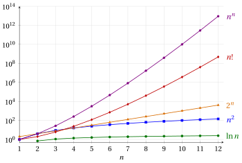
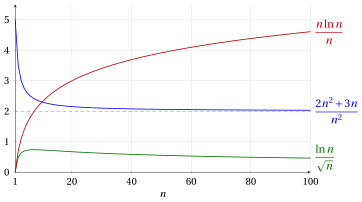

# Asymptotic growth

**Part 3 · Asymptotic growth and notation · Chapter 9** · [:material-file-pdf-box: Lecture notes, volume 3 (PDF)](../pdf/lecture-notes-3-asymptotic-notation.pdf) · [:material-pencil: Exercises](../exercises/ex-09-asymptotic-growth.md)

## Introduction

The number of steps executed by an algorithm is a function of a natural number: the size of its input. Two algorithms that solve the same problem are compared by looking at how fast these functions grow when the input grows, and not at their values on a few small inputs. In this chapter we study the functions of a natural variable that appear in the analysis of algorithms and we compare their <strong>orders of growth</strong>.

The plan of the chapter is the following.

- In Section [9.1](#sez-gr-sec-families) we introduce the five families of increasing functions of a natural variable used in the course: logarithmic, power, exponential, factorial and self-power functions.

- In Section [9.2](#sez-gr-sec-limits) we recall the four limits that put these families in order (the <strong>hierarchy of infinities</strong>).

- In Section [9.3](#sez-gr-sec-comparison) we define the comparison of two orders of growth through the limit of the ratio of the two functions. We then derive the hierarchy of the orders of growth, a classification of the orders of growth, and the properties of logarithmic, power, polynomial and exponential functions that are used in the analysis of algorithms.

!!! chiave ""

    <strong>Prerequisites.</strong> The functions of a natural variable are the <strong>sequences</strong> of the course <em>Mathematical Analysis 1</em> ([fabiofurini.github.io/mathematical-analysis-1/](https://fabiofurini.github.io/mathematical-analysis-1/), Italian version [fabiofurini.github.io/analisi-matematica-1/](https://fabiofurini.github.io/analisi-matematica-1/)). Their limits, and the theorems used to compute them, are not explained again in this chapter: we use them, and we refer to the part <em>Limits of sequences</em> of that course, in particular to the chapters <em>Computing limits of sequences</em> (comparison theorem), <em>Euler's number</em> and <em>Hierarchies of infinities and the ratio test</em>.

## 9.1 Families of increasing functions of a natural variable { #sez-gr-sec-families }

A function of a natural variable is defined on a set of natural numbers of the form $\N_{\ge n_0} = \{n_0, n_0+1, n_0+2, \dots\}$, and in the analysis of algorithms only its behaviour for large values of $n$ matters. The following two definitions describe properties that hold <em>from some value of $n$ onwards</em>: in the course <em>Mathematical Analysis 1</em> they are called properties that hold <em>eventually</em>.

!!! definizione "Definition 9.1: asymptotically positive function"

    A function of a natural variable $f: \N_{\ge n_0} \rightarrow \R$ is <strong>asymptotically positive</strong> if there exists $n_1 \in \N_{\ge n_0}$ such that:

    \begin{equation*}
    f(n) > 0, \quad \forall n \in \N_{\ge n_1} \tag{9.1}
    \end{equation*}

!!! definizione "Definition 9.2: asymptotically increasing function"

    A function of a natural variable $f: \N_{\ge n_0} \rightarrow \R$ is <strong>asymptotically increasing</strong> if there exists $n_1 \in \N_{\ge n_0}$ such that:

    \begin{equation*}
    f(n) < f(n+1), \quad \forall n \in \N_{\ge n_1} \tag{9.2}
    \end{equation*}

- The principal families of asymptotically increasing functions of a natural variable are the following ones.

    1. The <strong>logarithmic</strong> functions of a natural variable:

        \begin{equation*}
        f: \N_{\ge 1} \rightarrow \R,~~~ f:n \mapsto \log_a n \quad \forall a \in \R_{>1} \tag{9.3}
        \end{equation*}

    2. The <strong>power</strong> functions of a natural variable:

        \begin{equation*}
        f: \N \rightarrow \R,~~~ f:n \mapsto n^{\alpha} \quad \forall \alpha \in \R_{>0} \tag{9.4}
        \end{equation*}

    3. The <strong>exponential</strong> functions of a natural variable:

        \begin{equation*}
        f: \N \rightarrow \R,~~~ f:n \mapsto b^{n} \quad \forall b \in \R_{>1} \tag{9.5}
        \end{equation*}

    4. The <strong>factorial</strong> function of a natural variable:

        \begin{equation*}
        f: \N \rightarrow \R,~~~ f:n \mapsto n! \tag{9.6}
        \end{equation*}

    5. The <strong>self-power</strong> function of a natural variable:

        \begin{equation*}
        f: \N \rightarrow \R,~~~ f:n \mapsto n^n \tag{9.7}
        \end{equation*}

        where, by convention, we set $0^0 = 1$.

- All these functions are asymptotically positive, and all of them diverge to $\ip$ as $n \rr \ip$. The factorial and the self-power functions are not increasing on their whole domain, since $0! = 1! = 1$ and $0^0 = 1^1 = 1$, but they are strictly increasing from $n = 1$ onwards: this is why we speak of <em>asymptotically</em> increasing functions.

- In these notes $\ln n = \log_e n$ denotes the natural logarithm, where $e$ is Euler's number.

!!! esempio "Example 9.1: increasing functions of a natural variable"

    The table reports the values of some increasing functions of a natural variable, computed by increasing $n$ by one order of magnitude at a time, from $1$ to $100$ million. The values of $\ln n$ and the leading factors of $2^n$ and $n!$ are rounded to one decimal digit; the values of $n^2$ and $n^n$ are exact.

    
<table>
    <tr>
    <th>&#92;(n&#92;)</th>
    <th>&#92;(&#92;ln n&#92;)</th>
    <th>&#92;(n^2&#92;)</th>
    <th>&#92;(2^n&#92;)</th>
    <th>&#92;(n!&#92;)</th>
    <th>&#92;(n^n&#92;)</th>
    </tr>
    <tr>
    <td>&#92;(1=10^0&#92;)</td>
    <td>&#92;(0&#92;)</td>
    <td>&#92;(1&#92;)</td>
    <td>&#92;(2&#92;)</td>
    <td>&#92;(1&#92;)</td>
    <td>&#92;(1&#92;)</td>
    </tr>
    <tr>
    <td>&#92;(10=10^1&#92;)</td>
    <td>&#92;(&#92;approx 2.3&#92;)</td>
    <td>&#92;(10^2&#92;)</td>
    <td>&#92;(&#92;approx 1.0 &#92;cdot 10^{3}&#92;)</td>
    <td>&#92;(&#92;approx 3.6&#92;cdot 10^{6}&#92;)</td>
    <td>&#92;(10^{10}&#92;)</td>
    </tr>
    <tr>
    <td>&#92;(100=10^2&#92;)</td>
    <td>&#92;(&#92;approx 4.6&#92;)</td>
    <td>&#92;(10^4&#92;)</td>
    <td>&#92;(&#92;approx 1.3 &#92;cdot 10^{30}&#92;)</td>
    <td>&#92;(&#92;approx 9.3&#92;cdot 10^{157}&#92;)</td>
    <td>&#92;(10^{200}&#92;)</td>
    </tr>
    <tr>
    <td>&#92;(1{,}000=10^3&#92;)</td>
    <td>&#92;(&#92;approx 6.9&#92;)</td>
    <td>&#92;(10^6&#92;)</td>
    <td>&#92;(&#92;approx 1.1 &#92;cdot 10^{301}&#92;)</td>
    <td>&#92;(&#92;approx 4.0&#92;cdot 10^{2{,}567}&#92;)</td>
    <td>&#92;(10^{3{,}000}&#92;)</td>
    </tr>
    <tr>
    <td>&#92;(10{,}000=10^4&#92;)</td>
    <td>&#92;(&#92;approx 9.2&#92;)</td>
    <td>&#92;(10^8&#92;)</td>
    <td>&#92;(&#92;approx 2.0 &#92;cdot 10^{3{,}010}&#92;)</td>
    <td>&#92;(&#92;approx 2.8&#92;cdot 10^{35{,}659}&#92;)</td>
    <td>&#92;(10^{40{,}000}&#92;)</td>
    </tr>
    <tr>
    <td>&#92;(100{,}000=10^5&#92;)</td>
    <td>&#92;(&#92;approx 11.5&#92;)</td>
    <td>&#92;(10^{10}&#92;)</td>
    <td>&#92;(&#92;approx 1.0 &#92;cdot 10^{30{,}103}&#92;)</td>
    <td>&#92;(&#92;approx 2.8&#92;cdot 10^{456{,}573}&#92;)</td>
    <td>&#92;(10^{500{,}000}&#92;)</td>
    </tr>
    <tr>
    <td>&#92;(10^6&#92;)</td>
    <td>&#92;(&#92;approx 13.8&#92;)</td>
    <td>&#92;(10^{12}&#92;)</td>
    <td>&#92;(&#92;approx 9.9 &#92;cdot 10^{301{,}029}&#92;)</td>
    <td>&#92;(&#92;approx 8.3&#92;cdot 10^{5{,}565{,}708}&#92;)</td>
    <td>&#92;(10^{6{,}000{,}000}&#92;)</td>
    </tr>
    <tr>
    <td>&#92;(10^7&#92;)</td>
    <td>&#92;(&#92;approx 16.1&#92;)</td>
    <td>&#92;(10^{14}&#92;)</td>
    <td>&#92;(&#92;approx 9.0 &#92;cdot 10^{3{,}010{,}299}&#92;)</td>
    <td>&#92;(&#92;approx 1.2&#92;cdot 10^{65{,}657{,}059}&#92;)</td>
    <td>&#92;(10^{70{,}000{,}000}&#92;)</td>
    </tr>
    <tr>
    <td>&#92;(10^8&#92;)</td>
    <td>&#92;(&#92;approx 18.4&#92;)</td>
    <td>&#92;(10^{16}&#92;)</td>
    <td>&#92;(&#92;approx 3.7 &#92;cdot 10^{30{,}102{,}999}&#92;)</td>
    <td>&#92;(&#92;approx 1.6&#92;cdot 10^{756{,}570{,}556}&#92;)</td>
    <td>&#92;(10^{800{,}000{,}000}&#92;)</td>
    </tr>
    </table>

    To appreciate these numbers, recall that the number of atoms in the observable universe is estimated at about $10^{82}$, and that a personal computer of 2024 executes about $10 \cdot 10^9 = 10^{10}$ operations per second ($10$ GFLOPS). An algorithm that executes $2^n$ operations on an input with $n = 100$ needs

    $$
    \frac{2^{100}}{10^{10}} \text{ seconds} \approx 1.3 \cdot 10^{20} \text{ seconds} \approx 4.0 \cdot 10^{12} \text{ years},
    $$

    while an algorithm that executes $n^2$ operations needs $10^{4}/10^{10} = 10^{-6}$ seconds.

- Figure [9.1](#box-4-gr-figFamilies) shows the first values of the same functions. Since the values grow very fast, the vertical axis is in logarithmic scale: each horizontal line of the grid corresponds to a multiplication by $100$.

{ .fig loading=lazy  }

<strong>Figure 9.1:</strong> The values of &#92;(&#92;ln n&#92;), &#92;(n^2&#92;), &#92;(2^n&#92;), &#92;(n!&#92;) and &#92;(n^n&#92;) for &#92;(n &#92;in &#92;{1, 2, &#92;dots, 12&#92;}&#92;) (vertical axis in logarithmic scale; the points are joined by segments only for readability). For small values of &#92;(n&#92;) the order of the functions can be different from the final one: &#92;(2^3 = 8 &lt; 9 = 3^2&#92;), and &#92;(2^n &gt; n!&#92;) for &#92;(n &#92;in &#92;{1, 2, 3&#92;}&#92;).

## 9.2 The hierarchy of infinities { #sez-gr-sec-limits }

The five families of Section [9.1](#sez-gr-sec-families) all diverge to $\ip$. To decide which one diverges faster, we compute the limit of the ratio of two of them. The limits of this section are the <em>hierarchy of infinities</em> for sequences of the course <em>Mathematical Analysis 1</em> (chapter <em>Hierarchies of infinities and the ratio test</em>), where they are proved; here we recall them, together with the idea of their proofs, and we extend the first one to the powers of the logarithms.

- Given $a \in \R_{>1}$ and $\beta \in \R_{>0}$, the asymptotically increasing function of a natural variable

    \begin{equation*}
    f: \N_{\ge 1} \rightarrow \R,~~~ f:n \mapsto \log^{\beta}_a n = \big(\log_a n\big)^{\beta} \tag{9.8}
    \end{equation*}

    is called a <strong>polylogarithmic</strong> function of a natural variable.

!!! teorema "Proposition 9.3: logarithms and powers"

    For every $\alpha \in \R_{>0}$, $\beta \in \R_{>0}$ and $a \in \R_{>1}$, we have:

    \begin{equation*}
    \lim_{n \rr \ip} \frac{\log_a^\beta n}{n^\alpha} = 0^+ \tag{9.9}
    \end{equation*}

??? dimostrazione "Proof"

    For $\beta = 1$ this is the hierarchy of infinities (part I) of the course <em>Mathematical Analysis 1</em>:

    $$
    \lim_{n \rr \ip} \frac{\log_a n}{n^\alpha} = 0^+, \quad \forall \alpha \in \R_{>0},~ \forall a \in \R_{>1}.
    $$

    It is proved with the inequality $\log_a x < x \, \log_a 2$, valid for every $x \in \R_{>0}$ (a consequence of Bernoulli's inequality), applied to $x = n^{\alpha/2}$, and with the comparison theorem.

    For every $\beta \in \R_{>0}$, since $\frac{\alpha}{\beta} \in \R_{>0}$, we then have:

    $$
    \lim_{n \rr \ip} \frac{\log_a^\beta n}{n^\alpha}
    = \lim_{n \rr \ip} \Bigg( \underbrace{\frac{\log_a n}{n^{\alpha/\beta}}}_{\rr\, 0^+} \Bigg)^{\beta}
    = 0^+
    $$

    
□

!!! teorema "Proposition 9.4: powers and exponentials"

    For every $\alpha \in \R_{>0}$ and $b \in \R_{>1}$, we have:

    \begin{equation*}
    \lim_{n \rr \ip} \frac{n^{\alpha}}{b^{n}} = 0^+ \tag{9.10}
    \end{equation*}

- This is the hierarchy of infinities (part II). It follows from [Proposition 9.3](#box-5-grPropLogPower) by replacing $n$ with $2^n$, which gives $\frac{n}{(2^{\mu})^n} \rr 0^+$ for every $\mu \in \R_{>0}$, hence $\frac{n}{b^n} \rr 0^+$ for every $b \in \R_{>1}$ (choose $\mu$ such that $2^{\mu} = b$); the general case follows from the identity

    $$
    \frac{n^\alpha}{b^n} = \left( \frac{n}{\big(b^{1/\alpha}\big)^n} \right)^{\alpha}, \qquad b^{1/\alpha} \in \R_{>1}.
    $$

!!! teorema "Proposition 9.5: exponentials and factorial"

    For every $b \in \R_{>1}$, we have:

    \begin{equation*}
    \lim_{n \rr \ip} \frac{b^{n}}{n!} = 0^+ \tag{9.11}
    \end{equation*}

- This is the hierarchy of infinities (part III). It follows from the ratio test, since

    $$
    \frac{b^{n+1}}{(n+1)!} \; \frac{n!}{b^n} = \frac{b}{n+1} \rr 0^+ < 1.
    $$

!!! teorema "Proposition 9.6: factorial and self-power"

    \begin{equation*}
    \lim_{n \rr \ip} \frac{n!}{n^n} = 0^+ \tag{9.12}
    \end{equation*}

- This is the hierarchy of infinities (part IV). It follows from the ratio test, since

    $$
    \frac{(n+1)!}{(n+1)^{n+1}} \; \frac{n^n}{n!} = \left( \frac{n}{n+1}\right)^n = \frac{1}{\left( 1 + \frac{1}{n} \right)^n} \rr \frac{1}{e} < 1.
    $$

!!! chiave ""

    Polylogarithmic functions (with base greater than one) diverge more slowly than power functions (with positive exponent), which diverge more slowly than exponential functions (with base greater than one), which diverge more slowly than the factorial function, which diverges more slowly than the self-power function.

## 9.3 Comparison of orders of growth { #sez-gr-sec-comparison }

- The <strong>order of growth</strong> of an asymptotically increasing function of a natural variable describes how rapidly its values increase compared to the values of another asymptotically increasing function of a natural variable.

- To compare two functions $f$ and $g$ we look at the limit of their ratio $\frac{f(n)}{g(n)}$, which is defined for all sufficiently large $n$ when $f$ and $g$ are asymptotically positive.

!!! definizione "Definition 9.7: comparison of orders of growth"

    Let $f$ and $g$ be two asymptotically positive functions of a natural variable such that the limit

    $$
    L = \lim_{n \rr \ip} \frac{f(n)}{g(n)}
    $$

    exists (finite or $\ip$). We say that:

    - $f$ has a strictly <strong>smaller order of growth</strong> than $g$, if $L = 0^+$;

    - $f$ has a <strong>smaller or equal order of growth</strong> compared to $g$, if $L = 0^+$ or $L \in \R_{>0}$;

    - $f$ has the <strong>same order of growth</strong> as $g$, if $L \in \R_{>0}$;

    - $f$ has a <strong>greater or equal order of growth</strong> compared to $g$, if $L \in \R_{>0}$ or $L = \ip$;

    - $f$ has a strictly <strong>greater order of growth</strong> than $g$, if $L = \ip$.

!!! chiave ""

    Given two asymptotically increasing functions of a natural variable $f$ and $g$:

    - if $f$ has a strictly smaller order of growth than $g$, $\rightsquigarrow$ the function $f$ <strong>grows slower than</strong> the function $g$;

    - if $f$ has a smaller or equal order of growth compared to $g$, $\rightsquigarrow$ the function $f$ <strong>grows at most as fast as</strong> the function $g$;

    - if $f$ has the same order of growth as $g$, $\rightsquigarrow$ the function $f$ <strong>grows as fast as</strong> the function $g$;

    - if $f$ has a greater or equal order of growth compared to $g$, $\rightsquigarrow$ the function $f$ <strong>grows at least as fast as</strong> the function $g$;

    - if $f$ has a strictly greater order of growth than $g$, $\rightsquigarrow$ the function $f$ <strong>grows faster than</strong> the function $g$.

- The comparison does not depend on the values of $f$ and $g$ on finitely many natural numbers: changing them does not change the limit of the ratio.

- The comparison is symmetric, as stated by the following observation.

!!! teorema "Observation 9.8: exchanging the two functions"

    Let $f$ and $g$ be two asymptotically positive functions of a natural variable. Then:

    - $f$ has a strictly smaller order of growth than $g$ if and only if $g$ has a strictly greater order of growth than $f$;

    - $f$ has the same order of growth as $g$ if and only if $g$ has the same order of growth as $f$.

??? dimostrazione "Proof"

    For all sufficiently large $n$ we have $\frac{g(n)}{f(n)} = 1 \Big/ \frac{f(n)}{g(n)}$, with both ratios positive. By the theorem on the limit of the reciprocal of a sequence:

    $$
    \begin{aligned}
    \lim_{n \rr \ip} \frac{f(n)}{g(n)} = 0^+ \quad &\iff \quad \lim_{n \rr \ip} \frac{g(n)}{f(n)} = \ip\\[1ex]
    \lim_{n \rr \ip} \frac{f(n)}{g(n)} = \ell \in \R_{>0} \quad &\iff \quad \lim_{n \rr \ip} \frac{g(n)}{f(n)} = \frac{1}{\ell} \in \R_{>0}
    \end{aligned}
    $$

    
□

!!! esempio "Example 9.2: the limit of the ratio"

    We compare three pairs of functions; the three ratios are drawn in Figure [9.2](#box-12-gr-figRatios).

    - The function $n \mapsto \ln n$ has a strictly smaller order of growth than $n \mapsto \sqrt{n} = n^{1/2}$, since by [Proposition 9.3](#box-5-grPropLogPower) (with $a = e$, $\beta = 1$, $\alpha = \frac{1}{2}$):

        $$
        \lim_{n \rr \ip} \frac{\ln n}{\sqrt n} = 0^+
        $$

    - The function $n \mapsto 2n^2 + 3n$ has the same order of growth as $n \mapsto n^2$, since:

        $$
        \lim_{n \rr \ip} \frac{2n^2+3n}{n^2} = \lim_{n \rr \ip} \Big( 2 + \underbrace{\frac{3}{n}}_{\rr\, 0} \Big) = 2 \in \R_{>0}
        $$

    - The function $n \mapsto n \ln n$ has a strictly greater order of growth than $n \mapsto n$, since:

        $$
        \lim_{n \rr \ip} \frac{n \ln n}{n} = \lim_{n \rr \ip} \ln n = \ip
        $$

    The first ratio is not monotone: it increases up to its largest value, about $0.74$, reached for $n = 7$, and only then it decreases towards $0$.

{ .fig loading=lazy  }

<strong>Figure 9.2:</strong> The three ratios of [Example 9.2](#box-11-gr-exRatios) for &#92;(n &#92;in &#92;{1, 2, &#92;dots, 100&#92;}&#92;) (the points are joined by segments). The first one tends to &#92;(0&#92;), the second one to &#92;(2&#92;) (dashed line), the third one diverges to &#92;(&#92;ip&#92;).

- The comparison of [Definition 9.7](#box-9-grDefComparison) requires the limit of the ratio to exist. For example, for $f(n) = n$ if $n$ is even and $f(n) = 2n$ if $n$ is odd, the ratio $\frac{f(n)}{n}$ takes alternately the values $1$ and $2$ and has no limit. All the comparisons of this chapter are made between functions whose ratio has a limit.

When two functions have the same order of growth, the ratio of their values stays, for all sufficiently large $n$, between two positive constants.

!!! teorema "Observation 9.9: bounds on the ratio"

    Let $f$ and $g$ be two asymptotically positive functions of a natural variable with the same order of growth, and let $\ell = \lim_{n \rr \ip} \frac{f(n)}{g(n)} \in \R_{>0}$. Then there exist $c_1, c_2 \in \R_{>0}$ and $n_1 \in \N$ such that:

    \begin{equation*}
    0 < c_1 \, g(n) \le f(n) \le c_2 \, g(n), \quad \forall n \in \N_{\ge n_1} \tag{9.13}
    \end{equation*}

??? dimostrazione "Proof"

    By the definition of limit with $\varepsilon = \frac{\ell}{2} > 0$, there exists $n_1 \in \N$, which we can choose so large that $f(n) > 0$ and $g(n) > 0$ for every $n \ge n_1$, such that:

    $$
    \left| \frac{f(n)}{g(n)} - \ell \right| < \frac{\ell}{2}
    \quad \Longleftrightarrow \quad
    \frac{\ell}{2} < \frac{f(n)}{g(n)} < \frac{3\,\ell}{2},
    \quad \forall n \in \N_{\ge n_1}
    $$

    Multiplying by $g(n) > 0$, the claim follows with $c_1 = \frac{\ell}{2}$ and $c_2 = \frac{3\,\ell}{2}$. □

- Accordingly, if two constants $c_1, c_2 \in \R_{>0}$ as in [Observation 9.9](#box-13-grObsBounds) do not exist, then $f$ and $g$ do not have the same order of growth.

### 9.3.1 Hierarchy of the orders of growth { #sez-gr-sec-hierarchy }

The limits of Section [9.2](#sez-gr-sec-limits) translate directly into comparisons of orders of growth.

- Any polylogarithmic function of a natural variable with a base strictly greater than one has a strictly smaller order of growth than any power function of a natural variable with a positive exponent.

!!! teorema "Observation 9.10: polylogarithms and powers"

    For every $\alpha \in \R_{>0}$, $\beta \in \R_{>0}$ and $a \in \R_{>1}$, the function $n \mapsto \log^{\beta}_a n$ has a strictly smaller order of growth than the function $n \mapsto n^{\alpha}$.

??? dimostrazione "Proof"

    By [Proposition 9.3](#box-5-grPropLogPower), for every $\alpha \in \R_{>0}$, $\beta \in \R_{>0}$ and $a \in \R_{>1}$, we have:

    $$
    \lim_{n \rr \ip} \frac{\log^{\beta}_a n}{n^{\alpha}} = 0^+
    $$

    
□

- Any power function of a natural variable with a positive exponent has a strictly smaller order of growth than any exponential function of a natural variable with a base strictly greater than one.

!!! teorema "Observation 9.11: powers and exponentials"

    For every $\alpha \in \R_{>0}$ and $b \in \R_{>1}$, the function $n \mapsto n^{\alpha}$ has a strictly smaller order of growth than the function $n \mapsto b^{n}$.

??? dimostrazione "Proof"

    By [Proposition 9.4](#box-6-grPropPowerExp), for every $\alpha \in \R_{>0}$ and $b \in \R_{>1}$, we have:

    $$
    \lim_{n \rr \ip} \frac{n^{\alpha}}{b^{n}} = 0^+
    $$

    
□

!!! esempio "Example 9.3: comparison of orders of growth"

    - The function $n \mapsto \ln^6 n + 2 + 2^{1/n} + 3^{-n} + 9\,n^2$ has a strictly smaller order of growth than the function $n \mapsto n^3$, since:

        $$
        \lim_{n \rr \ip} \frac{\ln^6 n + 2 + 2^{1/n} + 3^{-n} + 9\,n^2}{n^3}
        = \lim_{n \rr \ip} \Bigg( \underbrace{\frac{\ln^6 n}{n^3}}_{\rr\, 0^+} + \underbrace{\frac{2}{n^3}}_{\rr\, 0^+} + \underbrace{\frac{2^{1/n}}{n^3}}_{\rr\, 0^+} + \underbrace{\frac{3^{-n}}{n^3}}_{\rr\, 0^+} + \underbrace{\frac{9}{n}}_{\rr\, 0^+} \Bigg) = 0^+
        $$

    - The function $n \mapsto 3n^2 + \sqrt{n} + \ln n + 5 + 4^{-n} + 10\,n^{1/3}$ has a strictly smaller order of growth than the function $n \mapsto n^3$, since:

        $$
        \lim_{n \rr \ip} \frac{3n^2 + \sqrt{n} + \ln n + 5 + 4^{-n} + 10\,n^{1/3}}{n^3}
        = \lim_{n \rr \ip} \Bigg(
        \underbrace{\frac{3}{n}}_{\rr\, 0^+} +
        \underbrace{\frac{1}{n^{5/2}}}_{\rr\, 0^+} +
        \underbrace{\frac{\ln n}{n^3}}_{\rr\, 0^+} +
        \underbrace{\frac{5}{n^3}}_{\rr\, 0^+} +
        \underbrace{\frac{4^{-n}}{n^3}}_{\rr\, 0^+} +
        \underbrace{\frac{10}{n^{8/3}}}_{\rr\, 0^+}
        \Bigg) = 0^+
        $$

    - The function $n \mapsto n^{1/4} + \ln^2 n + \frac{7}{\sqrt{n}} + e^{-n} + 20\,n^{1/2}$ has a strictly smaller order of growth than the function $n \mapsto n^2$, since:

        $$
        \lim_{n \rr \ip} \frac{n^{1/4} + \ln^2 n + \frac{7}{\sqrt{n}} + e^{-n} + 20\,n^{1/2}}{n^2}
        = \lim_{n \rr \ip} \Bigg(
        \underbrace{\frac{1}{n^{7/4}}}_{\rr\, 0^+} +
        \underbrace{\frac{\ln^2 n}{n^2}}_{\rr\, 0^+} +
        \underbrace{\frac{7}{n^{5/2}}}_{\rr\, 0^+} +
        \underbrace{\frac{e^{-n}}{n^2}}_{\rr\, 0^+} +
        \underbrace{\frac{20}{n^{3/2}}}_{\rr\, 0^+}
        \Bigg) = 0^+
        $$

    In each case the terms with a logarithm go to $0^+$ by [Observation 9.10](#box-14-grObsLogPower), and the other terms by elementary limits.

- Any exponential function of a natural variable with a base strictly greater than one has a strictly smaller order of growth than the factorial function of a natural variable.

!!! teorema "Observation 9.12: exponentials and factorial"

    For every $b \in \R_{>1}$, the function $n \mapsto b^{n}$ has a strictly smaller order of growth than the function $n \mapsto n!$.

??? dimostrazione "Proof"

    By [Proposition 9.5](#box-7-grPropExpFact), for every $b \in \R_{>1}$, we have:

    $$
    \lim_{n \rr \ip} \frac{b^{n}}{n!} = 0^+
    $$

    
□

- The factorial function of a natural variable has a strictly smaller order of growth than the self-power function of a natural variable.

!!! teorema "Observation 9.13: factorial and self-power"

    The function $n \mapsto n!$ has a strictly smaller order of growth than the function $n \mapsto n^n$.

??? dimostrazione "Proof"

    By [Proposition 9.6](#box-8-grPropFactSelf), we have:

    $$
    \lim_{n \rr \ip} \frac{n!}{n^n} = 0^+
    $$

    
□

!!! esempio "Example 9.4: comparison with the self-power function"

    The function $n \mapsto n! + 2^n + \sqrt{n} + \ln^3 n + n^{n-1} + \frac{1}{n}$ has a strictly smaller order of growth than the function $n \mapsto n^n$, since:

    $$
    \lim_{n \rr \ip} \frac{n! + 2^n + \sqrt{n} + \ln^3 n + n^{n-1} + \frac{1}{n}}{n^{n}}
    = \lim_{n \rr \ip} \Bigg(
    \underbrace{\frac{n!}{n^{n}}}_{\rr\, 0^+} +
    \underbrace{\frac{2^n}{n^{n}}}_{\rr\, 0^+} +
    \underbrace{\frac{\sqrt{n}}{n^{n}}}_{\rr\, 0^+} +
    \underbrace{\frac{\ln^3 n}{n^{n}}}_{\rr\, 0^+} +
    \underbrace{\frac{1}{n}}_{\rr\, 0^+} +
    \underbrace{\frac{1}{n^{n+1}}}_{\rr\, 0^+}
    \Bigg) = 0^+
    $$

    For example, $\frac{2^n}{n^n} = \frac{2^n}{n!} \, \frac{n!}{n^n}$ is the product of two functions that tend to $0^+$, by Propositions [9.5](#box-7-grPropExpFact) and [Proposition 9.6](#box-8-grPropFactSelf).

!!! chiave ""

    <strong>Hierarchy of the orders of growth.</strong> For every $a \in \R_{>1}$, $\beta \in \R_{>0}$, $\alpha \in \R_{>0}$ and $b \in \R_{>1}$, each function of the chain

    $$
    \log_a^\beta n \qquad n^\alpha \qquad b^n \qquad n! \qquad n^n
    $$

    has a strictly smaller order of growth than the following one.

### 9.3.2 Classification of orders of growth { #sez-gr-sec-classification }

The families of the hierarchy are used as yardsticks to classify the order of growth of any other function.

!!! definizione "Definition 9.14: bounded orders of growth"

    An asymptotically increasing function of a natural variable $f$ has:

    - a <strong>polylogarithmically bounded order of growth</strong>, if there exists $\beta \in \R_{>0}$ such that $f$ has a smaller or equal order of growth compared to $n \mapsto \ln^{\beta} n$; and a <strong>logarithmically bounded order of growth</strong>, if this holds with $\beta = 1$;

    - a <strong>polynomially bounded order of growth</strong>, if there exists $\alpha \in \R_{>0}$ such that $f$ has a smaller or equal order of growth compared to $n \mapsto n^{\alpha}$;

    - an <strong>exponentially bounded order of growth</strong>, if there exists $b \in \R_{>1}$ such that $f$ has a smaller or equal order of growth compared to $n \mapsto b^{n}$;

    - a <strong>factorially bounded order of growth</strong>, if $f$ has a smaller or equal order of growth compared to $n \mapsto n!$.

!!! definizione "Definition 9.15: linear, sub-linear and super-linear order of growth"

    An asymptotically increasing function of a natural variable $f$ has:

    - a <strong>sub-linear order of growth</strong>, if $f$ has a strictly smaller order of growth than $n \mapsto n$;

    - a <strong>linear order of growth</strong>, if $f$ has the same order of growth as $n \mapsto n$;

    - a <strong>super-linear order of growth</strong>, if $f$ has a strictly greater order of growth than $n \mapsto n$.

- By the hierarchy of the orders of growth, a function with a polylogarithmically bounded order of growth has also a polynomially bounded order of growth, which in turn is also exponentially bounded and factorially bounded.

!!! esempio "Example 9.5: classification of orders of growth"

    We classify four functions, drawn in Figure [9.3](#box-23-gr-figLinear).

    - $n \mapsto \sqrt n$ has a sub-linear order of growth, since $\frac{\sqrt n}{n} = \frac{1}{\sqrt n} \rr 0^+$; it has a polynomially bounded order of growth (with $\alpha = \frac{1}{2}$), but not a polylogarithmically bounded one, since $\frac{\sqrt n}{\ln^{\beta} n} \rr \ip$ for every $\beta \in \R_{>0}$ ([Proposition 9.3](#box-5-grPropLogPower) and [Observation 9.8](#box-10-grObsSymmetry)).

    - $n \mapsto n$ has a linear order of growth.

    - $n \mapsto n \ln n$ has a super-linear order of growth, since $\frac{n \ln n}{n} = \ln n \rr \ip$; it has a polynomially bounded order of growth, since $\frac{n \ln n}{n^2} = \frac{\ln n}{n} \rr 0^+$.

    - $n \mapsto n^2$ has a super-linear order of growth, since $\frac{n^2}{n} = n \rr \ip$; it has a polynomially bounded order of growth (with $\alpha = 2$).

{ .fig loading=lazy  }

<strong>Figure 9.3:</strong> A sub-linear function (&#92;(&#92;sqrt n&#92;)), the linear function &#92;(n&#92;) and two super-linear functions (&#92;(n &#92;ln n&#92;) and &#92;(n^2&#92;)) for &#92;(n &#92;in &#92;{1, 2, &#92;dots, 16&#92;}&#92;) (&#92;(n^2&#92;) only up to &#92;(n = 8&#92;), where it reaches &#92;(64&#92;); the points are joined by segments).

### 9.3.3 Properties of logarithmic functions { #sez-gr-sec-log }

- Any logarithmic function of a natural variable with a base strictly greater than one has the same order of growth as any other logarithmic function of a natural variable with a base strictly greater than one; multiplying the argument by a positive constant does not change the order of growth either.

!!! teorema "Observation 9.16: change of base"

    For every $a \in \R_{>1}$, $c \in \R_{>1}$ and $\lambda \in \R_{>0}$, the function $n \mapsto \log_{a} (\lambda\, n)$ has the same order of growth as the function $n \mapsto \log_{c} n$.

??? dimostrazione "Proof"

    For every $a,c \in \R_{>1}$ and $\lambda \in \R_{>0}$, since $\log_a (\lambda\, n) = \log_a \lambda + \log_a n$ and $\log_a n = \frac{\log_c n}{\log_c a}$, we have:

    $$
    \lim_{n \rr \ip} \frac{\log_{a}(\lambda\, n)}{\log_c n}
    = \lim_{n \rr \ip} \Bigg( \underbrace{\frac{\log_a \lambda}{\log_c n}}_{\rr\, 0} + \frac{\frac{\log_c n}{\log_c a}}{\log_c n} \Bigg)
    = \frac{1}{\log_c a} \in \R_{>0}
    $$

    
□

- For this reason, when only the order of growth matters, the base of a logarithm is often omitted. For example, $\log_2 n$ and $\ln n$ have the same order of growth, and $\lim_{n \rr \ip} \frac{\log_2 n}{\ln n} = \frac{1}{\ln 2} \approx 1.44$.

- Adding a positive constant to the argument of a logarithmic function of a natural variable does not change its order of growth.

!!! teorema "Observation 9.17: shift of the argument"

    For every $a \in \R_{>1}$ and $\lambda \in \R_{>0}$, the function $n \mapsto \log_{a} (n+\lambda)$ has the same order of growth as the function $n \mapsto \log_{a} n$.

??? dimostrazione "Proof"

    For every $a \in \R_{>1}$ and $\lambda \in \R_{>0}$, we have:

    $$
    \lim_{n \rr \ip} \frac{\log_a (n+\lambda)}{\log_a n}
    = \lim_{n \rr \ip} \frac{\log_a \left(n \left(1 + \frac{\lambda}{n} \right)\right)}{\log_a n}
    = \lim_{n \rr \ip} \frac{\log_a n + \overbrace{\log_a \left(1+\frac{\lambda}{n}\right)}^{\rr\, 0}}{\log_a n}
    = 1
    $$

    
□

- The <strong>quasi-linear</strong> function of a natural variable $n \mapsto n \log_a n$ has a strictly smaller order of growth than any power function of a natural variable with exponent strictly greater than one.

!!! teorema "Observation 9.18: quasi-linear and powers"

    For every $\alpha \in \R_{>1}$ and $a \in \R_{>1}$, the function $n \mapsto n \log_a n$ has a strictly smaller order of growth than the function $n \mapsto n^{\alpha}$.

??? dimostrazione "Proof"

    For every $\alpha \in \R_{>1}$ and $a \in \R_{>1}$, we have $\alpha - 1 \in \R_{>0}$ and, by [Proposition 9.3](#box-5-grPropLogPower):

    $$
    \lim_{n \rr \ip} \frac{n \log_a n}{n^{\alpha}} = \lim_{n \rr \ip} \frac{\log_a n}{n^{\alpha-1}} = 0^+
    $$

    
□

- The quasi-linear function of a natural variable $n \mapsto n \log_a n$ has a strictly greater order of growth than the linear function of a natural variable: it has a super-linear order of growth.

!!! teorema "Observation 9.19: quasi-linear and linear"

    For every $a \in \R_{>1}$, the function $n \mapsto n \log_a n$ has a strictly greater order of growth than the function $n \mapsto n$.

??? dimostrazione "Proof"

    For every $a \in \R_{>1}$, we have:

    $$
    \lim_{n \rr \ip} \frac{n \log_a n}{n} = \lim_{n \rr \ip} \log_a n = \ip
    $$

    
□

### 9.3.4 Properties of power functions { #sez-gr-sec-power }

- Adding a positive constant to the argument of a power function of a natural variable does not change its order of growth.

!!! teorema "Observation 9.20: shift of the argument"

    For every $\alpha \in \R_{>0}$ and $\lambda \in \R_{>0}$, the function $n \mapsto (n+\lambda)^{\alpha}$ has the same order of growth as the function $n \mapsto n^{\alpha}$.

??? dimostrazione "Proof"

    For every $\alpha \in \R_{>0}$ and $\lambda \in \R_{>0}$, we have:

    $$
    \lim_{n \rr \ip} \frac{(n+\lambda)^{\alpha}}{n^{\alpha}} = \lim_{n \rr \ip} \Big(1 + \underbrace{\frac{\lambda}{n}}_{\rr\, 0} \Big)^{\alpha} = 1
    $$

    
□

- Multiplying the argument of a power function of a natural variable by a positive constant does not change its order of growth.

!!! teorema "Observation 9.21: scaling of the argument"

    For every $\alpha \in \R_{>0}$ and $\lambda \in \R_{>0}$, the function $n \mapsto (\lambda\, n)^{\alpha}$ has the same order of growth as the function $n \mapsto n^{\alpha}$.

??? dimostrazione "Proof"

    For every $\alpha \in \R_{>0}$ and $\lambda \in \R_{>0}$, we have:

    $$
    \lim_{n \rr \ip} \frac{(\lambda\, n)^{\alpha}}{n^{\alpha}} = \lim_{n \rr \ip} \frac{\lambda^{\alpha}\, n^{\alpha}}{n^{\alpha}} = \lambda^{\alpha} \in \R_{>0}
    $$

    
□

- The order of growth of a power function of a natural variable, compared to the linear function of a natural variable, depends on whether the exponent is greater or smaller than one.

!!! teorema "Observation 9.22: powers and the linear function"

    For every $\alpha \in \R_{>0}$, the function $n \mapsto n^{\alpha}$ has:

    - a strictly greater order of growth than the function $n \mapsto n$ (super-linear order of growth), if $\alpha > 1$;

    - a strictly smaller order of growth than the function $n \mapsto n$ (sub-linear order of growth), if $\alpha < 1$.

??? dimostrazione "Proof"

    For every $\alpha \in \R_{>0}$, we have:

    $$
    \lim_{n \rr \ip} \frac{n^{\alpha}}{n} = \lim_{n \rr \ip} n^{\alpha - 1} =
    \begin{cases}
    \ip & \text{if} ~~~ \alpha > 1\\[1ex]
    0^+ & \text{if} ~~~ \alpha < 1
    \end{cases}
    $$

    
□

### 9.3.5 Properties of polynomial functions { #sez-gr-sec-poly }

- Any polynomial function of a natural variable with a positive leading coefficient has the same order of growth as its leading term.

!!! teorema "Observation 9.23: polynomials"

    For every $k \in \N_{\ge 1}$ and every $a_0, a_1, \dots, a_k \in \R$ with $a_k \in \R_{>0}$, the function $n \mapsto \sum_{i=0}^{k} a_i \, n^i$ has the same order of growth as the function $n \mapsto n^k$.

??? dimostrazione "Proof"

    We have:

    $$
    \lim_{n \rr \ip} \frac{\sum_{i=0}^{k} a_i \, n^i}{n^{k}} = a_k + \lim_{n \rr \ip} \sum_{i=0}^{k-1} \underbrace{\frac{a_i}{n^{k-i}}}_{\rr\, 0} = a_k \in \R_{>0}
    $$

    In particular, the polynomial is asymptotically positive, so the comparison of [Definition 9.7](#box-9-grDefComparison) applies. □

### 9.3.6 Properties of exponential functions { #sez-gr-sec-exp }

- Any exponential function of a natural variable with a base strictly greater than one has a strictly greater order of growth than the exponential functions of a natural variable with a smaller base, and a strictly smaller order of growth than the exponential functions of a natural variable with a greater base.

!!! teorema "Observation 9.24: different bases"

    For every $b \in \R_{>1}$ and $c \in \R_{>1}$, the function $n \mapsto b^n$ has:

    - a strictly greater order of growth than the function $n \mapsto c^n$, if $b > c$;

    - a strictly smaller order of growth than the function $n \mapsto c^n$, if $b < c$.

??? dimostrazione "Proof"

    For every $b \in \R_{>1}$ and $c \in \R_{>1}$, since $b = c^{\log_c b}$, we have:

    $$
    \lim_{n \rr \ip} \frac{b^n}{c^n} = \lim_{n \rr \ip} \frac{c^{n \log_c b}}{c^n} = \lim_{n \rr \ip} \Big(c^{\log_c b-1}\Big)^{n} =
    \begin{cases}
    \ip & \text{if} ~~~ b > c\\[1ex]
    0^+ & \text{if} ~~~ b < c
    \end{cases}
    $$

    since $c^{\log_c b - 1} = \frac{b}{c}$ is greater than one if $b > c$ and belongs to $(0,1)$ if $b < c$ (limit of the geometric progression). □

- Multiplying the exponent of an exponential function of a natural variable by a positive constant changes its order of growth, unless the constant is equal to one.

!!! teorema "Observation 9.25: scaling of the exponent"

    For every $b \in \R_{>1}$ and $\lambda \in \R_{>0}$, the function $n \mapsto b^{\lambda n}$ has:

    - a strictly greater order of growth than the function $n \mapsto b^n$, if $\lambda > 1$;

    - a strictly smaller order of growth than the function $n \mapsto b^n$, if $0 < \lambda < 1$.

??? dimostrazione "Proof"

    For every $b \in \R_{>1}$ and $\lambda \in \R_{>0}$, we have:

    $$
    \lim_{n \rr \ip} \frac{b^{\lambda n}}{b^n}
    = \lim_{n \rr \ip} \left(\frac{b^{\lambda}}{b}\right)^n
    = \lim_{n \rr \ip} \left(b^{\lambda-1}\right)^n
    =
    \begin{cases}
    \ip & \text{if} ~~~ \lambda > 1\\[1ex]
    0^+ & \text{if} ~~~ 0 < \lambda < 1
    \end{cases}
    $$

    
□

- An alternative proof is based on the fact that

    $$
    b^{\lambda n} = \big( b^{\lambda} \big)^n
    \qquad \text{and} \qquad
    b^{\lambda}
    \begin{cases}
    > b & \text{if} ~~~ \lambda > 1\\[1ex]
    < b & \text{if} ~~~ 0 < \lambda < 1
    \end{cases}
    $$

    Accordingly, by [Observation 9.24](#box-32-grObsExpBase) applied to the bases $b^{\lambda}$ and $b$, the function $n \mapsto b^{\lambda n}$ has a strictly greater order of growth than $n \mapsto b^n$ if $\lambda > 1$, and a strictly smaller one if $0 < \lambda < 1$.

!!! esempio "Example 9.6: scaling the exponent"

    - The function $n \mapsto 2^{n/2}$ has a strictly smaller order of growth than the function $n \mapsto 2^n$, since

        $$
        2^{n/2} = \big(2^{1/2}\big)^{n} \qquad \text{and} \qquad 2^{1/2} = \sqrt 2 < 2.
        $$

    - The function $n \mapsto 2^{3n/2}$ has a strictly greater order of growth than the function $n \mapsto 2^n$, since

        $$
        2^{3n/2} = \big(2^{3/2}\big)^{n} \qquad \text{and} \qquad 2^{3/2} = 2\sqrt 2 > 2.
        $$

- Shifting the exponent of an exponential function of a natural variable by a constant does not change its order of growth.

!!! teorema "Observation 9.26: shift of the exponent"

    For every $b \in \R_{>1}$ and $\lambda \in \R$, the function $n \mapsto b^{n+\lambda}$ has the same order of growth as the function $n \mapsto b^{n}$.

??? dimostrazione "Proof"

    For every $b \in \R_{>1}$ and $\lambda \in \R$, we have:

    $$
    \lim_{n \rr \ip} \frac{b^{n+\lambda}}{b^n} = \lim_{n \rr \ip} \frac{b^{n}\, b^{\lambda}}{b^n} = b^{\lambda} \in \R_{>0}
    $$

    
□

- For example, $2^{n+10} = 1024 \cdot 2^n$ has the same order of growth as $2^n$, while $2^{2n} = 4^n$ has a strictly greater order of growth: a constant added to the exponent is a constant factor, a constant factor in the exponent changes the base.

!!! chiave ""

    <strong>Key points of the chapter</strong>

    - The functions of a natural variable used in the analysis of algorithms are logarithmic ($\log_a n$), power ($n^\alpha$), exponential ($b^n$), factorial ($n!$) and self-power ($n^n$) functions, together with their sums and products.

    - The order of growth of $f$ is compared with that of $g$ through the limit of $\frac{f(n)}{g(n)}$: $0^+$ (strictly smaller), a positive real number (same order of growth), $\ip$ (strictly greater).

    - Hierarchy: $\log_a^\beta n$, $n^\alpha$, $b^n$, $n!$, $n^n$ (with $a, b > 1$ and $\alpha, \beta > 0$), each with a strictly smaller order of growth than the next one.

    - The base of a logarithm, a constant added to the argument of a logarithm or of a power, a constant factor in the argument of a power, and a constant added to the exponent of an exponential do not change the order of growth; a polynomial has the order of growth of its leading term.

    - A constant factor in the exponent of an exponential, and a different base of an exponential, do change the order of growth.

    - A function has a sub-linear, linear or super-linear order of growth if it grows slower than, as fast as, or faster than $n$; for example $\sqrt n$, $5n+3$ and $n \ln n$.

<!-- laboratorio-interattivo: sezione generata da interattivi.py -->

## Interactive lab { #interactive-lab }

The algorithm of the chapter, one step at a time: move the sliders and press ▶.
All the graphs of the course are in the [interactive lab](../lab/index.md#cap-9).

