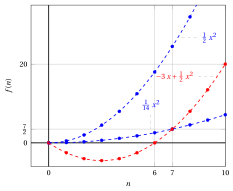
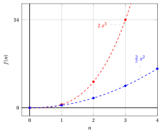
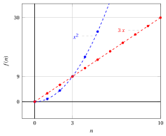
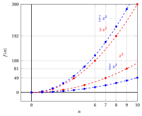

# Asymptotic notation

**Part 3 · Asymptotic notation and growth · Chapter 9** · [:material-file-pdf-box: Lecture notes, volume 3 (PDF)](../pdf/lecture-notes-3-asymptotic-notation.pdf) · [:material-pencil: Exercises: Asymptotic notation](../exercises/ex-09-asymptotic-notation.md)

## Introduction

The number of steps executed by an algorithm is a function of a natural number: the size of its input. Two algorithms that solve the same problem are compared by looking at how fast these functions grow when the input grows, neglecting constant factors and the values on a few small inputs. In this chapter we give the precise language used to express these comparisons: the <strong>asymptotic notations</strong> $\Theta$, $\bigO$, $\Omega$, $o$ and $\omega$.

!!! chiave ""

    <strong>Prerequisites.</strong> The functions of a natural variable are the <strong>sequences</strong> of the course <em>Mathematical Analysis 1</em> ([fabiofurini.github.io/mathematical-analysis-1/](https://fabiofurini.github.io/mathematical-analysis-1/), Italian version [fabiofurini.github.io/analisi-matematica-1/](https://fabiofurini.github.io/analisi-matematica-1/)). Their limits, and the theorems used to compute them, are not explained again in this chapter: we use the definition of limit and the rules to compute limits of the part <em>Limits of sequences</em> of that course.

The plan of the chapter is the following.

- In Section [9.1](#sez-sec-an-theta) we define the notations $\Theta$, $\bigO$ and $\Omega$, we interpret them graphically and we prove that $\Theta$ is the same as $\bigO$ and $\Omega$ together. We also study the sum and the maximum of two functions.

- In Section [9.2](#sez-sec-an-small) we define the notations $o$ and $\omega$, which express bounds that are <strong>not</strong> asymptotically tight.

- In Section [9.3](#sez-sec-an-limits) we link the five notations to the limit of the ratio $\frac{f(n)}{g(n)}$. When the limit exists, its value decides which of the five notations hold ([Proposition 9.18](#box-33-propLimitCriterion), the <strong>limit criterion</strong>); when it does not exist, we use the definitions.

- In Section [9.4](#sez-sec-an-relational) we prove the relational properties of the notations (transitivity, reflexivity, symmetry and transpose symmetry), which make the asymptotic comparison of two functions similar to the comparison of two real numbers, with one important difference.

- In Section [9.5](#sez-sec-an-algorithms) we see how the notation is used in the analysis of algorithms of the chapters «Input size» and «Running time».

Every constant ($c$, $c_1$, $c_2$, $n_1$) used in the examples of the chapter has been checked numerically with a script, for all the values of $n$ from the threshold $n_1$ up to at least $2 \cdot 10^5$.

Throughout the chapter we use the following terminology.

!!! definizione "Definition 9.1: asymptotically non-negative and asymptotically positive functions"

    A function $f$ of a natural variable is <strong>asymptotically non-negative</strong> if there exists $\tilde n \in \N$ such that $f(n) \ge 0$ for all $n \ge \tilde n$. It is <strong>asymptotically positive</strong> if there exists $\tilde n \in \N$ such that $f(n) > 0$ for all $n \ge \tilde n$.

## 9.1 $\Theta$, $\bigO$ and $\Omega$ notations { #sez-sec-an-theta }

### 9.1.1 Definitions

!!! definizione "Definition 9.2: $\Theta$-notation"

    Given two functions $f$ and $g$ of a natural variable, we write $f(n)=\Theta\big(g(n)\big)$ if there exist $c_1,c_2 \in \R_{>0}$ and $n_1 \in \N$ such that

    \begin{equation*}
    \label{eq:an-theta}
    0 \le c_1 \: g(n) \le f(n) \le c_2 \: g(n),\qquad \forall n \ge n_1. \tag{9.1}
    \end{equation*}

- If $f(n)= \Theta\big(g(n)\big)$, then, for sufficiently large values of $n$, the function $f$ is bounded from above and from below by the function $g$ scaled by two positive constants.

- In this case we say that the function $g$ is an <strong>asymptotic tight bound</strong> for the function $f$.

- We write $f(n)=\Theta(1)$ to mean that the values $f(n)$ are, for sufficiently large $n$, bounded from above and from below by two positive constants (here $g$ is the constant function $g(n)=1$).

!!! definizione "Definition 9.3: $\bigO$-notation"

    Given two functions $f$ and $g$ of a natural variable, we write $f(n)=\bigO\big(g(n)\big)$ if there exist $c \in \R_{>0}$ and $n_1 \in \N$ such that

    \begin{equation*}
    \label{eq:an-bigo}
    0 \le f(n) \le c \: g(n),\qquad \forall n \ge n_1. \tag{9.2}
    \end{equation*}

- If $f(n)= \bigO\big(g(n)\big)$, then, for sufficiently large values of $n$, the function $f$ is bounded from above by the function $g$ scaled by a positive constant.

- In this case we say that the function $g$ is an <strong>asymptotic upper bound</strong> for the function $f$.

!!! definizione "Definition 9.4: $\Omega$-notation"

    Given two functions $f$ and $g$ of a natural variable, we write $f(n)=\Omega\big(g(n)\big)$ if there exist $c \in \R_{>0}$ and $n_1 \in \N$ such that

    \begin{equation*}
    \label{eq:an-omega}
    0 \le c \: g(n) \le f(n),\qquad \forall n \ge n_1. \tag{9.3}
    \end{equation*}

- If $f(n)= \Omega\big(g(n)\big)$, then, for sufficiently large values of $n$, the function $f$ is bounded from below by the function $g$ scaled by a positive constant.

- In this case we say that the function $g$ is an <strong>asymptotic lower bound</strong> for the function $f$.

!!! chiave ""

    If $f(n) = \Theta\big(g(n)\big)$, $f(n) = \bigO\big(g(n)\big)$ or $f(n) = \Omega\big(g(n)\big)$ then, since the constants $c_1$ and $c$ are positive, we have $g(n) \ge 0$ and $f(n) \ge 0$ for all $n \ge n_1$ (for $\bigO$, the inequality $0 \le f(n) \le c\,g(n)$ gives $g(n) \ge 0$ as well). Therefore, the two functions $f$ and $g$ are <strong>asymptotically non-negative</strong>.

- To prove one of these statements we <strong>determine</strong> the constants ($c$, or $c_1$ and $c_2$) and the threshold $n_1$. In general, the threshold $n_1$ is not the smallest possible one and the constants are not unique: any larger threshold, any smaller $c_1$ and any larger $c_2$ (or $c$ in the definition of $\bigO$) also work.

- To prove that a statement is false, we proceed by contradiction: we suppose that the constants exist and we derive an inequality that cannot hold for arbitrarily large $n$.

### 9.1.2 Examples of asymptotic tight bounds

!!! esempio "Example 9.1: asymptotic tight bound"

    - To prove that

        $$
        - 3\: n + \frac{1}{2} \: n^2 = \Theta(n^2)
        $$

        we determine $c_1,c_2 \in \R_{>0}$ and $n_1 \in \N$ such that

        $$
        0 \le c_1 \: n^2 \le - 3\: n + \frac{1}{2} \: n^2 \le c_2 \: n^2,\qquad \forall n \ge n_1.
        $$

        With $n \ge 1$, dividing by $n^2$ and since $c_1 > 0$, this is equivalent to

        $$
        0 < c_1 \le \frac{1}{2} - \frac{3}{n} \le c_2,\qquad \forall n \ge n_1.
        $$

        The middle term increases with $n$ and it is always smaller than $\frac{1}{2}$. Thus, by choosing for example $c_1 = \frac{1}{14}$, $c_2=\frac{1}{2}$ and $n_1=7$ (we selected $\frac{1}{14}$ since $\frac{1}{14}= \frac{1}{2} - \frac{3}{7}$), we have

        $$
        0 \le \frac{1}{14} \: n^2 \le - 3\: n + \frac{1}{2} \: n^2 \le \frac{1}{2} \: n^2,\qquad \forall n \ge 7.
        $$

        For $n = 6$ the lower bound fails, since $-18 + 18 = 0 < \frac{36}{14}$.

        { .fig .ovale loading=lazy style="width:75%" }

    - The previous proof also proves that

        $$
        - 3\: n + \frac{1}{2} \: n^2 = \bigO(n^2) \qquad\text{and}\qquad - 3\: n + \frac{1}{2} \: n^2 = \Omega(n^2).
        $$

!!! esempio "Example 9.2: asymptotic tight bound"

    - To prove that

        $$
        n^2\; (2 - \sin n) = \Theta(n^2)
        $$

        we determine $c_1,c_2 \in \R_{>0}$ and $n_1 \in \N$ such that

        $$
        0 \le c_1 \: n^2 \le n^2\; (2 - \sin n) \le c_2 \: n^2,\qquad \forall n \ge n_1.
        $$

        With $n \ge 1$, dividing by $n^2$ and since $c_1 > 0$, this is equivalent to

        $$
        0 < c_1 \le 2 - \sin n \le c_2,\qquad \forall n \ge n_1.
        $$

        Since $-1 \le \sin n \le 1$, we have $1 \le 2 - \sin n \le 3$. Thus, by choosing for example $c_1=\frac{1}{2}$, $c_2=\frac{7}{2}$ and $n_1=1$, we have

        $$
        0 \le \frac{1}{2}\;n^2 \le n^2\; (2 - \sin n) \le \frac{7}{2}\;n^2,\qquad \forall n \ge 1.
        $$

        { .fig .ovale loading=lazy style="width:75%" }

    - The previous proof also proves that

        $$
        n^2\; (2 - \sin n) = \bigO(n^2) \qquad\text{and}\qquad n^2\; (2 - \sin n) = \Omega(n^2).
        $$

### 9.1.3 Graphical interpretation

The next figure gives a graphical interpretation of the three notations.

{ .fig .ovale loading=lazy style="width:95%" }

- In (a), from $n_1$ on, the values of $f$ lie between $c_1\,g(n)$ and $c_2\,g(n)$; in (b) they lie below $c\,g(n)$; in (c) they lie above $c\,g(n)$. Before $n_1$ nothing is required.

- In the figure, $n_1$ is the smallest possible threshold, but any larger value would also work. The figure also illustrates one possible choice of the constants $c_1, c_2$ and $c$, but other valid choices exist.

### 9.1.4 $\Theta$ versus $\bigO$ and $\Omega$

!!! teorema "Observation 9.5: $\Theta$ is the same as $\bigO$ and $\Omega$"

    Given two functions $f$ and $g$ of a natural variable, we have

    \begin{equation*}
    \label{eq:an-theta-iff}
    f(n)= \Theta\big(g(n)\big) \quad\Longleftrightarrow\quad f(n)= \bigO\big(g(n)\big) \ \text{ and } \ f(n)= \Omega\big(g(n)\big). \tag{9.4}
    \end{equation*}

    In particular,

    \begin{equation*}
    \label{eq:an-theta-o}
    f(n)= \Theta\big(g(n)\big) ~~\Longrightarrow~~ f(n)= \bigO\big(g(n)\big)
    \qquad\text{and}\qquad
    f(n)= \Theta\big(g(n)\big) ~~\Longrightarrow~~ f(n)= \Omega\big(g(n)\big). \tag{9.5}
    \end{equation*}

??? dimostrazione "Proof"

    If $f(n) = \Theta\big(g(n)\big)$, the two inequalities $0 \le f(n) \le c_2\, g(n)$ and $0 \le c_1\, g(n) \le f(n)$ contained in $\eqref{eq:an-theta}$ give $f(n) = \bigO\big(g(n)\big)$ (with $c = c_2$) and $f(n) = \Omega\big(g(n)\big)$ (with $c = c_1$), with the same threshold $n_1$.

    Conversely, let $0 \le f(n) \le c'\, g(n)$ for all $n \ge n_1'$, and $0 \le c''\, g(n) \le f(n)$ for all $n \ge n_1''$. By choosing $c_1 = c''$, $c_2 = c'$ and $n_1 = \max\{n_1', n_1''\}$, we obtain

    $$
    0 \le c_1\, g(n) \le f(n) \le c_2\, g(n), \qquad \forall n \ge n_1,
    $$

    that is, $f(n) = \Theta\big(g(n)\big)$. □

- It follows that “$f(n) = \Theta\big(g(n)\big)$” is a sufficient condition for “$f(n) = \bigO\big(g(n)\big)$”, and “$f(n) = \bigO\big(g(n)\big)$” is a necessary condition for “$f(n) = \Theta\big(g(n)\big)$”. By contraposition we also have

    $$
    f(n) \neq \bigO\big(g(n)\big) ~~\Longrightarrow~~ f(n) \neq \Theta\big(g(n)\big).
    $$

    The implication does not work in the other direction (see the next two examples), that is,

    $$
    f(n) = \bigO\big(g(n)\big) ~~\nRightarrow~~ f(n) = \Theta\big(g(n)\big).
    $$

- In the same way, “$f(n) = \Theta\big(g(n)\big)$” is a sufficient condition for “$f(n) = \Omega\big(g(n)\big)$”, and “$f(n) = \Omega\big(g(n)\big)$” is a necessary condition for “$f(n) = \Theta\big(g(n)\big)$”. By contraposition we also have

    $$
    f(n) \neq \Omega\big(g(n)\big) ~~\Longrightarrow~~ f(n) \neq \Theta\big(g(n)\big),
    $$

    and the implication does not work in the other direction (see the third example below):

    $$
    f(n) = \Omega\big(g(n)\big) ~~\nRightarrow~~ f(n) = \Theta\big(g(n)\big).
    $$

!!! esempio "Example 9.3: asymptotic upper bound that is not tight"

    - To prove that

        $$
        3 \: n^2 = \bigO(n^3)
        $$

        we determine $c \in \R_{> 0}$ and $n_1 \in \N$ such that

        $$
        0 \le 3\; n^2 \le c \: n^3,\qquad \forall n \ge n_1.
        $$

        With $n \ge 1$, dividing by $n^3$, this is equivalent to

        $$
        0 \le \frac{3}{n} \le c,\qquad \forall n \ge n_1.
        $$

        Thus, by choosing for example $c=\frac{3}{2}$ and $n_1=2$, we have

        $$
        0 \le 3\;n^2 \le \frac{3}{2}\;n^3,\qquad \forall n \ge 2.
        $$

        (For $n=1$ the inequality fails, since $3 > \frac{3}{2}$.)

        { .fig .ovale loading=lazy style="width:65%" }

    - To prove that

        $$
        3 \: n^2 \neq \Theta(n^3)
        $$

        we proceed by contradiction and we suppose that there exist $c_1 \in \R_{>0}$ and $n_1 \in \N$ such that

        $$
        0 \le c_1\; n^3 \le 3 \; n^2,\qquad \forall n \ge n_1.
        $$

        With $n \ge 1$, dividing by $n^3$ and since $c_1 > 0$, this is equivalent to

        $$
        0 < c_1 \le \frac{3}{n},\qquad \forall n \ge n_1,
        $$

        which cannot hold for arbitrarily large $n$, since $c_1$ is a positive constant (it fails for every $n > \frac{3}{c_1}$).

!!! esempio "Example 9.4: asymptotic upper bound that is not tight"

    - To prove that

        $$
        n^2\;\sin^2 n = \bigO(n^2)
        $$

        we determine $c \in \R_{>0}$ and $n_1 \in \N$ such that

        $$
        0 \le n^2\;\sin^2 n \le c \: n^2,\qquad \forall n \ge n_1.
        $$

        With $n \ge 1$, dividing by $n^2$, this is equivalent to

        $$
        0 \le \sin^2 n \le c,\qquad \forall n \ge n_1.
        $$

        Since $0 \le \sin^2 n \le 1$, by choosing for example $c=\frac{3}{2}$ and $n_1=1$ we have

        $$
        0 \le n^2\;\sin^2 n\le \frac{3}{2} \;n^2,\qquad \forall n \ge 1.
        $$

        { .fig .ovale loading=lazy style="width:65%" }

    - To prove that

        $$
        n^2\;\sin^2 n \neq \Theta(n^2)
        $$

        we proceed by contradiction and we suppose that there exist $c_1 \in \R_{>0}$ and $n_1 \in \N$ such that

        $$
        0 \le c_1\; n^2 \le n^2\;\sin^2 n,\qquad \forall n \ge n_1.
        $$

        With $n \ge 1$, dividing by $n^2$ and since $c_1 > 0$, this is equivalent to

        $$
        0 < c_1 \le \sin^2 n,\qquad \forall n \ge n_1,
        $$

        which cannot hold for arbitrarily large $n$, since $c_1$ is a positive constant.[^1]

!!! esempio "Example 9.5: asymptotic lower bound that is not tight"

    - To prove that

        $$
        2 \: n^3 = \Omega(n^2)
        $$

        we determine $c \in \R_{>0}$ and $n_1 \in \N$ such that

        $$
        0 \le c\; n^2 \le 2 \: n^3,\qquad \forall n \ge n_1.
        $$

        With $n \ge 1$, dividing by $n^2$ and since $c > 0$, this is equivalent to

        $$
        0 < c \le 2 \;n,\qquad \forall n \ge n_1.
        $$

        Thus, by choosing for example $c=\frac{3}{2}$ and $n_1=1$, we have

        $$
        0 \le \frac{3}{2}\;n^2 \le 2\;n^3,\qquad \forall n \ge 1.
        $$

        { .fig .ovale loading=lazy style="width:65%" }

    - To prove that

        $$
        2 \: n^3 \neq \Theta(n^2)
        $$

        we proceed by contradiction and we suppose that there exist $c_2 \in \R_{>0}$ and $n_1 \in \N$ such that

        $$
        0 \le 2\; n^3 \le c_2 \; n^2,\qquad \forall n \ge n_1.
        $$

        With $n \ge 1$, dividing by $n^2$, this is equivalent to

        $$
        0 \le 2\;n \le c_2,\qquad \forall n \ge n_1,
        $$

        which cannot hold for arbitrarily large $n$, since $c_2$ is a constant (it fails for every $n > \frac{c_2}{2}$).

### 9.1.5 Sum and maximum of two functions

!!! teorema "Observation 9.6: adding the bound to the function"

    Given two functions $f$ and $g$ of a natural variable, we have

    \begin{equation*}
    \label{eq:an-addbound}
    f(n)= \Theta\big(g(n)\big) ~~\Longrightarrow~~ f(n) + g(n) = \Theta\big(g(n)\big). \tag{9.6}
    \end{equation*}

??? dimostrazione "Proof"

    If $f(n) = \Theta\big(g(n)\big)$, there exist $c_1, c_2 \in \R_{>0}$ and $n_1 \in \N$ such that

    $$
    0 \le c_1\, g(n) \le f(n) \le c_2\, g(n), \qquad \forall n \ge n_1.
    $$

    Moreover, since $c_1>0$, we have $g(n) \ge 0$ for all $n \ge n_1$. Then, by adding $g(n)$, we get

    $$
    0 \le \underbrace{c_1\: g(n) + g(n)}_{=\underbrace{(c_1+1)}_{>0}\;g(n)} \le f(n)+ g(n) \le \underbrace{c_2\: g(n) + g(n)}_{=\underbrace{(c_2+1)}_{>0}\;g(n)}, \qquad \forall n \ge n_1.
    $$

    Accordingly, $f(n)+g(n)= \Theta\big(g(n)\big)$, with the constants $c_1+1$ and $c_2+1$ and the same threshold $n_1$. □

!!! esempio "Example 9.6: asymptotic tight bound of a sum"

    - In [Example 9.1](#box-5-ex-an-tight1) we proved that

        $$
        - 3\: n + \frac{1}{2} \: n^2 = \Theta(n^2)
        $$

        with $c_1=\frac{1}{14}$, $c_2=\frac{1}{2}$ and $n_1=7$. Then, according to $\eqref{eq:an-addbound}$, we have

        $$
        - 3\: n + \frac{1}{2} \: n^2 + n^2 = \Theta(n^2),
        $$

        with the constants $c_1+1=\frac{15}{14}$, $c_2+1=\frac{3}{2}$ and $n_1=7$.

    - In [Example 9.2](#box-6-ex-an-tight2) we proved that

        $$
        n^2\; (2 - \sin n) = \Theta(n^2)
        $$

        with $c_1=\frac{1}{2}$, $c_2=\frac{7}{2}$ and $n_1=1$. Then, according to $\eqref{eq:an-addbound}$, we have

        $$
        n^2\; (2 - \sin n)+ n^2 = \Theta(n^2),
        $$

        with the constants $\frac{3}{2}$, $\frac{9}{2}$ and $n_1=1$.

- By the implication $\eqref{eq:an-addbound}$, the statement “$f(n) = \Theta\big(g(n)\big)$” is a sufficient condition for “$f(n) + g(n)= \Theta\big(g(n)\big)$”, and “$f(n) + g(n)= \Theta\big(g(n)\big)$” is a necessary condition for “$f(n) = \Theta\big(g(n)\big)$”. By contraposition of $\eqref{eq:an-addbound}$ we also have

    $$
    f(n) + g(n) \neq \Theta\big(g(n)\big) ~~\Longrightarrow~~ f(n) \neq \Theta\big(g(n)\big).
    $$

    The implication $\eqref{eq:an-addbound}$ does not work in the other direction (see the next counterexample), that is,

    $$
    f(n) + g(n)= \Theta\big(g(n)\big) ~~\nRightarrow~~ f(n) = \Theta\big(g(n)\big).
    $$

!!! esempio "Example 9.7: the converse of [Observation 9.6](#box-11-obsAddBound) is false"

    Let $f(n) = 10\:n$ and $g(n) = \frac{1}{10}\:n^2$.

    - To prove that

        $$
        f(n) + g(n) = 10 \: n + \frac{1}{10}\: n^2 = \Theta\Big(\frac{1}{10}\:n^2\Big) = \Theta\big(g(n)\big)
        $$

        we determine $c_1,c_2 \in \R_{>0}$ and $n_1 \in \N$ such that

        $$
        0 \le c_1 \: \frac{1}{10}\:n^2 \le 10 \: n + \frac{1}{10}\: n^2 \le c_2 \: \frac{1}{10}\:n^2,\qquad \forall n \ge n_1.
        $$

        With $n \ge 1$, dividing by $\frac{1}{10}\:n^2$ and since $c_1 > 0$, this is equivalent to

        $$
        0 < c_1 \le \frac{100}{n} + 1 \le c_2,\qquad \forall n \ge n_1.
        $$

        The middle term decreases with $n$ and it is always larger than $1$; for $n = 5$ it is equal to $21$. Thus, by choosing for example $c_1 = 1$, $c_2=21$ and $n_1=5$, we have

        $$
        0 \le \frac{1}{10} \: n^2 \le 10 \: n + \frac{1}{10}\: n^2 \le \frac{21}{10} \: n^2,\qquad \forall n \ge 5.
        $$

        { .fig .ovale loading=lazy style="width:65%" }

    - To prove that

        $$
        f(n) = 10 \: n \neq \Theta\Big(\frac{1}{10}\:n^2\Big) = \Theta\big(g(n)\big)
        $$

        we proceed by contradiction and we suppose that there exist $c_1 \in \R_{>0}$ and $n_1 \in \N$ such that

        $$
        0 \le c_1 \; \frac{1}{10}\:n^2 \le 10\; n ,\qquad \forall n \ge n_1.
        $$

        With $n \ge 1$, dividing by $\frac{1}{10}\:n^2$ and since $c_1 > 0$, this is equivalent to

        $$
        0 < c_1 \le \frac{100}{n} ,\qquad \forall n \ge n_1,
        $$

        which cannot hold for arbitrarily large $n$, since $c_1$ is a positive constant.

When we add two functions, the asymptotic behaviour of the sum is determined by the larger of the two. The next two observations make this precise.

!!! teorema "Observation 9.7: sum and maximum (1)"

    Given two asymptotically non-negative functions $f$ and $g$ of a natural variable, we have

    $$
    f(n) + g(n) = \Theta\big( \max\big\{f(n), g(n)\big\} \big).
    $$

??? dimostrazione "Proof"

    Since $f$ and $g$ are asymptotically non-negative, there exists $\tilde{n} \in \N$ such that $f(n) \ge 0$ and $g(n) \ge 0$ for all $n \ge \tilde{n}$. Then the sum is at least the larger of the two terms and at most twice the larger of the two terms:

    $$
    0 \le \max\big\{f(n), g(n)\big\} \le f(n) + g(n) \le 2 \; \max\big\{f(n), g(n)\big\}, \qquad \forall n \ge \tilde{n}.
    $$

    This shows that the constants $c_1 = 1$, $c_2 = 2$ and $n_1 = \tilde{n}$ satisfy

    $$
    0 \le c_1 \; \max\big\{f(n), g(n)\big\} \le f(n) + g(n) \le c_2 \; \max\big\{f(n), g(n)\big\}, \qquad \forall n \ge n_1.
    $$

    Therefore, $f(n) + g(n) = \Theta\big( \max\{f(n), g(n)\} \big)$. □

!!! teorema "Observation 9.8: sum and maximum (2)"

    Given two asymptotically non-negative functions $f$ and $g$ of a natural variable, we have

    $$
    \max\big\{f(n), g(n)\big\} = \Theta\big( f(n) + g(n) \big).
    $$

??? dimostrazione "Proof"

    Let $\tilde{n} \in \N$ be such that $f(n) \ge 0$ and $g(n) \ge 0$ for all $n \ge \tilde{n}$. The larger of two non-negative numbers is at least their average and at most their sum:

    $$
    0 \le \frac{1}{2} \; \big(f(n) + g(n)\big) \le \max\big\{f(n), g(n)\big\} \le f(n) + g(n), \qquad \forall n \ge \tilde{n}.
    $$

    This shows that the constants $c_1 = \frac{1}{2}$, $c_2 = 1$ and $n_1 = \tilde{n}$ satisfy

    $$
    0 \le c_1 \; \big(f(n) + g(n)\big) \le \max\big\{f(n), g(n)\big\} \le c_2 \; \big(f(n) + g(n)\big), \qquad \forall n \ge n_1.
    $$

    Therefore, $\max\{f(n), g(n)\} = \Theta\big( f(n) + g(n) \big)$. □

!!! esempio "Example 9.8: sum and maximum"

    By Observations [9.7](#box-14-obsSumMax1) and [Observation 9.8](#box-15-obsSumMax2) we have

    $$
    \frac{1}{2} \: n^2 + 2^n = \Theta \left( \max \left\{ \frac{1}{2} \: n^2 , 2^n \right\} \right)
    \qquad\text{and}\qquad
    \max \left\{ \frac{1}{2} \: n^2 , 2^n \right\} = \Theta \left( \frac{1}{2} \: n^2 + 2^n \right).
    $$

    In this case $\max\left\{ \frac{1}{2} \: n^2 , 2^n \right\} = 2^n$ for every $n \in \N$, so that $\frac{1}{2} \: n^2 + 2^n = \Theta(2^n)$, with $c_1=1$, $c_2=2$ and $n_1=0$.

## 9.2 $o$ and $\omega$ notations { #sez-sec-an-small }

The asymptotic bounds expressed by the $\bigO$- and $\Omega$-notations may or may not be asymptotically tight. We use the $o$-notation to denote an asymptotic upper bound that is <strong>not asymptotically tight</strong>, and the $\omega$-notation to denote an asymptotic lower bound that is <strong>not asymptotically tight</strong>.

!!! esempio "Example 9.9: asymptotically tight and non-tight upper bounds"

    - We have $3n^3 = \bigO(n^3)$ and $3n^3 = \Theta(n^3)$: $n^3$ is an asymptotic upper bound for $3n^3$, and it is also an asymptotically tight bound.

    - We have $3n^3 = \bigO(n^4)$ but $3n^3 \ne \Theta(n^4)$: $n^4$ is an asymptotic upper bound for $3n^3$, but it is not an asymptotically tight bound.

!!! definizione "Definition 9.9: $o$-notation"

    Given two functions $f$ and $g$ of a natural variable, we write $f(n)=o\big(g(n)\big)$ if for all $c \in \R_{>0}$ there exists $n_1 \in \N$ such that

    \begin{equation*}
    \label{eq:an-smallo}
    0 \le f(n) < c \: g(n),\qquad \forall n \ge n_1. \tag{9.7}
    \end{equation*}

- If $f(n)= o\big(g(n)\big)$, then, for sufficiently large values of $n$, the function $f$ is bounded from above by the function $g$ scaled by <strong>any</strong> positive constant, that is, the function $f$ becomes insignificant relative to the function $g$.

- In this case we say that the function $g$ is an <strong>asymptotic upper bound that is not tight</strong> for the function $f$.

- The difference with the $\bigO$-notation is in the quantifier on the constant: for $\bigO$ the inequality must hold for <strong>one</strong> constant $c$, for $o$ it must hold for <strong>every</strong> constant $c$. The threshold $n_1$ depends on $c$: the smaller $c$, the larger, in general, $n_1$.

!!! definizione "Definition 9.10: $\omega$-notation"

    Given two functions $f$ and $g$ of a natural variable, we write $f(n)=\omega\big(g(n)\big)$ if for all $c \in \R_{>0}$ there exists $n_1 \in \N$ such that

    \begin{equation*}
    \label{eq:an-smallomega}
    0 \le c \: g(n) < f(n),\qquad \forall n \ge n_1. \tag{9.8}
    \end{equation*}

- If $f(n)= \omega\big(g(n)\big)$, then, for sufficiently large values of $n$, the function $f$ is bounded from below by the function $g$ scaled by <strong>any</strong> positive constant, that is, the function $f$ becomes arbitrarily large relative to the function $g$.

- In this case we say that the function $g$ is an <strong>asymptotic lower bound that is not tight</strong> for the function $f$.

!!! chiave ""

    If $f(n) = o\big(g(n)\big)$ or $f(n) = \omega\big(g(n)\big)$ then, since $c > 0$, we have $g(n) \ge 0$ and $f(n) \ge 0$ for all $n \ge n_1$. Therefore, the two functions $f$ and $g$ are <strong>asymptotically non-negative</strong>.

!!! esempio "Example 9.10: asymptotic upper bound that is not tight"

    - To prove that

        $$
        3n = o(n^2)
        $$

        we need to verify that for every $c \in \R_{>0}$ there exists $n_1 \in \N$ such that

        $$
        0 \le 3n < c\, n^2, \qquad \forall n \ge n_1.
        $$

        For $n \ge 1$, dividing by $n^2$, the condition is equivalent to

        $$
        0 \le \frac{3}{n} < c, \qquad \forall n \ge n_1.
        $$

        This holds whenever $n > \frac{3}{c}$, so we can choose any $n_1 > \frac{3}{c}$, for example $n_1 = \big\lfloor \frac{3}{c} \big\rfloor + 1$. For instance, $c = 1$ gives $n_1 = 4$, $c = \frac{1}{2}$ gives $n_1 = 7$, and $c = \frac{1}{10}$ gives $n_1 = 31$.

        { .fig .ovale loading=lazy style="width:65%" }

    - The previous proof also proves that

        $$
        3n = \bigO(n^2)
        $$

        (it is enough to take one value of $c$, for example $c=1$ with $n_1=4$).

    - To prove that

        $$
        3\: n \neq \Theta(n^2)
        $$

        we proceed by contradiction and we suppose that there exist $c_1 \in \R_{>0}$ and $n_1 \in \N$ such that

        $$
        0 \le c_1\; n^2 \le 3 \; n,\qquad \forall n \ge n_1.
        $$

        With $n \ge 1$, dividing by $n^2$ and since $c_1 > 0$, this is equivalent to

        $$
        0 < c_1 \le \frac{3}{n},\qquad \forall n \ge n_1,
        $$

        which cannot hold for arbitrarily large $n$, since $c_1$ is a positive constant.

!!! esempio "Example 9.11: asymptotic lower bound that is not tight"

    - To prove that

        $$
        \frac{1}{5}\, n^2 = \omega(n)
        $$

        we need to verify that for every $c \in \R_{>0}$ there exists $n_1 \in \N$ such that

        $$
        0 \le c\,n < \frac{1}{5}\,n^2, \qquad \forall n \ge n_1.
        $$

        For $n \ge 1$, dividing by $n$, the condition is equivalent to

        $$
        0 < c < \frac{1}{5}\,n, \qquad \forall n \ge n_1.
        $$

        This holds whenever $n > 5c$, so we can choose any $n_1 > 5c$, for example $n_1 = \lfloor 5c \rfloor + 1$. For instance, $c = 1$ gives $n_1 = 6$ and $c = 10$ gives $n_1 = 51$.

        { .fig .ovale loading=lazy style="width:60%" }

    - The previous proof also proves that

        $$
        \frac{1}{5}\,n^2 = \Omega(n).
        $$

    - To prove that

        $$
        \frac{1}{5}\,n^2 \neq \Theta(n)
        $$

        we proceed by contradiction and we suppose that there exist $c_2 \in \R_{>0}$ and $n_1 \in \N$ such that

        $$
        0 \le \frac{1}{5}\, n^2 \le c_2\; n,\qquad \forall n \ge n_1.
        $$

        With $n \ge 1$, dividing by $n$, this is equivalent to

        $$
        0 \le \frac{n}{5} \le c_2,\qquad \forall n \ge n_1,
        $$

        which cannot hold for arbitrarily large $n$, since $c_2$ is a constant.

## 9.3 Limits and asymptotic notations { #sez-sec-an-limits }

When the ratio $\frac{f(n)}{g(n)}$ has a limit, its value tells us immediately which notations hold. In this section the functions $f$ and $g$ are <strong>asymptotically positive</strong>, so that the ratio is defined for all sufficiently large $n$. The limits are computed with the rules of Mathematical Analysis 1.

### 9.3.1 Limits and the notations $o$ and $\omega$

!!! teorema "Observation 9.11: limit equal to zero"

    Given two asymptotically positive functions $f$ and $g$ of a natural variable, we have

    \begin{equation*}
    \label{eq:an-limzero}
    \lim_{n \rr +\infty} \frac{f(n)}{g(n)} =0^+ ~~\Longleftrightarrow~~ f(n)= o\big(g(n)\big). \tag{9.9}
    \end{equation*}

??? dimostrazione "Proof"

    Let $\tilde n \in \N$ be such that $f(n) > 0$ and $g(n) > 0$ for all $n \ge \tilde n$.

    - If $\displaystyle\lim_{n \rr +\infty} \frac{f(n)}{g(n)} =0^+$, then for all $\varepsilon \in \R_{>0}$ there exists $n(\varepsilon)\in \N$, which we can take with $n(\varepsilon) \ge \tilde n$, such that

        $$
        0 \le \frac{f(n)}{g(n)} < \varepsilon,\quad\forall n \ge n(\varepsilon) \qquad\Longrightarrow\qquad 0 \le f(n) < \varepsilon \; g(n), \quad\forall n \ge n(\varepsilon),
        $$

        where we multiplied by $g(n) > 0$. By choosing $c = \varepsilon$ and $n_1 = n(\varepsilon)$, this is the definition $\eqref{eq:an-smallo}$, so $f(n)= o\big(g(n)\big)$.

    - If $f(n)= o\big(g(n)\big)$, then for all $c \in \R_{>0}$ there exists $n_1 \in \N$, which we can take with $n_1 \ge \tilde n$, such that

        $$
        0 \le f(n) < c\; g(n),\quad\forall n \ge n_1 \qquad\Longrightarrow\qquad 0 \le \frac{f(n)}{g(n)} < c, \quad\forall n \ge n_1,
        $$

        where we divided by $g(n) > 0$. Since $c$ is arbitrary, this is the definition of $\displaystyle\lim_{n \rr +\infty} \frac{f(n)}{g(n)} =0^+$.

    
□

- If the functions $f$ and $g$ are asymptotically positive, “$\lim_{n \rr +\infty} \frac{f(n)}{g(n)} =0^+$” is a necessary and sufficient condition for “$f(n) = o\big(g(n)\big)$”.

!!! teorema "Observation 9.12: $o$ implies $\bigO$"

    Given two functions $f$ and $g$ of a natural variable, we have

    \begin{equation*}
    \label{eq:an-smallo-bigo}
    f(n)= o\big(g(n)\big) ~~\Longrightarrow~~ f(n)= \bigO\big(g(n)\big). \tag{9.10}
    \end{equation*}

??? dimostrazione "Proof"

    The definition $\eqref{eq:an-smallo}$ holds for every $c \in \R_{>0}$; in particular it holds for $c=1$: there exists $n_1 \in \N$ such that $0 \le f(n) < g(n) \le 1 \cdot g(n)$ for all $n \ge n_1$. This is the definition $\eqref{eq:an-bigo}$ with $c = 1$. □

- It follows that “$f(n) = o\big(g(n)\big)$” is a sufficient condition for “$f(n) = \bigO\big(g(n)\big)$”, and “$f(n) = \bigO\big(g(n)\big)$” is a necessary condition for “$f(n) = o\big(g(n)\big)$”. By contraposition of $\eqref{eq:an-smallo-bigo}$ we also have

    $$
    f(n) \neq \bigO\big(g(n)\big) ~~\Longrightarrow~~ f(n) \neq o\big(g(n)\big).
    $$

    The implication does not work in the other direction (see the next counterexample), that is,

    $$
    f(n) = \bigO\big(g(n)\big) ~~\nRightarrow~~ f(n) = o\big(g(n)\big).
    $$

!!! esempio "Example 9.12: an upper bound that is not an $o$"

    - To prove that

        $$
        3 \: n^3 = \bigO(n^3)
        $$

        we determine $c \in \R_{>0}$ and $n_1 \in \N$ such that

        $$
        0 \le 3\; n^3 \le c \: n^3,\qquad \forall n \ge n_1.
        $$

        With $n \ge 1$, dividing by $n^3$, this is equivalent to

        $$
        0 \le 3 \le c ,\qquad \forall n \ge n_1.
        $$

        Thus, by choosing for example $c=\frac{7}{2}$ and $n_1=1$, we have

        $$
        0 \le 3\;n^3 \le \frac{7}{2}\;n^3,\qquad \forall n \ge 1.
        $$

    - To prove that

        $$
        3 \: n^3 \neq o(n^3)
        $$

        we compute the limit

        $$
        \lim_{n \rr +\infty} \frac{3\;n^3}{n^3} =3 \neq 0^+
        $$

        and we apply $\eqref{eq:an-limzero}$.

!!! teorema "Observation 9.13: limit equal to $+\infty$"

    Given two asymptotically positive functions $f$ and $g$ of a natural variable, we have

    \begin{equation*}
    \label{eq:an-liminf}
    \lim_{n \rr +\infty} \frac{f(n)}{g(n)} =+\infty ~~\Longleftrightarrow~~ f(n)= \omega\big(g(n)\big). \tag{9.11}
    \end{equation*}

??? dimostrazione "Proof"

    Let $\tilde n \in \N$ be such that $f(n) > 0$ and $g(n) > 0$ for all $n \ge \tilde n$.

    - If $\displaystyle\lim_{n \rr +\infty} \frac{f(n)}{g(n)} =+\infty$, then for all $\lambda \in \R_{>0}$ there exists $n(\lambda) \in \N$, which we can take with $n(\lambda) \ge \tilde n$, such that

        $$
        \frac{f(n)}{g(n)} > \lambda ,\quad\forall n \ge n(\lambda) \qquad\Longrightarrow\qquad 0 \le \lambda \; g(n) < f(n) , \quad\forall n \ge n(\lambda).
        $$

        By choosing $c = \lambda$ and $n_1 = n(\lambda)$, this is the definition $\eqref{eq:an-smallomega}$, so $f(n)= \omega\big(g(n)\big)$.

    - If $f(n)= \omega\big(g(n)\big)$, then for all $c \in \R_{>0}$ there exists $n_1 \in \N$, which we can take with $n_1 \ge \tilde n$, such that

        $$
        0 \le c\; g(n) < f(n),\quad\forall n \ge n_1 \qquad\Longrightarrow\qquad \frac{f(n)}{g(n)} > c , \quad\forall n \ge n_1.
        $$

        Since $c$ is arbitrary, this is the definition of $\displaystyle\lim_{n \rr +\infty} \frac{f(n)}{g(n)} =+ \infty$.

    
□

- If the functions $f$ and $g$ are asymptotically positive, “$\lim_{n \rr +\infty} \frac{f(n)}{g(n)} =+ \infty$” is a necessary and sufficient condition for “$f(n) = \omega\big(g(n)\big)$”.

!!! teorema "Observation 9.14: $\omega$ implies $\Omega$"

    Given two functions $f$ and $g$ of a natural variable, we have

    \begin{equation*}
    \label{eq:an-smallomega-omega}
    f(n)= \omega\big(g(n)\big) ~~\Longrightarrow~~ f(n)= \Omega\big(g(n)\big). \tag{9.12}
    \end{equation*}

??? dimostrazione "Proof"

    The definition $\eqref{eq:an-smallomega}$ holds for every $c \in \R_{>0}$; in particular it holds for $c=1$: there exists $n_1 \in \N$ such that $0 \le 1 \cdot g(n) < f(n)$ for all $n \ge n_1$. This is the definition $\eqref{eq:an-omega}$ with $c = 1$. □

- It follows that “$f(n) = \omega\big(g(n)\big)$” is a sufficient condition for “$f(n) = \Omega\big(g(n)\big)$”, and “$f(n) = \Omega\big(g(n)\big)$” is a necessary condition for “$f(n) = \omega\big(g(n)\big)$”. By contraposition of $\eqref{eq:an-smallomega-omega}$ we also have

    $$
    f(n) \neq \Omega\big(g(n)\big) ~~\Longrightarrow~~ f(n) \neq \omega\big(g(n)\big).
    $$

    The implication does not work in the other direction (see the next counterexample), that is,

    $$
    f(n) = \Omega\big(g(n)\big) ~~\nRightarrow~~ f(n) = \omega\big(g(n)\big).
    $$

!!! esempio "Example 9.13: a lower bound that is not an $\omega$"

    - To prove that

        $$
        3 \: n^3 = \Omega(n^3)
        $$

        we determine $c \in \R_{>0}$ and $n_1 \in \N$ such that

        $$
        0 \le c\; n^3 \le 3 \: n^3,\qquad \forall n \ge n_1.
        $$

        With $n \ge 1$, dividing by $n^3$ and since $c > 0$, this is equivalent to

        $$
        0 < c \le 3 ,\qquad \forall n \ge n_1.
        $$

        Thus, by choosing for example $c=\frac{5}{2}$ and $n_1=1$, we have

        $$
        0 \le \frac{5}{2}\;n^3 \le 3\;n^3,\qquad \forall n \ge 1.
        $$

    - To prove that

        $$
        3 \: n^3 \neq \omega(n^3)
        $$

        we compute the limit

        $$
        \lim_{n \rr +\infty} \frac{3\;n^3}{n^3} =3 \neq +\infty
        $$

        and we apply $\eqref{eq:an-liminf}$.

### 9.3.2 Limits and the notations $\Theta$, $\bigO$ and $\Omega$

!!! teorema "Observation 9.15: finite positive limit"

    Given two asymptotically positive functions $f$ and $g$ of a natural variable, we have

    \begin{equation*}
    \label{eq:an-limfinite}
    \lim_{n \rr +\infty} \frac{f(n)}{g(n)} = \ell \in \R_{> 0} ~~\Longrightarrow~~ f(n)= \Theta\big(g(n)\big). \tag{9.13}
    \end{equation*}

??? dimostrazione "Proof"

    If $\displaystyle\lim_{n \rr +\infty} \frac{f(n)}{g(n)} = \ell \in \R_{>0}$, then for all $\varepsilon \in \R_{>0}$ there exists $n(\varepsilon) \in \N$ such that $g(n) > 0$ and

    $$
    \ell-\varepsilon < \frac{f(n)}{g(n)} < \ell + \varepsilon, \qquad \forall n \ge n(\varepsilon).
    $$

    Since $\ell > 0$, we can choose $\varepsilon$ small enough to have $\ell-\varepsilon >0$, for example $\varepsilon = \frac{\ell}{2}$. By setting $c_1=\ell-\varepsilon = \frac{\ell}{2} >0$ and $c_2=\ell+\varepsilon = \frac{3\ell}{2} >0$, and multiplying by $g(n) > 0$, we have

    $$
    0 < c_1 \; g(n) < f(n) < c_2 \; g(n), \qquad \forall n \ge n(\varepsilon),
    $$

    and, as a consequence, $f(n)= \Theta\big(g(n)\big)$ with $n_1 = n(\varepsilon)$. □

- It follows that “$\lim_{n \rr +\infty} \frac{f(n)}{g(n)} = \ell \in \R_{> 0}$” is a sufficient condition for “$f(n) = \Theta\big(g(n)\big)$”, and “$f(n) = \Theta\big(g(n)\big)$” is a necessary condition for “$\lim_{n \rr +\infty} \frac{f(n)}{g(n)} = \ell \in \R_{> 0}$”. By contraposition of $\eqref{eq:an-limfinite}$ we also have

    $$
    f(n) \neq \Theta\big(g(n)\big) ~~\Longrightarrow~~ \text{the limit of } \frac{f(n)}{g(n)} \text{ is not a number } \ell \in \R_{> 0}.
    $$

    The implication does not work in the other direction. A counterexample is given by [Example 9.2](#box-6-ex-an-tight2):

    $$
    n^2\; (2 - \sin n) = \Theta(n^2), \qquad\text{but}\qquad \lim_{n \to +\infty} \frac{n^2\; (2 - \sin n)}{n^2} = \lim_{n \to +\infty} (2 - \sin n) \text{ does not exist}.
    $$

    Accordingly, we have

    $$
    f(n) = \Theta\big(g(n)\big) ~~\nRightarrow~~ \lim_{n \rr +\infty} \frac{f(n)}{g(n)} = \ell \in \R_{>0}.
    $$

!!! chiave ""

    It is possible that $f(n)= \Theta\big(g(n)\big)$ even though $\frac{f(n)}{g(n)}$ does not converge to a limit. In this case the limit criterion cannot be applied, and we use the definition.

!!! esempio "Example 9.14: asymptotic tight bound without a limit"

    To prove that

    $$
    (2 + (-1)^n) \: n^2 = \Theta(n^2)
    $$

    we determine $c_1,c_2 \in \R_{>0}$ and $n_1 \in \N$ such that

    $$
    0 \le c_1 \: n^2 \le (2 + (-1)^n) \: n^2 \le c_2 \: n^2,\qquad \forall n \ge n_1.
    $$

    Since

    $$
    2 + (-1)^n =
    \begin{cases}
    1 & \text{if } n \text{ is odd,} \\
    3 & \text{if } n \text{ is even,}
    \end{cases}
    \qquad\text{we have}\qquad
    (2 + (-1)^n) \: n^2 =
    \begin{cases}
    n^2 & \text{if } n \text{ is odd,} \\
    3\:n^2 & \text{if } n \text{ is even.}
    \end{cases}
    $$

    Thus, by choosing for example $c_1 = \frac{1}{2}$, $c_2=\frac{7}{2}$ and $n_1=1$, we have

    $$
    0 \le\frac{1}{2} \;n^2 \le (2 + (-1)^n) \: n^2 \le \frac{7}{2} \: n^2,\qquad \forall n \ge 1.
    $$

    { .fig .ovale loading=lazy style="width:70%" }

    On the other hand,

    $$
    \lim_{n \to +\infty} \frac{(2 + (-1)^n) \: n^2}{n^2} = \lim_{n \to +\infty} (2 + (-1)^n) \text{ does not exist,}
    $$

    since the ratio is $1$ for all odd $n$ and $3$ for all even $n$.

!!! teorema "Observation 9.16: limit criterion for $\bigO$"

    Given two asymptotically positive functions $f$ and $g$ of a natural variable, we have

    \begin{equation*}
    \label{eq:an-limbigo}
    \lim_{n \rr +\infty} \frac{f(n)}{g(n)} = \ell \in \R_{> 0} \ \text{ or } \ 0^+ ~~\Longrightarrow~~ f(n)= \bigO\big(g(n)\big). \tag{9.14}
    \end{equation*}

??? dimostrazione "Proof"

    By Observations [9.15](#box-28-obsLimFinite), [Observation 9.5](#box-7-obsThetaOOmega), [Observation 9.11](#box-22-obsLimZero) and [Observation 9.12](#box-23-obsSmallOBigO), we have

    $$
    \lim_{n \rr +\infty} \frac{f(n)}{g(n)} = \ell \in \R_{>0} ~~\Longrightarrow~~ f(n)= \Theta\big(g(n)\big) ~~\Longrightarrow~~ f(n)= \bigO\big(g(n)\big),
    $$

    $$
    \lim_{n \rr +\infty} \frac{f(n)}{g(n)} = 0^+ ~~\Longleftrightarrow~~ f(n)= o\big(g(n)\big) ~~\Longrightarrow~~ f(n)= \bigO\big(g(n)\big).
    $$

    In both cases $f(n)= \bigO\big(g(n)\big)$. □

- It follows that “$\lim_{n \rr +\infty} \frac{f(n)}{g(n)} = \ell \in \R_{> 0}$ or $0^+$” is a sufficient condition for “$f(n) = \bigO\big(g(n)\big)$”. By contraposition of $\eqref{eq:an-limbigo}$ we also have

    $$
    f(n) \neq \bigO\big(g(n)\big) ~~\Longrightarrow~~ \text{the limit of } \frac{f(n)}{g(n)} \text{ is neither a number } \ell \in \R_{>0} \text{ nor } 0^+.
    $$

    The implication does not work in the other direction. A counterexample is given by [Example 9.4](#box-9-ex-an-upper2):

    $$
    n^2\;\sin^2 n = \bigO(n^2), \qquad\text{but}\qquad \lim_{n \to +\infty} \frac{n^2\;\sin^2 n}{n^2} = \lim_{n \to +\infty} \sin^2 n \text{ does not exist}.
    $$

    Accordingly, we have

    $$
    f(n) = \bigO\big(g(n)\big) ~~\nRightarrow~~ \lim_{n \rr +\infty} \frac{f(n)}{g(n)} = \ell \in \R_{> 0} \text{ or } 0^+.
    $$

!!! chiave ""

    It is possible that $f(n)= \bigO\big(g(n)\big)$ even though $\frac{f(n)}{g(n)}$ does not converge to a limit.

!!! teorema "Observation 9.17: limit criterion for $\Omega$"

    Given two asymptotically positive functions $f$ and $g$ of a natural variable, we have

    \begin{equation*}
    \label{eq:an-limomega}
    \lim_{n \rr +\infty} \frac{f(n)}{g(n)} = \ell \in \R_{>0} \ \text{ or } \ +\infty ~~\Longrightarrow~~ f(n)= \Omega\big(g(n)\big). \tag{9.15}
    \end{equation*}

??? dimostrazione "Proof"

    By Observations [9.15](#box-28-obsLimFinite), [Observation 9.5](#box-7-obsThetaOOmega), [Observation 9.13](#box-25-obsLimInf) and [Observation 9.14](#box-26-obsSmallOmegaOmega), we have

    $$
    \lim_{n \rr +\infty} \frac{f(n)}{g(n)} = \ell \in \R_{>0} ~~\Longrightarrow~~ f(n)= \Theta\big(g(n)\big) ~~\Longrightarrow~~ f(n)= \Omega\big(g(n)\big),
    $$

    $$
    \lim_{n \rr +\infty} \frac{f(n)}{g(n)} = +\infty ~~\Longleftrightarrow~~ f(n)= \omega\big(g(n)\big) ~~\Longrightarrow~~ f(n)= \Omega\big(g(n)\big).
    $$

    In both cases $f(n)= \Omega\big(g(n)\big)$. □

- It follows that “$\lim_{n \rr +\infty} \frac{f(n)}{g(n)} = \ell \in \R_{>0}$ or $+\infty$” is a sufficient condition for “$f(n) = \Omega\big(g(n)\big)$”. By contraposition of $\eqref{eq:an-limomega}$ we also have

    $$
    f(n) \neq \Omega\big(g(n)\big) ~~\Longrightarrow~~ \text{the limit of } \frac{f(n)}{g(n)} \text{ is neither a number } \ell \in \R_{>0} \text{ nor } +\infty.
    $$

    The implication does not work in the other direction. A counterexample is given by [Example 9.14](#box-29-ex-an-alternating): since $(2 + (-1)^n) \: n^2 = \Theta(n^2)$, by [Observation 9.5](#box-7-obsThetaOOmega) we have

    $$
    (2 + (-1)^n) \: n^2 = \Omega(n^2), \qquad\text{but}\qquad \lim_{n \to +\infty} \frac{(2 + (-1)^n) \: n^2}{n^2} = \lim_{n \to +\infty} (2 + (-1)^n) \text{ does not exist}.
    $$

    Accordingly, we have

    $$
    f(n) = \Omega\big(g(n)\big) ~~\nRightarrow~~ \lim_{n \rr +\infty} \frac{f(n)}{g(n)} = \ell \in \R_{>0} \text{ or } +\infty.
    $$

!!! chiave ""

    It is possible that $f(n)= \Omega\big(g(n)\big)$ even though $\frac{f(n)}{g(n)}$ does not converge to a limit.

!!! esempio "Example 9.15: asymptotic bounds from limits"

    - We have

        $$
        \lim_{n \rr +\infty} \frac{6\;n - n^3 + 2 \;n^4}{n^4}=\lim_{n \rr +\infty} \left( \underbrace{\frac{6}{n^3}}_{\rr 0} - \underbrace{\frac{1}{n}}_{\rr 0} + 2 \right) = 2 \in \R_{>0}.
        $$

        Then, according to $\eqref{eq:an-limbigo}$, we have $6\;n - n^3 + 2 \;n^4 = \bigO(n^4)$ and, according to $\eqref{eq:an-limomega}$, we have $6\;n - n^3 + 2 \;n^4 = \Omega(n^4)$. Finally, according to $\eqref{eq:an-limfinite}$, we also have $6\;n - n^3 + 2 \;n^4 = \Theta(n^4)$.

    - We have

        $$
        \lim_{n \rr +\infty} \frac{n+3\;n^3}{n^4} =\lim_{n \rr +\infty} \left( \underbrace{\frac{1} {n^3}}_{\rr 0} + \underbrace{\frac{3}{n}}_{\rr 0}\right)=0^+.
        $$

        Then, according to $\eqref{eq:an-limzero}$, we have $n+3\;n^3=o(n^4)$. Moreover, according to $\eqref{eq:an-smallo-bigo}$ or to $\eqref{eq:an-limbigo}$, we have $n + 3\;n^3=\bigO(n^4)$.

    - We have

        $$
        \lim_{n \rr +\infty} \frac{n+3\;n^4}{n^3} = \lim_{n \rr +\infty} \left( \underbrace{\frac{1}{n^2}}_{\rr 0} + 3 \;n \right) =+\infty.
        $$

        Then, according to $\eqref{eq:an-liminf}$, we have $n+3\;n^4=\omega(n^3)$. Moreover, according to $\eqref{eq:an-smallomega-omega}$ or to $\eqref{eq:an-limomega}$, we have $n+3\;n^4=\Omega(n^3)$.

### 9.3.3 The limit criterion

When the limit of the ratio exists, the previous observations can be reversed: the value of the limit tells us exactly which of the five notations hold and which ones do not.

!!! teorema "Proposition 9.18: limit criterion"

    Let $f$ and $g$ be two asymptotically positive functions of a natural variable such that the limit

    $$
    L = \lim_{n \rr +\infty} \frac{f(n)}{g(n)}
    $$

    exists (equal to $0^+$, to a number $\ell \in \R_{>0}$, or to $+\infty$). Then:

    \begin{align*}
    \label{eq:an-crit-smallo}
    f(n)= o\big(g(n)\big) &~~\Longleftrightarrow~~ L = 0^+, \tag{9.16}\\
    \label{eq:an-crit-bigo}
    f(n)= \bigO\big(g(n)\big) &~~\Longleftrightarrow~~ L = 0^+ \ \text{ or } \ L \in \R_{>0}, \tag{9.17}\\
    \label{eq:an-crit-theta}
    f(n)= \Theta\big(g(n)\big) &~~\Longleftrightarrow~~ L \in \R_{>0}, \tag{9.18}\\
    \label{eq:an-crit-omega}
    f(n)= \Omega\big(g(n)\big) &~~\Longleftrightarrow~~ L \in \R_{>0} \ \text{ or } \ L = +\infty, \tag{9.19}\\
    \label{eq:an-crit-smallomega}
    f(n)= \omega\big(g(n)\big) &~~\Longleftrightarrow~~ L = +\infty. \tag{9.20}
    \end{align*}

??? dimostrazione "Proof"

    The implications from right to left are $\eqref{eq:an-limzero}$, $\eqref{eq:an-limbigo}$, $\eqref{eq:an-limfinite}$, $\eqref{eq:an-limomega}$ and $\eqref{eq:an-liminf}$, and $\eqref{eq:an-crit-smallo}$ and $\eqref{eq:an-crit-smallomega}$ are $\eqref{eq:an-limzero}$ and $\eqref{eq:an-liminf}$. For the other implications we first observe that $f(n)= \bigO\big(g(n)\big)$ and $f(n)= \omega\big(g(n)\big)$ cannot hold together. Indeed, if $0 \le f(n) \le c\, g(n)$ for all $n \ge n_1'$, the definition $\eqref{eq:an-smallomega}$ with the same constant $c$ gives $n_1''$ such that $c\, g(n) < f(n)$ for all $n \ge n_1''$, and for $n \ge \max\{n_1', n_1''\}$ we would have $c\, g(n) < f(n) \le c\, g(n)$, which is impossible. In the same way, $f(n)= \Omega\big(g(n)\big)$ and $f(n)= o\big(g(n)\big)$ cannot hold together, since they would give $c\, g(n) \le f(n) < c\, g(n)$. Since the limit exists, exactly one of the three cases $L = 0^+$, $L \in \R_{>0}$ and $L = +\infty$ holds.

    - If $f(n)= \bigO\big(g(n)\big)$, then $L \neq +\infty$, since otherwise $f(n)= \omega\big(g(n)\big)$ by $\eqref{eq:an-liminf}$. Hence $L = 0^+$ or $L \in \R_{>0}$.

    - If $f(n)= \Omega\big(g(n)\big)$, then $L \neq 0^+$, since otherwise $f(n)= o\big(g(n)\big)$ by $\eqref{eq:an-limzero}$. Hence $L \in \R_{>0}$ or $L = +\infty$.

    - If $f(n)= \Theta\big(g(n)\big)$, then $f(n)= \bigO\big(g(n)\big)$ and $f(n)= \Omega\big(g(n)\big)$ by [Observation 9.5](#box-7-obsThetaOOmega), and by the two previous points $L \in \R_{>0}$.

    
□

!!! chiave ""

    For two asymptotically positive functions $f$ and $g$ whose ratio has a limit $L$, the limit criterion reads:

    - if $L = 0^+$, then $f(n) = o\big(g(n)\big)$ and $f(n) = \bigO\big(g(n)\big)$, and the other three notations do not hold;

    - if $L \in \R_{>0}$, then $f(n) = \Theta\big(g(n)\big)$, $f(n) = \bigO\big(g(n)\big)$ and $f(n) = \Omega\big(g(n)\big)$, while $f(n) \neq o\big(g(n)\big)$ and $f(n) \neq \omega\big(g(n)\big)$;

    - if $L = +\infty$, then $f(n) = \omega\big(g(n)\big)$ and $f(n) = \Omega\big(g(n)\big)$, and the other three notations do not hold.

    If the ratio has no limit, the criterion cannot be applied, and we use the definitions (Examples [9.2](#box-6-ex-an-tight2) and [Example 9.14](#box-29-ex-an-alternating)).

!!! esempio "Example 9.16: the limit criterion"

    - In the course <em>Mathematical Analysis 1</em> (chapter <em>Hierarchies of infinities and the ratio test</em>) it is proved that

        $$
        \lim_{n \rr +\infty} \frac{\ln n}{n} = 0^+.
        $$

        By [Proposition 9.18](#box-33-propLimitCriterion), we have $\ln n = o(n)$ and $\ln n = \bigO(n)$, while $\ln n \neq \Theta(n)$, $\ln n \neq \Omega(n)$ and $\ln n \neq \omega(n)$.

    - In the same chapter of that course it is proved that $\lim_{n \rr +\infty} \frac{n^2}{2^n} = 0^+$, hence

        $$
        \lim_{n \rr +\infty} \frac{2^n + n^2}{2^n} = \lim_{n \rr +\infty} \Big( 1 + \underbrace{\frac{n^2}{2^n}}_{\rr\, 0^+} \Big) = 1 \in \R_{>0}.
        $$

        By [Proposition 9.18](#box-33-propLimitCriterion), we have $2^n + n^2 = \Theta(2^n)$, $2^n + n^2 = \bigO(2^n)$ and $2^n + n^2 = \Omega(2^n)$, while $2^n + n^2 \neq o(2^n)$ and $2^n + n^2 \neq \omega(2^n)$.

## 9.4 Relational properties of asymptotic notations { #sez-sec-an-relational }

!!! teorema "Proposition 9.19: relational properties"

    Given three functions $f$, $g$ and $h$ of a natural variable, the following properties hold.

    1. <strong>Transitivity</strong>:

        \begin{align*}
        &f(n)= o\big(g(n)\big) \ \text{ and } \ g(n) = o\big({h(n)}\big) ~~\Longrightarrow~~ f(n)= o\big({h(n)}\big),\\
        &f(n)= \bigO\big(g(n)\big) \ \text{ and } \ g(n) = \bigO\big({h(n)}\big) ~~\Longrightarrow~~ f(n)= \bigO\big({h(n)}\big),\\
        &f(n)= \Theta\big(g(n)\big) \ \text{ and } \ g(n) = \Theta\big({h(n)}\big) ~~\Longrightarrow~~ f(n)= \Theta\big({h(n)}\big),\\
        &f(n)= \Omega\big(g(n)\big) \ \text{ and } \ g(n) = \Omega\big({h(n)}\big) ~~\Longrightarrow~~ f(n)= \Omega\big({h(n)}\big),\\
        &f(n)= \omega\big(g(n)\big) \ \text{ and } \ g(n) = \omega\big({h(n)}\big) ~~\Longrightarrow~~ f(n)= \omega\big({h(n)}\big).
        \end{align*}

    2. <strong>Reflexivity</strong> (for an asymptotically non-negative function $f$):

        $$
        f(n)= \Theta\big(f(n)\big),\qquad f(n)= \bigO\big(f(n)\big),\qquad f(n)= \Omega\big(f(n)\big).
        $$

    3. <strong>Symmetry</strong>:

        $$
        f(n)= \Theta\big(g(n)\big) ~~\Longleftrightarrow~~ g(n) = \Theta\big(f(n)\big).
        $$

    4. <strong>Transpose symmetry</strong>:

        \begin{align*}
        &f(n)= \bigO\big(g(n)\big) ~~\Longleftrightarrow~~ g(n) = \Omega\big(f(n)\big),\\
        &f(n)= o\big(g(n)\big) ~~\Longleftrightarrow~~ g(n) = \omega\big(f(n)\big).
        \end{align*}

??? dimostrazione "Proof"

    <strong>Transitivity.</strong> Let $0 \le f(n) \le c'\, g(n)$ for $n \ge n_1'$ and $0 \le g(n) \le c''\, h(n)$ for $n \ge n_1''$. Then $0 \le f(n) \le c' c''\, h(n)$ for all $n \ge \max\{n_1',n_1''\}$, and $f(n)= \bigO\big(h(n)\big)$ with $c = c'c'' > 0$. The proofs for $\Omega$ and $\Theta$ are the same, with the products of the constants. For $o$, let $c \in \R_{>0}$: the definition of $f(n)=o\big(g(n)\big)$ with the constant $1$ and the definition of $g(n)=o\big(h(n)\big)$ with the constant $c$ give two thresholds $n_1'$ and $n_1''$ such that

    $$
    0 \le f(n) < g(n) < c\, h(n), \qquad \forall n \ge \max\{n_1',n_1''\}.
    $$

    Since $c$ is arbitrary, $f(n)=o\big(h(n)\big)$. The proof for $\omega$ is the same, with $0 \le c\,h(n) < g(n) < f(n)$.

    <strong>Reflexivity.</strong> Let $\tilde n$ be such that $f(n) \ge 0$ for all $n \ge \tilde n$. Then $0 \le 1\cdot f(n) \le f(n) \le 1 \cdot f(n)$ for all $n \ge \tilde n$: the definitions of $\Theta$, $\bigO$ and $\Omega$ hold with all the constants equal to $1$ and $n_1 = \tilde n$.

    <strong>Symmetry.</strong> If $0 \le c_1\, g(n) \le f(n) \le c_2\, g(n)$ for all $n \ge n_1$, dividing the left inequality by $c_1$ and the right inequality by $c_2$ we obtain

    $$
    0 \le \frac{1}{c_2}\, f(n) \le g(n) \le \frac{1}{c_1}\, f(n), \qquad \forall n \ge n_1,
    $$

    that is, $g(n) = \Theta\big(f(n)\big)$. Exchanging the roles of $f$ and $g$ we obtain the other direction.

    <strong>Transpose symmetry.</strong> We have $0 \le f(n) \le c\, g(n)$ if and only if $0 \le \frac{1}{c}\, f(n) \le g(n)$: the first inequality defines $f(n)=\bigO\big(g(n)\big)$ with the constant $c$, the second one defines $g(n)=\Omega\big(f(n)\big)$ with the constant $\frac{1}{c}$, and the threshold is the same. For $o$ and $\omega$, let $f(n)=o\big(g(n)\big)$ and let $c \in \R_{>0}$. The definition of $f(n)=o\big(g(n)\big)$ with the constant $\frac{1}{c}$ gives $n_1$ such that $0 \le f(n) < \frac{1}{c}\, g(n)$, that is, $0 \le c\, f(n) < g(n)$, for all $n \ge n_1$. Since $c$ is arbitrary, $g(n)=\omega\big(f(n)\big)$. The other direction is proved in the same way. □

!!! chiave ""

    Because these relational properties hold for asymptotic notations, we can draw an analogy between the <strong>asymptotic comparison</strong> of two functions and the comparison of two real numbers $a$ and $b$:

    \begin{align*}
    f(n) = o\big(g(n)\big) &\quad \text{is like} \quad a < b, \\[1ex]
    f(n) = \bigO\big(g(n)\big) &\quad \text{is like} \quad a \le b, \\[1ex]
    f(n) = \Theta\big(g(n)\big) &\quad \text{is like} \quad a = b, \\[1ex]
    f(n) = \Omega\big(g(n)\big) &\quad \text{is like} \quad a \ge b, \\[1ex]
    f(n) = \omega\big(g(n)\big) &\quad \text{is like} \quad a > b.
    \end{align*}

- For any two real numbers $a$ and $b$, exactly one of the following three cases holds:

    $$
    a < b, \qquad a = b, \qquad a > b \qquad \text{(trichotomy property).}
    $$

- The analogous property <strong>does not hold</strong> for the asymptotic comparison of two functions: there exist two functions $f$ and $g$ such that none of the five notations holds, as the next example shows.

!!! esempio "Example 9.17: two functions that cannot be compared"

    We consider the asymptotically positive function

    $$
    f: \N \rr \R, \qquad f: n \mapsto n^{1 + \sin n}
    $$

    and the function $g(n) = n$. For every $n \ge 1$ we have $\frac{f(n)}{g(n)} = n^{\sin n}$. Since $\pi$ is irrational, the values $n \bmod 2\pi$, $n \in \N$, are dense in $[0,2\pi]$. Hence there exist arbitrarily large integers $n$ with $\sin n > \frac12$, for which

    $$
    n^{\sin n} \ge n^{1/2} = \sqrt n,
    $$

    and arbitrarily large integers $m$ with $\sin m < -\frac12$, for which

    $$
    m^{\sin m} \le m^{-1/2} = \frac{1}{\sqrt m}.
    $$

    - To prove that

        $$
        n^{1 + \sin n} \neq \bigO(n),
        $$

        we proceed by contradiction and we suppose that there exist $c \in \R_{>0}$ and $n_1 \in \N$ such that $0 \le n^{1+\sin n} \le c\,n$, that is, $n^{\sin n} \le c$, for all $n \ge n_1$. This is false for the arbitrarily large integers $n$ with $\sin n > \frac12$ and $\sqrt n > c$.

    - To prove that

        $$
        n^{1 + \sin n} \neq \Omega(n),
        $$

        we proceed by contradiction and we suppose that there exist $c \in \R_{>0}$ and $n_1 \in \N$ such that $0 \le c\,n \le n^{1+\sin n}$, that is, $c \le n^{\sin n}$, for all $n \ge n_1$. This is false for the arbitrarily large integers $m$ with $\sin m < -\frac12$ and $\frac{1}{\sqrt m} < c$.

    - By [Observation 9.5](#box-7-obsThetaOOmega), it follows that

        $$
        n^{1 + \sin n} \neq \Theta(n).
        $$

    - By the contrapositions of $\eqref{eq:an-smallo-bigo}$ and $\eqref{eq:an-smallomega-omega}$, it also follows that

        $$
        n^{1 + \sin n} \neq o(n) \qquad\text{and}\qquad n^{1 + \sin n} \neq \omega(n).
        $$

        The same conclusion follows from the limit

        $$
        \lim_{n \rr +\infty} \frac{ n^{1 + \sin n} }{n} = \lim_{n \rr +\infty} n^{\sin n} = \lim_{n \rr +\infty} e^{\sin n \, \ln n},
        $$

        which does not exist (along the integers $n$ with $\sin n > \frac12$ the ratio tends to $+\infty$, along the integers $m$ with $\sin m < -\frac12$ it tends to $0^+$): the limit is neither $0^+$ nor $+\infty$, and we apply $\eqref{eq:an-limzero}$ and $\eqref{eq:an-liminf}$.

    Therefore none of the five notations holds between $n^{1+\sin n}$ and $n$. Note that this is a stronger failure than the failure of trichotomy: not even the analogues of $a \le b$ or $a \ge b$ hold.

!!! esempio "Example 9.18: the graph of $n^{1+\sin n}$"

    This is the graph of the function

    $$
    f: \N \rr \R, \qquad f: n \mapsto n^{1 + \sin n},
    $$

    together with the graph of the function $g: \R_{\ge 0} \rr \R$, $g: x \mapsto x$. The values $f(n)$ are alternately above and below the line $g$, farther and farther from it.

    { .fig .ovale loading=lazy style="width:80%" }

## 9.5 Asymptotic notation in the analysis of algorithms { #sez-sec-an-algorithms }

In the chapters «Input size» and «Running time» we measure the size $|I|$ of the input of an algorithm and we count the number of steps $S(n)$ that the algorithm executes in the worst case, as a function of a natural parameter $n$. The exact expression of $S(n)$ depends on the conventions used to count the steps, and the time of one step depends on the computer. The asymptotic notation keeps only what does not depend on these details: the <strong>order of growth</strong>.

- <strong>Constant factors do not matter.</strong> If $f(n) = \Theta\big(g(n)\big)$ and $\lambda \in \R_{>0}$, then $\lambda\, f(n) = \Theta\big(g(n)\big)$, with the constants $\lambda c_1$ and $\lambda c_2$ and the same threshold. For example, an algorithm executing $4n$ steps and an algorithm executing $n$ steps both have a number of steps $\Theta(n)$.

- <strong>Lower-order terms do not matter.</strong> This is made precise by the next observation, which follows from [Observation 9.7](#box-14-obsSumMax1).

!!! teorema "Observation 9.20: dropping the lower-order terms"

    Given two asymptotically non-negative functions $f$ and $g$ of a natural variable, we have

    $$
    g(n) = \bigO\big(f(n)\big) ~~\Longrightarrow~~ f(n) + g(n) = \Theta\big(f(n)\big).
    $$

??? dimostrazione "Proof"

    Let $0 \le g(n) \le c\, f(n)$ for all $n \ge n_1'$, and let $f(n) \ge 0$ for all $n \ge n_1''$. Then, for all $n \ge n_1 = \max\{n_1', n_1''\}$,

    $$
    0 \le 1 \cdot f(n) \le f(n) + g(n) \le f(n) + c\, f(n) = (1 + c)\, f(n),
    $$

    that is, $f(n) + g(n) = \Theta\big(f(n)\big)$ with the constants $c_1 = 1$ and $c_2 = 1 + c$. □

!!! esempio "Example 9.19: the number of steps of two algorithms"

    In the chapter «Running time» we count the steps of two algorithms on an array of $n$ entries.

    - <code>FindMaximum</code> executes $S(n) = 4n$ steps. By choosing $c_1 = c_2 = 4$ and $n_1 = 1$ we have $0 \le 4\,n \le S(n) \le 4\,n$ for all $n \ge 1$, so $S(n) = \Theta(n)$: the number of steps is <strong>linear</strong> in $n$.

    - <code>InsertionSort</code> executes, in the worst case,

        $$
        S(n) = \frac{3n^2+9n-8}{2}
        $$

        steps. To prove that $S(n) = \Theta(n^2)$ we determine $c_1,c_2 \in \R_{>0}$ and $n_1 \in \N$ such that

        $$
        0 \le c_1\, n^2 \le \frac{3n^2+9n-8}{2} \le c_2\, n^2, \qquad \forall n \ge n_1.
        $$

        For the lower bound, $9n - 8 \ge 0$ for all $n \ge 1$, hence $\frac{3n^2+9n-8}{2} \ge \frac{3}{2}\, n^2$. For the upper bound, $9n - 8 \le 9n \le 9n^2$ for all $n \ge 1$, hence $\frac{3n^2+9n-8}{2} \le \frac{12\, n^2}{2} = 6\, n^2$. By choosing $c_1 = \frac{3}{2}$, $c_2 = 6$ and $n_1 = 1$, we have

        $$
        0 \le \frac{3}{2}\, n^2 \le \frac{3n^2+9n-8}{2} \le 6\, n^2, \qquad \forall n \ge 1.
        $$

        The same result follows from the limit $\lim_{n \rr +\infty} \frac{3n^2+9n-8}{2n^2} = \frac{3}{2} \in \R_{>0}$ and $\eqref{eq:an-limfinite}$. The number of steps is <strong>quadratic</strong> in $n$.

    - Since $n = o(n^2)$, for large arrays <code>InsertionSort</code> executes, in the worst case, many more steps than <code>FindMaximum</code>: by [Observation 9.11](#box-22-obsLimZero), the ratio $\frac{4n}{(3n^2+9n-8)/2}$ tends to $0^+$.

- The three notations $\bigO$, $\Omega$ and $\Theta$ say different things about the number of steps $S(n)$ in the worst case. If $S(n) = \bigO\big(g(n)\big)$, then, for all $n \ge n_1$, the algorithm executes at most $c\, g(n)$ steps on <strong>every</strong> input with parameter $n$. If $S(n) = \Omega\big(g(n)\big)$, then, for all $n \ge n_1$, there is <strong>at least one</strong> input with parameter $n$ on which the algorithm executes at least $c\, g(n)$ steps. The statement $S(n) = \Theta\big(g(n)\big)$ gives both, and it is the most informative one.

- In the chapter «Running time» the order of growth of $S(n)$ is then expressed as a function of the input size $|I|$, using the order of growth of $|I|$ obtained in the chapter «Input size».

## Summary

!!! chiave ""

    - $f(n) = \Theta\big(g(n)\big)$, $\bigO\big(g(n)\big)$, $\Omega\big(g(n)\big)$: there exist positive constants ($c_1$ and $c_2$, or $c$) and a threshold $n_1$ such that, for all $n \ge n_1$, $f(n)$ lies between $c_1 g(n)$ and $c_2 g(n)$, below $c\, g(n)$, above $c\, g(n)$. To prove these statements we determine the constants.

    - $f(n) = o\big(g(n)\big)$, $\omega\big(g(n)\big)$: the inequality $f(n) < c\, g(n)$, or $c\, g(n) < f(n)$, holds for <strong>every</strong> $c > 0$ from a threshold $n_1$ that depends on $c$.

    - $\Theta$ is the same as $\bigO$ and $\Omega$ together; $o$ implies $\bigO$ and $\omega$ implies $\Omega$. None of these implications can be reversed.

    - Limit criterion: for asymptotically positive functions whose ratio $\frac{f(n)}{g(n)}$ has a limit, the limit decides: $0^+$ gives $o$ and $\bigO$, a number $\ell > 0$ gives $\Theta$, $\bigO$ and $\Omega$, $+\infty$ gives $\omega$ and $\Omega$, and in each case the other notations do not hold. When the limit does not exist, as for $2 - \sin n$ or $2 + (-1)^n$, we use the definitions.

    - The notations are transitive; $\Theta$, $\bigO$, $\Omega$ are reflexive; $\Theta$ is symmetric; $\bigO$ and $\Omega$, and $o$ and $\omega$, are transpose symmetric. Unlike real numbers, two functions may not be comparable at all, as $n^{1+\sin n}$ and $n$.

    - In the analysis of algorithms, the notation drops constant factors and lower-order terms and keeps the order of growth of the number of steps.

---

**Exercises on this chapter:** [:material-pencil: Asymptotic notation](../exercises/ex-09-asymptotic-notation.md)

[^1]: Since $\pi$ is irrational, the values $n \bmod \pi$, $n \in \N$, are dense in $[0,\pi]$. Therefore, for every $\varepsilon \in \R_{>0}$ there exist arbitrarily large integers $n$ such that $|\sin n|<\varepsilon$. By choosing $\varepsilon=\frac{\sqrt{c_1}}{2}$, we obtain $\sin^2 n < \frac{c_1}{4} < c_1$, which contradicts $c_1 \le \sin^2 n$ for all sufficiently large $n$.
