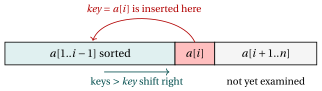
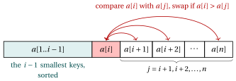
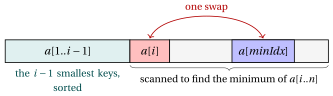

# Sorting algorithms

**Part 1 · Basic algorithms · Chapter 3** · [:material-file-pdf-box: Lecture notes, volume 1 (PDF)](../pdf/lecture-notes-1-basic-algorithms.pdf) · [:material-pencil: Exercises: Sorting algorithms](../exercises/ex-03-sorting.md) · [:material-gesture-tap: App: Sorting step by step](../lab/sorting.md)

## Introduction

Sorting is one of the most common tasks in computing: a sorted list of names, of grades or of prices is much easier to search, to compare and to read than an unsorted one. In this chapter we state the sorting problem precisely, we introduce the criteria used to compare sorting algorithms, and we study three classical algorithms that solve it: <strong>Insertion Sort</strong>, <strong>Exchange Sort</strong> and <strong>Selection Sort</strong>.

- The three algorithms are written in the pseudo-code of the course, with arrays indexed from $1$; their implementations in Python, <code>C++</code> and Java, with arrays indexed from $0$, are in the Colab notebooks of the chapter.

- For each algorithm we show its execution step by step on the same two arrays, $[5, 2, 4, 1, 3]$ and $[12, 11, 13, 5, 6]$, so that the three methods can be compared directly.

- For each algorithm we count the key comparisons and the moves of keys that it performs, and we establish whether it is in-place and whether it is stable.

## 3.1 The sorting problem

!!! definizione "Definition 3.1: sorting problem"

    Given an array $a[1..n]$ of $n \in \Z_{\ge 1}$ natural numbers, the <strong>sorting problem</strong> consists in rearranging the elements of the array in <strong>non-decreasing order</strong>, i.e., so that

    \begin{equation*}
    \label{eq:srt:sorted}
    a[1] \le a[2] \le \dots \le a[n]. \tag{3.1}
    \end{equation*}

    A <strong>rearrangement</strong> (or <strong>permutation</strong>) of the array is an array that contains the same elements, each with the same multiplicity, in a possibly different order. The output of the sorting problem is the rearrangement of the input array that satisfies $\eqref{eq:srt:sorted}$.

- Each element $a[i]$ is called a <strong>key</strong>: it is the value on which the ordering is based, i.e., the value that is compared to decide the final arrangement.

- The order is <em>non-decreasing</em> rather than <em>increasing</em> because the array may contain equal keys, as in $[3, 1, 3]$, whose sorted rearrangement is $[1, 3, 3]$.

- The output must be a rearrangement of the input: an array such as $[0, 0, 0, 0, 0]$ satisfies $\eqref{eq:srt:sorted}$, but it is not the sorted version of $[5, 2, 4, 1, 3]$.

!!! esempio "Example 3.1: sorting an array"

    - Input array: $a = [5, 2, 4, 1, 3]$.

    - Sorted array: $a = [1, 2, 3, 4, 5]$.

Before studying specific algorithms, we fix the operations that they may use and the criteria by which we compare them.

### 3.1.1 Comparison-based sorting

!!! definizione "Definition 3.2: comparison-based sorting"

    A sorting algorithm is <strong>comparison-based</strong> if it accesses the keys only by comparing them two at a time and by copying them.

- The only operations permitted on the keys in a comparison-based sorting algorithm are:

    1. <strong>compare two keys</strong>: determine which of $a[i]$ and $a[j]$ is larger (or whether they are equal);

    2. <strong>copy / assign a key</strong>: move or store a key value, e.g., $\mathit{tmp} \leftarrow a[i]$.

- Forbidden operations on keys:

    1. arithmetic on keys (addition, multiplication, etc.);

    2. inspecting individual digits or bits of a key;

    3. any operation that exploits the internal representation of the key.

- All the sorting algorithms studied in this chapter (Insertion Sort, Exchange Sort, Selection Sort) belong to this class: they decide how to rearrange the elements solely on the basis of pairwise key comparisons.

### 3.1.2 Performance metrics

- Since comparisons and assignments are the only operations permitted on the keys, we evaluate a comparison-based sorting algorithm by counting:

    - the <strong>number of key comparisons</strong> it performs;

    - the <strong>number of key assignments</strong> (copies) it performs.

- The number of assignments matters in practice. Each <strong>swap</strong> of two array elements requires three assignments:

    $$
    \mathit{tmp} \leftarrow a[i]; \qquad a[i] \leftarrow a[j]; \qquad a[j] \leftarrow \mathit{tmp},
    $$

    so algorithms that swap less tend to be faster.

- Both numbers depend not only on $n$ but also on the initial order of the keys. For this reason we compute them in the <strong>best case</strong> (the input that minimizes them) and in the <strong>worst case</strong> (the input that maximizes them), among all arrays with $n$ elements.

- In the counts we use the sum of the first $n-1$ positive integers:

    \begin{equation*}
    \label{eq:srt:gauss}
    \sum_{k=1}^{n-1} k \;=\; 1 + 2 + \dots + (n-1) \;=\; \frac{n(n-1)}{2}. \tag{3.2}
    \end{equation*}

### 3.1.3 In-place sorting and memory usage

- Beyond time, we also care about how much <strong>extra memory</strong> an algorithm uses beyond the space already needed to store the $n$ input keys.

!!! definizione "Definition 3.3: in-place sorting"

    A sorting algorithm is <strong>in-place</strong> if the amount of extra memory it requires is <strong>constant</strong>, i.e., it does not grow with $n$.

- Equivalently, an in-place sorting algorithm sorts by rearranging the elements <em>within</em> the original array, using at most a fixed number of auxiliary variables (e.g., loop counters, a temporary variable for swapping).

- In-place algorithms typically rearrange the input array by shifting or swapping elements, so they do not require extra space for another array to hold the sorted output.

### 3.1.4 Stability

- In many applications the keys are part of larger <strong>records</strong> (e.g., a student identified by a grade and a name), and two different records may have the same key. We write a record as a pair $(\mathit{key},\ \mathit{label})$. Only the keys are compared, and each label travels with its key.

!!! definizione "Definition 3.4: stable sorting"

    A sorting algorithm is <strong>stable</strong> if records with equal keys appear in the output in the same relative order as in the input.

!!! esempio "Example 3.2: stable and non-stable sorting"

    - Array of records: $a = [(3,A),\ (1,B),\ (3,C),\ (2,D),\ (1,E)]$.

    - Stable sorting: $a = [(1,B),\ (1,E),\ (2,D),\ (3,A),\ (3,C)]$. The records with key $1$ keep the order $B, E$ and the records with key $3$ keep the order $A, C$, as in the input.

    - Non-stable sorting: $a = [(1,E),\ (1,B),\ (2,D),\ (3,C),\ (3,A)]$. The keys are sorted, but both pairs of records with equal keys are inverted.

- Stability matters when the records are sorted several times by different keys: for instance, sorting students first by name and then, with a stable algorithm, by grade, gives the students with the same grade in alphabetical order.

!!! chiave ""

    A comparison-based sorting algorithm is evaluated by the <strong>number of key comparisons</strong> and the <strong>number of key assignments</strong> it performs (in the best and in the worst case), by the <strong>extra memory</strong> it uses (in-place or not), and by whether it is <strong>stable</strong>.

## 3.2 Insertion Sort

- Insertion Sort works as many people sort a hand of playing cards: the cards already in the hand are kept sorted, and each new card is inserted in its correct place among them.

- At the beginning of iteration $i$, the sub-array $a[1..i-1]$ is sorted. The algorithm takes the next element $a[i]$, called $\mathit{key}$, shifts one position to the right all the elements of $a[1..i-1]$ that are greater than $\mathit{key}$, and writes $\mathit{key}$ in the position left free (Figure [3.1](#box-7-fig-srt-insertion)).

{ .fig loading=lazy  }

<strong>Figure 3.1:</strong> Iteration &#92;(i&#92;) of Insertion Sort: &#92;(&#92;mathit{key}=a&#91;i&#93;&#92;) is inserted in the sorted sub-array &#92;(a&#91;1..i-1&#93;&#92;), after shifting one position to the right the keys greater than &#92;(&#92;mathit{key}&#92;).

- This is the pseudo-code of the Insertion Sort algorithm, which sorts an array $a[1..n]$ of $n$ natural numbers in non-decreasing order.

!!! algoritmo "Algorithm: InsertionSort"

    

    
Input: An array &#92;(a&#91;1..n&#93;&#92;) of &#92;(n&#92;) natural numbers

    
Output: The array &#92;(a&#92;) sorted in non-decreasing order

    

    

    
1<strong>function</strong> InsertionSort(a, n)

    
2&#92;(i := 2&#92;)

    
3<strong>while</strong> &#92;(i &#92;le n&#92;) <strong>do</strong>

    
4&#92;(&#92;mathit{key} := a&#91;i&#93;&#92;)// element to insert

    
5&#92;(j := i - 1&#92;)

    
6<strong>while</strong> &#92;(j &#92;ge 1&#92;) <strong>and</strong> &#92;(a&#91;j&#93; &gt; &#92;mathit{key}&#92;) <strong>do</strong>

    
7&#92;(a&#91;j+1&#93; &#92;leftarrow a&#91;j&#93;&#92;)// shift element to the right

    
8&#92;(j &#92;leftarrow j - 1&#92;)

    
9<strong>end</strong>

    
10&#92;(a&#91;j+1&#93; &#92;leftarrow &#92;mathit{key}&#92;)// insert key in its position

    
11&#92;(i &#92;leftarrow i + 1&#92;)

    
12<strong>end</strong>

    
13<strong>end</strong>

    

Run in Colab:

- Explanation of the algorithm:

    - The outer loop (lines [3](#riga-03-sorting-line-is-b)–[11](#riga-03-sorting-line-is-i)) iterates through the array starting from the second element ($i = 2$): a single element, $a[1..1]$, is already sorted.

    - For each element $a[i]$ (the $\mathit{key}$), the inner loop (lines [6](#riga-03-sorting-line-is-e)–[8](#riga-03-sorting-line-is-g)) scans the sorted portion $a[1..i-1]$ from right to left and shifts one position to the right all the elements greater than $\mathit{key}$.

    - The inner loop stops when $j=0$ (all the elements of $a[1..i-1]$ were greater than $\mathit{key}$) or when $a[j] \le \mathit{key}$. The condition at line [6](#riga-03-sorting-line-is-e) is evaluated from left to right: when $j = 0$ the comparison $a[j] > \mathit{key}$ is not evaluated, since $a[0]$ does not exist.

    - Line [10](#riga-03-sorting-line-is-h) writes $\mathit{key}$ in the position $j+1$ left free by the shifts.

    - After each iteration of the outer loop, the sub-array $a[1..i]$ is sorted. When the algorithm stops, $i = n+1$ and the whole array $a[1..n]$ is sorted.

- In the trace tables of this chapter, each row shows the state of the array <em>after</em> the operation described in the last column. The current key is highlighted in <mark style="background:color-mix(in srgb, #e03131 30%, transparent);color:inherit">red</mark>, and the cells modified by a shift, an insertion or a swap are highlighted in <mark style="background:color-mix(in srgb, #1971c2 30%, transparent);color:inherit">blue</mark>.

!!! esempio "Example 3.3: Insertion Sort on $[5, 2, 4, 1, 3]$"

    Input array: $a = [5, 2, 4, 1, 3]$, with $n=5$. The outer loop executes the iterations $i = 2, 3, 4, 5$.

    - Detailed trace (inner loop):

    
<table>
    <tr>
    <th>&#92;(i&#92;)</th>
    <th>&#92;(j&#92;)</th>
    <th>&#92;(&#92;mathit{key}&#92;)</th>
    <th>&#92;(a&#91;1&#93;&#92;)</th>
    <th>&#92;(a&#91;2&#93;&#92;)</th>
    <th>&#92;(a&#91;3&#93;&#92;)</th>
    <th>&#92;(a&#91;4&#93;&#92;)</th>
    <th>&#92;(a&#91;5&#93;&#92;)</th>
    <th>Action</th>
    </tr>
    <tr>
    <td>&#92;(-&#92;)</td>
    <td>&#92;(-&#92;)</td>
    <td>&#92;(-&#92;)</td>
    <td>5</td>
    <td>2</td>
    <td>4</td>
    <td>1</td>
    <td>3</td>
    <td>initial state</td>
    </tr>
    <tr>
    <td>2</td>
    <td>1</td>
    <td class="cella-rossa">2</td>
    <td>5</td>
    <td>2</td>
    <td>4</td>
    <td>1</td>
    <td>3</td>
    <td>&#92;(&#92;mathit{key} &#92;leftarrow a&#91;2&#93;=2&#92;); &#92;(j &#92;leftarrow 1&#92;)</td>
    </tr>
    <tr>
    <td></td>
    <td>0</td>
    <td>2</td>
    <td>5</td>
    <td class="cella-blu">5</td>
    <td>4</td>
    <td>1</td>
    <td>3</td>
    <td>&#92;(a&#91;1&#93;=5&gt;2&#92;): shift &#92;(a&#91;2&#93;&#92;leftarrow 5&#92;); &#92;(j&#92;leftarrow 0&#92;)</td>
    </tr>
    <tr>
    <td></td>
    <td>&#92;(-&#92;)</td>
    <td>2</td>
    <td class="cella-blu">2</td>
    <td>5</td>
    <td>4</td>
    <td>1</td>
    <td>3</td>
    <td>&#92;(j=0&#92;): exit; insert &#92;(a&#91;1&#93;&#92;leftarrow 2&#92;)</td>
    </tr>
    <tr>
    <td>3</td>
    <td>2</td>
    <td class="cella-rossa">4</td>
    <td>2</td>
    <td>5</td>
    <td>4</td>
    <td>1</td>
    <td>3</td>
    <td>&#92;(&#92;mathit{key} &#92;leftarrow a&#91;3&#93;=4&#92;); &#92;(j &#92;leftarrow 2&#92;)</td>
    </tr>
    <tr>
    <td></td>
    <td>1</td>
    <td>4</td>
    <td>2</td>
    <td>5</td>
    <td class="cella-blu">5</td>
    <td>1</td>
    <td>3</td>
    <td>&#92;(a&#91;2&#93;=5&gt;4&#92;): shift &#92;(a&#91;3&#93;&#92;leftarrow 5&#92;); &#92;(j&#92;leftarrow 1&#92;)</td>
    </tr>
    <tr>
    <td></td>
    <td>&#92;(-&#92;)</td>
    <td>4</td>
    <td>2</td>
    <td class="cella-blu">4</td>
    <td>5</td>
    <td>1</td>
    <td>3</td>
    <td>&#92;(a&#91;1&#93;=2&#92;le 4&#92;): exit; insert &#92;(a&#91;2&#93;&#92;leftarrow 4&#92;)</td>
    </tr>
    <tr>
    <td>4</td>
    <td>3</td>
    <td class="cella-rossa">1</td>
    <td>2</td>
    <td>4</td>
    <td>5</td>
    <td>1</td>
    <td>3</td>
    <td>&#92;(&#92;mathit{key} &#92;leftarrow a&#91;4&#93;=1&#92;); &#92;(j &#92;leftarrow 3&#92;)</td>
    </tr>
    <tr>
    <td></td>
    <td>2</td>
    <td>1</td>
    <td>2</td>
    <td>4</td>
    <td>5</td>
    <td class="cella-blu">5</td>
    <td>3</td>
    <td>&#92;(a&#91;3&#93;=5&gt;1&#92;): shift &#92;(a&#91;4&#93;&#92;leftarrow 5&#92;); &#92;(j&#92;leftarrow 2&#92;)</td>
    </tr>
    <tr>
    <td></td>
    <td>1</td>
    <td>1</td>
    <td>2</td>
    <td>4</td>
    <td class="cella-blu">4</td>
    <td>5</td>
    <td>3</td>
    <td>&#92;(a&#91;2&#93;=4&gt;1&#92;): shift &#92;(a&#91;3&#93;&#92;leftarrow 4&#92;); &#92;(j&#92;leftarrow 1&#92;)</td>
    </tr>
    <tr>
    <td></td>
    <td>0</td>
    <td>1</td>
    <td>2</td>
    <td class="cella-blu">2</td>
    <td>4</td>
    <td>5</td>
    <td>3</td>
    <td>&#92;(a&#91;1&#93;=2&gt;1&#92;): shift &#92;(a&#91;2&#93;&#92;leftarrow 2&#92;); &#92;(j&#92;leftarrow 0&#92;)</td>
    </tr>
    <tr>
    <td></td>
    <td>&#92;(-&#92;)</td>
    <td>1</td>
    <td class="cella-blu">1</td>
    <td>2</td>
    <td>4</td>
    <td>5</td>
    <td>3</td>
    <td>&#92;(j=0&#92;): exit; insert &#92;(a&#91;1&#93;&#92;leftarrow 1&#92;)</td>
    </tr>
    <tr>
    <td>5</td>
    <td>4</td>
    <td class="cella-rossa">3</td>
    <td>1</td>
    <td>2</td>
    <td>4</td>
    <td>5</td>
    <td>3</td>
    <td>&#92;(&#92;mathit{key} &#92;leftarrow a&#91;5&#93;=3&#92;); &#92;(j &#92;leftarrow 4&#92;)</td>
    </tr>
    <tr>
    <td></td>
    <td>3</td>
    <td>3</td>
    <td>1</td>
    <td>2</td>
    <td>4</td>
    <td>5</td>
    <td class="cella-blu">5</td>
    <td>&#92;(a&#91;4&#93;=5&gt;3&#92;): shift &#92;(a&#91;5&#93;&#92;leftarrow 5&#92;); &#92;(j&#92;leftarrow 3&#92;)</td>
    </tr>
    <tr>
    <td></td>
    <td>2</td>
    <td>3</td>
    <td>1</td>
    <td>2</td>
    <td>4</td>
    <td class="cella-blu">4</td>
    <td>5</td>
    <td>&#92;(a&#91;3&#93;=4&gt;3&#92;): shift &#92;(a&#91;4&#93;&#92;leftarrow 4&#92;); &#92;(j&#92;leftarrow 2&#92;)</td>
    </tr>
    <tr>
    <td></td>
    <td>&#92;(-&#92;)</td>
    <td>3</td>
    <td>1</td>
    <td>2</td>
    <td class="cella-blu">3</td>
    <td>4</td>
    <td>5</td>
    <td>&#92;(a&#91;2&#93;=2&#92;le 3&#92;): exit; insert &#92;(a&#91;3&#93;&#92;leftarrow 3&#92;)</td>
    </tr>
    </table>

    - State of the array after each iteration of the outer loop:

    
<table>
    <tr>
    <th>&#92;(i&#92;)</th>
    <th>&#92;(&#92;mathit{key}&#92;)</th>
    <th>&#92;(a&#91;1&#93;&#92;)</th>
    <th>&#92;(a&#91;2&#93;&#92;)</th>
    <th>&#92;(a&#91;3&#93;&#92;)</th>
    <th>&#92;(a&#91;4&#93;&#92;)</th>
    <th>&#92;(a&#91;5&#93;&#92;)</th>
    <th>Action</th>
    </tr>
    <tr>
    <td>&#92;(-&#92;)</td>
    <td>&#92;(-&#92;)</td>
    <td>5</td>
    <td>2</td>
    <td>4</td>
    <td>1</td>
    <td>3</td>
    <td>initial state</td>
    </tr>
    <tr>
    <td>2</td>
    <td class="cella-rossa">2</td>
    <td class="cella-blu">2</td>
    <td class="cella-blu">5</td>
    <td>4</td>
    <td>1</td>
    <td>3</td>
    <td>insert 2 at the beginning</td>
    </tr>
    <tr>
    <td>3</td>
    <td class="cella-rossa">4</td>
    <td>2</td>
    <td class="cella-blu">4</td>
    <td class="cella-blu">5</td>
    <td>1</td>
    <td>3</td>
    <td>insert 4 between 2 and 5</td>
    </tr>
    <tr>
    <td>4</td>
    <td class="cella-rossa">1</td>
    <td class="cella-blu">1</td>
    <td class="cella-blu">2</td>
    <td class="cella-blu">4</td>
    <td class="cella-blu">5</td>
    <td>3</td>
    <td>insert 1 at the beginning</td>
    </tr>
    <tr>
    <td>5</td>
    <td class="cella-rossa">3</td>
    <td>1</td>
    <td>2</td>
    <td class="cella-blu">3</td>
    <td class="cella-blu">4</td>
    <td class="cella-blu">5</td>
    <td>insert 3 between 2 and 4</td>
    </tr>
    </table>

    - The sorted array is $[1, 2, 3, 4, 5]$. The algorithm performs 9 key comparisons and 7 shifts.

!!! esempio "Example 3.4: Insertion Sort on $[12, 11, 13, 5, 6]$"

    Input array: $a = [12, 11, 13, 5, 6]$, with $n=5$.

    - Detailed trace (inner loop):

    
<table>
    <tr>
    <th>&#92;(i&#92;)</th>
    <th>&#92;(j&#92;)</th>
    <th>&#92;(&#92;mathit{key}&#92;)</th>
    <th>&#92;(a&#91;1&#93;&#92;)</th>
    <th>&#92;(a&#91;2&#93;&#92;)</th>
    <th>&#92;(a&#91;3&#93;&#92;)</th>
    <th>&#92;(a&#91;4&#93;&#92;)</th>
    <th>&#92;(a&#91;5&#93;&#92;)</th>
    <th>Action</th>
    </tr>
    <tr>
    <td>&#92;(-&#92;)</td>
    <td>&#92;(-&#92;)</td>
    <td>&#92;(-&#92;)</td>
    <td>12</td>
    <td>11</td>
    <td>13</td>
    <td>5</td>
    <td>6</td>
    <td>initial state</td>
    </tr>
    <tr>
    <td>2</td>
    <td>1</td>
    <td class="cella-rossa">11</td>
    <td>12</td>
    <td>11</td>
    <td>13</td>
    <td>5</td>
    <td>6</td>
    <td>&#92;(&#92;mathit{key} &#92;leftarrow a&#91;2&#93;=11&#92;); &#92;(j &#92;leftarrow 1&#92;)</td>
    </tr>
    <tr>
    <td></td>
    <td>0</td>
    <td>11</td>
    <td>12</td>
    <td class="cella-blu">12</td>
    <td>13</td>
    <td>5</td>
    <td>6</td>
    <td>&#92;(a&#91;1&#93;=12&gt;11&#92;): shift &#92;(a&#91;2&#93;&#92;leftarrow 12&#92;); &#92;(j&#92;leftarrow 0&#92;)</td>
    </tr>
    <tr>
    <td></td>
    <td>&#92;(-&#92;)</td>
    <td>11</td>
    <td class="cella-blu">11</td>
    <td>12</td>
    <td>13</td>
    <td>5</td>
    <td>6</td>
    <td>&#92;(j=0&#92;): exit; insert &#92;(a&#91;1&#93;&#92;leftarrow 11&#92;)</td>
    </tr>
    <tr>
    <td>3</td>
    <td>2</td>
    <td class="cella-rossa">13</td>
    <td>11</td>
    <td>12</td>
    <td>13</td>
    <td>5</td>
    <td>6</td>
    <td>&#92;(&#92;mathit{key} &#92;leftarrow a&#91;3&#93;=13&#92;); &#92;(j &#92;leftarrow 2&#92;)</td>
    </tr>
    <tr>
    <td></td>
    <td>&#92;(-&#92;)</td>
    <td>13</td>
    <td>11</td>
    <td>12</td>
    <td class="cella-blu">13</td>
    <td>5</td>
    <td>6</td>
    <td>&#92;(a&#91;2&#93;=12&#92;le 13&#92;): exit; insert &#92;(a&#91;3&#93;&#92;leftarrow 13&#92;)</td>
    </tr>
    <tr>
    <td>4</td>
    <td>3</td>
    <td class="cella-rossa">5</td>
    <td>11</td>
    <td>12</td>
    <td>13</td>
    <td>5</td>
    <td>6</td>
    <td>&#92;(&#92;mathit{key} &#92;leftarrow a&#91;4&#93;=5&#92;); &#92;(j &#92;leftarrow 3&#92;)</td>
    </tr>
    <tr>
    <td></td>
    <td>2</td>
    <td>5</td>
    <td>11</td>
    <td>12</td>
    <td>13</td>
    <td class="cella-blu">13</td>
    <td>6</td>
    <td>&#92;(a&#91;3&#93;=13&gt;5&#92;): shift &#92;(a&#91;4&#93;&#92;leftarrow 13&#92;); &#92;(j&#92;leftarrow 2&#92;)</td>
    </tr>
    <tr>
    <td></td>
    <td>1</td>
    <td>5</td>
    <td>11</td>
    <td>12</td>
    <td class="cella-blu">12</td>
    <td>13</td>
    <td>6</td>
    <td>&#92;(a&#91;2&#93;=12&gt;5&#92;): shift &#92;(a&#91;3&#93;&#92;leftarrow 12&#92;); &#92;(j&#92;leftarrow 1&#92;)</td>
    </tr>
    <tr>
    <td></td>
    <td>0</td>
    <td>5</td>
    <td>11</td>
    <td class="cella-blu">11</td>
    <td>12</td>
    <td>13</td>
    <td>6</td>
    <td>&#92;(a&#91;1&#93;=11&gt;5&#92;): shift &#92;(a&#91;2&#93;&#92;leftarrow 11&#92;); &#92;(j&#92;leftarrow 0&#92;)</td>
    </tr>
    <tr>
    <td></td>
    <td>&#92;(-&#92;)</td>
    <td>5</td>
    <td class="cella-blu">5</td>
    <td>11</td>
    <td>12</td>
    <td>13</td>
    <td>6</td>
    <td>&#92;(j=0&#92;): exit; insert &#92;(a&#91;1&#93;&#92;leftarrow 5&#92;)</td>
    </tr>
    <tr>
    <td>5</td>
    <td>4</td>
    <td class="cella-rossa">6</td>
    <td>5</td>
    <td>11</td>
    <td>12</td>
    <td>13</td>
    <td>6</td>
    <td>&#92;(&#92;mathit{key} &#92;leftarrow a&#91;5&#93;=6&#92;); &#92;(j &#92;leftarrow 4&#92;)</td>
    </tr>
    <tr>
    <td></td>
    <td>3</td>
    <td>6</td>
    <td>5</td>
    <td>11</td>
    <td>12</td>
    <td>13</td>
    <td class="cella-blu">13</td>
    <td>&#92;(a&#91;4&#93;=13&gt;6&#92;): shift &#92;(a&#91;5&#93;&#92;leftarrow 13&#92;); &#92;(j&#92;leftarrow 3&#92;)</td>
    </tr>
    <tr>
    <td></td>
    <td>2</td>
    <td>6</td>
    <td>5</td>
    <td>11</td>
    <td>12</td>
    <td class="cella-blu">12</td>
    <td>13</td>
    <td>&#92;(a&#91;3&#93;=12&gt;6&#92;): shift &#92;(a&#91;4&#93;&#92;leftarrow 12&#92;); &#92;(j&#92;leftarrow 2&#92;)</td>
    </tr>
    <tr>
    <td></td>
    <td>1</td>
    <td>6</td>
    <td>5</td>
    <td>11</td>
    <td class="cella-blu">11</td>
    <td>12</td>
    <td>13</td>
    <td>&#92;(a&#91;2&#93;=11&gt;6&#92;): shift &#92;(a&#91;3&#93;&#92;leftarrow 11&#92;); &#92;(j&#92;leftarrow 1&#92;)</td>
    </tr>
    <tr>
    <td></td>
    <td>&#92;(-&#92;)</td>
    <td>6</td>
    <td>5</td>
    <td class="cella-blu">6</td>
    <td>11</td>
    <td>12</td>
    <td>13</td>
    <td>&#92;(a&#91;1&#93;=5&#92;le 6&#92;): exit; insert &#92;(a&#91;2&#93;&#92;leftarrow 6&#92;)</td>
    </tr>
    </table>

    - State of the array after each iteration of the outer loop:

    
<table>
    <tr>
    <th>&#92;(i&#92;)</th>
    <th>&#92;(&#92;mathit{key}&#92;)</th>
    <th>&#92;(a&#91;1&#93;&#92;)</th>
    <th>&#92;(a&#91;2&#93;&#92;)</th>
    <th>&#92;(a&#91;3&#93;&#92;)</th>
    <th>&#92;(a&#91;4&#93;&#92;)</th>
    <th>&#92;(a&#91;5&#93;&#92;)</th>
    <th>Action</th>
    </tr>
    <tr>
    <td>&#92;(-&#92;)</td>
    <td>&#92;(-&#92;)</td>
    <td>12</td>
    <td>11</td>
    <td>13</td>
    <td>5</td>
    <td>6</td>
    <td>initial state</td>
    </tr>
    <tr>
    <td>2</td>
    <td class="cella-rossa">11</td>
    <td class="cella-blu">11</td>
    <td class="cella-blu">12</td>
    <td>13</td>
    <td>5</td>
    <td>6</td>
    <td>insert 11 at the beginning</td>
    </tr>
    <tr>
    <td>3</td>
    <td class="cella-rossa">13</td>
    <td>11</td>
    <td>12</td>
    <td>13</td>
    <td>5</td>
    <td>6</td>
    <td>13 already in position</td>
    </tr>
    <tr>
    <td>4</td>
    <td class="cella-rossa">5</td>
    <td class="cella-blu">5</td>
    <td class="cella-blu">11</td>
    <td class="cella-blu">12</td>
    <td class="cella-blu">13</td>
    <td>6</td>
    <td>insert 5 at the beginning</td>
    </tr>
    <tr>
    <td>5</td>
    <td class="cella-rossa">6</td>
    <td>5</td>
    <td class="cella-blu">6</td>
    <td class="cella-blu">11</td>
    <td class="cella-blu">12</td>
    <td class="cella-blu">13</td>
    <td>insert 6 between 5 and 11</td>
    </tr>
    </table>

    - The sorted array is $[5, 6, 11, 12, 13]$. In iteration $i=3$ the key $13$ is already in its position: the inner loop stops at the first comparison and no shift is performed. The algorithm performs 9 key comparisons and 7 shifts.

### 3.2.1 Properties of Insertion Sort

- The two examples show that the work done by Insertion Sort depends on the initial order of the keys: a key that is already in its position costs one comparison and no shift, while a key smaller than all the previous ones is shifted across the whole sorted portion.

!!! teorema "Observation 3.5: comparisons and shifts of Insertion Sort"

    Given an array $a[1..n]$ of $n$ natural numbers, <code>InsertionSort</code> performs at least $n-1$ and at most $\frac{n(n-1)}{2}$ key comparisons, and at most $\frac{n(n-1)}{2}$ shifts. The lower bounds are attained when the array is already sorted (no shift is performed), the upper bounds when it is sorted in decreasing order with distinct keys.

??? dimostrazione "Proof"

    Consider iteration $i$ of the outer loop, with $i \in \{2, 3, \dots, n\}$, and let $s_i$ and $c_i$ be the numbers of shifts and of key comparisons it performs. The inner loop starts with $j=i-1 \ge 1$, so $c_i \ge 1$. Each shift (lines [7](#riga-03-sorting-line-is-f)–[8](#riga-03-sorting-line-is-g)) follows a comparison $a[j] > \mathit{key}$ that is true, and decreases $j$ by $1$; hence $s_i \le i-1$. The inner loop then stops in one of two ways:

    - with $j = 0$, after $s_i = i-1$ shifts and without a further comparison: $c_i = s_i = i-1$;

    - after a comparison $a[j] > \mathit{key}$ that is false, with $j \ge 1$: then $s_i = i-1-j \le i-2$ and $c_i = s_i + 1 \le i-1$.

    In both cases $1 \le c_i \le i-1$ and $0 \le s_i \le i-1$. Summing over $i \in \{2, 3, \dots, n\}$ and using $\eqref{eq:srt:gauss}$:

    $$
    n-1 \;\le\; \text{key comparisons} \;\le\; \sum_{i=2}^{n} (i-1) = \frac{n(n-1)}{2},
    \qquad
    \text{shifts} \;\le\; \frac{n(n-1)}{2}.
    $$

    If the array is sorted, at every iteration $a[i-1] \le \mathit{key}$: the inner loop stops at the first comparison, with no shift, and the algorithm performs exactly $n-1$ comparisons. If the keys are distinct and in decreasing order, $\mathit{key}=a[i]$ is smaller than all the keys of $a[1..i-1]$: all of them are shifted and the loop stops with $j=0$, so iteration $i$ performs $i-1$ comparisons and $i-1$ shifts, and the totals are both $\frac{n(n-1)}{2}$. □

- Every iteration also performs two assignments of keys (lines [4](#riga-03-sorting-line-is-c) and [10](#riga-03-sorting-line-is-h)), so the number of key assignments is $2(n-1)$ plus the number of shifts: between $2(n-1)$ and $2(n-1) + \frac{n(n-1)}{2}$.

- Insertion Sort never swaps two elements: a shift is a single assignment, which makes the method cheaper than a sequence of swaps that would move $\mathit{key}$ one position at a time.

!!! teorema "Observation 3.6: Insertion Sort is in-place and stable"

    <code>InsertionSort</code> is an in-place and stable sorting algorithm.

??? dimostrazione "Proof"

    Besides the array, the algorithm uses only the three variables $i$, $j$ and $\mathit{key}$, independently of $n$: it is in-place. A key is moved to the left only past keys that are <em>strictly</em> greater than it (condition $a[j] > \mathit{key}$ at line [6](#riga-03-sorting-line-is-e)): the inner loop stops at the first key $a[j] \le \mathit{key}$, so $\mathit{key}$ is inserted after every equal key that precedes it. Hence two records with equal keys are never exchanged, and their relative order in the output is the same as in the input: the algorithm is stable. □

## 3.3 Exchange Sort

- Insertion Sort builds the sorted prefix by inserting each new key among the previous ones. Exchange Sort follows the opposite idea: it fills the positions $1, 2, \dots, n-1$ one at a time, each with the smallest of the remaining keys.

- In iteration $i$, the algorithm compares $a[i]$ with every element $a[j]$ with $j > i$ and swaps the two elements whenever $a[i] > a[j]$. At the end of the iteration $a[i]$ is the minimum of $a[i..n]$ (Figure [3.2](#box-14-fig-srt-exchange)).

{ .fig loading=lazy  }

<strong>Figure 3.2:</strong> Iteration &#92;(i&#92;) of Exchange Sort: &#92;(a&#91;i&#93;&#92;) is compared with every &#92;(a&#91;j&#93;&#92;), &#92;(j &gt; i&#92;), and the two elements are swapped whenever &#92;(a&#91;i&#93; &gt; a&#91;j&#93;&#92;); at the end, &#92;(a&#91;i&#93; = &#92;min(a&#91;i..n&#93;)&#92;).

- This is the pseudo-code of the Exchange Sort algorithm, which sorts an array $a[1..n]$ of $n$ natural numbers in non-decreasing order.

!!! algoritmo "Algorithm: ExchangeSort"

    

    
Input: An array &#92;(a&#91;1..n&#93;&#92;) of &#92;(n&#92;) natural numbers

    
Output: The array &#92;(a&#92;) sorted in non-decreasing order

    

    

    
1<strong>function</strong> ExchangeSort(a, n)

    
2&#92;(i := 1&#92;)

    
3<strong>while</strong> &#92;(i &#92;le n-1&#92;) <strong>do</strong>

    
4&#92;(j := i+1&#92;)

    
5<strong>while</strong> &#92;(j &#92;le n&#92;) <strong>do</strong>

    
6<strong>if</strong> &#92;(a&#91;i&#93; &gt; a&#91;j&#93;&#92;) <strong>then</strong>

    
7&#92;(&#92;mathit{tmp} := a&#91;i&#93;&#92;)// swap &#92;(a&#91;i&#93;&#92;) and &#92;(a&#91;j&#93;&#92;)

    
8&#92;(a&#91;i&#93; &#92;leftarrow a&#91;j&#93;&#92;)

    
9&#92;(a&#91;j&#93; &#92;leftarrow &#92;mathit{tmp}&#92;)

    
10<strong>end</strong>

    
11&#92;(j &#92;leftarrow j + 1&#92;)

    
12<strong>end</strong>

    
13&#92;(i &#92;leftarrow i + 1&#92;)

    
14<strong>end</strong>

    
15<strong>end</strong>

    

Run in Colab:

- Explanation of the algorithm:

    - The outer loop iterates with index $i$ from $1$ to $n-1$.

    - For each $i$, the inner loop compares $a[i]$ with every element $a[j]$ for $j \in \{i+1, i+2, \dots, n\}$.

    - Whenever $a[i] > a[j]$, the two elements are swapped (lines [7](#riga-03-sorting-line-es-f)–[9](#riga-03-sorting-line-es-h)), so $a[i]$ always holds the smallest key met so far in $a[i..n]$.

    - After iteration $i$ of the outer loop, $a[i]$ is the minimum of $a[i..n]$ and the sub-array $a[1..i]$ contains the $i$ smallest keys of the array, sorted. After iteration $n-1$, the last element $a[n]$ is the largest key, and the whole array is sorted.

!!! esempio "Example 3.7: Exchange Sort on $[5, 2, 4, 1, 3]$"

    Input array: $a = [5, 2, 4, 1, 3]$, with $n=5$. The outer loop executes the iterations $i = 1, 2, 3, 4$.

    - Detailed trace (inner loop):

    
<table>
    <tr>
    <th>&#92;(i&#92;)</th>
    <th>&#92;(j&#92;)</th>
    <th>&#92;(a&#91;1&#93;&#92;)</th>
    <th>&#92;(a&#91;2&#93;&#92;)</th>
    <th>&#92;(a&#91;3&#93;&#92;)</th>
    <th>&#92;(a&#91;4&#93;&#92;)</th>
    <th>&#92;(a&#91;5&#93;&#92;)</th>
    <th>Action</th>
    </tr>
    <tr>
    <td>&#92;(-&#92;)</td>
    <td>&#92;(-&#92;)</td>
    <td>5</td>
    <td>2</td>
    <td>4</td>
    <td>1</td>
    <td>3</td>
    <td>initial state</td>
    </tr>
    <tr>
    <td>1</td>
    <td>2</td>
    <td class="cella-blu">2</td>
    <td class="cella-blu">5</td>
    <td>4</td>
    <td>1</td>
    <td>3</td>
    <td>&#92;(a&#91;1&#93;=5&gt;a&#91;2&#93;=2&#92;): swap &#92;(a&#91;1&#93;&#92;leftrightarrow a&#91;2&#93;&#92;)</td>
    </tr>
    <tr>
    <td></td>
    <td>3</td>
    <td>2</td>
    <td>5</td>
    <td>4</td>
    <td>1</td>
    <td>3</td>
    <td>&#92;(a&#91;1&#93;=2&#92;le a&#91;3&#93;=4&#92;): no swap</td>
    </tr>
    <tr>
    <td></td>
    <td>4</td>
    <td class="cella-blu">1</td>
    <td>5</td>
    <td>4</td>
    <td class="cella-blu">2</td>
    <td>3</td>
    <td>&#92;(a&#91;1&#93;=2&gt;a&#91;4&#93;=1&#92;): swap &#92;(a&#91;1&#93;&#92;leftrightarrow a&#91;4&#93;&#92;)</td>
    </tr>
    <tr>
    <td></td>
    <td>5</td>
    <td>1</td>
    <td>5</td>
    <td>4</td>
    <td>2</td>
    <td>3</td>
    <td>&#92;(a&#91;1&#93;=1&#92;le a&#91;5&#93;=3&#92;): no swap</td>
    </tr>
    <tr>
    <td>2</td>
    <td>3</td>
    <td>1</td>
    <td class="cella-blu">4</td>
    <td class="cella-blu">5</td>
    <td>2</td>
    <td>3</td>
    <td>&#92;(a&#91;2&#93;=5&gt;a&#91;3&#93;=4&#92;): swap &#92;(a&#91;2&#93;&#92;leftrightarrow a&#91;3&#93;&#92;)</td>
    </tr>
    <tr>
    <td></td>
    <td>4</td>
    <td>1</td>
    <td class="cella-blu">2</td>
    <td>5</td>
    <td class="cella-blu">4</td>
    <td>3</td>
    <td>&#92;(a&#91;2&#93;=4&gt;a&#91;4&#93;=2&#92;): swap &#92;(a&#91;2&#93;&#92;leftrightarrow a&#91;4&#93;&#92;)</td>
    </tr>
    <tr>
    <td></td>
    <td>5</td>
    <td>1</td>
    <td>2</td>
    <td>5</td>
    <td>4</td>
    <td>3</td>
    <td>&#92;(a&#91;2&#93;=2&#92;le a&#91;5&#93;=3&#92;): no swap</td>
    </tr>
    <tr>
    <td>3</td>
    <td>4</td>
    <td>1</td>
    <td>2</td>
    <td class="cella-blu">4</td>
    <td class="cella-blu">5</td>
    <td>3</td>
    <td>&#92;(a&#91;3&#93;=5&gt;a&#91;4&#93;=4&#92;): swap &#92;(a&#91;3&#93;&#92;leftrightarrow a&#91;4&#93;&#92;)</td>
    </tr>
    <tr>
    <td></td>
    <td>5</td>
    <td>1</td>
    <td>2</td>
    <td class="cella-blu">3</td>
    <td>5</td>
    <td class="cella-blu">4</td>
    <td>&#92;(a&#91;3&#93;=4&gt;a&#91;5&#93;=3&#92;): swap &#92;(a&#91;3&#93;&#92;leftrightarrow a&#91;5&#93;&#92;)</td>
    </tr>
    <tr>
    <td>4</td>
    <td>5</td>
    <td>1</td>
    <td>2</td>
    <td>3</td>
    <td class="cella-blu">4</td>
    <td class="cella-blu">5</td>
    <td>&#92;(a&#91;4&#93;=5&gt;a&#91;5&#93;=4&#92;): swap &#92;(a&#91;4&#93;&#92;leftrightarrow a&#91;5&#93;&#92;)</td>
    </tr>
    </table>

    - State of the array after each iteration of the outer loop:

    
<table>
    <tr>
    <th>&#92;(i&#92;)</th>
    <th>&#92;(a&#91;1&#93;&#92;)</th>
    <th>&#92;(a&#91;2&#93;&#92;)</th>
    <th>&#92;(a&#91;3&#93;&#92;)</th>
    <th>&#92;(a&#91;4&#93;&#92;)</th>
    <th>&#92;(a&#91;5&#93;&#92;)</th>
    <th>Action</th>
    </tr>
    <tr>
    <td>&#92;(-&#92;)</td>
    <td>5</td>
    <td>2</td>
    <td>4</td>
    <td>1</td>
    <td>3</td>
    <td>initial state</td>
    </tr>
    <tr>
    <td>1</td>
    <td class="cella-blu">1</td>
    <td class="cella-blu">5</td>
    <td>4</td>
    <td class="cella-blu">2</td>
    <td>3</td>
    <td>&#92;(a&#91;1&#93;=&#92;min(a&#91;1..5&#93;)=1&#92;) (2 swaps)</td>
    </tr>
    <tr>
    <td>2</td>
    <td>1</td>
    <td class="cella-blu">2</td>
    <td class="cella-blu">5</td>
    <td class="cella-blu">4</td>
    <td>3</td>
    <td>&#92;(a&#91;2&#93;=&#92;min(a&#91;2..5&#93;)=2&#92;) (2 swaps)</td>
    </tr>
    <tr>
    <td>3</td>
    <td>1</td>
    <td>2</td>
    <td class="cella-blu">3</td>
    <td class="cella-blu">5</td>
    <td class="cella-blu">4</td>
    <td>&#92;(a&#91;3&#93;=&#92;min(a&#91;3..5&#93;)=3&#92;) (2 swaps)</td>
    </tr>
    <tr>
    <td>4</td>
    <td>1</td>
    <td>2</td>
    <td>3</td>
    <td class="cella-blu">4</td>
    <td class="cella-blu">5</td>
    <td>&#92;(a&#91;4&#93;=&#92;min(a&#91;4..5&#93;)=4&#92;) (1 swap)</td>
    </tr>
    </table>

    - The sorted array is $[1, 2, 3, 4, 5]$. The algorithm performs 10 key comparisons and 7 swaps.

!!! esempio "Example 3.8: Exchange Sort on $[12, 11, 13, 5, 6]$"

    Input array: $a = [12, 11, 13, 5, 6]$, with $n=5$.

    - Detailed trace (inner loop):

    
<table>
    <tr>
    <th>&#92;(i&#92;)</th>
    <th>&#92;(j&#92;)</th>
    <th>&#92;(a&#91;1&#93;&#92;)</th>
    <th>&#92;(a&#91;2&#93;&#92;)</th>
    <th>&#92;(a&#91;3&#93;&#92;)</th>
    <th>&#92;(a&#91;4&#93;&#92;)</th>
    <th>&#92;(a&#91;5&#93;&#92;)</th>
    <th>Action</th>
    </tr>
    <tr>
    <td>&#92;(-&#92;)</td>
    <td>&#92;(-&#92;)</td>
    <td>12</td>
    <td>11</td>
    <td>13</td>
    <td>5</td>
    <td>6</td>
    <td>initial state</td>
    </tr>
    <tr>
    <td>1</td>
    <td>2</td>
    <td class="cella-blu">11</td>
    <td class="cella-blu">12</td>
    <td>13</td>
    <td>5</td>
    <td>6</td>
    <td>&#92;(a&#91;1&#93;=12&gt;a&#91;2&#93;=11&#92;): swap &#92;(a&#91;1&#93;&#92;leftrightarrow a&#91;2&#93;&#92;)</td>
    </tr>
    <tr>
    <td></td>
    <td>3</td>
    <td>11</td>
    <td>12</td>
    <td>13</td>
    <td>5</td>
    <td>6</td>
    <td>&#92;(a&#91;1&#93;=11&#92;le a&#91;3&#93;=13&#92;): no swap</td>
    </tr>
    <tr>
    <td></td>
    <td>4</td>
    <td class="cella-blu">5</td>
    <td>12</td>
    <td>13</td>
    <td class="cella-blu">11</td>
    <td>6</td>
    <td>&#92;(a&#91;1&#93;=11&gt;a&#91;4&#93;=5&#92;): swap &#92;(a&#91;1&#93;&#92;leftrightarrow a&#91;4&#93;&#92;)</td>
    </tr>
    <tr>
    <td></td>
    <td>5</td>
    <td>5</td>
    <td>12</td>
    <td>13</td>
    <td>11</td>
    <td>6</td>
    <td>&#92;(a&#91;1&#93;=5&#92;le a&#91;5&#93;=6&#92;): no swap</td>
    </tr>
    <tr>
    <td>2</td>
    <td>3</td>
    <td>5</td>
    <td>12</td>
    <td>13</td>
    <td>11</td>
    <td>6</td>
    <td>&#92;(a&#91;2&#93;=12&#92;le a&#91;3&#93;=13&#92;): no swap</td>
    </tr>
    <tr>
    <td></td>
    <td>4</td>
    <td>5</td>
    <td class="cella-blu">11</td>
    <td>13</td>
    <td class="cella-blu">12</td>
    <td>6</td>
    <td>&#92;(a&#91;2&#93;=12&gt;a&#91;4&#93;=11&#92;): swap &#92;(a&#91;2&#93;&#92;leftrightarrow a&#91;4&#93;&#92;)</td>
    </tr>
    <tr>
    <td></td>
    <td>5</td>
    <td>5</td>
    <td class="cella-blu">6</td>
    <td>13</td>
    <td>12</td>
    <td class="cella-blu">11</td>
    <td>&#92;(a&#91;2&#93;=11&gt;a&#91;5&#93;=6&#92;): swap &#92;(a&#91;2&#93;&#92;leftrightarrow a&#91;5&#93;&#92;)</td>
    </tr>
    <tr>
    <td>3</td>
    <td>4</td>
    <td>5</td>
    <td>6</td>
    <td class="cella-blu">12</td>
    <td class="cella-blu">13</td>
    <td>11</td>
    <td>&#92;(a&#91;3&#93;=13&gt;a&#91;4&#93;=12&#92;): swap &#92;(a&#91;3&#93;&#92;leftrightarrow a&#91;4&#93;&#92;)</td>
    </tr>
    <tr>
    <td></td>
    <td>5</td>
    <td>5</td>
    <td>6</td>
    <td class="cella-blu">11</td>
    <td>13</td>
    <td class="cella-blu">12</td>
    <td>&#92;(a&#91;3&#93;=12&gt;a&#91;5&#93;=11&#92;): swap &#92;(a&#91;3&#93;&#92;leftrightarrow a&#91;5&#93;&#92;)</td>
    </tr>
    <tr>
    <td>4</td>
    <td>5</td>
    <td>5</td>
    <td>6</td>
    <td>11</td>
    <td class="cella-blu">12</td>
    <td class="cella-blu">13</td>
    <td>&#92;(a&#91;4&#93;=13&gt;a&#91;5&#93;=12&#92;): swap &#92;(a&#91;4&#93;&#92;leftrightarrow a&#91;5&#93;&#92;)</td>
    </tr>
    </table>

    - State of the array after each iteration of the outer loop:

    
<table>
    <tr>
    <th>&#92;(i&#92;)</th>
    <th>&#92;(a&#91;1&#93;&#92;)</th>
    <th>&#92;(a&#91;2&#93;&#92;)</th>
    <th>&#92;(a&#91;3&#93;&#92;)</th>
    <th>&#92;(a&#91;4&#93;&#92;)</th>
    <th>&#92;(a&#91;5&#93;&#92;)</th>
    <th>Action</th>
    </tr>
    <tr>
    <td>&#92;(-&#92;)</td>
    <td>12</td>
    <td>11</td>
    <td>13</td>
    <td>5</td>
    <td>6</td>
    <td>initial state</td>
    </tr>
    <tr>
    <td>1</td>
    <td class="cella-blu">5</td>
    <td class="cella-blu">12</td>
    <td>13</td>
    <td class="cella-blu">11</td>
    <td>6</td>
    <td>&#92;(a&#91;1&#93;=&#92;min(a&#91;1..5&#93;)=5&#92;) (2 swaps)</td>
    </tr>
    <tr>
    <td>2</td>
    <td>5</td>
    <td class="cella-blu">6</td>
    <td>13</td>
    <td class="cella-blu">12</td>
    <td class="cella-blu">11</td>
    <td>&#92;(a&#91;2&#93;=&#92;min(a&#91;2..5&#93;)=6&#92;) (2 swaps)</td>
    </tr>
    <tr>
    <td>3</td>
    <td>5</td>
    <td>6</td>
    <td class="cella-blu">11</td>
    <td class="cella-blu">13</td>
    <td class="cella-blu">12</td>
    <td>&#92;(a&#91;3&#93;=&#92;min(a&#91;3..5&#93;)=11&#92;) (2 swaps)</td>
    </tr>
    <tr>
    <td>4</td>
    <td>5</td>
    <td>6</td>
    <td>11</td>
    <td class="cella-blu">12</td>
    <td class="cella-blu">13</td>
    <td>&#92;(a&#91;4&#93;=&#92;min(a&#91;4..5&#93;)=12&#92;) (1 swap)</td>
    </tr>
    </table>

    - The sorted array is $[5, 6, 11, 12, 13]$. The algorithm performs 10 key comparisons and 7 swaps.

### 3.3.1 Properties of Exchange Sort

- Unlike Insertion Sort, Exchange Sort compares every pair of positions $i < j$ exactly once, whatever the initial order of the keys: only the number of swaps depends on the input.

!!! teorema "Observation 3.7: comparisons and swaps of Exchange Sort"

    Given an array $a[1..n]$ of $n$ natural numbers, <code>ExchangeSort</code> performs exactly $\frac{n(n-1)}{2}$ key comparisons and at most $\frac{n(n-1)}{2}$ swaps. No swap is performed when the array is already sorted, and $\frac{n(n-1)}{2}$ swaps are performed when it is sorted in decreasing order with distinct keys.

??? dimostrazione "Proof"

    In iteration $i$ of the outer loop, $i \in \{1, 2, \dots, n-1\}$, the inner loop executes line [6](#riga-03-sorting-line-es-e) once for each $j \in \{i+1, i+2, \dots, n\}$, i.e., $n-i$ times. By $\eqref{eq:srt:gauss}$, the total number of key comparisons is

    $$
    \sum_{i=1}^{n-1} (n-i) = (n-1) + (n-2) + \dots + 1 = \frac{n(n-1)}{2}.
    $$

    Each comparison causes at most one swap, so there are at most $\frac{n(n-1)}{2}$ swaps.

    If the array is sorted, $a[i] \le a[j]$ for every $i < j$: the first comparison causes no swap, the array does not change, and the same holds for all the following comparisons.

    If the keys are distinct and in decreasing order, let $b[1..n]$ be the input array, so $b[1] > b[2] > \dots > b[n]$. In iteration $1$, before the comparison with $j \in \{2, 3, \dots, n\}$ the current value of $a[1]$ is $b[j-1]$ (the last key swapped into position $1$), which is greater than $a[j] = b[j]$: every comparison causes a swap, which moves $b[j-1]$ to position $j$. At the end of iteration $1$, $a[1] = b[n]$ and $a[2..n] = [b[1], b[2], \dots, b[n-1]]$, which is again in decreasing order: for instance, $[6, 5, 4, 3, 2, 1]$ becomes $[1, 6, 5, 4, 3, 2]$. Repeating the argument on $a[i..n]$ for $i = 2, 3, \dots, n-1$, all the $\frac{n(n-1)}{2}$ comparisons cause a swap. □

- On an array in decreasing order with distinct keys, Exchange Sort performs $\frac{n(n-1)}{2}$ swaps, i.e., $\frac{3n(n-1)}{2}$ key assignments, while Insertion Sort moves the keys with $\frac{n(n-1)}{2}$ shifts, one assignment each.

!!! teorema "Observation 3.8: Exchange Sort is in-place but not stable"

    <code>ExchangeSort</code> is an in-place sorting algorithm, but it is not stable.

??? dimostrazione "Proof"

    Besides the array, the algorithm uses only the three variables $i$, $j$ and $\mathit{tmp}$: it is in-place. To show that it is not stable, it is enough to exhibit one input on which the relative order of two equal keys changes. Consider the array of records $[(2,A),\ (2,B),\ (1,C)]$. For $i=1$: the comparison with $j=2$ finds $2 > 2$ false, so no swap; the comparison with $j=3$ finds $2 > 1$, so $a[1]$ and $a[3]$ are swapped, giving $[(1,C),\ (2,B),\ (2,A)]$. For $i=2$: $2 > 2$ is false, so no swap. The output is $[(1,C),\ (2,B),\ (2,A)]$: the record $(2,A)$, which preceded $(2,B)$ in the input, now follows it. □

## 3.4 Selection Sort

- Exchange Sort may swap many times in the same iteration only to bring the minimum of $a[i..n]$ into position $i$. Selection Sort reaches the same result with at most one swap per iteration: it first <em>selects</em> the position of the minimum of $a[i..n]$, and then swaps it with $a[i]$ (Figure [3.3](#box-21-fig-srt-selection)).

{ .fig loading=lazy  }

<strong>Figure 3.3:</strong> Iteration &#92;(i&#92;) of Selection Sort: the inner loop finds the position &#92;(&#92;mathit{minIdx}&#92;) of the minimum of &#92;(a&#91;i..n&#93;&#92;), and then &#92;(a&#91;i&#93;&#92;) and &#92;(a&#91;&#92;mathit{minIdx}&#93;&#92;) are swapped (if &#92;(&#92;mathit{minIdx} &#92;neq i&#92;)).

- This is the pseudo-code of the Selection Sort algorithm, which sorts an array $a[1..n]$ of $n$ natural numbers in non-decreasing order.

!!! algoritmo "Algorithm: SelectionSort"

    

    
Input: An array &#92;(a&#91;1..n&#93;&#92;) of &#92;(n&#92;) natural numbers

    
Output: The array &#92;(a&#92;) sorted in non-decreasing order

    

    

    
1<strong>function</strong> SelectionSort(a, n)

    
2&#92;(i := 1&#92;)

    
3<strong>while</strong> &#92;(i &#92;le n-1&#92;) <strong>do</strong>

    
4&#92;(&#92;mathit{minIdx} := i&#92;)// index of the minimum in &#92;(a&#91;i..n&#93;&#92;)

    
5&#92;(j := i+1&#92;)

    
6<strong>while</strong> &#92;(j &#92;le n&#92;) <strong>do</strong>

    
7<strong>if</strong> &#92;(a&#91;j&#93; &lt; a&#91;&#92;mathit{minIdx}&#93;&#92;) <strong>then</strong>

    
8&#92;(&#92;mathit{minIdx} &#92;leftarrow j&#92;)// new minimum found

    
9<strong>end</strong>

    
10&#92;(j &#92;leftarrow j + 1&#92;)

    
11<strong>end</strong>

    
12<strong>if</strong> &#92;(&#92;mathit{minIdx} &#92;neq i&#92;) <strong>then</strong>

    
13&#92;(&#92;mathit{tmp} := a&#91;i&#93;&#92;)// swap &#92;(a&#91;i&#93;&#92;) and &#92;(a&#91;&#92;mathit{minIdx}&#93;&#92;)

    
14&#92;(a&#91;i&#93; &#92;leftarrow a&#91;&#92;mathit{minIdx}&#93;&#92;)

    
15&#92;(a&#91;&#92;mathit{minIdx}&#93; &#92;leftarrow &#92;mathit{tmp}&#92;)

    
16<strong>end</strong>

    
17&#92;(i &#92;leftarrow i + 1&#92;)

    
18<strong>end</strong>

    
19<strong>end</strong>

    

Run in Colab:

- Explanation of the algorithm:

    - The outer loop iterates with index $i$ from $1$ to $n-1$.

    - For each $i$, the inner loop scans $a[i+1..n]$ and keeps in $\mathit{minIdx}$ the index of the smallest key met so far. Since the comparison at line [7](#riga-03-sorting-line-ss-f) is strict, in case of ties $\mathit{minIdx}$ is the index of the <em>first</em> minimum.

    - After the inner loop, if $\mathit{minIdx} \neq i$, the minimum $a[\mathit{minIdx}]$ is swapped with $a[i]$: at most <strong>one swap</strong> per iteration of the outer loop, unlike Exchange Sort.

    - After iteration $i$ of the outer loop, the sub-array $a[1..i]$ is sorted and contains the $i$ smallest keys of the array.

!!! esempio "Example 3.11: Selection Sort on $[5, 2, 4, 1, 3]$"

    Input array: $a = [5, 2, 4, 1, 3]$, with $n=5$. The outer loop executes the iterations $i = 1, 2, 3, 4$.

    - Detailed trace (inner loop):

    
<table>
    <tr>
    <th>&#92;(i&#92;)</th>
    <th>&#92;(j&#92;)</th>
    <th>&#92;(&#92;mathit{minIdx}&#92;)</th>
    <th>&#92;(a&#91;1&#93;&#92;)</th>
    <th>&#92;(a&#91;2&#93;&#92;)</th>
    <th>&#92;(a&#91;3&#93;&#92;)</th>
    <th>&#92;(a&#91;4&#93;&#92;)</th>
    <th>&#92;(a&#91;5&#93;&#92;)</th>
    <th>Action</th>
    </tr>
    <tr>
    <td>&#92;(-&#92;)</td>
    <td>&#92;(-&#92;)</td>
    <td>&#92;(-&#92;)</td>
    <td>5</td>
    <td>2</td>
    <td>4</td>
    <td>1</td>
    <td>3</td>
    <td>initial state</td>
    </tr>
    <tr>
    <td>1</td>
    <td>&#92;(-&#92;)</td>
    <td>1</td>
    <td>5</td>
    <td>2</td>
    <td>4</td>
    <td>1</td>
    <td>3</td>
    <td>&#92;(&#92;mathit{minIdx}:=1&#92;) (&#92;(a&#91;1&#93;=5&#92;))</td>
    </tr>
    <tr>
    <td></td>
    <td>2</td>
    <td>2</td>
    <td>5</td>
    <td>2</td>
    <td>4</td>
    <td>1</td>
    <td>3</td>
    <td>&#92;(a&#91;2&#93;=2&lt;a&#91;1&#93;=5&#92;): &#92;(&#92;mathit{minIdx}&#92;leftarrow 2&#92;)</td>
    </tr>
    <tr>
    <td></td>
    <td>3</td>
    <td>2</td>
    <td>5</td>
    <td>2</td>
    <td>4</td>
    <td>1</td>
    <td>3</td>
    <td>&#92;(a&#91;3&#93;=4&#92;ge a&#91;2&#93;=2&#92;): no update</td>
    </tr>
    <tr>
    <td></td>
    <td>4</td>
    <td>4</td>
    <td>5</td>
    <td>2</td>
    <td>4</td>
    <td>1</td>
    <td>3</td>
    <td>&#92;(a&#91;4&#93;=1&lt;a&#91;2&#93;=2&#92;): &#92;(&#92;mathit{minIdx}&#92;leftarrow 4&#92;)</td>
    </tr>
    <tr>
    <td></td>
    <td>5</td>
    <td>4</td>
    <td>5</td>
    <td>2</td>
    <td>4</td>
    <td>1</td>
    <td>3</td>
    <td>&#92;(a&#91;5&#93;=3&#92;ge a&#91;4&#93;=1&#92;): no update</td>
    </tr>
    <tr>
    <td></td>
    <td>&#92;(-&#92;)</td>
    <td>&#92;(-&#92;)</td>
    <td class="cella-blu">1</td>
    <td>2</td>
    <td>4</td>
    <td class="cella-blu">5</td>
    <td>3</td>
    <td>&#92;(&#92;mathit{minIdx}=4&#92;ne 1&#92;): swap &#92;(a&#91;1&#93;&#92;leftrightarrow a&#91;4&#93;&#92;)</td>
    </tr>
    <tr>
    <td>2</td>
    <td>&#92;(-&#92;)</td>
    <td>2</td>
    <td>1</td>
    <td>2</td>
    <td>4</td>
    <td>5</td>
    <td>3</td>
    <td>&#92;(&#92;mathit{minIdx}:=2&#92;) (&#92;(a&#91;2&#93;=2&#92;))</td>
    </tr>
    <tr>
    <td></td>
    <td>3</td>
    <td>2</td>
    <td>1</td>
    <td>2</td>
    <td>4</td>
    <td>5</td>
    <td>3</td>
    <td>&#92;(a&#91;3&#93;=4&#92;ge a&#91;2&#93;=2&#92;): no update</td>
    </tr>
    <tr>
    <td></td>
    <td>4</td>
    <td>2</td>
    <td>1</td>
    <td>2</td>
    <td>4</td>
    <td>5</td>
    <td>3</td>
    <td>&#92;(a&#91;4&#93;=5&#92;ge a&#91;2&#93;=2&#92;): no update</td>
    </tr>
    <tr>
    <td></td>
    <td>5</td>
    <td>2</td>
    <td>1</td>
    <td>2</td>
    <td>4</td>
    <td>5</td>
    <td>3</td>
    <td>&#92;(a&#91;5&#93;=3&#92;ge a&#91;2&#93;=2&#92;): no update</td>
    </tr>
    <tr>
    <td></td>
    <td>&#92;(-&#92;)</td>
    <td>&#92;(-&#92;)</td>
    <td>1</td>
    <td>2</td>
    <td>4</td>
    <td>5</td>
    <td>3</td>
    <td>&#92;(&#92;mathit{minIdx}=2&#92;): no swap</td>
    </tr>
    <tr>
    <td>3</td>
    <td>&#92;(-&#92;)</td>
    <td>3</td>
    <td>1</td>
    <td>2</td>
    <td>4</td>
    <td>5</td>
    <td>3</td>
    <td>&#92;(&#92;mathit{minIdx}:=3&#92;) (&#92;(a&#91;3&#93;=4&#92;))</td>
    </tr>
    <tr>
    <td></td>
    <td>4</td>
    <td>3</td>
    <td>1</td>
    <td>2</td>
    <td>4</td>
    <td>5</td>
    <td>3</td>
    <td>&#92;(a&#91;4&#93;=5&#92;ge a&#91;3&#93;=4&#92;): no update</td>
    </tr>
    <tr>
    <td></td>
    <td>5</td>
    <td>5</td>
    <td>1</td>
    <td>2</td>
    <td>4</td>
    <td>5</td>
    <td>3</td>
    <td>&#92;(a&#91;5&#93;=3&lt;a&#91;3&#93;=4&#92;): &#92;(&#92;mathit{minIdx}&#92;leftarrow 5&#92;)</td>
    </tr>
    <tr>
    <td></td>
    <td>&#92;(-&#92;)</td>
    <td>&#92;(-&#92;)</td>
    <td>1</td>
    <td>2</td>
    <td class="cella-blu">3</td>
    <td>5</td>
    <td class="cella-blu">4</td>
    <td>&#92;(&#92;mathit{minIdx}=5&#92;ne 3&#92;): swap &#92;(a&#91;3&#93;&#92;leftrightarrow a&#91;5&#93;&#92;)</td>
    </tr>
    <tr>
    <td>4</td>
    <td>&#92;(-&#92;)</td>
    <td>4</td>
    <td>1</td>
    <td>2</td>
    <td>3</td>
    <td>5</td>
    <td>4</td>
    <td>&#92;(&#92;mathit{minIdx}:=4&#92;) (&#92;(a&#91;4&#93;=5&#92;))</td>
    </tr>
    <tr>
    <td></td>
    <td>5</td>
    <td>5</td>
    <td>1</td>
    <td>2</td>
    <td>3</td>
    <td>5</td>
    <td>4</td>
    <td>&#92;(a&#91;5&#93;=4&lt;a&#91;4&#93;=5&#92;): &#92;(&#92;mathit{minIdx}&#92;leftarrow 5&#92;)</td>
    </tr>
    <tr>
    <td></td>
    <td>&#92;(-&#92;)</td>
    <td>&#92;(-&#92;)</td>
    <td>1</td>
    <td>2</td>
    <td>3</td>
    <td class="cella-blu">4</td>
    <td class="cella-blu">5</td>
    <td>&#92;(&#92;mathit{minIdx}=5&#92;ne 4&#92;): swap &#92;(a&#91;4&#93;&#92;leftrightarrow a&#91;5&#93;&#92;)</td>
    </tr>
    </table>

    - State of the array after each iteration of the outer loop:

    
<table>
    <tr>
    <th>&#92;(i&#92;)</th>
    <th>&#92;(&#92;mathit{minIdx}&#92;)</th>
    <th>&#92;(a&#91;1&#93;&#92;)</th>
    <th>&#92;(a&#91;2&#93;&#92;)</th>
    <th>&#92;(a&#91;3&#93;&#92;)</th>
    <th>&#92;(a&#91;4&#93;&#92;)</th>
    <th>&#92;(a&#91;5&#93;&#92;)</th>
    <th>Action</th>
    </tr>
    <tr>
    <td>&#92;(-&#92;)</td>
    <td>&#92;(-&#92;)</td>
    <td>5</td>
    <td>2</td>
    <td>4</td>
    <td>1</td>
    <td>3</td>
    <td>initial state</td>
    </tr>
    <tr>
    <td>1</td>
    <td>4</td>
    <td class="cella-blu">1</td>
    <td>2</td>
    <td>4</td>
    <td class="cella-blu">5</td>
    <td>3</td>
    <td>swap &#92;(a&#91;1&#93;&#92;leftrightarrow a&#91;4&#93;&#92;): &#92;(a&#91;1&#93;=&#92;min(a&#91;1..5&#93;)=1&#92;)</td>
    </tr>
    <tr>
    <td>2</td>
    <td>2</td>
    <td>1</td>
    <td>2</td>
    <td>4</td>
    <td>5</td>
    <td>3</td>
    <td>no swap: &#92;(a&#91;2&#93;=&#92;min(a&#91;2..5&#93;)=2&#92;)</td>
    </tr>
    <tr>
    <td>3</td>
    <td>5</td>
    <td>1</td>
    <td>2</td>
    <td class="cella-blu">3</td>
    <td>5</td>
    <td class="cella-blu">4</td>
    <td>swap &#92;(a&#91;3&#93;&#92;leftrightarrow a&#91;5&#93;&#92;): &#92;(a&#91;3&#93;=&#92;min(a&#91;3..5&#93;)=3&#92;)</td>
    </tr>
    <tr>
    <td>4</td>
    <td>5</td>
    <td>1</td>
    <td>2</td>
    <td>3</td>
    <td class="cella-blu">4</td>
    <td class="cella-blu">5</td>
    <td>swap &#92;(a&#91;4&#93;&#92;leftrightarrow a&#91;5&#93;&#92;): &#92;(a&#91;4&#93;=&#92;min(a&#91;4..5&#93;)=4&#92;)</td>
    </tr>
    </table>

    - The sorted array is $[1, 2, 3, 4, 5]$. The algorithm performs 10 key comparisons and 3 swaps.

!!! esempio "Example 3.12: Selection Sort on $[12, 11, 13, 5, 6]$"

    Input array: $a = [12, 11, 13, 5, 6]$, with $n=5$.

    - Detailed trace (inner loop):

    
<table>
    <tr>
    <th>&#92;(i&#92;)</th>
    <th>&#92;(j&#92;)</th>
    <th>&#92;(&#92;mathit{minIdx}&#92;)</th>
    <th>&#92;(a&#91;1&#93;&#92;)</th>
    <th>&#92;(a&#91;2&#93;&#92;)</th>
    <th>&#92;(a&#91;3&#93;&#92;)</th>
    <th>&#92;(a&#91;4&#93;&#92;)</th>
    <th>&#92;(a&#91;5&#93;&#92;)</th>
    <th>Action</th>
    </tr>
    <tr>
    <td>&#92;(-&#92;)</td>
    <td>&#92;(-&#92;)</td>
    <td>&#92;(-&#92;)</td>
    <td>12</td>
    <td>11</td>
    <td>13</td>
    <td>5</td>
    <td>6</td>
    <td>initial state</td>
    </tr>
    <tr>
    <td>1</td>
    <td>&#92;(-&#92;)</td>
    <td>1</td>
    <td>12</td>
    <td>11</td>
    <td>13</td>
    <td>5</td>
    <td>6</td>
    <td>&#92;(&#92;mathit{minIdx}:=1&#92;) (&#92;(a&#91;1&#93;=12&#92;))</td>
    </tr>
    <tr>
    <td></td>
    <td>2</td>
    <td>2</td>
    <td>12</td>
    <td>11</td>
    <td>13</td>
    <td>5</td>
    <td>6</td>
    <td>&#92;(a&#91;2&#93;=11&lt;a&#91;1&#93;=12&#92;): &#92;(&#92;mathit{minIdx}&#92;leftarrow 2&#92;)</td>
    </tr>
    <tr>
    <td></td>
    <td>3</td>
    <td>2</td>
    <td>12</td>
    <td>11</td>
    <td>13</td>
    <td>5</td>
    <td>6</td>
    <td>&#92;(a&#91;3&#93;=13&#92;ge a&#91;2&#93;=11&#92;): no update</td>
    </tr>
    <tr>
    <td></td>
    <td>4</td>
    <td>4</td>
    <td>12</td>
    <td>11</td>
    <td>13</td>
    <td>5</td>
    <td>6</td>
    <td>&#92;(a&#91;4&#93;=5&lt;a&#91;2&#93;=11&#92;): &#92;(&#92;mathit{minIdx}&#92;leftarrow 4&#92;)</td>
    </tr>
    <tr>
    <td></td>
    <td>5</td>
    <td>4</td>
    <td>12</td>
    <td>11</td>
    <td>13</td>
    <td>5</td>
    <td>6</td>
    <td>&#92;(a&#91;5&#93;=6&#92;ge a&#91;4&#93;=5&#92;): no update</td>
    </tr>
    <tr>
    <td></td>
    <td>&#92;(-&#92;)</td>
    <td>&#92;(-&#92;)</td>
    <td class="cella-blu">5</td>
    <td>11</td>
    <td>13</td>
    <td class="cella-blu">12</td>
    <td>6</td>
    <td>&#92;(&#92;mathit{minIdx}=4&#92;ne 1&#92;): swap &#92;(a&#91;1&#93;&#92;leftrightarrow a&#91;4&#93;&#92;)</td>
    </tr>
    <tr>
    <td>2</td>
    <td>&#92;(-&#92;)</td>
    <td>2</td>
    <td>5</td>
    <td>11</td>
    <td>13</td>
    <td>12</td>
    <td>6</td>
    <td>&#92;(&#92;mathit{minIdx}:=2&#92;) (&#92;(a&#91;2&#93;=11&#92;))</td>
    </tr>
    <tr>
    <td></td>
    <td>3</td>
    <td>2</td>
    <td>5</td>
    <td>11</td>
    <td>13</td>
    <td>12</td>
    <td>6</td>
    <td>&#92;(a&#91;3&#93;=13&#92;ge a&#91;2&#93;=11&#92;): no update</td>
    </tr>
    <tr>
    <td></td>
    <td>4</td>
    <td>2</td>
    <td>5</td>
    <td>11</td>
    <td>13</td>
    <td>12</td>
    <td>6</td>
    <td>&#92;(a&#91;4&#93;=12&#92;ge a&#91;2&#93;=11&#92;): no update</td>
    </tr>
    <tr>
    <td></td>
    <td>5</td>
    <td>5</td>
    <td>5</td>
    <td>11</td>
    <td>13</td>
    <td>12</td>
    <td>6</td>
    <td>&#92;(a&#91;5&#93;=6&lt;a&#91;2&#93;=11&#92;): &#92;(&#92;mathit{minIdx}&#92;leftarrow 5&#92;)</td>
    </tr>
    <tr>
    <td></td>
    <td>&#92;(-&#92;)</td>
    <td>&#92;(-&#92;)</td>
    <td>5</td>
    <td class="cella-blu">6</td>
    <td>13</td>
    <td>12</td>
    <td class="cella-blu">11</td>
    <td>&#92;(&#92;mathit{minIdx}=5&#92;ne 2&#92;): swap &#92;(a&#91;2&#93;&#92;leftrightarrow a&#91;5&#93;&#92;)</td>
    </tr>
    <tr>
    <td>3</td>
    <td>&#92;(-&#92;)</td>
    <td>3</td>
    <td>5</td>
    <td>6</td>
    <td>13</td>
    <td>12</td>
    <td>11</td>
    <td>&#92;(&#92;mathit{minIdx}:=3&#92;) (&#92;(a&#91;3&#93;=13&#92;))</td>
    </tr>
    <tr>
    <td></td>
    <td>4</td>
    <td>4</td>
    <td>5</td>
    <td>6</td>
    <td>13</td>
    <td>12</td>
    <td>11</td>
    <td>&#92;(a&#91;4&#93;=12&lt;a&#91;3&#93;=13&#92;): &#92;(&#92;mathit{minIdx}&#92;leftarrow 4&#92;)</td>
    </tr>
    <tr>
    <td></td>
    <td>5</td>
    <td>5</td>
    <td>5</td>
    <td>6</td>
    <td>13</td>
    <td>12</td>
    <td>11</td>
    <td>&#92;(a&#91;5&#93;=11&lt;a&#91;4&#93;=12&#92;): &#92;(&#92;mathit{minIdx}&#92;leftarrow 5&#92;)</td>
    </tr>
    <tr>
    <td></td>
    <td>&#92;(-&#92;)</td>
    <td>&#92;(-&#92;)</td>
    <td>5</td>
    <td>6</td>
    <td class="cella-blu">11</td>
    <td>12</td>
    <td class="cella-blu">13</td>
    <td>&#92;(&#92;mathit{minIdx}=5&#92;ne 3&#92;): swap &#92;(a&#91;3&#93;&#92;leftrightarrow a&#91;5&#93;&#92;)</td>
    </tr>
    <tr>
    <td>4</td>
    <td>&#92;(-&#92;)</td>
    <td>4</td>
    <td>5</td>
    <td>6</td>
    <td>11</td>
    <td>12</td>
    <td>13</td>
    <td>&#92;(&#92;mathit{minIdx}:=4&#92;) (&#92;(a&#91;4&#93;=12&#92;))</td>
    </tr>
    <tr>
    <td></td>
    <td>5</td>
    <td>4</td>
    <td>5</td>
    <td>6</td>
    <td>11</td>
    <td>12</td>
    <td>13</td>
    <td>&#92;(a&#91;5&#93;=13&#92;ge a&#91;4&#93;=12&#92;): no update</td>
    </tr>
    <tr>
    <td></td>
    <td>&#92;(-&#92;)</td>
    <td>&#92;(-&#92;)</td>
    <td>5</td>
    <td>6</td>
    <td>11</td>
    <td>12</td>
    <td>13</td>
    <td>&#92;(&#92;mathit{minIdx}=4&#92;): no swap</td>
    </tr>
    </table>

    - State of the array after each iteration of the outer loop:

    
<table>
    <tr>
    <th>&#92;(i&#92;)</th>
    <th>&#92;(&#92;mathit{minIdx}&#92;)</th>
    <th>&#92;(a&#91;1&#93;&#92;)</th>
    <th>&#92;(a&#91;2&#93;&#92;)</th>
    <th>&#92;(a&#91;3&#93;&#92;)</th>
    <th>&#92;(a&#91;4&#93;&#92;)</th>
    <th>&#92;(a&#91;5&#93;&#92;)</th>
    <th>Action</th>
    </tr>
    <tr>
    <td>&#92;(-&#92;)</td>
    <td>&#92;(-&#92;)</td>
    <td>12</td>
    <td>11</td>
    <td>13</td>
    <td>5</td>
    <td>6</td>
    <td>initial state</td>
    </tr>
    <tr>
    <td>1</td>
    <td>4</td>
    <td class="cella-blu">5</td>
    <td>11</td>
    <td>13</td>
    <td class="cella-blu">12</td>
    <td>6</td>
    <td>swap &#92;(a&#91;1&#93;&#92;leftrightarrow a&#91;4&#93;&#92;): &#92;(a&#91;1&#93;=&#92;min(a&#91;1..5&#93;)=5&#92;)</td>
    </tr>
    <tr>
    <td>2</td>
    <td>5</td>
    <td>5</td>
    <td class="cella-blu">6</td>
    <td>13</td>
    <td>12</td>
    <td class="cella-blu">11</td>
    <td>swap &#92;(a&#91;2&#93;&#92;leftrightarrow a&#91;5&#93;&#92;): &#92;(a&#91;2&#93;=&#92;min(a&#91;2..5&#93;)=6&#92;)</td>
    </tr>
    <tr>
    <td>3</td>
    <td>5</td>
    <td>5</td>
    <td>6</td>
    <td class="cella-blu">11</td>
    <td>12</td>
    <td class="cella-blu">13</td>
    <td>swap &#92;(a&#91;3&#93;&#92;leftrightarrow a&#91;5&#93;&#92;): &#92;(a&#91;3&#93;=&#92;min(a&#91;3..5&#93;)=11&#92;)</td>
    </tr>
    <tr>
    <td>4</td>
    <td>4</td>
    <td>5</td>
    <td>6</td>
    <td>11</td>
    <td>12</td>
    <td>13</td>
    <td>no swap: &#92;(a&#91;4&#93;=&#92;min(a&#91;4..5&#93;)=12&#92;)</td>
    </tr>
    </table>

    - The sorted array is $[5, 6, 11, 12, 13]$. The algorithm performs 10 key comparisons and 3 swaps.

### 3.4.1 Properties of Selection Sort

!!! teorema "Observation 3.9: comparisons and swaps of Selection Sort"

    Given an array $a[1..n]$ of $n$ natural numbers, <code>SelectionSort</code> performs exactly $\frac{n(n-1)}{2}$ key comparisons and at most $n-1$ swaps. No swap is performed when the array is already sorted, and $n-1$ swaps are performed, for instance, on the array $[2, 3, \dots, n, 1]$.

??? dimostrazione "Proof"

    As for Exchange Sort, in iteration $i \in \{1, 2, \dots, n-1\}$ the comparison at line [7](#riga-03-sorting-line-ss-f) is executed once for each $j \in \{i+1, i+2, \dots, n\}$, so the total number of key comparisons is $\sum_{i=1}^{n-1}(n-i) = \frac{n(n-1)}{2}$ by $\eqref{eq:srt:gauss}$. Each of the $n-1$ iterations of the outer loop performs at most one swap (lines [13](#riga-03-sorting-line-ss-j)–[15](#riga-03-sorting-line-ss-l)), so there are at most $n-1$ swaps.

    If the array is sorted, the minimum of $a[i..n]$ is $a[i]$ and, by the strict comparison at line [7](#riga-03-sorting-line-ss-f), $\mathit{minIdx}$ remains equal to $i$: no swap is performed. On $[2, 3, \dots, n, 1]$, iteration $1$ finds the minimum $1$ in position $n$ and swaps it with $a[1]=2$, giving $[1, 3, 4, \dots, n, 2]$; in general, at the beginning of iteration $i$ the array is $[1, 2, \dots, i-1, i+1, \dots, n, i]$, the minimum $i$ of $a[i..n]$ is in position $n \neq i$, and the swap gives $[1, 2, \dots, i, i+2, \dots, n, i+1]$. Hence each of the $n-1$ iterations performs a swap. □

- Selection Sort performs at most $3(n-1)$ key assignments, the smallest worst-case number of key assignments among the three algorithms of this chapter, while its number of comparisons, $\frac{n(n-1)}{2}$, does not depend on the input.

!!! teorema "Observation 3.10: Selection Sort is in-place but not stable"

    <code>SelectionSort</code> is an in-place sorting algorithm, but it is not stable.

??? dimostrazione "Proof"

    Besides the array, the algorithm uses only the four variables $i$, $j$, $\mathit{minIdx}$ and $\mathit{tmp}$: it is in-place. Consider the array of records $[(2,A),\ (2,B),\ (1,C)]$. For $i=1$, the minimum is $(1,C)$, with $\mathit{minIdx}=3$, and the swap of $a[1]$ and $a[3]$ gives $[(1,C),\ (2,B),\ (2,A)]$. For $i=2$, the comparison $2 < 2$ is false, so $\mathit{minIdx}=2$ and no swap is performed. In the output $(2,A)$ follows $(2,B)$, while it preceded it in the input: the swap moved $(2,A)$ past the equal key $(2,B)$. □

## 3.5 Comparison of the three algorithms

- Table [Definition 3.2](#box-3-srt-comparison) collects the results of the six Observations of this chapter, for an array of $n$ keys. The “moves” are the shifts for Insertion Sort and the swaps for the other two algorithms.

[h!tb]

<table>
<tr>
<th></th>
<th colspan="2">key comparisons</th>
<th colspan="2">moves</th>
<th></th>
<th></th>
</tr>
<tr>
<td>algorithm</td>
<td>best</td>
<td>worst</td>
<td>best</td>
<td>worst</td>
<td>in-place</td>
<td>stable</td>
</tr>
<tr>
<td>Insertion Sort</td>
<td>&#92;(n-1&#92;)</td>
<td>&#92;(&#92;frac{n(n-1)}{2}&#92;)</td>
<td>&#92;(0&#92;) shifts</td>
<td>&#92;(&#92;frac{n(n-1)}{2}&#92;) shifts</td>
<td>yes</td>
<td>yes</td>
</tr>
<tr>
<td>Exchange Sort</td>
<td>&#92;(&#92;frac{n(n-1)}{2}&#92;)</td>
<td>&#92;(&#92;frac{n(n-1)}{2}&#92;)</td>
<td>&#92;(0&#92;) swaps</td>
<td>&#92;(&#92;frac{n(n-1)}{2}&#92;) swaps</td>
<td>yes</td>
<td>no</td>
</tr>
<tr>
<td>Selection Sort</td>
<td>&#92;(&#92;frac{n(n-1)}{2}&#92;)</td>
<td>&#92;(&#92;frac{n(n-1)}{2}&#92;)</td>
<td>&#92;(0&#92;) swaps</td>
<td>&#92;(n-1&#92;) swaps</td>
<td>yes</td>
<td>no</td>
</tr>
</table>

!!! esempio "Example 3.15: the three algorithms on the same arrays"

    On the two arrays used throughout the chapter, the three algorithms perform the following numbers of key comparisons and moves.

    
<table>
    <tr>
    <th></th>
    <th colspan="2">&#92;(&#91;5, 2, 4, 1, 3&#93;&#92;)</th>
    <th colspan="2">&#92;(&#91;12, 11, 13, 5, 6&#93;&#92;)</th>
    </tr>
    <tr>
    <td>algorithm</td>
    <td>comparisons</td>
    <td>moves</td>
    <td>comparisons</td>
    <td>moves</td>
    </tr>
    <tr>
    <td>Insertion Sort</td>
    <td>9</td>
    <td>7 shifts</td>
    <td>9</td>
    <td>7 shifts</td>
    </tr>
    <tr>
    <td>Exchange Sort</td>
    <td>10</td>
    <td>7 swaps</td>
    <td>10</td>
    <td>7 swaps</td>
    </tr>
    <tr>
    <td>Selection Sort</td>
    <td>10</td>
    <td>3 swaps</td>
    <td>10</td>
    <td>3 swaps</td>
    </tr>
    </table>

!!! chiave ""

    - Insertion Sort, Exchange Sort and Selection Sort are comparison-based and in-place, and in the worst case all three perform $\frac{n(n-1)}{2}$ key comparisons.

    - Insertion Sort adapts to the input: on an array that is already sorted it performs only $n-1$ comparisons and no shift. It is the only stable algorithm of the three.

    - Exchange Sort and Selection Sort always perform $\frac{n(n-1)}{2}$ comparisons, but Selection Sort performs at most $n-1$ swaps, against the $\frac{n(n-1)}{2}$ swaps of Exchange Sort in the worst case.

---

**Exercises on this chapter:** [:material-pencil: Sorting algorithms](../exercises/ex-03-sorting.md)

<!-- laboratorio-interattivo: sezione generata da interattivi.py -->

## Interactive lab { #interactive-lab }

The algorithm of the chapter, one step at a time: move the sliders and press ▶.
The same graph full page, with the other ones of the course, is in the [interactive lab](../lab/sorting.md).

