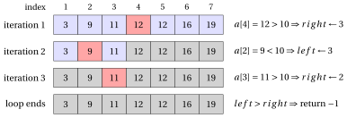

# Linear and binary search

<div class="info-capitolo" markdown>

**Part 1 · Basic algorithms · Chapter 4** · [:material-file-pdf-box: Lecture notes, volume 1 (PDF)](../pdf/lecture-notes-1-basic-algorithms.pdf) · [:material-pencil: Exercises](../exercises/ex-04-search.md)

</div>

## 4.1 The search problem

- Looking for a value in a collection of data is one of the most frequent operations performed by a computer: a name in a list of contacts, a code in a table of products, a word in a dictionary.

- In this chapter the collection is an array of natural numbers, and we present two algorithms that solve the problem:

    - <strong>linear search</strong>, which works on every array;

    - <strong>binary search</strong>, which works only on arrays sorted in non-decreasing order, but which is much faster than linear search on long arrays.

<a id="box-1-defSearchProblem"></a>

!!! definizione "Definition 4.1: search problem"

    Given an array $a[1..n]$ of $n$ natural numbers and a target natural number $m$, the <strong>search problem</strong> consists in determining if $m$ is one of the elements of the array, i.e., if there exists an index $k \in \{1, 2, \dots, n\}$ such that

    $$
    a[k] = m.
    $$

    An algorithm for the search problem returns such an index $k$ if it exists, and the value $-1$ otherwise.

- The value $-1$ is never a valid index of the array $a[1..n]$ (nor of a <code>C++</code> array, whose indices start from $0$): for this reason it can be used to signal that the target value has not been found.

## 4.2 Linear search

!!! chiave ""

    Given an array $a[1..n]$ of $n$ natural numbers and a target natural number $m$, we consider the problem of determining if $m$ is one of the elements of the array.

- The simplest idea is to compare the target $m$ with the elements of the array one after the other, from the first to the last, and to stop as soon as an element equal to $m$ is found.

- This is the pseudo-code of the Linear Search algorithm that determines if a target value $m$ is present in an array $a[1..n]$ of $n$ natural numbers:

!!! algoritmo "Algorithm: LinearSearch"

    <div class="pseudocodice" markdown="0">
    <div class="pc-io"><span class="pc-kw">Input:</span> <span>An array <span class="arithmatex">&#92;(a&#91;1..n&#93;&#92;)</span> of <span class="arithmatex">&#92;(n&#92;)</span> natural numbers and a target value <span class="arithmatex">&#92;(m&#92;)</span></span></div>
    <div class="pc-io"><span class="pc-kw">Output:</span> <span>Index of <span class="arithmatex">&#92;(m&#92;)</span> in <span class="arithmatex">&#92;(a&#92;)</span>, or <span class="arithmatex">&#92;(-1&#92;)</span> if not found</span></div>
    <div class="pc-sep"></div>
    <div class="pc-riga pc-vuota"><span class="pc-n"></span><span class="pc-corpo"></span></div>
    <div class="pc-riga"><span class="pc-n">1</span><span class="pc-corpo"><span class="pc-t"><strong>function</strong> LinearSearch(a, n, m)</span></span></div>
    <div class="pc-riga" id="riga-04-search-line-ls-a"><span class="pc-n">2</span><span class="pc-corpo"><span class="pc-l"></span><span class="pc-t"><span class="arithmatex">&#92;(i := 1&#92;)</span></span></span></div>
    <div class="pc-riga" id="riga-04-search-line-ls-b"><span class="pc-n">3</span><span class="pc-corpo"><span class="pc-l"></span><span class="pc-t"><strong>while</strong> <span class="arithmatex">&#92;(i &#92;le n&#92;)</span> <strong>do</strong></span></span></div>
    <div class="pc-riga" id="riga-04-search-line-ls-c"><span class="pc-n">4</span><span class="pc-corpo"><span class="pc-l"></span><span class="pc-l"></span><span class="pc-t"><strong>if</strong> <span class="arithmatex">&#92;(a&#91;i&#93; = m&#92;)</span> <strong>then</strong></span></span></div>
    <div class="pc-riga" id="riga-04-search-line-ls-d"><span class="pc-n">5</span><span class="pc-corpo"><span class="pc-l"></span><span class="pc-l"></span><span class="pc-l"></span><span class="pc-t"><strong>return</strong> <span class="arithmatex">&#92;(i&#92;)</span></span><span class="pc-c">// Element found at index <span class="arithmatex">&#92;(i&#92;)</span></span></span></div>
    <div class="pc-riga"><span class="pc-n">6</span><span class="pc-corpo"><span class="pc-l"></span><span class="pc-l"></span><span class="pc-t"><strong>end</strong></span></span></div>
    <div class="pc-riga" id="riga-04-search-line-ls-e"><span class="pc-n">7</span><span class="pc-corpo"><span class="pc-l"></span><span class="pc-l"></span><span class="pc-t"><span class="arithmatex">&#92;(i &#92;leftarrow i + 1&#92;)</span></span></span></div>
    <div class="pc-riga"><span class="pc-n">8</span><span class="pc-corpo"><span class="pc-l"></span><span class="pc-t"><strong>end</strong></span></span></div>
    <div class="pc-riga pc-vuota"><span class="pc-n"></span><span class="pc-corpo"><span class="pc-l"></span></span></div>
    <div class="pc-riga" id="riga-04-search-line-ls-f"><span class="pc-n">9</span><span class="pc-corpo"><span class="pc-l"></span><span class="pc-t"><strong>return</strong> <span class="arithmatex">&#92;(-1&#92;)</span></span><span class="pc-c">// Element not found</span></span></div>
    <div class="pc-riga"><span class="pc-n">10</span><span class="pc-corpo"><span class="pc-t"><strong>end</strong></span></span></div>
    </div>

- Explanation of the algorithm:

    - The algorithm scans the array sequentially from index $1$ to $n$.

    - At each iteration, it compares the element $a[i]$ with the target $m$ (line [4](#riga-04-search-line-ls-c)).

    - If $a[i] = m$, the element is found and index $i$ is returned (line [5](#riga-04-search-line-ls-d)).

    - If the loop completes without a match, the element is not in the array and $-1$ is returned (line [9](#riga-04-search-line-ls-f)).

- If $m$ appears more than once in the array, the algorithm stops at the first match: the returned index is the <strong>smallest</strong> index $k$ such that $a[k]=m$.

<a id="box-2-exLinearSearch"></a>

!!! esempio "Example 4.1: Linear Search"

    Consider the array $a = [4, 2, 7, 1, 5, 9, 3]$ with $n=7$.

    - Search for $m = 5$:

        <div class="tabella" markdown="0"><table>
        <tr>
        <th>iteration</th>
        <th><span class="arithmatex">&#92;(i&#92;)</span></th>
        <th><span class="arithmatex">&#92;(a&#91;i&#93;&#92;)</span></th>
        <th>action</th>
        </tr>
        <tr>
        <td><span class="arithmatex">&#92;(1&#92;)</span></td>
        <td>1</td>
        <td>4</td>
        <td><span class="arithmatex">&#92;(a&#91;i&#93; &#92;neq m&#92;)</span></td>
        </tr>
        <tr>
        <td><span class="arithmatex">&#92;(2&#92;)</span></td>
        <td>2</td>
        <td>2</td>
        <td><span class="arithmatex">&#92;(a&#91;i&#93; &#92;neq m&#92;)</span></td>
        </tr>
        <tr>
        <td><span class="arithmatex">&#92;(3&#92;)</span></td>
        <td>3</td>
        <td>7</td>
        <td><span class="arithmatex">&#92;(a&#91;i&#93; &#92;neq m&#92;)</span></td>
        </tr>
        <tr>
        <td><span class="arithmatex">&#92;(4&#92;)</span></td>
        <td>4</td>
        <td>1</td>
        <td><span class="arithmatex">&#92;(a&#91;i&#93; &#92;neq m&#92;)</span></td>
        </tr>
        <tr>
        <td><span class="arithmatex">&#92;(5&#92;)</span></td>
        <td>5</td>
        <td>5</td>
        <td><span class="arithmatex">&#92;(a&#91;i&#93; = m&#92;)</span> <span class="arithmatex">&#92;(&#92;Rightarrow&#92;)</span> Found!</td>
        </tr>
        </table></div>

        Accordingly, element 5 is found at index 5.

    - Search for $m = 6$:

        <div class="tabella" markdown="0"><table>
        <tr>
        <th>iteration</th>
        <th><span class="arithmatex">&#92;(i&#92;)</span></th>
        <th><span class="arithmatex">&#92;(a&#91;i&#93;&#92;)</span></th>
        <th>action</th>
        </tr>
        <tr>
        <td><span class="arithmatex">&#92;(1&#92;)</span></td>
        <td>1</td>
        <td>4</td>
        <td><span class="arithmatex">&#92;(a&#91;i&#93; &#92;neq m&#92;)</span></td>
        </tr>
        <tr>
        <td><span class="arithmatex">&#92;(2&#92;)</span></td>
        <td>2</td>
        <td>2</td>
        <td><span class="arithmatex">&#92;(a&#91;i&#93; &#92;neq m&#92;)</span></td>
        </tr>
        <tr>
        <td><span class="arithmatex">&#92;(3&#92;)</span></td>
        <td>3</td>
        <td>7</td>
        <td><span class="arithmatex">&#92;(a&#91;i&#93; &#92;neq m&#92;)</span></td>
        </tr>
        <tr>
        <td><span class="arithmatex">&#92;(4&#92;)</span></td>
        <td>4</td>
        <td>1</td>
        <td><span class="arithmatex">&#92;(a&#91;i&#93; &#92;neq m&#92;)</span></td>
        </tr>
        <tr>
        <td><span class="arithmatex">&#92;(5&#92;)</span></td>
        <td>5</td>
        <td>5</td>
        <td><span class="arithmatex">&#92;(a&#91;i&#93; &#92;neq m&#92;)</span></td>
        </tr>
        <tr>
        <td><span class="arithmatex">&#92;(6&#92;)</span></td>
        <td>6</td>
        <td>9</td>
        <td><span class="arithmatex">&#92;(a&#91;i&#93; &#92;neq m&#92;)</span></td>
        </tr>
        <tr>
        <td><span class="arithmatex">&#92;(7&#92;)</span></td>
        <td>7</td>
        <td>3</td>
        <td><span class="arithmatex">&#92;(a&#91;i&#93; &#92;neq m&#92;)</span></td>
        </tr>
        <tr>
        <td><span class="arithmatex">&#92;(-&#92;)</span></td>
        <td>8</td>
        <td><span class="arithmatex">&#92;(-&#92;)</span></td>
        <td><span class="arithmatex">&#92;(i &gt; n&#92;)</span> <span class="arithmatex">&#92;(&#92;Rightarrow&#92;)</span> loop ends, Not found!</td>
        </tr>
        </table></div>

        Accordingly, element 6 is not in the array (return $-1$).

- The work done by linear search is measured by the number of comparisons $a[i]=m$ at line [4](#riga-04-search-line-ls-c): in the example, $5$ comparisons are needed to find $m=5$, and all the $n=7$ elements are compared to conclude that $m=6$ is not in the array.

<a id="box-3-obsLinearComparisons"></a>

!!! teorema "Observation 4.2: number of comparisons of linear search"

    Given an array $a[1..n]$ of $n$ natural numbers and a target value $m$:

    - if $k$ is the smallest index such that $a[k]=m$, then <code>LinearSearch</code> performs exactly $k$ comparisons at line [4](#riga-04-search-line-ls-c) and returns $k$;

    - if $m$ is not in the array, then <code>LinearSearch</code> performs exactly $n$ comparisons at line [4](#riga-04-search-line-ls-c) and returns $-1$.

??? dimostrazione "Proof"

    The variable $i$ takes the values $1, 2, 3, \dots$ in this order, and at each value $i \le n$ exactly one comparison $a[i]=m$ is performed.

    - If $k$ is the smallest index with $a[k]=m$, then $a[i] \neq m$ for $i \in \{1, 2, \dots, k-1\}$, so the algorithm does not stop at these values of $i$; for $i=k$ the comparison is true and the algorithm returns $k$. The comparisons are those with $i = 1, 2, \dots, k$, i.e., $k$ comparisons.

    - If $m$ is not in the array, every comparison is false, so the loop is executed for $i = 1, 2, \dots, n$ and stops when $i = n+1$. The comparisons are $n$, and the algorithm returns $-1$ at line [9](#riga-04-search-line-ls-f).

    <p class="qed-riga"><span class="qed">□</span></p>

!!! chiave ""

    Linear search makes no assumption on the order of the elements. Its price is that, when the target is absent (or it is in the last position), all the $n$ elements of the array must be examined.

### 4.2.1 <code>C++</code> implementation

- This is a <code>C++</code> implementation of the Linear Search algorithm. In <code>C++</code> the indices of an array of $n$ elements go from $0$ to $n-1$: the index returned by the function is therefore the index of the pseudo-code minus $1$.

```cpp
// Returns the index of m in array a, or -1 if not found

int LinearSearch(int n, int *a, int m)
{
    for (int i = 0; i < n; i++)
    {
        if (a[i] == m)
        {
            return i;  // Element found at index i
        }
    }

    return -1;  // Element not found
}
```

- The function can be called, for instance, from the following <code>main</code>:

```cpp
#include <iostream>
using namespace std;

int main()
{
    int a[] = {4, 2, 7, 1, 5, 9, 3};
    int n = 7;

    cout << LinearSearch(n, a, 5) << endl;  // prints 4
    cout << LinearSearch(n, a, 6) << endl;  // prints -1

    return 0;
}
```

<a id="box-4-exLinearSearchCpp"></a>

!!! esempio "Example 4.2: execution of the <code>C++</code> implementation of Linear Search"

    Consider the array of [Example 4.1](#box-2-exLinearSearch), stored in <code>C++</code> with indices from $0$ to $6$:

    $$
    \begin{array}{c|c|c|c|c|c|c|c|}
    {a[j]} & {j=0} & {j=1} & {j=2} & {j=3} & {j=4} & {j=5} & {j=6} \\
    & 4 & 2 & 7 & 1 & 5 & 9 & 3
    \end{array}
    $$

    - Search for $m=5$:

        <div class="tabella" markdown="0"><table>
        <tr>
        <th>iteration</th>
        <th><span class="arithmatex">&#92;(i&#92;)</span></th>
        <th>comparison</th>
        <th>action</th>
        </tr>
        <tr>
        <td><span class="arithmatex">&#92;(1&#92;)</span></td>
        <td>0</td>
        <td><span class="arithmatex">&#92;(a&#91;0&#93; = 4 &#92;neq 5&#92;)</span></td>
        <td>continue</td>
        </tr>
        <tr>
        <td><span class="arithmatex">&#92;(2&#92;)</span></td>
        <td>1</td>
        <td><span class="arithmatex">&#92;(a&#91;1&#93; = 2 &#92;neq 5&#92;)</span></td>
        <td>continue</td>
        </tr>
        <tr>
        <td><span class="arithmatex">&#92;(3&#92;)</span></td>
        <td>2</td>
        <td><span class="arithmatex">&#92;(a&#91;2&#93; = 7 &#92;neq 5&#92;)</span></td>
        <td>continue</td>
        </tr>
        <tr>
        <td><span class="arithmatex">&#92;(4&#92;)</span></td>
        <td>3</td>
        <td><span class="arithmatex">&#92;(a&#91;3&#93; = 1 &#92;neq 5&#92;)</span></td>
        <td>continue</td>
        </tr>
        <tr>
        <td><span class="arithmatex">&#92;(5&#92;)</span></td>
        <td>4</td>
        <td><span class="arithmatex">&#92;(a&#91;4&#93; = 5 = m&#92;)</span></td>
        <td><strong>Found! Return 4</strong></td>
        </tr>
        </table></div>

        The function returns $4$: the element is found at <code>C++</code> index $4$, i.e., at index $5$ of the pseudo-code.

    - Search for $m=6$:

        <div class="tabella" markdown="0"><table>
        <tr>
        <th>iteration</th>
        <th><span class="arithmatex">&#92;(i&#92;)</span></th>
        <th>comparison</th>
        <th>action</th>
        </tr>
        <tr>
        <td><span class="arithmatex">&#92;(1&#92;)</span></td>
        <td>0</td>
        <td><span class="arithmatex">&#92;(a&#91;0&#93; = 4 &#92;neq 6&#92;)</span></td>
        <td>continue</td>
        </tr>
        <tr>
        <td><span class="arithmatex">&#92;(2&#92;)</span></td>
        <td>1</td>
        <td><span class="arithmatex">&#92;(a&#91;1&#93; = 2 &#92;neq 6&#92;)</span></td>
        <td>continue</td>
        </tr>
        <tr>
        <td><span class="arithmatex">&#92;(3&#92;)</span></td>
        <td>2</td>
        <td><span class="arithmatex">&#92;(a&#91;2&#93; = 7 &#92;neq 6&#92;)</span></td>
        <td>continue</td>
        </tr>
        <tr>
        <td><span class="arithmatex">&#92;(4&#92;)</span></td>
        <td>3</td>
        <td><span class="arithmatex">&#92;(a&#91;3&#93; = 1 &#92;neq 6&#92;)</span></td>
        <td>continue</td>
        </tr>
        <tr>
        <td><span class="arithmatex">&#92;(5&#92;)</span></td>
        <td>4</td>
        <td><span class="arithmatex">&#92;(a&#91;4&#93; = 5 &#92;neq 6&#92;)</span></td>
        <td>continue</td>
        </tr>
        <tr>
        <td><span class="arithmatex">&#92;(6&#92;)</span></td>
        <td>5</td>
        <td><span class="arithmatex">&#92;(a&#91;5&#93; = 9 &#92;neq 6&#92;)</span></td>
        <td>continue</td>
        </tr>
        <tr>
        <td><span class="arithmatex">&#92;(7&#92;)</span></td>
        <td>6</td>
        <td><span class="arithmatex">&#92;(a&#91;6&#93; = 3 &#92;neq 6&#92;)</span></td>
        <td>continue</td>
        </tr>
        </table></div>

        The <code>for</code> loop terminates with $i = n = 7$: the element is not found and the function returns $-1$.

## 4.3 Binary search

- Think of looking up a word in a paper dictionary: nobody reads it from the first page. We open it in the middle and, since the words are in alphabetical order, we know in which half to continue. Binary search applies the same idea to a sorted array.

<a id="box-5-defSortedArray"></a>

!!! definizione "Definition 4.3: sorted array"

    An array $a[1..n]$ of $n$ natural numbers is <strong>sorted in non-decreasing order</strong> if

    $$
    a[1] \le a[2] \le \cdots \le a[n].
    $$

!!! chiave ""

    Given an array $a[1..n]$ of $n$ natural numbers sorted in non-decreasing order and a target natural number $m$, we consider the problem of determining if $m$ is one of the elements of the array.

- Binary search keeps a portion $a[left..right]$ of the array, called the <strong>search interval</strong>, which is the only portion that may still contain $m$. At the beginning the search interval is the whole array.

- At each iteration the target $m$ is compared with the element $a[mid]$ in the middle of the search interval:

    - if $a[mid] < m$, then, since the array is sorted, all the elements $a[left], \dots, a[mid]$ are smaller than $m$, and the search continues in the right half $a[mid+1..right]$;

    - if $a[mid] > m$, then all the elements $a[mid], \dots, a[right]$ are greater than $m$, and the search continues in the left half $a[left..mid-1]$.

- This is the pseudo-code of the Binary Search algorithm that determines if a target value $m$ is present in an array $a[1..n]$ of $n$ natural numbers sorted in non-decreasing order:

!!! algoritmo "Algorithm: BinarySearch"

    <div class="pseudocodice" markdown="0">
    <div class="pc-io"><span class="pc-kw">Input:</span> <span>An array <span class="arithmatex">&#92;(a&#91;1..n&#93;&#92;)</span> of <span class="arithmatex">&#92;(n&#92;)</span> natural numbers sorted in non-decreasing order and a target value <span class="arithmatex">&#92;(m&#92;)</span></span></div>
    <div class="pc-io"><span class="pc-kw">Output:</span> <span>Index of <span class="arithmatex">&#92;(m&#92;)</span> in <span class="arithmatex">&#92;(a&#92;)</span>, or <span class="arithmatex">&#92;(-1&#92;)</span> if not found</span></div>
    <div class="pc-sep"></div>
    <div class="pc-riga pc-vuota"><span class="pc-n"></span><span class="pc-corpo"></span></div>
    <div class="pc-riga"><span class="pc-n">1</span><span class="pc-corpo"><span class="pc-t"><strong>function</strong> BinarySearch(a, n, m)</span></span></div>
    <div class="pc-riga" id="riga-04-search-line-bs-a"><span class="pc-n">2</span><span class="pc-corpo"><span class="pc-l"></span><span class="pc-t"><span class="arithmatex">&#92;(left&#92;)</span> := <span class="arithmatex">&#92;(1&#92;)</span></span><span class="pc-c">// Left boundary</span></span></div>
    <div class="pc-riga" id="riga-04-search-line-bs-b"><span class="pc-n">3</span><span class="pc-corpo"><span class="pc-l"></span><span class="pc-t"><span class="arithmatex">&#92;(right&#92;)</span> := <span class="arithmatex">&#92;(n&#92;)</span></span><span class="pc-c">// Right boundary</span></span></div>
    <div class="pc-riga pc-vuota"><span class="pc-n"></span><span class="pc-corpo"><span class="pc-l"></span></span></div>
    <div class="pc-riga" id="riga-04-search-line-bs-c"><span class="pc-n">4</span><span class="pc-corpo"><span class="pc-l"></span><span class="pc-t"><strong>while</strong> <span class="arithmatex">&#92;(left &#92;le right&#92;)</span> <strong>do</strong></span></span></div>
    <div class="pc-riga" id="riga-04-search-line-bs-d"><span class="pc-n">5</span><span class="pc-corpo"><span class="pc-l"></span><span class="pc-l"></span><span class="pc-t"><span class="arithmatex">&#92;(mid&#92;)</span> := <span class="arithmatex">&#92;(left + &#92;lfloor (right - left) / 2 &#92;rfloor&#92;)</span></span><span class="pc-c">// Middle index</span></span></div>
    <div class="pc-riga pc-vuota"><span class="pc-n"></span><span class="pc-corpo"><span class="pc-l"></span><span class="pc-l"></span></span></div>
    <div class="pc-riga" id="riga-04-search-line-bs-e"><span class="pc-n">6</span><span class="pc-corpo"><span class="pc-l"></span><span class="pc-l"></span><span class="pc-t"><strong>if</strong> <span class="arithmatex">&#92;(a&#91;mid&#93; = m&#92;)</span> <strong>then</strong></span></span></div>
    <div class="pc-riga" id="riga-04-search-line-bs-f"><span class="pc-n">7</span><span class="pc-corpo"><span class="pc-l"></span><span class="pc-l"></span><span class="pc-l"></span><span class="pc-t"><strong>return</strong> <span class="arithmatex">&#92;(mid&#92;)</span></span><span class="pc-c">// Element found</span></span></div>
    <div class="pc-riga"><span class="pc-n">8</span><span class="pc-corpo"><span class="pc-l"></span><span class="pc-l"></span><span class="pc-t"><strong>end</strong></span></span></div>
    <div class="pc-riga pc-vuota"><span class="pc-n"></span><span class="pc-corpo"><span class="pc-l"></span><span class="pc-l"></span></span></div>
    <div class="pc-riga" id="riga-04-search-line-bs-g"><span class="pc-n">9</span><span class="pc-corpo"><span class="pc-l"></span><span class="pc-l"></span><span class="pc-t"><strong>if</strong> <span class="arithmatex">&#92;(a&#91;mid&#93; &lt; m&#92;)</span> <strong>then</strong></span></span></div>
    <div class="pc-riga" id="riga-04-search-line-bs-h"><span class="pc-n">10</span><span class="pc-corpo"><span class="pc-l"></span><span class="pc-l"></span><span class="pc-l"></span><span class="pc-t"><span class="arithmatex">&#92;(left&#92;)</span> <span class="arithmatex">&#92;(&#92;leftarrow&#92;)</span> <span class="arithmatex">&#92;(mid + 1&#92;)</span></span><span class="pc-c">// Search in right half</span></span></div>
    <div class="pc-riga"><span class="pc-n">11</span><span class="pc-corpo"><span class="pc-l"></span><span class="pc-l"></span><span class="pc-t"><strong>end</strong></span></span></div>
    <div class="pc-riga"><span class="pc-n">12</span><span class="pc-corpo"><span class="pc-l"></span><span class="pc-l"></span><span class="pc-t"><strong>else</strong></span></span></div>
    <div class="pc-riga" id="riga-04-search-line-bs-i"><span class="pc-n">13</span><span class="pc-corpo"><span class="pc-l"></span><span class="pc-l"></span><span class="pc-l"></span><span class="pc-t"><span class="arithmatex">&#92;(right&#92;)</span> <span class="arithmatex">&#92;(&#92;leftarrow&#92;)</span> <span class="arithmatex">&#92;(mid - 1&#92;)</span></span><span class="pc-c">// Search in left half</span></span></div>
    <div class="pc-riga"><span class="pc-n">14</span><span class="pc-corpo"><span class="pc-l"></span><span class="pc-l"></span><span class="pc-t"><strong>end</strong></span></span></div>
    <div class="pc-riga"><span class="pc-n">15</span><span class="pc-corpo"><span class="pc-l"></span><span class="pc-t"><strong>end</strong></span></span></div>
    <div class="pc-riga pc-vuota"><span class="pc-n"></span><span class="pc-corpo"><span class="pc-l"></span></span></div>
    <div class="pc-riga" id="riga-04-search-line-bs-j"><span class="pc-n">16</span><span class="pc-corpo"><span class="pc-l"></span><span class="pc-t"><strong>return</strong> <span class="arithmatex">&#92;(-1&#92;)</span></span><span class="pc-c">// Element not found</span></span></div>
    <div class="pc-riga"><span class="pc-n">17</span><span class="pc-corpo"><span class="pc-t"><strong>end</strong></span></span></div>
    </div>

- Explanation of the algorithm:

    - The algorithm maintains two indices, $left$ and $right$, defining the search interval $a[left..right]$, which contains $right-left+1$ elements.

    - At each iteration, it computes the middle index $mid$ (line [5](#riga-04-search-line-bs-d)) and compares $a[mid]$ with the target $m$.

    - If $a[mid] = m$, the element is found and its index is returned (line [7](#riga-04-search-line-bs-f)).

    - If $a[mid] < m$, the search continues in the right half by updating $left \leftarrow mid + 1$ (line [10](#riga-04-search-line-bs-h)).

    - If $a[mid] > m$, the search continues in the left half by updating $right \leftarrow mid - 1$ (line [13](#riga-04-search-line-bs-i)).

    - If the search interval becomes empty ($left > right$), the element is not in the array and $-1$ is returned (line [16](#riga-04-search-line-bs-j)).

- Since $0 \le \lfloor (right-left)/2 \rfloor \le right-left$, the index $mid$ always lies in the search interval: $left \le mid \le right$.

<a id="box-6-exBinarySearch"></a>

!!! esempio "Example 4.3: Binary Search"

    Consider the sorted array $a = [3, 9, 11, 12, 12, 16, 19]$ with $n=7$.

    - Search for $m = 12$:

        <div class="tabella" markdown="0"><table>
        <tr>
        <th>iteration</th>
        <th><span class="arithmatex">&#92;(left&#92;)</span></th>
        <th><span class="arithmatex">&#92;(right&#92;)</span></th>
        <th><span class="arithmatex">&#92;(mid&#92;)</span></th>
        <th><span class="arithmatex">&#92;(a&#91;mid&#93;&#92;)</span></th>
        <th>action</th>
        </tr>
        <tr>
        <td><span class="arithmatex">&#92;(1&#92;)</span></td>
        <td>1</td>
        <td>7</td>
        <td>4</td>
        <td>12</td>
        <td><span class="arithmatex">&#92;(a&#91;mid&#93; = m&#92;)</span> <span class="arithmatex">&#92;(&#92;Rightarrow&#92;)</span> Found!</td>
        </tr>
        </table></div>

        Accordingly, element 12 is found at index 4.

    - Search for $m = 10$:

        <div class="tabella" markdown="0"><table>
        <tr>
        <th>iteration</th>
        <th><span class="arithmatex">&#92;(left&#92;)</span></th>
        <th><span class="arithmatex">&#92;(right&#92;)</span></th>
        <th><span class="arithmatex">&#92;(mid&#92;)</span></th>
        <th><span class="arithmatex">&#92;(a&#91;mid&#93;&#92;)</span></th>
        <th>action</th>
        </tr>
        <tr>
        <td><span class="arithmatex">&#92;(1&#92;)</span></td>
        <td>1</td>
        <td>7</td>
        <td>4</td>
        <td>12</td>
        <td><span class="arithmatex">&#92;(a&#91;mid&#93; &gt; m&#92;)</span> <span class="arithmatex">&#92;(&#92;Rightarrow&#92;)</span> <span class="arithmatex">&#92;(right &#92;leftarrow 3&#92;)</span></td>
        </tr>
        <tr>
        <td><span class="arithmatex">&#92;(2&#92;)</span></td>
        <td>1</td>
        <td>3</td>
        <td>2</td>
        <td>9</td>
        <td><span class="arithmatex">&#92;(a&#91;mid&#93; &lt; m&#92;)</span> <span class="arithmatex">&#92;(&#92;Rightarrow&#92;)</span> <span class="arithmatex">&#92;(left &#92;leftarrow 3&#92;)</span></td>
        </tr>
        <tr>
        <td><span class="arithmatex">&#92;(3&#92;)</span></td>
        <td>3</td>
        <td>3</td>
        <td>3</td>
        <td>11</td>
        <td><span class="arithmatex">&#92;(a&#91;mid&#93; &gt; m&#92;)</span> <span class="arithmatex">&#92;(&#92;Rightarrow&#92;)</span> <span class="arithmatex">&#92;(right &#92;leftarrow 2&#92;)</span></td>
        </tr>
        <tr>
        <td><span class="arithmatex">&#92;(-&#92;)</span></td>
        <td>3</td>
        <td>2</td>
        <td><span class="arithmatex">&#92;(-&#92;)</span></td>
        <td><span class="arithmatex">&#92;(-&#92;)</span></td>
        <td><span class="arithmatex">&#92;(left &gt; right&#92;)</span> <span class="arithmatex">&#92;(&#92;Rightarrow&#92;)</span> Not found!</td>
        </tr>
        </table></div>

        Accordingly, element 10 is not in the array (return $-1$).

    - Search for $m = 3$:

        <div class="tabella" markdown="0"><table>
        <tr>
        <th>iteration</th>
        <th><span class="arithmatex">&#92;(left&#92;)</span></th>
        <th><span class="arithmatex">&#92;(right&#92;)</span></th>
        <th><span class="arithmatex">&#92;(mid&#92;)</span></th>
        <th><span class="arithmatex">&#92;(a&#91;mid&#93;&#92;)</span></th>
        <th>action</th>
        </tr>
        <tr>
        <td><span class="arithmatex">&#92;(1&#92;)</span></td>
        <td>1</td>
        <td>7</td>
        <td>4</td>
        <td>12</td>
        <td><span class="arithmatex">&#92;(a&#91;mid&#93; &gt; m&#92;)</span> <span class="arithmatex">&#92;(&#92;Rightarrow&#92;)</span> <span class="arithmatex">&#92;(right &#92;leftarrow 3&#92;)</span></td>
        </tr>
        <tr>
        <td><span class="arithmatex">&#92;(2&#92;)</span></td>
        <td>1</td>
        <td>3</td>
        <td>2</td>
        <td>9</td>
        <td><span class="arithmatex">&#92;(a&#91;mid&#93; &gt; m&#92;)</span> <span class="arithmatex">&#92;(&#92;Rightarrow&#92;)</span> <span class="arithmatex">&#92;(right &#92;leftarrow 1&#92;)</span></td>
        </tr>
        <tr>
        <td><span class="arithmatex">&#92;(3&#92;)</span></td>
        <td>1</td>
        <td>1</td>
        <td>1</td>
        <td>3</td>
        <td><span class="arithmatex">&#92;(a&#91;mid&#93; = m&#92;)</span> <span class="arithmatex">&#92;(&#92;Rightarrow&#92;)</span> Found!</td>
        </tr>
        </table></div>

        Accordingly, element 3 is found at index 1.

    - Search for $m = 19$:

        <div class="tabella" markdown="0"><table>
        <tr>
        <th>iteration</th>
        <th><span class="arithmatex">&#92;(left&#92;)</span></th>
        <th><span class="arithmatex">&#92;(right&#92;)</span></th>
        <th><span class="arithmatex">&#92;(mid&#92;)</span></th>
        <th><span class="arithmatex">&#92;(a&#91;mid&#93;&#92;)</span></th>
        <th>action</th>
        </tr>
        <tr>
        <td><span class="arithmatex">&#92;(1&#92;)</span></td>
        <td>1</td>
        <td>7</td>
        <td>4</td>
        <td>12</td>
        <td><span class="arithmatex">&#92;(a&#91;mid&#93; &lt; m&#92;)</span> <span class="arithmatex">&#92;(&#92;Rightarrow&#92;)</span> <span class="arithmatex">&#92;(left &#92;leftarrow 5&#92;)</span></td>
        </tr>
        <tr>
        <td><span class="arithmatex">&#92;(2&#92;)</span></td>
        <td>5</td>
        <td>7</td>
        <td>6</td>
        <td>16</td>
        <td><span class="arithmatex">&#92;(a&#91;mid&#93; &lt; m&#92;)</span> <span class="arithmatex">&#92;(&#92;Rightarrow&#92;)</span> <span class="arithmatex">&#92;(left &#92;leftarrow 7&#92;)</span></td>
        </tr>
        <tr>
        <td><span class="arithmatex">&#92;(3&#92;)</span></td>
        <td>7</td>
        <td>7</td>
        <td>7</td>
        <td>19</td>
        <td><span class="arithmatex">&#92;(a&#91;mid&#93; = m&#92;)</span> <span class="arithmatex">&#92;(&#92;Rightarrow&#92;)</span> Found!</td>
        </tr>
        </table></div>

        Accordingly, element 19 is found at index 7.

- The following figure shows the search interval at each iteration of the search for $m=10$: the elements outside the search interval (grey) are discarded, and the element $a[mid]$ compared with $m$ is highlighted in red.

<a id="box-7-figBinarySearch"></a>

{ .fig loading=lazy  }

<p class="didascalia"><strong>Figure 4.1:</strong> Search intervals of <code>BinarySearch</code> for <span class="arithmatex">&#92;(m=10&#92;)</span> in <span class="arithmatex">&#92;(a=&#91;3, 9, 11, 12, 12, 16, 19&#93;&#92;)</span>: blue cells form the search interval <span class="arithmatex">&#92;(a&#91;left..right&#93;&#92;)</span>, the red cell is <span class="arithmatex">&#92;(a&#91;mid&#93;&#92;)</span>, grey cells have been discarded.</p>

- If $m$ appears more than once in the array, binary search returns the index of <strong>one</strong> of its occurrences, not necessarily the first one. For instance, for $a=[1, 2, 2, 2, 2, 2, 3]$ and $m=2$, the first iteration computes $mid = 1 + \lfloor 6/2 \rfloor = 4$ and, since $a[4] = 2 = m$, the algorithm returns $4$, while <code>LinearSearch</code> returns $2$.

### 4.3.1 Number of iterations

- Each iteration that does not find $m$ discards the element $a[mid]$ and at least half of the remaining elements of the search interval. This is why binary search is fast: the length of the search interval is (at least) halved at each iteration.

<a id="box-8-obsBinaryIterations"></a>

!!! teorema "Observation 4.4: number of iterations of binary search"

    Given an array $a[1..n]$ of $n \ge 1$ natural numbers sorted in non-decreasing order and a target value $m$, the while loop of <code>BinarySearch</code> executes at most

    $$
    \lfloor \log_2 n \rfloor + 1
    $$

    iterations.

??? dimostrazione "Proof"

    Let $L = right - left + 1 \ge 1$ be the number of elements of the search interval at the beginning of an iteration that does not return. Since $mid = left + \lfloor (L-1)/2 \rfloor$, the new search interval has:

    - $mid - left = \lfloor (L-1)/2 \rfloor$ elements, if $right \leftarrow mid-1$;

    - $right - mid = (L-1) - \lfloor (L-1)/2 \rfloor = \lceil (L-1)/2 \rceil$ elements, if $left \leftarrow mid+1$.

    In both cases the new number of elements is at most $\lceil (L-1)/2 \rceil = \lfloor L/2 \rfloor \le L/2$.

    At the beginning $L = n$. Hence, after $k$ iterations that do not return, the search interval has at most $n/2^k$ elements. An iteration is executed only if the search interval is not empty, so iteration $k+1$ is executed only if

    $$
    1 \le \frac{n}{2^k}, \qquad \text{i.e.,} \qquad k \le \log_2 n.
    $$

    Since $k$ is an integer, $k \le \lfloor \log_2 n \rfloor$, and the number $k+1$ of any executed iteration is at most $\lfloor \log_2 n \rfloor + 1$. <span class="qed">□</span>

- In [Example 4.3](#box-6-exBinarySearch), $n = 7$ and $\lfloor \log_2 7 \rfloor + 1 = 3$: the searches for $m=10$, $m=3$ and $m=19$ execute exactly $3$ iterations, so the bound is attained.

- The difference with linear search grows very quickly with $n$. The following table compares the number of comparisons of linear search when $m$ is not in the array ([Observation 4.2](#box-3-obsLinearComparisons)) with the maximum number of iterations of binary search:

<div class="tabella" markdown="0"><table>
<tr>
<th><span class="arithmatex">&#92;(n&#92;)</span></th>
<th>linear search</th>
<th>binary search</th>
</tr>
<tr>
<td></td>
<td><span class="arithmatex">&#92;(n&#92;)</span> comparisons</td>
<td>at most <span class="arithmatex">&#92;(&#92;lfloor &#92;log&#95;2 n &#92;rfloor + 1&#92;)</span> iterations</td>
</tr>
<tr>
<td><span class="arithmatex">&#92;(1&#92;,000&#92;)</span></td>
<td><span class="arithmatex">&#92;(1&#92;,000&#92;)</span></td>
<td><span class="arithmatex">&#92;(10&#92;)</span></td>
</tr>
<tr>
<td><span class="arithmatex">&#92;(1&#92;,000&#92;,000&#92;)</span></td>
<td><span class="arithmatex">&#92;(1&#92;,000&#92;,000&#92;)</span></td>
<td><span class="arithmatex">&#92;(20&#92;)</span></td>
</tr>
<tr>
<td><span class="arithmatex">&#92;(1&#92;,000&#92;,000&#92;,000&#92;)</span></td>
<td><span class="arithmatex">&#92;(1&#92;,000&#92;,000&#92;,000&#92;)</span></td>
<td><span class="arithmatex">&#92;(30&#92;)</span></td>
</tr>
</table></div>

!!! chiave ""

    Binary search requires the array to be sorted in non-decreasing order. On a sorted array of $n$ elements it executes at most $\lfloor \log_2 n \rfloor + 1$ iterations, while linear search may need $n$ comparisons. If the array is not sorted, binary search may wrongly discard the half that contains $m$, and linear search must be used.

### 4.3.2 <code>C++</code> implementation

- This is a <code>C++</code> implementation of the Binary Search algorithm. The initial search interval is $a[0..n-1]$.

```cpp
// Returns the index of m in array a, or -1 if not found
// The array a must be sorted in non-decreasing order

int BinarySearch(int n, int *a, int m)
{
    int left = 0;
    int right = n - 1;

    while (left <= right)
    {
        int mid = left + (right - left) / 2;

        if (a[mid] == m)
        {
            return mid;  // Element found at index mid
        }

        if (a[mid] < m)
        {
            left = mid + 1;  // Search in right half
        }
        else
        {
            right = mid - 1;  // Search in left half
        }
    }

    return -1;  // Element not found
}
```

- The division between two <code>int</code> values with $right - left \ge 0$ discards the fractional part, so $(right-left)/2$ is exactly $\lfloor (right-left)/2 \rfloor$.

- The middle index is computed as $left + (right-left)/2$ instead of $(left+right)/2$: the two expressions have the same value, but the sum $left+right$ may exceed the largest value of an <code>int</code> when the array is very long, while $left + (right-left)/2$ never exceeds $right$.

- The function can be called, for instance, from the following <code>main</code>:

```cpp
#include <iostream>
using namespace std;

int main()
{
    int a[] = {3, 9, 11, 12, 12, 16, 19};
    int n = 7;

    cout << BinarySearch(n, a, 12) << endl;  // prints 3
    cout << BinarySearch(n, a, 10) << endl;  // prints -1
    cout << BinarySearch(n, a, 3) << endl;   // prints 0
    cout << BinarySearch(n, a, 19) << endl;  // prints 6

    return 0;
}
```

<a id="box-9-exBinarySearchCpp"></a>

!!! esempio "Example 4.4: execution of the <code>C++</code> implementation of Binary Search"

    Consider the sorted array of [Example 4.3](#box-6-exBinarySearch), stored in <code>C++</code> with indices from $0$ to $6$:

    $$
    \begin{array}{c|c|c|c|c|c|c|c|}
    {a[j]} & {j=0} & {j=1} & {j=2} & {j=3} & {j=4} & {j=5} & {j=6} \\
    & 3 & 9 & 11 & 12 & 12 & 16 & 19
    \end{array}
    $$

    At the beginning $left = 0$ and $right = 6$.

    - Search for $m=12$:

        <div class="tabella" markdown="0"><table>
        <tr>
        <th>iteration</th>
        <th><span class="arithmatex">&#92;(left&#92;)</span></th>
        <th><span class="arithmatex">&#92;(right&#92;)</span></th>
        <th><span class="arithmatex">&#92;(mid&#92;)</span></th>
        <th>comparison and update</th>
        </tr>
        <tr>
        <td><span class="arithmatex">&#92;(1&#92;)</span></td>
        <td>0</td>
        <td>6</td>
        <td><span class="arithmatex">&#92;(0 + (6-0)/2 = 3&#92;)</span></td>
        <td><span class="arithmatex">&#92;(a&#91;3&#93; = 12 = m&#92;)</span> <span class="arithmatex">&#92;(&#92;Rightarrow&#92;)</span> <strong>Found! Return 3</strong></td>
        </tr>
        </table></div>

    - Search for $m=10$:

        <div class="tabella" markdown="0"><table>
        <tr>
        <th>iteration</th>
        <th><span class="arithmatex">&#92;(left&#92;)</span></th>
        <th><span class="arithmatex">&#92;(right&#92;)</span></th>
        <th><span class="arithmatex">&#92;(mid&#92;)</span></th>
        <th>comparison and update</th>
        </tr>
        <tr>
        <td><span class="arithmatex">&#92;(1&#92;)</span></td>
        <td>0</td>
        <td>6</td>
        <td><span class="arithmatex">&#92;(0 + (6-0)/2 = 3&#92;)</span></td>
        <td><span class="arithmatex">&#92;(a&#91;3&#93; = 12 &gt; 10&#92;)</span> <span class="arithmatex">&#92;(&#92;Rightarrow&#92;)</span> <span class="arithmatex">&#92;(right = 3 - 1 = 2&#92;)</span></td>
        </tr>
        <tr>
        <td><span class="arithmatex">&#92;(2&#92;)</span></td>
        <td>0</td>
        <td>2</td>
        <td><span class="arithmatex">&#92;(0 + (2-0)/2 = 1&#92;)</span></td>
        <td><span class="arithmatex">&#92;(a&#91;1&#93; = 9 &lt; 10&#92;)</span> <span class="arithmatex">&#92;(&#92;Rightarrow&#92;)</span> <span class="arithmatex">&#92;(left = 1 + 1 = 2&#92;)</span></td>
        </tr>
        <tr>
        <td><span class="arithmatex">&#92;(3&#92;)</span></td>
        <td>2</td>
        <td>2</td>
        <td><span class="arithmatex">&#92;(2 + (2-2)/2 = 2&#92;)</span></td>
        <td><span class="arithmatex">&#92;(a&#91;2&#93; = 11 &gt; 10&#92;)</span> <span class="arithmatex">&#92;(&#92;Rightarrow&#92;)</span> <span class="arithmatex">&#92;(right = 2 - 1 = 1&#92;)</span></td>
        </tr>
        <tr>
        <td><span class="arithmatex">&#92;(-&#92;)</span></td>
        <td>2</td>
        <td>1</td>
        <td><span class="arithmatex">&#92;(-&#92;)</span></td>
        <td><span class="arithmatex">&#92;(left &gt; right&#92;)</span> <span class="arithmatex">&#92;(&#92;Rightarrow&#92;)</span> <strong>Return <span class="arithmatex">&#92;(-1&#92;)</span></strong></td>
        </tr>
        </table></div>

    - Search for $m=3$:

        <div class="tabella" markdown="0"><table>
        <tr>
        <th>iteration</th>
        <th><span class="arithmatex">&#92;(left&#92;)</span></th>
        <th><span class="arithmatex">&#92;(right&#92;)</span></th>
        <th><span class="arithmatex">&#92;(mid&#92;)</span></th>
        <th>comparison and update</th>
        </tr>
        <tr>
        <td><span class="arithmatex">&#92;(1&#92;)</span></td>
        <td>0</td>
        <td>6</td>
        <td><span class="arithmatex">&#92;(0 + (6-0)/2 = 3&#92;)</span></td>
        <td><span class="arithmatex">&#92;(a&#91;3&#93; = 12 &gt; 3&#92;)</span> <span class="arithmatex">&#92;(&#92;Rightarrow&#92;)</span> <span class="arithmatex">&#92;(right = 3 - 1 = 2&#92;)</span></td>
        </tr>
        <tr>
        <td><span class="arithmatex">&#92;(2&#92;)</span></td>
        <td>0</td>
        <td>2</td>
        <td><span class="arithmatex">&#92;(0 + (2-0)/2 = 1&#92;)</span></td>
        <td><span class="arithmatex">&#92;(a&#91;1&#93; = 9 &gt; 3&#92;)</span> <span class="arithmatex">&#92;(&#92;Rightarrow&#92;)</span> <span class="arithmatex">&#92;(right = 1 - 1 = 0&#92;)</span></td>
        </tr>
        <tr>
        <td><span class="arithmatex">&#92;(3&#92;)</span></td>
        <td>0</td>
        <td>0</td>
        <td><span class="arithmatex">&#92;(0 + (0-0)/2 = 0&#92;)</span></td>
        <td><span class="arithmatex">&#92;(a&#91;0&#93; = 3 = m&#92;)</span> <span class="arithmatex">&#92;(&#92;Rightarrow&#92;)</span> <strong>Found! Return 0</strong></td>
        </tr>
        </table></div>

    - Search for $m=19$:

        <div class="tabella" markdown="0"><table>
        <tr>
        <th>iteration</th>
        <th><span class="arithmatex">&#92;(left&#92;)</span></th>
        <th><span class="arithmatex">&#92;(right&#92;)</span></th>
        <th><span class="arithmatex">&#92;(mid&#92;)</span></th>
        <th>comparison and update</th>
        </tr>
        <tr>
        <td><span class="arithmatex">&#92;(1&#92;)</span></td>
        <td>0</td>
        <td>6</td>
        <td><span class="arithmatex">&#92;(0 + (6-0)/2 = 3&#92;)</span></td>
        <td><span class="arithmatex">&#92;(a&#91;3&#93; = 12 &lt; 19&#92;)</span> <span class="arithmatex">&#92;(&#92;Rightarrow&#92;)</span> <span class="arithmatex">&#92;(left = 3 + 1 = 4&#92;)</span></td>
        </tr>
        <tr>
        <td><span class="arithmatex">&#92;(2&#92;)</span></td>
        <td>4</td>
        <td>6</td>
        <td><span class="arithmatex">&#92;(4 + (6-4)/2 = 5&#92;)</span></td>
        <td><span class="arithmatex">&#92;(a&#91;5&#93; = 16 &lt; 19&#92;)</span> <span class="arithmatex">&#92;(&#92;Rightarrow&#92;)</span> <span class="arithmatex">&#92;(left = 5 + 1 = 6&#92;)</span></td>
        </tr>
        <tr>
        <td><span class="arithmatex">&#92;(3&#92;)</span></td>
        <td>6</td>
        <td>6</td>
        <td><span class="arithmatex">&#92;(6 + (6-6)/2 = 6&#92;)</span></td>
        <td><span class="arithmatex">&#92;(a&#91;6&#93; = 19 = m&#92;)</span> <span class="arithmatex">&#92;(&#92;Rightarrow&#92;)</span> <strong>Found! Return 6</strong></td>
        </tr>
        </table></div>

    Every <code>C++</code> index is the corresponding index of [Example 4.3](#box-6-exBinarySearch) minus $1$.

!!! chiave ""

    <strong>Key points of the chapter</strong>

    - The search problem asks for an index $k$ such that $a[k]=m$, or $-1$ if no such index exists.

    - Linear search works on every array, returns the first occurrence of $m$, and performs up to $n$ comparisons.

    - Binary search works only on arrays sorted in non-decreasing order; it halves the search interval $a[left..right]$ at each iteration and executes at most $\lfloor \log_2 n \rfloor + 1$ iterations.

    - In the pseudo-code the indices go from $1$ to $n$, in <code>C++</code> from $0$ to $n-1$: the returned indices differ by $1$.

<!-- laboratorio-interattivo: sezione generata da interattivi.py -->

## Interactive lab { #interactive-lab }

The algorithm of the chapter, one step at a time: move the sliders and press ▶.
The same graph full page, with the other ones of the course, is in the [interactive lab](../lab/search.md).

<div class="gi" data-grafico="ricerca"></div>
