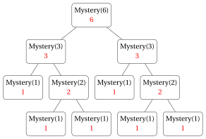

# Exercises · Recursion

**Exercises · Chapter 14** · each solution opens with a click · [:material-book-open-variant: Chapter 14](../analysis-recursion/14-recursion.md) · [:material-file-pdf-box: Exercises, volume 4 (PDF)](../pdf/exercises-4-analysis-recursion.pdf)

In the exercises of this chapter the steps of a recursive algorithm are counted with the conventions of the chapters «Running time» and «Recursion», and the recurrences are solved by simple unrolling.

!!! nota ""

    - Every execution of a numbered line of pseudo-code is <strong>one step</strong>; a line that contains a recursive call counts as one step <strong>plus</strong> all the steps executed by that call.

    - $C(n)$ denotes the number of <strong>calls</strong> (nodes of the tree of recursive calls) and $S(n)$ the number of <strong>steps</strong>; the <strong>depth of the recursion</strong> is the maximum number of nodes on a path from the root to a leaf of the tree, i.e., the maximum number of stack frames simultaneously in memory.

    - <strong>Strong induction</strong>: if $P(n_0)$ is true and, for every $n>n_0$, the truth of $P(k)$ for every $k$ with $n_0\le k<n$ implies the truth of $P(n)$, then $P(n)$ is true for every $n\ge n_0$.

    - <strong>Unrolling</strong> a recurrence $S(n)=S(n-1)+c$ with constant $c$:

        $$
        S(n)=S(n-1)+c=S(n-2)+2c=\cdots=S(n-k)+k\,c,
        $$

        and the base case is reached for the value of $k$ that makes $n-k$ a base case.

!!! esercizio "Exercise 14.1: Recursion (E1)"

    Consider the following recursive algorithm.

    !!! algoritmo "Algorithm: Mystery"

        

        
Input: A natural number &#92;(n &#92;ge 1&#92;)

        
Output: A natural number

        

        

        
1<strong>function</strong> Mystery(n)

        
2<strong>if</strong> &#92;(n = 1&#92;) <strong>then</strong>

        
3<strong>return</strong> &#92;(1&#92;)

        
4<strong>end</strong>

        
5<strong>return</strong> Mystery&#92;((&#92;lfloor n/2 &#92;rfloor)&#92;) &#92;(+&#92;) Mystery&#92;((&#92;lceil n/2 &#92;rceil)&#92;)

        
6<strong>end</strong>

        

    **Questions**

    1. Draw the tree of recursive calls of <code>Mystery</code>$(6)$, writing next to each call the value it returns.

    2. What does the algorithm compute? Prove your claim by strong induction on $n$.

    3. Let $C(n)$ be the number of calls executed by <code>Mystery</code>$(n)$. Write a recurrence for $C(n)$ and prove that $C(n) = 2n - 1$ for every $n \ge 1$. Check the formula on the tree of question 1.

    4. What is the depth of the recursion of <code>Mystery</code>$(6)$, i.e., the maximum number of stack frames simultaneously in memory?

??? soluzione "Solution"

    1. We have $\lfloor 6/2 \rfloor = \lceil 6/2 \rceil = 3$, $\lfloor 3/2 \rfloor = 1$, $\lceil 3/2 \rceil = 2$ and $\lfloor 2/2 \rfloor = \lceil 2/2 \rceil = 1$. The tree of recursive calls (returned values in red) is:

        { .fig loading=lazy  }

        <code>Mystery</code>$(2)$ returns $1+1 = 2$, <code>Mystery</code>$(3)$ returns $1 + 2 = 3$ and <code>Mystery</code>$(6)$ returns $3 + 3 = 6$.

    2. The algorithm returns $n$ itself (it computes $n$ as a sum of $n$ ones). 

        <strong>Proof</strong> by strong induction on $n \ge 1$.

        - <strong>Base case</strong> ($n=1$): the algorithm returns $1$ at line [3](#riga-ex-14-recursion-exrecone-b).

        - <strong>Inductive step</strong> ($n \ge 2$): assume that <code>Mystery</code>$(k)$ returns $k$ for every $1 \le k < n$. For $n \ge 2$ we have $1 \le \lfloor n/2 \rfloor \le \lceil n/2 \rceil < n$, so by the inductive hypothesis line [5](#riga-ex-14-recursion-exrecone-c) returns

            $$
            \lfloor n/2 \rfloor + \lceil n/2 \rceil = n.
            $$

        Strong induction is necessary because the recursive calls are on $\lfloor n/2 \rfloor$ and $\lceil n/2 \rceil$, not on $n-1$.

    3. Each call with $n \ge 2$ makes two recursive calls, hence

        $$
        C(n) =
        \begin{cases}
        1 & \text{if } n = 1 \\
        1 + C(\lfloor n/2 \rfloor) + C(\lceil n/2 \rceil) & \text{if } n \ge 2
        \end{cases}
        $$

        <strong>Proof</strong> of $C(n) = 2n - 1$ by strong induction on $n$.

        - <strong>Base case</strong> ($n=1$): $C(1) = 1 = 2 \cdot 1 - 1$.

        - <strong>Inductive step</strong> ($n \ge 2$): by the inductive hypothesis,

            $$
            C(n) = 1 + \big(2\lfloor n/2 \rfloor - 1\big) + \big(2\lceil n/2 \rceil - 1\big) = 2\big(\lfloor n/2 \rfloor + \lceil n/2 \rceil\big) - 1 = 2n - 1.
            $$

        For $n = 6$: $C(6) = 11$, and indeed the tree of question 1 has $11$ nodes. (The tree has $n = 6$ leaves, one for each $1$ in the sum, and $n - 1 = 5$ internal nodes, one for each addition.)

    4. The longest paths from the root to a leaf are, e.g., <code>Mystery</code>$(6)$, <code>Mystery</code>$(3)$, <code>Mystery</code>$(2)$, <code>Mystery</code>$(1)$. Hence the depth of the recursion is $4$: at most $4$ stack frames are simultaneously in memory, although $11$ calls are executed. (In general the depth is $\lceil \log_2 n \rceil + 1$.)

!!! esercizio "Exercise 14.2: Recursion (E2)"

    Given an array $a[1..n]$ of $n$ integer numbers, consider the problems of computing

    - the <strong>sum</strong> $a[1] + a[2] + \dots + a[n]$ (equal to $0$ if $n = 0$);

    - the <strong>maximum</strong> value $\max\{a[1], a[2], \dots, a[n]\}$ (for $n \ge 1$).

    Use the array $a = [3, 8, 1, 6]$ for the numerical questions.

    **Questions**

    1. Write a recursive algorithm <code>RecSum</code>$(a, n)$ that computes the sum of $a[1..n]$ by reducing the problem to the sub-array $a[1..n-1]$ (decrease by one).

    2. Write a recursive algorithm <code>RecMax</code>$(a, n)$ that computes the maximum of $a[1..n]$ by reducing the problem to the sub-array $a[1..n-1]$.

    3. Show the sequence of calls and returns of <code>RecSum</code>$(a, 4)$ and of <code>RecMax</code>$(a, 4)$ for $a = [3, 8, 1, 6]$.

    4. Prove the correctness of <code>RecMax</code> by induction on $n$.

    5. Write the recurrences of the number of steps $S(n)$ of the two algorithms, solve them by unrolling, and give the depth of the recursion.

??? soluzione "Solution"

    1. The sum of $a[1..n]$ is the sum of $a[1..n-1]$ plus $a[n]$, and the sum of an empty array is $0$:

        !!! algoritmo "Algorithm: RecSum"

            

            
Input: An array &#92;(a&#91;1..n&#93;&#92;) of &#92;(n &#92;ge 0&#92;) integer numbers

            
Output: The sum &#92;(a&#91;1&#93; + &#92;dots + a&#91;n&#93;&#92;)

            

            

            
1<strong>function</strong> RecSum(a, n)

            
2<strong>if</strong> &#92;(n = 0&#92;) <strong>then</strong>

            
3<strong>return</strong> &#92;(0&#92;)

            
4<strong>end</strong>

            
5<strong>return</strong> RecSum&#92;((a, n-1) + a&#91;n&#93;&#92;)

            
6<strong>end</strong>

            

    2. The maximum of $a[1..n]$ is the larger between the maximum of $a[1..n-1]$ and $a[n]$; the maximum of a single element $a[1]$ is $a[1]$:

        !!! algoritmo "Algorithm: RecMax"

            

            
Input: An array &#92;(a&#91;1..n&#93;&#92;) of &#92;(n &#92;ge 1&#92;) integer numbers

            
Output: The maximum value in &#92;(a&#91;1..n&#93;&#92;)

            

            

            
1<strong>function</strong> RecMax(a, n)

            
2<strong>if</strong> &#92;(n = 1&#92;) <strong>then</strong>

            
3<strong>return</strong> &#92;(a&#91;1&#93;&#92;)

            
4<strong>end</strong>

            
5&#92;(m :=&#92;) RecMax&#92;((a, n-1)&#92;)

            
6<strong>if</strong> &#92;(a&#91;n&#93; &gt; m&#92;) <strong>then</strong>

            
7<strong>return</strong> &#92;(a&#91;n&#93;&#92;)

            
8<strong>end</strong>

            
9<strong>return</strong> &#92;(m&#92;)

            
10<strong>end</strong>

            

    3. For $a = [3, 8, 1, 6]$:

        <strong>RecSum</strong>$(a,4)$: calls

        $$
        \texttt{RecSum}(a,4) \to \texttt{RecSum}(a,3) \to \texttt{RecSum}(a,2) \to \texttt{RecSum}(a,1) \to \texttt{RecSum}(a,0),
        $$

        then the returns:

        
<table>
        <tr>
        <th>call</th>
        <th>returns</th>
        </tr>
        <tr>
        <td><code>RecSum</code>&#92;((a,0)&#92;)</td>
        <td>&#92;(0&#92;) (base case)</td>
        </tr>
        <tr>
        <td><code>RecSum</code>&#92;((a,1)&#92;)</td>
        <td>&#92;(0 + a&#91;1&#93; = 0 + 3 = 3&#92;)</td>
        </tr>
        <tr>
        <td><code>RecSum</code>&#92;((a,2)&#92;)</td>
        <td>&#92;(3 + a&#91;2&#93; = 3 + 8 = 11&#92;)</td>
        </tr>
        <tr>
        <td><code>RecSum</code>&#92;((a,3)&#92;)</td>
        <td>&#92;(11 + a&#91;3&#93; = 11 + 1 = 12&#92;)</td>
        </tr>
        <tr>
        <td><code>RecSum</code>&#92;((a,4)&#92;)</td>
        <td>&#92;(12 + a&#91;4&#93; = 12 + 6 = 18&#92;)</td>
        </tr>
        </table>

        <strong>RecMax</strong>$(a,4)$: calls <code>RecMax</code>$(a,4) \to$ <code>RecMax</code>$(a,3) \to$ <code>RecMax</code>$(a,2) \to$ <code>RecMax</code>$(a,1)$, then the returns:

        
<table>
        <tr>
        <th>call</th>
        <th>comparison</th>
        <th>returns</th>
        </tr>
        <tr>
        <td><code>RecMax</code>&#92;((a,1)&#92;)</td>
        <td>– (base case)</td>
        <td>&#92;(a&#91;1&#93; = 3&#92;)</td>
        </tr>
        <tr>
        <td><code>RecMax</code>&#92;((a,2)&#92;)</td>
        <td>&#92;(m = 3&#92;), &#92;(a&#91;2&#93; = 8 &gt; 3&#92;)</td>
        <td>&#92;(8&#92;)</td>
        </tr>
        <tr>
        <td><code>RecMax</code>&#92;((a,3)&#92;)</td>
        <td>&#92;(m = 8&#92;), &#92;(a&#91;3&#93; = 1 &#92;le 8&#92;)</td>
        <td>&#92;(8&#92;)</td>
        </tr>
        <tr>
        <td><code>RecMax</code>&#92;((a,4)&#92;)</td>
        <td>&#92;(m = 8&#92;), &#92;(a&#91;4&#93; = 6 &#92;le 8&#92;)</td>
        <td>&#92;(8&#92;)</td>
        </tr>
        </table>

        The sum is $18$ and the maximum is $8$.

    4. <strong>Claim</strong>: for every $n \ge 1$, <code>RecMax</code>$(a,n)$ returns $\max\{a[1], \dots, a[n]\}$.

        - <strong>Base case</strong> ($n=1$): the algorithm returns $a[1] = \max\{a[1]\}$ at line [3](#riga-ex-14-recursion-exrectwo-e).

        - <strong>Inductive step</strong> ($n \ge 2$): by the inductive hypothesis, line [5](#riga-ex-14-recursion-exrectwo-f) assigns

            $$
            m = \max\{a[1],\dots,a[n-1]\}.
            $$

            If $a[n] > m$, then $a[n]$ is larger than all the elements of $a[1..n-1]$ and the algorithm returns $a[n] = \max\{a[1],\dots,a[n]\}$ (line [7](#riga-ex-14-recursion-exrectwo-h)). Otherwise $a[n] \le m$ and the algorithm returns $m = \max\{a[1],\dots,a[n]\}$ (line [9](#riga-ex-14-recursion-exrectwo-i)).

    5. <strong>RecSum.</strong> $S(0) = 2$ (lines [2](#riga-ex-14-recursion-exrectwo-a)–[3](#riga-ex-14-recursion-exrectwo-b)) and, for $n \ge 1$, lines [2](#riga-ex-14-recursion-exrectwo-a) and [5](#riga-ex-14-recursion-exrectwo-c) plus the recursive call:

        $$
        S(n) = S(n-1) + 2 = S(n-2) + 2 \cdot 2 = \dots = S(0) + 2n = 2n + 2 = \Theta(n).
        $$

        <strong>RecMax.</strong> $S(1) = 2$ (lines [2](#riga-ex-14-recursion-exrectwo-d)–[3](#riga-ex-14-recursion-exrectwo-e)) and, for $n \ge 2$, lines [2](#riga-ex-14-recursion-exrectwo-d), [5](#riga-ex-14-recursion-exrectwo-f), [6](#riga-ex-14-recursion-exrectwo-g) and one of the lines [7](#riga-ex-14-recursion-exrectwo-h), [9](#riga-ex-14-recursion-exrectwo-i), plus the recursive call:

        $$
        S(n) = S(n-1) + 4 = S(n-2) + 2 \cdot 4 = \dots = S(1) + 4(n-1) = 4n - 2 = \Theta(n).
        $$

        For $n = 4$: $S(4) = 10$ for <code>RecSum</code> and $S(4) = 14$ for <code>RecMax</code>.

        The depth of the recursion is $n+1$ for <code>RecSum</code> (calls on $n, n-1, \dots, 0$) and $n$ for <code>RecMax</code> (calls on $n, \dots, 1$): both use $\Theta(n)$ memory for the call stack, while the iterative versions (as <code>FindMaximum</code> in the chapter «Running time») use constant memory.

        !!! chiave ""

            If all the entries use a constant number of bits ($|I| = \Theta(n)$), the worst-case running time of both <code>RecSum</code> and <code>RecMax</code> is $T(|I|) = \Theta(|I|)$.

!!! esercizio "Exercise 14.3: Recursion (E3)"

    An array $a[1..n]$ is a <strong>palindrome</strong> if it reads the same from left to right and from right to left, i.e., $a[i] = a[n+1-i]$ for every $i \in \{1, 2, \dots, n\}$. Consider the following recursive algorithm, called on the whole array as <code>IsPalindrome</code>$(a, 1, n)$.

    !!! algoritmo "Algorithm: IsPalindrome"

        

        
Input: An array &#92;(a&#92;) and two indices &#92;(l, r&#92;)

        
Output: <strong>true</strong> if the sub-array &#92;(a&#91;l..r&#93;&#92;) is a palindrome, <strong>false</strong> otherwise

        

        

        
1<strong>function</strong> IsPalindrome(a, l, r)

        
2<strong>if</strong> &#92;(l &#92;ge r&#92;) <strong>then</strong>

        
3<strong>return</strong> <strong>true</strong>

        
4<strong>end</strong>

        
5<strong>if</strong> &#92;(a&#91;l&#93; &#92;ne a&#91;r&#93;&#92;) <strong>then</strong>

        
6<strong>return</strong> <strong>false</strong>

        
7<strong>end</strong>

        
8<strong>return</strong> IsPalindrome&#92;((a, l+1, r-1)&#92;)

        
9<strong>end</strong>

        

    **Questions**

    1. Show the sequence of calls of <code>IsPalindrome</code>$(a,1,5)$ for the arrays $a = [1, 2, 3, 2, 1]$ and $a = [1, 2, 3, 3, 1]$.

    2. Prove by induction on the length $k = r - l + 1$ of the sub-array that the algorithm is correct.

    3. Determine the worst-case number of steps $S(n)$ of <code>IsPalindrome</code>$(a,1,n)$ and its depth of recursion.

    4. Is the algorithm tail recursive? If yes, write the equivalent iterative algorithm.

    5. Write a recursive algorithm <code>Reverse</code>$(a, l, r)$ that reverses the sub-array $a[l..r]$ in place, and show its execution on $a = [5, 7, 2, 9, 4, 6]$ with $l = 1$, $r = 6$.

??? soluzione "Solution"

    1. For $a = [1, 2, 3, 2, 1]$:

        
<table>
        <tr>
        <th>call</th>
        <th>&#92;(a&#91;l&#93;&#92;)</th>
        <th>&#92;(a&#91;r&#93;&#92;)</th>
        <th>action</th>
        </tr>
        <tr>
        <td><code>IsPalindrome</code>&#92;((a,1,5)&#92;)</td>
        <td>&#92;(1&#92;)</td>
        <td>&#92;(1&#92;)</td>
        <td>equal &#92;(&#92;Rightarrow&#92;) calls <code>IsPalindrome</code>&#92;((a,2,4)&#92;)</td>
        </tr>
        <tr>
        <td><code>IsPalindrome</code>&#92;((a,2,4)&#92;)</td>
        <td>&#92;(2&#92;)</td>
        <td>&#92;(2&#92;)</td>
        <td>equal &#92;(&#92;Rightarrow&#92;) calls <code>IsPalindrome</code>&#92;((a,3,3)&#92;)</td>
        </tr>
        <tr>
        <td><code>IsPalindrome</code>&#92;((a,3,3)&#92;)</td>
        <td>–</td>
        <td>–</td>
        <td>&#92;(l &#92;ge r&#92;) &#92;(&#92;Rightarrow&#92;) returns <strong>true</strong></td>
        </tr>
        </table>

        The value <strong>true</strong> is returned unchanged by all the calls ($3$ calls).

        For $a = [1, 2, 3, 3, 1]$:

        
<table>
        <tr>
        <th>call</th>
        <th>&#92;(a&#91;l&#93;&#92;)</th>
        <th>&#92;(a&#91;r&#93;&#92;)</th>
        <th>action</th>
        </tr>
        <tr>
        <td><code>IsPalindrome</code>&#92;((a,1,5)&#92;)</td>
        <td>&#92;(1&#92;)</td>
        <td>&#92;(1&#92;)</td>
        <td>equal &#92;(&#92;Rightarrow&#92;) calls <code>IsPalindrome</code>&#92;((a,2,4)&#92;)</td>
        </tr>
        <tr>
        <td><code>IsPalindrome</code>&#92;((a,2,4)&#92;)</td>
        <td>&#92;(2&#92;)</td>
        <td>&#92;(3&#92;)</td>
        <td>different &#92;(&#92;Rightarrow&#92;) returns <strong>false</strong></td>
        </tr>
        </table>

        The value <strong>false</strong> is returned ($2$ calls).

    2. Let $k = r - l + 1$ be the length of $a[l..r]$ ($k \le 0$ means an empty sub-array). We prove by strong induction on $k$ that the algorithm returns <strong>true</strong> if and only if $a[l..r]$ is a palindrome.

        - <strong>Base cases</strong> ($k \le 1$, i.e., $l \ge r$): an empty array or an array with one element is a palindrome, and the algorithm returns <strong>true</strong> at line [3](#riga-ex-14-recursion-exrecthree-b).

        - <strong>Inductive step</strong> ($k \ge 2$): $a[l..r]$ is a palindrome if and only if $a[l] = a[r]$ <strong>and</strong> the inner sub-array $a[l+1..r-1]$ is a palindrome. If $a[l] \ne a[r]$, the algorithm correctly returns <strong>false</strong> (line [6](#riga-ex-14-recursion-exrecthree-d)). Otherwise it returns the result of the call on $a[l+1..r-1]$, whose length $k-2 < k$; by the inductive hypothesis, this result is <strong>true</strong> if and only if $a[l+1..r-1]$ is a palindrome, hence if and only if $a[l..r]$ is a palindrome.

        The length decreases by $2$ at each call, which is why both $k=0$ and $k=1$ must be base cases.

    3. The worst case is when the array is a palindrome (the recursion is never stopped at line [6](#riga-ex-14-recursion-exrecthree-d)). Every call with $l < r$ executes lines [2](#riga-ex-14-recursion-exrecthree-a), [5](#riga-ex-14-recursion-exrecthree-c) and [8](#riga-ex-14-recursion-exrecthree-e) ($3$ steps), and the final call executes lines [2](#riga-ex-14-recursion-exrecthree-a)–[3](#riga-ex-14-recursion-exrecthree-b) ($2$ steps). In terms of the length $k$:

        $$
        S(k) = S(k-2) + 3 \quad (k \ge 2), \qquad S(0) = S(1) = 2.
        $$

        Unrolling, after $\lfloor k/2 \rfloor$ steps we reach $S(0)$ or $S(1)$:

        $$
        S(n) = 3\lfloor n/2 \rfloor + 2 = \Theta(n).
        $$

        The algorithm makes $\lfloor n/2 \rfloor + 1$ calls, which is also the depth of the recursion (the tree is a path). For $n = 5$: $3$ calls, as in question 1, and $S(5) = 8$.

    4. Yes: the recursive call at line [8](#riga-ex-14-recursion-exrecthree-e) is the last operation and its result is returned unchanged. Replacing the tail call by the update $(l, r) \leftarrow (l+1, r-1)$ we obtain:

        !!! algoritmo "Algorithm: IterativeIsPalindrome"

            

            
Input: An array &#92;(a&#91;1..n&#93;&#92;)

            
Output: <strong>true</strong> if &#92;(a&#92;) is a palindrome, <strong>false</strong> otherwise

            

            

            
1<strong>function</strong> IterativeIsPalindrome(a, n)

            
2&#92;(l := 1&#92;)

            
3&#92;(r := n&#92;)

            
4<strong>while</strong> &#92;(l &lt; r&#92;) <strong>do</strong>

            
5<strong>if</strong> &#92;(a&#91;l&#93; &#92;ne a&#91;r&#93;&#92;) <strong>then</strong>

            
6<strong>return</strong> <strong>false</strong>

            
7<strong>end</strong>

            
8&#92;(l &#92;leftarrow l + 1&#92;)

            
9&#92;(r &#92;leftarrow r - 1&#92;)

            
10<strong>end</strong>

            
11<strong>return</strong> <strong>true</strong>

            
12<strong>end</strong>

            

        It uses constant memory instead of a stack of depth $\lfloor n/2 \rfloor + 1$.

    5. To reverse $a[l..r]$: swap the two extreme elements, then reverse the inner sub-array $a[l+1..r-1]$. A sub-array with at most one element is already reversed (base case, nothing to do).

        !!! algoritmo "Algorithm: Reverse"

            

            
Input: An array &#92;(a&#92;) and two indices &#92;(l, r&#92;)

            
Output: The sub-array &#92;(a&#91;l..r&#93;&#92;) reversed in place

            

            

            
1<strong>function</strong> Reverse(a, l, r)

            
2<strong>if</strong> &#92;(l &lt; r&#92;) <strong>then</strong>

            
3swap &#92;(a&#91;l&#93;&#92;) and &#92;(a&#91;r&#93;&#92;)

            
4Reverse&#92;((a, l+1, r-1)&#92;)

            
5<strong>end</strong>

            
6<strong>end</strong>

            

        Execution on $a = [5, 7, 2, 9, 4, 6]$:

        
<table>
        <tr>
        <th>call</th>
        <th>action</th>
        <th>array after the call's swap</th>
        </tr>
        <tr>
        <td><code>Reverse</code>&#92;((a,1,6)&#92;)</td>
        <td>swap &#92;(a&#91;1&#93;=5&#92;), &#92;(a&#91;6&#93;=6&#92;)</td>
        <td>&#92;(&#91;6, 7, 2, 9, 4, 5&#93;&#92;)</td>
        </tr>
        <tr>
        <td><code>Reverse</code>&#92;((a,2,5)&#92;)</td>
        <td>swap &#92;(a&#91;2&#93;=7&#92;), &#92;(a&#91;5&#93;=4&#92;)</td>
        <td>&#92;(&#91;6, 4, 2, 9, 7, 5&#93;&#92;)</td>
        </tr>
        <tr>
        <td><code>Reverse</code>&#92;((a,3,4)&#92;)</td>
        <td>swap &#92;(a&#91;3&#93;=2&#92;), &#92;(a&#91;4&#93;=9&#92;)</td>
        <td>&#92;(&#91;6, 4, 9, 2, 7, 5&#93;&#92;)</td>
        </tr>
        <tr>
        <td><code>Reverse</code>&#92;((a,4,3)&#92;)</td>
        <td>&#92;(l &#92;ge r&#92;): base case, nothing to do</td>
        <td>&#92;(&#91;6, 4, 9, 2, 7, 5&#93;&#92;)</td>
        </tr>
        </table>

        The final array is $[6, 4, 9, 2, 7, 5]$, after $\lfloor 6/2 \rfloor + 1 = 4$ calls and $3$ swaps. The correctness follows by induction on $k = r - l + 1$ exactly as in question 2.

!!! esercizio "Exercise 14.4: Recursion (E4)"

    Consider the naive recursive algorithm for the Fibonacci numbers ($F(0) = 0$, $F(1) = 1$, $F(n) = F(n-1) + F(n-2)$ for $n \ge 2$).

    !!! algoritmo "Algorithm: Fib"

        

        
Input: A natural number &#92;(n&#92;)

        
Output: The Fibonacci number &#92;(F(n)&#92;)

        

        

        
1<strong>function</strong> Fib(n)

        
2<strong>if</strong> &#92;(n &#92;le 1&#92;) <strong>then</strong>

        
3<strong>return</strong> &#92;(n&#92;)

        
4<strong>end</strong>

        
5<strong>return</strong> Fib&#92;((n-1)&#92;) &#92;(+&#92;) Fib&#92;((n-2)&#92;)

        
6<strong>end</strong>

        

    **Questions**

    1. Draw the tree of recursive calls of <code>Fib</code>$(6)$ and compute the value returned.

    2. Count the number of calls $C(6)$ and check the formula $C(n) = 2F(n+1) - 1$.

    3. How many times is <code>Fib</code>$(k)$ called, for each $k = 0, 1, \dots, 6$, during the computation of <code>Fib</code>$(6)$? What do you observe?

    4. Compare the number of steps of <code>Fib</code> ($S(n) = 4F(n+1) - 2$) with the number of steps of <code>IterativeFib</code> ($S(n) = 5n + 1$) for $n = 6$ and for $n = 20$.

    5. What is the depth of the recursion of <code>Fib</code>$(6)$?

??? soluzione "Solution"

    1. The tree of recursive calls of <code>Fib</code>$(6)$ (we write F$k$ for <code>Fib</code>$(k)$):

        { .fig loading=lazy  }

        Returning from the leaves to the root: <code>Fib</code>$(2) = 1 + 0 = 1$, <code>Fib</code>$(3) = 1 + 1 = 2$, <code>Fib</code>$(4) = 2 + 1 = 3$, <code>Fib</code>$(5) = 3 + 2 = 5$, <code>Fib</code>$(6) = 5 + 3 = 8$. Hence $F(6) = 8$.

    2. Counting the nodes of the tree level by level: $1 + 2 + 4 + 8 + 8 + 2 = 25$. The formula gives

        $$
        C(6) = 2F(7) - 1 = 2 \cdot 13 - 1 = 25.
        $$

        Equivalently, from the recurrence $C(n) = C(n-1) + C(n-2) + 1$ with $C(0) = C(1) = 1$: $C(2) = 3$, $C(3) = 5$, $C(4) = 9$, $C(5) = 15$, $C(6) = 15 + 9 + 1 = 25$.

    3. Counting the nodes with the same label:

        
<table>
        <tr>
        <th>&#92;(k&#92;)</th>
        <th>6</th>
        <th>5</th>
        <th>4</th>
        <th>3</th>
        <th>2</th>
        <th>1</th>
        <th>0</th>
        <th>total</th>
        </tr>
        <tr>
        <td>number of calls <code>Fib</code>&#92;((k)&#92;)</td>
        <td>1</td>
        <td>1</td>
        <td>2</td>
        <td>3</td>
        <td>5</td>
        <td>8</td>
        <td>5</td>
        <td>25</td>
        </tr>
        </table>

        The numbers of calls are themselves Fibonacci numbers: <code>Fib</code>$(k)$ is called $F(7-k)$ times for $k \ge 1$ (and <code>Fib</code>$(0)$ is called $F(5)$ times, once for each call <code>Fib</code>$(2)$). The same subproblems are solved again and again: for example $F(2)$ is computed $5$ times, while it would be enough to compute it once and store it. This is the motivation of <strong>Dynamic Programming</strong>.

    4. The number of calls and of steps of the two algorithms are:

        
<table>
        <tr>
        <th>&#92;(n&#92;)</th>
        <th>calls &#92;(C(n) = 2F(n+1)-1&#92;)</th>
        <th>steps of <code>Fib</code>: &#92;(4F(n+1) - 2&#92;)</th>
        <th>steps of <code>IterativeFib</code>: &#92;(5n+1&#92;)</th>
        </tr>
        <tr>
        <td>&#92;(6&#92;)</td>
        <td>&#92;(2 &#92;cdot 13 - 1 = 25&#92;)</td>
        <td>&#92;(4 &#92;cdot 13 - 2 = 50&#92;)</td>
        <td>&#92;(31&#92;)</td>
        </tr>
        <tr>
        <td>&#92;(20&#92;)</td>
        <td>&#92;(2 &#92;cdot 10946 - 1 = 21891&#92;)</td>
        <td>&#92;(4 &#92;cdot 10946 - 2 = 43782&#92;)</td>
        <td>&#92;(101&#92;)</td>
        </tr>
        </table>

        For $n = 6$ the two algorithms are comparable, but for $n = 20$ the naive algorithm executes more than $400$ times the number of steps of the iterative one: the first grows exponentially, the second linearly.

    5. The longest path from the root to a leaf is <code>Fib</code>$(6)$, <code>Fib</code>$(5)$, <code>Fib</code>$(4)$, <code>Fib</code>$(3)$, <code>Fib</code>$(2)$, <code>Fib</code>$(1)$: the depth of the recursion is $6$. Although $25$ calls are executed, at most $6$ stack frames are simultaneously in memory.

!!! esercizio "Exercise 14.5: Recursion (E5)"

    Consider the Towers of Hanoi with $n = 4$ disks, numbered $1, 2, 3, 4$ from the smallest to the largest, initially on peg $A$, to be moved to peg $C$ using peg $B$ as auxiliary peg, with the recursive algorithm:

    !!! algoritmo "Algorithm: Hanoi"

        

        
Input: The number of disks &#92;(n &#92;ge 1&#92;), the pegs &#92;(from&#92;), &#92;(to&#92;), &#92;(aux&#92;)

        
Output: The sequence of moves that transfers disks &#92;(1,2,&#92;dots,n&#92;) from &#92;(from&#92;) to &#92;(to&#92;)

        

        

        
1<strong>function</strong> Hanoi(n, from, to, aux)

        
2<strong>if</strong> &#92;(n = 1&#92;) <strong>then</strong>

        
3move disk &#92;(1&#92;) from &#92;(from&#92;) to &#92;(to&#92;)

        
4<strong>else</strong>

        
5Hanoi&#92;((n-1, from, aux, to)&#92;)

        
6move disk &#92;(n&#92;) from &#92;(from&#92;) to &#92;(to&#92;)

        
7Hanoi&#92;((n-1, aux, to, from)&#92;)

        
8<strong>end</strong>

        
9<strong>end</strong>

        

    **Questions**

    1. List all the moves executed by <code>Hanoi</code>$(4, A, C, B)$, in order.

    2. Check that the number of moves is $M(4) = 2^4 - 1$.

    3. How many times is each disk moved? Prove that, with $n$ disks, disk $k$ is moved exactly $2^{n-k}$ times ($\forall k \in \{1, 2, \dots, n\}$), and check that $\sum_{k=1}^{n} 2^{n-k} = 2^n - 1$.

    4. How many calls of <code>Hanoi</code> are executed for $n = 4$, and what is the depth of the recursion?

    5. According to the legend, $n = 64$ golden disks are moved at a speed of one move per second. How long does it take?

??? soluzione "Solution"

    1. <code>Hanoi</code>$(4, A, C, B)$ executes <code>Hanoi</code>$(3, A, B, C)$, then moves disk $4$ from $A$ to $C$, then executes <code>Hanoi</code>$(3, B, C, A)$. Each call with $n = 3$ moves $7$ disks (in the same pattern as <code>Hanoi</code>$(3, A, C, B)$ in the chapter, with the pegs renamed):

        
<table>
        <tr>
        <th>move</th>
        <th>disk</th>
        <th>from</th>
        <th>to</th>
        <th>move</th>
        <th>disk</th>
        <th>from</th>
        <th>to</th>
        </tr>
        <tr>
        <td>1</td>
        <td>1</td>
        <td>A</td>
        <td>B</td>
        <td>9</td>
        <td>1</td>
        <td>B</td>
        <td>C</td>
        </tr>
        <tr>
        <td>2</td>
        <td>2</td>
        <td>A</td>
        <td>C</td>
        <td>10</td>
        <td>2</td>
        <td>B</td>
        <td>A</td>
        </tr>
        <tr>
        <td>3</td>
        <td>1</td>
        <td>B</td>
        <td>C</td>
        <td>11</td>
        <td>1</td>
        <td>C</td>
        <td>A</td>
        </tr>
        <tr>
        <td>4</td>
        <td>3</td>
        <td>A</td>
        <td>B</td>
        <td>12</td>
        <td>3</td>
        <td>B</td>
        <td>C</td>
        </tr>
        <tr>
        <td>5</td>
        <td>1</td>
        <td>C</td>
        <td>A</td>
        <td>13</td>
        <td>1</td>
        <td>A</td>
        <td>B</td>
        </tr>
        <tr>
        <td>6</td>
        <td>2</td>
        <td>C</td>
        <td>B</td>
        <td>14</td>
        <td>2</td>
        <td>A</td>
        <td>C</td>
        </tr>
        <tr>
        <td>7</td>
        <td>1</td>
        <td>A</td>
        <td>B</td>
        <td>15</td>
        <td>1</td>
        <td>B</td>
        <td>C</td>
        </tr>
        <tr>
        <td><strong>8</strong></td>
        <td><strong>4</strong></td>
        <td><strong>A</strong></td>
        <td><strong>C</strong></td>
        <td></td>
        <td></td>
        <td></td>
        <td></td>
        </tr>
        </table>

        Moves $1$–$7$ transfer disks $1,2,3$ from $A$ to $B$ (call <code>Hanoi</code>$(3,A,B,C)$), move $8$ moves the largest disk, and moves $9$–$15$ transfer disks $1,2,3$ from $B$ to $C$ (call <code>Hanoi</code>$(3,B,C,A)$).

    2. There are $15$ moves and $2^4 - 1 = 15$. Equivalently, $M(1) = 1$, $M(2) = 2 \cdot 1 + 1 = 3$, $M(3) = 2 \cdot 3 + 1 = 7$, $M(4) = 2 \cdot 7 + 1 = 15$.

    3. From the table: disk $1$ is moved $8$ times, disk $2$ is moved $4$ times, disk $3$ is moved $2$ times and disk $4$ is moved once; these are $2^{4-1}, 2^{4-2}, 2^{4-3}, 2^{4-4}$.

        <strong>Proof</strong> by induction on $n$ that, in <code>Hanoi</code>$(n, \cdot, \cdot, \cdot)$, disk $k$ is moved $2^{n-k}$ times for every $k \in \{1, 2, \dots, n\}$.

        - <strong>Base case</strong> ($n = 1$): disk $1$ is moved once $= 2^{1-1}$.

        - <strong>Inductive step</strong> ($n \ge 2$): disk $n$ is moved only by the call itself, once $= 2^{n-n}$. A disk $k \le n-1$ is moved only inside the two recursive calls with $n-1$ disks, and by the inductive hypothesis it is moved $2^{(n-1)-k}$ times in each of them: in total $2 \cdot 2^{n-1-k} = 2^{n-k}$ times.

        Summing over all the disks (geometric sum),

        $$
        \sum_{k=1}^{n} 2^{n-k} = 2^{n-1} + 2^{n-2} + \dots + 2 + 1 = 2^n - 1 = M(n).
        $$

        For $n=4$: $8 + 4 + 2 + 1 = 15$.

    4. Every call executes exactly one move (the base case moves disk $1$, the other calls move disk $n$), hence the number of calls is equal to the number of moves: $15$ calls. The tree of recursive calls is a complete binary tree with $4$ levels ($1 + 2 + 4 + 8 = 15$ nodes), so the depth of the recursion is $4$.

    5. $M(64) = 2^{64} - 1 = 18\,446\,744\,073\,709\,551\,615$ moves, i.e., the same number of seconds. One year has about $365.25 \cdot 24 \cdot 3600 = 31\,557\,600$ seconds, so the time is

        $$
        \frac{2^{64}-1}{31\,557\,600} \approx 5.85 \cdot 10^{11} \text{ years},
        $$

        about $585$ billion years (more than $40$ times the age of the universe). Since the number of moves of <code>Hanoi</code> is optimal, no algorithm can do better.

!!! esercizio "Exercise 14.6: Recursion (E6)"

    Consider the following two recursive algorithms: <code>FastPower</code> computes $x^n$ by squaring, <code>ToBinary</code> prints the binary representation of a natural number $n$.

    !!! algoritmo "Algorithm"

        

<strong>Algorithm:</strong> FastPower

        
Input: A number &#92;(x&#92;) and a natural number &#92;(n&#92;)

        
Output: The power &#92;(x^n&#92;)

        

        

        
1<strong>function</strong> FastPower(x, n)

        
2<strong>if</strong> &#92;(n = 0&#92;) <strong>then</strong>

        
3<strong>return</strong> &#92;(1&#92;)

        
4<strong>end</strong>

        
5&#92;(y :=&#92;) FastPower&#92;((x, &#92;lfloor n/2 &#92;rfloor)&#92;)

        
6<strong>if</strong> &#92;(n &#92;bmod 2 = 0&#92;) <strong>then</strong>

        
7<strong>return</strong> &#92;(y &#92;cdot y&#92;)

        
8<strong>else</strong>

        
9<strong>return</strong> &#92;(x &#92;cdot y &#92;cdot y&#92;)

        
10<strong>end</strong>

        
11<strong>end</strong>

        

        

<strong>Algorithm:</strong> ToBinary

        
Input: A natural number &#92;(n&#92;)

        
Output: The binary digits of &#92;(n&#92;), printed from the most significant one

        

        

        
1<strong>function</strong> ToBinary(n)

        
2<strong>if</strong> &#92;(n &#92;le 1&#92;) <strong>then</strong>

        
3print &#92;(n&#92;)

        
4<strong>else</strong>

        
5ToBinary&#92;((&#92;lfloor n/2 &#92;rfloor)&#92;)

        
6print &#92;(n &#92;bmod 2&#92;)

        
7<strong>end</strong>

        
8<strong>end</strong>

        

    **Questions**

    1. Show the sequence of calls of <code>FastPower</code>$(x, 25)$ and count the number of multiplications. Compare with the naive algorithm, which executes $n$ multiplications.

    2. Compute the number of multiplications and the number of steps $S(n) = 4\lfloor \log_2 n \rfloor + 6$ of <code>FastPower</code> for $n = 31$, $n = 32$ and $n = 100$.

    3. A student replaces the line $y :=$ <code>FastPower</code>$(x, \lfloor n/2 \rfloor)$ and the following lines by

        $$
        \textbf{return } \texttt{FastPower}(x, \lfloor n/2 \rfloor) \cdot \texttt{FastPower}(x, \lfloor n/2 \rfloor) \quad (\text{times } x \text{ if } n \text{ is odd}).
        $$

        Write the recurrence of the number of calls $C(n)$ of this version, compute $C(13)$ and $C(16)$, and show that $C(n) = \Theta(n)$.

    4. Show the execution of <code>ToBinary</code>$(37)$: calls, printed digits, and number of calls. Why are the digits printed in the correct order, while the algorithm <code>ChangeOfBase</code> (chapter «Numerical algorithms») produces them from the least significant one?

    5. Prove by strong induction that <code>ToBinary</code>$(n)$ prints the binary representation of $n$, and that it executes $\lfloor \log_2 n \rfloor + 1$ calls for $n \ge 1$.

??? soluzione "Solution"

    1. The exponents of the calls are $25, 12, 6, 3, 1, 0$. Going back from the base case:

        
<table>
        <tr>
        <th>call</th>
        <th>&#92;(y&#92;)</th>
        <th>returns</th>
        <th>multiplications</th>
        </tr>
        <tr>
        <td><code>FastPower</code>&#92;((x, 0)&#92;)</td>
        <td>–</td>
        <td>&#92;(1&#92;) (base case)</td>
        <td>&#92;(0&#92;)</td>
        </tr>
        <tr>
        <td><code>FastPower</code>&#92;((x, 1)&#92;)</td>
        <td>&#92;(1&#92;)</td>
        <td>&#92;(x &#92;cdot 1 &#92;cdot 1 = x&#92;) (odd)</td>
        <td>&#92;(2&#92;)</td>
        </tr>
        <tr>
        <td><code>FastPower</code>&#92;((x, 3)&#92;)</td>
        <td>&#92;(x&#92;)</td>
        <td>&#92;(x &#92;cdot x &#92;cdot x = x^3&#92;) (odd)</td>
        <td>&#92;(2&#92;)</td>
        </tr>
        <tr>
        <td><code>FastPower</code>&#92;((x, 6)&#92;)</td>
        <td>&#92;(x^3&#92;)</td>
        <td>&#92;(x^3 &#92;cdot x^3 = x^6&#92;) (even)</td>
        <td>&#92;(1&#92;)</td>
        </tr>
        <tr>
        <td><code>FastPower</code>&#92;((x, 12)&#92;)</td>
        <td>&#92;(x^6&#92;)</td>
        <td>&#92;(x^6 &#92;cdot x^6 = x^{12}&#92;) (even)</td>
        <td>&#92;(1&#92;)</td>
        </tr>
        <tr>
        <td><code>FastPower</code>&#92;((x, 25)&#92;)</td>
        <td>&#92;(x^{12}&#92;)</td>
        <td>&#92;(x &#92;cdot x^{12} &#92;cdot x^{12} = x^{25}&#92;) (odd)</td>
        <td>&#92;(2&#92;)</td>
        </tr>
        </table>

        In total $2 + 2 + 1 + 1 + 2 = 8$ multiplications, against $25$ for the naive algorithm. Note that $25 = (11001)_2$: $5$ binary digits, three of which equal to $1$, and $5 + 3 = 8$.

    2. The number of multiplications is the number of binary digits of $n$ plus the number of digits equal to $1$ (each call with $n \ge 1$ executes $1$ multiplication if $n$ is even, $2$ if $n$ is odd, and the parity of the successive exponents gives the binary digits of $n$):

        
<table>
        <tr>
        <th>&#92;(n&#92;)</th>
        <th>binary</th>
        <th>multiplications</th>
        <th>&#92;(S(n) = 4&#92;lfloor &#92;log&#95;2 n &#92;rfloor + 6&#92;)</th>
        <th>naive</th>
        </tr>
        <tr>
        <td>&#92;(31&#92;)</td>
        <td>&#92;(11111&#92;)</td>
        <td>&#92;(5 + 5 = 10&#92;)</td>
        <td>&#92;(4 &#92;cdot 4 + 6 = 22&#92;)</td>
        <td>&#92;(31&#92;)</td>
        </tr>
        <tr>
        <td>&#92;(32&#92;)</td>
        <td>&#92;(100000&#92;)</td>
        <td>&#92;(6 + 1 = 7&#92;)</td>
        <td>&#92;(4 &#92;cdot 5 + 6 = 26&#92;)</td>
        <td>&#92;(32&#92;)</td>
        </tr>
        <tr>
        <td>&#92;(100&#92;)</td>
        <td>&#92;(1100100&#92;)</td>
        <td>&#92;(7 + 3 = 10&#92;)</td>
        <td>&#92;(4 &#92;cdot 6 + 6 = 30&#92;)</td>
        <td>&#92;(100&#92;)</td>
        </tr>
        </table>

        Note that $x^{32}$ requires fewer multiplications than $x^{31}$, although $32 > 31$.

    3. Each call with $n \ge 1$ now makes <strong>two</strong> recursive calls on $\lfloor n/2 \rfloor$:

        $$
        C(n) = 2C(\lfloor n/2 \rfloor) + 1 \quad (n \ge 1), \qquad C(0) = 1.
        $$

        Hence $C(1) = 3$, $C(3) = 7$, $C(6) = 15$, $C(13) = 31$, and $C(2) = 7$, $C(4) = 15$, $C(8) = 31$, $C(16) = 63$.

        The tree of recursive calls is now a complete binary tree. Its levels correspond to the exponents $n, \lfloor n/2 \rfloor, \dots, 1, 0$, i.e., there are $L = \lfloor \log_2 n \rfloor + 2$ levels, with $1, 2, 4, \dots, 2^{L-1}$ nodes. Therefore

        $$
        C(n) = 1 + 2 + \dots + 2^{L-1} = 2^{L} - 1 = 4 \cdot 2^{\lfloor \log_2 n \rfloor} - 1.
        $$

        (Check: $C(13) = 4 \cdot 8 - 1 = 31$, $C(16) = 4 \cdot 16 - 1 = 63$.) Since $n/2 < 2^{\lfloor \log_2 n \rfloor} \le n$, we get $2n - 1 < C(n) \le 4n - 1$, i.e., $C(n) = \Theta(n)$: the version with two identical recursive calls is <strong>no better than the naive algorithm</strong>. Computing the value once and storing it in $y$ is essential.

    4. Execution of <code>ToBinary</code>$(37)$:

        <strong>Calls</strong>:

        <code>ToBinary</code>$(37) \to$ <code>ToBinary</code>$(18) \to$ <code>ToBinary</code>$(9) \to$  <code>ToBinary</code>$(4) \to$ <code>ToBinary</code>$(2) \to$ <code>ToBinary</code>$(1)$

        <strong>Prints</strong> (in the order in which the calls end):

        
<table>
        <tr>
        <th>call</th>
        <th>action</th>
        <th>printed so far</th>
        </tr>
        <tr>
        <td><code>ToBinary</code>&#92;((1)&#92;)</td>
        <td>base case, prints &#92;(1&#92;)</td>
        <td>&#92;(1&#92;)</td>
        </tr>
        <tr>
        <td><code>ToBinary</code>&#92;((2)&#92;)</td>
        <td>prints &#92;(2 &#92;bmod 2 = 0&#92;)</td>
        <td>&#92;(10&#92;)</td>
        </tr>
        <tr>
        <td><code>ToBinary</code>&#92;((4)&#92;)</td>
        <td>prints &#92;(4 &#92;bmod 2 = 0&#92;)</td>
        <td>&#92;(100&#92;)</td>
        </tr>
        <tr>
        <td><code>ToBinary</code>&#92;((9)&#92;)</td>
        <td>prints &#92;(9 &#92;bmod 2 = 1&#92;)</td>
        <td>&#92;(1001&#92;)</td>
        </tr>
        <tr>
        <td><code>ToBinary</code>&#92;((18)&#92;)</td>
        <td>prints &#92;(18 &#92;bmod 2 = 0&#92;)</td>
        <td>&#92;(10010&#92;)</td>
        </tr>
        <tr>
        <td><code>ToBinary</code>&#92;((37)&#92;)</td>
        <td>prints &#92;(37 &#92;bmod 2 = 1&#92;)</td>
        <td>&#92;(100101&#92;)</td>
        </tr>
        </table>

        Hence $37 = (100101)_2$ (indeed $32 + 4 + 1 = 37$), with $6$ calls.

        The remainders $n \bmod 2$ are computed in the same order as in <code>ChangeOfBase</code> (repeated division: $1, 0, 1, 0, 0, 1$, from the least significant digit). However, each call prints its remainder <strong>after</strong> its recursive call has returned, i.e., after all the more significant digits have been printed: the call stack reverses the order of the digits, and no array is needed.

    5. <strong>Correctness</strong>, by strong induction on $n$.

        - <strong>Base cases</strong> ($n \in \{0,1\}$): the binary representation of $n$ is the single digit $n$, which is printed.

        - <strong>Inductive step</strong> ($n \ge 2$): we have $n = 2\lfloor n/2 \rfloor + (n \bmod 2)$ with $1 \le \lfloor n/2 \rfloor < n$. If $\lfloor n/2 \rfloor = (d_{k-1} \dots d_0)_2$, then

            $$
            n = 2\sum_{i=0}^{k-1} d_i 2^i + (n \bmod 2) = (d_{k-1} \dots d_0 \; (n \bmod 2))_2,
            $$

            i.e., the binary representation of $n$ is that of $\lfloor n/2 \rfloor$ followed by the digit $n \bmod 2$. By the inductive hypothesis the recursive call prints $d_{k-1} \dots d_0$, and then the algorithm prints $n \bmod 2$.

        <strong>Number of calls.</strong> Let $C(n)$ be the number of calls for $n \ge 1$: $C(1) = 1$ and $C(n) = C(\lfloor n/2 \rfloor) + 1$ for $n \ge 2$. We prove $C(n) = \lfloor \log_2 n \rfloor + 1$ by strong induction: $C(1) = 1 = \lfloor \log_2 1 \rfloor + 1$; for $n \ge 2$, using $\lfloor \log_2 \lfloor n/2 \rfloor \rfloor = \lfloor \log_2 n \rfloor - 1$,

        $$
        C(n) = \big(\lfloor \log_2 n \rfloor - 1 + 1\big) + 1 = \lfloor \log_2 n \rfloor + 1.
        $$

        This is the number of binary digits of $n$ (one digit printed per call). For $n = 37$: $\lfloor \log_2 37 \rfloor + 1 = 5 + 1 = 6$.
