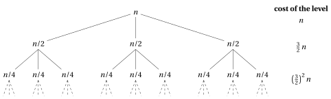

# Exercises · Recurrences

<div class="info-capitolo" markdown>

**Exercises · Chapter 15** · each solution opens with a click · [:material-book-open-variant: Chapter 15](../recursion/15-recurrences.md) · [:material-file-pdf-box: Exercises, volume 5 (PDF)](../pdf/exercises-5-recursion.pdf)

</div>

In the exercises of this chapter recurrences are solved with the three methods of the chapter «Recurrences» (expansion, substitution, recursion tree), using the following formulas.

!!! nota ""

    For every $n,m\in\N$, $n,m\ge 1$, every $k\in\N$ and every real number $x\neq 1$:

    \begin{align*}
    \sum_{i=1}^{n} i &= \frac{n(n+1)}{2}
    && \text{(arithmetic series)}\\[1ex]
    \sum_{j=1}^{m} j^2 &= \frac{m(m+1)(2m+1)}{6}
    && \text{(sum of the squares)}\\[1ex]
    \sum_{i=0}^{k} x^i &= \frac{x^{k+1}-1}{x-1}=\frac{1-x^{k+1}}{1-x}
    && \text{(geometric series)}\\[1ex]
    \sum_{i=0}^{\infty} x^i &= \frac{1}{1-x}\quad\text{if } |x|<1
    && \text{(infinite decreasing geometric series)}
    \end{align*}

!!! nota ""

    For every $a,b,n>0$ with $b\neq 1$, and every real number $x$:

    \begin{align*}
    a^{\log_b n}&=n^{\log_b a}, \qquad \log_b n=\frac{\log_2 n}{\log_2 b},\\[1ex]
    x-1&<\lfloor x\rfloor\le x, \qquad 2\lfloor n/2\rfloor\ge n-1 \quad (n\in\N).
    \end{align*}

<a id="esercizio-15-1"></a>

!!! esercizio "Exercise 15.1: Recurrences (E1)"

    Consider the following recurrences.

    - **(a)** $T(n)=T(n-1)+2n-1$ for $n>1$, with $T(1)=1$.

    - **(b)** $T(n)=3\,T(n-1)$ for $n>1$, with $T(1)=2$.

    - **(c)** $T(n)=T\left(\frac{n}{3}\right)+1$ for $n>1$, with $T(1)=1$, where $n$ is an exact power of $3$.

    - **(d)** $T(n)=2\,T\left(\frac{n}{2}\right)+n^2$ for $n>1$, with $T(1)=1$, where $n$ is an exact power of $2$.

    **Questions**

    1. For each recurrence, compute the first four values of $T(n)$ (for (c) and (d), on the first four admissible values of $n$).

    2. Solve each recurrence with the expansion method, that is, determine a closed form of $T(n)$.

    3. Check that the closed forms are consistent with the values computed in question 1.

    4. Determine the order of growth of each recurrence ($\Theta$-notation).

??? soluzione "Solution"

    1. First values:

        - (a) $T(1)=1$, $T(2)=1+3=4$, $T(3)=4+5=9$, $T(4)=9+7=16$.

        - (b) $T(1)=2$, $T(2)=6$, $T(3)=18$, $T(4)=54$.

        - (c) $T(1)=1$, $T(3)=T(1)+1=2$, $T(9)=T(3)+1=3$, $T(27)=T(9)+1=4$.

        - (d) $T(1)=1$, $T(2)=2\cdot 1+4=6$, $T(4)=2\cdot 6+16=28$, $T(8)=2\cdot 28+64=120$.

    2. Expansion.

        - **(a)** Expanding,

            \begin{align*}
            T(n) &= T(n-1)+(2n-1)\\
            &= T(n-2)+\big(2(n-1)-1\big)+(2n-1)\\
            &\;\;\vdots\\
            &= T(n-k)+\sum_{i=n-k+1}^{n}(2i-1).
            \end{align*}

            With $k=n-1$ and using the arithmetic series $\sum_{i=1}^{n}i=\frac{n(n+1)}{2}$:

            $$
            T(n)=T(1)+\sum_{i=2}^{n}(2i-1)=\sum_{i=1}^{n}(2i-1)=2\,\frac{n(n+1)}{2}-n=n^2.
            $$

        - **(b)** Expanding,

            $$
            T(n)=3\,T(n-1)=3^2\,T(n-2)=3^3\,T(n-3)=\cdots=3^k\,T(n-k).
            $$

            With $k=n-1$: $T(n)=3^{n-1}\,T(1)=2\cdot 3^{n-1}$.

        - **(c)** Let $n=3^k$. Expanding,

            $$
            T(n)=T\left(\frac{n}{3}\right)+1=T\left(\frac{n}{3^2}\right)+2=\cdots=T\left(\frac{n}{3^j}\right)+j.
            $$

            The boundary condition is reached when $\frac{n}{3^j}=1$, that is, $j=\log_3 n$:

            $$
            T(n)=T(1)+\log_3 n=\log_3 n+1.
            $$

        - **(d)** Expanding,

            \begin{align*}
            T(n) &= 2\,T\left(\frac{n}{2}\right)+n^2\\
            &= 2\left(2\,T\left(\frac{n}{2^2}\right)+\frac{n^2}{4}\right)+n^2=2^2\,T\left(\frac{n}{2^2}\right)+n^2\left(1+\frac{1}{2}\right)\\
            &= 2^2\left(2\,T\left(\frac{n}{2^3}\right)+\frac{n^2}{16}\right)+n^2\left(1+\frac{1}{2}\right)=2^3\,T\left(\frac{n}{2^3}\right)+n^2\left(1+\frac{1}{2}+\frac{1}{4}\right)\\
            &\;\;\vdots\\
            &= 2^j\,T\left(\frac{n}{2^j}\right)+n^2\sum_{i=0}^{j-1}\left(\frac{1}{2}\right)^i.
            \end{align*}

            With $j=\log_2 n$ (so $2^j=n$) and the geometric series $\sum_{i=0}^{j-1}x^i=\frac{1-x^j}{1-x}$:

            $$
            T(n)=n\,T(1)+n^2\,\frac{1-\left(\frac{1}{2}\right)^{\log_2 n}}{1-\frac{1}{2}}=n+2n^2\left(1-\frac{1}{n}\right)=2n^2-n.
            $$

    3. Check:

        - (a) $n^2$: $1,4,9,16$. ✓

        - (b) $2\cdot 3^{n-1}$: $2,6,18,54$. ✓

        - (c) $\log_3 n+1$ for $n=1,3,9,27$: $1,2,3,4$. ✓

        - (d) $2n^2-n$ for $n=1,2,4,8$: $1,\;8-2=6,\;32-4=28,\;128-8=120$. ✓

    4. Orders of growth:

        - (a) $T(n)=n^2=\Theta(n^2)$.

        - (b) $T(n)=2\cdot 3^{n-1}=\frac{2}{3}\,3^n=\Theta(3^n)$ (exponential).

        - (c) $T(n)=\log_3 n+1=\Theta(\log_2 n)$ (the base of the logarithm is irrelevant inside $\Theta$).

        - (d) $T(n)=2n^2-n=\Theta(n^2)$, since $\lim_{n\to\infty}\frac{2n^2-n}{n^2}=2\in\R_{>0}$. Note that the cost is dominated by the root ($n^2$).

<a id="esercizio-15-2"></a>

!!! esercizio "Exercise 15.2: Recurrences (E2)"

    Consider the following recurrences, defined for every $n\in\N$, $n\ge 1$.

    $$
    \text{(A)}\quad T(n)=
    \begin{cases}
    1 & \text{if } n=1\\
    T(n-1)+n & \text{if } n>1
    \end{cases}
    \qquad\qquad
    \text{(B)}\quad U(n)=
    \begin{cases}
    1 & \text{if } n=1\\
    U(\lfloor n/2\rfloor)+1 & \text{if } n>1
    \end{cases}
    $$

    **Questions**

    1. Using the substitution method, prove that $T(n)\le n^2$ for all $n\ge 1$.

    2. Using the substitution method, prove that $T(n)\ge \frac{1}{2}n^2$ for all $n\ge 1$. Conclude that $T(n)=\Theta(n^2)$.

    3. Compute $U(n)$ for $n=1,2,\dots,8$.

    4. Prove that $U(n)=O(\log_2 n)$, by showing that $U(n)\le c\log_2 n$ for a suitable constant $c$ and all $n\ge 2$. Explain why the bound cannot hold for $n=1$ and which base cases are needed.

    5. Prove that $U(n)\ge\log_2(n+1)$ for all $n\ge 1$. Conclude that $U(n)=\Theta(\log_2 n)$.

??? soluzione "Solution"

    1. We guess $T(n)\le c\,n^2$ and look for $c$. Assume (inductive hypothesis) $T(n-1)\le c\,(n-1)^2$. Then

        $$
        T(n)\le c\,(n-1)^2+n=c\,n^2-2c\,n+c+n=c\,n^2-\big((2c-1)\,n-c\big).
        $$

        We need $(2c-1)\,n-c\ge 0$. With $c=1$ this is $n-1\ge 0$, true for every $n\ge 1$.

        <em>Base case</em>: $T(1)=1\le 1^2$. ✓

        <em>Inductive step</em> ($n\ge 2$): $T(n)\le (n-1)^2+n=n^2-n+1\le n^2$. ✓

        Hence $T(n)\le n^2$ for all $n\ge 1$, that is, $T(n)=O(n^2)$.

    2. We guess $T(n)\ge d\,n^2$. Assume $T(n-1)\ge d\,(n-1)^2$. Then

        $$
        T(n)\ge d\,(n-1)^2+n=d\,n^2+\big((1-2d)\,n+d\big).
        $$

        We need $(1-2d)\,n+d\ge 0$: with $d=\frac{1}{2}$ it is $\frac{1}{2}\ge 0$. ✓

        <em>Base case</em>: $T(1)=1\ge\frac{1}{2}$. ✓

        Hence $\frac{1}{2}n^2\le T(n)\le n^2$ for all $n\ge 1$, and $T(n)=\Theta(n^2)$. (Indeed, the exact solution is $T(n)=\frac{n(n+1)}{2}$.)

    3.

        <div class="tabella" markdown="0"><table>
        <tr>
        <th><span class="arithmatex">&#92;(n&#92;)</span></th>
        <th>1</th>
        <th>2</th>
        <th>3</th>
        <th>4</th>
        <th>5</th>
        <th>6</th>
        <th>7</th>
        <th>8</th>
        </tr>
        <tr>
        <td><span class="arithmatex">&#92;(U(n)&#92;)</span></td>
        <td>1</td>
        <td>2</td>
        <td>2</td>
        <td>3</td>
        <td>3</td>
        <td>3</td>
        <td>3</td>
        <td>4</td>
        </tr>
        </table></div>

        For example, $U(6)=U(3)+1=U(1)+2=3$ and $U(8)=U(4)+1=U(2)+2=U(1)+3=4$. (In general $U(n)=\lfloor\log_2 n\rfloor+1$, the number of bits of $n$.)

    4. We guess $U(n)\le c\log_2 n$.

        <em>Inductive step.</em> Assume $U(\lfloor n/2\rfloor)\le c\log_2\lfloor n/2\rfloor$. Then

        $$
        U(n)\le c\log_2\lfloor n/2\rfloor+1\le c\log_2\frac{n}{2}+1=c\log_2 n-c+1\le c\log_2 n,
        $$

        as long as $c\ge 1$.

        <em>Base cases.</em> For $n=1$: $U(1)=1>c\log_2 1=0$ for every $c$, so the bound cannot hold for $n=1$. We prove the bound for $n\ge n_0=2$. For $n\ge 4$ we have $\lfloor n/2\rfloor\ge 2$, so the inductive step uses only values $\ge 2$. For $n=2,3$ we have $\lfloor n/2\rfloor=1$: these are the base cases. We need

        $$
        U(2)=2\le c\log_2 2=c, \qquad U(3)=2\le c\log_2 3\approx 1.58\,c.
        $$

        Both hold with $c=2$.

        Hence $U(n)\le 2\log_2 n$ for all $n\ge 2$, and $U(n)=O(\log_2 n)$.

    5. By strong induction on $n$.

        <em>Base case</em>: $U(1)=1=\log_2 2$. ✓

        <em>Inductive step</em> ($n\ge 2$): since $1\le\lfloor n/2\rfloor<n$, the inductive hypothesis gives

        $$
        U(\lfloor n/2\rfloor)\ge\log_2(\lfloor n/2\rfloor+1).
        $$

        Then

        $$
        \begin{aligned}
        U(n)&\ge\log_2\left(\lfloor n/2\rfloor+1\right)+1=\log_2\left(2\lfloor n/2\rfloor+2\right)\\
        &\ge\log_2\left((n-1)+2\right)=\log_2(n+1),
        \end{aligned}
        $$

        where we used $2\lfloor n/2\rfloor\ge n-1$.

        Note that the natural guess $U(n)\ge\log_2 n$ does <span style="color:#e03131">not</span> work directly: for odd $n$ the inductive step only gives

        $$
        U(n)\ge\log_2\lfloor n/2\rfloor+1=\log_2\left(2\lfloor n/2\rfloor\right)=\log_2(n-1).
        $$

        The slightly stronger statement $U(n)\ge\log_2(n+1)$ makes the induction work.

        Since $\log_2(n+1)\ge\log_2 n$, we have $U(n)=\Omega(\log_2 n)$. Together with question 4,

        $$
        U(n)=\Theta(\log_2 n).
        $$

<a id="esercizio-15-3"></a>

!!! esercizio "Exercise 15.3: Recurrences (E3)"

    Consider the recurrence

    $$
    T(n)=
    \begin{cases}
    1 & \text{if } n=1\\
    3\,T\left(\frac{n}{2}\right)+n & \text{if } n>1
    \end{cases}
    $$

    where $n$ is an exact power of $2$.

    **Questions**

    1. Draw the first three levels of the recursion tree (depths $0,1,2$) and indicate the cost of each node.

    2. Determine, for a generic depth $i$, the number of nodes, the cost of each node and the cost of the level. Determine the depth of the tree and the number of leaves.

    3. Sum the costs of all levels and obtain a closed form of $T(n)$.

    4. Determine the order of growth of $T(n)$. Which part of the tree dominates the total cost?

    5. Verify the closed form obtained in question 3 by induction (substitution method), and check it numerically for $n=1,2,4,8$.

??? soluzione "Solution"

    1. The root has cost $n$ and three children, each with cost $\frac{n}{2}$; each of them has three children with cost $\frac{n}{4}$.

        { .fig loading=lazy style="width:95%" }

    2. At depth $i$:

        - number of nodes: $3^i$;

        - size of each subproblem: $\frac{n}{2^i}$, hence cost of each node: $\frac{n}{2^i}$;

        - cost of the level: $3^i\,\frac{n}{2^i}=\left(\frac{3}{2}\right)^i n$.

        The subproblem size reaches $1$ when $\frac{n}{2^i}=1$, that is, at depth $k=\log_2 n$. The number of leaves is

        $$
        3^{\log_2 n}=n^{\log_2 3}\approx n^{1.585},
        $$

        each with cost $T(1)=1$.

    3. Let $k=\log_2 n$. Using the geometric series $\sum_{i=0}^{k-1}x^i=\frac{x^k-1}{x-1}$ with $x=\frac{3}{2}$:

        $$
        \sum_{i=0}^{k-1}\left(\frac{3}{2}\right)^i n=n\,\frac{\left(\frac{3}{2}\right)^k-1}{\frac{3}{2}-1}=2n\left(\frac{3^k}{2^k}-1\right)=2n\left(\frac{3^k}{n}-1\right)=2\cdot 3^k-2n.
        $$

        Adding the cost of the leaves, $3^k\cdot 1$:

        $$
        T(n)=2\cdot 3^k-2n+3^k=3\cdot 3^{\log_2 n}-2n=3\,n^{\log_2 3}-2n.
        $$

    4. Since $\log_2 3>1$, the term $n^{\log_2 3}$ dominates $n$:

        $$
        \lim_{n\to\infty}\frac{3\,n^{\log_2 3}-2n}{n^{\log_2 3}}=\lim_{n\to\infty}\left(3-\frac{2}{n^{\log_2 3-1}}\right)=3\in\R_{>0}.
        $$

        Hence $T(n)=\Theta\left(n^{\log_2 3}\right)$. The costs of the levels increase geometrically (ratio $\frac{3}{2}>1$): the total cost is dominated by the <strong>leaves</strong>.

    5. We prove $T(n)=3\,n^{\log_2 3}-2n$ for every $n=2^k$, by induction on $k$.

        <em>Base case</em> $k=0$ ($n=1$): $3\cdot 1-2=1=T(1)$. ✓

        <em>Inductive step</em>: assume the formula for $\frac{n}{2}$. Since $\left(\frac{n}{2}\right)^{\log_2 3}=\frac{n^{\log_2 3}}{2^{\log_2 3}}=\frac{n^{\log_2 3}}{3}$,

        $$
        T(n)=3\left(3\,\frac{n^{\log_2 3}}{3}-2\,\frac{n}{2}\right)+n=3\,n^{\log_2 3}-3n+n=3\,n^{\log_2 3}-2n. \quad\checkmark
        $$

        <em>Numerical check</em> ($n^{\log_2 3}=3^k$):

        <div class="tabella" markdown="0"><table>
        <tr>
        <th><span class="arithmatex">&#92;(n&#92;)</span></th>
        <th><span class="arithmatex">&#92;(T(n)&#92;)</span> from the recurrence</th>
        <th><span class="arithmatex">&#92;(3&#92;cdot 3^k-2n&#92;)</span></th>
        </tr>
        <tr>
        <td><span class="arithmatex">&#92;(1&#92;)</span></td>
        <td><span class="arithmatex">&#92;(1&#92;)</span></td>
        <td><span class="arithmatex">&#92;(3-2=1&#92;)</span></td>
        </tr>
        <tr>
        <td><span class="arithmatex">&#92;(2&#92;)</span></td>
        <td><span class="arithmatex">&#92;(3&#92;cdot 1+2=5&#92;)</span></td>
        <td><span class="arithmatex">&#92;(9-4=5&#92;)</span></td>
        </tr>
        <tr>
        <td><span class="arithmatex">&#92;(4&#92;)</span></td>
        <td><span class="arithmatex">&#92;(3&#92;cdot 5+4=19&#92;)</span></td>
        <td><span class="arithmatex">&#92;(27-8=19&#92;)</span></td>
        </tr>
        <tr>
        <td><span class="arithmatex">&#92;(8&#92;)</span></td>
        <td><span class="arithmatex">&#92;(3&#92;cdot 19+8=65&#92;)</span></td>
        <td><span class="arithmatex">&#92;(81-16=65&#92;)</span></td>
        </tr>
        </table></div>

<a id="esercizio-15-4"></a>

!!! esercizio "Exercise 15.4: Recurrences (E4)"

    Consider the following recurrences.

    $$
    \text{(A)}\quad T(n)=
    \begin{cases}
    1 & \text{if } 1\le n<4\\
    T\left(\frac{n}{2}\right)+T\left(\frac{n}{4}\right)+n & \text{if } n\ge 4
    \end{cases}
    \qquad \text{(defined for every real } n\ge 1\text{)}
    $$

    $$
    \text{(B)}\quad U(n)=
    \begin{cases}
    0 & \text{if } n=0\\
    U(n-2)+n^2 & \text{if } n\ge 2
    \end{cases}
    \qquad \text{(defined for every even } n\in\N\text{)}
    $$

    **Questions**

    1. Draw the first three levels of the recursion tree of (A) and compute the cost of each of these levels.

    2. Show that the cost of the level at depth $i$ of the tree of (A) is at most $\left(\frac{3}{4}\right)^i n$, and use this fact to guess an upper bound on $T(n)$.

    3. Prove, with the substitution method, that $T(n)\le 4n$ for all $n\ge 1$. Conclude that $T(n)=\Theta(n)$.

    4. Draw the recursion tree of (B). What is its shape? What is its depth?

    5. Determine a closed form of $U(n)$ and its order of growth. (Recall that $\sum_{j=1}^{m}j^2=\frac{m(m+1)(2m+1)}{6}$.)

??? soluzione "Solution"

    1. Each node of size $s\ge 4$ has two children, of sizes $\frac{s}{2}$ and $\frac{s}{4}$.

        { .fig loading=lazy style="width:90%" }

        The costs of the first three levels (for $n$ large enough, so that all these nodes are internal) are:

        $$
        n,\qquad \frac{n}{2}+\frac{n}{4}=\frac{3}{4}\,n,\qquad \frac{n}{4}+\frac{n}{8}+\frac{n}{8}+\frac{n}{16}=\frac{9}{16}\,n.
        $$

    2. If a node has size $s$, its children have total size $\frac{s}{2}+\frac{s}{4}=\frac{3}{4}s$. Hence, by induction on $i$, the nodes at depth $i$ have total size at most $\left(\frac{3}{4}\right)^i n$ (exactly, if the level is complete), and the internal nodes at depth $i$ have total cost at most $\left(\frac{3}{4}\right)^i n$.

        Summing over all levels and using the infinite decreasing geometric series $\sum_{i=0}^{\infty}x^i=\frac{1}{1-x}$:

        $$
        \sum_{i=0}^{\infty}\left(\frac{3}{4}\right)^i n=\frac{1}{1-\frac{3}{4}}\,n=4n.
        $$

        Since the leaves have constant cost, we <strong>guess</strong> $T(n)=O(n)$, more precisely $T(n)\le 4n$. (The leaves are not easy to count, so we prove the guess with the substitution method.)

    3. We prove $T(n)\le 4n$ for every real $n\ge 1$, by induction on $k=\lfloor\log_2 n\rfloor$.

        <em>Base cases</em> $k\in\{0,1\}$, that is, $1\le n<4$: $T(n)=1\le 4\le 4n$. ✓

        <em>Inductive step</em> $k\ge 2$, that is, $n\ge 4$: the arguments $\frac{n}{2}\ge 2$ and $\frac{n}{4}\ge 1$ are in the domain and have $\lfloor\log_2(\cdot)\rfloor<k$, so by the inductive hypothesis

        $$
        T(n)=T\left(\frac{n}{2}\right)+T\left(\frac{n}{4}\right)+n\le 4\,\frac{n}{2}+4\,\frac{n}{4}+n=2n+n+n=4n. \quad\checkmark
        $$

        Hence $T(n)=O(n)$.

        <em>Lower bound</em>: for $n\ge 4$, all the terms are non-negative and the root alone costs $n$, so $T(n)\ge n$. Hence $T(n)=\Omega(n)$ and

        $$
        T(n)=\Theta(n).
        $$

        (The cost is dominated by the root: the level costs decrease geometrically with ratio $\frac{3}{4}$.)

    4. Each call generates only <em>one</em> recursive call, so the recursion tree is a <strong>path</strong>:

        $$
        n^2 \;\longrightarrow\; (n-2)^2 \;\longrightarrow\; (n-4)^2 \;\longrightarrow\;\cdots\;\longrightarrow\; 2^2 \;\longrightarrow\; U(0)=0.
        $$

        The node at depth $i$ has size $n-2i$ and cost $(n-2i)^2$. The size reaches $0$ at depth $\frac{n}{2}$, which is the depth of the tree.

    5. Summing the costs of all levels, with $m=\frac{n}{2}$ and $j=m-i$ (so that $n-2i=2j$):

        $$
        U(n)=\sum_{i=0}^{m-1}(n-2i)^2=\sum_{j=1}^{m}(2j)^2=4\sum_{j=1}^{m}j^2=4\,\frac{m(m+1)(2m+1)}{6}.
        $$

        Substituting $m=\frac{n}{2}$:

        $$
        U(n)=4\,\frac{\frac{n}{2}\cdot\frac{n+2}{2}\cdot(n+1)}{6}=\frac{n(n+1)(n+2)}{6}.
        $$

        Check: $U(2)=4$ and $\frac{2\cdot 3\cdot 4}{6}=4$; $U(4)=4+16=20$ and $\frac{4\cdot 5\cdot 6}{6}=20$; $U(6)=20+36=56$ and $\frac{6\cdot 7\cdot 8}{6}=56$. ✓

        Order of growth:

        $$
        \lim_{n\to\infty}\frac{n(n+1)(n+2)/6}{n^3}=\frac{1}{6}\in\R_{>0}\qquad\Longrightarrow\qquad U(n)=\Theta(n^3).
        $$

        Note that, unlike in (A), the cost of the levels decreases only slowly (polynomially, not geometrically) and the depth is linear in $n$: no level dominates, and the total is $\Theta(n)$ levels times $\Theta(n^2)$ per level (at least half of the levels cost at least $\frac{n^2}{4}$).

<a id="esercizio-15-5"></a>

!!! esercizio "Exercise 15.5: Recurrences (E5)"

    Consider the following two recursive algorithms. Assume that every multiplication is a primitive operation (one step), and that $x$ is stored with a constant number of bits.

    !!! algoritmo "Algorithm: FastPower"

        <div class="pseudocodice" markdown="0">
        <div class="pc-io"><span class="pc-kw">Input:</span> <span>An integer number <span class="arithmatex">&#92;(x&#92;)</span> and a natural number <span class="arithmatex">&#92;(n&#92;)</span></span></div>
        <div class="pc-io"><span class="pc-kw">Output:</span> <span>An integer number</span></div>
        <div class="pc-sep"></div>
        <div class="pc-riga pc-vuota"><span class="pc-n"></span><span class="pc-corpo"></span></div>
        <div class="pc-riga"><span class="pc-n">1</span><span class="pc-corpo"><span class="pc-t"><strong>function</strong> FastPower(x, n)</span></span></div>
        <div class="pc-riga" id="riga-ex-15-recurrences-exfive-fp-a"><span class="pc-n">2</span><span class="pc-corpo"><span class="pc-l"></span><span class="pc-t"><strong>if</strong> <span class="arithmatex">&#92;(n = 0&#92;)</span> <strong>then</strong></span></span></div>
        <div class="pc-riga" id="riga-ex-15-recurrences-exfive-fp-b"><span class="pc-n">3</span><span class="pc-corpo"><span class="pc-l"></span><span class="pc-l"></span><span class="pc-t"><strong>return</strong> <span class="arithmatex">&#92;(1&#92;)</span></span></span></div>
        <div class="pc-riga"><span class="pc-n">4</span><span class="pc-corpo"><span class="pc-l"></span><span class="pc-t"><strong>end</strong></span></span></div>
        <div class="pc-riga" id="riga-ex-15-recurrences-exfive-fp-c"><span class="pc-n">5</span><span class="pc-corpo"><span class="pc-l"></span><span class="pc-t"><span class="arithmatex">&#92;(y :=&#92;)</span> FastPower(<span class="arithmatex">&#92;(x, &#92;lfloor n/2&#92;rfloor&#92;)</span>)</span></span></div>
        <div class="pc-riga" id="riga-ex-15-recurrences-exfive-fp-d"><span class="pc-n">6</span><span class="pc-corpo"><span class="pc-l"></span><span class="pc-t"><strong>if</strong> <span class="arithmatex">&#92;(n&#92;)</span> is even <strong>then</strong></span></span></div>
        <div class="pc-riga" id="riga-ex-15-recurrences-exfive-fp-e"><span class="pc-n">7</span><span class="pc-corpo"><span class="pc-l"></span><span class="pc-l"></span><span class="pc-t"><strong>return</strong> <span class="arithmatex">&#92;(y&#92;cdot y&#92;)</span></span></span></div>
        <div class="pc-riga"><span class="pc-n">8</span><span class="pc-corpo"><span class="pc-l"></span><span class="pc-t"><strong>else</strong></span></span></div>
        <div class="pc-riga" id="riga-ex-15-recurrences-exfive-fp-f"><span class="pc-n">9</span><span class="pc-corpo"><span class="pc-l"></span><span class="pc-l"></span><span class="pc-t"><strong>return</strong> <span class="arithmatex">&#92;(x&#92;cdot y&#92;cdot y&#92;)</span></span></span></div>
        <div class="pc-riga"><span class="pc-n">10</span><span class="pc-corpo"><span class="pc-l"></span><span class="pc-t"><strong>end</strong></span></span></div>
        <div class="pc-riga"><span class="pc-n">11</span><span class="pc-corpo"><span class="pc-t"><strong>end</strong></span></span></div>
        </div>

    !!! algoritmo "Algorithm: SlowPower"

        <div class="pseudocodice" markdown="0">
        <div class="pc-io"><span class="pc-kw">Input:</span> <span>An integer number <span class="arithmatex">&#92;(x&#92;)</span> and a natural number <span class="arithmatex">&#92;(n&#92;)</span></span></div>
        <div class="pc-io"><span class="pc-kw">Output:</span> <span>An integer number</span></div>
        <div class="pc-sep"></div>
        <div class="pc-riga pc-vuota"><span class="pc-n"></span><span class="pc-corpo"></span></div>
        <div class="pc-riga"><span class="pc-n">1</span><span class="pc-corpo"><span class="pc-t"><strong>function</strong> SlowPower(x, n)</span></span></div>
        <div class="pc-riga" id="riga-ex-15-recurrences-exfive-sp-a"><span class="pc-n">2</span><span class="pc-corpo"><span class="pc-l"></span><span class="pc-t"><strong>if</strong> <span class="arithmatex">&#92;(n = 0&#92;)</span> <strong>then</strong></span></span></div>
        <div class="pc-riga" id="riga-ex-15-recurrences-exfive-sp-b"><span class="pc-n">3</span><span class="pc-corpo"><span class="pc-l"></span><span class="pc-l"></span><span class="pc-t"><strong>return</strong> <span class="arithmatex">&#92;(1&#92;)</span></span></span></div>
        <div class="pc-riga"><span class="pc-n">4</span><span class="pc-corpo"><span class="pc-l"></span><span class="pc-t"><strong>end</strong></span></span></div>
        <div class="pc-riga" id="riga-ex-15-recurrences-exfive-sp-c"><span class="pc-n">5</span><span class="pc-corpo"><span class="pc-l"></span><span class="pc-t"><strong>if</strong> <span class="arithmatex">&#92;(n&#92;)</span> is even <strong>then</strong></span></span></div>
        <div class="pc-riga" id="riga-ex-15-recurrences-exfive-sp-d"><span class="pc-n">6</span><span class="pc-corpo"><span class="pc-l"></span><span class="pc-l"></span><span class="pc-t"><strong>return</strong> SlowPower(<span class="arithmatex">&#92;(x, n/2&#92;)</span>) <span class="arithmatex">&#92;(&#92;cdot&#92;)</span> SlowPower(<span class="arithmatex">&#92;(x, n/2&#92;)</span>)</span></span></div>
        <div class="pc-riga"><span class="pc-n">7</span><span class="pc-corpo"><span class="pc-l"></span><span class="pc-t"><strong>else</strong></span></span></div>
        <div class="pc-riga" id="riga-ex-15-recurrences-exfive-sp-e"><span class="pc-n">8</span><span class="pc-corpo"><span class="pc-l"></span><span class="pc-l"></span><span class="pc-t"><strong>return</strong> <span class="arithmatex">&#92;(x&#92;,&#92;cdot&#92;)</span> SlowPower(<span class="arithmatex">&#92;(x, &#92;lfloor n/2&#92;rfloor&#92;)</span>) <span class="arithmatex">&#92;(&#92;cdot&#92;)</span> SlowPower(<span class="arithmatex">&#92;(x, &#92;lfloor n/2&#92;rfloor&#92;)</span>)</span></span></div>
        <div class="pc-riga"><span class="pc-n">9</span><span class="pc-corpo"><span class="pc-l"></span><span class="pc-t"><strong>end</strong></span></span></div>
        <div class="pc-riga"><span class="pc-n">10</span><span class="pc-corpo"><span class="pc-t"><strong>end</strong></span></span></div>
        </div>

    **Questions**

    1. What do the two algorithms compute? Justify your answer.

    2. Let $S_F(n)$ be the number of steps executed by <code>FastPower</code>. Write a recurrence for $S_F(n)$, counting the executions of each line, and compute $S_F(n)$ for $n=0,1,\dots,8$.

    3. Solve the recurrence for $S_F(n)$ and determine its order of growth.

    4. Let $S_S(n)$ be the number of steps executed by <code>SlowPower</code>. Write a recurrence for $S_S(n)$ and solve it with the expansion method when $n$ is an exact power of $2$. Determine its order of growth.

    5. Determine the worst-case running time of the two algorithms as a function of the input size $|I|$, and compare them.

??? soluzione "Solution"

    1. Both algorithms compute $x^n$. Indeed, writing $n=2\lfloor n/2\rfloor+r$ with $r\in\{0,1\}$,

        $$
        x^n=\left(x^{\lfloor n/2\rfloor}\right)^2\cdot x^{r}=
        \begin{cases}
        x^{n/2}\cdot x^{n/2} & \text{if } n \text{ is even}\\
        x\cdot x^{\lfloor n/2\rfloor}\cdot x^{\lfloor n/2\rfloor} & \text{if } n \text{ is odd}
        \end{cases}
        $$

        and $x^0=1$. By strong induction on $n$, if the recursive calls return $x^{\lfloor n/2\rfloor}$, both algorithms return $x^n$. The only difference is that <code>FastPower</code> computes $x^{\lfloor n/2\rfloor}$ <em>once</em> and stores it in $y$, while <code>SlowPower</code> computes it <em>twice</em>.

        <code>FastPower</code> is the function <code>powerRec</code> of the code of the course (in C++, <code>n / 2</code> is the integer division $\lfloor n/2\rfloor$ for $n\ge 0$):

        ```cpp
        long long powerRec(long long x, int n)
        {
        	if (n == 0)
        	{
        		return 1;
        	}

        	long long h = powerRec(x, n / 2);

        	if (n % 2 == 0)
        	{
        		return h * h;
        	}

        	return h * h * x;
        }
        ```

        For $x=3$ and $n=0,1,\dots,10$ it returns $1,3,9,27,81,243,729,2187,6561,19683,59049$, that is, $3^n$.

    2. <code>FastPower</code>.

        - If $n=0$: <span style="color:#e03131">lines</span> [2](#riga-ex-15-recurrences-exfive-fp-a) and [3](#riga-ex-15-recurrences-exfive-fp-b) are executed once: $S_F(0)=2$.

        - If $n\ge 1$: <span style="color:#e03131">lines</span> [2](#riga-ex-15-recurrences-exfive-fp-a), [5](#riga-ex-15-recurrences-exfive-fp-c) and [6](#riga-ex-15-recurrences-exfive-fp-d) are executed once, and exactly one of <span style="color:#e03131">lines</span> [7](#riga-ex-15-recurrences-exfive-fp-e) and [9](#riga-ex-15-recurrences-exfive-fp-f) is executed once: $4$ steps. In addition, the recursive call at line [5](#riga-ex-15-recurrences-exfive-fp-c) executes $S_F(\lfloor n/2\rfloor)$ steps.

        Therefore

        $$
        S_F(n)=
        \begin{cases}
        2 & \text{if } n=0\\
        S_F(\lfloor n/2\rfloor)+4 & \text{if } n\ge 1
        \end{cases}
        $$

        <div class="tabella" markdown="0"><table>
        <tr>
        <th><span class="arithmatex">&#92;(n&#92;)</span></th>
        <th>0</th>
        <th>1</th>
        <th>2</th>
        <th>3</th>
        <th>4</th>
        <th>5</th>
        <th>6</th>
        <th>7</th>
        <th>8</th>
        </tr>
        <tr>
        <td><span class="arithmatex">&#92;(S&#95;F(n)&#92;)</span></td>
        <td>2</td>
        <td>6</td>
        <td>10</td>
        <td>10</td>
        <td>14</td>
        <td>14</td>
        <td>14</td>
        <td>14</td>
        <td>18</td>
        </tr>
        </table></div>

    3. Expanding,

        $$
        S_F(n)=S_F(\lfloor n/2\rfloor)+4=S_F(\lfloor n/4\rfloor)+8=\cdots=S_F\left(\lfloor n/2^j\rfloor\right)+4j.
        $$

        For $n\ge 1$, $\lfloor n/2^j\rfloor=0$ for the first time when $2^j>n$, that is, for $j=\lfloor\log_2 n\rfloor+1$ (the number of bits of $n$). Hence

        $$
        S_F(n)=4\left(\lfloor\log_2 n\rfloor+1\right)+2 \qquad (n\ge 1).
        $$

        Check: $S_F(1)=4+2=6$, $S_F(3)=8+2=10$, $S_F(8)=16+2=18$. ✓

        Since $\log_2 n-1<\lfloor\log_2 n\rfloor\le\log_2 n$, we have $4\log_2 n+2<S_F(n)\le 4\log_2 n+6$, and

        $$
        S_F(n)=\Theta(\log_2 n).
        $$

    4. <code>SlowPower</code>.

        - If $n=0$: <span style="color:#e03131">lines</span> [2](#riga-ex-15-recurrences-exfive-sp-a) and [3](#riga-ex-15-recurrences-exfive-sp-b): $S_S(0)=2$.

        - If $n\ge 1$: <span style="color:#e03131">lines</span> [2](#riga-ex-15-recurrences-exfive-sp-a), [5](#riga-ex-15-recurrences-exfive-sp-c) and one of [6](#riga-ex-15-recurrences-exfive-sp-d), [8](#riga-ex-15-recurrences-exfive-sp-e): $3$ steps, plus <em>two</em> recursive calls on $\lfloor n/2\rfloor$.

        Therefore

        $$
        S_S(n)=
        \begin{cases}
        2 & \text{if } n=0\\
        2\,S_S(\lfloor n/2\rfloor)+3 & \text{if } n\ge 1
        \end{cases}
        $$

        so that $S_S(1)=2\cdot 2+3=7$. Let $n=2^k$. Expanding down to $S_S(1)$:

        \begin{align*}
        S_S(n) &= 2\,S_S\left(\frac{n}{2}\right)+3\\
        &= 2^2\,S_S\left(\frac{n}{2^2}\right)+3\,(2+1)\\
        &= 2^3\,S_S\left(\frac{n}{2^3}\right)+3\,(2^2+2+1)\\
        &\;\;\vdots\\
        &= 2^k\,S_S(1)+3\sum_{i=0}^{k-1}2^i=7\cdot 2^k+3\left(2^k-1\right)=10\,n-3.
        \end{align*}

        Check: $S_S(1)=7$, $S_S(2)=2\cdot 7+3=17=20-3$, $S_S(4)=2\cdot 17+3=37=40-3$. ✓

        Hence $S_S(n)=\Theta(n)$ for $n$ power of $2$. (For a generic $n\ge 1$, $S_S(n)$ depends only on the number of bits of $n$, and $S_S(n)=10\cdot 2^{\lfloor\log_2 n\rfloor}-3$, which is between $5n-3$ and $10n-3$: still $\Theta(n)$.)

    5. The input consists of $x$ (a constant number of bits) and of the natural number $n$, so

        $$
        |I|=\Theta(\log_2 n), \qquad\text{that is,}\qquad n=2^{\Theta(|I|)}.
        $$

        - <code>FastPower</code>: $S_F(n)=\Theta(\log_2 n)=\Theta(|I|)$.

        - <code>SlowPower</code>: $S_S(n)=\Theta(n)=2^{\Theta(|I|)}$.

        !!! chiave ""

            The worst-case running time of <code>FastPower</code> is $T(|I|)=\Theta(|I|)$ (linear in the input size), while the worst-case running time of <code>SlowPower</code> is $T(|I|)=2^{\Theta(|I|)}$ (exponential in the input size).

        Computing the same sub-result twice changes the recurrence from $S(n)=S(n/2)+c$ to $S(n)=2S(n/2)+c$, and the running time from logarithmic to linear in $n$.

<a id="esercizio-15-6"></a>

!!! esercizio "Exercise 15.6: Recurrences (E6)"

    Consider the following recurrences, where $n$ is an exact power of $2$.

    $$
    \text{(A)}\quad T(n)=
    \begin{cases}
    1 & \text{if } n=1\\
    4\,T\left(\frac{n}{2}\right)+n & \text{if } n>1
    \end{cases}
    \qquad\qquad
    \text{(B)}\quad U(n)=
    \begin{cases}
    1 & \text{if } n=1\\
    8\,U\left(\frac{n}{2}\right)+n^2 & \text{if } n>1
    \end{cases}
    $$

    **Questions**

    1. Try to prove $T(n)\le c\,n^2$ with the substitution method. Show that the induction fails for every choice of the constant $c$.

    2. Strengthen the guess by subtracting a lower-order term: prove that $T(n)\le c\,n^2-d\,n$ for suitable constants $c,d>0$, handling the base case.

    3. Prove that $T(n)\ge n^2$ and conclude that $T(n)=\Theta(n^2)$.

    4. Repeat questions 1–3 for $U(n)$, with the guess $U(n)\le c\,n^3$.

    5. Using the recursion-tree method, compute the exact value of $U(n)$ and compare it with the bound obtained in question 4.

??? soluzione "Solution"

    1. Assume $T\left(\frac{n}{2}\right)\le c\left(\frac{n}{2}\right)^2$. Then

        $$
        T(n)\le 4\,c\,\frac{n^2}{4}+n=c\,n^2+n.
        $$

        Since $n>0$, $c\,n^2+n>c\,n^2$ for every $c$: we cannot conclude $T(n)\le c\,n^2$. The induction fails, by the lower-order term $n$. (Note: concluding “$T(n)\le c\,n^2+n=O(n^2)$” would be <span style="color:#e03131">wrong</span>: the induction must prove exactly the inductive hypothesis, with the same constant $c$.)

    2. Guess $T(n)\le c\,n^2-d\,n$. Assume $T\left(\frac{n}{2}\right)\le c\left(\frac{n}{2}\right)^2-d\,\frac{n}{2}$. Then

        $$
        T(n)\le 4\left(c\,\frac{n^2}{4}-d\,\frac{n}{2}\right)+n=c\,n^2-2d\,n+n=c\,n^2-d\,n-(d-1)\,n\le c\,n^2-d\,n,
        $$

        as long as $d\ge 1$.

        <em>Base case</em>: $T(1)=1\le c-d$. With $d=1$ we need $c\ge 2$.

        Choosing $c=2$ and $d=1$: $T(n)\le 2n^2-n$ for every $n$ power of $2$. Hence $T(n)=O(n^2)$. (In fact, $T(n)=2n^2-n$ exactly, as can be verified with the recursion-tree method.)

    3. Assume $T\left(\frac{n}{2}\right)\ge\left(\frac{n}{2}\right)^2$. Then

        $$
        T(n)\ge 4\,\frac{n^2}{4}+n=n^2+n\ge n^2.
        $$

        Base case: $T(1)=1\ge 1$. Hence $n^2\le T(n)\le 2n^2-n$, and $T(n)=\Theta(n^2)$.

    4. <em>Naive guess.</em> Assume $U\left(\frac{n}{2}\right)\le c\left(\frac{n}{2}\right)^3$. Then

        $$
        U(n)\le 8\,c\,\frac{n^3}{8}+n^2=c\,n^3+n^2,
        $$

        and the induction fails (by the lower-order term $n^2$).

        <em>Strengthened guess.</em> Assume $U\left(\frac{n}{2}\right)\le c\left(\frac{n}{2}\right)^3-d\left(\frac{n}{2}\right)^2$. Then

        $$
        U(n)\le 8\left(c\,\frac{n^3}{8}-d\,\frac{n^2}{4}\right)+n^2=c\,n^3-2d\,n^2+n^2=c\,n^3-d\,n^2-(d-1)\,n^2\le c\,n^3-d\,n^2,
        $$

        as long as $d\ge 1$. Base case: $U(1)=1\le c-d$, satisfied by $c=2$, $d=1$. Hence

        $$
        U(n)\le 2n^3-n^2.
        $$

        <em>Lower bound.</em> Assume $U\left(\frac{n}{2}\right)\ge\left(\frac{n}{2}\right)^3$. Then $U(n)\ge 8\,\frac{n^3}{8}+n^2\ge n^3$; base case $U(1)=1\ge 1$. Hence $n^3\le U(n)\le 2n^3-n^2$, and $U(n)=\Theta(n^3)$.

    5. At depth $i$ the recursion tree of (B) has $8^i$ nodes, each of size $\frac{n}{2^i}$ and cost $\left(\frac{n}{2^i}\right)^2$. The cost of the level is

        $$
        8^i\,\frac{n^2}{4^i}=2^i\,n^2.
        $$

        The depth of the tree is $\log_2 n$, and there are $8^{\log_2 n}=n^{\log_2 8}=n^3$ leaves, each with cost $U(1)=1$. Using $\sum_{i=0}^{k-1}2^i=2^k-1$:

        $$
        U(n)=\sum_{i=0}^{\log_2 n-1}2^i\,n^2+n^3=n^2\left(2^{\log_2 n}-1\right)+n^3=n^2(n-1)+n^3=2n^3-n^2.
        $$

        The bound of question 4 is therefore <em>exact</em>: the strengthened guess $c\,n^3-d\,n^2$ with $c=2$, $d=1$ is precisely the solution of the recurrence.

        Numerical check: $U(2)=8+4=12=16-4$, $U(4)=8\cdot 12+16=112=128-16$, $U(8)=8\cdot 112+64=960=1024-64$. ✓
