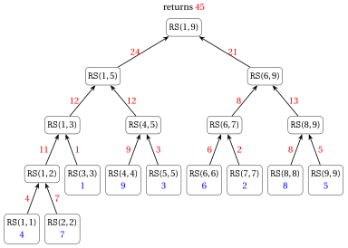
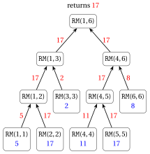
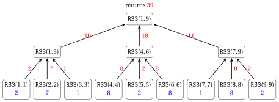
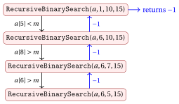

# Exercises · Recursive algorithms

**Exercises · Chapter 17** · each solution opens with a click · [:material-book-open-variant: Chapter 17: Recursive algorithms](../recursion/17-recursive-algorithms.md) · [:material-file-pdf-box: Exercises, volume 5 (PDF)](../pdf/exercises-5-recursion.pdf)

In the exercises of this chapter the steps are counted as in the chapter «Recursive algorithms»: every line of pseudo-code executed counts as one step, and a line containing a call counts one step plus the steps of the called function. The following results of the chapter are used.

!!! nota ""

    <strong>Number of steps</strong> on an array (or sub-array) of $n$ elements:

    
<table>
    <tr>
    <td><code>SumIterative</code>&#92;((a,n)&#92;)</td>
    <td>&#92;(3n+4&#92;)</td>
    </tr>
    <tr>
    <td><code>RecursiveSum</code>&#92;((a,1,n)&#92;)</td>
    <td>&#92;(7n-5&#92;), with &#92;(2n-1&#92;) calls and depth &#92;(&#92;lceil&#92;log&#95;2 n&#92;rceil+1&#92;)</td>
    </tr>
    <tr>
    <td><code>RecursiveSumLinear</code>&#92;((a,n)&#92;)</td>
    <td>&#92;(3n-1&#92;), with &#92;(n&#92;) calls and depth &#92;(n&#92;)</td>
    </tr>
    <tr>
    <td><code>Merge</code>&#92;((a,l,m,r)&#92;), &#92;(n=r-l+1&#92;)</td>
    <td>&#92;(6n+t+11&#92;), where &#92;(t&#92;) is the number of comparisons and &#92;(&#92;min&#92;{n&#95;1,n&#95;2&#92;}&#92;le t&#92;le n-1&#92;)</td>
    </tr>
    <tr>
    <td><code>RecursiveBinarySearch</code>&#92;((a,1,n,m)&#92;)</td>
    <td>&#92;(S(0)=2&#92;), &#92;(S(n)=S(&#92;lfloor n/2&#92;rfloor)+5&#92;) for &#92;(n&#92;ge 1&#92;)</td>
    </tr>
    <tr>
    <td><code>BruteForceMaximumSubarray</code>&#92;((a,n)&#92;)</td>
    <td>&#92;(2n^2+7n+6+3U&#92;), where &#92;(U&#92;) is the number of updates of &#92;(best&#92;)</td>
    </tr>
    </table>

!!! nota ""

    <strong>Master Theorem.</strong> Let $S(n)=a\,S(n/b)+f(n)$, with $a\ge 1$ and $b>1$ constants and $f(n)$ asymptotically positive.

    1. If $f(n)=O\big(n^{\log_b a-\varepsilon}\big)$ for some constant $\varepsilon>0$, then $S(n)=\Theta\big(n^{\log_b a}\big)$.

    2. If $f(n)=\Theta\big(n^{\log_b a}\log^k n\big)$ for some constant $k\ge 0$, then $S(n)=\Theta\big(n^{\log_b a}\log^{k+1} n\big)$.

    3. If $f(n)=\Omega\big(n^{\log_b a+\varepsilon}\big)$ for some constant $\varepsilon>0$, and $a\,f(n/b)\le c\,f(n)$ for some constant $c<1$ and all sufficiently large $n$, then $S(n)=\Theta\big(f(n)\big)$.

!!! esercizio "Exercise 17.1: Recursive algorithms (E1)"

    Consider the recursive algorithm <code>RecursiveSum</code>:

    

<strong>Algorithm:</strong> RecursiveSum

    
Input: An array &#92;(a&#92;) and two indices &#92;(l &#92;le r&#92;)

    
Output: The sum &#92;(a&#91;l&#93;+a&#91;l+1&#93;+&#92;cdots+a&#91;r&#93;&#92;)

    

    

    
1<strong>function</strong> RecursiveSum(a, l, r)

    
2<strong>if</strong> &#92;(l = r&#92;) <strong>then</strong>

    
3<strong>return</strong> &#92;(a&#91;l&#93;&#92;)

    
4<strong>end</strong>

    
5&#92;(m := &#92;lfloor (l+r)/2 &#92;rfloor&#92;)

    
6&#92;(s&#95;1 :=&#92;) RecursiveSum&#92;((a, l, m)&#92;)

    
7&#92;(s&#95;2 :=&#92;) RecursiveSum&#92;((a, m+1, r)&#92;)

    
8<strong>return</strong> &#92;(s&#95;1 + s&#95;2&#92;)

    
9<strong>end</strong>

    

    and the array of $n=9$ elements

    $$
    a = [4, 7, 1, 9, 3, 6, 2, 8, 5].
    $$

    **Questions**

    1. Draw the call tree of <code>RecursiveSum</code>$(a,1,9)$, indicating for each call the indices $(l,r)$ and the value returned to its parent.

    2. List the calls in the order in which they <strong>terminate</strong>.

    3. How many calls are executed in total? How many additions? How many steps (count each line executed as one step)? Compare with the general formulas $2n-1$, $n-1$ and $7n-5$.

    4. What is the maximum number of calls that are simultaneously active (the recursion depth)? Which calls are active at that moment? Compare with the formula $\lceil \log_2 n\rceil+1$.

??? soluzione "Solution"

    1. The root <code>RS</code>$(1,9)$ computes $m=\lfloor 10/2\rfloor=5$; the left half $a[1..5]$ has $\lceil 9/2\rceil=5$ elements and the right half $a[6..9]$ has $\lfloor 9/2\rfloor=4$ elements. Proceeding in the same way for every call, we obtain the following call tree (in blue the elements returned by the base cases, in red the values returned to the parents):

        { .fig loading=lazy  }

        The values of $m$ computed by the internal calls are:

        
<table>
        <tr>
        <th>call</th>
        <th>&#92;((1,9)&#92;)</th>
        <th>&#92;((1,5)&#92;)</th>
        <th>&#92;((1,3)&#92;)</th>
        <th>&#92;((1,2)&#92;)</th>
        <th>&#92;((4,5)&#92;)</th>
        <th>&#92;((6,9)&#92;)</th>
        <th>&#92;((6,7)&#92;)</th>
        <th>&#92;((8,9)&#92;)</th>
        </tr>
        <tr>
        <td>&#92;(m&#92;)</td>
        <td>5</td>
        <td>3</td>
        <td>2</td>
        <td>1</td>
        <td>4</td>
        <td>7</td>
        <td>6</td>
        <td>8</td>
        </tr>
        <tr>
        <td>returned value</td>
        <td>45</td>
        <td>24</td>
        <td>12</td>
        <td>11</td>
        <td>12</td>
        <td>21</td>
        <td>8</td>
        <td>13</td>
        </tr>
        </table>

        The algorithm returns $45=4+7+1+9+3+6+2+8+5$.

    2. The calls are executed depth-first, and a call terminates only after both its children have terminated. The order of termination is:

        $$
        \begin{array}{l}
        (1,1),\ (2,2),\ (1,2),\ (3,3),\ (1,3),\ (4,4),\ (5,5),\ (4,5),\ (1,5),\\
        (6,6),\ (7,7),\ (6,7),\ (8,8),\ (9,9),\ (8,9),\ (6,9),\ (1,9).
        \end{array}
        $$

    3. The call tree has $9$ leaves (one for each element) and $8$ internal nodes:

        - number of calls: $17 = 2\cdot 9-1$;

        - number of additions: one for each internal node, i.e., $8=9-1$;

        - number of steps: each leaf executes $2$ lines and each internal node $5$ lines, so the total is $9\cdot 2+8\cdot 5 = 58 = 7\cdot 9-5$.

    4. The call tree has height $4$ (the leaves <code>RS</code>$(1,1)$ and <code>RS</code>$(2,2)$ are at level $4$), so the maximum number of simultaneously active calls is $5$. For instance, when <code>RS</code>$(1,1)$ is executed, the active calls are

        $$
        \texttt{RS}(1,9),\quad \texttt{RS}(1,5),\quad \texttt{RS}(1,3),\quad \texttt{RS}(1,2),\quad \texttt{RS}(1,1).
        $$

        This agrees with the formula: $\lceil \log_2 9\rceil+1 = 4+1 = 5$, since $2^3=8<9\le 16=2^4$.

        Note that the leaves are not all at the same level: <code>RS</code>$(3,3)$, for instance, is at level $3$. The deepest leaves are reached by always following the larger (left) half: $9\to 5\to 3\to 2\to 1$.

!!! esercizio "Exercise 17.2: Recursive algorithms (E2)"

    Consider the three algorithms that compute the sum of the elements of an array $a[1..n]$, $n\ge 1$, studied in the chapter «Recursive algorithms»:

    - <code>SumIterative</code>$(a,n)$ (a loop);

    - <code>RecursiveSum</code>$(a,1,n)$ (divide and conquer, $m=\lfloor (l+r)/2\rfloor$, base case $l=r$);

    - <code>RecursiveSumLinear</code>$(a,n)$ (decrease by one: returns <code>RecursiveSumLinear</code>$(a,n-1)+a[n]$, base case $n=1$).

    Their numbers of steps are recalled in the introduction to the exercises.

    **Questions**

    1. For <code>RecursiveSum</code>, let $A(n)$ be the number of additions executed on an array of $n$ elements. Write a recurrence for $A(n)$ and prove by strong induction that $A(n)=n-1$.

    2. Complete the following table, where <em>calls</em> is the total number of calls (for <code>SumIterative</code> write $-$) and <em>depth</em> is the maximum number of simultaneously active calls:

        
<table>
        <tr>
        <th></th>
        <th colspan="3">&#92;(n=10&#92;)</th>
        <th colspan="3">&#92;(n=100&#92;)</th>
        <th colspan="3">&#92;(n=1000&#92;)</th>
        </tr>
        <tr>
        <td></td>
        <td>steps</td>
        <td>calls</td>
        <td>depth</td>
        <td>steps</td>
        <td>calls</td>
        <td>depth</td>
        <td>steps</td>
        <td>calls</td>
        <td>depth</td>
        </tr>
        <tr>
        <td><code>SumIterative</code></td>
        <td></td>
        <td></td>
        <td></td>
        <td></td>
        <td></td>
        <td></td>
        <td></td>
        <td></td>
        <td></td>
        </tr>
        <tr>
        <td><code>RecursiveSum</code></td>
        <td></td>
        <td></td>
        <td></td>
        <td></td>
        <td></td>
        <td></td>
        <td></td>
        <td></td>
        <td></td>
        </tr>
        <tr>
        <td><code>RecursiveSumLinear</code></td>
        <td></td>
        <td></td>
        <td></td>
        <td></td>
        <td></td>
        <td></td>
        <td></td>
        <td></td>
        <td></td>
        </tr>
        </table>

    3. Consider the following variant of <code>RecursiveSum</code>, which also treats sub-arrays of two elements as a base case: if $r-l+1\le 2$ then it returns $a[l]$ (if $l=r$) or $a[l]+a[r]$ (if $r=l+1$); otherwise it proceeds as <code>RecursiveSum</code>. How many calls and how many additions does it execute for $n=8$? And for $n=2^k$, $k\ge 1$?

    4. Explain why <em>every</em> algorithm that computes the sum of $n$ numbers by adding them two at a time executes exactly $n-1$ additions.

??? soluzione "Solution"

    1. A call on one element executes no addition; a call on $n\ge 2$ elements executes one addition ($s_1+s_2$) plus the additions of its two recursive calls:

        $$
        A(n)=
        \begin{cases}
        0 & \text{if } n=1,\\
        A(\lceil n/2\rceil)+A(\lfloor n/2\rfloor)+1 & \text{if } n\ge 2.
        \end{cases}
        $$

        <strong>Base case</strong> ($n=1$): $A(1)=0=1-1$.

        <strong>Inductive step</strong> ($n\ge 2$): assume $A(k)=k-1$ for every $1\le k<n$. Since $1\le\lfloor n/2\rfloor\le\lceil n/2\rceil<n$,

        $$
        A(n) = \big(\lceil n/2\rceil-1\big)+\big(\lfloor n/2\rfloor-1\big)+1 = \lceil n/2\rceil+\lfloor n/2\rfloor-1 = n-1.
        $$

    2. We use the formulas of the chapter «Recursive algorithms» (see also the introduction to the exercises):

        - <code>SumIterative</code>: $3n+4$ steps, no recursive call;

        - <code>RecursiveSum</code>: $7n-5$ steps, $2n-1$ calls, depth $\lceil\log_2 n\rceil+1$;

        - <code>RecursiveSumLinear</code>: $3n-1$ steps, $n$ calls (on $n, n-1,\dots,1$ elements), depth $n$ (all the calls are active when the base case is reached).

        Since $2^3<10\le 2^4$, $2^6<100\le 2^7$ and $2^9<1000\le 2^{10}$, we have $\lceil\log_2 10\rceil=4$, $\lceil\log_2 100\rceil=7$ and $\lceil\log_2 1000\rceil=10$. Therefore:

        
<table>
        <tr>
        <th></th>
        <th colspan="3">&#92;(n=10&#92;)</th>
        <th colspan="3">&#92;(n=100&#92;)</th>
        <th colspan="3">&#92;(n=1000&#92;)</th>
        </tr>
        <tr>
        <td></td>
        <td>steps</td>
        <td>calls</td>
        <td>depth</td>
        <td>steps</td>
        <td>calls</td>
        <td>depth</td>
        <td>steps</td>
        <td>calls</td>
        <td>depth</td>
        </tr>
        <tr>
        <td><code>SumIterative</code></td>
        <td>34</td>
        <td>&#92;(-&#92;)</td>
        <td>&#92;(-&#92;)</td>
        <td>304</td>
        <td>&#92;(-&#92;)</td>
        <td>&#92;(-&#92;)</td>
        <td>3004</td>
        <td>&#92;(-&#92;)</td>
        <td>&#92;(-&#92;)</td>
        </tr>
        <tr>
        <td><code>RecursiveSum</code></td>
        <td>65</td>
        <td>19</td>
        <td>5</td>
        <td>695</td>
        <td>199</td>
        <td>8</td>
        <td>6995</td>
        <td>1999</td>
        <td>11</td>
        </tr>
        <tr>
        <td><code>RecursiveSumLinear</code></td>
        <td>29</td>
        <td>10</td>
        <td>10</td>
        <td>299</td>
        <td>100</td>
        <td>100</td>
        <td>2999</td>
        <td>1000</td>
        <td>1000</td>
        </tr>
        </table>

        All the three algorithms execute $\Theta(n)$ steps, but the extra memory (proportional to the depth) is $\Theta(1)$, $\Theta(\log_2 n)$ and $\Theta(n)$, respectively.

    3. For $n=8$ the sub-arrays have sizes $8\to 4,4\to 2,2,2,2$: the calls on $2$ elements are base cases. The call tree has $1+2+4=7$ calls: $3$ internal calls (one addition each) and $4$ base cases on two elements (one addition each), for a total of $3+4=7$ additions.

        For $n=2^k$, the tree has levels $0,1,\dots,k-1$, with $2^i$ calls at level $i$ on sub-arrays of $2^{k-i}$ elements; the calls at level $k-1$ are the base cases on $2$ elements. The number of calls is

        $$
        \sum_{i=0}^{k-1}2^i = 2^k-1 = n-1
        $$

        (about half of the $2n-1$ calls of <code>RecursiveSum</code>). The number of additions is still $(2^{k-1}-1)+2^{k-1} = 2^k-1 = n-1$: one for each of the $2^{k-1}-1$ internal calls and one for each of the $2^{k-1}$ base cases.

    4. Every addition takes two numbers (elements of the array or partial sums) and replaces them by a single number (their sum). At the beginning there are $n$ numbers, at the end there is only one number (the total sum), and each addition decreases the count by exactly one. Therefore exactly $n-1$ additions are needed, regardless of the order in which they are performed (iterative, divide and conquer, decrease by one, …).

!!! esercizio "Exercise 17.3: Recursive algorithms (E3)"

    Given an array $a[1..n]$ of $n\ge 1$ integer numbers, consider the problem of determining the maximum value in the array. We want to solve it with a recursive <strong>divide and conquer</strong> algorithm <code>RecursiveMax</code>$(a,l,r)$, following the same scheme as <code>RecursiveSum</code>$(a,l,r)$, and to apply it to the array

    $$
    a = [5, 17, 2, 11, 17, 8].
    $$

    **Questions**

    1. Write the pseudo-code of <code>RecursiveMax</code>$(a,l,r)$, which returns the maximum of $a[l..r]$ (base case $l=r$, middle index $m=\lfloor (l+r)/2\rfloor$).

    2. Draw the call tree of <code>RecursiveMax</code>$(a,1,6)$ for the given array, with the value returned by each call. How many calls and how many comparisons between elements are executed?

    3. Prove by strong induction that <code>RecursiveMax</code>$(a,l,r)$ returns $\max\{a[l],\dots,a[r]\}$.

    4. Write the recurrence for the number of steps $S(n)$ of <code>RecursiveMax</code> and solve it with the Master Theorem. Then compute $S(n)$ exactly.

    5. Determine the worst-case running time $T(|I|)$, assuming that every entry uses a constant number of bits, and compare the algorithm with the iterative algorithm <code>FindMaximum</code> of the chapter «Running time».

??? soluzione "Solution"

    1. The maximum of $a[l..r]$ is the larger of the maxima of the two halves:

        !!! algoritmo "Algorithm: RecursiveMax"

            

            
Input: An array &#92;(a&#92;) and two indices &#92;(l &#92;le r&#92;)

            
Output: The maximum value in &#92;(a&#91;l..r&#93;&#92;)

            

            

            
1<strong>function</strong> RecursiveMax(a, l, r)

            
2<strong>if</strong> &#92;(l = r&#92;) <strong>then</strong>

            
3<strong>return</strong> &#92;(a&#91;l&#93;&#92;)

            
4<strong>end</strong>

            
5&#92;(m := &#92;lfloor (l+r)/2 &#92;rfloor&#92;)

            
6&#92;(x&#95;1 :=&#92;) RecursiveMax&#92;((a, l, m)&#92;)

            
7&#92;(x&#95;2 :=&#92;) RecursiveMax&#92;((a, m+1, r)&#92;)

            
8<strong>if</strong> &#92;(x&#95;1 &#92;ge x&#95;2&#92;) <strong>then</strong>

            
9<strong>return</strong> &#92;(x&#95;1&#92;)

            
10<strong>else</strong>

            
11<strong>return</strong> &#92;(x&#95;2&#92;)

            
12<strong>end</strong>

            
13<strong>end</strong>

            

    2. The root computes $m=\lfloor 7/2\rfloor=3$. This is the call tree, where <code>RM</code>$(l,r)$ stands for the call <code>RecursiveMax</code>$(a,l,r)$ and the returned values are in red:

        { .fig loading=lazy  }

        The comparisons executed at line [8](#riga-ex-17-recursive-algorithms-rmax-f) are:

        
<table>
        <tr>
        <th>call</th>
        <th>&#92;(x&#95;1&#92;)</th>
        <th>&#92;(x&#95;2&#92;)</th>
        <th>returned value</th>
        </tr>
        <tr>
        <td><code>RM</code>&#92;((1,2)&#92;)</td>
        <td>5</td>
        <td>17</td>
        <td>&#92;(5&lt;17&#92;Rightarrow 17&#92;)</td>
        </tr>
        <tr>
        <td><code>RM</code>&#92;((1,3)&#92;)</td>
        <td>17</td>
        <td>2</td>
        <td>&#92;(17&#92;ge 2&#92;Rightarrow 17&#92;)</td>
        </tr>
        <tr>
        <td><code>RM</code>&#92;((4,5)&#92;)</td>
        <td>11</td>
        <td>17</td>
        <td>&#92;(11&lt;17&#92;Rightarrow 17&#92;)</td>
        </tr>
        <tr>
        <td><code>RM</code>&#92;((4,6)&#92;)</td>
        <td>17</td>
        <td>8</td>
        <td>&#92;(17&#92;ge 8&#92;Rightarrow 17&#92;)</td>
        </tr>
        <tr>
        <td><code>RM</code>&#92;((1,6)&#92;)</td>
        <td>17</td>
        <td>17</td>
        <td>&#92;(17&#92;ge 17&#92;Rightarrow 17&#92;)</td>
        </tr>
        </table>

        There are $11=2\cdot 6-1$ calls and $5=6-1$ comparisons (one for each internal call). The maximum is $17$.

    3. We use strong induction on $k=r-l+1\ge 1$.

        <strong>Base case</strong> ($k=1$): $l=r$ and the algorithm returns $a[l]=\max\{a[l]\}$.

        <strong>Inductive step</strong> ($k\ge 2$): assume that the statement holds for all sub-arrays with fewer than $k$ elements. The two halves $a[l..m]$ and $a[m+1..r]$ have $\lceil k/2\rceil$ and $\lfloor k/2\rfloor$ elements, both between $1$ and $k-1$; by the inductive hypothesis

        $$
        x_1=\max\{a[l],\dots,a[m]\}, \qquad x_2=\max\{a[m+1],\dots,a[r]\}.
        $$

        Every element of $a[l..r]$ belongs to one of the two halves, so it is at most $\max\{x_1,x_2\}$; moreover $\max\{x_1,x_2\}$ is an element of $a[l..r]$. Therefore $\max\{a[l],\dots,a[r]\}=\max\{x_1,x_2\}$, which is exactly the value returned by lines [8](#riga-ex-17-recursive-algorithms-rmax-f)–[11](#riga-ex-17-recursive-algorithms-rmax-h).

    4. If $n=1$, lines [2](#riga-ex-17-recursive-algorithms-rmax-a) and [3](#riga-ex-17-recursive-algorithms-rmax-b) are executed: $S(1)=2$. If $n\ge 2$:

        - Lines [2](#riga-ex-17-recursive-algorithms-rmax-a), [5](#riga-ex-17-recursive-algorithms-rmax-c), [8](#riga-ex-17-recursive-algorithms-rmax-f) are executed $1$ time each

        - Line [6](#riga-ex-17-recursive-algorithms-rmax-d) is executed $1$ time, plus the $S(\lceil n/2\rceil)$ steps of the call

        - Line [7](#riga-ex-17-recursive-algorithms-rmax-e) is executed $1$ time, plus the $S(\lfloor n/2\rfloor)$ steps of the call

        - exactly one of lines [9](#riga-ex-17-recursive-algorithms-rmax-g) and [11](#riga-ex-17-recursive-algorithms-rmax-h) is executed $1$ time

        Therefore

        $$
        S(n)=
        \begin{cases}
        2 & \text{if } n=1,\\
        S(\lceil n/2\rceil)+S(\lfloor n/2\rfloor)+6 & \text{if } n\ge 2,
        \end{cases}
        \qquad\text{i.e.,}\qquad S(n)=2\,S(n/2)+c.
        $$

        <strong>Master Theorem</strong>:

        - $a=2$, $b=2$, $f(n)=c$;

        - $n^{\log_b a}=n^{\log_2 2}=n$;

        - $f(n)=c$ grows polynomially slower than $n$ $\rightarrow$ case 1;

        - $f(n)=c=O(n^{1-\varepsilon})$ with $\varepsilon=1$;

        - $S(n)=\Theta(n^{\log_2 2})=\Theta(n)$.

        <strong>Exact value</strong>: as for <code>RecursiveSum</code>, the call tree has $n$ leaves (cost $2$ each) and $n-1$ internal nodes (cost $6$ each), hence

        $$
        S(n)=2n+6(n-1)=8n-6.
        $$

        (It can be verified by strong induction: $S(1)=2=8-6$ and $S(n)=(8\lceil n/2\rceil-6)+(8\lfloor n/2\rfloor-6)+6=8n-6$.) For the given array, $S(6)=42$.

    5. Since $|I|=\Theta(n)$ and $S(n)=8n-6=\Theta(n)$, exactly as in the chapter «Recursive algorithms» we obtain

        !!! chiave ""

            The worst-case running time of <code>RecursiveMax</code> is $T(|I|)=\Theta(|I|)$.

        <code>FindMaximum</code> executes $4n-1$ steps in the worst case: both algorithms are linear and perform $n-1$ comparisons between elements. The recursive algorithm executes more steps ($8n-6$) and uses $\Theta(\log_2 n)$ extra memory for the call stack, against $\Theta(1)$ of <code>FindMaximum</code>.

!!! esercizio "Exercise 17.4: Recursive algorithms (E4)"

    Consider the following recursive algorithm, which splits the sub-array $a[l..r]$ in <strong>three</strong> parts:

    

<strong>Algorithm:</strong> RecursiveSum3

    
Input: An array &#92;(a&#92;) and two indices &#92;(l &#92;le r&#92;)

    
Output: The sum &#92;(a&#91;l&#93;+a&#91;l+1&#93;+&#92;cdots+a&#91;r&#93;&#92;)

    

    

    
1<strong>function</strong> RecursiveSum3(a, l, r)

    
2<strong>if</strong> &#92;(r-l+1 &#92;le 2&#92;) <strong>then</strong>

    
3<strong>if</strong> &#92;(l = r&#92;) <strong>then</strong> <strong>return</strong> &#92;(a&#91;l&#93;&#92;)

    
4<strong>return</strong> &#92;(a&#91;l&#93;+a&#91;r&#93;&#92;)

    
5<strong>end</strong>

    
6&#92;(s := &#92;lfloor (r-l+1)/3 &#92;rfloor&#92;)

    
7&#92;(m&#95;1 := l+s-1&#92;)

    
8&#92;(m&#95;2 := m&#95;1+s&#92;)

    
9&#92;(x&#95;1 :=&#92;) RecursiveSum3&#92;((a, l, m&#95;1)&#92;)

    
10&#92;(x&#95;2 :=&#92;) RecursiveSum3&#92;((a, m&#95;1+1, m&#95;2)&#92;)

    
11&#92;(x&#95;3 :=&#92;) RecursiveSum3&#92;((a, m&#95;2+1, r)&#92;)

    
12<strong>return</strong> &#92;(x&#95;1+x&#95;2+x&#95;3&#92;)

    
13<strong>end</strong>

    

    and the array of $n=9$ elements $a=[2, 7, 1, 8, 2, 8, 1, 8, 2]$.

    **Questions**

    1. Show that, for $n=r-l+1\ge 3$, the three parts are non-empty and have fewer than $n$ elements. What are their sizes?

    2. Draw the call tree of <code>RecursiveSum3</code>$(a,1,9)$ with the value returned by each call.

    3. Write the recurrence for the number of steps $S(n)$ and solve it with the Master Theorem.

    4. Assume $n=3^k$, $k\ge 1$. Compute the number of calls, the number of additions and the recursion depth, and compare them with those of <code>RecursiveSum</code>.

??? soluzione "Solution"

    1. Let $n=r-l+1\ge 3$ and $s=\lfloor n/3\rfloor\ge 1$. The three parts are

        $$
        a[l..m_1] \ (s \text{ elements}),\qquad a[m_1+1..m_2]\ (s \text{ elements}),\qquad a[m_2+1..r]\ (n-2s \text{ elements}).
        $$

        Since $s\ge 1$, the first two parts are non-empty and have $s\le n/3<n$ elements. Writing $n=3s+\rho$ with $\rho\in\{0,1,2\}$, the third part has $n-2s=s+\rho$ elements, with $1\le s\le s+\rho<3s+\rho=n$. So the third part is also non-empty and smaller than $n$, and all the sizes are about $n/3$ (they differ by at most $2$).

    2. The root has $n=9$, $s=3$, $m_1=3$, $m_2=6$; every part has $3$ elements, which are split again into parts of one element:

        { .fig loading=lazy  }

        For instance, <code>RS3</code>$(4,6)$ computes $s=1$, $m_1=4$, $m_2=5$ and returns $8+2+8=18$. The algorithm returns $10+18+11=39$, which is the sum of the elements. There are $13$ calls and $4\cdot 2=8$ additions.

    3. For $n\le 2$, lines [2](#riga-ex-17-recursive-algorithms-rs3-a), [3](#riga-ex-17-recursive-algorithms-rs3-b) and (if $n=2$) [4](#riga-ex-17-recursive-algorithms-rs3-c) are executed: $S(1)=2$, $S(2)=3$. For $n\ge 3$, lines [2](#riga-ex-17-recursive-algorithms-rs3-a), [6](#riga-ex-17-recursive-algorithms-rs3-d), [7](#riga-ex-17-recursive-algorithms-rs3-e), [8](#riga-ex-17-recursive-algorithms-rs3-f), [12](#riga-ex-17-recursive-algorithms-rs3-j) are executed once, and lines [9](#riga-ex-17-recursive-algorithms-rs3-g), [10](#riga-ex-17-recursive-algorithms-rs3-h), [11](#riga-ex-17-recursive-algorithms-rs3-i) once each plus the steps of the three calls:

        $$
        S(n) = S(s)+S(s)+S(n-2s)+8, \qquad s=\lfloor n/3\rfloor,
        $$

        which, ignoring floors, we write as

        $$
        S(n)=3\,S(n/3)+c.
        $$

        <strong>Master Theorem</strong>:

        - $a=3$, $b=3$, $f(n)=c$;

        - $n^{\log_b a}=n^{\log_3 3}=n$;

        - $f(n)=c$ grows polynomially slower than $n$ $\rightarrow$ case 1;

        - $f(n)=c=O(n^{1-\varepsilon})$ with $\varepsilon=1$;

        - $S(n)=\Theta(n^{\log_3 3})=\Theta(n)$.

        As expected, splitting in three parts instead of two does not change the order of growth: every element must be read at least once.

    4. For $n=3^k$, every call on $3^{j}$ elements, $j\ge 1$, makes three calls on $3^{j-1}$ elements, and the calls on $3^0=1$ element are base cases. Level $i$ of the call tree contains $3^i$ calls, for $i=0,1,\dots,k$:

        - <strong>calls</strong>: $\displaystyle\sum_{i=0}^{k}3^i=\frac{3^{k+1}-1}{2}=\frac{3n-1}{2}$ (for $n=9$: $13$, as in question 2), against $2n-1$ of <code>RecursiveSum</code>;

        - <strong>additions</strong>: each of the $\frac{3n-1}{2}-n=\frac{n-1}{2}$ internal calls executes $2$ additions, for a total of $n-1$, as <code>RecursiveSum</code> (every algorithm that adds two numbers at a time needs $n-1$ additions);

        - <strong>recursion depth</strong>: the height of the tree is $k=\log_3 n$, so the depth is $\log_3 n+1$ (for $n=9$: $3$), against $\lceil\log_2 n\rceil+1$ of <code>RecursiveSum</code>. Since $\log_3 n=\frac{\log_2 n}{\log_2 3}\approx 0.63\,\log_2 n$, the depth is smaller by a constant factor, but it is still $\Theta(\log n)$.

!!! esercizio "Exercise 17.5: Recursive algorithms (E5)"

    Consider the following array of $n=8$ natural numbers:

    $$
    a = [38, 27, 43, 3, 9, 82, 10, 15].
    $$

    The array is sorted by the call <code>MergeSort</code>$(a,1,8)$ of the algorithm studied in the chapter «Recursive algorithms» (with $m=\lfloor (l+r)/2\rfloor$ and the procedure <code>Merge</code>$(a,l,m,r)$).

    **Questions**

    1. Draw the call tree of <code>MergeSort</code>$(a,1,8)$, indicating for each call the indices $(l,r)$, the sub-array received and the sorted sub-array produced.

    2. List the calls of <code>Merge</code> in the order in which they are executed, and give the content of the array $a$ after each of them.

    3. For each call of <code>Merge</code>, give the number of comparisons between elements (line $L[i]\le R[j]$). What is the total number of comparisons?

    4. How many calls of <code>MergeSort</code> and how many calls of <code>Merge</code> are executed? Generalise to an array of $n=2^k$ elements.

??? soluzione "Solution"

    1. Since $n=8$ is a power of $2$, every sub-array is split into two halves of the same size. In each node, in blue the sub-array received and in red the sorted sub-array produced:

        { .fig loading=lazy  }

    2. The calls of <code>Merge</code> are executed depth-first, after the two recursive calls of the corresponding <code>MergeSort</code> (in red the modified sub-array):

        
<table>
        <tr>
        <th>call</th>
        <th>merged sub-arrays</th>
        <th>array &#92;(a&#92;) after the call</th>
        </tr>
        <tr>
        <td><code>Merge</code>&#92;((a,1,1,2)&#92;)</td>
        <td>&#92;(&#91;38&#93;&#92;), &#92;(&#91;27&#93;&#92;)</td>
        <td>&#92;(&#91;&#92;red{27,38},43,3,9,82,10,15&#93;&#92;)</td>
        </tr>
        <tr>
        <td><code>Merge</code>&#92;((a,3,3,4)&#92;)</td>
        <td>&#92;(&#91;43&#93;&#92;), &#92;(&#91;3&#93;&#92;)</td>
        <td>&#92;(&#91;27,38,&#92;red{3,43},9,82,10,15&#93;&#92;)</td>
        </tr>
        <tr>
        <td><code>Merge</code>&#92;((a,1,2,4)&#92;)</td>
        <td>&#92;(&#91;27,38&#93;&#92;), &#92;(&#91;3,43&#93;&#92;)</td>
        <td>&#92;(&#91;&#92;red{3,27,38,43},9,82,10,15&#93;&#92;)</td>
        </tr>
        <tr>
        <td><code>Merge</code>&#92;((a,5,5,6)&#92;)</td>
        <td>&#92;(&#91;9&#93;&#92;), &#92;(&#91;82&#93;&#92;)</td>
        <td>&#92;(&#91;3,27,38,43,&#92;red{9,82},10,15&#93;&#92;)</td>
        </tr>
        <tr>
        <td><code>Merge</code>&#92;((a,7,7,8)&#92;)</td>
        <td>&#92;(&#91;10&#93;&#92;), &#92;(&#91;15&#93;&#92;)</td>
        <td>&#92;(&#91;3,27,38,43,9,82,&#92;red{10,15}&#93;&#92;)</td>
        </tr>
        <tr>
        <td><code>Merge</code>&#92;((a,5,6,8)&#92;)</td>
        <td>&#92;(&#91;9,82&#93;&#92;), &#92;(&#91;10,15&#93;&#92;)</td>
        <td>&#92;(&#91;3,27,38,43,&#92;red{9,10,15,82}&#93;&#92;)</td>
        </tr>
        <tr>
        <td><code>Merge</code>&#92;((a,1,4,8)&#92;)</td>
        <td>&#92;(&#91;3,27,38,43&#93;&#92;), &#92;(&#91;9,10,15,82&#93;&#92;)</td>
        <td>&#92;(&#91;&#92;red{3,9,10,15,27,38,43,82}&#93;&#92;)</td>
        </tr>
        </table>

    3. The comparisons of each <code>Merge</code> are:

        - <code>Merge</code>$(a,1,1,2)$: $38\le 27$? No. Then $L$ is copied. <strong>1</strong> comparison.

        - <code>Merge</code>$(a,3,3,4)$: $43\le 3$? No. <strong>1</strong> comparison.

        - <code>Merge</code>$(a,1,2,4)$, $L=[27,38]$, $R=[3,43]$: $27\le 3$? No; $27\le 43$? Yes; $38\le 43$? Yes; then $L$ is exhausted and $43$ is copied. <strong>3</strong> comparisons.

        - <code>Merge</code>$(a,5,5,6)$: $9\le 82$? Yes. <strong>1</strong> comparison.

        - <code>Merge</code>$(a,7,7,8)$: $10\le 15$? Yes. <strong>1</strong> comparison.

        - <code>Merge</code>$(a,5,6,8)$, $L=[9,82]$, $R=[10,15]$: $9\le 10$? Yes; $82\le 10$? No; $82\le 15$? No; then $R$ is exhausted and $82$ is copied. <strong>3</strong> comparisons.

        - <code>Merge</code>$(a,1,4,8)$, $L=[3,27,38,43]$, $R=[9,10,15,82]$:

            
<table>
            <tr>
            <th>&#92;(k&#92;)</th>
            <th>&#92;(i&#92;)</th>
            <th>&#92;(j&#92;)</th>
            <th>&#92;(L&#91;i&#93;&#92;)</th>
            <th>&#92;(R&#91;j&#93;&#92;)</th>
            <th>action</th>
            </tr>
            <tr>
            <td>1</td>
            <td>1</td>
            <td>1</td>
            <td>3</td>
            <td>9</td>
            <td>&#92;(3&#92;le 9&#92;): &#92;(a&#91;1&#93;&#92;leftarrow 3&#92;)</td>
            </tr>
            <tr>
            <td>2</td>
            <td>2</td>
            <td>1</td>
            <td>27</td>
            <td>9</td>
            <td>&#92;(27&gt;9&#92;): &#92;(a&#91;2&#93;&#92;leftarrow 9&#92;)</td>
            </tr>
            <tr>
            <td>3</td>
            <td>2</td>
            <td>2</td>
            <td>27</td>
            <td>10</td>
            <td>&#92;(27&gt;10&#92;): &#92;(a&#91;3&#93;&#92;leftarrow 10&#92;)</td>
            </tr>
            <tr>
            <td>4</td>
            <td>2</td>
            <td>3</td>
            <td>27</td>
            <td>15</td>
            <td>&#92;(27&gt;15&#92;): &#92;(a&#91;4&#93;&#92;leftarrow 15&#92;)</td>
            </tr>
            <tr>
            <td>5</td>
            <td>2</td>
            <td>4</td>
            <td>27</td>
            <td>82</td>
            <td>&#92;(27&#92;le 82&#92;): &#92;(a&#91;5&#93;&#92;leftarrow 27&#92;)</td>
            </tr>
            <tr>
            <td>6</td>
            <td>3</td>
            <td>4</td>
            <td>38</td>
            <td>82</td>
            <td>&#92;(38&#92;le 82&#92;): &#92;(a&#91;6&#93;&#92;leftarrow 38&#92;)</td>
            </tr>
            <tr>
            <td>7</td>
            <td>4</td>
            <td>4</td>
            <td>43</td>
            <td>82</td>
            <td>&#92;(43&#92;le 82&#92;): &#92;(a&#91;7&#93;&#92;leftarrow 43&#92;)</td>
            </tr>
            <tr>
            <td>8</td>
            <td>5</td>
            <td>4</td>
            <td>–</td>
            <td>82</td>
            <td>&#92;(L&#92;) exhausted: &#92;(a&#91;8&#93;&#92;leftarrow 82&#92;)</td>
            </tr>
            </table>

            <strong>7</strong> comparisons.

        The total number of comparisons is $1+1+3+1+1+3+7=17$. Each <code>Merge</code> of $n'$ elements performs at most $n'-1$ comparisons; here every <code>Merge</code> reaches this maximum ($1,1,3,1,1,3,7$), so this array is a <strong>worst case</strong> for the number of comparisons of Merge Sort with $n=8$: $17=8\log_2 8-8+1$.

    4. The call tree has $8$ leaves and $7$ internal nodes: there are $15=2\cdot 8-1$ calls of <code>MergeSort</code> and $7=8-1$ calls of <code>Merge</code> (one for each internal node).

        For $n=2^k$, level $i$ of the call tree contains $2^i$ calls, for $i=0,1,\dots,k$, so the number of calls of <code>MergeSort</code> is $\sum_{i=0}^{k}2^i=2^{k+1}-1=2n-1$. The leaves are the $n$ calls on one element (which do not call <code>Merge</code>), so the number of calls of <code>Merge</code> is $2n-1-n=n-1$.

!!! esercizio "Exercise 17.6: Recursive algorithms (E6)"

    Consider the array of $n=9$ elements

    $$
    a=[2, 5, 8, 13, 20, 3, 4, 9, 21],
    $$

    in which $a[1..5]$ and $a[6..9]$ are sorted, and the call <code>Merge</code>$(a,1,5,9)$ of the procedure <code>Merge</code> studied in the chapter «Recursive algorithms». The number of steps of <code>Merge</code> on $n$ elements is recalled in the introduction to the exercises ($t$ is the number of iterations of the first while loop).

    **Questions**

    1. Give the values of $n_1$, $n_2$, $L$ and $R$.

    2. Trace the execution of <code>Merge</code>$(a,1,5,9)$ in a table with columns $k$, $i$, $j$, $L[i]$, $R[j]$, comparison and action.

    3. How many comparisons between elements are executed? How many elements are copied by the first while loop and how many by the other two loops? How many steps are executed?

    4. Repeat question 3 (without the table) if the right part is replaced by $[22,23,24,25]$ and by $[0,1,1,1]$, i.e., for $a=[2,5,8,13,20,22,23,24,25]$ and for $a=[2,5,8,13,20,0,1,1,1]$.

??? soluzione "Solution"

    1. $n_1=m-l+1=5-1+1=5$ and $n_2=r-m=9-5=4$. The two for loops of <code>Merge</code> copy the two sorted parts:

        $$
        L=[2,5,8,13,20], \qquad R=[3,4,9,21].
        $$

    2. Initially $i=1$, $j=1$, $k=1$. One row per element copied into $a$:

        
<table>
        <tr>
        <th>&#92;(k&#92;)</th>
        <th>&#92;(i&#92;)</th>
        <th>&#92;(j&#92;)</th>
        <th>&#92;(L&#91;i&#93;&#92;)</th>
        <th>&#92;(R&#91;j&#93;&#92;)</th>
        <th>comparison</th>
        <th>action</th>
        </tr>
        <tr>
        <td>1</td>
        <td>1</td>
        <td>1</td>
        <td>2</td>
        <td>3</td>
        <td>&#92;(2&#92;le 3&#92;)</td>
        <td>&#92;(a&#91;1&#93;&#92;leftarrow 2&#92;), &#92;(i=2&#92;)</td>
        </tr>
        <tr>
        <td>2</td>
        <td>2</td>
        <td>1</td>
        <td>5</td>
        <td>3</td>
        <td>&#92;(5&gt;3&#92;)</td>
        <td>&#92;(a&#91;2&#93;&#92;leftarrow 3&#92;), &#92;(j=2&#92;)</td>
        </tr>
        <tr>
        <td>3</td>
        <td>2</td>
        <td>2</td>
        <td>5</td>
        <td>4</td>
        <td>&#92;(5&gt;4&#92;)</td>
        <td>&#92;(a&#91;3&#93;&#92;leftarrow 4&#92;), &#92;(j=3&#92;)</td>
        </tr>
        <tr>
        <td>4</td>
        <td>2</td>
        <td>3</td>
        <td>5</td>
        <td>9</td>
        <td>&#92;(5&#92;le 9&#92;)</td>
        <td>&#92;(a&#91;4&#93;&#92;leftarrow 5&#92;), &#92;(i=3&#92;)</td>
        </tr>
        <tr>
        <td>5</td>
        <td>3</td>
        <td>3</td>
        <td>8</td>
        <td>9</td>
        <td>&#92;(8&#92;le 9&#92;)</td>
        <td>&#92;(a&#91;5&#93;&#92;leftarrow 8&#92;), &#92;(i=4&#92;)</td>
        </tr>
        <tr>
        <td>6</td>
        <td>4</td>
        <td>3</td>
        <td>13</td>
        <td>9</td>
        <td>&#92;(13&gt;9&#92;)</td>
        <td>&#92;(a&#91;6&#93;&#92;leftarrow 9&#92;), &#92;(j=4&#92;)</td>
        </tr>
        <tr>
        <td>7</td>
        <td>4</td>
        <td>4</td>
        <td>13</td>
        <td>21</td>
        <td>&#92;(13&#92;le 21&#92;)</td>
        <td>&#92;(a&#91;7&#93;&#92;leftarrow 13&#92;), &#92;(i=5&#92;)</td>
        </tr>
        <tr>
        <td>8</td>
        <td>5</td>
        <td>4</td>
        <td>20</td>
        <td>21</td>
        <td>&#92;(20&#92;le 21&#92;)</td>
        <td>&#92;(a&#91;8&#93;&#92;leftarrow 20&#92;), &#92;(i=6&#92;)</td>
        </tr>
        <tr>
        <td>9</td>
        <td>6</td>
        <td>4</td>
        <td>–</td>
        <td>21</td>
        <td>&#92;(L&#92;) exhausted</td>
        <td>&#92;(a&#91;9&#93;&#92;leftarrow 21&#92;), &#92;(j=5&#92;)</td>
        </tr>
        </table>

        After the $8$-th iteration $i=6>n_1$: the first while loop ends, the loop that copies the rest of $L$ is skipped, and the loop that copies the rest of $R$ copies $R[4]=21$. The result is

        $$
        a=[2,3,4,5,8,9,13,20,21].
        $$

    3. There are $t=8$ comparisons, which is the maximum possible value $n-1=8$. The first while loop copies $8$ elements, the loop on $L$ copies $0$ elements and the loop on $R$ copies $1$ element. The number of steps is

        $$
        6n+t+11 = 6\cdot 9+8+11 = 73.
        $$

    4. <strong>Right part $[22,23,24,25]$.</strong> All the elements of $L$ are smaller than $R[1]=22$: the first while loop copies $2,5,8,13,20$ with the comparisons $2\le 22$, $5\le 22$, $8\le 22$, $13\le 22$, $20\le 22$, and stops because $L$ is exhausted. The loop on $R$ copies $22,23,24,25$. Hence $t=5$ comparisons ($5$ elements copied by the first loop, $4$ by the loop on $R$) and $6\cdot 9+5+11=70$ steps.

        <strong>Right part $[0,1,1,1]$.</strong> All the elements of $R$ are smaller than $L[1]=2$: the first while loop copies $0,1,1,1$ with the comparisons $2\le 0$, $2\le 1$, $2\le 1$, $2\le 1$ (all false), and stops because $R$ is exhausted. The loop on $L$ copies $2,5,8,13,20$. Hence $t=4$ comparisons ($4$ elements copied by the first loop, $5$ by the loop on $L$) and $6\cdot 9+4+11=69$ steps. This is the minimum possible number of comparisons, $\min\{n_1,n_2\}=4$.

        In all the cases the number of steps is between $6n+11=65$ and $7n+10=73$: <code>Merge</code> is linear in the number of elements, whatever their values.

!!! esercizio "Exercise 17.7: Recursive algorithms (E7)"

    Consider the procedure <code>Merge</code>$(a,l,m,r)$ studied in the chapter «Recursive algorithms», which merges the sorted sub-arrays $a[l..m]$ ($n_1$ elements) and $a[m+1..r]$ ($n_2$ elements), with $n_1,n_2\ge 1$. Let $C$ be the number of <strong>comparisons between elements</strong> ($L[i]\le R[j]$) executed by <code>Merge</code>, and let $C_\text{MS}(n)$ be the total number of comparisons executed by <code>MergeSort</code> on an array of $n$ elements.

    **Questions**

    1. Prove that $\min\{n_1,n_2\}\le C\le n_1+n_2-1$.

    2. Show that both bounds are tight: for $n_1=n_2=4$, give two sorted sub-arrays for which <code>Merge</code> performs $4$ comparisons and two for which it performs $7$ comparisons.

    3. Let $n=2^k$. Write recurrences for the minimum $B(n)$ and for the maximum $W(n)$ of $C_\text{MS}(n)$ over all the arrays of $n$ elements, and solve them.

    4. For $n=8$, verify the formulas with the arrays $[1,2,3,4,5,6,7,8]$ and $[1,5,3,7,2,6,4,8]$. What happens with the array $[8,7,6,5,4,3,2,1]$?

??? soluzione "Solution"

    1. Every iteration of the first while loop executes exactly one comparison and copies exactly one element into $a$; the other two loops do not execute comparisons. Hence $C=t$, the number of iterations of the first while loop.

        - <strong>Lower bound.</strong> The loop ends only when $i>n_1$ or $j>n_2$, i.e., when all the elements of $L$ or all the elements of $R$ have been copied by the loop. Therefore $t\ge n_1$ or $t\ge n_2$, and in both cases $t\ge\min\{n_1,n_2\}$.

        - <strong>Upper bound.</strong> Each iteration increases $i$ or $j$ by one, and before the last iteration both $i\le n_1$ and $j\le n_2$ hold. When the loop ends, exactly one of the two arrays is exhausted, while the other one still contains at least one element (it was not exhausted before the last iteration, and the last iteration copied an element of the first array). Therefore at most $n_1+n_2-1$ elements are copied by the loop: $t\le n_1+n_2-1$.

    2. <strong>$4$ comparisons</strong>: all the elements of one part are smaller than all the elements of the other one, e.g., $L=[1,2,3,4]$ and $R=[5,6,7,8]$. The comparisons are $1\le 5$, $2\le 5$, $3\le 5$, $4\le 5$; then $L$ is exhausted and $5,6,7,8$ are copied without comparisons.

        <strong>$7$ comparisons</strong>: the elements of the two parts alternate, e.g., $L=[1,3,5,7]$ and $R=[2,4,6,8]$. The comparisons are

        $$
        1\le 2,\ \ 3\le 2,\ \ 3\le 4,\ \ 5\le 4,\ \ 5\le 6,\ \ 7\le 6,\ \ 7\le 8,
        $$

        after which $L$ is exhausted and only $8$ is copied without comparisons.

    3. Let $n=2^k$. <code>MergeSort</code> executes the comparisons of the two recursive calls on $n/2$ elements plus those of the final <code>Merge</code> with $n_1=n_2=n/2$, and the calls on one element execute no comparison.

        - <strong>Minimum.</strong> By question 1, the final <code>Merge</code> executes at least $n/2$ comparisons, and exactly $n/2$ if the two halves are, e.g., one entirely smaller than the other one (which is the case if the array is sorted, at all levels of the recursion). Hence

            $$
            B(1)=0,\qquad B(n)=2\,B(n/2)+\frac{n}{2}.
            $$

        - <strong>Maximum.</strong> The final <code>Merge</code> executes at most $n-1$ comparisons, and exactly $n-1$ if the elements of the two sorted halves alternate. Hence

            $$
            W(1)=0,\qquad W(n)=2\,W(n/2)+n-1.
            $$

            (That the maximum is reached simultaneously at all levels is shown by the example of question 4.)

        We solve the recurrences with the recursion tree: level $i$, $i=0,\dots,k-1$, has $2^i$ calls on $n/2^i$ elements.

        $$
        B(n)=\sum_{i=0}^{k-1}2^i\cdot\frac{n}{2^{i+1}}=\sum_{i=0}^{k-1}\frac{n}{2}=\frac{n}{2}\log_2 n,
        $$

        $$
        W(n)=\sum_{i=0}^{k-1}2^i\left(\frac{n}{2^i}-1\right)=k\,n-\sum_{i=0}^{k-1}2^i=n\log_2 n-(2^k-1)=n\log_2 n-n+1.
        $$

        In both cases $C_\text{MS}(n)=\Theta(n\log_2 n)$: also the best case of <code>MergeSort</code> is $\Theta(n\log n)$ (on the contrary, the best case of <code>InsertionSort</code> is linear).

    4. For $n=8$ ($k=3$) the formulas give $B(8)=4\cdot 3=12$ and $W(8)=24-8+1=17$.

        - $[1,2,3,4,5,6,7,8]$ (sorted): the four merges of pairs execute $1$ comparison each, the two merges of quadruples ($[1,2]$ with $[3,4]$, $[5,6]$ with $[7,8]$) $2$ each, and the final merge of $[1,2,3,4]$ with $[5,6,7,8]$ executes $4$ comparisons: $4\cdot 1+2\cdot 2+4=12=B(8)$.

        - $[1,5,3,7,2,6,4,8]$: the pairs $[1,5]$, $[3,7]$, $[2,6]$, $[4,8]$ are already sorted ($1$ comparison each); then $[1,5]$ and $[3,7]$ alternate, giving $[1,3,5,7]$ with $3$ comparisons, and $[2,6]$ and $[4,8]$ alternate, giving $[2,4,6,8]$ with $3$ comparisons; finally $[1,3,5,7]$ and $[2,4,6,8]$ alternate ($7$ comparisons, see question 2). Total: $4\cdot 1+2\cdot 3+7=17=W(8)$.

        - $[8,7,6,5,4,3,2,1]$ (reversed): every merge combines two halves in which all the elements of $R$ are smaller than all the elements of $L$. Each merge executes $\min\{n_1,n_2\}$ comparisons, exactly as for the sorted array: $4\cdot 1+2\cdot 2+4=12=B(8)$. The reversed array, which is the worst case of <code>InsertionSort</code>, is a best case for the number of comparisons of <code>MergeSort</code>.

!!! esercizio "Exercise 17.8: Recursive algorithms (E8)"

    Consider the following <strong>3-way</strong> variant of Merge Sort, which splits $a[l..r]$ in three parts and uses the procedure <code>Merge</code> of the chapter «Recursive algorithms» twice (<code>Merge</code> works correctly also when its right part is empty, i.e., $n_2=0$):

    

<strong>Algorithm:</strong> MergeSort3

    
Input: An array &#92;(a&#92;) and two indices &#92;(l&#92;), &#92;(r&#92;)

    
Output: The sub-array &#92;(a&#91;l..r&#93;&#92;) sorted in non-decreasing order

    

    

    
1<strong>function</strong> MergeSort3(a, l, r)

    
2<strong>if</strong> &#92;(l &lt; r&#92;) <strong>then</strong>

    
3&#92;(m&#95;1 := &#92;lfloor (2l+r)/3 &#92;rfloor&#92;)

    
4&#92;(m&#95;2 := &#92;lfloor (l+2r)/3 &#92;rfloor&#92;)

    
5MergeSort3&#92;((a, l, m&#95;1)&#92;)

    
6MergeSort3&#92;((a, m&#95;1+1, m&#95;2)&#92;)

    
7MergeSort3&#92;((a, m&#95;2+1, r)&#92;)

    
8Merge&#92;((a, l, m&#95;1, m&#95;2)&#92;)

    
9Merge&#92;((a, l, m&#95;2, r)&#92;)

    
10<strong>end</strong>

    
11<strong>end</strong>

    

    Consider also the array $a=[24, 5, 17, 9, 31, 2, 12, 20, 7]$ of $n=9$ elements.

    **Questions**

    1. Apply <code>MergeSort3</code>$(a,1,9)$ to the given array: give the three parts of the first call, the sorted parts returned by the three recursive calls, and the result of each of the two final calls of <code>Merge</code>.

    2. Explain what lines [8](#riga-ex-17-recursive-algorithms-ms3-g) and [9](#riga-ex-17-recursive-algorithms-ms3-h) do, and show that together they execute $\Theta(n)$ steps, where $n=r-l+1$.

    3. Write the recurrence for the number of steps $S(n)$ of <code>MergeSort3</code> and solve it with the Master Theorem. Is <code>MergeSort3</code> asymptotically faster than <code>MergeSort</code>?

    4. Let $n=3^k$. Compare the maximum number of comparisons between elements executed at each level of the recursion and the number of levels with those of <code>MergeSort</code>. Which algorithm executes fewer comparisons in the worst case, for large $n$?

??? soluzione "Solution"

    1. In the first call $l=1$, $r=9$: $m_1=\lfloor 11/3\rfloor=3$ and $m_2=\lfloor 19/3\rfloor=6$. The three parts are

        $$
        a[1..3]=[24,5,17],\qquad a[4..6]=[9,31,2],\qquad a[7..9]=[12,20,7].
        $$

        Each part has $3$ elements; for instance, for $a[1..3]$: $m_1=\lfloor 5/3\rfloor=1$ and $m_2=\lfloor 7/3\rfloor=2$, so it is split into three parts of one element. The three recursive calls return

        $$
        a[1..3]=[5,17,24],\qquad a[4..6]=[2,9,31],\qquad a[7..9]=[7,12,20],
        $$

        i.e., $a=[5,17,24,2,9,31,7,12,20]$. Then:

        - <code>Merge</code>$(a,1,3,6)$ merges $[5,17,24]$ and $[2,9,31]$ into $a[1..6]=[2,5,9,17,24,31]$; now $a=[2,5,9,17,24,31,7,12,20]$;

        - <code>Merge</code>$(a,1,6,9)$ merges $[2,5,9,17,24,31]$ and $[7,12,20]$: $a=[2,5,7,9,12,17,20,24,31]$.

    2. After the three recursive calls, $a[l..m_1]$, $a[m_1+1..m_2]$ and $a[m_2+1..r]$ are sorted. Line [8](#riga-ex-17-recursive-algorithms-ms3-g) merges the first two parts, so that $a[l..m_2]$ is sorted; line [9](#riga-ex-17-recursive-algorithms-ms3-h) merges $a[l..m_2]$ with the third part, so that $a[l..r]$ is sorted.

        <code>Merge</code> on $n'$ elements executes between $6n'+11$ and $7n'+10$ steps. The first call works on $n'=m_2-l+1\le n$ elements and the second one on $n'=n$ elements, so the two calls together execute at least $6n+11$ and at most $2(7n+10)=14n+20$ steps: $\Theta(n)$.

    3. For $n\ge 2$, lines [2](#riga-ex-17-recursive-algorithms-ms3-a)–[9](#riga-ex-17-recursive-algorithms-ms3-h) are executed once each ($8$ steps), plus the steps of three recursive calls on about $n/3$ elements, plus the $\Theta(n)$ steps of the two calls of <code>Merge</code>:

        $$
        S(n)=3\,S(n/3)+\Theta(n).
        $$

        <strong>Master Theorem</strong>:

        - $a=3$, $b=3$, $f(n)=\Theta(n)$;

        - $n^{\log_b a}=n^{\log_3 3}=n$;

        - $f(n)$ and $n^{\log_b a}$ grow in the same way $\rightarrow$ case 2;

        - $f(n)=\Theta(n)=\Theta(n^{\log_3 3}\log^0 n)$ with $k=0$;

        - $S(n)=\Theta(n^{\log_3 3}\log n)=\Theta(n\log n)$.

        <code>MergeSort3</code> is <strong>not</strong> asymptotically faster than <code>MergeSort</code>: both execute $\Theta(n\log n)$ steps. The recursion tree of <code>MergeSort3</code> has only $\log_3 n+1$ levels instead of $\log_2 n+1$, but

        $$
        \log_3 n=\frac{\log_2 n}{\log_2 3},
        $$

        and the two logarithms differ only by a constant factor, which disappears inside $\Theta$.

    4. For $n=3^k$, every call on $n'=3^j\ge 3$ elements splits it into three parts of $n'/3$ elements. The first <code>Merge</code> works on $2n'/3$ elements and executes at most $2n'/3-1$ comparisons, the second one works on $n'$ elements and executes at most $n'-1$ comparisons: at most $\frac{5}{3}n'-2$ comparisons per call. Summing over the $3^i$ calls of level $i$ (with $n'=n/3^i$), each level executes fewer than $\frac{5}{3}n$ comparisons, and there are $k=\log_3 n$ levels with <code>Merge</code>. In the worst case:

        - <code>MergeSort3</code>: about $\displaystyle\frac{5}{3}\,n\log_3 n=\frac{5}{3\log_2 3}\,n\log_2 n\approx 1.05\,n\log_2 n$ comparisons;

        - <code>MergeSort</code>: about $n\log_2 n$ comparisons

        (the exact value for <code>MergeSort</code> is $n\log_2 n-n+1$ when $n$ is a power of $2$). The levels are fewer, but each level is more expensive: for large $n$, <code>MergeSort3</code> executes about $5\%$ <strong>more</strong> comparisons in the worst case. Both are $\Theta(n\log n)$.

!!! esercizio "Exercise 17.9: Recursive algorithms (E9)"

    For small sub-arrays <code>InsertionSort</code> is faster in practice than <code>MergeSort</code>. Consider the following <strong>hybrid</strong> algorithm, where $k\ge 1$ is a parameter and <code>InsertionSort</code>$(a,l,r)$ is Insertion Sort applied to the sub-array $a[l..r]$ (it executes $\Theta(p^2)$ steps in the worst case on $p$ elements):

    

<strong>Algorithm:</strong> HybridMergeSort

    
Input: An array &#92;(a&#92;), two indices &#92;(l&#92;le r&#92;) and a parameter &#92;(k&#92;ge 1&#92;)

    
Output: The sub-array &#92;(a&#91;l..r&#93;&#92;) sorted in non-decreasing order

    

    

    
1<strong>function</strong> HybridMergeSort(a, l, r, k)

    
2<strong>if</strong> &#92;(r-l+1 &#92;le k&#92;) <strong>then</strong>

    
3InsertionSort&#92;((a, l, r)&#92;)

    
4<strong>else</strong>

    
5&#92;(m := &#92;lfloor (l+r)/2 &#92;rfloor&#92;)

    
6HybridMergeSort&#92;((a, l, m, k)&#92;)

    
7HybridMergeSort&#92;((a, m+1, r, k)&#92;)

    
8Merge&#92;((a, l, m, r)&#92;)

    
9<strong>end</strong>

    
10<strong>end</strong>

    

    **Questions**

    1. Apply <code>HybridMergeSort</code>$(a,1,8,2)$ to the array $a=[7,2,9,4,3,8,6,1]$: list, in order, the calls of the procedures <code>InsertionSort</code> and <code>Merge</code>, with their results.

    2. Let $n=k\cdot 2^h$ for a natural number $h$. Show that the calls of <code>InsertionSort</code> are executed on $n/k$ sub-arrays of exactly $k$ elements, and that they execute $\Theta(nk)$ steps in total in the worst case.

    3. Show that the calls of <code>Merge</code> execute $\Theta\big(n\log_2(n/k)\big)$ steps in total.

    4. Conclude that the worst-case number of steps of <code>HybridMergeSort</code> is

        $$
        S(n)=\Theta\big(nk+n\log(n/k)\big),
        $$

        and discuss the extreme cases $k=1$ and $k=n$.

    5. What is the largest order of growth of $k$, as a function of $n$, for which <code>HybridMergeSort</code> still executes $\Theta(n\log n)$ steps?

??? soluzione "Solution"

    1. With $k=2$, the sub-arrays with at most $2$ elements are sorted by <code>InsertionSort</code>. The call on $a[1..8]$ ($m=4$) calls $a[1..4]$ ($m=2$) and $a[5..8]$ ($m=6$), which call the sub-arrays of two elements. In order:

        
<table>
        <tr>
        <th>call</th>
        <th>sub-array</th>
        <th>result</th>
        </tr>
        <tr>
        <td><code>InsertionSort</code>&#92;((a,1,2)&#92;)</td>
        <td>&#92;(&#91;7,2&#93;&#92;)</td>
        <td>&#92;(&#91;2,7&#93;&#92;)</td>
        </tr>
        <tr>
        <td><code>InsertionSort</code>&#92;((a,3,4)&#92;)</td>
        <td>&#92;(&#91;9,4&#93;&#92;)</td>
        <td>&#92;(&#91;4,9&#93;&#92;)</td>
        </tr>
        <tr>
        <td><code>Merge</code>&#92;((a,1,2,4)&#92;)</td>
        <td>&#92;(&#91;2,7&#93;&#92;), &#92;(&#91;4,9&#93;&#92;)</td>
        <td>&#92;(&#91;2,4,7,9&#93;&#92;)</td>
        </tr>
        <tr>
        <td><code>InsertionSort</code>&#92;((a,5,6)&#92;)</td>
        <td>&#92;(&#91;3,8&#93;&#92;)</td>
        <td>&#92;(&#91;3,8&#93;&#92;)</td>
        </tr>
        <tr>
        <td><code>InsertionSort</code>&#92;((a,7,8)&#92;)</td>
        <td>&#92;(&#91;6,1&#93;&#92;)</td>
        <td>&#92;(&#91;1,6&#93;&#92;)</td>
        </tr>
        <tr>
        <td><code>Merge</code>&#92;((a,5,6,8)&#92;)</td>
        <td>&#92;(&#91;3,8&#93;&#92;), &#92;(&#91;1,6&#93;&#92;)</td>
        <td>&#92;(&#91;1,3,6,8&#93;&#92;)</td>
        </tr>
        <tr>
        <td><code>Merge</code>&#92;((a,1,4,8)&#92;)</td>
        <td>&#92;(&#91;2,4,7,9&#93;&#92;), &#92;(&#91;1,3,6,8&#93;&#92;)</td>
        <td>&#92;(&#91;1,2,3,4,6,7,8,9&#93;&#92;)</td>
        </tr>
        </table>

        There are $4=n/k$ calls of <code>InsertionSort</code> and $3$ calls of <code>Merge</code>, against the $7$ calls of <code>Merge</code> of <code>MergeSort</code> on $8$ elements.

    2. Let $n=k\cdot 2^h$. A call on $k\cdot 2^j$ elements with $j\ge 1$ has more than $k$ elements, so it splits the sub-array into two halves of $k\cdot 2^{j-1}$ elements each. Therefore the recursion tree has levels $0,1,\dots,h$: level $i$ contains $2^i$ calls on $n/2^i=k\cdot 2^{h-i}$ elements, and the calls of level $h$, on exactly $k$ elements, are the leaves, which call <code>InsertionSort</code>. There are $2^h=n/k$ leaves.

        In the worst case <code>InsertionSort</code> on $k$ elements executes $\frac{3k^2+9k-8}{2}=\Theta(k^2)$ steps (see the chapter «Running time»). This happens on every leaf at the same time, for instance if the whole array is sorted in decreasing order (then every sub-array of the leaves is in decreasing order). In total:

        $$
        \frac{n}{k}\cdot\Theta(k^2)=\Theta(nk).
        $$

    3. The calls of <code>Merge</code> are executed by the internal nodes, i.e., at levels $0,1,\dots,h-1$. At level $i$ there are $2^i$ calls of <code>Merge</code>, each on $n/2^i$ elements. Since <code>Merge</code> on $n'$ elements executes between $6n'+11$ and $7n'+10$ steps, the calls at level $i$ execute between

        $$
        2^i\Big(6\frac{n}{2^i}+11\Big)\ge 6n
        \qquad\text{and}\qquad
        2^i\Big(7\frac{n}{2^i}+10\Big)=7n+10\cdot 2^i\le 17n
        $$

        steps (since $2^i\le 2^h=n/k\le n$). Each level costs $\Theta(n)$ and there are $h=\log_2(n/k)$ levels with <code>Merge</code>, so the total is

        $$
        \Theta\big(n\log_2(n/k)\big).
        $$

    4. The steps of <code>HybridMergeSort</code> are those of the leaves (question 2), plus those of the internal nodes (question 3), plus a constant number of steps (lines [2](#riga-ex-17-recursive-algorithms-hms-a)–[8](#riga-ex-17-recursive-algorithms-hms-f)) for each of the $2^{h+1}-1<2n$ calls, which is $O(n)$ and is absorbed by the other terms. In the worst case,

        $$
        S(n)=\Theta(nk)+\Theta\big(n\log(n/k)\big)=\Theta\big(nk+n\log(n/k)\big).
        $$

        - $k=1$: the leaves contain one element, <code>InsertionSort</code> does nothing significant and the algorithm is <code>MergeSort</code>: $S(n)=\Theta(n+n\log n)=\Theta(n\log n)$.

        - $k=n$: there is a single leaf, the whole array is sorted by <code>InsertionSort</code> and there is no merge: $S(n)=\Theta(n^2+n\log 1)=\Theta(n^2)$.

    5. Since $\log(n/k)\le \log n$, we always have $n\log(n/k)=O(n\log n)$. Hence $S(n)=\Theta(n\log n)$ if and only if, in addition, $nk=O(n\log n)$, i.e.,

        $$
        k=O(\log n).
        $$

        Indeed, if $k=\Theta(\log n)$, then $nk=\Theta(n\log n)$ and $n\log(n/k)=n\log n-n\log k\le n\log n$, so $S(n)=\Theta(n\log n)$. If $k$ grows faster than $\log n$ (for instance $k=\sqrt n$), the term $nk$ dominates and $S(n)$ grows faster than $n\log n$.

        Therefore the largest admissible order of growth is $k=\Theta(\log n)$. In practice, $k$ is chosen experimentally (typical values are between $8$ and $32$), as the largest size for which, on the given computer, Insertion Sort is faster than Merge Sort.

!!! esercizio "Exercise 17.10: Recursive algorithms (E10)"

    Consider the following sorted array of $n=10$ elements:

    $$
    a = [1, 4, 7, 10, 13, 17, 21, 25, 30, 34]
    $$

    and the algorithm <code>RecursiveBinarySearch</code>$(a,left,right,m)$, with first call <code>RecursiveBinarySearch</code>$(a,1,10,m)$ and middle index

    $$
    mid = left + \left\lfloor \frac{right-left}{2}\right\rfloor .
    $$

    **Questions**

    1. Apply the Recursive Binary Search algorithm for the following values of $m$:

        1. $m = 21$

        2. $m = 1$

        3. $m = 34$

        4. $m = 15$

        5. $m = 40$

        For each search, report one row for each call, indicating the values of $left$, $right$, $mid$, $a[mid]$ and the action executed, and give the returned value.

    2. Draw the tree of calls for $m=15$, indicating the values returned by each call.

    3. For each search, count the number of calls on a non-empty interval and the total number of calls. Compare these numbers with the bound $\lfloor \log_2 n \rfloor + 1$ on the number of calls on a non-empty interval.

??? soluzione "Solution"

    1. 1. Search for $m = 21$, first call <code>RecursiveBinarySearch</code>$(a,1,10,21)$:

            
<table>
            <tr>
            <th>call</th>
            <th>&#92;(left&#92;)</th>
            <th>&#92;(right&#92;)</th>
            <th>&#92;(mid&#92;)</th>
            <th>&#92;(a&#91;mid&#93;&#92;)</th>
            <th>action</th>
            </tr>
            <tr>
            <td>&#92;(1&#92;)</td>
            <td>1</td>
            <td>10</td>
            <td>5</td>
            <td>13</td>
            <td>&#92;(a&#91;mid&#93; &lt; m&#92;) &#92;(&#92;Rightarrow&#92;) call on &#92;(left=6&#92;), &#92;(right=10&#92;)</td>
            </tr>
            <tr>
            <td>&#92;(2&#92;)</td>
            <td>6</td>
            <td>10</td>
            <td>8</td>
            <td>25</td>
            <td>&#92;(a&#91;mid&#93; &gt; m&#92;) &#92;(&#92;Rightarrow&#92;) call on &#92;(left=6&#92;), &#92;(right=7&#92;)</td>
            </tr>
            <tr>
            <td>&#92;(3&#92;)</td>
            <td>6</td>
            <td>7</td>
            <td>6</td>
            <td>17</td>
            <td>&#92;(a&#91;mid&#93; &lt; m&#92;) &#92;(&#92;Rightarrow&#92;) call on &#92;(left=7&#92;), &#92;(right=7&#92;)</td>
            </tr>
            <tr>
            <td>&#92;(4&#92;)</td>
            <td>7</td>
            <td>7</td>
            <td>7</td>
            <td>21</td>
            <td>&#92;(a&#91;mid&#93; = m&#92;) &#92;(&#92;Rightarrow&#92;) Found! Return &#92;(7&#92;)</td>
            </tr>
            </table>

            The value $7$ is returned back along the calls: element 21 is found at index 7.

        2. Search for $m = 1$, first call <code>RecursiveBinarySearch</code>$(a,1,10,1)$:

            
<table>
            <tr>
            <th>call</th>
            <th>&#92;(left&#92;)</th>
            <th>&#92;(right&#92;)</th>
            <th>&#92;(mid&#92;)</th>
            <th>&#92;(a&#91;mid&#93;&#92;)</th>
            <th>action</th>
            </tr>
            <tr>
            <td>&#92;(1&#92;)</td>
            <td>1</td>
            <td>10</td>
            <td>5</td>
            <td>13</td>
            <td>&#92;(a&#91;mid&#93; &gt; m&#92;) &#92;(&#92;Rightarrow&#92;) call on &#92;(left=1&#92;), &#92;(right=4&#92;)</td>
            </tr>
            <tr>
            <td>&#92;(2&#92;)</td>
            <td>1</td>
            <td>4</td>
            <td>2</td>
            <td>4</td>
            <td>&#92;(a&#91;mid&#93; &gt; m&#92;) &#92;(&#92;Rightarrow&#92;) call on &#92;(left=1&#92;), &#92;(right=1&#92;)</td>
            </tr>
            <tr>
            <td>&#92;(3&#92;)</td>
            <td>1</td>
            <td>1</td>
            <td>1</td>
            <td>1</td>
            <td>&#92;(a&#91;mid&#93; = m&#92;) &#92;(&#92;Rightarrow&#92;) Found! Return &#92;(1&#92;)</td>
            </tr>
            </table>

            Element 1 is found at index 1.

        3. Search for $m = 34$, first call <code>RecursiveBinarySearch</code>$(a,1,10,34)$:

            
<table>
            <tr>
            <th>call</th>
            <th>&#92;(left&#92;)</th>
            <th>&#92;(right&#92;)</th>
            <th>&#92;(mid&#92;)</th>
            <th>&#92;(a&#91;mid&#93;&#92;)</th>
            <th>action</th>
            </tr>
            <tr>
            <td>&#92;(1&#92;)</td>
            <td>1</td>
            <td>10</td>
            <td>5</td>
            <td>13</td>
            <td>&#92;(a&#91;mid&#93; &lt; m&#92;) &#92;(&#92;Rightarrow&#92;) call on &#92;(left=6&#92;), &#92;(right=10&#92;)</td>
            </tr>
            <tr>
            <td>&#92;(2&#92;)</td>
            <td>6</td>
            <td>10</td>
            <td>8</td>
            <td>25</td>
            <td>&#92;(a&#91;mid&#93; &lt; m&#92;) &#92;(&#92;Rightarrow&#92;) call on &#92;(left=9&#92;), &#92;(right=10&#92;)</td>
            </tr>
            <tr>
            <td>&#92;(3&#92;)</td>
            <td>9</td>
            <td>10</td>
            <td>9</td>
            <td>30</td>
            <td>&#92;(a&#91;mid&#93; &lt; m&#92;) &#92;(&#92;Rightarrow&#92;) call on &#92;(left=10&#92;), &#92;(right=10&#92;)</td>
            </tr>
            <tr>
            <td>&#92;(4&#92;)</td>
            <td>10</td>
            <td>10</td>
            <td>10</td>
            <td>34</td>
            <td>&#92;(a&#91;mid&#93; = m&#92;) &#92;(&#92;Rightarrow&#92;) Found! Return &#92;(10&#92;)</td>
            </tr>
            </table>

            Element 34 is found at index 10.

        4. Search for $m = 15$, first call <code>RecursiveBinarySearch</code>$(a,1,10,15)$:

            
<table>
            <tr>
            <th>call</th>
            <th>&#92;(left&#92;)</th>
            <th>&#92;(right&#92;)</th>
            <th>&#92;(mid&#92;)</th>
            <th>&#92;(a&#91;mid&#93;&#92;)</th>
            <th>action</th>
            </tr>
            <tr>
            <td>&#92;(1&#92;)</td>
            <td>1</td>
            <td>10</td>
            <td>5</td>
            <td>13</td>
            <td>&#92;(a&#91;mid&#93; &lt; m&#92;) &#92;(&#92;Rightarrow&#92;) call on &#92;(left=6&#92;), &#92;(right=10&#92;)</td>
            </tr>
            <tr>
            <td>&#92;(2&#92;)</td>
            <td>6</td>
            <td>10</td>
            <td>8</td>
            <td>25</td>
            <td>&#92;(a&#91;mid&#93; &gt; m&#92;) &#92;(&#92;Rightarrow&#92;) call on &#92;(left=6&#92;), &#92;(right=7&#92;)</td>
            </tr>
            <tr>
            <td>&#92;(3&#92;)</td>
            <td>6</td>
            <td>7</td>
            <td>6</td>
            <td>17</td>
            <td>&#92;(a&#91;mid&#93; &gt; m&#92;) &#92;(&#92;Rightarrow&#92;) call on &#92;(left=6&#92;), &#92;(right=5&#92;)</td>
            </tr>
            <tr>
            <td>&#92;(4&#92;)</td>
            <td>6</td>
            <td>5</td>
            <td>\-</td>
            <td>\-</td>
            <td>&#92;(left &gt; right&#92;) &#92;(&#92;Rightarrow&#92;) Not found! Return &#92;(-1&#92;)</td>
            </tr>
            </table>

            Element 15 is not in the array (return $-1$).

        5. Search for $m = 40$, first call <code>RecursiveBinarySearch</code>$(a,1,10,40)$:

            
<table>
            <tr>
            <th>call</th>
            <th>&#92;(left&#92;)</th>
            <th>&#92;(right&#92;)</th>
            <th>&#92;(mid&#92;)</th>
            <th>&#92;(a&#91;mid&#93;&#92;)</th>
            <th>action</th>
            </tr>
            <tr>
            <td>&#92;(1&#92;)</td>
            <td>1</td>
            <td>10</td>
            <td>5</td>
            <td>13</td>
            <td>&#92;(a&#91;mid&#93; &lt; m&#92;) &#92;(&#92;Rightarrow&#92;) call on &#92;(left=6&#92;), &#92;(right=10&#92;)</td>
            </tr>
            <tr>
            <td>&#92;(2&#92;)</td>
            <td>6</td>
            <td>10</td>
            <td>8</td>
            <td>25</td>
            <td>&#92;(a&#91;mid&#93; &lt; m&#92;) &#92;(&#92;Rightarrow&#92;) call on &#92;(left=9&#92;), &#92;(right=10&#92;)</td>
            </tr>
            <tr>
            <td>&#92;(3&#92;)</td>
            <td>9</td>
            <td>10</td>
            <td>9</td>
            <td>30</td>
            <td>&#92;(a&#91;mid&#93; &lt; m&#92;) &#92;(&#92;Rightarrow&#92;) call on &#92;(left=10&#92;), &#92;(right=10&#92;)</td>
            </tr>
            <tr>
            <td>&#92;(4&#92;)</td>
            <td>10</td>
            <td>10</td>
            <td>10</td>
            <td>34</td>
            <td>&#92;(a&#91;mid&#93; &lt; m&#92;) &#92;(&#92;Rightarrow&#92;) call on &#92;(left=11&#92;), &#92;(right=10&#92;)</td>
            </tr>
            <tr>
            <td>&#92;(5&#92;)</td>
            <td>11</td>
            <td>10</td>
            <td>\-</td>
            <td>\-</td>
            <td>&#92;(left &gt; right&#92;) &#92;(&#92;Rightarrow&#92;) Not found! Return &#92;(-1&#92;)</td>
            </tr>
            </table>

            Element 40 is not in the array (return $-1$).

    2. Each call makes at most one recursive call, hence the tree of calls is a path. For $m=15$ (black arrows: recursive calls; blue arrows: returned values):

        { .fig loading=lazy  }

        The last call is on the empty interval $left=6$, $right=5$ and returns $-1$; every other call returns, unchanged, the value returned by its recursive call.

    3. For $n=10$ we have $\lfloor \log_2 10 \rfloor + 1 = 3+1 = 4$, since $2^3 = 8 \le 10 < 16 = 2^4$.

        
<table>
        <tr>
        <th>&#92;(m&#92;)</th>
        <th>calls on a non-empty interval</th>
        <th>total calls</th>
        </tr>
        <tr>
        <td>21</td>
        <td>4</td>
        <td>4</td>
        </tr>
        <tr>
        <td>1</td>
        <td>3</td>
        <td>3</td>
        </tr>
        <tr>
        <td>34</td>
        <td>4</td>
        <td>4</td>
        </tr>
        <tr>
        <td>15</td>
        <td>3</td>
        <td>4</td>
        </tr>
        <tr>
        <td>40</td>
        <td>4</td>
        <td>5</td>
        </tr>
        </table>

        In every search the number of calls on a non-empty interval is at most $4$, as predicted by the bound. For $m=40>a[10]$ the algorithm always continues in the right half, the bound $4$ is attained, and one more call on the empty interval follows: the total number of calls is $\lfloor \log_2 10 \rfloor + 2 = 5$, which is the maximum possible for $n=10$.

!!! esercizio "Exercise 17.11: Recursive algorithms (E11)"

    Consider the algorithm <code>RecursiveBinarySearch</code>$(a,left,right,m)$ applied to a sorted array $a[1..n]$, with first call <code>RecursiveBinarySearch</code>$(a,1,n,m)$. Its worst-case number of steps $S(n)$ satisfies the recurrence recalled in the introduction to the exercises.

    **Questions**

    1. Determine the maximum number of calls on a non-empty interval and the maximum total number of calls (including the final call on an empty interval) for an array of $n = 1000$ elements. Give an example of a target value $m$ for which the maximum is attained, if $a[i] = 2i$ for $i=1,\dots,1000$.

    2. Answer the same questions for $n = 10^6$.

    3. Compute $S(1000)$ and $S(10^6)$.

    4. Determine the smallest $n$ for which, in the worst case, the algorithm makes $21$ calls on a non-empty interval.

    5. What is the maximum number of calls that are simultaneously in the call stack for $n=10^6$? Compare with the number of elements examined by a linear search in the worst case.

??? soluzione "Solution"

    1. The maximum number of calls on a non-empty interval is $\lfloor \log_2 n \rfloor + 1$, and the maximum total number of calls is $\lfloor \log_2 n \rfloor + 2$. For $n = 1000$:

        $$
        2^9 = 512 \le 1000 < 1024 = 2^{10} \quad\Longrightarrow\quad \lfloor \log_2 1000 \rfloor = 9 .
        $$

        Therefore:

        - maximum number of calls on a non-empty interval: $9+1 = 10$;

        - maximum total number of calls: $9+2 = 11$.

        The maximum is attained, for example, by any $m > a[1000] = 2000$, e.g. $m = 2001$: the algorithm always continues in the right half, whose sizes are

        $$
        1000,\ 500,\ 250,\ 125,\ 62,\ 31,\ 15,\ 7,\ 3,\ 1,\ 0,
        $$

        that is, $10$ non-empty intervals followed by the empty one.

    2. For $n = 10^6$:

        $$
        2^{19} = 524\,288 \le 10^6 < 1\,048\,576 = 2^{20} \quad\Longrightarrow\quad \lfloor \log_2 10^6 \rfloor = 19 .
        $$

        Therefore:

        - maximum number of calls on a non-empty interval: $19+1 = 20$;

        - maximum total number of calls: $19+2 = 21$.

        Again, the maximum is attained by any $m > a[n]$.

    3. By expansion, $S(n) = 5\big(\lfloor \log_2 n \rfloor + 1\big) + 2$ for $n \ge 1$. Hence

        $$
        S(1000) = 5\cdot 10 + 2 = 52, \qquad S(10^6) = 5 \cdot 20 + 2 = 102 .
        $$

        Multiplying the size of the array by $1000$ only doubles (approximately) the number of steps.

    4. We need $\lfloor \log_2 n \rfloor + 1 = 21$, i.e., $\lfloor \log_2 n \rfloor = 20$, i.e.,

        $$
        2^{20} \le n < 2^{21}.
        $$

        The smallest such $n$ is $n = 2^{20} = 1\,048\,576$. Indeed, for $n = 2^{20}-1$ we have $\lfloor \log_2 n \rfloor = 19$ and only $20$ calls on a non-empty interval.

    5. No call terminates before its recursive call has terminated; hence, when the deepest call is executing, all the calls of the path are in the call stack. For $n = 10^6$ there are at most $21$ calls simultaneously in the call stack (extra memory $\Theta(\log n)$).

        A linear search examines, in the worst case, all the $10^6$ elements of the array, while the Recursive Binary Search examines at most $20$ elements (one for each call on a non-empty interval).

!!! esercizio "Exercise 17.12: Recursive algorithms (E12)"

    Consider the following <strong>ternary search</strong> algorithm, which splits the interval $a[left..right]$ into three parts using two indices $m_1$ and $m_2$.

    

<strong>Algorithm:</strong> TernarySearch

    
Input: An array &#92;(a&#91;1..n&#93;&#92;) sorted in non-decreasing order, two indices &#92;(left&#92;), &#92;(right&#92;), a target value &#92;(m&#92;)

    
Output: An index &#92;(i&#92;) with &#92;(a&#91;i&#93;=m&#92;), or &#92;(-1&#92;) if &#92;(m&#92;) is not in &#92;(a&#91;left..right&#93;&#92;)

    

    

    
1<strong>function</strong> TernarySearch(a, left, right, m)

    
2<strong>if</strong> &#92;(left &gt; right&#92;) <strong>then</strong>

    
3<strong>return</strong> &#92;(-1&#92;)

    
4<strong>end</strong>

    
5&#92;(d := &#92;lfloor (right-left)/3 &#92;rfloor&#92;)

    
6&#92;(m&#95;1 := left + d&#92;)

    
7&#92;(m&#95;2 := right - d&#92;)

    
8<strong>if</strong> &#92;(a&#91;m&#95;1&#93; = m&#92;) <strong>then</strong>

    
9<strong>return</strong> &#92;(m&#95;1&#92;)

    
10<strong>end</strong>

    
11<strong>if</strong> &#92;(a&#91;m&#95;2&#93; = m&#92;) <strong>then</strong>

    
12<strong>return</strong> &#92;(m&#95;2&#92;)

    
13<strong>end</strong>

    
14<strong>if</strong> &#92;(m &lt; a&#91;m&#95;1&#93;&#92;) <strong>then</strong>

    
15<strong>return</strong> TernarySearch(&#92;(a&#92;), &#92;(left&#92;), &#92;(m&#95;1-1&#92;), &#92;(m&#92;))

    
16<strong>end</strong>

    
17<strong>if</strong> &#92;(m &gt; a&#91;m&#95;2&#93;&#92;) <strong>then</strong>

    
18<strong>return</strong> TernarySearch(&#92;(a&#92;), &#92;(m&#95;2+1&#92;), &#92;(right&#92;), &#92;(m&#92;))

    
19<strong>end</strong>

    
20<strong>return</strong> TernarySearch(&#92;(a&#92;), &#92;(m&#95;1+1&#92;), &#92;(m&#95;2-1&#92;), &#92;(m&#92;))

    
21<strong>end</strong>

    

    **Questions**

    1. Let $n = right-left+1 \ge 1$. Show that each of the three sub-intervals on which a recursive call can be made has at most $\lfloor n/3 \rfloor$ elements, and write a recurrence for the worst-case number of steps $S(n)$.

    2. Solve the recurrence $S(n) = S(n/3) + c$ with the Master Theorem.

    3. Show that the number of calls on a non-empty interval is at most $\lfloor \log_3 n \rfloor + 1$. Compute this bound for $n = 10^6$ and compare it with the corresponding bound for the Recursive Binary Search.

    4. Each call of the Recursive Binary Search compares $m$ with array elements at most $2$ times ($a[mid]=m$ and $a[mid]<m$), while each call of the ternary search does it at most $4$ times. Compare the maximum number of comparisons of the two algorithms for $n=10^6$ and for $n \to \infty$. Is ternary search faster than binary search?

??? soluzione "Solution"

    1. Let $n = right-left+1 \ge 1$ and write $n-1 = right-left = 3d+s$ with $d = \lfloor (n-1)/3 \rfloor$ and $s \in \{0,1,2\}$. The three sub-intervals have the following sizes:

        - $a[left..m_1-1]$: $m_1 - left = d$ elements;

        - $a[m_2+1..right]$: $right - m_2 = d$ elements;

        - $a[m_1+1..m_2-1]$: $m_2 - m_1 - 1 = (n-1) - 2d - 1 = d + s - 1$ elements (if this number is negative, the interval is empty).

        Since $d = \lfloor (n-1)/3 \rfloor \le \lfloor n/3 \rfloor$, the first two sizes are at most $\lfloor n/3 \rfloor$. For the middle interval:

        - if $s \in \{0,1\}$, then $d+s-1 \le d \le \lfloor n/3 \rfloor$;

        - if $s = 2$, then $n = 3d+3$, so $\lfloor n/3 \rfloor = d+1 = d+s-1$.

        Hence every sub-interval has at most $\lfloor n/3 \rfloor$ elements. For example, for $n = 9$: $d=2$, $s=2$, and the three sub-intervals have $2$, $3$, $2$ elements, with $\lfloor 9/3 \rfloor = 3$.

        Each call executes a constant number of steps besides the recursive call, and makes at most one recursive call. Therefore, the worst-case number of steps satisfies

        $$
        S(n) = S\big(\lfloor n/3 \rfloor\big) + c \qquad (n \ge 1), \qquad S(0) = c_0,
        $$

        for some constants $c, c_0 > 0$.

    2. We apply the Master Theorem to $S(n) = S(n/3) + c$:

        - <strong>Identify</strong>: $a = 1$, $b = 3$, $f(n) = c$.

        - <strong>Compute</strong>: $n^{\log_b a} = n^{\log_3 1} = n^0 = 1$.

        - <strong>Compare</strong>: $f(n) = c = \Theta(1) = \Theta\big(n^{\log_3 1}\log^0 n\big)$.

        - <strong>Verify</strong>: case 2 of the Master Theorem holds with $k=0$.

        - <strong>Conclude</strong>:

            $$
            S(n) = \Theta\big(n^{\log_3 1}\log^{1} n\big) = \Theta(\log n).
            $$

        Ternary search has the same order of growth as binary search: the base of the logarithm is irrelevant inside $\Theta$, since $\log_3 n = \log_2 n / \log_2 3$.

    3. Let $n_i$ be the size of the interval of the $i$-th call ($n_1=n$). By question 1, $n_{i+1} \le \lfloor n_i/3 \rfloor$, and by induction $n_i \le \lfloor n/3^{i-1} \rfloor$ (using $\lfloor \lfloor x/3^{i-1} \rfloor /3 \rfloor = \lfloor x/3^{i} \rfloor$). If the $i$-th call is on a non-empty interval, then $n_i \ge 1$, so $3^{i-1} \le n$, i.e., $i - 1 \le \log_3 n$ and, since $i-1$ is an integer,

        $$
        i \le \lfloor \log_3 n \rfloor + 1 .
        $$

        For $n = 10^6$: $3^{12} = 531\,441 \le 10^6 < 1\,594\,323 = 3^{13}$, hence $\lfloor \log_3 10^6 \rfloor = 12$ and the ternary search makes at most

        $$
        12 + 1 = 13
        $$

        calls on a non-empty interval (and this value is attained for $n=10^6$). The Recursive Binary Search makes at most $\lfloor \log_2 10^6 \rfloor + 1 = 19+1 = 20$ such calls. Ternary search makes fewer calls.

    4. Maximum number of comparisons with array elements for $n=10^6$:

        $$
        \text{binary search: } 2 \cdot 20 = 40, \qquad \text{ternary search: } 4 \cdot 13 = 52 .
        $$

        For $n \to \infty$ the two bounds behave as $2\log_2 n$ and $4 \log_3 n$, and

        $$
        \lim_{n\to\infty} \frac{4\log_3 n}{2 \log_2 n} = \frac{4}{2\log_2 3} = \frac{2}{\log_2 3} \approx 1.26 .
        $$

        Although ternary search makes fewer calls, each call is more expensive, and in total it performs about $26\%$ more comparisons than binary search in the worst case. Both algorithms are $\Theta(\log n)$: ternary search is <strong>not</strong> asymptotically faster, and in practice it is slightly slower.

!!! esercizio "Exercise 17.13: Recursive algorithms (E13)"

    Consider the sorted array with duplicates

    $$
    a = [2, 4, 4, 4, 4, 7, 9, 9, 9, 12]
    $$

    and the following algorithm, whose first call is <code>FirstOccurrence</code>$(a,1,n,m)$.

    

<strong>Algorithm:</strong> FirstOccurrence

    
Input: An array &#92;(a&#91;1..n&#93;&#92;) sorted in non-decreasing order, two indices &#92;(left&#92;), &#92;(right&#92;), a target value &#92;(m&#92;)

    
Output: The smallest index &#92;(i &#92;in &#92;{left,&#92;dots,right&#92;}&#92;) with &#92;(a&#91;i&#93;=m&#92;), or &#92;(-1&#92;) if &#92;(m&#92;) is not in &#92;(a&#91;left..right&#93;&#92;)

    

    

    
1<strong>function</strong> FirstOccurrence(a, left, right, m)

    
2<strong>if</strong> &#92;(left &gt; right&#92;) <strong>then</strong>

    
3<strong>return</strong> &#92;(-1&#92;)

    
4<strong>end</strong>

    
5&#92;(mid := left + &#92;lfloor (right-left)/2 &#92;rfloor&#92;)

    
6<strong>if</strong> &#92;(a&#91;mid&#93; &lt; m&#92;) <strong>then</strong>

    
7<strong>return</strong> FirstOccurrence(&#92;(a&#92;), &#92;(mid+1&#92;), &#92;(right&#92;), &#92;(m&#92;))

    
8<strong>end</strong>

    
9<strong>if</strong> &#92;(a&#91;mid&#93; &gt; m&#92;) <strong>then</strong>

    
10<strong>return</strong> FirstOccurrence(&#92;(a&#92;), &#92;(left&#92;), &#92;(mid-1&#92;), &#92;(m&#92;))

    
11<strong>end</strong>

    
12&#92;(r :=&#92;) FirstOccurrence(&#92;(a&#92;), &#92;(left&#92;), &#92;(mid-1&#92;), &#92;(m&#92;))// &#92;(a&#91;mid&#93;=m&#92;)

    
13<strong>if</strong> &#92;(r = -1&#92;) <strong>then</strong>

    
14<strong>return</strong> &#92;(mid&#92;)

    
15<strong>end</strong>

    
16<strong>return</strong> &#92;(r&#92;)

    
17<strong>end</strong>

    

    **Questions**

    1. Apply <code>RecursiveBinarySearch</code>$(a,1,10,m)$ for $m=4$ and $m=9$. Does it return the first occurrence of $m$?

    2. Apply <code>FirstOccurrence</code>$(a,1,10,m)$ for $m = 4$, $m = 9$ and $m = 5$. For each search, report one row for each call and the value returned by each call.

    3. Prove by strong induction on $k = right-left+1$ that <code>FirstOccurrence</code> is correct.

    4. Write the recurrence for the worst-case number of steps $S(n)$ and solve it.

    5. A student proposes a different algorithm: find any occurrence $i$ of $m$ with <code>RecursiveBinarySearch</code>, then move left while $i > 1$ and $a[i-1] = m$. Determine its worst-case number of steps.

    6. Is <code>FirstOccurrence</code> tail recursive?

??? soluzione "Solution"

    1. Search for $m=4$ with <code>RecursiveBinarySearch</code>$(a,1,10,4)$:

        
<table>
        <tr>
        <th>call</th>
        <th>&#92;(left&#92;)</th>
        <th>&#92;(right&#92;)</th>
        <th>&#92;(mid&#92;)</th>
        <th>&#92;(a&#91;mid&#93;&#92;)</th>
        <th>action</th>
        </tr>
        <tr>
        <td>&#92;(1&#92;)</td>
        <td>1</td>
        <td>10</td>
        <td>5</td>
        <td>4</td>
        <td>&#92;(a&#91;mid&#93; = m&#92;) &#92;(&#92;Rightarrow&#92;) Found! Return &#92;(5&#92;)</td>
        </tr>
        </table>

        Search for $m=9$ with <code>RecursiveBinarySearch</code>$(a,1,10,9)$:

        
<table>
        <tr>
        <th>call</th>
        <th>&#92;(left&#92;)</th>
        <th>&#92;(right&#92;)</th>
        <th>&#92;(mid&#92;)</th>
        <th>&#92;(a&#91;mid&#93;&#92;)</th>
        <th>action</th>
        </tr>
        <tr>
        <td>&#92;(1&#92;)</td>
        <td>1</td>
        <td>10</td>
        <td>5</td>
        <td>4</td>
        <td>&#92;(a&#91;mid&#93; &lt; m&#92;) &#92;(&#92;Rightarrow&#92;) call on &#92;(left=6&#92;), &#92;(right=10&#92;)</td>
        </tr>
        <tr>
        <td>&#92;(2&#92;)</td>
        <td>6</td>
        <td>10</td>
        <td>8</td>
        <td>9</td>
        <td>&#92;(a&#91;mid&#93; = m&#92;) &#92;(&#92;Rightarrow&#92;) Found! Return &#92;(8&#92;)</td>
        </tr>
        </table>

        The returned indices are $5$ and $8$, while the first occurrences are at index $2$ (for $m=4$) and $7$ (for $m=9$). <code>RecursiveBinarySearch</code> returns <strong>an</strong> occurrence, not necessarily the first one.

    2. Search for $m=4$ with <code>FirstOccurrence</code>$(a,1,10,4)$:

        
<table>
        <tr>
        <th>call</th>
        <th>&#92;(left&#92;)</th>
        <th>&#92;(right&#92;)</th>
        <th>&#92;(mid&#92;)</th>
        <th>&#92;(a&#91;mid&#93;&#92;)</th>
        <th>action</th>
        <th>returns</th>
        </tr>
        <tr>
        <td>&#92;(1&#92;)</td>
        <td>1</td>
        <td>10</td>
        <td>5</td>
        <td>4</td>
        <td>&#92;(a&#91;mid&#93; = m&#92;) &#92;(&#92;Rightarrow&#92;) &#92;(r&#92;) := call on &#92;(1&#92;), &#92;(4&#92;)</td>
        <td>&#92;(r=2&#92;) &#92;(&#92;Rightarrow&#92;) &#92;(2&#92;)</td>
        </tr>
        <tr>
        <td>&#92;(2&#92;)</td>
        <td>1</td>
        <td>4</td>
        <td>2</td>
        <td>4</td>
        <td>&#92;(a&#91;mid&#93; = m&#92;) &#92;(&#92;Rightarrow&#92;) &#92;(r&#92;) := call on &#92;(1&#92;), &#92;(1&#92;)</td>
        <td>&#92;(r=-1&#92;) &#92;(&#92;Rightarrow&#92;) &#92;(mid = 2&#92;)</td>
        </tr>
        <tr>
        <td>&#92;(3&#92;)</td>
        <td>1</td>
        <td>1</td>
        <td>1</td>
        <td>2</td>
        <td>&#92;(a&#91;mid&#93; &lt; m&#92;) &#92;(&#92;Rightarrow&#92;) call on &#92;(2&#92;), &#92;(1&#92;)</td>
        <td>&#92;(-1&#92;)</td>
        </tr>
        <tr>
        <td>&#92;(4&#92;)</td>
        <td>2</td>
        <td>1</td>
        <td>\-</td>
        <td>\-</td>
        <td>&#92;(left &gt; right&#92;)</td>
        <td>&#92;(-1&#92;)</td>
        </tr>
        </table>

        The returned values are computed from the bottom to the top: call 4 returns $-1$, call 3 returns $-1$, call 2 receives $r=-1$ and returns its own $mid=2$, call 1 receives $r = 2 \neq -1$ and returns $2$. The first occurrence of $4$ is at index $2$.

        Search for $m=9$ with <code>FirstOccurrence</code>$(a,1,10,9)$:

        
<table>
        <tr>
        <th>call</th>
        <th>&#92;(left&#92;)</th>
        <th>&#92;(right&#92;)</th>
        <th>&#92;(mid&#92;)</th>
        <th>&#92;(a&#91;mid&#93;&#92;)</th>
        <th>action</th>
        <th>returns</th>
        </tr>
        <tr>
        <td>&#92;(1&#92;)</td>
        <td>1</td>
        <td>10</td>
        <td>5</td>
        <td>4</td>
        <td>&#92;(a&#91;mid&#93; &lt; m&#92;) &#92;(&#92;Rightarrow&#92;) call on &#92;(6&#92;), &#92;(10&#92;)</td>
        <td>&#92;(7&#92;)</td>
        </tr>
        <tr>
        <td>&#92;(2&#92;)</td>
        <td>6</td>
        <td>10</td>
        <td>8</td>
        <td>9</td>
        <td>&#92;(a&#91;mid&#93; = m&#92;) &#92;(&#92;Rightarrow&#92;) &#92;(r&#92;) := call on &#92;(6&#92;), &#92;(7&#92;)</td>
        <td>&#92;(r=7&#92;) &#92;(&#92;Rightarrow&#92;) &#92;(7&#92;)</td>
        </tr>
        <tr>
        <td>&#92;(3&#92;)</td>
        <td>6</td>
        <td>7</td>
        <td>6</td>
        <td>7</td>
        <td>&#92;(a&#91;mid&#93; &lt; m&#92;) &#92;(&#92;Rightarrow&#92;) call on &#92;(7&#92;), &#92;(7&#92;)</td>
        <td>&#92;(7&#92;)</td>
        </tr>
        <tr>
        <td>&#92;(4&#92;)</td>
        <td>7</td>
        <td>7</td>
        <td>7</td>
        <td>9</td>
        <td>&#92;(a&#91;mid&#93; = m&#92;) &#92;(&#92;Rightarrow&#92;) &#92;(r&#92;) := call on &#92;(7&#92;), &#92;(6&#92;)</td>
        <td>&#92;(r=-1&#92;) &#92;(&#92;Rightarrow&#92;) &#92;(mid=7&#92;)</td>
        </tr>
        <tr>
        <td>&#92;(5&#92;)</td>
        <td>7</td>
        <td>6</td>
        <td>\-</td>
        <td>\-</td>
        <td>&#92;(left &gt; right&#92;)</td>
        <td>&#92;(-1&#92;)</td>
        </tr>
        </table>

        The first occurrence of $9$ is at index $7$.

        Search for $m=5$ with <code>FirstOccurrence</code>$(a,1,10,5)$:

        
<table>
        <tr>
        <th>call</th>
        <th>&#92;(left&#92;)</th>
        <th>&#92;(right&#92;)</th>
        <th>&#92;(mid&#92;)</th>
        <th>&#92;(a&#91;mid&#93;&#92;)</th>
        <th>action</th>
        <th>returns</th>
        </tr>
        <tr>
        <td>&#92;(1&#92;)</td>
        <td>1</td>
        <td>10</td>
        <td>5</td>
        <td>4</td>
        <td>&#92;(a&#91;mid&#93; &lt; m&#92;) &#92;(&#92;Rightarrow&#92;) call on &#92;(6&#92;), &#92;(10&#92;)</td>
        <td>&#92;(-1&#92;)</td>
        </tr>
        <tr>
        <td>&#92;(2&#92;)</td>
        <td>6</td>
        <td>10</td>
        <td>8</td>
        <td>9</td>
        <td>&#92;(a&#91;mid&#93; &gt; m&#92;) &#92;(&#92;Rightarrow&#92;) call on &#92;(6&#92;), &#92;(7&#92;)</td>
        <td>&#92;(-1&#92;)</td>
        </tr>
        <tr>
        <td>&#92;(3&#92;)</td>
        <td>6</td>
        <td>7</td>
        <td>6</td>
        <td>7</td>
        <td>&#92;(a&#91;mid&#93; &gt; m&#92;) &#92;(&#92;Rightarrow&#92;) call on &#92;(6&#92;), &#92;(5&#92;)</td>
        <td>&#92;(-1&#92;)</td>
        </tr>
        <tr>
        <td>&#92;(4&#92;)</td>
        <td>6</td>
        <td>5</td>
        <td>\-</td>
        <td>\-</td>
        <td>&#92;(left &gt; right&#92;)</td>
        <td>&#92;(-1&#92;)</td>
        </tr>
        </table>

        Element $5$ is not in the array (return $-1$).

    3. We prove that, for $1 \le left \le right+1 \le n+1$, <code>FirstOccurrence</code>$(a,left,right,m)$ returns the smallest index $i\in\{left,\dots,right\}$ with $a[i]=m$, or $-1$ if there is none. Strong induction on $k = right-left+1$.

        <strong>Base case</strong> $k=0$: the interval is empty, $m$ does not occur, and the algorithm returns $-1$.

        <strong>Inductive step</strong> $k \ge 1$: assume the statement for all sizes $k'<k$. We have $left \le mid \le right$, and every recursive call is on an interval of size $right-mid$ or $mid-left$, both smaller than $k$.

        - If $a[mid] < m$: all the elements $a[left..mid]$ are $< m$ (sorted array), so the occurrences of $m$ in $a[left..right]$ are exactly those in $a[mid+1..right]$, and the smallest one is returned by the recursive call (inductive hypothesis).

        - If $a[mid] > m$: all the elements $a[mid..right]$ are $> m$, so the occurrences are exactly those in $a[left..mid-1]$, and we conclude as above.

        - If $a[mid] = m$: $mid$ is an occurrence, so the first occurrence is either in $a[left..mid-1]$ or it is $mid$. By the inductive hypothesis, $r$ is the first occurrence in $a[left..mid-1]$, or $-1$ if there is none. In the first case the algorithm returns $r$ (line [16](#riga-ex-17-recursive-algorithms-line-exfo-k)), in the second case it returns $mid$ (line [14](#riga-ex-17-recursive-algorithms-line-exfo-j)). Both are correct.

    4. Let $n = right-left+1$. Each call executes a constant number of steps (at most $7$: lines [2](#riga-ex-17-recursive-algorithms-line-exfo-a), [5](#riga-ex-17-recursive-algorithms-line-exfo-c), [6](#riga-ex-17-recursive-algorithms-line-exfo-d), [9](#riga-ex-17-recursive-algorithms-line-exfo-f), [12](#riga-ex-17-recursive-algorithms-line-exfo-h), [13](#riga-ex-17-recursive-algorithms-line-exfo-i) and [14](#riga-ex-17-recursive-algorithms-line-exfo-j) or [16](#riga-ex-17-recursive-algorithms-line-exfo-k)) and makes <strong>at most one</strong> recursive call, on an interval of $\lfloor (n-1)/2 \rfloor$ or $\lfloor n/2 \rfloor$ elements. Hence

        $$
        S(n) = S\big(\lfloor n/2 \rfloor\big) + c \quad (n\ge 1), \qquad S(0) = c_0 .
        $$

        By case 2 of the Master Theorem ($a=1$, $b=2$, $f(n)=c=\Theta(n^{\log_2 1}\log^0 n)$, $k=0$):

        $$
        S(n) = \Theta(\log n).
        $$

        As for <code>RecursiveBinarySearch</code>, there are at most $\lfloor \log_2 n\rfloor+1$ calls on a non-empty interval (here $\lfloor \log_2 10\rfloor+1=4$; the search of $m=9$ attains it). Note that <code>FirstOccurrence</code> never stops when it finds $m$: the recursion always ends with a call on an empty interval.

    5. Consider the array $a[1..n]$ with all elements equal to $m$. <code>RecursiveBinarySearch</code> immediately returns $i = mid = 1 + \lfloor (n-1)/2 \rfloor$. Then the algorithm moves left $i-1 = \lfloor (n-1)/2 \rfloor$ times, until $i = 1$. Each move costs a constant number of steps, so the worst-case number of steps is

        $$
        \Theta(\log n) + \Theta(n) = \Theta(n).
        $$

        The proposed algorithm is linear in the worst case, while <code>FirstOccurrence</code> is logarithmic.

    6. No. The recursive calls of lines [7](#riga-ex-17-recursive-algorithms-line-exfo-e) and [10](#riga-ex-17-recursive-algorithms-line-exfo-g) are tail calls, but the call of line [12](#riga-ex-17-recursive-algorithms-line-exfo-h) is not: after it terminates, the algorithm still has to test $r = -1$ (line [13](#riga-ex-17-recursive-algorithms-line-exfo-i)). The algorithm can be made tail recursive by passing the best candidate found so far as an extra parameter $best$ (initially $-1$): when $a[mid] = m$, it calls <code>FirstOccurrence</code>$(a,left,mid-1,m,mid)$, and the empty interval returns $best$ instead of $-1$.

!!! esercizio "Exercise 17.14: Recursive algorithms (E14)"

    Consider the array of $n = 5$ integer numbers

    $$
    a = [2, -4, 3, -1, 2]
    $$

    and the algorithm <code>BruteForceMaximumSubarray</code>$(a,n)$, which examines all the pairs $(l,r)$ with $1 \le l \le r \le n$ in the order $(1,1), (1,2), \dots, (1,n), (2,2), \dots, (n,n)$, starting from $best = a[1]$ and updating $best$, $bl$, $br$ only when $sum > best$. Its number of steps on an array of $n$ elements, as a function of the number $U$ of updates of $best$, is recalled in the introduction to the exercises.

    **Questions**

    1. How many subarrays does $a$ have?

    2. Apply the brute force algorithm to $a$. For each pair $(l,r)$, report the sum of $a[l..r]$ and whether $best$ is updated. Which triple $(bl,br,best)$ is returned?

    3. Compute the exact number of steps executed by the algorithm on $a$.

    4. For $n = 1000$, give a lower bound and an upper bound on the number of steps executed by the algorithm on any input of size $n$.

??? soluzione "Solution"

    1. The subarrays are the pairs $(l,r)$ with $1 \le l \le r \le 5$:

        $$
        \frac{n(n+1)}{2} = \frac{5 \cdot 6}{2} = 15 .
        $$

    2. Initially $best = a[1] = 2$, $bl = br = 1$.

        
<table>
        <tr>
        <th>&#92;(l&#92;)</th>
        <th>&#92;(r&#92;)</th>
        <th>&#92;(sum&#92;) of &#92;(a&#91;l..r&#93;&#92;)</th>
        <th>action</th>
        </tr>
        <tr>
        <td>1</td>
        <td>1</td>
        <td>&#92;(2&#92;)</td>
        <td>&#92;(sum &#92;le best = 2&#92;)</td>
        </tr>
        <tr>
        <td>1</td>
        <td>2</td>
        <td>&#92;(-2&#92;)</td>
        <td></td>
        </tr>
        <tr>
        <td>1</td>
        <td>3</td>
        <td>&#92;(1&#92;)</td>
        <td></td>
        </tr>
        <tr>
        <td>1</td>
        <td>4</td>
        <td>&#92;(0&#92;)</td>
        <td></td>
        </tr>
        <tr>
        <td>1</td>
        <td>5</td>
        <td>&#92;(2&#92;)</td>
        <td>&#92;(sum &#92;le best = 2&#92;)</td>
        </tr>
        <tr>
        <td>2</td>
        <td>2</td>
        <td>&#92;(-4&#92;)</td>
        <td></td>
        </tr>
        <tr>
        <td>2</td>
        <td>3</td>
        <td>&#92;(-1&#92;)</td>
        <td></td>
        </tr>
        <tr>
        <td>2</td>
        <td>4</td>
        <td>&#92;(-2&#92;)</td>
        <td></td>
        </tr>
        <tr>
        <td>2</td>
        <td>5</td>
        <td>&#92;(0&#92;)</td>
        <td></td>
        </tr>
        <tr>
        <td>3</td>
        <td>3</td>
        <td>&#92;(3&#92;)</td>
        <td>&#92;(sum &gt; best&#92;) &#92;(&#92;Rightarrow&#92;) &#92;(best=3&#92;), &#92;(bl=3&#92;), &#92;(br=3&#92;)</td>
        </tr>
        <tr>
        <td>3</td>
        <td>4</td>
        <td>&#92;(2&#92;)</td>
        <td></td>
        </tr>
        <tr>
        <td>3</td>
        <td>5</td>
        <td>&#92;(4&#92;)</td>
        <td>&#92;(sum &gt; best&#92;) &#92;(&#92;Rightarrow&#92;) &#92;(best=4&#92;), &#92;(bl=3&#92;), &#92;(br=5&#92;)</td>
        </tr>
        <tr>
        <td>4</td>
        <td>4</td>
        <td>&#92;(-1&#92;)</td>
        <td></td>
        </tr>
        <tr>
        <td>4</td>
        <td>5</td>
        <td>&#92;(1&#92;)</td>
        <td></td>
        </tr>
        <tr>
        <td>5</td>
        <td>5</td>
        <td>&#92;(2&#92;)</td>
        <td></td>
        </tr>
        </table>

        The algorithm returns $(3,5,4)$: the maximum subarray is $a[3..5] = [3,-1,2]$ with sum $4$. Note that the whole array has sum $2$ and the subarray $a[1..1]$ has sum $2$: since the comparison is strict, they never cause an update.

    3. There are $U = 2$ updates (pairs $(3,3)$ and $(3,5)$). With $n = 5$:

        $$
        2\cdot 5^2 + 7 \cdot 5 + 6 + 3 \cdot 2 = 50 + 35 + 6 + 6 = 97 \text{ steps.}
        $$

    4. The number of updates satisfies $0 \le U \le n(n+1)/2$. Hence the number of steps is at least

        $$
        2\cdot 1000^2 + 7\cdot 1000 + 6 = 2\,007\,006
        $$

        and at most

        $$
        2\,007\,006 + 3 \cdot \frac{1000 \cdot 1001}{2} = 2\,007\,006 + 1\,501\,500 = 3\,508\,506 .
        $$

        In both cases the number of steps is about $2$–$3.5$ million: the algorithm is $\Theta(n^2)$ on every input, not only in the worst case.

!!! esercizio "Exercise 17.15: Recursive algorithms (E15)"

    Consider the array of $n=8$ integer numbers

    $$
    a = [-1, 3, -2, 4, -6, 1, 5, -3]
    $$

    and the algorithm <code>FindMaxCrossingSubarray</code>$(a,l,mid,r)$, which scans $i = mid, mid-1, \dots, l$ computing the sums of $a[i..mid]$, and $j = mid+1, \dots, r$ computing the sums of $a[mid+1..j]$, keeping the best of each (strict comparison, initial values $-\infty$).

    **Questions**

    1. Compute <code>FindMaxCrossingSubarray</code>$(a,1,4,8)$ step by step.

    2. Compute <code>FindMaxCrossingSubarray</code>$(a,5,6,8)$ step by step.

    3. Is the subarray found in question 1 a maximum subarray of $a$? Justify the answer.

    4. How many iterations do the loops execute in questions 1 and 2? Why is the subarray returned in question 1 forced to contain $a[4]$ and $a[5]$, even if $a[5] = -6$?

??? soluzione "Solution"

    1. $l = 1$, $mid = 4$, $r = 8$.

        Left loop ($i$ from $4$ down to $1$):

        
<table>
        <tr>
        <th>&#92;(i&#92;)</th>
        <th>&#92;(a&#91;i&#93;&#92;)</th>
        <th>&#92;(sum&#92;)</th>
        <th>&#92;(leftsum&#92;)</th>
        <th>&#92;(maxleft&#92;)</th>
        </tr>
        <tr>
        <td>4</td>
        <td>4</td>
        <td>4</td>
        <td>4</td>
        <td>4</td>
        </tr>
        <tr>
        <td>3</td>
        <td>&#92;(-2&#92;)</td>
        <td>2</td>
        <td>4</td>
        <td>4</td>
        </tr>
        <tr>
        <td>2</td>
        <td>3</td>
        <td>5</td>
        <td>5</td>
        <td>2</td>
        </tr>
        <tr>
        <td>1</td>
        <td>&#92;(-1&#92;)</td>
        <td>4</td>
        <td>5</td>
        <td>2</td>
        </tr>
        </table>

        Right loop ($j$ from $5$ to $8$):

        
<table>
        <tr>
        <th>&#92;(j&#92;)</th>
        <th>&#92;(a&#91;j&#93;&#92;)</th>
        <th>&#92;(sum&#92;)</th>
        <th>&#92;(rightsum&#92;)</th>
        <th>&#92;(maxright&#92;)</th>
        </tr>
        <tr>
        <td>5</td>
        <td>&#92;(-6&#92;)</td>
        <td>&#92;(-6&#92;)</td>
        <td>&#92;(-6&#92;)</td>
        <td>5</td>
        </tr>
        <tr>
        <td>6</td>
        <td>1</td>
        <td>&#92;(-5&#92;)</td>
        <td>&#92;(-5&#92;)</td>
        <td>6</td>
        </tr>
        <tr>
        <td>7</td>
        <td>5</td>
        <td>0</td>
        <td>0</td>
        <td>7</td>
        </tr>
        <tr>
        <td>8</td>
        <td>&#92;(-3&#92;)</td>
        <td>&#92;(-3&#92;)</td>
        <td>0</td>
        <td>7</td>
        </tr>
        </table>

        The algorithm returns $(maxleft, maxright, leftsum+rightsum) = (2, 7, 5+0) = (2,7,5)$: the subarray $a[2..7] = [3,-2,4,-6,1,5]$ with sum $5$.

    2. $l = 5$, $mid = 6$, $r = 8$.

        
<table>
        <tr>
        <th>&#92;(i&#92;)</th>
        <th>&#92;(a&#91;i&#93;&#92;)</th>
        <th>&#92;(sum&#92;)</th>
        <th>&#92;(leftsum&#92;)</th>
        <th>&#92;(maxleft&#92;)</th>
        </tr>
        <tr>
        <td>6</td>
        <td>1</td>
        <td>1</td>
        <td>1</td>
        <td>6</td>
        </tr>
        <tr>
        <td>5</td>
        <td>&#92;(-6&#92;)</td>
        <td>&#92;(-5&#92;)</td>
        <td>1</td>
        <td>6</td>
        </tr>
        </table>

        
<table>
        <tr>
        <th>&#92;(j&#92;)</th>
        <th>&#92;(a&#91;j&#93;&#92;)</th>
        <th>&#92;(sum&#92;)</th>
        <th>&#92;(rightsum&#92;)</th>
        <th>&#92;(maxright&#92;)</th>
        </tr>
        <tr>
        <td>7</td>
        <td>5</td>
        <td>5</td>
        <td>5</td>
        <td>7</td>
        </tr>
        <tr>
        <td>8</td>
        <td>&#92;(-3&#92;)</td>
        <td>2</td>
        <td>5</td>
        <td>7</td>
        </tr>
        </table>

        The algorithm returns $(6, 7, 1+5) = (6,7,6)$: the subarray $a[6..7] = [1,5]$ with sum $6$.

    3. No. The subarray $a[6..7]$ found in question 2 has sum $6 > 5$. In fact, $a[6..7]$ is a maximum subarray of $a$: the maximum subarray lies entirely in the right half $a[5..8]$ and does <strong>not</strong> cross the midpoint $mid = 4$.

        <code>FindMaxCrossingSubarray</code> only finds the best subarray <strong>among those crossing the midpoint</strong>. This is why <code>FindMaximumSubarray</code> also solves recursively the two halves and returns the best of the three candidates: here the left half $a[1..4]$ gives $a[2..4]$ with sum $3-2+4=5$, the right half $a[5..8]$ gives $a[6..7]$ with sum $6$, the crossing subarray has sum $5$, and the answer is $a[6..7]$ with sum $6$.

    4. In question 1 the loops execute $(mid-l+1) + (r-mid) = 4+4 = 8 = r-l+1$ iterations; in question 2 they execute $2+2 = 4 = r-l+1$ iterations. In general, <code>FindMaxCrossingSubarray</code> executes exactly $n = r-l+1$ iterations, hence $\Theta(n)$ steps.

        By definition, a subarray crossing the midpoint is $a[i..j]$ with $i \le mid < j$: it always contains both $a[mid]$ and $a[mid+1]$. Indeed, the left loop starts from $i = mid$ and the right loop from $j = mid+1$, and both $leftsum$ and $rightsum$ are updated at the first iteration (initial values $-\infty$). The subarrays that do not contain $a[5] = -6$ are considered by the recursive calls on the two halves.

!!! esercizio "Exercise 17.16: Recursive algorithms (E16)"

    Consider the array of $n = 8$ integer numbers

    $$
    a = [-2, 4, -1, 3, -5, 2, 6, -4]
    $$

    and the divide and conquer algorithm <code>FindMaximumSubarray</code>$(a,l,r)$, with first call <code>FindMaximumSubarray</code>$(a,1,8)$, $mid = \lfloor (l+r)/2 \rfloor$, and ties broken in favour of the left half, then of the right half.

    **Questions**

    1. Draw the tree of calls, indicating for each call $[l..r]$ the triple $(i,j,s)$ it returns.

    2. For each call on at least two elements, report the triples returned by the two recursive calls and by <code>FindMaxCrossingSubarray</code>, and the returned triple.

    3. Show the computation of <code>FindMaxCrossingSubarray</code> in the first call.

    4. How many calls of <code>FindMaximumSubarray</code> are executed? How many iterations are executed, in total, by the loops of all the calls of <code>FindMaxCrossingSubarray</code>? Compare with $n \log_2 n$.

??? soluzione "Solution"

    1. Tree of calls (each node: the sub-array $[l..r]$ and the returned triple $(i,j,s)$):

        { .fig loading=lazy  }

    2. Results of the calls on at least two elements (left, right and crossing candidates, and the returned triple):

        
<table>
        <tr>
        <th>call</th>
        <th>&#92;(mid&#92;)</th>
        <th>left</th>
        <th>right</th>
        <th>crossing</th>
        <th>returned</th>
        </tr>
        <tr>
        <td>&#92;(&#91;1..8&#93;&#92;)</td>
        <td>4</td>
        <td>&#92;((2,4,6)&#92;)</td>
        <td>&#92;((6,7,8)&#92;)</td>
        <td>&#92;((2,7,9)&#92;)</td>
        <td>&#92;((2,7,9)&#92;)</td>
        </tr>
        <tr>
        <td>&#92;(&#91;1..4&#93;&#92;)</td>
        <td>2</td>
        <td>&#92;((2,2,4)&#92;)</td>
        <td>&#92;((4,4,3)&#92;)</td>
        <td>&#92;((2,4,6)&#92;)</td>
        <td>&#92;((2,4,6)&#92;)</td>
        </tr>
        <tr>
        <td>&#92;(&#91;5..8&#93;&#92;)</td>
        <td>6</td>
        <td>&#92;((6,6,2)&#92;)</td>
        <td>&#92;((7,7,6)&#92;)</td>
        <td>&#92;((6,7,8)&#92;)</td>
        <td>&#92;((6,7,8)&#92;)</td>
        </tr>
        <tr>
        <td>&#92;(&#91;1..2&#93;&#92;)</td>
        <td>1</td>
        <td>&#92;((1,1,-2)&#92;)</td>
        <td>&#92;((2,2,4)&#92;)</td>
        <td>&#92;((1,2,2)&#92;)</td>
        <td>&#92;((2,2,4)&#92;)</td>
        </tr>
        <tr>
        <td>&#92;(&#91;3..4&#93;&#92;)</td>
        <td>3</td>
        <td>&#92;((3,3,-1)&#92;)</td>
        <td>&#92;((4,4,3)&#92;)</td>
        <td>&#92;((3,4,2)&#92;)</td>
        <td>&#92;((4,4,3)&#92;)</td>
        </tr>
        <tr>
        <td>&#92;(&#91;5..6&#93;&#92;)</td>
        <td>5</td>
        <td>&#92;((5,5,-5)&#92;)</td>
        <td>&#92;((6,6,2)&#92;)</td>
        <td>&#92;((5,6,-3)&#92;)</td>
        <td>&#92;((6,6,2)&#92;)</td>
        </tr>
        <tr>
        <td>&#92;(&#91;7..8&#93;&#92;)</td>
        <td>7</td>
        <td>&#92;((7,7,6)&#92;)</td>
        <td>&#92;((8,8,-4)&#92;)</td>
        <td>&#92;((7,8,2)&#92;)</td>
        <td>&#92;((7,7,6)&#92;)</td>
        </tr>
        </table>

        For example, in the call $[1..4]$ the crossing subarray is computed as follows: left loop $i=2$: $sum=4$; $i=1$: $sum = 2$, so $leftsum = 4$, $maxleft = 2$; right loop $j=3$: $sum=-1$; $j=4$: $sum = 2$, so $rightsum = 2$, $maxright = 4$; result $(2,4,6)$. In the call $[5..8]$: $leftsum = 2$ ($maxleft = 6$), $rightsum = 6$ ($maxright = 7$), result $(6,7,8)$.

    3. First call: $l=1$, $mid=4$, $r=8$.

        
<table>
        <tr>
        <th>&#92;(i&#92;)</th>
        <th>&#92;(a&#91;i&#93;&#92;)</th>
        <th>&#92;(sum&#92;)</th>
        <th>&#92;(leftsum&#92;)</th>
        <th>&#92;(maxleft&#92;)</th>
        </tr>
        <tr>
        <td>4</td>
        <td>3</td>
        <td>3</td>
        <td>3</td>
        <td>4</td>
        </tr>
        <tr>
        <td>3</td>
        <td>&#92;(-1&#92;)</td>
        <td>2</td>
        <td>3</td>
        <td>4</td>
        </tr>
        <tr>
        <td>2</td>
        <td>4</td>
        <td>6</td>
        <td>6</td>
        <td>2</td>
        </tr>
        <tr>
        <td>1</td>
        <td>&#92;(-2&#92;)</td>
        <td>4</td>
        <td>6</td>
        <td>2</td>
        </tr>
        </table>

        
<table>
        <tr>
        <th>&#92;(j&#92;)</th>
        <th>&#92;(a&#91;j&#93;&#92;)</th>
        <th>&#92;(sum&#92;)</th>
        <th>&#92;(rightsum&#92;)</th>
        <th>&#92;(maxright&#92;)</th>
        </tr>
        <tr>
        <td>5</td>
        <td>&#92;(-5&#92;)</td>
        <td>&#92;(-5&#92;)</td>
        <td>&#92;(-5&#92;)</td>
        <td>5</td>
        </tr>
        <tr>
        <td>6</td>
        <td>2</td>
        <td>&#92;(-3&#92;)</td>
        <td>&#92;(-3&#92;)</td>
        <td>6</td>
        </tr>
        <tr>
        <td>7</td>
        <td>6</td>
        <td>3</td>
        <td>3</td>
        <td>7</td>
        </tr>
        <tr>
        <td>8</td>
        <td>&#92;(-4&#92;)</td>
        <td>&#92;(-1&#92;)</td>
        <td>3</td>
        <td>7</td>
        </tr>
        </table>

        The crossing subarray is $a[2..7] = [4,-1,3,-5,2,6]$ with sum $6+3 = 9$. Since $9 > 6$ (left) and $9 > 8$ (right), the algorithm returns $(2,7,9)$: the maximum subarray is $a[2..7]$ with sum $9$. Note that it contains the negative element $a[5]=-5$.

    4. The tree of calls has $n = 8$ leaves and $n-1 = 7$ internal nodes: $2n-1 = 15$ calls of <code>FindMaximumSubarray</code>, and $7$ calls of <code>FindMaxCrossingSubarray</code>.

        A call of <code>FindMaxCrossingSubarray</code> on $a[l..r]$ executes $r-l+1$ iterations. The calls of each level of the tree cover the whole array once:

        - level 0: $[1..8]$ $\Rightarrow$ $8$ iterations;

        - level 1: $[1..4]$, $[5..8]$ $\Rightarrow$ $4 + 4 = 8$ iterations;

        - level 2: $[1..2]$, $[3..4]$, $[5..6]$, $[7..8]$ $\Rightarrow$ $2+2+2+2 = 8$ iterations.

        In total $3 \cdot 8 = 24$ iterations, which is exactly $n\log_2 n = 8 \cdot 3 = 24$. This is the term $c\,n\log_2 n$ of the recursion tree, which gives $S(n) = \Theta(n\log n)$.

!!! esercizio "Exercise 17.17: Recursive algorithms (E17)"

    Consider the two arrays

    $$
    a = [-2, 1, -3, 4, -1, 2, 1, -5, 4] \qquad\text{and}\qquad b = [-8, -3, -6, -2, -5, -4]
    $$

    and the iterative algorithm <code>Kadane</code>$(a,n)$: it starts with $best := a[1]$, $bl := br := 1$, $cur := a[1]$, $cl := 1$ and, for $i = 2, \dots, n$, it executes

    - if $cur < 0$: $cur \leftarrow a[i]$, $cl \leftarrow i$ (restart); otherwise $cur \leftarrow cur + a[i]$ (extend);

    - if $cur > best$: $best \leftarrow cur$, $bl \leftarrow cl$, $br \leftarrow i$.

    It returns $(bl, br, best)$.

    **Questions**

    1. Apply <code>Kadane</code> to the array $a$, reporting for each $i$ the action executed and the values of $cur$, $cl$, $best$, $bl$, $br$.

    2. Apply <code>Kadane</code> to the array $b$, whose entries are all negative.

    3. What do the brute force algorithm and the divide and conquer algorithm <code>FindMaximumSubarray</code> return on $b$? (For the divide and conquer algorithm, report the three candidates of the first call.) Prove that, if all the entries of an array are negative, every maximum subarray consists of a single element.

    4. A popular variant of the algorithm initialises $cur := 0$ and $best := 0$ and, for $i = 1, \dots, n$, executes $cur \leftarrow \max\{0, cur + a[i]\}$ and $best \leftarrow \max\{best, cur\}$. What does it return on $a$ and on $b$? Which problem does it solve?

??? soluzione "Solution"

    1. Execution on $a = [-2, 1, -3, 4, -1, 2, 1, -5, 4]$ (row $i=1$: initialisation; the other rows report the values at the end of the iteration with index $i$):

        
<table>
        <tr>
        <th>&#92;(i&#92;)</th>
        <th>&#92;(a&#91;i&#93;&#92;)</th>
        <th>action</th>
        <th>&#92;(cur&#92;)</th>
        <th>&#92;(cl&#92;)</th>
        <th>&#92;(best&#92;)</th>
        <th>&#92;((bl,br)&#92;)</th>
        </tr>
        <tr>
        <td>1</td>
        <td>&#92;(-2&#92;)</td>
        <td>initialisation</td>
        <td>&#92;(-2&#92;)</td>
        <td>1</td>
        <td>&#92;(-2&#92;)</td>
        <td>&#92;((1,1)&#92;)</td>
        </tr>
        <tr>
        <td>2</td>
        <td>1</td>
        <td>restart (&#92;(cur = -2 &lt; 0&#92;))</td>
        <td>1</td>
        <td>2</td>
        <td><strong>1</strong></td>
        <td>&#92;((2,2)&#92;)</td>
        </tr>
        <tr>
        <td>3</td>
        <td>&#92;(-3&#92;)</td>
        <td>extend</td>
        <td>&#92;(-2&#92;)</td>
        <td>2</td>
        <td>1</td>
        <td>&#92;((2,2)&#92;)</td>
        </tr>
        <tr>
        <td>4</td>
        <td>4</td>
        <td>restart (&#92;(cur = -2 &lt; 0&#92;))</td>
        <td>4</td>
        <td>4</td>
        <td><strong>4</strong></td>
        <td>&#92;((4,4)&#92;)</td>
        </tr>
        <tr>
        <td>5</td>
        <td>&#92;(-1&#92;)</td>
        <td>extend</td>
        <td>3</td>
        <td>4</td>
        <td>4</td>
        <td>&#92;((4,4)&#92;)</td>
        </tr>
        <tr>
        <td>6</td>
        <td>2</td>
        <td>extend</td>
        <td>5</td>
        <td>4</td>
        <td><strong>5</strong></td>
        <td>&#92;((4,6)&#92;)</td>
        </tr>
        <tr>
        <td>7</td>
        <td>1</td>
        <td>extend</td>
        <td>6</td>
        <td>4</td>
        <td><strong>6</strong></td>
        <td>&#92;((4,7)&#92;)</td>
        </tr>
        <tr>
        <td>8</td>
        <td>&#92;(-5&#92;)</td>
        <td>extend</td>
        <td>1</td>
        <td>4</td>
        <td>6</td>
        <td>&#92;((4,7)&#92;)</td>
        </tr>
        <tr>
        <td>9</td>
        <td>4</td>
        <td>extend</td>
        <td>5</td>
        <td>4</td>
        <td>6</td>
        <td>&#92;((4,7)&#92;)</td>
        </tr>
        </table>

        The algorithm returns $(4,7,6)$: the maximum subarray is $a[4..7] = [4,-1,2,1]$ with sum $6$.

    2. Execution on $b = [-8, -3, -6, -2, -5, -4]$:

        
<table>
        <tr>
        <th>&#92;(i&#92;)</th>
        <th>&#92;(b&#91;i&#93;&#92;)</th>
        <th>action</th>
        <th>&#92;(cur&#92;)</th>
        <th>&#92;(cl&#92;)</th>
        <th>&#92;(best&#92;)</th>
        <th>&#92;((bl,br)&#92;)</th>
        </tr>
        <tr>
        <td>1</td>
        <td>&#92;(-8&#92;)</td>
        <td>initialisation</td>
        <td>&#92;(-8&#92;)</td>
        <td>1</td>
        <td>&#92;(-8&#92;)</td>
        <td>&#92;((1,1)&#92;)</td>
        </tr>
        <tr>
        <td>2</td>
        <td>&#92;(-3&#92;)</td>
        <td>restart</td>
        <td>&#92;(-3&#92;)</td>
        <td>2</td>
        <td>&#92;(&#92;mathbf{-3}&#92;)</td>
        <td>&#92;((2,2)&#92;)</td>
        </tr>
        <tr>
        <td>3</td>
        <td>&#92;(-6&#92;)</td>
        <td>restart</td>
        <td>&#92;(-6&#92;)</td>
        <td>3</td>
        <td>&#92;(-3&#92;)</td>
        <td>&#92;((2,2)&#92;)</td>
        </tr>
        <tr>
        <td>4</td>
        <td>&#92;(-2&#92;)</td>
        <td>restart</td>
        <td>&#92;(-2&#92;)</td>
        <td>4</td>
        <td>&#92;(&#92;mathbf{-2}&#92;)</td>
        <td>&#92;((4,4)&#92;)</td>
        </tr>
        <tr>
        <td>5</td>
        <td>&#92;(-5&#92;)</td>
        <td>restart</td>
        <td>&#92;(-5&#92;)</td>
        <td>5</td>
        <td>&#92;(-2&#92;)</td>
        <td>&#92;((4,4)&#92;)</td>
        </tr>
        <tr>
        <td>6</td>
        <td>&#92;(-4&#92;)</td>
        <td>restart</td>
        <td>&#92;(-4&#92;)</td>
        <td>6</td>
        <td>&#92;(-2&#92;)</td>
        <td>&#92;((4,4)&#92;)</td>
        </tr>
        </table>

        Since $cur$ is always negative, the algorithm restarts at every iteration: $cur = b[i]$, and $best$ is simply the maximum element seen so far. The algorithm returns $(4,4,-2)$: the maximum subarray is the single element $b[4] = -2$.

    3. The brute force algorithm examines all the subarrays and returns $(4,4,-2)$ as well.

        The divide and conquer algorithm, in the first call $[1..6]$ with $mid = 3$, obtains:

        - left half $[1..3]$: $(2,2,-3)$;

        - right half $[4..6]$: $(4,4,-2)$;

        - crossing subarray: left loop $i=3$: $sum=-6$, $i=2$: $-9$, $i=1$: $-17$, so $leftsum = -6$ ($maxleft = 3$); right loop $j=4$: $sum=-2$, $j=5$: $-7$, $j=6$: $-11$, so $rightsum = -2$ ($maxright = 4$); result $(3,4,-8)$.

        The best of the three is $(4,4,-2)$. All three algorithms return $b[4..4]$ with sum $-2$.

        <strong>Proof of the property.</strong> Let all entries be negative, and let $a[l..r]$ be a subarray with at least two elements ($l<r$). Then

        $$
        \sum_{k=l}^{r} a[k] = a[l] + \sum_{k=l+1}^{r} a[k] < a[l],
        $$

        because $\sum_{k=l+1}^{r} a[k]$ is a sum of negative numbers. Hence the single-element subarray $a[l..l]$ has a larger sum, and $a[l..r]$ is not a maximum subarray. Thus every maximum subarray has one element, and it is a maximum element of the array.

    4. The variant computes the maximum sum of a subarray <strong>allowing the empty subarray</strong> (whose sum is $0$): resetting $cur$ to $0$ means “start a new, empty subarray”.

        - On $a$: $cur$ takes the values $0, 1, 0, 4, 3, 5, 6, 1, 5$, and the algorithm returns $best = 6$, as before, since the maximum subarray has a positive sum.

        - On $b$: $cur$ is reset to $0$ at every iteration, and the algorithm returns $best = 0$, which is the sum of the empty subarray. This is <strong>not</strong> a correct answer to our problem, where a subarray must be non-empty ($l \le r$): the correct answer is $-2$.

        In the stock interpretation, the variant answers the question “what is the maximum profit if we are also allowed <strong>not to buy</strong> at all?”: if the price decreases every day, the best choice is not to buy (profit $0$). The two versions coincide whenever the array contains at least one non-negative entry.
