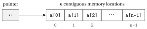

# Introduction to C++

<div class="info-capitolo" markdown>

**Part 2 · Programming languages · Chapter 6** · [:material-file-pdf-box: Lecture notes, volume 2 (PDF)](../pdf/lecture-notes-2-programming-languages.pdf) · [:material-pencil: Exercises](../exercises/ex-06-introduction-to-cpp.md)

</div>

## Introduction

In the chapter «Pseudo-code» algorithms are written in a language meant for humans: it is precise, but it is not executed by a computer. To run an algorithm we have to translate it into a <strong>programming language</strong>. In this chapter we introduce the programming language <code>C++</code>, which we use to implement the algorithms of the course.

The chapter follows the same path as the chapter «Pseudo-code»:

- the main characteristics of the language and the structure of a program;

- variables, data types and the input-output stream;

- operators, conditional statements and loops;

- arrays, whose size can be fixed or decided during the execution;

- functions, with the <code>main</code> function as the entry point of every program;

- a complete algorithm, the search of the maximum value in an array, written in pseudo-code and in <code>C++</code>;

- the bitwise operators, which act directly on the binary representation of integer numbers.

Every fragment of code of the chapter has been compiled with the <code>g++</code> compiler (standard <code>C++17</code>) and executed: the outputs reported in the examples are the ones printed by the programs.

!!! chiave ""

    In pseudo-code the entries of an array $a[1..n]$ are indexed from $1$ to $n$; in <code>C++</code> the entries of an array of size $n$ are indexed from $0$ to $n-1$. The entry $a[i]$ of the pseudo-code corresponds to the entry <code>a[i-1]</code> of the <code>C++</code> code.

## 6.1 Main characteristics of the programming language

The main characteristics of <code>C++</code> are the following.

- <code>C++</code> is an <strong>imperative</strong> language that gives direct access to the memory and to the hardware resources of the computer. It is highly efficient for low-level system programming while also supporting high-level abstractions, making it versatile for both performance-critical applications and modern software development.

- <code>C++</code> supports <strong>functions</strong>, which enable a structured and modular approach to programming. Functions allow code reuse and better organization.

- The <code>C++</code> programming language includes a predefined set of <strong>reserved symbols</strong> used to declare variables, define functions and specify executable instructions. The <strong>source code</strong> consists of a sequence of <strong>atomic operations</strong> executed in order, one after the other, operating on variables of specific <strong>data types</strong>.

- The source code in <code>C++</code> can contain <strong>comments</strong>, which serve as documentation for the code and are ignored by the compiler. In <code>C++</code>, a single-line comment starts with the reserved symbol “<code>//</code>”. Multi-line comments are enclosed between the reserved symbols “<code>/\*</code>” and “<code>\*/</code>”.

<a id="box-1-cpp-excomments"></a>

!!! esempio "Example 6.1: comments in <code>C++</code>"

    This is an example of a single-line comment:

    ```cpp
    // This is a comment line
    ```

    This is an example of a multi-line comment:

    ```cpp
    /* This is a
       multi-line comment */
    ```

### 6.1.1 The structure of a program

Before describing the single instructions, we look at the skeleton that every program shares. A <code>C++</code> program is a text file (with extension <code>.cpp</code>) that is translated by a <strong>compiler</strong> into an executable file. The execution of the program starts from the <code>main</code> function, the entry point of every program.

<a id="box-2-cpp-exskeleton"></a>

!!! esempio "Example 6.2: the skeleton of a program"

    ```cpp
    #include <iostream>

    using namespace std;

    int main()
    {
        // The instructions of the program are written here
        cout << "Hello, world!" << endl;

        return 0;
    }
    ```

    If the source code is saved in the file <code>hello.cpp</code>, it is compiled and executed with the commands

    ```bash
    g++ -Wall -std=c++17 -o hello hello.cpp
    ./hello
    ```

    and the output is

    ```text
    Hello, world!
    ```

In the following examples we write only the instructions that matter: unless they contain a complete program, the fragments of code are meant to be placed inside the curly braces of <code>main</code>.

!!! chiave ""

    Each instruction of a <code>C++</code> source code must end with the reserved symbol “<code>;</code>”.

## 6.2 Variables and data types

The source code operates on <strong>variables</strong>, and every variable has a <strong>data type</strong>.

- Information is categorized into different <strong>data types</strong>. The four fundamental families of data types are:

    1. The data type “<code>int</code>” represents an integer, which is a whole number written without a decimal point. This includes positive and negative whole numbers, as well as zero.

    2. The data type “<code>bool</code>” represents a Boolean value: <code>true</code> or <code>false</code>.

    3. The data type “<code>float</code>” represents a floating-point number, which includes numbers written with a decimal point. The data type “<code>double</code>” represents a floating-point number with double precision, providing greater accuracy and range than <code>float</code>.

    4. The data type “<code>char</code>” represents a single character, such as a letter, digit, or symbol, enclosed in single quotes (e.g., <code>'A'</code>, <code>'7'</code>, <code>'!'</code>).

- A sequence of characters enclosed in double quotes (e.g., <code>"Ada"</code>) is stored in a variable of type “<code>string</code>”, provided by the standard library <code>&lt;string&gt;</code>.

- A variable acts as a container that stores a value of a specific data type for later use. Each variable has a unique name and holds a single value at any given time.

- Variables are assigned values using the assignment operator “<code>=</code>”. When a new value is assigned, the previous value is overwritten.

!!! chiave ""

    Variables must be declared before use, specifying their data type.

<a id="box-3-cpp-exvariables"></a>

!!! esempio "Example 6.3: variable declarations and value assignments"

    ```cpp
    int age = 25; // Integer variable
    bool isRaining = false; // Boolean variable
    float smallNumber = 3.14; // Floating-point variable
    double largeNumber = 123456.789; // Double precision floating-point variable
    char character = 'a'; // Char variable
    string name = "Ada"; // String variable

    age = 26; // The previous value 25 is overwritten
    cout << age << " " << isRaining << " " << smallNumber << " "
         << largeNumber << " " << character << " " << name << endl;
    ```

    <strong>Output:</strong>

    ```text
    26 0 3.14 123457 a Ada
    ```

    The Boolean value <code>false</code> is displayed as <code>0</code>, and the number <code>123456.789</code> is displayed as <code>123457</code>: by default, <code>cout</code> displays at most six significant digits (the value stored in the variable does not change, and the number of displayed digits can be chosen, as we see now).

## 6.3 Input-output stream

To display the values of the variables on the screen, a program uses the <strong>input-output stream</strong> library.

- The include “<code>#include &lt;iostream&gt;</code>” allows to use the input-output stream library in <code>C++</code>.

<a id="box-4-cpp-exinclude"></a>

!!! esempio "Example 6.4: include"

    ```cpp
    #include <iostream>
    ```

- The values of variables can be displayed as output text on the screen using the output stream “<code>std::cout</code>”. The insertion operator “<code>&lt; &lt;</code>” is used to send data to the output stream.

- Multiple values can be displayed in a single <code>cout</code> statement by chaining them with the “<code>&lt; &lt;</code>” operator. Text should be enclosed in double quotes “<code>"</code>”, while variable values are written directly.

- The manipulator “<code>std::endl</code>” is used with <code>std::cout</code> to insert a new line on the screen and flush the output buffer.

<a id="box-5-cpp-excout"></a>

!!! esempio "Example 6.5: screen printings"

    ```cpp
    int n = 7;
    std::cout << "The value of the variable is " << n << std::endl;
    ```

    <strong>Output:</strong>

    ```text
    The value of the variable is 7
    ```

- The statement “<code>using namespace std;</code>” simplifies the use of standard library functions by eliminating the need to prefix them with <code>std::</code>. From now on we always use it, and we write <code>cout</code> and <code>endl</code>.

- The include “<code>#include &lt;iomanip&gt;</code>” gives the manipulators “<code>fixed</code>” and “<code>setprecision(k)</code>”. When they are written together in a <code>cout</code> statement, they display the floating-point numbers that follow with exactly $k$ digits after the decimal point.

## 6.4 Operators

Operators are symbols that perform operations on variables and values. They are classified, according to their functionality, into five main categories: arithmetic, assignment, increment and decrement, relational and logical operators.

### 6.4.1 Arithmetic operators

!!! chiave ""

    <strong>Arithmetic operators</strong>, used to perform basic mathematical operations:

    - <code>+</code> (Addition) $\rightsquigarrow$ Adds two values.

    - <code>-</code> (Subtraction) $\rightsquigarrow$ Subtracts one value from another.

    - <code>\*</code> (Multiplication) $\rightsquigarrow$ Multiplies two values.

    - <code>/</code> (Division) $\rightsquigarrow$ Divides one value by another.

    - <code>%</code> (Modulus) $\rightsquigarrow$ Returns the remainder of a division.

<a id="box-6-cpp-exarith"></a>

!!! esempio "Example 6.6: arithmetic operators"

    ```cpp
    int a = 10, b = 3;

    cout << "Addition: " << (a + b) << endl;
    cout << "Subtraction: " << (a - b) << endl;
    cout << "Multiplication: " << (a * b) << endl;
    cout << "Division: " << (a / b) << endl; // Integer division
    cout << "Modulus: " << (a % b) << endl; // Remainder of division
    ```

    <strong>Output:</strong>

    ```text
    Addition: 13
    Subtraction: 7
    Multiplication: 30
    Division: 3
    Modulus: 1
    ```

- The division operator <code>/</code> performs integer division when used with integers: the result <code>10 / 3</code> is <code>3</code>. To obtain a floating-point result, at least one operand must be of data type <code>float</code> or <code>double</code>. For example, <code>10.0 / 3</code> returns <code>3.33333</code> instead of <code>3</code>.

- A value of type <code>int</code> is converted into a value of type <code>double</code> by writing “<code>(double)</code>” before it (<strong>type conversion</strong>). For example, if <code>a</code> and <code>b</code> are variables of type <code>int</code>, the expression <code>(double)a / b</code> performs the floating-point division.

<a id="box-7-cpp-exdivision"></a>

!!! esempio "Example 6.7: integer and floating-point division"

    ```cpp
    int a = 10, b = 3;

    cout << a / b << endl;          // Integer division: 3
    cout << 10.0 / 3 << endl;       // Floating-point division
    cout << (double)a / b << endl;  // Conversion of a to double
    cout << fixed << setprecision(2) << (double)a / b << endl; // Two decimals
    ```

    <strong>Output</strong> (the last line requires <code>#include &lt;iomanip&gt;</code>):

    ```text
    3
    3.33333
    3.33333
    3.33
    ```

### 6.4.2 Assignment operators

!!! chiave ""

    <strong>Assignment operators</strong>, used to assign values to variables:

    - <code>=</code> (Assignment) $\rightsquigarrow$ Assigns a value to a variable.

    - <code>+=</code> (Addition assignment) $\rightsquigarrow$ Adds a value to a variable and assigns the result.

    - <code>-=</code> (Subtraction assignment) $\rightsquigarrow$ Subtracts a value from a variable and assigns the result.

    - <code>\*=</code> (Multiplication assignment) $\rightsquigarrow$ Multiplies a variable by a value and assigns the result.

    - <code>/=</code> (Division assignment) $\rightsquigarrow$ Divides a variable by a value and assigns the result.

    - <code>%=</code> (Modulus assignment) $\rightsquigarrow$ Applies the modulus operation and assigns the result.

<a id="box-8-cpp-exassign"></a>

!!! esempio "Example 6.8: assignment operators"

    ```cpp
    int x = 10;  // Assignment
    cout << "Initial value: " << x << endl;

    x += 5;  // Equivalent to: x = x + 5
    cout << "After += 5: " << x << endl;

    x -= 3;  // Equivalent to: x = x - 3
    cout << "After -= 3: " << x << endl;

    x *= 2;  // Equivalent to: x = x * 2
    cout << "After *= 2: " << x << endl;

    x /= 4;  // Equivalent to: x = x / 4
    cout << "After /= 4: " << x << endl;

    x %= 3;  // Equivalent to: x = x % 3
    cout << "After %= 3: " << x << endl;
    ```

    <strong>Output:</strong>

    ```text
    Initial value: 10
    After += 5: 15
    After -= 3: 12
    After *= 2: 24
    After /= 4: 6
    After %= 3: 0
    ```

### 6.4.3 Increment and decrement operators

!!! chiave ""

    <strong>Increment and decrement operators</strong>:

    - <code>++</code> (Increment) $\rightsquigarrow$ Increases the value of a variable by 1.

    - <code>- -</code> (Decrement) $\rightsquigarrow$ Decreases the value of a variable by 1.

- The increment operator <code>++</code> can be used in two forms:

    - pre-increment (“<code>++x</code>”): increments the value before returning it;

    - post-increment (“<code>x++</code>”): returns the value first, then increments it.

    The same logic applies to the decrement operator (<code>- -x</code> and <code>x- -</code>).

<a id="box-9-cpp-exincdec"></a>

!!! esempio "Example 6.9: increment and decrement operators"

    ```cpp
    int x = 5;

    cout << "Initial value: " << x << endl; // Displays 5

    cout << "Pre-increment (++x): " << ++x << endl; // Displays 6

    cout << "Post-increment (x++): " << x++ << endl; // Displays 6
    cout << "Value after post-increment: " << x << endl; // Displays 7

    cout << "Pre-decrement (--x): " << --x << endl; // Displays 6

    cout << "Post-decrement (x--): " << x-- << endl; // Displays 6
    cout << "Value after post-decrement: " << x << endl; // Displays 5
    ```

    <strong>Output:</strong>

    ```text
    Initial value: 5
    Pre-increment (++x): 6
    Post-increment (x++): 6
    Value after post-increment: 7
    Pre-decrement (--x): 6
    Post-decrement (x--): 6
    Value after post-decrement: 5
    ```

### 6.4.4 Relational operators

!!! chiave ""

    <strong>Relational operators</strong>, used to compare values and return a Boolean result:

    - <code>==</code> (Equal to) $\rightsquigarrow$ Checks if two values are equal.

    - <code>!=</code> (Not equal to) $\rightsquigarrow$ Checks if two values are different.

    - <code>&lt;</code> (Less than) $\rightsquigarrow$ Checks if one value is smaller than another.

    - <code>&gt;</code> (Greater than) $\rightsquigarrow$ Checks if one value is larger than another.

    - <code>&lt;=</code> (Less than or equal to) $\rightsquigarrow$ Checks if one value is smaller than or equal to another.

    - <code>&gt;=</code> (Greater than or equal to) $\rightsquigarrow$ Checks if one value is larger than or equal to another.

- Relational operators return a Boolean result:

    - <code>true</code> (displayed as <code>1</code>) if the condition is satisfied;

    - <code>false</code> (displayed as <code>0</code>) if the condition is not satisfied.

    These operators are commonly used in <strong>conditional statements</strong> and <strong>loops</strong>.

<a id="box-10-cpp-exrel"></a>

!!! esempio "Example 6.10: relational operators"

    ```cpp
    int a = 10, b = 5;

    cout << "a == b: " << (a == b) << endl;  // Equal to
    cout << "a != b: " << (a != b) << endl;  // Not equal to
    cout << "a < b: " << (a < b) << endl;    // Less than
    cout << "a > b: " << (a > b) << endl;    // Greater than
    cout << "a <= b: " << (a <= b) << endl;  // Less than or equal to
    cout << "a >= b: " << (a >= b) << endl;  // Greater than or equal to
    ```

    <strong>Output:</strong>

    ```text
    a == b: 0
    a != b: 1
    a < b: 0
    a > b: 1
    a <= b: 0
    a >= b: 1
    ```

### 6.4.5 Logical operators

!!! chiave ""

    <strong>Logical operators</strong>, used for logical operations, often in conditional statements:

    - <code>&amp;&amp;</code> (Logical AND) $\rightsquigarrow$ Returns <code>true</code> if both conditions are true.

    - <code>||</code> (Logical OR) $\rightsquigarrow$ Returns <code>true</code> if at least one condition is true.

    - <code>!</code> (Logical NOT) $\rightsquigarrow$ Reverses the Boolean value.

- Like the relational operators, logical operators return Boolean values, <code>true</code> (<code>1</code>) or <code>false</code> (<code>0</code>), and are commonly used in <strong>conditional statements</strong> and <strong>loops</strong>.

<a id="box-11-cpp-exlogic"></a>

!!! esempio "Example 6.11: logical operators"

    ```cpp
    bool condition1 = true;
    bool condition2 = false;

    cout << "condition1: " << condition1 << endl;
    cout << "condition2: " << condition2 << endl;

    // Logical AND: true only if both conditions are true
    cout << "condition1 && condition2: " << (condition1 && condition2) << endl;

    // Logical OR: true if at least one condition is true
    cout << "condition1 || condition2: " << (condition1 || condition2) << endl;

    // Logical NOT: reverses the Boolean value
    cout << "!condition1: " << !condition1 << endl;
    cout << "!condition2: " << !condition2 << endl;
    ```

    <strong>Output:</strong>

    ```text
    condition1: 1
    condition2: 0
    condition1 && condition2: 0
    condition1 || condition2: 1
    !condition1: 0
    !condition2: 1
    ```

## 6.5 Conditional statements

The relational and logical operators produce the conditions that decide which instructions are executed.

- Conditional statements allow to execute different blocks of code based on specific conditions. The <code>if</code> statement is the most fundamental control structure of this type.

- The <code>if</code> statement evaluates a condition inside parentheses <code>()</code>. If the condition is <strong>true</strong>, the block of code inside the curly braces <code>{}</code> is executed. If the condition is <strong>false</strong>, the program skips the block and executes the block of code inside the curly braces <code>{}</code> of the <code>else</code> part, if present.

<a id="box-12-cpp-exif"></a>

!!! esempio "Example 6.12: conditional statement"

    ```cpp
    int number = 10;

    // Check if number is positive
    if (number > 0)
    {
        cout << "The number is positive." << endl;
    }
    else
    {
        cout << "The number is non-positive." << endl;
    }
    ```

    <strong>Output:</strong>

    ```text
    The number is positive.
    ```

### 6.5.1 Ternary operator (conditional operator)

- The <strong>ternary operator</strong> <code>?:</code> provides a compact way to write simple <code>if-else</code> statements.

- It is the only operator in <code>C++</code> that takes three operands.

- Syntax: <code>condition ? value\_if\_true : value\_if\_false</code>

- If the condition is <strong>true</strong>, the expression evaluates to <code>value\_if\_true</code>; otherwise, it evaluates to <code>value\_if\_false</code>.

<a id="box-13-cpp-extern"></a>

!!! esempio "Example 6.13: ternary operator"

    ```cpp
    int number = 10;

    // Using if-else statement
    string result1;
    if (number > 0)
        result1 = "positive";
    else
        result1 = "non-positive";

    cout << "The number is " << result1 << endl;

    // Using ternary operator (compact form)
    string result2 = (number > 0) ? "positive" : "non-positive";

    cout << "The number is " << result2 << endl;
    ```

    <strong>Output:</strong>

    ```text
    The number is positive
    The number is positive
    ```

<a id="box-14-cpp-exmaxtwo"></a>

!!! esempio "Example 6.14: finding the maximum of two numbers"

    ```cpp
    int a = 15, b = 20;

    // Using if-else statement
    int max1;
    if (a > b)
        max1 = a;
    else
        max1 = b;

    cout << "Maximum (if-else): " << max1 << endl;

    // Using ternary operator (compact form)
    int max2 = (a > b) ? a : b;

    cout << "Maximum (ternary): " << max2 << endl;
    ```

    <strong>Output:</strong>

    ```text
    Maximum (if-else): 20
    Maximum (ternary): 20
    ```

<a id="box-15-cpp-exparity"></a>

!!! esempio "Example 6.15: checking even or odd"

    ```cpp
    int n = 7;

    // Using ternary operator
    string parity = (n % 2 == 0) ? "even" : "odd";

    cout << n << " is " << parity << endl;
    ```

    <strong>Output:</strong>

    ```text
    7 is odd
    ```

<a id="box-16-cpp-exabs"></a>

!!! esempio "Example 6.16: assigning the absolute value"

    ```cpp
    int x = -5;

    // Using ternary operator to compute absolute value
    int absValue = (x >= 0) ? x : -x;

    cout << "Absolute value of " << x << " is " << absValue << endl;
    ```

    <strong>Output:</strong>

    ```text
    Absolute value of -5 is 5
    ```

<a id="box-17-cpp-exnested"></a>

!!! esempio "Example 6.17: nested ternary operators"

    ```cpp
    int score = 85;

    // Nested ternary operators to assign a grade
    string grade = (score >= 90) ? "A" :
                   (score >= 80) ? "B" :
                   (score >= 70) ? "C" :
                   (score >= 60) ? "D" : "F";

    cout << "Score: " << score << ", Grade: " << grade << endl;
    ```

    <strong>Output:</strong>

    ```text
    Score: 85, Grade: B
    ```

    The conditions are evaluated from top to bottom: <code>score &gt;= 90</code> is false and <code>score &gt;= 80</code> is true, so the grade is <code>"B"</code>. For readability, complex conditions are better handled with <code>if-else</code> statements.

## 6.6 Loops

Conditional statements choose <em>whether</em> a block of code is executed; loops decide <em>how many times</em> it is executed.

- Loops are used to execute a block of code repeatedly while a condition is met. They are essential for automating repetitive tasks and reducing redundant code. In <code>C++</code>, the most commonly used loops are the <code>while</code> loop and the <code>for</code> loop.

### 6.6.1 The <code>while</code> loop

- The <code>while</code> loop executes a block of code as long as the condition inside the parentheses <code>()</code> evaluates to <strong>true</strong>. When the condition is false, the loop terminates.

<a id="box-18-cpp-exwhile"></a>

!!! esempio "Example 6.18: <code>while</code> loop"

    ```cpp
    int i = 1; // Initialization

    while (i <= 5) // Condition
    {
        cout << "Number: " << i << endl;
        i++; // Increment
    }
    ```

    <strong>Output:</strong>

    ```text
    Number: 1
    Number: 2
    Number: 3
    Number: 4
    Number: 5
    ```

    The condition <code>i &lt;= 5</code> is evaluated six times: five times it is true, and the sixth time (<code>i</code> equal to <code>6</code>) it is false and the loop terminates.

### 6.6.2 The <code>for</code> loop

- The <code>for</code> loop is a compact loop structure that combines initialization, condition, and increment (or decrement) in one statement.

<a id="box-19-cpp-exfor"></a>

!!! esempio "Example 6.19: <code>for</code> loop"

    ```cpp
    for (int i = 1; i <= 5; i++) // Initialization, condition, increment
    {
        cout << "Number: " << i << endl;
    }
    ```

    The output is the same as in the <code>while</code> loop of [Example 6.18](#box-18-cpp-exwhile).

### 6.6.3 The <code>break</code> and <code>continue</code> statements

- The <code>break</code> statement immediately terminates the loop.

- The <code>continue</code> statement skips the rest of the current iteration and moves to the next one.

<a id="box-20-cpp-exbreak"></a>

!!! esempio "Example 6.20: <code>break</code> and <code>continue</code>"

    ```cpp
    for (int i = 1; i <= 10; i++)
    {
        if (i % 2 == 0)
        {
            continue; // Skip the even numbers
        }
        if (i > 7)
        {
            break; // Stop the loop at the first odd number greater than 7
        }
        cout << i << " ";
    }
    cout << endl;
    ```

    <strong>Output:</strong>

    ```text
    1 3 5 7
    ```

    The even values of <code>i</code> are skipped by <code>continue</code>; when <code>i</code> is equal to <code>9</code> the <code>break</code> statement terminates the loop, and the value <code>10</code> is never reached.

## 6.7 Arrays

Loops become really useful when they visit collections of values. A collection of variables of the same data type is stored in an <strong>array</strong>.

### 6.7.1 Fixed-size arrays

- An array whose values are known when the program is written can be declared by listing its values inside curly braces. The size of the array is the number of listed values, and it cannot change during the execution.

- Each element of an array is accessed using its <strong>index</strong>, starting from zero, inside square brackets “<code>[]</code>”: the elements of an array of size $n$ are <code>b[0]</code>, <code>b[1]</code>, …, <code>b[n-1]</code>.

<a id="box-21-cpp-exstatic"></a>

!!! esempio "Example 6.21: fixed-size arrays"

    ```cpp
    int b[] = {9, 12, 3, 16}; // Array of 4 integers
    int n = 4;

    b[2] = 5; // Assign a new value to the third element

    for (int i = 0; i < n; i++)
    {
        cout << b[i] << " ";
    }
    cout << endl;
    ```

    <strong>Output:</strong>

    ```text
    9 12 5 16
    ```

- A two-dimensional fixed-size array is declared with two sizes, the number of rows and the number of columns, and its values are listed row by row: <code>int c[2][3] = {{3, 1, 4}, {1, 5, 9}};</code> declares an array with $2$ rows and $3$ columns, and <code>c[1][2]</code> is the element in the second row and third column, equal to $9$.

### 6.7.2 Dynamic-size arrays

- A <strong>dynamic-size array</strong> is a collection of variables of the same data type, stored in contiguous memory locations. The size of the array is determined during the execution of the algorithm.

- The reserved symbol “<code>\*</code>” is used to declare a <strong>pointer</strong>, which stores the memory address of the first element of a dynamic-size array. The <code>new</code> operator is used to allocate the memory of a dynamic-size array, and it must specify the data type of the elements along with the size of the array inside square brackets “<code>[]</code>”.

- Each element of a dynamic-size array is accessed using its index, starting from zero, inside square brackets “<code>[]</code>”. A dynamic-size array requires memory deallocation using the <code>delete[]</code> operator to free memory and prevent memory leaks.

<a id="box-22-cpp-figarray"></a>

{ .fig loading=lazy  }

<p class="didascalia"><strong>Figure 6.1:</strong> A dynamic-size array of size <span class="arithmatex">&#92;(n&#92;)</span>: the pointer <code>a</code> stores the address of the first element, and the elements are indexed from <span class="arithmatex">&#92;(0&#92;)</span> to <span class="arithmatex">&#92;(n-1&#92;)</span>.</p>

<a id="box-23-cpp-exdynamic"></a>

!!! esempio "Example 6.22: dynamic-size arrays"

    ```cpp
    int n = 5; // Size of the array

    int* a = new int[n]; // Memory allocation of an array of size n

    for (int i = 0; i < n; i++)
    {
        a[i] = i * 2; // Example of value assignment
    }

    for (int i = 0; i < n; i++)
    {
        cout << a[i] << " ";
    }
    cout << endl;

    delete[] a;  // Free allocated memory
    ```

    <strong>Output:</strong>

    ```text
    0 2 4 6 8
    ```

- Dynamic-size arrays can be multidimensional. For example, the reserved symbol “<code>\*\*</code>” is used to declare a pointer to a pointer, which stores the memory address of the first element of a dynamic-size two-dimensional array: an array of $m$ pointers, each pointing to a row of $n$ elements.

- The <code>new</code> operator is also used to allocate the memory of dynamic-size two-dimensional arrays: first the array of the $m$ row pointers, then each row. Each element of a dynamic-size two-dimensional array is accessed using two indices, both starting from zero, inside square brackets “<code>[][]</code>”. The memory is freed in the reverse order: first each row, then the array of row pointers.

<a id="box-24-cpp-exdynamic2"></a>

!!! esempio "Example 6.23: dynamic-size two-dimensional arrays"

    ```cpp
    int m = 3; // Number of rows
    int n = 4; // Number of columns

    int** matrix = new int*[m]; // Memory allocation of a matrix of size m times n
    for (int i = 0; i < m; i++)
    {
        matrix[i] = new int[n]; // Allocate each row
    }

    for (int i = 0; i < m; i++)
    {
        for (int j = 0; j < n; j++)
        {
            matrix[i][j] = i * j; // Example of value assignment
            cout << matrix[i][j] << " ";
        }
        cout << endl;
    }

    for (int i = 0; i < m; i++) // Free allocated memory
    {
        delete[] matrix[i]; // Free each row
    }
    delete[] matrix; // Free row pointers
    ```

    <strong>Output:</strong>

    ```text
    0 0 0 0
    0 1 2 3
    0 2 4 6
    ```

## 6.8 The <code>main</code> and custom functions

As in pseudo-code, an algorithm is written as a function that receives the input and returns the output.

- Functions allow programmers to write modular and reusable code by grouping instructions into a single unit. A function can be called multiple times to execute the same task, reducing redundancy and improving code organization.

- Functions typically return a value and accept multiple parameters as input. When calling a function, the arguments are passed to the parameters.

- A function in <code>C++</code> consists of:

    1. a <strong>return type</strong>: specifies the type of the value returned by the function (<code>void</code> if nothing is returned);

    2. a <strong>function name</strong>: the unique identifier of the function;

    3. a <strong>parameter list</strong> (optional): specifies the input values of the function;

    4. a <strong>body</strong>: contains the block of code executed when the function is called;

    5. a <strong>return statement</strong> (optional): used to return a value if the function returns a value.

- The <code>main</code> function serves as the entry point of a <code>C++</code> program. It is executed first when the program starts running. Every <code>C++</code> program must contain exactly one <code>main</code> function. Its return value <code>0</code> tells the operating system that the program terminated correctly.

- A function must be defined (or declared) before the point where it is called: for this reason the custom functions are written before <code>main</code>.

- <code>C++</code> source code can also be compiled and executed online, for example at the following address: [www.mycompiler.io/it/online-c++-compiler](https://www.mycompiler.io/it/online-c++-compiler)

<a id="box-25-cpp-exfunctions"></a>

!!! esempio "Example 6.24: functions"

    ```cpp
    #include <iostream>

    using namespace std;

    // Function definition
    int addition(int a, int b)
    {
        return a + b; // Returns the sum
    }

    // Function definition
    int multiplication(int a, int b)
    {
        return a * b; // Returns the product
    }

    int main()
    {
        int sum = addition(5, 10); // Function call
        cout << "Sum: " << sum << endl;
        int prod = multiplication(5, 10); // Function call
        cout << "Prod: " << prod << endl;

        return 0;
    }
    ```

    <strong>Output:</strong>

    ```text
    Sum: 15
    Prod: 50
    ```

### 6.8.1 Parameters passed by value and by reference

A function returns at most one value. When a function has to produce more than one result, or has to modify a variable of the caller, its parameters are passed by reference.

- By default, a parameter is passed <strong>by value</strong>: the function receives a copy of the argument, and the changes made to the copy do not affect the variable of the caller.

- A parameter is passed <strong>by reference</strong> by writing the reserved symbol “<code>&amp;</code>” after its data type (for example <code>int&amp; x</code>): the parameter is another name for the variable of the caller, and every change made by the function is visible to the caller.

- An array is passed to a function through the pointer to its first element (for example <code>int \*a</code>), together with its size: the function works directly on the elements of the array of the caller.

<a id="box-26-cpp-exreference"></a>

!!! esempio "Example 6.25: parameters passed by value and by reference"

    ```cpp
    #include <iostream>

    using namespace std;

    void incrementByValue(int x)
    {
        x = x + 1; // Modifies only the local copy
    }

    void incrementByReference(int& x)
    {
        x = x + 1; // Modifies the variable of the caller
    }

    void fillWithZeros(int n, int* a)
    {
        for (int i = 0; i < n; i++)
        {
            a[i] = 0; // Modifies the array of the caller
        }
    }

    int main()
    {
        int k = 5;
        incrementByValue(k);
        cout << "After incrementByValue: " << k << endl;
        incrementByReference(k);
        cout << "After incrementByReference: " << k << endl;

        int b[] = {4, 7, 1};
        fillWithZeros(3, b);
        cout << "Array: " << b[0] << " " << b[1] << " " << b[2] << endl;

        return 0;
    }
    ```

    <strong>Output:</strong>

    ```text
    After incrementByValue: 5
    After incrementByReference: 6
    Array: 0 0 0
    ```

## 6.9 A complete algorithm: the maximum value in an array

We now put all the pieces together: a function, a loop, a conditional statement and a dynamic-size array.

!!! chiave ""

    We consider the problem of finding the maximum value in an array $a$ of $n \ge 1$ integer numbers.

- This is the pseudo-code of the algorithm <code>FindMaximum</code> of the chapter «Pseudo-code»: the entries are indexed from $1$ to $n$.

!!! algoritmo "Algorithm: FindMaximum"

    <div class="pseudocodice" markdown="0">
    <div class="pc-io"><span class="pc-kw">Input:</span> <span>An array <span class="arithmatex">&#92;(a&#91;1..n&#93;&#92;)</span> of <span class="arithmatex">&#92;(n &#92;ge 1&#92;)</span> integer numbers</span></div>
    <div class="pc-io"><span class="pc-kw">Output:</span> <span>The maximum value in the array <span class="arithmatex">&#92;(a&#92;)</span></span></div>
    <div class="pc-sep"></div>
    <div class="pc-riga pc-vuota"><span class="pc-n"></span><span class="pc-corpo"></span></div>
    <div class="pc-riga"><span class="pc-n">1</span><span class="pc-corpo"><span class="pc-t"><strong>function</strong> FindMaximum(a, n)</span></span></div>
    <div class="pc-riga"><span class="pc-n">2</span><span class="pc-corpo"><span class="pc-l"></span><span class="pc-t"><span class="arithmatex">&#92;(max := a&#91;1&#93;&#92;)</span></span></span></div>
    <div class="pc-riga"><span class="pc-n">3</span><span class="pc-corpo"><span class="pc-l"></span><span class="pc-t"><strong>for</strong> <span class="arithmatex">&#92;(i := 2&#92;)</span> <strong>to</strong>  <span class="arithmatex">&#92;(n&#92;)</span> <strong>do</strong></span></span></div>
    <div class="pc-riga"><span class="pc-n">4</span><span class="pc-corpo"><span class="pc-l"></span><span class="pc-l"></span><span class="pc-t"><strong>if</strong> <span class="arithmatex">&#92;(a&#91;i&#93; &gt; max&#92;)</span> <strong>then</strong></span></span></div>
    <div class="pc-riga"><span class="pc-n">5</span><span class="pc-corpo"><span class="pc-l"></span><span class="pc-l"></span><span class="pc-l"></span><span class="pc-t"><span class="arithmatex">&#92;(max &#92;leftarrow a&#91;i&#93;&#92;)</span></span></span></div>
    <div class="pc-riga"><span class="pc-n">6</span><span class="pc-corpo"><span class="pc-l"></span><span class="pc-l"></span><span class="pc-t"><strong>end</strong></span></span></div>
    <div class="pc-riga"><span class="pc-n">7</span><span class="pc-corpo"><span class="pc-l"></span><span class="pc-t"><strong>end</strong></span></span></div>
    <div class="pc-riga"><span class="pc-n">8</span><span class="pc-corpo"><span class="pc-l"></span><span class="pc-t"><strong>return</strong> <span class="arithmatex">&#92;(max&#92;)</span></span></span></div>
    <div class="pc-riga"><span class="pc-n">9</span><span class="pc-corpo"><span class="pc-t"><strong>end</strong></span></span></div>
    </div>

- This is the <code>C++</code> implementation: the entries are indexed from $0$ to $n-1$, so the initialization uses <code>a[0]</code> and the loop starts from <code>i = 1</code>. The function assumes $n \ge 1$, as the pseudo-code does: for $n = 0$ the element <code>a[0]</code> does not exist.

    ```cpp
    #include <iostream>

    using namespace std;

    // Function to find the maximum value in an array
    int ArrayMaxValue(int n, int *a)
    {
        int max = a[0]; // Initialize with the first element

        for (int i = 1; i < n; i++)
        {
            if (a[i] > max)
            {
                max = a[i]; // Update the maximum
            }
        }

        return max;
    }

    int main()
    {
        int n = 7; // Size of the array

        int* a = new int[n]; // Memory allocation of an array of size n

        int values[] = {9, 12, 3, 16, 19, 11, 12};
        for (int i = 0; i < n; i++)
        {
            a[i] = values[i];
        }

        int max = ArrayMaxValue(n, a);
        cout << "Maximum value: " << max << endl;

        delete[] a; // Free allocated memory

        return 0;
    }
    ```

    <strong>Output:</strong>

    ```text
    Maximum value: 19
    ```

<a id="box-27-cpp-extrace"></a>

!!! esempio "Example 6.26: step-by-step execution"

    In each table, the column $i$ is the index of the <code>C++</code> loop and the column $i+1$ is the corresponding index of the pseudo-code. The first row is the initialization <code>max = a[0]</code>.

    <strong>Instance 1:</strong> $a = [9, 12, 3, 16, 19, 11, 12]$, $n=7$

    <div class="tabella" markdown="0"><table>
    <tr>
    <th><span class="arithmatex">&#92;(i&#92;)</span> (<code>C++</code>)</th>
    <th><span class="arithmatex">&#92;(i+1&#92;)</span> (pseudo-code)</th>
    <th><code>a[i]</code></th>
    <th><code>a[i] &gt; max</code>?</th>
    <th><code>max</code></th>
    </tr>
    <tr>
    <td>–</td>
    <td>–</td>
    <td>–</td>
    <td>–</td>
    <td><span class="arithmatex">&#92;(9&#92;)</span></td>
    </tr>
    <tr>
    <td><span class="arithmatex">&#92;(1&#92;)</span></td>
    <td><span class="arithmatex">&#92;(2&#92;)</span></td>
    <td><span class="arithmatex">&#92;(12&#92;)</span></td>
    <td>Yes</td>
    <td><span class="arithmatex">&#92;(12&#92;)</span></td>
    </tr>
    <tr>
    <td><span class="arithmatex">&#92;(2&#92;)</span></td>
    <td><span class="arithmatex">&#92;(3&#92;)</span></td>
    <td><span class="arithmatex">&#92;(3&#92;)</span></td>
    <td>No</td>
    <td><span class="arithmatex">&#92;(12&#92;)</span></td>
    </tr>
    <tr>
    <td><span class="arithmatex">&#92;(3&#92;)</span></td>
    <td><span class="arithmatex">&#92;(4&#92;)</span></td>
    <td><span class="arithmatex">&#92;(16&#92;)</span></td>
    <td>Yes</td>
    <td><span class="arithmatex">&#92;(16&#92;)</span></td>
    </tr>
    <tr>
    <td><span class="arithmatex">&#92;(4&#92;)</span></td>
    <td><span class="arithmatex">&#92;(5&#92;)</span></td>
    <td><span class="arithmatex">&#92;(19&#92;)</span></td>
    <td>Yes</td>
    <td><span class="arithmatex">&#92;(19&#92;)</span></td>
    </tr>
    <tr>
    <td><span class="arithmatex">&#92;(5&#92;)</span></td>
    <td><span class="arithmatex">&#92;(6&#92;)</span></td>
    <td><span class="arithmatex">&#92;(11&#92;)</span></td>
    <td>No</td>
    <td><span class="arithmatex">&#92;(19&#92;)</span></td>
    </tr>
    <tr>
    <td><span class="arithmatex">&#92;(6&#92;)</span></td>
    <td><span class="arithmatex">&#92;(7&#92;)</span></td>
    <td><span class="arithmatex">&#92;(12&#92;)</span></td>
    <td>No</td>
    <td><span class="arithmatex">&#92;(19&#92;)</span></td>
    </tr>
    </table></div>

    <strong>Return:</strong> <code>max</code> $= 19$

    <strong>Instance 2:</strong> $a = [3, 7, 2, 9, 1]$, $n=5$

    <div class="tabella" markdown="0"><table>
    <tr>
    <th><span class="arithmatex">&#92;(i&#92;)</span> (<code>C++</code>)</th>
    <th><span class="arithmatex">&#92;(i+1&#92;)</span> (pseudo-code)</th>
    <th><code>a[i]</code></th>
    <th><code>a[i] &gt; max</code>?</th>
    <th><code>max</code></th>
    </tr>
    <tr>
    <td>–</td>
    <td>–</td>
    <td>–</td>
    <td>–</td>
    <td><span class="arithmatex">&#92;(3&#92;)</span></td>
    </tr>
    <tr>
    <td><span class="arithmatex">&#92;(1&#92;)</span></td>
    <td><span class="arithmatex">&#92;(2&#92;)</span></td>
    <td><span class="arithmatex">&#92;(7&#92;)</span></td>
    <td>Yes</td>
    <td><span class="arithmatex">&#92;(7&#92;)</span></td>
    </tr>
    <tr>
    <td><span class="arithmatex">&#92;(2&#92;)</span></td>
    <td><span class="arithmatex">&#92;(3&#92;)</span></td>
    <td><span class="arithmatex">&#92;(2&#92;)</span></td>
    <td>No</td>
    <td><span class="arithmatex">&#92;(7&#92;)</span></td>
    </tr>
    <tr>
    <td><span class="arithmatex">&#92;(3&#92;)</span></td>
    <td><span class="arithmatex">&#92;(4&#92;)</span></td>
    <td><span class="arithmatex">&#92;(9&#92;)</span></td>
    <td>Yes</td>
    <td><span class="arithmatex">&#92;(9&#92;)</span></td>
    </tr>
    <tr>
    <td><span class="arithmatex">&#92;(4&#92;)</span></td>
    <td><span class="arithmatex">&#92;(5&#92;)</span></td>
    <td><span class="arithmatex">&#92;(1&#92;)</span></td>
    <td>No</td>
    <td><span class="arithmatex">&#92;(9&#92;)</span></td>
    </tr>
    </table></div>

    <strong>Return:</strong> <code>max</code> $= 9$

## 6.10 Bitwise operators

The integer numbers handled by a program are stored in binary, as described in the chapter «Representation of numbers». <code>C++</code> provides operators that act directly on these binary digits.

- <strong>Bitwise operators</strong> perform operations on the individual bits of integer values. They are essential for low-level programming, optimization, and working with binary representations.

- The bits are numbered from the right, starting from position $0$ (the least significant bit).

!!! chiave ""

    <strong>Bitwise operators</strong> in <code>C++</code>:

    - <code>&amp;</code> (Bitwise AND) $\rightsquigarrow$ Returns 1 only if both corresponding bits are 1.

    - <code>|</code> (Bitwise OR) $\rightsquigarrow$ Returns 1 if at least one corresponding bit is 1.

    - <code></code> (Bitwise XOR) $\rightsquigarrow$ Returns 1 if the corresponding bits are different.

    - <code>~</code> (Bitwise NOT) $\rightsquigarrow$ Flips all bits (0 becomes 1, 1 becomes 0).

    - <code>&lt; &lt;</code> (Left shift) $\rightsquigarrow$ Shifts the bits to the left by a specified number of positions.

    - <code>&gt; &gt;</code> (Right shift) $\rightsquigarrow$ Shifts the bits to the right by a specified number of positions.

### 6.10.1 Bitwise AND (<code>&amp;</code>)

- The bitwise AND operator compares each bit of two numbers and returns 1 only if both bits are 1.

- Truth table for AND:

<div class="tabella" markdown="0"><table>
<tr>
<th>Bit A</th>
<th>Bit B</th>
<th>A &amp; B</th>
</tr>
<tr>
<td>0</td>
<td>0</td>
<td>0</td>
</tr>
<tr>
<td>0</td>
<td>1</td>
<td>0</td>
</tr>
<tr>
<td>1</td>
<td>0</td>
<td>0</td>
</tr>
<tr>
<td>1</td>
<td>1</td>
<td>1</td>
</tr>
</table></div>

<a id="box-28-cpp-exand"></a>

!!! esempio "Example 6.27: bitwise AND"

    ```cpp
    int a = 12;  // Binary: 1100
    int b = 10;  // Binary: 1010
    int result = a & b;  // Binary: 1000 (decimal: 8)

    cout << "a & b = " << result << endl;  // Output: 8
    ```

    Bit-by-bit operation:

    <div class="tabella" markdown="0"><table>
    <tr>
    <th></th>
    <th colspan="4"></th>
    <th>Decimal</th>
    </tr>
    <tr>
    <td><code>a</code></td>
    <td>1</td>
    <td>1</td>
    <td>0</td>
    <td>0</td>
    <td>12</td>
    </tr>
    <tr>
    <td><code>b</code></td>
    <td>1</td>
    <td>0</td>
    <td>1</td>
    <td>0</td>
    <td>10</td>
    </tr>
    <tr>
    <td><code>a &amp; b</code></td>
    <td>1</td>
    <td>0</td>
    <td>0</td>
    <td>0</td>
    <td>8</td>
    </tr>
    </table></div>

### 6.10.2 Bitwise OR (<code>|</code>)

- The bitwise OR operator compares each bit of two numbers and returns 1 if at least one bit is 1.

- Truth table for OR:

<div class="tabella" markdown="0"><table>
<tr>
<th>Bit A</th>
<th>Bit B</th>
<th>A | B</th>
</tr>
<tr>
<td>0</td>
<td>0</td>
<td>0</td>
</tr>
<tr>
<td>0</td>
<td>1</td>
<td>1</td>
</tr>
<tr>
<td>1</td>
<td>0</td>
<td>1</td>
</tr>
<tr>
<td>1</td>
<td>1</td>
<td>1</td>
</tr>
</table></div>

<a id="box-29-cpp-exor"></a>

!!! esempio "Example 6.28: bitwise OR"

    ```cpp
    int a = 12;  // Binary: 1100
    int b = 10;  // Binary: 1010
    int result = a | b;  // Binary: 1110 (decimal: 14)

    cout << "a | b = " << result << endl;  // Output: 14
    ```

    Bit-by-bit operation:

    <div class="tabella" markdown="0"><table>
    <tr>
    <th></th>
    <th colspan="4"></th>
    <th>Decimal</th>
    </tr>
    <tr>
    <td><code>a</code></td>
    <td>1</td>
    <td>1</td>
    <td>0</td>
    <td>0</td>
    <td>12</td>
    </tr>
    <tr>
    <td><code>b</code></td>
    <td>1</td>
    <td>0</td>
    <td>1</td>
    <td>0</td>
    <td>10</td>
    </tr>
    <tr>
    <td><code>a | b</code></td>
    <td>1</td>
    <td>1</td>
    <td>1</td>
    <td>0</td>
    <td>14</td>
    </tr>
    </table></div>

### 6.10.3 Bitwise XOR (<code></code>)

- The bitwise XOR (exclusive OR) operator compares each bit of two numbers and returns 1 if the bits are different.

- Truth table for XOR:

<div class="tabella" markdown="0"><table>
<tr>
<th>Bit A</th>
<th>Bit B</th>
<th>A  B</th>
</tr>
<tr>
<td>0</td>
<td>0</td>
<td>0</td>
</tr>
<tr>
<td>0</td>
<td>1</td>
<td>1</td>
</tr>
<tr>
<td>1</td>
<td>0</td>
<td>1</td>
</tr>
<tr>
<td>1</td>
<td>1</td>
<td>0</td>
</tr>
</table></div>

<a id="box-30-cpp-exxor"></a>

!!! esempio "Example 6.29: bitwise XOR"

    ```cpp
    int a = 12;  // Binary: 1100
    int b = 10;  // Binary: 1010
    int result = a ^ b;  // Binary: 0110 (decimal: 6)

    cout << "a ^ b = " << result << endl;  // Output: 6
    ```

    Bit-by-bit operation:

    <div class="tabella" markdown="0"><table>
    <tr>
    <th></th>
    <th colspan="4"></th>
    <th>Decimal</th>
    </tr>
    <tr>
    <td><code>a</code></td>
    <td>1</td>
    <td>1</td>
    <td>0</td>
    <td>0</td>
    <td>12</td>
    </tr>
    <tr>
    <td><code>b</code></td>
    <td>1</td>
    <td>0</td>
    <td>1</td>
    <td>0</td>
    <td>10</td>
    </tr>
    <tr>
    <td><code>a  b</code></td>
    <td>0</td>
    <td>1</td>
    <td>1</td>
    <td>0</td>
    <td>6</td>
    </tr>
    </table></div>

### 6.10.4 Bitwise NOT (<code>~</code>)

- The bitwise NOT operator flips all bits of a number (0 becomes 1, 1 becomes 0).

- This is a unary operator (it operates on a single operand).

- The result depends on the number of bits used to represent the integer. In the example we use the data type <code>unsigned char</code>, which stores the natural numbers from $0$ to $255$ with $8$ bits; the conversion <code>(int)</code> displays the result as a number instead of a character.

<a id="box-31-cpp-exnot"></a>

!!! esempio "Example 6.30: bitwise NOT"

    ```cpp
    unsigned char a = 12;  // Binary (8 bits): 00001100
    unsigned char result = ~a;  // Binary: 11110011 (decimal: 243)

    cout << "~a = " << (int)result << endl;  // Output: 243
    ```

    Bit-by-bit operation (using the 8-bit representation):

    <div class="tabella" markdown="0"><table>
    <tr>
    <th></th>
    <th colspan="8"></th>
    <th>Decimal</th>
    </tr>
    <tr>
    <td><code>a</code></td>
    <td>0</td>
    <td>0</td>
    <td>0</td>
    <td>0</td>
    <td>1</td>
    <td>1</td>
    <td>0</td>
    <td>0</td>
    <td>12</td>
    </tr>
    <tr>
    <td><code>~a</code></td>
    <td>1</td>
    <td>1</td>
    <td>1</td>
    <td>1</td>
    <td>0</td>
    <td>0</td>
    <td>1</td>
    <td>1</td>
    <td>243</td>
    </tr>
    </table></div>

    Indeed, $243 = 255 - 12$: flipping all the $8$ bits of a number $x$ gives $255 - x$.

### 6.10.5 Left shift (<code>&lt; &lt;</code>)

- The left shift operator shifts all bits to the left by a specified number of positions.

- Zeros are added on the right side.

- Shifting left by $k$ positions is equivalent to multiplying by $2^k$ (as long as the result can be represented by the data type).

<a id="box-32-cpp-exlshift"></a>

!!! esempio "Example 6.31: left shift"

    ```cpp
    int a = 5;  // Binary: 0101
    int result = a << 2;  // Shift left by 2 positions: 10100 (decimal: 20)

    cout << "a << 2 = " << result << endl;  // Output: 20
    // Equivalent to: 5 * 2^2 = 5 * 4 = 20
    ```

    Bit-by-bit operation:

    <div class="tabella" markdown="0"><table>
    <tr>
    <th></th>
    <th colspan="6"></th>
    <th>Decimal</th>
    <th>Equivalent</th>
    </tr>
    <tr>
    <td><code>a</code></td>
    <td>0</td>
    <td>0</td>
    <td>0</td>
    <td>1</td>
    <td>0</td>
    <td>1</td>
    <td>5</td>
    <td><span class="arithmatex">&#92;(5&#92;)</span></td>
    </tr>
    <tr>
    <td><code>a &lt; &lt; 1</code></td>
    <td>0</td>
    <td>0</td>
    <td>1</td>
    <td>0</td>
    <td>1</td>
    <td>0</td>
    <td>10</td>
    <td><span class="arithmatex">&#92;(5 &#92;times 2^1&#92;)</span></td>
    </tr>
    <tr>
    <td><code>a &lt; &lt; 2</code></td>
    <td>0</td>
    <td>1</td>
    <td>0</td>
    <td>1</td>
    <td>0</td>
    <td>0</td>
    <td>20</td>
    <td><span class="arithmatex">&#92;(5 &#92;times 2^2&#92;)</span></td>
    </tr>
    <tr>
    <td><code>a &lt; &lt; 3</code></td>
    <td>1</td>
    <td>0</td>
    <td>1</td>
    <td>0</td>
    <td>0</td>
    <td>0</td>
    <td>40</td>
    <td><span class="arithmatex">&#92;(5 &#92;times 2^3&#92;)</span></td>
    </tr>
    </table></div>

### 6.10.6 Right shift (<code>&gt; &gt;</code>)

- The right shift operator shifts all bits to the right by a specified number of positions; the bits that exit on the right are lost.

- For non-negative integers, zeros are added on the left side.

- For non-negative integers, shifting right by $k$ positions is equivalent to the integer division by $2^k$, that is, to $\lfloor x / 2^k \rfloor$.

<a id="box-33-cpp-exrshift"></a>

!!! esempio "Example 6.32: right shift"

    ```cpp
    int a = 20;  // Binary: 10100
    int result = a >> 2;  // Shift right by 2 positions: 00101 (decimal: 5)

    cout << "a >> 2 = " << result << endl;  // Output: 5
    // Equivalent to: 20 / 2^2 = 20 / 4 = 5
    ```

    Bit-by-bit operation:

    <div class="tabella" markdown="0"><table>
    <tr>
    <th></th>
    <th colspan="6"></th>
    <th>Decimal</th>
    <th>Equivalent</th>
    </tr>
    <tr>
    <td><code>a</code></td>
    <td>0</td>
    <td>1</td>
    <td>0</td>
    <td>1</td>
    <td>0</td>
    <td>0</td>
    <td>20</td>
    <td><span class="arithmatex">&#92;(20&#92;)</span></td>
    </tr>
    <tr>
    <td><code>a &gt; &gt; 1</code></td>
    <td>0</td>
    <td>0</td>
    <td>1</td>
    <td>0</td>
    <td>1</td>
    <td>0</td>
    <td>10</td>
    <td><span class="arithmatex">&#92;(20 / 2^1&#92;)</span></td>
    </tr>
    <tr>
    <td><code>a &gt; &gt; 2</code></td>
    <td>0</td>
    <td>0</td>
    <td>0</td>
    <td>1</td>
    <td>0</td>
    <td>1</td>
    <td>5</td>
    <td><span class="arithmatex">&#92;(20 / 2^2&#92;)</span></td>
    </tr>
    <tr>
    <td><code>a &gt; &gt; 3</code></td>
    <td>0</td>
    <td>0</td>
    <td>0</td>
    <td>0</td>
    <td>1</td>
    <td>0</td>
    <td>2</td>
    <td><span class="arithmatex">&#92;(&#92;lfloor 20 / 2^3 &#92;rfloor&#92;)</span></td>
    </tr>
    </table></div>

    In the last row $20 / 2^3 = 2.5$, and the right shift gives the integer part $2$: the bit $1$ in position $0$ of <code>a &gt; &gt; 2</code> is lost.

### 6.10.7 Practical applications

The bitwise operators give short and fast solutions to common tasks. In the following examples, a <strong>mask</strong> is a number whose binary representation has the bit $1$ only in the positions we want to act on: the mask <code>1 &lt; &lt; k</code> has the bit $1$ only in position $k$.

<a id="box-34-cpp-exoddbit"></a>

!!! esempio "Example 6.33: checking if a number is even or odd"

    ```cpp
    int n = 15;

    if (n & 1)
        cout << n << " is odd" << endl;
    else
        cout << n << " is even" << endl;

    // Explanation: n & 1 checks the least significant bit
    // If it is 1, the number is odd; if it is 0, the number is even
    ```

    <strong>Output:</strong>

    ```text
    15 is odd
    ```

<a id="box-35-cpp-exswap"></a>

!!! esempio "Example 6.34: swapping two numbers without a temporary variable"

    ```cpp
    int a = 5, b = 9;

    cout << "Before swap: a = " << a << ", b = " << b << endl;

    a = a ^ b;  // a now holds a XOR b
    b = a ^ b;  // b = (a XOR b) XOR b = a
    a = a ^ b;  // a = (a XOR b) XOR a = b

    cout << "After swap: a = " << a << ", b = " << b << endl;
    ```

    <strong>Output:</strong>

    ```text
    Before swap: a = 5, b = 9
    After swap: a = 9, b = 5
    ```

    The swap works because <code>x  x</code> is $0$ and <code>x  0</code> is <code>x</code> for every integer <code>x</code>, and the XOR is commutative and associative.

<a id="box-36-cpp-extestbit"></a>

!!! esempio "Example 6.35: checking if a specific bit is set"

    ```cpp
    int n = 12;  // Binary: 1100
    int position = 2;  // Check the bit at position 2 (from right, starting at 0)

    if (n & (1 << position))
        cout << "Bit " << position << " is set (1)" << endl;
    else
        cout << "Bit " << position << " is not set (0)" << endl;

    // Explanation: (1 << position) creates a mask with only bit at position set
    // n & mask checks if that bit is 1 in n
    ```

    <strong>Output:</strong>

    ```text
    Bit 2 is set (1)
    ```

<a id="box-37-cpp-exsetbit"></a>

!!! esempio "Example 6.36: setting a specific bit to 1"

    ```cpp
    int n = 12;  // Binary: 1100
    int position = 1;  // Set the bit at position 1

    n = n | (1 << position);  // Set bit at position 1 to 1

    cout << "Result: " << n << endl;  // Output: 14 (Binary: 1110)
    ```

<a id="box-38-cpp-exclearbit"></a>

!!! esempio "Example 6.37: clearing a specific bit to 0"

    ```cpp
    int n = 14;  // Binary: 1110
    int position = 1;  // Clear the bit at position 1

    n = n & ~(1 << position);  // Set bit at position 1 to 0

    cout << "Result: " << n << endl;  // Output: 12 (Binary: 1100)
    ```

    The mask <code>~(1 &lt; &lt; position)</code> has the bit $0$ in the given position and the bit $1$ in all the other positions.

<a id="box-39-cpp-extoggle"></a>

!!! esempio "Example 6.38: toggling a specific bit"

    ```cpp
    int n = 12;  // Binary: 1100
    int position = 0;  // Toggle the bit at position 0

    n = n ^ (1 << position);  // Toggle bit at position 0

    cout << "Result: " << n << endl;  // Output: 13 (Binary: 1101)
    ```

!!! chiave ""

    <strong>Key points of the chapter</strong>

    - A <code>C++</code> program is compiled (for example with <code>g++</code>) and its execution starts from the <code>main</code> function; every instruction ends with “<code>;</code>”.

    - Every variable is declared with its data type before use; the division between two <code>int</code> values is the integer division.

    - Conditional statements (<code>if</code>, <code>else</code>, <code>?:</code>) choose which instructions are executed; loops (<code>while</code>, <code>for</code>) repeat them.

    - The arrays of <code>C++</code> are indexed from $0$ to $n-1$, while the arrays of the pseudo-code are indexed from $1$ to $n$; a dynamic-size array is allocated with <code>new</code> and freed with <code>delete[]</code>.

    - A function receives its parameters by value (a copy) or by reference (<code>&amp;</code>); an array is passed through the pointer to its first element, together with its size.

    - The bitwise operators act on the binary representation of the integer numbers: <code>x &lt; &lt; k</code> multiplies $x$ by $2^k$ and, for $x \ge 0$, <code>x &gt; &gt; k</code> computes $\lfloor x/2^k \rfloor$.
