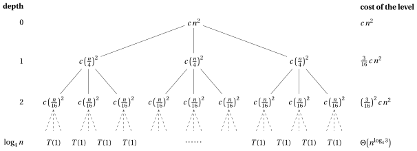
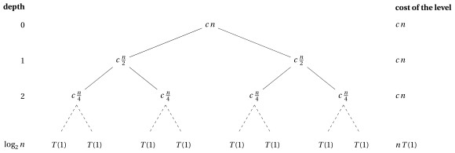
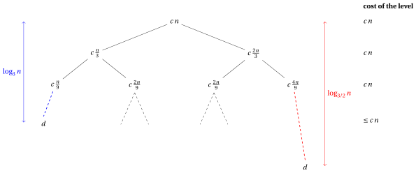
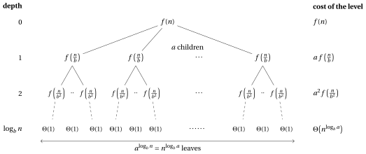

# Recurrences

**Part 5 · Recursion · Chapter 15** · [:material-file-pdf-box: Lecture notes, volume 5 (PDF)](../pdf/lecture-notes-5-recursion.pdf) · [:material-pencil: Exercises](../exercises/ex-15-recurrences.md)

## Introduction

In the chapter <em>Recursion</em> we counted the steps of a recursive algorithm line by line, and we noticed that the number of steps executed by a call depends on the number of steps executed by its recursive calls, which are calls of the <em>same</em> algorithm on a <em>smaller</em> input. The quantity we want to compute is therefore defined in terms of itself: this is a <strong>recurrence</strong>.

In this chapter we first define recurrences and show where they come from (Section [15.1](#sez-sec-recurrences)). Then we study three methods to solve them, that is, to obtain their closed form or at least their order of growth:

- the <strong>expansion method</strong> (Section [15.2](#sez-sec-expansion)), which unrolls the recurrence until the boundary condition is reached;

- the <strong>substitution method</strong> (Section [15.3](#sez-sec-substitution)), which proves a guessed bound by induction;

- the <strong>recursion-tree method</strong> (Section [15.4](#sez-sec-recursionTree)), which visualises the costs of all the calls and sums them level by level.

Finally (Section [15.5](#sez-sec-towardsMaster)) we draw the recursion tree of a generic divide-and-conquer recurrence: the three behaviours that we observe there are the starting point of the chapter <em>The Master Theorem</em>.

## 15.1 Recurrences { #sez-sec-recurrences }

!!! definizione "Definition 15.1: recurrence"

    A <strong>recurrence</strong> is an equation (or an inequality) that describes a function $T:\N\to\R$ in terms of its values on smaller inputs.

- Each recurrence has <strong>boundary conditions</strong>, which give the value of the function when the input size is small, that is, when $n$ reaches (or is below) a specific value $n_0$. Precisely, the boundary conditions are

    $$
    T(n)=g(n) \qquad \text{if } n\le n_0,
    $$

    where $g(n)$ is the value of the function for the small values of $n$. Typically $n_0=1$ and the boundary condition is $T(1)=\Theta(1)$.

- <strong>Solving a recurrence</strong> means determining a closed form of $T(n)$ or, at least, its order of growth, that is, a function $h(n)$ such that $T(n)=\Theta(h(n))$ (or $T(n)=O(h(n))$, or $T(n)=\Omega(h(n))$).

!!! esempio "Example 15.1: A first recurrence"

    Consider the recurrence

    $$
    T(n)=
    \begin{cases}
    1 & \text{if } n=1\\
    T(n-1)+n & \text{if } n>1
    \end{cases}
    $$

    The boundary condition is $T(1)=1$ (here $n_0=1$); for $n>1$ every value is obtained from the previous one:

    - $T(1)=1$ (boundary condition);

    - $T(2)=T(1)+2=1+2=3$;

    - $T(3)=T(2)+3=3+3=6$;

    - $T(4)=T(3)+4=6+4=10$.

    The recurrence defines $T(n)$ for every $n\in\N$, $n\ge 1$, but computing $T(n)$ in this way requires $n-1$ additions. In [Example 15.4](#box-7-exRecExpQuadratic) we solve it and obtain the closed form $T(n)=\frac{n(n+1)}{2}$.

### 15.1.1 Recurrences and recursive algorithms

!!! chiave ""

    Recurrences are the natural tool to determine the asymptotic complexity of <strong>recursive algorithms</strong>.

    In this chapter recurrences are mathematical objects, and we use a generic function $T(n)$. When we analyse a recursive algorithm, the function described by the recurrence is the number of steps $S(n)$ executed in the worst case on an input of size parameter $n$ (see the chapter <em>Recursion</em>): the number of steps of a call is the number of steps executed by the call itself plus the number of steps executed by its recursive calls.

- Consider the following recursive algorithm that computes the sum of the entries of an array.

!!! algoritmo "Algorithm: RecursiveSum"

    

    
Input: An array &#92;(a&#91;1..n&#93;&#92;) of &#92;(n&#92;ge 1&#92;) integer numbers

    
Output: The sum &#92;(a&#91;1&#93;+a&#91;2&#93;+&#92;cdots+a&#91;n&#93;&#92;)

    

    

    
1<strong>function</strong> RecursiveSum(a, n)

    
2<strong>if</strong> &#92;(n = 1&#92;) <strong>then</strong>

    
3<strong>return</strong> &#92;(a&#91;1&#93;&#92;)

    
4<strong>end</strong>

    
5&#92;(s :=&#92;) RecursiveSum(&#92;(a, n-1&#92;))

    
6<strong>return</strong> &#92;(s + a&#91;n&#93;&#92;)

    
7<strong>end</strong>

    

Run in Colab:

!!! esempio "Example 15.2: The recurrence of <code>RecursiveSum</code>"

    Let $S(n)$ be the number of steps executed by <code>RecursiveSum</code> on an array of size $n$. We count the executions of each line.

    - If $n=1$, lines [2](#riga-15-recurrences-line-rsum-a) and [3](#riga-15-recurrences-line-rsum-b) are executed once: $S(1)=2$.

    - If $n>1$, lines [2](#riga-15-recurrences-line-rsum-a), [5](#riga-15-recurrences-line-rsum-c) and [6](#riga-15-recurrences-line-rsum-d) are executed once ($3$ steps), and in addition the recursive call at line [5](#riga-15-recurrences-line-rsum-c) executes $S(n-1)$ steps.

    Therefore

    $$
    S(n)=
    \begin{cases}
    2 & \text{if } n=1\\
    S(n-1)+3 & \text{if } n>1
    \end{cases}
    $$

    For instance, $S(2)=2+3=5$, $S(3)=5+3=8$ and $S(4)=8+3=11$. In [Example 15.3](#box-6-exRecExpLinear) we show that $S(n)=3n-1=\Theta(n)$.

### 15.1.2 Different forms of recurrences

The shape of the recurrence mirrors the way the algorithm splits its input. The most common shapes are the following.

- <strong>Divide-and-conquer.</strong> A recursive algorithm divides the problem into $a$ subproblems, each of size $n/b$, solves them recursively and combines their solutions. This gives rise to a recurrence of the form

    $$
    T(n)=a\,T\left(\frac{n}{b}\right)+f(n).
    $$

    For example, the algorithm <code>MergeSort</code> (studied in the chapter <em>Recursive algorithms</em>) gives rise to

    $$
    T(n)=2T(n/2)+\Theta(n).
    $$

- <strong>Unequal split.</strong> A recursive algorithm might divide the problem into subproblems of different sizes. For example, if the input is divided into a $1/3$ and a $2/3$ split, we obtain the recurrence

    $$
    T(n)=T\left(\frac{n}{3}\right)+T\left(\frac{2n}{3}\right)+f(n),
    $$

    where $f(n)$ is the time required to divide the problem and to combine the solutions of the subproblems.

- <strong>Decrease-and-conquer.</strong> Subproblems are not necessarily a constant fraction of the original problem. For example, a recursive algorithm might create just one subproblem containing one element less than the original problem (as <code>RecursiveSum</code>). This gives rise to the recurrence

    $$
    T(n)=T(n-1)+f(n).
    $$

- <strong>Several subproblems of size $n-1$.</strong> For example, the algorithm that solves the <em>Tower of Hanoi</em> puzzle with $n$ disks moves $n-1$ disks, then one disk, then again $n-1$ disks, giving rise to the recurrence

    $$
    T(n)=2\,T(n-1)+1,
    $$

    whose solution is exponential in $n$ (see [Example 15.5](#box-8-exRecExpHanoi)).

!!! definizione "Definition 15.2: recurrence in standard form"

    A recurrence is in <strong>standard form</strong> if it can be written as

    \begin{equation*}
    T(n)=a\,T\left(\frac{n}{b}\right)+f(n) \label{eq:rec:standardForm} \tag{15.1}
    \end{equation*}

    where

    - $n$ is the size of the input (typically $n\in\N$);

    - $a\ge 1$ is the number of subproblems to solve;

    - $\frac{n}{b}$ is the size of each subproblem ($b>1$);

    - $f(n)$ is the time required to divide the problem and to combine the solutions of the subproblems.

- Including the boundary conditions, a recurrence in standard form is

    $$
    T(n)=
    \begin{cases}
    g(1) & \text{if } n=1\\
    a\,T\left(\frac{n}{b}\right)+f(n) & \text{if } n>1
    \end{cases}
    $$

    where $g(1)$ is the time required to solve a subproblem of size $1$, typically $g(1)=\Theta(1)$.

- Occasionally, we shall see recurrences that are not equalities but inequalities, such as

    $$
    T(n)\le a\,T\left(\frac{n}{b}\right)+f(n).
    $$

    Because such a recurrence states only an <strong>upper bound</strong> on $T(n)$, its solution is given in $O$-notation rather than in $\Theta$-notation.

- Similarly, if the inequality is reversed,

    $$
    T(n)\ge a\,T\left(\frac{n}{b}\right)+f(n),
    $$

    the recurrence gives only a <strong>lower bound</strong> on $T(n)$, and its solution is given in $\Omega$-notation.

### 15.1.3 Methods for solving recurrences

- In this chapter we study three methods for solving recurrences:

    1. The <strong>expansion method</strong> (also called iteration or unrolling): we repeatedly substitute the recurrence into itself until we reach the boundary condition, and we compute the resulting summation.

    2. The <strong>substitution method</strong>: we guess a bound and then use mathematical induction to prove that the guess is correct.

    3. The <strong>recursion-tree method</strong>: we convert the recurrence into a tree whose nodes represent the costs incurred at the various levels of the recursion, and we bound the resulting summations.

- In the chapter <em>The Master Theorem</em> we study a fourth method, the <strong>Master Theorem</strong>, which provides directly the solution of recurrences in standard form $\eqref{eq:rec:standardForm}$.

Before applying the methods, we fix two technical points: which details of a recurrence can be neglected, and which summations appear most often.

### 15.1.4 Technicalities in recurrences

- We often neglect certain technical details when we state and solve recurrences.

- <strong>Floors and ceilings.</strong> Consider the recurrence

    $$
    T(n)=
    \begin{cases}
    \Theta(1) & \text{if } n=1\\
    2\,T\left(\frac{n}{2}\right)+\Theta(n) & \text{if } n>1
    \end{cases}
    $$

    When $n$ is odd, the two subproblems cannot both have size $n/2$ (which is not an integer): typically, they have sizes $\lceil n/2\rceil$ and $\lfloor n/2\rfloor$. The precise recurrence is therefore

    $$
    T(n)=
    \begin{cases}
    \Theta(1) & \text{if } n=1\\
    T\left(\lceil n/2\rceil\right)+T\left(\lfloor n/2\rfloor\right)+\Theta(n) & \text{if } n>1
    \end{cases}
    $$

    The two recurrences have the same asymptotic solution. Since we are interested in the order of growth, floors and ceilings can usually be omitted.

- <strong>Exact powers.</strong> For the same reason, when solving a recurrence in standard form $\eqref{eq:rec:standardForm}$ we often assume that $n$ is an <strong>exact power of $b$</strong>, that is, $n=b^k$ for some $k\in\N$. In this way all the subproblem sizes $n/b, n/b^2,\dots,1$ are integers. In the example above, we assume $n=2^k$.

- <strong>Boundary conditions.</strong> Boundary conditions are another class of details that we typically ignore. Since the running time of an algorithm on an input of constant size is a constant, the recurrences that arise from the analysis of algorithms generally satisfy

    $$
    T(n)=\Theta(1) \qquad \text{for sufficiently small } n.
    $$

    Consequently, for convenience, we shall generally omit the boundary conditions and assume that $T(n)$ is constant for small $n$. Changing the value of $T(1)$ typically changes the exact solution, but not its order of growth.

!!! chiave ""

    Omitting floors, ceilings and boundary conditions, and assuming that $n$ is an exact power of $b$, simplifies the computations. When a rigorous proof is required (for example in the substitution method), these details must be handled explicitly.

### 15.1.5 Useful summations

All three methods end with a summation: the costs of the single calls must be added up. The following formulas are used throughout the chapter.

!!! teorema "Observation 15.3: useful summations and logarithms"

    - The <em>arithmetic series</em>: for every $n\ge 1$

        \begin{equation*}
        \sum_{i=1}^{n} i = 1+2+\cdots+n=\frac{n(n+1)}{2}. \label{eq:rec:arith} \tag{15.2}
        \end{equation*}

    - The <em>geometric series</em>: for every real number $x\neq 1$ and every $k\in\N$

        \begin{equation*}
        \sum_{i=0}^{k} x^i = 1+x+x^2+\cdots+x^k=\frac{x^{k+1}-1}{x-1}. \label{eq:rec:geomFinite} \tag{15.3}
        \end{equation*}

        In particular, for $x=2$,

        \begin{equation*}
        \sum_{i=0}^{k-1} 2^i = 2^k-1. \label{eq:rec:geomTwo} \tag{15.4}
        \end{equation*}

    - The <em>infinite decreasing geometric series</em>: for every real number $x$ with $|x|<1$

        \begin{equation*}
        \sum_{i=0}^{\infty} x^i = \frac{1}{1-x}. \label{eq:rec:geomInfinite} \tag{15.5}
        \end{equation*}

    - Two properties of logarithms: for every $a,b,n>0$ (with $b\neq 1$)

        \begin{equation*}
        a^{\log_b n}=n^{\log_b a}, \qquad \log_b n=\frac{\log_2 n}{\log_2 b}. \label{eq:rec:logProps} \tag{15.6}
        \end{equation*}

??? dimostrazione "Proof"

    <em>Arithmetic series.</em> Writing the sum twice, once in increasing and once in decreasing order, and adding term by term, we obtain $n$ pairs, each with sum $n+1$: twice the sum is $n(n+1)$.

    <em>Geometric series.</em> Multiplying the sum by $x-1$, all the intermediate terms cancel:

    $$
    (x-1)\sum_{i=0}^{k}x^i=\sum_{i=1}^{k+1}x^i-\sum_{i=0}^{k}x^i=x^{k+1}-1 ,
    $$

    and we divide by $x-1\neq 0$. For $x=2$ and $k-1$ in place of $k$ we obtain $2^k-1$.

    <em>Infinite series.</em> If $|x|<1$, then $x^{k+1}\to 0$ for $k\to\infty$, and the finite sum tends to $\frac{0-1}{x-1}=\frac{1}{1-x}$.

    <em>Logarithms.</em> $a^{\log_b n}=\big(b^{\log_b a}\big)^{\log_b n}=\big(b^{\log_b n}\big)^{\log_b a}=n^{\log_b a}$. Moreover $n=b^{\log_b n}$ gives $\log_2 n=\log_b n\cdot\log_2 b$. □

- Since all the terms are positive when $0<x<1$, every finite sum $\sum_{i=0}^{k} x^i$ is smaller than $\frac{1}{1-x}$: the infinite series gives an <strong>upper bound</strong> on a finite geometric sum that does not depend on $k$.

- The second property of the logarithms shows that logarithms in different bases differ by a constant factor; hence, inside $\Theta$, $O$ and $\Omega$ the base of the logarithm is irrelevant.

## 15.2 The expansion method { #sez-sec-expansion }

The most direct way to solve a recurrence is to apply it again and again: each application replaces a value of $T$ with a value on a smaller argument, and after enough applications only the boundary condition remains.

!!! chiave ""

    In the <strong>expansion method</strong> (also called <strong>iteration</strong> or <strong>unrolling</strong>) we:

    1. substitute the recurrence into itself a few times, until we recognise the general pattern after $k$ substitutions;

    2. choose $k$ such that the argument reaches the boundary condition;

    3. compute (or bound) the resulting summation.

- The method gives an exact closed form when the summation can be computed. The pattern recognised in step 1 can be proved rigorously by induction on $k$.

We start with the recurrences of the decrease-and-conquer type, $T(n-1)+f(n)$, and then move to the divide-and-conquer type, $a\,T(n/2)+f(n)$.

!!! esempio "Example 15.3: $T(n)=T(n-1)+c$"

    Let $c,d>0$ be constants and

    $$
    T(n)=
    \begin{cases}
    d & \text{if } n=1\\
    T(n-1)+c & \text{if } n>1
    \end{cases}
    $$

    - <em>Step 1 (expand).</em>

        \begin{align*}
        T(n) &= T(n-1)+c\\
        &= \big(T(n-2)+c\big)+c = T(n-2)+2c\\
        &= \big(T(n-3)+c\big)+2c = T(n-3)+3c\\
        &\;\;\vdots\\
        &= T(n-k)+k\,c.
        \end{align*}

    - <em>Step 2 (boundary condition).</em> The boundary condition is reached when $n-k=1$, that is, $k=n-1$.

    - <em>Step 3 (sum).</em>

        $$
        T(n)=T(1)+(n-1)\,c=c\,n+(d-c)=\Theta(n).
        $$

    For <code>RecursiveSum</code> ([Example 15.2](#box-3-exRecSumSteps)) we have $c=3$ and $d=2$, hence

    $$
    S(n)=3(n-1)+2=3n-1=\Theta(n),
    $$

    which gives $S(2)=5$, $S(3)=8$, $S(4)=11$, as computed directly from the recurrence.

!!! esempio "Example 15.4: $T(n)=T(n-1)+n$"

    Let

    $$
    T(n)=
    \begin{cases}
    1 & \text{if } n=1\\
    T(n-1)+n & \text{if } n>1
    \end{cases}
    $$

    - <em>Step 1 (expand).</em>

        \begin{align*}
        T(n) &= T(n-1)+n\\
        &= T(n-2)+(n-1)+n\\
        &= T(n-3)+(n-2)+(n-1)+n\\
        &\;\;\vdots\\
        &= T(n-k)+(n-k+1)+\cdots+(n-1)+n.
        \end{align*}

    - <em>Step 2 (boundary condition).</em> $n-k=1$, that is, $k=n-1$.

    - <em>Step 3 (sum).</em> Using the arithmetic series $\eqref{eq:rec:arith}$,

        $$
        T(n)=T(1)+2+3+\cdots+n=1+2+\cdots+n=\frac{n(n+1)}{2}=\Theta(n^2).
        $$

        Indeed,

        $$
        \lim_{n\to\infty}\frac{n(n+1)/2}{n^2}=\lim_{n\to\infty}\frac{1}{2}\left(1+\frac{1}{n}\right)=\frac{1}{2}\in\R_{>0}.
        $$

    The closed form gives $T(1)=1$, $T(2)=3$, $T(3)=6$, $T(4)=10$, the values of [Example 15.1](#box-2-exRecFirst).

!!! esempio "Example 15.5: $T(n)=2T(n-1)+1$: the Tower of Hanoi"

    Let

    $$
    T(n)=
    \begin{cases}
    1 & \text{if } n=1\\
    2\,T(n-1)+1 & \text{if } n>1
    \end{cases}
    $$

    - <em>Step 1 (expand).</em>

        \begin{align*}
        T(n) &= 2\,T(n-1)+1\\
        &= 2\big(2\,T(n-2)+1\big)+1 = 2^2\,T(n-2)+2+1\\
        &= 2^2\big(2\,T(n-3)+1\big)+2+1 = 2^3\,T(n-3)+2^2+2+1\\
        &\;\;\vdots\\
        &= 2^k\,T(n-k)+\sum_{i=0}^{k-1}2^i.
        \end{align*}

    - <em>Step 2 (boundary condition).</em> $n-k=1$, that is, $k=n-1$.

    - <em>Step 3 (sum).</em> Using $\eqref{eq:rec:geomTwo}$,

        $$
        T(n)=2^{n-1}\,T(1)+\left(2^{n-1}-1\right)=2^{n-1}+2^{n-1}-1=2^n-1=\Theta(2^n).
        $$

    This is the number of moves needed to solve the Tower of Hanoi puzzle with $n$ disks: the running time is <strong>exponential</strong> in $n$. The function <code>hanoi</code> of the code of the course counts its moves; running it we obtain

    
<table>
    <tr>
    <th>&#92;(n&#92;)</th>
    <th>1</th>
    <th>2</th>
    <th>3</th>
    <th>4</th>
    <th>5</th>
    <th>6</th>
    <th>7</th>
    <th>8</th>
    <th>10</th>
    </tr>
    <tr>
    <td>moves</td>
    <td>1</td>
    <td>3</td>
    <td>7</td>
    <td>15</td>
    <td>31</td>
    <td>63</td>
    <td>127</td>
    <td>255</td>
    <td>1023</td>
    </tr>
    </table>

    that is, exactly $2^n-1$ moves.

The next two recurrences halve the size of the problem at each call. To avoid floors we assume that $n$ is an exact power of $2$.

!!! esempio "Example 15.6: $T(n)=T(n/2)+c$"

    Let $c,d>0$ be constants, let $n=2^k$ be an exact power of $2$, and

    $$
    T(n)=
    \begin{cases}
    d & \text{if } n=1\\
    T\left(\frac{n}{2}\right)+c & \text{if } n>1
    \end{cases}
    $$

    - <em>Step 1 (expand).</em>

        $$
        T(n) = T\left(\frac{n}{2}\right)+c
        = T\left(\frac{n}{2^2}\right)+2c
        = T\left(\frac{n}{2^3}\right)+3c
        = \cdots
        = T\left(\frac{n}{2^j}\right)+j\,c.
        $$

    - <em>Step 2 (boundary condition).</em> $\frac{n}{2^j}=1$, that is, $j=\log_2 n$.

    - <em>Step 3 (sum).</em>

        $$
        T(n)=T(1)+c\log_2 n=c\log_2 n+d=\Theta(\log_2 n).
        $$

    This recurrence describes, for instance, the recursive version of <code>BinarySearch</code>: at each call the size of the sub-array is halved.

!!! esempio "Example 15.7: $T(n)=2T(n/2)+n$"

    Let $n=2^k$ be an exact power of $2$ and

    $$
    T(n)=
    \begin{cases}
    1 & \text{if } n=1\\
    2\,T\left(\frac{n}{2}\right)+n & \text{if } n>1
    \end{cases}
    $$

    - <em>Step 1 (expand).</em>

        \begin{align*}
        T(n) &= 2\,T\left(\frac{n}{2}\right)+n\\
        &= 2\left(2\,T\left(\frac{n}{2^2}\right)+\frac{n}{2}\right)+n = 2^2\,T\left(\frac{n}{2^2}\right)+2n\\
        &= 2^2\left(2\,T\left(\frac{n}{2^3}\right)+\frac{n}{2^2}\right)+2n = 2^3\,T\left(\frac{n}{2^3}\right)+3n\\
        &\;\;\vdots\\
        &= 2^j\,T\left(\frac{n}{2^j}\right)+j\,n.
        \end{align*}

    - <em>Step 2 (boundary condition).</em> $j=\log_2 n$, so that $2^j=n$.

    - <em>Step 3 (sum).</em>

        $$
        T(n)=n\,T(1)+n\log_2 n=n\log_2 n+n=\Theta(n\log_2 n).
        $$

    Check: from the recurrence $T(2)=2+2=4$, $T(4)=8+4=12$, $T(8)=24+8=32$, and from the closed form $T(8)=8\cdot 3+8=32$.

!!! chiave ""

    The expansion method works well when the recurrence has a <strong>single recursive term</strong>. With several recursive terms of different sizes (for example $T(n/3)+T(2n/3)$) the expansion quickly becomes unmanageable: in these cases the recursion-tree method (Section [15.4](#sez-sec-recursionTree)) is more convenient.

## 15.3 The substitution method { #sez-sec-substitution }

The expansion method needs exact subproblem sizes: with floors and ceilings the pattern is no longer clean. When we already have a good idea of the solution, a more robust approach is to <em>prove</em> it by induction.

!!! chiave ""

    The <strong>substitution method</strong> comprises two steps:

    1. <strong>guess</strong> the form of the solution (for example $T(n)\le c\,n\log_2 n$, with $c$ an unknown constant);

    2. use <strong>mathematical induction</strong> to find the constants and show that the solution works.

- The name comes from the fact that, in the inductive step, we <em>substitute</em> the guessed bound for the values of the function on the smaller inputs.

- The method is very powerful, but it requires a good guess. The guess can come from experience (similar recurrences), from the expansion method or from a recursion tree.

- We can use the substitution method to prove upper bounds ($O$) and lower bounds ($\Omega$) separately. Both together give $\Theta$.

- Since the asymptotic notation requires the bound only for $n\ge n_0$, we are free to choose $n_0$: this is useful when the bound does not hold for the smallest values of $n$.

### 15.3.1 An example with floors: upper bound

- Consider the recurrence

    \begin{equation*}
    T(n)=
    \begin{cases}
    1 & \text{if } n=1\\
    2\,T\left(\lfloor n/2\rfloor\right)+n & \text{if } n>1
    \end{cases} \label{eq:rec:subsMain} \tag{15.7}
    \end{equation*}

- From [Example 15.7](#box-10-exRecExpNlogN) (where $n$ is a power of $2$) we guess $T(n)=O(n\log_2 n)$. We want to prove that there exist constants $c>0$ and $n_0$ such that

    $$
    T(n)\le c\,n\log_2 n \qquad \text{for all } n\ge n_0.
    $$

<strong>Inductive step.</strong>  Assume that the bound holds for all the values $m$ with $n_0\le m<n$, in particular for $m=\lfloor n/2\rfloor$ (this requires $\lfloor n/2\rfloor\ge n_0$):

$$
T\left(\lfloor n/2\rfloor\right)\le c\,\lfloor n/2\rfloor\log_2\lfloor n/2\rfloor.
$$

Substituting into the recurrence:

\begin{align*}
T(n) &\le 2\,c\,\lfloor n/2\rfloor\log_2\lfloor n/2\rfloor+n\\
&\le 2\,c\,\frac{n}{2}\log_2\frac{n}{2}+n && \text{(since } \lfloor n/2\rfloor\le n/2\text{)}\\
&= c\,n\log_2 n-c\,n\log_2 2+n\\
&= c\,n\log_2 n-c\,n+n\\
&\le c\,n\log_2 n,
\end{align*}

where the last step holds as long as $c\ge 1$.

<strong>Base cases.</strong>  The induction needs the bound to hold for the boundary conditions. However, for $n=1$:

$$
T(1)=1 > c\cdot 1\cdot\log_2 1=0,
$$

for every $c$. So the bound <em>does not hold</em> for $n=1$. We take advantage of the freedom of choosing $n_0$: we prove the bound for $n\ge n_0=2$.

- For $n\ge 4$ we have $\lfloor n/2\rfloor\ge 2$, so the inductive step only uses values of $T$ on arguments $\ge 2$.

- For $n=2$ and $n=3$ we have $\lfloor n/2\rfloor=1$, so the inductive step would use $T(1)$, which does not satisfy the bound. Therefore $n=2$ and $n=3$ must be treated as <strong>base cases</strong>.

From the recurrence, $T(2)=2\,T(1)+2=4$ and $T(3)=2\,T(1)+3=5$. We need

$$
4\le c\cdot 2\log_2 2=2c \qquad\text{and}\qquad 5\le c\cdot 3\log_2 3.
$$

Both hold for $c\ge 2$ (since $3\log_2 3\approx 4.75$, we have $2\cdot 3\log_2 3\approx 9.51\ge 5$).

!!! teorema "Observation 15.4: upper bound for $2T(\lfloor n/2\rfloor)+n$"

    The function $T(n)$ defined in $\eqref{eq:rec:subsMain}$ satisfies $T(n)\le 2\,n\log_2 n$ for all $n\ge 2$. Hence $T(n)=O(n\log_2 n)$.

??? dimostrazione "Proof"

    Let $c=2$. We proceed by strong induction on $n\ge 2$.

    <em>Base cases</em> $n=2,3$: $T(2)=4\le 2\cdot 2\cdot\log_2 2=4$ and $T(3)=5\le 2\cdot 3\log_2 3\approx 9.51$.

    <em>Inductive step</em> $n\ge 4$: we have $2\le\lfloor n/2\rfloor<n$, so by the inductive hypothesis $T(\lfloor n/2\rfloor)\le 2\lfloor n/2\rfloor\log_2\lfloor n/2\rfloor$. Then

    $$
    T(n)\le 4\lfloor n/2\rfloor\log_2\lfloor n/2\rfloor+n\le 2n\log_2\frac{n}{2}+n=2n\log_2 n-2n+n\le 2n\log_2 n. \qedhere
    $$

    
□

### 15.3.2 An example with floors: lower bound

- We now prove $T(n)=\Omega(n\log_2 n)$ for the same recurrence $\eqref{eq:rec:subsMain}$. We look for a constant $d>0$ such that $T(n)\ge d\,n\log_2 n$ for all $n\ge 1$.

- For the lower bound, the floor works against us: we need lower bounds on $\lfloor n/2\rfloor$. For every $n\ge 2$:

    $$
    2\lfloor n/2\rfloor\ge n-1 \qquad\text{and}\qquad \lfloor n/2\rfloor\ge \frac{n}{3}.
    $$

    The first holds because $\lfloor n/2\rfloor\ge (n-1)/2$. The second holds for $n=2$ ($1\ge 2/3$) and, for $n\ge 3$, because $(n-1)/2\ge n/3$ is equivalent to $n\ge 3$.

<strong>Inductive step</strong>  ($n\ge 2$). Assume $T(\lfloor n/2\rfloor)\ge d\lfloor n/2\rfloor\log_2\lfloor n/2\rfloor$. Since $\lfloor n/2\rfloor\ge 1$, the factor $\log_2\lfloor n/2\rfloor$ is non-negative, and

\begin{align*}
T(n) &\ge 2\,d\,\lfloor n/2\rfloor\log_2\lfloor n/2\rfloor+n\\
&\ge d\,(n-1)\log_2\frac{n}{3}+n\\
&= d\,n\log_2 n-d\,n\log_2 3-d\log_2 n+d\log_2 3+n\\
&\ge d\,n\log_2 n+\Big(n-d\,n\log_2 3-d\log_2 n\Big).
\end{align*}

Since $\log_2 n\le n$, the term in parentheses is at least $n\,(1-d\log_2 3-d)$, which is non-negative if

$$
d\le\frac{1}{1+\log_2 3}\approx 0.387.
$$

We choose $d=\frac{1}{4}$.

<strong>Base case</strong>  ($n=1$): $T(1)=1\ge \frac{1}{4}\cdot 1\cdot\log_2 1=0$. ✓

!!! teorema "Observation 15.5: lower bound for $2T(\lfloor n/2\rfloor)+n$"

    The function $T(n)$ defined in $\eqref{eq:rec:subsMain}$ satisfies $T(n)\ge \frac{1}{4}\,n\log_2 n$ for all $n\ge 1$. Hence $T(n)=\Omega(n\log_2 n)$.

??? dimostrazione "Proof"

    By strong induction on $n\ge 1$, with $d=\frac{1}{4}$. For $n=1$, $T(1)=1\ge 0$. For $n\ge 2$ we have $1\le\lfloor n/2\rfloor<n$, so the inductive hypothesis holds for $\lfloor n/2\rfloor$, and the computation of the inductive step above gives

    $$
    T(n)\ge \tfrac{1}{4}\,n\log_2 n+n\left(1-\tfrac{1}{4}\log_2 3-\tfrac{1}{4}\right)\ge \tfrac{1}{4}\,n\log_2 n ,
    $$

    since $1-\frac{1}{4}(1+\log_2 3)\approx 0.35>0$. □

!!! chiave ""

    From Observations [15.4](#box-11-obsRecSubsUpper) and [Observation 15.5](#box-12-obsRecSubsLower), the solution of $\eqref{eq:rec:subsMain}$ is

    $$
    T(n)=\Theta(n\log_2 n).
    $$

    The floor does not change the order of growth found for $n$ power of $2$. Numerically, for every $n$ with $2\le n<200\,000$ the ratio $\frac{T(n)}{n\log_2 n}$ lies between $0.83$ and $2$.

### 15.3.3 When the guess must be strengthened

- Sometimes the guess is correct, but the induction does not work because the inductive hypothesis is <em>not strong enough</em>. Consider

    \begin{equation*}
    T(n)=
    \begin{cases}
    1 & \text{if } n=1\\
    2\,T\left(\lfloor n/2\rfloor\right)+1 & \text{if } n>1
    \end{cases} \label{eq:rec:subsStrength} \tag{15.8}
    \end{equation*}

- For $n$ power of $2$ one easily finds $T(n)=2n-1$ (for instance $T(2)=3$, $T(4)=7$, $T(8)=15$), so we guess $T(n)=O(n)$, that is, $T(n)\le c\,n$.

- <strong>Naive attempt.</strong> Substituting the guess,

    $$
    T(n)\le 2\,c\,\lfloor n/2\rfloor+1\le c\,n+1,
    $$

    which does not imply $T(n)\le c\,n$ for any choice of $c$. The induction fails, by a lower-order term (the constant $1$).

- <strong>Strengthened guess.</strong> It is tempting to try a larger guess, such as $c\,n^2$, but this is not needed. Instead, we <em>subtract</em> a lower-order term: we guess

    $$
    T(n)\le c\,n-d,
    $$

    with $d\ge 0$ a constant. Then

    $$
    T(n)\le 2\big(c\,\lfloor n/2\rfloor-d\big)+1\le c\,n-2d+1\le c\,n-d,
    $$

    where the last step holds as long as $d\ge 1$.

- <strong>Base case.</strong> $T(1)=1\le c-d$: with $d=1$ we need $c\ge 2$.

!!! teorema "Observation 15.6: strengthened guess for $2T(\lfloor n/2\rfloor)+1$"

    The function $T(n)$ defined in $\eqref{eq:rec:subsStrength}$ satisfies $n\le T(n)\le 2n-1$ for all $n\ge 1$. Hence $T(n)=\Theta(n)$.

??? dimostrazione "Proof"

    By strong induction on $n$. For $n=1$: $1\le T(1)=1\le 2\cdot 1-1$. For $n\ge 2$, we have $1\le\lfloor n/2\rfloor<n$ and, by the inductive hypothesis, $\lfloor n/2\rfloor\le T(\lfloor n/2\rfloor)\le 2\lfloor n/2\rfloor-1$.

    <em>Upper bound</em>: $T(n)\le 2\big(2\lfloor n/2\rfloor-1\big)+1=4\lfloor n/2\rfloor-1\le 2n-1$.

    <em>Lower bound</em>: $T(n)\ge 2\lfloor n/2\rfloor+1\ge (n-1)+1=n$. □

!!! chiave ""

    When the induction fails only because of a <strong>lower-order term</strong>, do not increase the guess: <strong>subtract a lower-order term</strong> from it (for example $c\,n-d$ instead of $c\,n$, or $c\,n^2-d\,n$ instead of $c\,n^2$). The stronger hypothesis makes the induction work.

- <strong>Avoid pitfalls.</strong> In the naive attempt it would be wrong to conclude “$T(n)\le c\,n+1=O(n)$, done”. The induction must prove <em>exactly</em> the form of the inductive hypothesis, $T(n)\le c\,n$, with the <em>same</em> constant $c$; otherwise the constant would grow at each step of the recursion.

### 15.3.4 Changing variables

Sometimes an algebraic manipulation, such as a change of variables, transforms an unknown recurrence into a known one, whose solution can then be reused.

!!! esempio "Example 15.8: $T(n)=2T(\lfloor\sqrt{n}\rfloor)+\log_2 n$"

    Consider

    $$
    T(n)=2\,T\left(\lfloor\sqrt{n}\rfloor\right)+\log_2 n,
    $$

    with boundary condition $T(2)=1$.

    - <em>Step 1 (rename).</em> Ignoring the rounding (that is, assuming that $n=2^{2^k}$, so that all the square roots are exact powers of $2$), we rename $m=\log_2 n$, that is, $n=2^m$ and $\sqrt{n}=2^{m/2}$:

        $$
        T(2^m)=2\,T\left(2^{m/2}\right)+m.
        $$

    - <em>Step 2 (new function).</em> We define $R(m)=T(2^m)$ and obtain

        $$
        R(m)=2\,R\left(\frac{m}{2}\right)+m,
        $$

        which is the recurrence of [Example 15.7](#box-10-exRecExpNlogN). Since $T(2)=1$, we have $R(1)=1$, and therefore

        $$
        R(m)=m\log_2 m+m.
        $$

    - <em>Step 3 (back to $T$).</em> With $m=\log_2 n$:

        $$
        T(n)=R(\log_2 n)=\log_2 n\cdot\log_2\log_2 n+\log_2 n=\Theta(\log_2 n\cdot\log_2\log_2 n).
        $$

    Check: $T(4)=2\,T(2)+2=4$ and $R(2)=2\cdot 1+2=4$; $T(16)=2\,T(4)+4=12$ and $R(4)=4\cdot 2+4=12$.

## 15.4 The recursion-tree method { #sez-sec-recursionTree }

The substitution method proves a guess, but does not produce it. The recursion tree is the tool that produces good guesses, and in many cases it directly gives the solution.

- In a recursion tree, each node represents the cost of a single subproblem somewhere in the set of recursive function invocations. The children of a node are the subproblems generated by it.

- It can be used to solve recurrences, that is, to determine their asymptotic complexity, or to produce a good guess to be verified with the substitution method.

- Main idea: we sum the costs within each level of the tree to obtain a set of per-level costs, and then we sum all the per-level costs to determine the total cost of all the levels of the recursion.

!!! chiave ""

    In the <strong>recursion-tree method</strong> we determine:

    1. the size of the subproblems and the number of nodes at each depth $i$;

    2. the cost of each level (number of nodes $\times$ cost of each node);

    3. the depth of the tree (when the subproblem size reaches the boundary condition) and the cost of the leaves;

    4. the sum of the costs of all levels.

We apply the method to four recurrences, which show the three possible behaviours of the level costs (decreasing, constant, increasing) and the case of an unbalanced tree.

### 15.4.1 Decreasing level costs: $T(n)=3T(n/4)+c\,n^2$

- Consider the recurrence ($c>0$ a constant)

    $$
    T(n)=3\,T\left(\frac{n}{4}\right)+c\,n^2.
    $$

    For convenience, we assume that $n$ is an exact power of $4$, so that all subproblem sizes are integers.

{ .fig loading=lazy style="width:100%" }

<strong>Figure 15.1:</strong> Recursion tree of &#92;(T(n)=3T(n/4)+c&#92;,n^2&#92;): every node has three children, the subproblem size is divided by &#92;(4&#92;) at each level, and the leaves are at depth &#92;(&#92;log&#95;4 n&#92;).

- The $c\,n^2$ term at the root represents the cost at the top level of the recursion (dividing and combining).

- The three subtrees of the root represent the costs incurred by the subproblems of size $\frac{n}{4}$; at the next depth the size becomes $\frac{n}{16}$, and so on.

- The leaves represent the points where the recursion “bottoms out”, that is, where the <em>base case</em> of the recursion is reached.

!!! esempio "Example 15.9: Solving $T(n)=3T(n/4)+c\,n^2$ with the recursion tree"

    - <em>Step 1 (sizes and nodes).</em> The subproblem size of each node at depth $i$ is $\frac{n}{4^i}$. Each level has $3$ times as many nodes as the previous level, so the number of nodes at depth $i$ is $3^i$.

    - <em>Step 2 (cost of a level).</em> Each node at depth $i$ ($i=0,1,2,\dots,\log_4 n-1$) has a cost of $c\left(\frac{n}{4^i}\right)^2$. Multiplying, the overall cost of all the nodes at depth $i$ is

        $$
        3^i\,c\left(\frac{n}{4^i}\right)^2=\left(\frac{3}{16}\right)^i c\,n^2.
        $$

    - <em>Step 3 (depth and leaves).</em> The subproblem size reaches $1$ when $\frac{n}{4^i}=1$, that is, when $i=\log_4 n$. Accordingly, the tree has $\log_4 n+1$ levels (at depths $0,1,2,\dots,\log_4 n$). The bottom level has, using $\eqref{eq:rec:logProps}$,

        $$
        3^{\log_4 n}=n^{\log_4 3}
        $$

        nodes (the leaves of the tree), each contributing a constant cost $T(1)$. The total cost of the bottom level is

        $$
        n^{\log_4 3}\,T(1)=\Theta\left(n^{\log_4 3}\right).
        $$

    - <em>Step 4 (sum).</em> Summing up the costs of all levels we obtain

        \begin{align*}
        T(n) &= c\,n^2+\frac{3}{16}\,c\,n^2+\left(\frac{3}{16}\right)^2 c\,n^2+\cdots+\left(\frac{3}{16}\right)^{\log_4 n-1} c\,n^2+\Theta\left(n^{\log_4 3}\right)\\
        &= \sum_{i=0}^{\log_4 n-1}\left(\frac{3}{16}\right)^i c\,n^2+\Theta\left(n^{\log_4 3}\right).
        \end{align*}

        Using the geometric series $\eqref{eq:rec:geomFinite}$ we obtain the exact value

        $$
        T(n)=\frac{16}{13}\left(1-\left(\frac{3}{16}\right)^{\log_4 n}\right)c\,n^2+\Theta\left(n^{\log_4 3}\right).
        $$

    <strong>Upper bound.</strong> It is simpler to bound the finite sum by the infinite decreasing geometric series $\eqref{eq:rec:geomInfinite}$:

    \begin{align*}
    T(n) &< \sum_{i=0}^{\infty}\left(\frac{3}{16}\right)^i c\,n^2+\Theta\left(n^{\log_4 3}\right)
    = \frac{1}{1-\frac{3}{16}}\;c\,n^2+\Theta\left(n^{\log_4 3}\right)\\
    &= \frac{16}{13}\;c\,n^2+\Theta\left(n^{\log_4 3}\right)
    = O(n^2),
    \end{align*}

    since $\log_4 3\approx 0.79<2$, so that $n^{\log_4 3}=O(n^2)$.

    <strong>Lower bound.</strong> All the terms of the sum are non-negative, and the root alone costs $c\,n^2$. Hence

    $$
    T(n)\ge c\,n^2=\Omega(n^2).
    $$

    <strong>Numerical check</strong> ($c=1$, $T(1)=1$): the recurrence gives $T(4)=19$, $T(16)=313$, $T(64)=5035$, the values of the exact formula above, and $\frac{T(n)}{n^2}=1.1875,\ 1.2227,\ 1.2292$, which approach $\frac{16}{13}\approx 1.2308$.

!!! chiave ""

    The solution of $T(n)=3T(n/4)+c\,n^2$ is $T(n)=\Theta(n^2)$. The costs of the levels decrease geometrically: the total cost is dominated by the cost of the <strong>root</strong>.

### 15.4.2 Constant level costs: $T(n)=2T(n/2)+c\,n$

- Consider the recurrence ($c>0$ a constant), which describes algorithms such as <code>MergeSort</code>:

    $$
    T(n)=2\,T\left(\frac{n}{2}\right)+c\,n,
    $$

    where $n$ is an exact power of $2$.

{ .fig loading=lazy style="width:90%" }

<strong>Figure 15.2:</strong> Recursion tree of &#92;(T(n)=2T(n/2)+c&#92;,n&#92;): every level has total cost &#92;(c&#92;,n&#92;).

!!! esempio "Example 15.10: Solving $T(n)=2T(n/2)+c\,n$ with the recursion tree"

    - <em>Steps 1 and 2.</em> At depth $i$ there are $2^i$ nodes, each corresponding to a subproblem of size $\frac{n}{2^i}$ and with cost $c\,\frac{n}{2^i}$. The cost of each level is therefore

        $$
        2^i\,c\,\frac{n}{2^i}=c\,n.
        $$

    - <em>Step 3.</em> The subproblem size reaches $1$ at depth $\log_2 n$. The bottom level has $2^{\log_2 n}=n$ leaves, with total cost $n\,T(1)=\Theta(n)$.

    - <em>Step 4.</em> Summing the costs of all levels:

        $$
        T(n)=\sum_{i=0}^{\log_2 n-1}c\,n+n\,T(1)=c\,n\log_2 n+n\,T(1)=\Theta(n\log_2 n).
        $$

    For $c=1$ and $T(1)=1$ we obtain again $T(n)=n\log_2 n+n$ ([Example 15.7](#box-10-exRecExpNlogN)).

!!! chiave ""

    The solution of $T(n)=2T(n/2)+c\,n$ is $T(n)=\Theta(n\log_2 n)$. All the levels have the <strong>same cost</strong> $c\,n$, and there are $\Theta(\log_2 n)$ levels.

### 15.4.3 An unbalanced tree: $T(n)=T(n/3)+T(2n/3)+c\,n$

- Consider the recurrence ($c,d>0$ constants), defined for every real number $n>0$:

    $$
    T(n)=
    \begin{cases}
    d & \text{if } 0<n<1\\
    T\left(\frac{n}{3}\right)+T\left(\frac{2n}{3}\right)+c\,n & \text{if } n\ge 1
    \end{cases}
    $$

    (Working with real sizes allows us to avoid floors and ceilings.)

{ .fig loading=lazy style="width:90%" }

<strong>Figure 15.3:</strong> Recursion tree of &#92;(T(n)=T(n/3)+T(2n/3)+c&#92;,n&#92;): the shortest root-to-leaf path (blue) has length about &#92;(&#92;log&#95;3 n&#92;), the longest (red) about &#92;(&#92;log&#95;{3/2} n&#92;).

- Each internal node of size $s$ has two children of sizes $\frac{s}{3}$ and $\frac{2s}{3}$, whose sum is $s$. Hence the sizes of the nodes at any given depth sum to at most $n$ (exactly $n$ if the level is complete).

- The <strong>shortest path</strong> from the root to a leaf is the leftmost one: $n\to\frac{n}{3}\to\frac{n}{9}\to\cdots$. A node at depth $i$ on this path has size $\frac{n}{3^i}$, which is $\ge 1$ as long as $i\le\log_3 n$.

- The <strong>longest path</strong> is the rightmost one: $n\to\frac{2n}{3}\to\frac{4n}{9}\to\cdots$. A node at depth $i$ on this path has size $\left(\frac{2}{3}\right)^i n$, which is $\ge 1$ as long as $i\le\log_{3/2} n$.

- Unlike the previous examples, the tree is <strong>not complete</strong>: the leaves are at different depths, between $\log_3 n$ and $\log_{3/2} n$ (approximately).

!!! esempio "Example 15.11: Bounds for the unbalanced tree"

    <strong>Upper bound.</strong>

    - <em>Internal nodes.</em> Every node at depth $i$ has size at most $\left(\frac{2}{3}\right)^i n$; an internal node has size $\ge 1$, so internal nodes appear only at depths $i\le\log_{3/2} n$. At each depth, the internal nodes have total size at most $n$, so their total cost is at most $c\,n$. Hence the cost of the internal nodes is at most

        $$
        c\,n\left(\log_{3/2} n+1\right).
        $$

    - <em>Leaves.</em> A leaf has size $<1$, but its parent has size $\ge 1$, so a leaf has size $\ge\frac{1}{3}$. The sizes of all the leaves sum to exactly $n$ (each internal node splits its size among its children). Hence there are at most $3n$ leaves, with total cost at most $3\,d\,n=O(n)$.

    - Therefore

        $$
        T(n)\le c\,n\left(\log_{3/2} n+1\right)+3\,d\,n=O(n\log_2 n),
        $$

        since $\log_{3/2} n=\frac{\log_2 n}{\log_2(3/2)}$ differs from $\log_2 n$ by a constant factor $\eqref{eq:rec:logProps}$.

    <strong>Lower bound.</strong>

    - Every node at depth $i$ has size at least $\frac{n}{3^i}$. Hence, for every depth $i\le\log_3 n$, <em>all</em> the nodes at depth $i$ have size $\ge 1$: they are internal nodes, the level is complete ($2^i$ nodes) and their sizes sum to exactly $n$. The cost of each of these levels is exactly $c\,n$.

    - There are $\lfloor\log_3 n\rfloor+1\ge\log_3 n$ such levels (depths $0,1,\dots,\lfloor\log_3 n\rfloor$), so

        $$
        T(n)\ge c\,n\log_3 n=\Omega(n\log_2 n).
        $$

    <strong>Numerical check</strong> ($c=d=1$): computing $T(n)$ exactly from the recurrence, $T(100)\approx 929.2$ and $T(1000)\approx 13\,002.3$; both values lie between the lower bound $n\log_3 n$ ($419.2$ and $6\,287.7$) and the upper bound $n(\log_{3/2} n+1)+3n$ ($1\,535.8$ and $21\,036.6$).

!!! chiave ""

    The solution of $T(n)=T(n/3)+T(2n/3)+c\,n$ is $T(n)=\Theta(n\log_2 n)$. Each level costs at most $c\,n$; the upper bound uses the <strong>longest path</strong> ($\log_{3/2} n$) and the lower bound uses the <strong>shortest path</strong> ($\log_3 n$). Both are $\Theta(\log_2 n)$.

- <strong>Remark.</strong> If the tree were a complete binary tree of height $\log_{3/2} n$, it would have $2^{\log_{3/2} n}=n^{\log_{3/2} 2}\approx n^{1.71}$ leaves, which is $\omega(n\log_2 n)$. The argument above shows that the tree is far from complete: the actual number of leaves is $O(n)$. When the leaves are not easy to count, a safe approach is to use the recursion tree only to <em>guess</em> the solution and then to prove it with the substitution method.

### 15.4.4 Increasing level costs: $T(n)=4T(n/2)+n$

!!! esempio "Example 15.12: Solving $T(n)=4T(n/2)+n$ with the recursion tree"

    Consider the recurrence

    $$
    T(n)=
    \begin{cases}
    1 & \text{if } n=1\\
    4\,T\left(\frac{n}{2}\right)+n & \text{if } n>1
    \end{cases}
    $$

    where $n$ is an exact power of $2$.

    - <em>Steps 1 and 2.</em> At depth $i$ there are $4^i$ nodes, each of size $\frac{n}{2^i}$ and cost $\frac{n}{2^i}$. The cost of the level is

        $$
        4^i\,\frac{n}{2^i}=2^i\,n.
        $$

    - <em>Step 3.</em> The size reaches $1$ at depth $\log_2 n$, where there are $4^{\log_2 n}=n^2$ leaves:

        
<table>
        <tr>
        <th>depth</th>
        <th>number of nodes</th>
        <th>cost of each node</th>
        <th>cost of the level</th>
        </tr>
        <tr>
        <td>&#92;(0&#92;)</td>
        <td>&#92;(1&#92;)</td>
        <td>&#92;(n&#92;)</td>
        <td>&#92;(n&#92;)</td>
        </tr>
        <tr>
        <td>&#92;(1&#92;)</td>
        <td>&#92;(4&#92;)</td>
        <td>&#92;(n/2&#92;)</td>
        <td>&#92;(2n&#92;)</td>
        </tr>
        <tr>
        <td>&#92;(2&#92;)</td>
        <td>&#92;(16&#92;)</td>
        <td>&#92;(n/4&#92;)</td>
        <td>&#92;(4n&#92;)</td>
        </tr>
        <tr>
        <td>&#92;(&#92;vdots&#92;)</td>
        <td>&#92;(&#92;vdots&#92;)</td>
        <td>&#92;(&#92;vdots&#92;)</td>
        <td>&#92;(&#92;vdots&#92;)</td>
        </tr>
        <tr>
        <td>&#92;(i&#92;)</td>
        <td>&#92;(4^i&#92;)</td>
        <td>&#92;(n/2^i&#92;)</td>
        <td>&#92;(2^i n&#92;)</td>
        </tr>
        <tr>
        <td>&#92;(&#92;vdots&#92;)</td>
        <td>&#92;(&#92;vdots&#92;)</td>
        <td>&#92;(&#92;vdots&#92;)</td>
        <td>&#92;(&#92;vdots&#92;)</td>
        </tr>
        <tr>
        <td>&#92;(&#92;log&#95;2 n&#92;)</td>
        <td>&#92;(4^{&#92;log&#95;2 n}=n^2&#92;)</td>
        <td>&#92;(T(1)=1&#92;)</td>
        <td>&#92;(n^2&#92;)</td>
        </tr>
        </table>

    - <em>Step 4.</em> The costs <em>increase</em> geometrically going down the tree. Using $\eqref{eq:rec:geomTwo}$,

        $$
        T(n)=\sum_{i=0}^{\log_2 n-1}2^i\,n+n^2=n\left(2^{\log_2 n}-1\right)+n^2=n(n-1)+n^2=2n^2-n.
        $$

    Hence $T(n)=2n^2-n=\Theta(n^2)$: indeed $\lim_{n\to\infty}\frac{2n^2-n}{n^2}=2\in\R_{>0}$. Check: $T(2)=4+2=6$, $T(4)=24+4=28$, $T(8)=112+8=120=2\cdot 64-8$.

!!! chiave ""

    The solution of $T(n)=4T(n/2)+n$ is $T(n)=\Theta(n^2)$. The costs of the levels increase geometrically: the total cost is dominated by the <strong>leaves</strong>, whose number is $4^{\log_2 n}=n^{\log_2 4}=n^2$.

## 15.5 Towards the Master Theorem { #sez-sec-towardsMaster }

The three balanced trees of the previous section are instances of the same picture. We now draw the recursion tree of a general recurrence in standard form $\eqref{eq:rec:standardForm}$

$$
T(n)=
\begin{cases}
\Theta(1) & \text{if } n=1\\
a\,T\left(\frac{n}{b}\right)+f(n) & \text{if } n>1
\end{cases}
$$

with $a\ge 1$, $b>1$ constants and $n$ an exact power of $b$.

{ .fig loading=lazy style="width:100%" }

<strong>Figure 15.4:</strong> Recursion tree of a recurrence in standard form &#92;(T(n)=a&#92;,T(n/b)+f(n)&#92;), for &#92;(n&#92;) exact power of &#92;(b&#92;).

- At depth $j$ there are $a^j$ nodes, each corresponding to a subproblem of size $\frac{n}{b^j}$ with cost $f\left(\frac{n}{b^j}\right)$. The cost of the level is

    $$
    a^j\,f\left(\frac{n}{b^j}\right).
    $$

- The subproblem size reaches $1$ at depth $\log_b n$. The number of leaves is, by $\eqref{eq:rec:logProps}$,

    $$
    a^{\log_b n}=n^{\log_b a},
    $$

    and their total cost is $\Theta\left(n^{\log_b a}\right)$.

- Summing the costs of all levels:

    \begin{equation*}
    T(n)=\Theta\left(n^{\log_b a}\right)+\sum_{j=0}^{\log_b n-1}a^j\,f\left(\frac{n}{b^j}\right). \label{eq:rec:generalTree} \tag{15.9}
    \end{equation*}

- The solution depends on how the level costs $a^j f(n/b^j)$ evolve with $j$, that is, on the comparison between $f(n)$ (the cost of the root) and $n^{\log_b a}$ (the cost of the leaves). There are three possible behaviours, all of which we have already met:

    1. <strong>The leaves dominate</strong>: the level costs increase geometrically going down the tree, and $T(n)=\Theta\left(n^{\log_b a}\right)$.

        Example: $T(n)=4T(n/2)+n$, with $n^{\log_2 4}=n^2$ leaves, $T(n)=\Theta(n^2)$ ([Example 15.12](#box-21-exRecTreeFour)).

    2. <strong>All levels have (about) the same cost</strong>: the cost of each of the $\log_b n+1$ levels is $\Theta\left(n^{\log_b a}\right)$, and $T(n)=\Theta\left(n^{\log_b a}\log_2 n\right)$.

        Example: $T(n)=2T(n/2)+c\,n$, with $n^{\log_2 2}=n$, $T(n)=\Theta(n\log_2 n)$ ([Example 15.10](#box-18-exRecTreeMerge)).

    3. <strong>The root dominates</strong>: the level costs decrease geometrically going down the tree, and $T(n)=\Theta(f(n))$.

        Example: $T(n)=3T(n/4)+c\,n^2$, with $f(n)=c\,n^2$, $T(n)=\Theta(n^2)$ ([Example 15.9](#box-16-exRecTreeThreeQuarter)).

!!! chiave ""

    The <strong>Master Theorem</strong>, studied in the chapter <em>The Master Theorem</em>, makes these three behaviours precise. It compares $f(n)$ with $n^{\log_b a}$ and gives the solution of a recurrence in standard form directly, without drawing the recursion tree.

## 15.6 Summary: which method when { #sez-sec-recSummary }

!!! chiave ""

    - <strong>Expansion method</strong>: recurrences with a <em>single</em> recursive term, for example $T(n-1)+f(n)$, $2T(n-1)+1$, $T(n/2)+c$, $2T(n/2)+n$. It gives the exact closed form when the resulting summation can be computed (arithmetic or geometric series).

    - <strong>Substitution method</strong>: when we have a guess and want a <em>rigorous</em> proof, in particular with floors and ceilings and explicit boundary conditions. Prove $O$ and $\Omega$ separately; handle the base cases by choosing $n_0$; if the induction fails by a lower-order term, subtract a lower-order term from the guess. It can be combined with a change of variables.

    - <strong>Recursion-tree method</strong>: to visualise the costs and to obtain a guess; ideal when the recursive terms have <em>different sizes</em> (unbalanced trees, as $T(n/3)+T(2n/3)+c\,n$). Compute the cost per level, the depth, the number of leaves, and sum using the geometric series.

    - <strong>Master Theorem</strong> (chapter <em>The Master Theorem</em>): recurrences in <em>standard form</em> $a\,T(n/b)+f(n)$; it gives the answer directly by comparing $f(n)$ with $n^{\log_b a}$. It does not apply to $T(n-1)+f(n)$ or to unbalanced splits.
