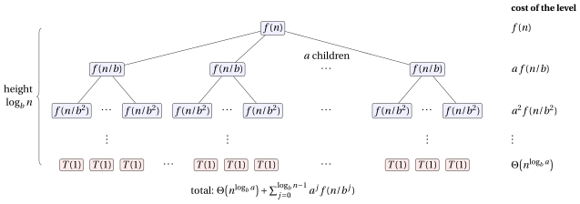

# The Master Theorem

**Part 5 · Recursion · Chapter 16** · [:material-file-pdf-box: Lecture notes, volume 5 (PDF)](../pdf/lecture-notes-5-recursion.pdf) · [:material-pencil: Exercises](../exercises/ex-16-master-theorem.md)

## Introduction

In the chapter <em>Recurrences</em> we solved recurrences by expansion, by substitution and with recursion trees. Each method requires some computation, and for divide-and-conquer recurrences the computation is always the same: draw the tree, sum the level costs, compare the root with the leaves. At the end of that chapter we observed three possible behaviours: the leaves dominate, all the levels cost the same, or the root dominates.

The <strong>Master Theorem</strong> turns these three behaviours into a ready-to-use result. In this chapter we

- recall the recurrences in standard form and the algorithms that produce them (Section [16.1](#sez-sec-standardForm));

- state the theorem and explain its three cases (Section [16.2](#sez-sec-theorem));

- apply it with a fixed five-step scheme to many examples (Section [16.3](#sez-sec-applying)), and show the situations in which it cannot be applied (Section [16.4](#sez-sec-notApply));

- prove it (Section [16.5](#sez-sec-proof)), first for exact powers of $b$ and then for every natural number.

## 16.1 Recurrences in standard form { #sez-sec-standardForm }

- In the chapter <em>Recurrences</em> we have seen that the number of steps executed by a recursive algorithm is naturally described by a <strong>recurrence</strong>, i.e., an equation that expresses the value of a function on an input of size $n$ in terms of its values on smaller inputs.

- A large family of <em>divide-and-conquer</em> algorithms produces recurrences of a very specific shape, called the <strong>standard form</strong>:

    $$
    \blue{T(n) = a\, T\left(\frac{n}{b}\right) + f(n)}
    $$

    where:

    - $n$ is the size of the input;

    - $a$ is the <strong>number of subproblems</strong> generated by each recursive call ($a \ge 1$, constant);

    - $\frac{n}{b}$ is the <strong>size of each subproblem</strong> ($b > 1$, constant); when $n/b$ is not a natural number it is understood as $\lfloor n/b \rfloor$ or $\lceil n/b \rceil$;

    - $f(n)$ is the <strong>cost of dividing</strong> the problem into the $a$ subproblems <strong>and of combining</strong> their solutions (everything that is done outside the recursive calls). We always assume that $f(n)$ is <strong>asymptotically positive</strong>, i.e., $f(n)>0$ for all sufficiently large $n$.

- For sufficiently small $n$ (for example $n=1$) the recursion stops and $T(n)=\Theta(1)$: solving a problem of constant size requires a constant number of steps. For this reason the base case is usually not even written.

!!! chiave ""

    In this chapter a recurrence is a <strong>mathematical object</strong>: we use a generic function $T(n)$. When we analyse a recursive algorithm, the function described by the recurrence is the number of steps $S(n)$ executed in the worst case on an input of size parameter $n$; the worst-case running time $T(|I|)$ is then obtained from $S(n)$ exactly as in the chapter <em>Running time</em>.

- Examples of recurrences in standard form (they will all be solved in Section [16.3](#sez-sec-applying)):

    
<table>
    <tr>
    <th>Algorithm</th>
    <th>Recurrence</th>
    <th>&#92;(a&#92;)</th>
    <th>&#92;(b&#92;)</th>
    <th>&#92;(f(n)&#92;)</th>
    </tr>
    <tr>
    <td>Binary search (recursive)</td>
    <td>&#92;(T(n)=T(n/2)+1&#92;)</td>
    <td>&#92;(1&#92;)</td>
    <td>&#92;(2&#92;)</td>
    <td>&#92;(1&#92;)</td>
    </tr>
    <tr>
    <td>Array sum (recursive)</td>
    <td>&#92;(T(n)=2T(n/2)+1&#92;)</td>
    <td>&#92;(2&#92;)</td>
    <td>&#92;(2&#92;)</td>
    <td>&#92;(1&#92;)</td>
    </tr>
    <tr>
    <td>Merge sort</td>
    <td>&#92;(T(n)=2T(n/2)+n&#92;)</td>
    <td>&#92;(2&#92;)</td>
    <td>&#92;(2&#92;)</td>
    <td>&#92;(n&#92;)</td>
    </tr>
    <tr>
    <td>Karatsuba multiplication</td>
    <td>&#92;(T(n)=3T(n/2)+n&#92;)</td>
    <td>&#92;(3&#92;)</td>
    <td>&#92;(2&#92;)</td>
    <td>&#92;(n&#92;)</td>
    </tr>
    <tr>
    <td>Strassen matrix multiplication</td>
    <td>&#92;(T(n)=7T(n/2)+n^2&#92;)</td>
    <td>&#92;(7&#92;)</td>
    <td>&#92;(2&#92;)</td>
    <td>&#92;(n^2&#92;)</td>
    </tr>
    </table>

- The <strong>Master Theorem</strong> gives the order of growth of $T(n)$ for most recurrences in standard form, directly from $a$, $b$ and $f(n)$, without any computation of the recursion.

## 16.2 The Master Theorem { #sez-sec-theorem }

!!! teorema "Theorem 16.1: Master Theorem"

    Let $a \ge 1$ and $b>1$ be constants, let $f(n)$ be an asymptotically positive function, and let $T(n)$ be defined on the natural numbers by the recurrence

    $$
    T(n) = a\, T\left(\frac{n}{b}\right) + f(n),
    $$

    where $n/b$ is interpreted as either $\lfloor n/b\rfloor$ or $\lceil n/b\rceil$, and $T(n)=\Theta(1)$ for sufficiently small $n$. Then $T(n)$ has the following asymptotic bounds.

    - **Case 1:** if $f(n) = O\big(n^{\log_b a - \epsilon}\big)$ for some constant $\epsilon>0$, then

        $$
        \blue{T(n)=\Theta\big(n^{\log_b a}\big)};
        $$

    - **Case 2:** if $f(n) = \Theta\big(n^{\log_b a}\log^k n\big)$ for some constant $k\ge 0$, then

        $$
        \blue{T(n)=\Theta\big(n^{\log_b a}\log^{k+1} n\big)};
        $$

    - **Case 3:** if $f(n) = \Omega\big(n^{\log_b a + \epsilon}\big)$ for some constant $\epsilon>0$, and if

        $$
        a\, f\left(\frac{n}{b}\right) \le c\, f(n)
        $$

        for some constant $c<1$ and all sufficiently large $n$ (<strong>regularity condition</strong>), then

        $$
        \blue{T(n)=\Theta\big(f(n)\big)}.
        $$

- This is the classical statement of the theorem (as in the textbook of Cormen, Leiserson, Rivest and Stein, <em>Introduction to Algorithms</em>), with the <strong>extended case 2</strong>: for $k=0$ we obtain the basic statement “if $f(n)=\Theta(n^{\log_b a})$ then $T(n)=\Theta(n^{\log_b a}\log n)$”.

- The notations $O$, $\Omega$ and $\Theta$ in the statement are those defined in chapter 9 «Asymptotic notation».

- The proof is given in Section [16.5](#sez-sec-proof).

### 16.2.1 Rule of thumb

- In each of the three cases we compare the function $f(n)$ with the function

    $$
    n^{\log_b a},
    $$

    which (as we will see in [Lemma 16.3](#box-21-lemMasterTree)) is the number of leaves of the recursion tree. As a rule of thumb, check:

    $$
    n^{\log_b a } \quad  \begin{cases}
    \text{polynomially larger than } f(n) & \longrightarrow \quad \text{\red{case 1}:}\quad T(n)=\Theta\big(n^{\log_b a}\big)\\[2mm]
    \text{of the same order as } f(n) \text{ (up to } \log^k n) &\longrightarrow \quad \text{\red{case 2}:}\quad T(n)=\Theta\big(n^{\log_b a}\log^{k+1} n\big) \\[2mm]
    \text{polynomially smaller than } f(n) & \longrightarrow \quad \text{\red{case 3}:}\quad T(n)=\Theta\big(f(n)\big)
    \end{cases}
    $$

    and determine the order of growth of $T(n)$ accordingly (if possible).

- <strong>Intuitively, the larger of the two functions determines the solution of the recurrence.</strong>

- <strong>Polynomially</strong> smaller (larger) means smaller (larger) <strong>by a factor $n^{\epsilon}$</strong> for some constant $\epsilon>0$. For example:

    - $n$ is polynomially smaller than $n^2$ (factor $n^1$), and $n^{2}$ is polynomially smaller than $n^{2.1}$ (factor $n^{0.1}$);

    - $n$ is smaller than $n\log n$, but <strong>not</strong> polynomially smaller: for every $\epsilon>0$

        $$
        \lim_{n\to\infty}\frac{n\log n}{n^{1+\epsilon}}=\lim_{n\to\infty}\frac{\log n}{n^{\epsilon}} = 0^+,
        $$

        hence $n\log n$ grows more slowly than $n\cdot n^{\epsilon}$, whatever $\epsilon>0$ we choose.

### 16.2.2 Intuition

- Unfolding the recurrence (see the recursion tree in Figure [16.1](#box-20-fig-masterTree)) the total cost is

    $$
    T(n) = \underbrace{\Theta\big(n^{\log_b a}\big)}_{\text{cost of the leaves}} \; + \; \underbrace{\sum_{j=0}^{\log_b n -1} a^j f\left(\frac{n}{b^j}\right)}_{\text{cost of the internal levels}}
    $$

    where level $j$ of the tree contains $a^j$ subproblems of size $n/b^j$.

- Consider the simple case $f(n)=n^d$. The cost of level $j$ is

    $$
    a^j \left(\frac{n}{b^j}\right)^{d} = n^d\left(\frac{a}{b^d}\right)^{j},
    $$

    so the costs of the levels form a <strong>geometric progression with ratio</strong> $a/b^d$. Since $a/b^d>1 \iff d<\log_b a$:

    - case 1 ($d<\log_b a$): the level costs <strong>increase</strong> geometrically from the root to the leaves; the total is dominated by the leaves, i.e., by $n^{\log_b a}$;

    - case 2 ($d=\log_b a$): all the $\log_b n$ levels have <strong>the same cost</strong> $n^{d}=n^{\log_b a}$; the total is $n^{\log_b a}$ times the number of levels, i.e., $n^{\log_b a}\log n$;

    - case 3 ($d>\log_b a$): the level costs <strong>decrease</strong> geometrically; the total is dominated by the root, i.e., by $f(n)$.

### 16.2.3 The gaps between the cases

- The three cases <strong>do not cover all the possible functions</strong> $f(n)$.

    - There is a gap between case 1 and case 2 when $f(n)$ is smaller than $n^{\log_b a}$ but <strong>not polynomially smaller</strong> (and not of the form $n^{\log_b a}\log^k n$ with $k\ge0$), e.g., $f(n)=n^{\log_b a}/\log n$.

    - There is a gap between case 2 and case 3 when $f(n)$ is larger than $n^{\log_b a}$ but <strong>not polynomially larger</strong> (and not of the form $n^{\log_b a}\log^k n$), e.g., $f(n)=n^{\log_b a}\, 2^{\sqrt{\log_2 n}}$.

    - Case 3 does not apply also when $f(n)$ is polynomially larger than $n^{\log_b a}$ but the <strong>regularity condition</strong> fails.

- In these situations the Master Theorem <strong>cannot be used</strong>, and the recurrence must be solved with other techniques (recursion tree, iteration, substitution method), see Section [16.4](#sez-sec-notApply).

### 16.2.4 A remark on the base of the logarithms

- Since $\log_c n = \dfrac{\log_2 n}{\log_2 c}$ for every base $c>1$, we have

    $$
    \log_c^k n = \frac{1}{\log_2^k c}\,\log_2^k n = \Theta\big(\log_2^k n\big).
    $$

    Thus, <strong>inside $\Theta$, $O$ and $\Omega$ the base of the logarithm is irrelevant</strong>: in case 2 we simply write $\log^k n$.

- On the contrary, the base $b$ in the <strong>exponent</strong> $n^{\log_b a}$ is essential: for instance $n^{\log_2 4}=n^2$ whereas $n^{\log_4 4}=n$, and $n^{2}\neq\Theta(n)$.

!!! chiave ""

    - The Master Theorem compares the cost of the root, $f(n)$, with the number of leaves of the recursion tree, $n^{\log_b a}$: the larger of the two determines $T(n)$; when they are of the same order (up to $\log^k n$) one more factor $\log n$ appears.

    - “Larger” and “smaller” must be <strong>polynomial</strong> (by a factor $n^\epsilon$); in case 3 the <strong>regularity condition</strong> must also hold.

    - When $f(n)$ falls in a gap between the cases, the theorem gives no answer.

## 16.3 Applying the Master Theorem { #sez-sec-applying }

!!! chiave ""

    To solve a recurrence with the Master Theorem we always follow this scheme:

    1. <strong>identify</strong> $a$, $b$ and $f(n)$ (and check that $a\ge 1$, $b>1$ are constants and $f(n)$ is asymptotically positive);

    2. <strong>compute</strong> $n^{\log_b a}$;

    3. <strong>compare</strong> $n^{\log_b a}$ with $f(n)$ and guess the case;

    4. <strong>verify</strong> the hypothesis of the case: find $\epsilon>0$ (case 1 or 3), find $k\ge0$ (case 2), and check the regularity condition (case 3);

    5. <strong>conclude</strong>.

We start with three recurrences, one for each case, and then solve the recurrences of the algorithms listed in Section [16.1](#sez-sec-standardForm).

!!! esempio "Example 16.1: $T(n)=16\,T(n/4)+n$"

    1. $a=16$, $b=4$, $f(n)=n$.

    2. $n^{\log_b a}=n^{\log_4 16}=n^2$.

    3. $n^2$ is polynomially larger than $f(n)=n$ $\longrightarrow$ case 1.

    4. $f(n)=n=O\big(n^{2-\epsilon}\big)$ with $\epsilon=1$.

    5. $T(n)=\Theta\big(n^{\log_4 16}\big)=\Theta(n^2)$.

!!! esempio "Example 16.2: $T(n)=8\,T(n/2)+n^3$"

    1. $a=8$, $b=2$, $f(n)=n^3$.

    2. $n^{\log_b a}=n^{\log_2 8}=n^3$.

    3. $n^3$ and $f(n)=n^3$ have the same order $\longrightarrow$ case 2.

    4. $f(n)=n^3=\Theta\big(n^{3}\log^k n\big)$ with $k=0$.

    5. $T(n)=\Theta\big(n^{3}\log^{k+1} n\big)=\Theta(n^3\log n)$.

!!! esempio "Example 16.3: $T(n)=8\,T(n/3)+n^2$"

    1. $a=8$, $b=3$, $f(n)=n^2$.

    2. $n^{\log_b a}=n^{\log_3 8}\approx n^{1.893}$.

    3. $n^{1.893}$ is polynomially smaller than $f(n)=n^2$ $\longrightarrow$ case 3.

    4. $f(n)=n^2=\Omega\big(n^{\log_3 8+\epsilon}\big)$ for every $0<\epsilon\le 2-\log_3 8\approx 0.107$.  Regularity condition: we look for a constant $c<1$ such that, for all large $n$,

        $$
        8\, f\left(\frac{n}{3}\right) \le c\, f(n)
        \quad\Longleftrightarrow\quad
        8\left(\frac{n}{3}\right)^2 \le c\, n^2
        \quad\Longleftrightarrow\quad
        \frac{8}{9}\, n^2 \le c\, n^2 ,
        $$

        which holds for every $c$ with $\frac{8}{9}\le c<1$, e.g., $c=\frac{8}{9}$.

    5. $T(n)=\Theta(n^2)$.

!!! esempio "Example 16.4: Binary search: $T(n)=T(n/2)+1$"

    1. $a=1$, $b=2$, $f(n)=1$.

    2. $n^{\log_b a}=n^{\log_2 1}=n^0=1$.

    3. $1$ and $f(n)=1$ have the same order $\longrightarrow$ case 2.

    4. $f(n)=1=\Theta\big(n^{0}\log^k n\big)$ with $k=0$.

    5. $T(n)=\Theta\big(n^{0}\log n\big)=\Theta(\log n)$.

!!! esempio "Example 16.5: Merge sort: $T(n)=2\,T(n/2)+n$"

    1. $a=2$, $b=2$, $f(n)=n$.

    2. $n^{\log_b a}=n^{\log_2 2}=n$.

    3. $n$ and $f(n)=n$ have the same order $\longrightarrow$ case 2.

    4. $f(n)=n=\Theta\big(n\log^k n\big)$ with $k=0$.

    5. $T(n)=\Theta(n\log n)$.

!!! esempio "Example 16.6: Array sum: $T(n)=2\,T(n/2)+1$"

    1. $a=2$, $b=2$, $f(n)=1$.

    2. $n^{\log_b a}=n^{\log_2 2}=n$.

    3. $n$ is polynomially larger than $f(n)=1$ $\longrightarrow$ case 1.

    4. $f(n)=1=O\big(n^{1-\epsilon}\big)$ with $\epsilon=1$ (indeed $n^{1-1}=n^0=1$).

    5. $T(n)=\Theta(n)$.

    The recursive sum of an array that splits the array into two halves (the algorithm <code>RecursiveSum</code> of the chapter «Recursive algorithms») is an algorithm of this kind.

    Each call does a constant amount of work outside the recursive calls, and the total number of calls is $\Theta(n)$: counting them (in the Colab notebooks of the chapter), on $n=8$, $1000$ and $2^{20}=1\,048\,576$ entries we obtain $15$, $1\,999$ and $2\,097\,151$ calls, that is, exactly $2n-1$.

    
Run in Colab:

!!! esempio "Example 16.7: Karatsuba: $T(n)=3\,T(n/2)+n$"

    1. $a=3$, $b=2$, $f(n)=n$.

    2. $n^{\log_b a}=n^{\log_2 3}\approx n^{1.585}$.

    3. $n^{1.585}$ is polynomially larger than $f(n)=n$ $\longrightarrow$ case 1.

    4. $f(n)=n=O\big(n^{\log_2 3-\epsilon}\big)$ with $\epsilon=\log_2 3-1\approx 0.585>0$.

    5. $T(n)=\Theta\big(n^{\log_2 3}\big)\approx\Theta\big(n^{1.585}\big)$: Karatsuba's algorithm is asymptotically faster than the schoolbook $\Theta(n^2)$ multiplication.

!!! esempio "Example 16.8: Strassen: $T(n)=7\,T(n/2)+n^2$"

    1. $a=7$, $b=2$, $f(n)=n^2$.

    2. $n^{\log_b a}=n^{\log_2 7}\approx n^{2.807}$.

    3. $n^{2.807}$ is polynomially larger than $f(n)=n^2$ $\longrightarrow$ case 1.

    4. $f(n)=n^2=O\big(n^{\log_2 7-\epsilon}\big)$ with $\epsilon=\log_2 7-2\approx 0.807>0$.

    5. $T(n)=\Theta\big(n^{\log_2 7}\big)\approx\Theta\big(n^{2.807}\big)$, better than the $\Theta(n^3)$ of the standard matrix multiplication (whose divide-and-conquer recurrence is $T(n)=8T(n/2)+n^2$).

!!! esempio "Example 16.9: $T(n)=2\,T(n/2)+n\log n$"

    1. $a=2$, $b=2$, $f(n)=n\log n$.

    2. $n^{\log_b a}=n^{\log_2 2}=n$.

    3. $f(n)=n\log n$ is larger than $n$, but only by a factor $\log n$, not polynomially $\longrightarrow$ not case 3; it has the form $n^{\log_b a}\log^k n$ $\longrightarrow$ case 2.

    4. $f(n)=n\log n=\Theta\big(n\log^k n\big)$ with $k=1$.

    5. $T(n)=\Theta\big(n\log^{2} n\big)$.

!!! esempio "Example 16.10: $T(n)=3\,T(n/4)+n\log n$"

    1. $a=3$, $b=4$, $f(n)=n\log n$ (logarithm in base 2).

    2. $n^{\log_b a}=n^{\log_4 3}\approx n^{0.792}$.

    3. $n^{0.792}$ is polynomially smaller than $f(n)=n\log n$ $\longrightarrow$ case 3.

    4. Since $n\log n\ge n$ for $n\ge 2$, we have $f(n)=\Omega\big(n^{\log_4 3+\epsilon}\big)$ with $\epsilon=1-\log_4 3\approx 0.208$.  Regularity condition: for every $n\ge 4$,

        $$
        3\, f\left(\frac{n}{4}\right) = 3\, \frac{n}{4}\,\log\frac{n}{4} \le \frac{3}{4}\, n\log n = c\, f(n)
        \qquad\text{with } c=\frac{3}{4}<1,
        $$

        because $\log(n/4)\le \log n$.

    5. $T(n)=\Theta(n\log n)$.

!!! esempio "Example 16.11: $T(n)=T(2n/3)+1$"

    1. $a=1$, $b=\frac{3}{2}$ (indeed $\frac{2n}{3}=\frac{n}{3/2}$), $f(n)=1$. Note that $b$ does not need to be an integer.

    2. $n^{\log_b a}=n^{\log_{3/2} 1}=n^0=1$.

    3. $1$ and $f(n)=1$ have the same order $\longrightarrow$ case 2.

    4. $f(n)=1=\Theta\big(n^{0}\log^k n\big)$ with $k=0$.

    5. $T(n)=\Theta(\log n)$.

- A <strong>numerical check</strong>. For each of the recurrences above with $b$ integer we computed $T(n)$ exactly from the recurrence, with $T(1)=1$ and $n=b^L$, and divided it by the order of growth $g(n)$ given by the theorem (logarithms in base $2$). The ratio stays bounded between two positive constants, as the theorem guarantees, and approaches the limit in the last column.

<table>
<tr>
<th>Recurrence</th>
<th>&#92;(g(n)&#92;)</th>
<th>&#92;(L=5&#92;)</th>
<th>&#92;(L=10&#92;)</th>
<th>&#92;(L=20&#92;)</th>
<th>limit</th>
</tr>
<tr>
<td>&#92;(16&#92;,T(n/4)+n&#92;)</td>
<td>&#92;(n^2&#92;)</td>
<td>1.3330</td>
<td>1.3333</td>
<td>1.3333</td>
<td>&#92;(4/3&#92;)</td>
</tr>
<tr>
<td>&#92;(8&#92;,T(n/2)+n^3&#92;)</td>
<td>&#92;(n^3&#92;log n&#92;)</td>
<td>1.2000</td>
<td>1.1000</td>
<td>1.0500</td>
<td>&#92;(1&#92;)</td>
</tr>
<tr>
<td>&#92;(8&#92;,T(n/3)+n^2&#92;)</td>
<td>&#92;(n^2&#92;)</td>
<td>4.5606</td>
<td>6.5364</td>
<td>8.2414</td>
<td>&#92;(9&#92;)</td>
</tr>
<tr>
<td>&#92;(T(n/2)+1&#92;)</td>
<td>&#92;(&#92;log n&#92;)</td>
<td>1.2000</td>
<td>1.1000</td>
<td>1.0500</td>
<td>&#92;(1&#92;)</td>
</tr>
<tr>
<td>&#92;(2&#92;,T(n/2)+n&#92;)</td>
<td>&#92;(n&#92;log n&#92;)</td>
<td>1.2000</td>
<td>1.1000</td>
<td>1.0500</td>
<td>&#92;(1&#92;)</td>
</tr>
<tr>
<td>&#92;(2&#92;,T(n/2)+1&#92;)</td>
<td>&#92;(n&#92;)</td>
<td>1.9688</td>
<td>1.9990</td>
<td>2.0000</td>
<td>&#92;(2&#92;)</td>
</tr>
<tr>
<td>&#92;(3&#92;,T(n/2)+n&#92;)</td>
<td>&#92;(n^{&#92;log&#95;2 3}&#92;)</td>
<td>2.7366</td>
<td>2.9653</td>
<td>2.9994</td>
<td>&#92;(3&#92;)</td>
</tr>
<tr>
<td>&#92;(7&#92;,T(n/2)+n^2&#92;)</td>
<td>&#92;(n^{&#92;log&#95;2 7}&#92;)</td>
<td>2.2521</td>
<td>2.3284</td>
<td>2.3333</td>
<td>&#92;(7/3&#92;)</td>
</tr>
<tr>
<td>&#92;(2&#92;,T(n/2)+n&#92;log n&#92;)</td>
<td>&#92;(n&#92;log^2 n&#92;)</td>
<td>0.6400</td>
<td>0.5600</td>
<td>0.5275</td>
<td>&#92;(1/2&#92;)</td>
</tr>
<tr>
<td>&#92;(3&#92;,T(n/4)+n&#92;log n&#92;)</td>
<td>&#92;(n&#92;log n&#92;)</td>
<td>2.1933</td>
<td>2.8704</td>
<td>3.4020</td>
<td>&#92;(4&#92;)</td>
</tr>
</table>

- For merge sort, for instance, $T(2^{L})=2^{L}(L+1)$, so $T(n)=n\log_2 n+n$ and $\frac{T(n)}{n\log_2 n}=1+\frac{1}{L}$. In case 3 the convergence is slow: the ratio tends to $\frac{1}{1-c}$ ($9$ for $c=\frac{8}{9}$, $4$ for $c=\frac{3}{4}$), the bound that appears in the proof of the theorem.

!!! chiave ""

    The theorem gives the <strong>order of growth</strong>, not the constant: in the table the ratios tend to different constants, but they never grow or vanish.

## 16.4 When the Master Theorem does not apply { #sez-sec-notApply }

- Before applying the theorem, always check that <strong>all</strong> its hypotheses hold. Here are typical situations in which the theorem <strong>cannot</strong> be applied.

!!! esempio "Example 16.12: A gap between case 1 and case 2: $T(n)=2\,T(n/2)+n/\log_2 n$"

    - $a=2$, $b=2$, $f(n)=n/\log_2 n$, and $n^{\log_b a}=n$.

    - <strong>Not case 1</strong>: $f(n)$ is smaller than $n$, but not polynomially smaller. For every $\epsilon>0$

        $$
        \lim_{n\to\infty}\frac{n/\log_2 n}{n^{1-\epsilon}}=\lim_{n\to\infty}\frac{n^{\epsilon}}{\log_2 n}=+\infty,
        $$

        hence $f(n)\neq O(n^{1-\epsilon})$.

    - <strong>Not case 2</strong>: $f(n)=n\log^{-1} n$ would require $k=-1<0$.

    - <strong>Not case 3</strong>: $f(n)$ is smaller than $n$.

    - <strong>Solution with the recursion tree</strong> ([Lemma 16.3](#box-21-lemMasterTree)), for $n=2^L$ and $T(1)=1$: level $j$ costs

        $$
        2^j\,\frac{n/2^j}{\log_2(n/2^j)}=\frac{n}{L-j},
        \qquad\text{so}\qquad
        T(n)=n+\sum_{j=0}^{L-1}\frac{n}{L-j}=n+n\sum_{i=1}^{L}\frac{1}{i}=n\,(1+H_L),
        $$

        where $H_L=\sum_{i=1}^{L}\frac1i$ is the $L$-th harmonic number. Since $\ln(L+1)\le H_L\le 1+\ln L$ (comparison with $\int \frac{dx}{x}$), $H_L=\Theta(\log L)$ and

        $$
        T(n)=\Theta(n\log\log n).
        $$

!!! esempio "Example 16.13: Not in standard form: $T(n)=T(n-1)+n$"

    - The subproblem has size $n-1$, not $n/b$ with a constant $b>1$: the recurrence is <strong>not in standard form</strong>.

    - Solution by iteration (with $T(1)=1$):

        $$
        T(n)=n+(n-1)+\dots+2+T(1)=\sum_{i=1}^{n} i=\frac{n(n+1)}{2}=\Theta(n^2).
        $$

!!! esempio "Example 16.14: Subproblems of different sizes: $T(n)=T(n/3)+T(2n/3)+n$"

    - The two subproblems have <strong>different sizes</strong> $n/3$ and $2n/3$: the recurrence is not of the form $a\,T(n/b)+f(n)$.

    - Recursion tree: every complete level has total size $n$, hence cost $n$. The shortest root-to-leaf path (always $n/3$) has length $\log_3 n$, the longest (always $2n/3$) has length $\log_{3/2} n$. Therefore the first $\log_3 n$ levels are complete (cost $\ge n\log_3 n$), and there are at most $\log_{3/2} n+1$ levels, each of cost at most $n$. Hence

        $$
        T(n)=\Theta(n\log n).
        $$

!!! esempio "Example 16.15: $a$ is not constant: $T(n)=2^n\,T(n/2)+n^n$"

    - The number of subproblems $a=2^n$ <strong>depends on $n$</strong>: the Master Theorem requires $a$ to be a constant.

!!! esempio "Example 16.16: $a<1$: $T(n)=0.5\,T(n/2)+1/n$"

    - Here $a=0.5<1$: the theorem requires $a\ge 1$ (there must be at least one subproblem).

!!! esempio "Example 16.17: The regularity condition fails: $T(n)=T(n/2)+n(2-\cos n)$"

    - $a=1$, $b=2$, $n^{\log_b a}=n^0=1$, $f(n)=n(2-\cos n)$. Since $1\le 2-\cos n\le 3$, we have $n\le f(n)\le 3n$, so

        $$
        f(n)=\Theta(n)=\Omega\big(n^{0+\epsilon}\big)\quad\text{with }\epsilon=1:
        $$

        $f(n)$ is polynomially larger than $n^{\log_b a}$, and we would expect case 3.

    - <strong>The regularity condition fails.</strong> Take an even $n=2m$. Then

        $$
        \frac{a\,f(n/2)}{f(n)}=\frac{m\,(2-\cos m)}{2m\,(2-\cos 2m)}=\frac{2-\cos m}{2\,(2-\cos 2m)}.
        $$

        If $\cos m\le -0.9$, then $2-\cos m\ge 2.9$ and $\cos 2m=2\cos^2 m-1\ge 2\cdot 0.81-1=0.62$, so $2(2-\cos 2m)\le 2.76$ and the ratio is $>1$. Since $\pi$ is irrational, the values $m \bmod 2\pi$ ($m\in\N$) are dense in $[0,2\pi)$, so there are <strong>infinitely many</strong> $m$ with $\cos m\le -0.9$ (e.g., $m=3,9,16,22,28,\dots$). For $m=22$: $\cos 22\approx-0.99996$, $\cos 44\approx 0.99984$, and the ratio is $\approx 1.4997$.  Hence there is no constant $c<1$ such that $a f(n/2)\le c f(n)$ for all large $n$: <strong>case 3 cannot be applied</strong>.

    - Nevertheless the recurrence can be solved directly (with $n/2$ meaning $\lfloor n/2\rfloor$): unfolding it,

        $$
        n\le f(n)\le T(n)\le \sum_{j\ge 0} 3\,\frac{n}{2^j}+T(1)=6n+T(1),
        \qquad\text{so}\qquad T(n)=\Theta(n).
        $$

## 16.5 Proof of the Master Theorem { #sez-sec-proof }

- We follow the classical proof, which has two parts:

    1. we first assume that $n$ is an <strong>exact power of $b$</strong>, i.e., $n=b^L$ for some $L\in\N$; then all the subproblem sizes $n/b, n/b^2,\dots$ are exact powers of $b$ and no floor or ceiling is needed (Lemmas [16.3](#box-21-lemMasterTree), [Lemma 16.4](#box-23-lemMasterSum) and [Lemma 16.5](#box-27-lemMasterPowers));

    2. we then extend the result to every natural number $n$, when $n/b$ is $\lceil n/b\rceil$ or $\lfloor n/b\rfloor$ (Section [16.5.5](#sez-sec-floorsCeilings)).

### 16.5.1 Setting

- Throughout the proof we set

    $$
    \blue{p=\log_b a}, \qquad\text{so that}\qquad b^p=a \quad\text{and}\quad p\ge 0 \ (\text{since } a\ge1).
    $$

- For $n$ exact power of $b$ we consider the recurrence

    \begin{equation*}
    \label{eq:recPowers}
    T(n)=\begin{cases}
    d & \text{if } n=1,\\
    a\,T(n/b)+f(n) & \text{if } n=b^i,\ i\ge 1,
    \end{cases} \tag{16.1}
    \end{equation*}

    where $d>0$ is a constant (this is the meaning of $T(1)=\Theta(1)$).

- We assume $f(m)>0$ for every $m\ge1$. This is always true when $f$ counts steps of an algorithm; in general, since $f$ is asymptotically positive, only finitely many values are affected and only the constants of the proof change.

- The hypotheses of the three cases hold “for all sufficiently large $n$”, i.e., for $n\ge n_0$. The following observation allows us to use them for <strong>every</strong> exact power of $b$ at least $b$.

!!! teorema "Observation 16.2: from large powers to all powers"

    Let $f(m)>0$ and $h(m)>0$ for every exact power $m\ge b$ of $b$. If there are constants $c>0$ and $n_0$ such that $f(m)\le c\,h(m)$ (resp. $f(m)\ge c\,h(m)$) for all exact powers $m\ge n_0$, then there is a constant $c'>0$ such that $f(m)\le c'\,h(m)$ (resp. $f(m)\ge c'\,h(m)$) for <strong>all</strong> exact powers $m\ge b$ of $b$.

??? dimostrazione "Proof"

    There are only finitely many exact powers of $b$ in the interval $[b,n_0)$. Let

    $$
    c'=\max\left\{c,\ \max_{b\le m<n_0}\frac{f(m)}{h(m)}\right\}
    \qquad\left(\text{resp. } c'=\min\left\{c,\ \min_{b\le m<n_0}\frac{f(m)}{h(m)}\right\}>0\right),
    $$

    where $m$ ranges over exact powers of $b$. Then $f(m)\le c'h(m)$ (resp. $\ge$) both for $m<n_0$, by the choice of $c'$, and for $m\ge n_0$, since $c\le c'$ (resp. $c\ge c'$). □

- We will apply it with $h(m)=m^{p-\epsilon}$ and $h(m)=m^{p}\log_b^k m$, which are positive for $m\ge b$ (note $\log_b m\ge 1$ for $m\ge b$).

### 16.5.2 The recursion tree

{ .fig loading=lazy  }

<strong>Figure 16.1:</strong> Recursion tree of &#92;(T(n)=aT(n/b)+f(n)&#92;) for &#92;(n&#92;) exact power of &#92;(b&#92;). Each internal node has &#92;(a&#92;) children; level &#92;(j&#92;) has &#92;(a^j&#92;) nodes, each a subproblem of size &#92;(n/b^j&#92;) with cost &#92;(f(n/b^j)&#92;); the leaves are at depth &#92;(&#92;log&#95;b n&#92;).

- The root (level $0$) is a problem of size $n$; it costs $f(n)$ and generates $a$ subproblems of size $n/b$.

- By induction, level $j$ contains $a^j$ nodes, each a subproblem of size $n/b^j$ and cost $f(n/b^j)$: the total cost of level $j$ is $a^j f(n/b^j)$.

- The subproblem size reaches $1$ when $n/b^j=1$, i.e., at depth $j=\log_b n$: the leaves are the $a^{\log_b n}$ nodes of level $\log_b n$, each with cost $T(1)=d$.

!!! teorema "Lemma 16.3: Cost of the recursion tree"

    Let $a\ge1$ and $b>1$ be constants and let $f(n)>0$ for $n\ge1$. For every $n$ exact power of $b$, the solution of recurrence $\eqref{eq:recPowers}$ is

    $$
    T(n)=d\,n^{\log_b a}+\sum_{j=0}^{\log_b n-1}a^j f\left(\frac{n}{b^j}\right)
    =\Theta\big(n^{\log_b a}\big)+\sum_{j=0}^{\log_b n-1}a^j f\left(\frac{n}{b^j}\right).
    $$

??? dimostrazione "Proof"

    Let $n=b^L$. We first prove by induction on $i\in\{0,1,\dots,L\}$ that

    \begin{equation*}
    \label{eq:unfold}
    T(n)=a^{i}\,T\left(\frac{n}{b^{i}}\right)+\sum_{j=0}^{i-1}a^j f\left(\frac{n}{b^j}\right). \tag{16.2}
    \end{equation*}

    For $i=0$ the sum is empty and $\eqref{eq:unfold}$ reads $T(n)=T(n)$. Assume $\eqref{eq:unfold}$ holds for some $i<L$. Since $n/b^{i}=b^{L-i}$ with $L-i\ge1$, the recurrence gives $T(n/b^{i})=a\,T(n/b^{i+1})+f(n/b^{i})$, so

    $$
    T(n)=a^{i}\Big(a\,T\big(\tfrac{n}{b^{i+1}}\big)+f\big(\tfrac{n}{b^{i}}\big)\Big)+\sum_{j=0}^{i-1}a^j f\big(\tfrac{n}{b^j}\big)
    =a^{i+1}\,T\big(\tfrac{n}{b^{i+1}}\big)+\sum_{j=0}^{i}a^j f\big(\tfrac{n}{b^j}\big),
    $$

    which is $\eqref{eq:unfold}$ for $i+1$. For $i=L=\log_b n$ we have $T(n/b^L)=T(1)=d$, hence

    $$
    T(n)=d\,a^{\log_b n}+\sum_{j=0}^{\log_b n-1}a^j f\left(\frac{n}{b^j}\right).
    $$

    It remains to show that $a^{\log_b n}=n^{\log_b a}$. Writing $a=b^{\log_b a}$ and $n=b^{\log_b n}$,

    $$
    a^{\log_b n}=\big(b^{\log_b a}\big)^{\log_b n}=b^{\log_b a\,\cdot\,\log_b n}=\big(b^{\log_b n}\big)^{\log_b a}=n^{\log_b a}.
    $$

    Finally, $d>0$ is a constant, so $d\,n^{\log_b a}=\Theta(n^{\log_b a})$. □

- The first term is the cost of the <strong>leaves</strong>: there are exactly $n^{\log_b a}$ leaves. The sum is the cost of the <strong>internal nodes</strong> (levels $0,\dots,\log_b n-1$).

!!! esempio "Example 16.18: [Lemma 16.3](#box-21-lemMasterTree) for $T(n)=2T(n/2)+n$, $T(1)=1$, $n=8$"

    Here $a=2$, $b=2$, $f(n)=n$, $d=1$, $\log_2 8=3$.

    
<table>
    <tr>
    <th>level &#92;(j&#92;)</th>
    <th>nodes &#92;(a^j&#92;)</th>
    <th>size &#92;(n/b^j&#92;)</th>
    <th>cost per node</th>
    <th>cost of the level</th>
    </tr>
    <tr>
    <td>0</td>
    <td>1</td>
    <td>8</td>
    <td>&#92;(f(8)=8&#92;)</td>
    <td>8</td>
    </tr>
    <tr>
    <td>1</td>
    <td>2</td>
    <td>4</td>
    <td>&#92;(f(4)=4&#92;)</td>
    <td>8</td>
    </tr>
    <tr>
    <td>2</td>
    <td>4</td>
    <td>2</td>
    <td>&#92;(f(2)=2&#92;)</td>
    <td>8</td>
    </tr>
    <tr>
    <td>3 (leaves)</td>
    <td>&#92;(8=8^{&#92;log&#95;2 2}&#92;)</td>
    <td>1</td>
    <td>&#92;(T(1)=1&#92;)</td>
    <td>8</td>
    </tr>
    <tr>
    <td></td>
    <td></td>
    <td></td>
    <td>total</td>
    <td>32</td>
    </tr>
    </table>

    [Lemma 16.3](#box-21-lemMasterTree) gives $T(8)=1\cdot 8^{\log_2 2}+(8+8+8)=8+24=32$. Directly from the recurrence:

    $$
    T(2)=2\cdot1+2=4,\qquad T(4)=2\cdot4+4=12,\qquad T(8)=2\cdot12+8=32. \quad\checkmark
    $$

### 16.5.3 Bounding the sum

- By [Lemma 16.3](#box-21-lemMasterTree), to solve the recurrence we need the order of growth of

    $$
    \blue{g(n)=\sum_{j=0}^{\log_b n-1}a^j f\left(\frac{n}{b^j}\right)}.
    $$

- A key identity, used many times: since $b^p=a$,

    \begin{equation*}
    \label{eq:keyIdentity}
    a^j\left(\frac{n}{b^j}\right)^{p}=\frac{a^j}{(b^{p})^j}\,n^{p}=\frac{a^j}{a^j}\,n^p=n^{p}
    \qquad\text{for every } j. \tag{16.3}
    \end{equation*}

- In the sum, $j\le \log_b n-1$, so the sizes $m=n/b^j$ are exact powers of $b$ with $m\ge b$: by [Observation 16.2](#box-19-obsMasterAllPowers), the bounds on $f$ of cases 1 and 2 can be used for all of them.

!!! teorema "Lemma 16.4: Bounds on the sum"

    Let $a\ge1$ and $b>1$ be constants, $p=\log_b a$, let $f(m)>0$ for $m\ge1$, and let $g(n)$ be defined, for $n$ exact power of $b$, as above. Then:

    1. if $f(n)=O(n^{p-\epsilon})$ for some constant $\epsilon>0$, then $g(n)=O(n^{p})$;

    2. if $f(n)=\Theta(n^{p}\log^k n)$ for some constant $k\ge0$, then $g(n)=\Theta(n^{p}\log^{k+1} n)$;

    3. if $f(n)=\Omega(n^{p+\epsilon})$ for some constant $\epsilon>0$, and $a\,f(n/b)\le c\,f(n)$ for some constant $c<1$ and all exact powers $n\ge n_0$, then $g(n)=\Theta(f(n))$.

??? dimostrazione "Proof (Proof of case 1)"

    By [Observation 16.2](#box-19-obsMasterAllPowers) there is a constant $c>0$ such that $f(m)\le c\,m^{p-\epsilon}$ for every exact power $m\ge b$. Hence, using $\eqref{eq:keyIdentity}$,

    $$
    g(n)\le c\sum_{j=0}^{\log_b n-1}a^j\left(\frac{n}{b^j}\right)^{p-\epsilon}
    = c\sum_{j=0}^{\log_b n-1}a^j\left(\frac{n}{b^j}\right)^{p}\left(\frac{b^j}{n}\right)^{\epsilon}
    = c\, n^{p-\epsilon}\sum_{j=0}^{\log_b n-1}\big(b^{\epsilon}\big)^j .
    $$

    This is a finite geometric series with ratio $b^\epsilon>1$ (since $b>1$ and $\epsilon>0$):

    $$
    \sum_{j=0}^{\log_b n-1}\big(b^{\epsilon}\big)^j=\frac{(b^\epsilon)^{\log_b n}-1}{b^\epsilon-1}
    =\frac{(b^{\log_b n})^{\epsilon}-1}{b^\epsilon-1}=\frac{n^\epsilon-1}{b^\epsilon-1}.
    $$

    Therefore

    $$
    0< g(n)\le c\, n^{p-\epsilon}\,\frac{n^\epsilon-1}{b^\epsilon-1}\le \frac{c}{b^\epsilon-1}\,n^{p},
    $$

    and since $\frac{c}{b^\epsilon-1}$ is a positive constant, $g(n)=O(n^{p})$. □

!!! esempio "Example 16.19: Case 1 of [Lemma 16.4](#box-23-lemMasterSum): $T(n)=16T(n/4)+n$, $n=64$"

    Here $p=\log_4 16=2$, $f(m)=m=m^{2-1}$, so $c=1$, $\epsilon=1$. The internal levels cost

    $$
    g(64)=1\cdot 64+16\cdot16+256\cdot 4=64+256+1024=1344:
    $$

    the costs grow by the factor $b^\epsilon=4$ from one level to the next (they are dominated by the deepest levels). The formula of the proof gives exactly $n^{p-\epsilon}\frac{n^\epsilon-1}{b^\epsilon-1}=64\cdot\frac{63}{3}=1344$, and the bound $\frac{c}{b^\epsilon-1}n^p=\frac{4096}{3}\approx 1365.3$ holds. Adding the leaves, $T(64)=4096+1344=5440$ with $T(1)=1$.

??? dimostrazione "Proof (Proof of case 2)"

    Since $\log^k n$ and $\log_b^k n$ differ by a constant factor, the hypothesis is $f(n)=\Theta(n^p\log_b^k n)$. By [Observation 16.2](#box-19-obsMasterAllPowers) there are constants $c_1,c_2>0$ such that

    $$
    c_1\,m^p\log_b^k m\le f(m)\le c_2\,m^p\log_b^k m\qquad\text{for every exact power } m\ge b.
    $$

    Let $L=\log_b n$. For the term $j$ of the sum, $m=n/b^j$ and $\log_b m=L-j$; by $\eqref{eq:keyIdentity}$,

    $$
    a^j\left(\frac{n}{b^j}\right)^{p}\log_b^k\frac{n}{b^j}=n^p\,(L-j)^k .
    $$

    Hence, setting $i=L-j$ (as $j$ goes from $0$ to $L-1$, $i$ goes from $L$ down to $1$),

    $$
    c_1\,n^p\, S_k(L)\ \le\ g(n)\ \le\ c_2\,n^p\, S_k(L),
    \qquad\text{where}\quad S_k(L)=\sum_{i=1}^{L}i^k .
    $$

    We now prove that $\big(\tfrac{L}{2}\big)^{k+1}\le S_k(L)\le L^{k+1}$, i.e., $S_k(L)=\Theta(L^{k+1})$.

    - <em>Upper bound</em>: each of the $L$ terms satisfies $i^k\le L^k$ (since $k\ge 0$), so $S_k(L)\le L\cdot L^k=L^{k+1}$.

    - <em>Lower bound</em>: keep only the terms with $i\ge \lceil L/2\rceil$ (all terms are nonnegative). There are $L-\lceil L/2\rceil+1\ge L/2$ of them and each is at least $(L/2)^k$. Hence $S_k(L)\ge \frac{L}{2}\left(\frac{L}{2}\right)^k=\left(\frac{L}{2}\right)^{k+1}$.

    Therefore

    $$
    \frac{c_1}{2^{k+1}}\,n^p\log_b^{k+1}n\ \le\ g(n)\ \le\ c_2\,n^p\log_b^{k+1}n,
    $$

    that is, $g(n)=\Theta(n^p\log_b^{k+1}n)=\Theta(n^p\log^{k+1}n)$. □

!!! esempio "Example 16.20: Case 2 of [Lemma 16.4](#box-23-lemMasterSum): $2T(n/2)+n$ and $2T(n/2)+n\log_2 n$, $n=16$"

    Here $p=\log_2 2=1$ and $L=\log_2 16=4$.

    - $f(n)=n$ ($k=0$): every level costs $2^j\cdot\frac{16}{2^j}=16=n^p$, so $g(16)=4\cdot 16=64=n\,S_0(4)$, with $S_0(4)=4=L$.

    - $f(n)=n\log_2 n$ ($k=1$): level $j$ costs $n^p(L-j)=16\,(4-j)$:

        $$
        g(16)=64+48+32+16=160=16\,(4+3+2+1)=n\,S_1(4).
        $$

        The bounds of the proof give $\left(\frac{L}{2}\right)^{2}=4\le S_1(4)=10\le L^2=16$, hence $64\le g(16)\le 256$.

??? dimostrazione "Proof (Proof of case 3)"

    <em>Lower bound</em>. All terms of $g(n)$ are positive and the term $j=0$ is $f(n)$: hence $g(n)\ge f(n)$.

    <em>Upper bound</em>. Let $L=\log_b n$. We first prove, by induction on $j$, that

    \begin{equation*}
    \label{eq:regIter}
    a^j f\left(\frac{n}{b^j}\right)\le c^j f(n)\qquad\text{for every } j\ge 0 \text{ such that } \frac{n}{b^{j-1}}\ge n_0 . \tag{16.4}
    \end{equation*}

    For $j=0$ it is an equality. Let $j\ge1$ with $n/b^{j-1}\ge n_0$. Then also $n/b^{j-2}\ge n_0$, so the induction hypothesis holds for $j-1$; applying the regularity condition to the exact power $n/b^{j-1}\ge n_0$,

    $$
    a^j f\left(\frac{n}{b^j}\right)=a^{j-1}\left[a\, f\left(\frac{n/b^{j-1}}{b}\right)\right]\le a^{j-1}\,c\, f\left(\frac{n}{b^{j-1}}\right)\le c\cdot c^{j-1}f(n)=c^j f(n).
    $$

    We split $g(n)$ into the terms that satisfy $n/b^{j-1}\ge n_0$ (<em>top</em> levels) and the others (<em>bottom</em> levels).

    - Top levels: by $\eqref{eq:regIter}$ and the infinite geometric series with ratio $0<c<1$,

        $$
        \sum_{\text{top}}a^jf\left(\frac{n}{b^j}\right)\le f(n)\sum_{j=0}^{\infty}c^j=\frac{f(n)}{1-c}.
        $$

    - Bottom levels: if $n/b^{j-1}<n_0$, then $m=n/b^j<n_0$ is an exact power of $b$ with $m\ge b$, so $f(m)\le M$, where $M$ is the maximum of $f$ over the finitely many exact powers of $b$ in $[b,n_0)$. Moreover $a^j\le a^{L}=n^p$ ([Lemma 16.3](#box-21-lemMasterTree)), and the number of bottom levels is at most $h=\lceil\log_b n_0\rceil$ (they correspond to $m=b,b^2,\dots$ with $m<n_0$). Hence

        $$
        \sum_{\text{bottom}}a^jf\left(\frac{n}{b^j}\right)\le h\,M\,n^p .
        $$

    Finally, $f(n)=\Omega(n^{p+\epsilon})$ implies $n^p=O(f(n))$ (indeed $n^p\le n^{p+\epsilon}$). Therefore $g(n)\le \frac{f(n)}{1-c}+hMn^p=O(f(n))$, and together with the lower bound $g(n)=\Theta(f(n))$. □

!!! esempio "Example 16.21: Case 3 of [Lemma 16.4](#box-23-lemMasterSum): $T(n)=8T(n/3)+n^2$, $n=27$"

    Here $p=\log_3 8\approx1.893$, $c=\frac{8}{9}$ and the regularity condition holds for every $n$ (so $n_0=1$, and there are no bottom levels). Level $j$ costs $8^j\left(\frac{27}{3^j}\right)^2=729\left(\frac{8}{9}\right)^j$:

    $$
    g(27)=729+648+576=1953,
    \qquad
    f(27)=729\le g(27)\le\frac{f(27)}{1-8/9}=6561 .
    $$

    The level costs decrease geometrically (they are dominated by the root). With $T(1)=1$: $T(27)=8^{3}+1953=512+1953=2465$.

### 16.5.4 Proof for exact powers of $b$

!!! teorema "Lemma 16.5: Master Theorem for exact powers"

    The three cases of [Theorem 16.1](#box-1-theoMaster) hold for recurrence $\eqref{eq:recPowers}$, i.e., when $n$ ranges over the exact powers of $b$.

??? dimostrazione "Proof"

    By [Lemma 16.3](#box-21-lemMasterTree), $T(n)=\Theta(n^{p})+g(n)$, with $g(n)>0$. We use [Lemma 16.4](#box-23-lemMasterSum).

    - **Case 1:** $g(n)=O(n^p)$, hence $\Theta(n^p)\le T(n)\le \Theta(n^p)+O(n^p)$, i.e., $T(n)=\Theta(n^{p})=\Theta(n^{\log_b a})$.

    - **Case 2:** $g(n)=\Theta(n^p\log^{k+1}n)$. Since $n^p=O(n^p\log^{k+1}n)$, the leaves are negligible: $T(n)=\Theta(n^p\log^{k+1}n)=\Theta(n^{\log_b a}\log^{k+1}n)$.

    - **Case 3:** $g(n)=\Theta(f(n))$. Since $f(n)=\Omega(n^{p+\epsilon})$, we have $n^p=O(f(n))$, so again the leaves are negligible: $T(n)=\Theta(f(n))$.

    
□

### 16.5.5 Floors and ceilings { #sez-sec-floorsCeilings }

- We now consider every natural number $n$. We treat in detail the recurrence with ceilings,

    \begin{equation*}
    \label{eq:recCeil}
    T(n)=a\,T\big(\lceil n/b\rceil\big)+f(n)\quad\text{for } n\ge n',
    \qquad d_1\le T(n)\le d_2\quad\text{for } 1\le n<n', \tag{16.5}
    \end{equation*}

    where $n'$ and $0<d_1\le d_2$ are constants, and $f(n)>0$ for every $n\ge1$. In case 3 the regularity condition reads $a\,f(\lceil n/b\rceil)\le c\,f(n)$ for all $n\ge n_0$.

- <strong>Enlarging the threshold.</strong> The values $T(m)$ for $1\le m<N$ are finitely many positive numbers for every constant $N\ge n'$. Hence, replacing $d_1$ by their minimum and $d_2$ by their maximum, we may assume that the recurrence is used only for $n\ge N$, where we choose

    $$
    N\ge \max\left\{n',\ n_0,\ \frac{2b-1}{b-1}\right\}.
    $$

    Then the hypotheses on $f$ (and the regularity condition) hold for every argument $\ge N$.

- <strong>Sizes of the subproblems.</strong> At depth $j$ of the recursion tree all subproblems have the same size $n_j$, where

    $$
    n_0^{*}=n,\qquad n_j=\big\lceil n_{j-1}/b\big\rceil\quad (j\ge1)
    $$

    (we write $n_0^{*}$ for the size at depth $0$ to avoid confusion with the threshold $n_0$).

!!! teorema "Lemma 16.6: Sizes with ceilings"

    For every $j\ge0$:

    $$
    \frac{n}{b^j}\ \le\ n_j\ <\ \frac{n}{b^j}+\frac{b}{b-1}.
    $$

??? dimostrazione "Proof"

    By induction on $j$. For $j=0$, $n_0^*=n$. For $j\ge1$, using $x\le\lceil x\rceil<x+1$ and the induction hypothesis,

    \begin{gather*}
    n_j\ge \frac{n_{j-1}}{b}\ge\frac{n}{b^j},\\
    n_j<\frac{n_{j-1}}{b}+1<\frac{1}{b}\left(\frac{n}{b^{j-1}}+\frac{b}{b-1}\right)+1=\frac{n}{b^j}+\frac{1}{b-1}+1=\frac{n}{b^j}+\frac{b}{b-1}. \qedhere
    \end{gather*}

    
□

!!! teorema "Lemma 16.7: Master Theorem with ceilings"

    The three cases of [Theorem 16.1](#box-1-theoMaster) hold for recurrence $\eqref{eq:recCeil}$, for every natural number $n$.

??? dimostrazione "Proof"

    Let $n\ge N$ and $L=\log_b n$ (a real number, not necessarily an integer).

    <em>Step 1: depth of the tree.</em> Let $D$ be the smallest $j$ such that $n_j<N$ (the depth at which the recursion stops). For $j\ge L$, [Lemma 16.6](#box-28-lemMasterCeilSizes) gives $n_j<1+\frac{b}{b-1}=\frac{2b-1}{b-1}\le N$; hence $D\le\lceil L\rceil<L+1$. For $j\le L-\log_b N$, $n_j\ge n/b^j\ge N$; hence $D>L-\log_b N$. Thus

    $$
    L-\log_b N< D< L+1 .
    $$

    <em>Step 2: unfolding.</em> Exactly as in the proof of [Lemma 16.3](#box-21-lemMasterTree) (the recurrence holds at every size $n_j\ge N$, i.e., for $j<D$),

    $$
    T(n)=a^{D}\,T(n_D)+\sum_{j=0}^{D-1}a^j f(n_j).
    $$

    Since $d_1\le T(n_D)\le d_2$ and, by Step 1, $\frac{n^p}{N^p}=a^{L-\log_b N}\le a^{D}\le a^{L+1}=a\,n^p$, the first term is $\Theta(n^p)$.

    <em>Step 3: bounding $g(n)=\sum_{j=0}^{D-1}a^jf(n_j)$.</em> Let $m_j=n/b^j$. For $0\le j\le D-1$ we have $j<L$, so $m_j>1$, and by [Lemma 16.6](#box-28-lemMasterCeilSizes)

    \begin{equation*}
    \label{eq:sandwichCeil}
    m_j\le n_j< m_j+\frac{b}{b-1}< C\,m_j,\qquad C=\frac{2b-1}{b-1}, \tag{16.6}
    \end{equation*}

    while $n_j\ge N$, so the bounds on $f$ hold at $n_j$. Recall $a^jm_j^p=n^p$ by $\eqref{eq:keyIdentity}$.

    - **Case 1:** $f(n_j)\le c\,n_j^{p-\epsilon}\le c\,C'\,m_j^{p-\epsilon}$ with $C'=\max\{1,C^{p-\epsilon}\}$ (if $p-\epsilon\ge0$ use $n_j<Cm_j$, otherwise $n_j\ge m_j$). As in [Lemma 16.4](#box-23-lemMasterSum),

        $$
        g(n)\le cC'n^{p-\epsilon}\sum_{j=0}^{D-1}(b^\epsilon)^j\le cC'n^{p-\epsilon}\frac{b^{\epsilon D}}{b^\epsilon-1}\le cC'n^{p-\epsilon}\frac{b^{\epsilon}n^{\epsilon}}{b^\epsilon-1}=O(n^p).
        $$

    - **Case 2:** Upper bound: $\log_b n_j<\log_b C+\log_b m_j\le\log_b C+L$, so

        $$
        a^jf(n_j)\le c_2\,a^j\,C^pm_j^p\,(L+\log_b C)^k=c_2C^p\,n^p(L+\log_b C)^k,
        $$

        and summing the $D<L+1$ terms, $g(n)\le c_2C^pn^p(L+1)(L+\log_bC)^k=O(n^p\log^{k+1}n)$.  Lower bound: $n_j\ge m_j>1$ gives $a^jf(n_j)\ge c_1a^jm_j^p\log_b^km_j=c_1n^p(L-j)^k$. For $n$ large enough $D-1\ge L/2$ (because $D>L-\log_bN$), so keeping only the terms $0\le j\le L/2$ (at least $L/2$ terms, each $\ge (L/2)^k$),

        $$
        g(n)\ge c_1n^p\left(\frac{L}{2}\right)^{k+1}=\Omega(n^p\log^{k+1}n).
        $$

    - **Case 3:** $g(n)\ge f(n)$ (term $j=0$). For $1\le j\le D-1$ we have $n_{j-1}\ge N\ge n_0$, so the regularity condition gives $a\,f(n_j)=a\,f(\lceil n_{j-1}/b\rceil)\le c\,f(n_{j-1})$; by induction (as in $\eqref{eq:regIter}$) $a^jf(n_j)\le c^jf(n)$, hence $g(n)\le\frac{f(n)}{1-c}$ and $g(n)=\Theta(f(n))$.

    <em>Step 4: conclusion.</em> $T(n)=\Theta(n^p)+g(n)$ with the same bounds on $g(n)$ as in [Lemma 16.4](#box-23-lemMasterSum); the three cases follow exactly as in the proof of [Lemma 16.5](#box-27-lemMasterPowers). □

- <strong>Floors.</strong> For $T(n)=a\,T(\lfloor n/b\rfloor)+f(n)$ the proof is the same, with $n_j=\lfloor n_{j-1}/b\rfloor$ and the bounds

    $$
    \frac{n}{b^j}-\frac{b}{b-1}<n_j\le\frac{n}{b^j}
    $$

    (proved as [Lemma 16.6](#box-28-lemMasterCeilSizes), using $x-1<\lfloor x\rfloor\le x$). Choosing also $N\ge\max\{b,\frac{2b}{b-1}\}$, for $j<D$ we get $m_j\ge n_j\ge N$, hence $\frac{b}{b-1}\le\frac{m_j}{2}$ and $\frac{m_j}{2}<n_j\le m_j$, which replaces $\eqref{eq:sandwichCeil}$; moreover $L-\log_b\!\big(N+\frac{b}{b-1}\big)\le D\le L-\log_bN+1$. Only the constants change.

- This completes the proof of [Theorem 16.1](#box-1-theoMaster). $\blacksquare$

!!! esempio "Example 16.22: $T(n)=T(\lceil n/2\rceil)+T(\lfloor n/2\rfloor)+n$, $T(1)=1$"

    This is the exact recurrence of merge sort on an array of any length $n$. It is not of the form $aT(\lceil n/b\rceil)+f(n)$, but it is <strong>sandwiched</strong> between two recurrences of that form:

    $$
    U(n)=2\,U(\lceil n/2\rceil)+n,\qquad W(n)=2\,W(\lfloor n/2\rfloor)+n,\qquad U(1)=W(1)=1 .
    $$

    - $U$ and $W$ are nondecreasing (by strong induction: if $n<n''$ then $\lceil n/2\rceil\le\lceil n''/2\rceil$ and the added term $n$ is smaller).

    - By strong induction, $W(n)\le T(n)\le U(n)$: for $n\ge2$, using that $U$ is nondecreasing and $\lfloor n/2\rfloor\le\lceil n/2\rceil$,

        $$
        T(n)\le U(\lceil n/2\rceil)+U(\lfloor n/2\rfloor)+n\le 2\,U(\lceil n/2\rceil)+n=U(n),
        $$

        and symmetrically $T(n)\ge 2\,W(\lfloor n/2\rfloor)+n=W(n)$.

    - By [Lemma 16.7](#box-29-lemMasterCeil) (case 2, $k=0$) and its floor version, $U(n)=\Theta(n\log n)$ and $W(n)=\Theta(n\log n)$. Hence $T(n)=\Theta(n\log n)$ for <strong>every</strong> $n$, not only for powers of 2.

    Numerically: $T(1000)=10976$ and $T(10^6)=20951424$, with $\frac{T(n)}{n\log_2 n}\approx 1.101$ and $\approx1.051$, respectively.

### 16.5.6 The regularity condition

- In case 3 the hypothesis $f(n)=\Omega(n^{p+\epsilon})$ is in fact implied by the regularity condition (for positive $f$). This explains why, in practice, one only has to check the regularity condition.

!!! teorema "Observation 16.8: regularity implies polynomial growth"

    Let $a\ge1$, $b>1$, $p=\log_b a$, and let $f(m)>0$ for every exact power $m$ of $b$. If $a\,f(n/b)\le c\,f(n)$ for some constant $0<c<1$ and for all exact powers $n\ge n_0$ of $b$, then

    $$
    f(n)=\Omega\big(n^{p+\epsilon}\big)\qquad\text{with}\qquad \epsilon=\log_b\frac{a}{c}-\log_b a=-\log_b c>0 .
    $$

??? dimostrazione "Proof"

    Since $0<c<1$, $\epsilon=-\log_b c>0$ and $\frac{a}{c}>a\ge 1$. The regularity condition can be rewritten as

    $$
    f(n)\ge\frac{a}{c}\,f\left(\frac{n}{b}\right)\qquad\text{for every exact power } n\ge n_0 .
    $$

    Let $n\ge n_0$ be an exact power of $b$, and let $j\ge0$ be the number of times we can apply this inequality, i.e., the smallest $j$ such that $m=n/b^j$ satisfies $m<b\,n_0$ (so $n_0\le m<b\,n_0$ when $n\ge n_0$; every intermediate size $n/b^i$, $i<j$, is $\ge b n_0 \ge n_0$). Applying the inequality $j$ times,

    $$
    f(n)\ge\left(\frac{a}{c}\right)^{j}f\left(\frac{n}{b^j}\right)\ge\left(\frac{a}{c}\right)^{j}\mu ,
    $$

    where $\mu>0$ is the minimum of $f$ over the finitely many exact powers of $b$ in $[n_0,bn_0)$. Since $b^j=n/m>\frac{n}{bn_0}$ and $\frac{a}{c}=b^{\log_b(a/c)}$ with $\log_b(a/c)>0$,

    $$
    \left(\frac{a}{c}\right)^{j}=\big(b^{j}\big)^{\log_b(a/c)}>\left(\frac{n}{bn_0}\right)^{\log_b(a/c)} .
    $$

    Finally $\log_b(a/c)=\log_b a-\log_b c=p+\epsilon$, hence

    $$
    f(n)\ge \frac{\mu}{(bn_0)^{p+\epsilon}}\;n^{p+\epsilon}\qquad\text{for every exact power } n\ge n_0,
    $$

    that is, $f(n)=\Omega(n^{p+\epsilon})$. □

- For example, in [Example 16.3](#box-4-exMasterEightThird) ($8T(n/3)+n^2$, $c=8/9$) the observation gives $\epsilon=-\log_3\frac{8}{9}=2-\log_3 8\approx0.107$, exactly the largest $\epsilon$ found there.

- The converse is false: in [Example 16.17](#box-18-exMasterRegularityFails), $f(n)=\Omega(n^{p+1})$ but the regularity condition does not hold.

## 16.6 Summary

!!! chiave ""

    <strong>How to solve a recurrence $T(n)$.</strong>

    1. Is it in standard form $T(n)=a\,T(n/b)+f(n)$ with constants $a\ge1$, $b>1$ and $f(n)$ asymptotically positive?

        - <strong>No</strong> $\longrightarrow$ use another method: iteration, recursion tree, substitution.

        - <strong>Yes</strong> $\longrightarrow$ compute $n^{\log_b a}$ and compare it with $f(n)$.

    2. $f(n)=O(n^{\log_b a-\epsilon})$ for some $\epsilon>0$ (polynomially smaller)?  $\longrightarrow$ case 1: $\blue{T(n)=\Theta(n^{\log_b a})}$.

    3. $f(n)=\Theta(n^{\log_b a}\log^k n)$ for some $k\ge0$?  $\longrightarrow$ case 2: $\blue{T(n)=\Theta(n^{\log_b a}\log^{k+1}n)}$.

    4. $f(n)=\Omega(n^{\log_b a+\epsilon})$ for some $\epsilon>0$ (polynomially larger)? Check the regularity condition $a\,f(n/b)\le c\,f(n)$ with $c<1$:

        - holds $\longrightarrow$ case 3: $\blue{T(n)=\Theta(f(n))}$;

        - fails $\longrightarrow$ the theorem does not apply.

    5. None of the above (a <strong>gap</strong>, e.g., $f(n)=n^{\log_b a}/\log n$) $\longrightarrow$ the theorem does not apply: use the recursion tree $T(n)=\Theta(n^{\log_b a})+\sum_{j=0}^{\log_b n-1}a^jf(n/b^j)$ ([Lemma 16.3](#box-21-lemMasterTree)).

    Base of the logarithms: irrelevant in $\log^k n$, essential in $n^{\log_b a}$.

<!-- laboratorio-interattivo: sezione generata da interattivi.py -->

## Interactive lab { #interactive-lab }

The algorithm of the chapter, one step at a time: move the sliders and press ▶.
The same graph full page, with the other ones of the course, is in the [interactive lab](../lab/master-theorem.md).

